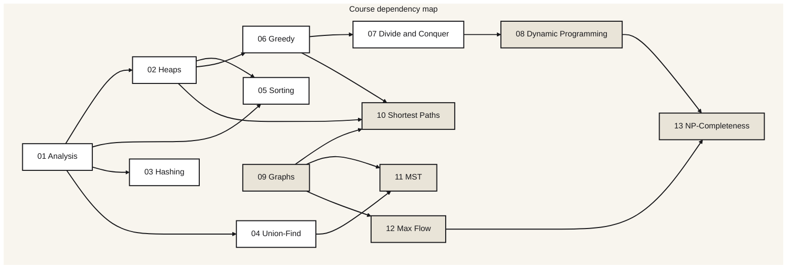
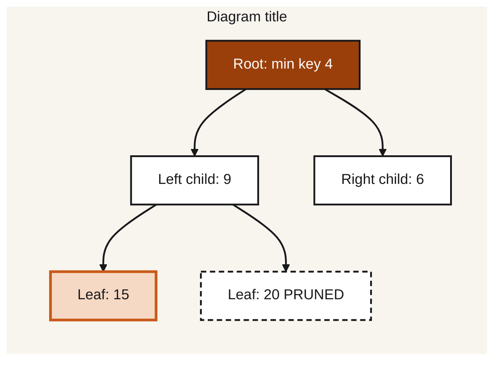

# Agent Instructions: Study Notes for Algorithms and Complexity (504)

This file is a complete, self-contained prompt. It produces two note sets: the **General set** (Final exam, all chapters, written to `Resources/Notes/`) and the **MidTerm set** (Midterm exam, chapters 1, 5, 6, 7, 8, 10, 11, written to `Resources/Notes/MidTerm/`). It is read in one of these ways (Section 10, the last section, resolves the task):

- **Mode A, standalone:** this file alone. Generate the General set, sections `00` to `13`.
- **Mode B, single section:** this file + the mindmap path + a section identifier (for example `Section 01`). Generate exactly one General note.
- **Mode C, midterm:** the word `midterm` (or `Πρόοδος`) + this file + optionally the mindmap path + optionally a section identifier. Generate MidTerm notes into `Resources/Notes/MidTerm/`: one note if a section is given, otherwise the whole MidTerm set, sections `00` to `07`.

A "section" always means the **complete subtree of that number in the mindmap**. Section `00` is the whole exam-scope block (reference book, Midterm list of 7 chapters, Final list of 13 chapters, all exclusions), not only its heading.

Target models: Gemini 4 Neon, DeepSeek V4.1 Flash, GLM-5.2, all at maximum reasoning effort. Apply Section 9 for model-specific behavior.

---

## 0. Hard Constraints (apply to everything below)

1. **No emojis**, anywhere: titles, text, tables, code comments, Mermaid labels. If an emoji is found in an existing file being edited, report it and remove it.
2. **Output language:** formal academic Greek. Every international technical term appears in English in backticks or parentheses at first use (for example *ταξινόμηση με συγχώνευση (`Merge-Sort`)*). Instructions in this file are in English; the produced notes are in Greek.
3. **Zero filler.** No "In this note we will see", no "Let us now examine", no closing pleasantries, no meta-commentary about the writing process. Every sentence is a definition, a derivation, a step, a comparison, or a warning.
4. **Direct and clear explanations.** One idea per sentence. Define a term before using it. State the rule first, then the reason, then an example.
5. **Math in LaTeX only.** Inline `$O(n \log n)$`, display `$$ ... $$` on its own lines. No Unicode math symbols in prose (write `$\sum$`, not the Unicode sigma sign). Do not put LaTeX inside Mermaid labels.
6. **No skipped steps in worked solutions.** Show the substitution into the formula, every intermediate table row, every intermediate state. Never jump to a final answer.
7. **Mermaid diagrams obey Section 6 exactly.** Copy the template. Never improvise colors.
8. **Code obeys Section 5.** Python only, with both the explicit algorithm and the Pythonic idiom when an idiom exists.
9. **Scope obeys the syllabus.** Excluded textbook sections are not taught (Section 2.3). Do not add topics from outside the mindmap.
10. **Never fabricate.** No invented page numbers, theorem numbers, past-exam questions, or statistics. If a fact cannot be confirmed from the mindmap, the lecture PDF, or standard textbook knowledge, omit it or mark it `Δεν επιβεβαιώνεται`.
11. **Git:** never run `git commit`, `git push`, `git sync`. Read-only git commands only.
12. **Verification:** if code execution is available, run every Python snippet and every numeric trace and fix mismatches before saving. If not available, re-derive each number by hand a second time. Never claim a verification that was not performed.

---

## 1. Course Context

- **Course:** Αλγόριθμοι και Πολυπλοκότητα (504), 5th semester, Department of Informatics and Telecommunications, University of Ioannina. Required course, 5 ECTS.
- **Textbook (the only exam source):** M. T. Goodrich and R. Tamassia, *Αλγόριθμοι: Σχεδίαση και Εφαρμογές* (Greek edition, Μ. Γκιούρδας). Algorithm names in the course follow the book (`arrayMax`, `MaxsubFastest`, `inPlaceQuickSort`, `UFConnectedComponents`). Reuse these names.
- **Exams:** a **Midterm** (Πρόοδος, 7 chapters: 1, 5, 6, 7, 8, 10, 11) and a cumulative **Final** (Τελική, all 13 chapters). The course is proof-and-trace oriented: students are asked to run an algorithm by hand, derive a complexity, prove a property, or choose a strategy and justify it.
- **Student goal of the notes:** pass the written exam. Therefore explicit algorithms, hand traces and justified complexities have priority over implementation detail. A Pythonic one-liner never replaces the explicit algorithm in an answer.

### 1.1 Source authority (highest first)

1. `Resources/Meta/mindmap.md` and `Resources/Meta/exam_syllabus.md`: what is in scope, the topic list, the formulas and traps already curated.
2. `Lectures/NN_*.pdf`: terminology, examples and the exact pseudocode taught in class. Read the PDFs of the section's lectures if file reading is possible; otherwise rely on source 1 and standard textbook knowledge.
3. Goodrich and Tamassia, and general algorithms knowledge, for proofs and extra worked examples.
4. Web search only to verify a numeric example or a proof step.

> **Known inconsistency.** `README.md` and `Lectures/README.md` in this directory describe a generic course (Strassen, Edmonds-Karp, Turing machines, Branch and Bound, TSP approximation, 3-SAT reductions, Hamiltonian cycle). That list does **not** match the lectures, the mindmap, or the exam syllabus. Ignore those README topic lists. The mindmap and the syllabus always win.

---

## 2. Section Map and Scope

### 2.1 Mapping of mindmap sections to files

The section number is the mindmap section, **not** the book chapter. Section `03` is book chapter 6.

| Section | Book chapter | Lectures (`Lectures/`) | Output file (`Resources/Notes/`) | Exam |
|---|---|---|---|---|
| 00 | Syllabus and exam structure | none | `00_course_map_and_exam_scope.md` | Both |
| 01 | Κεφ. 1 Analysis of Algorithms | `01_analysis_of_algorithms.pdf` | `01_analysis_of_algorithms.md` | Midterm and Final |
| 02 | Κεφ. 5 Priority Queues and Heaps | `02_priority_queues.pdf`, `03_heaps.pdf` | `02_priority_queues_heaps.md` | Midterm and Final |
| 03 | Κεφ. 6 Maps, Hash Tables, Cuckoo Hashing | `04_maps.pdf`, `05_hash_tables.pdf`, `06_cuckoo_hashing.pdf` | `03_maps_hash_tables_cuckoo.md` | Midterm and Final |
| 04 | Κεφ. 7 Union-Find | `07_union_find.pdf` | `04_union_find.md` | Midterm and Final |
| 05 | Κεφ. 8 Sorting and Lower Bound | `08_merge_sort.pdf`, `09_quick_sort.pdf`, `10_sorting_lower_bound.pdf` | `05_sorting_and_lower_bound.md` | Midterm and Final |
| 06 | Κεφ. 10 Greedy Method | `11_greedy_method.pdf` | `06_greedy_method.md` | Midterm and Final |
| 07 | Κεφ. 11 Divide and Conquer | `12_divide_and_conquer.pdf` | `07_divide_and_conquer.md` | Midterm and Final |
| 08 | Κεφ. 12 Dynamic Programming | `13_dynamic_programming_matrix_chain.pdf`, `14_telescope_scheduling.pdf`, `15_longest_common_subsequence.pdf`, `16_zero_one_knapsack.pdf` | `08_dynamic_programming.md` | Final only |
| 09 | Κεφ. 13 Graphs, DFS, BFS | `17_graph_terminology_and_representations.pdf`, `18_depth_first_search.pdf`, `19_breadth_first_search.pdf` | `09_graphs_dfs_bfs.md` | Final only |
| 10 | Κεφ. 14 Shortest Paths | `20_shortest_paths.pdf` | `10_shortest_paths.md` | Final only |
| 11 | Κεφ. 15 Minimum Spanning Trees | `21_minimum_spanning_trees.pdf` | `11_minimum_spanning_trees.md` | Final only |
| 12 | Κεφ. 16 Maximum Flow | `22_maximum_flow.pdf` | `12_maximum_flow.md` | Final only |
| 13 | Κεφ. 17 NP-Completeness | `23_np_completeness.pdf` | `13_np_completeness.md` | Final only |

The metadata block of every General note states the exam tag exactly as `Πρόοδος και Τελική` or `Μόνο Τελική`.

### 2.1.1 Note sets (the two lists, also recorded in the mindmap `*Notes*` block)

| Set | Directory | Sections | Exam tag in metadata |
|---|---|---|---|
| General (Final) | `Resources/Notes/` | `[00, 01, 02, 03, 04, 05, 06, 07, 08, 09, 10, 11, 12, 13]` | per table above |
| MidTerm | `Resources/Notes/MidTerm/` | `[00, 01, 02, 03, 04, 05, 06, 07]` | `Πρόοδος` |

- The MidTerm set uses **the same numbering and the same file names** as the General set (for example `Resources/Notes/MidTerm/05_sorting_and_lower_bound.md`). Sections `08` to `13` do not exist in the MidTerm set.
- Create `Resources/Notes/MidTerm/` if it does not exist.
- Midterm exclusions are identical to the Final ones for the same chapters (Section 2.3).

### 2.1.2 What differs in a MidTerm note

- The metadata block says `Εξεταστική κάλυψη: Πρόοδος`, and the `Εκτός ύλης` line lists only the exclusions of that chapter.
- Cross-links point only to files that exist in the MidTerm set (same folder, relative path, for example `[02_priority_queues_heaps.md](02_priority_queues_heaps.md)`). Never link to sections `08` to `13`.
- Forward references to Final-only topics are limited to **one line** in the form `Εφαρμογή στην Τελική: <topic>` (for example Union-Find in Kruskal, heaps in Dijkstra). Do not teach, trace, or exercise them.
- Worked exercises, strategy tables, comparison tables and diagrams use **only Midterm material**.
- Everything else (blueprint, depth, dual-form code, Mermaid standard, quality checklist) is identical to the General set. The MidTerm note is not a shortened version.
- The MidTerm `00` note: the Section 2.2 map is redrawn with only nodes `01` to `07`, the strategy chooser lists only Greedy and Divide and Conquer (plus the data-structure choices), the complexity cheat table lists only Midterm algorithms, and the Final-only chapters appear as a plain list under the heading `Εκτός Προόδου (μόνο Τελική)`.

### 2.2 Course map



Reading: white nodes are Midterm topics (also in the Final); sand nodes are Final-only topics. The colors are secondary to the numbers: the first seven sections are the Midterm.

### 2.3 Excluded material (never teach, never test)

When a section's topic touches an exclusion, add a one-line callout `> Εκτός ύλης: <topic>` in the relevant place and stop. Do not derive it.

| Chapter | Excluded |
|---|---|
| 1 | Section 1.4.1 |
| 5 | Section 5.5 |
| 6 | Linear-probing analysis with Chernoff bound (pp. 202-203), cuckoo hashing analysis (pp. 208-211, Lemma 6.1), Section 6.5 |
| 7 | Section 7.3.1 (Ackermann-function amortized analysis) |
| 10 | Formal analysis of Huffman coding (pp. 294-297). The algorithm itself is in scope. |
| 12 | Section 12.4 |
| 13 | Sections 13.4.3 and 13.5 |
| 14 | Section 14.5.2 |
| 16 | Sections 16.2.2, 16.3, 16.4, 16.5. Do not add Edmonds-Karp, Dinic or other max-flow variants. |
| 17 | Sections 17.3, 17.4, 17.5. Do not add NP-completeness reduction chains (3-SAT to Clique, etc.). |

---

## 3. Note Blueprint (mandatory structure of every note)

Every note uses exactly these headings, in this order, in Greek. Headings use the word "και" instead of an ampersand so that anchors stay simple. TOC anchors are the heading text lowercased, punctuation removed, spaces replaced by hyphens, Greek letters and accents kept unchanged.

````markdown
# NN — [Greek chapter title]
*[English subtitle in italics]*

[3 to 5 sentence introduction: the problem the chapter solves, what it depends on, what depends on it.]

> **Εξεταστική κάλυψη:** Πρόοδος και Τελική | Μόνο Τελική
> **Κεφάλαιο βιβλίου:** Κεφ. X | **Διαλέξεις:** `NN_name.pdf`, ...
> **Πηγή:** `Resources/Meta/mindmap.md` (Ενότητα NN)
> **Εκτός ύλης:** [list from Section 2.3, or "Καμία"]

## Πίνακας Περιεχομένων
[linked list of the seven headings below]

## 1. Εννοιολογικό Πλαίσιο και Συνολική Εικόνα
## 2. Θεωρητική Θεμελίωση και Τυπικοί Ορισμοί
## 3. Αλγόριθμοι, Ιχνηλάτηση και Κώδικας
## 4. Συγκριτική Ανάλυση και Πολυπλοκότητα
## 5. Πλήρως Λυμένες Ασκήσεις Εξεταστικού Επιπέδου
## 6. Οδηγός Επιβίωσης στις Εξετάσεις και Παγίδες
## 7. Συνοπτικός Πίνακας Εννοιών
````

Content of each heading:

1. **Εννοιολογικό Πλαίσιο:** the motivating problem with a concrete real-world case (the mindmap lists several, for example order books, routers, web crawlers, DNA alignment). One Mermaid overview diagram (Section 6) showing how the chapter's ideas connect. A short "when to use what" paragraph.
2. **Θεωρητική Θεμελίωση:** formal definitions, theorems with the **proof or proof sketch the mindmap lists** (for example heap height, bottom-up heap construction in $O(n)$, `log(n!)` lower bound, exchange argument for Fractional Knapsack, cycle and partition property for MST, max-flow min-cut). State each theorem in a bold line first, then the proof.
3. **Αλγόριθμοι, Ιχνηλάτηση και Κώδικας:** for each algorithm in this order: (a) one-sentence purpose, (b) textbook-style pseudocode in a `text` block, (c) a trace table on a small concrete input, (d) the Python implementation pair (Section 5), (e) the complexity derivation line by line.
4. **Συγκριτική Ανάλυση:** comparison tables of time, space, in-place or not, stable or not, worst or expected or amortized, and the selection rule "which structure or strategy for which situation". Write the complexity case explicitly (worst, expected, amortized): the exam penalizes an unlabeled $O(\cdot)$.
5. **Λυμένες Ασκήσεις:** at least **4** exercises (section 00 is exempt). Mandatory mix: one hand trace, one complexity derivation or recurrence, one proof or justification, one "choose the method and justify". Format per exercise: `Εκφώνηση`, `Στρατηγική`, `Λύση` (numbered steps), `Έλεγχος`. Difficulty equals or exceeds a university written exam. Inputs are small enough to trace fully (5 to 10 elements, 5 to 8 vertices).
6. **Οδηγός Επιβίωσης:** `Παγίδες` (each: the wrong belief, why it is wrong, the correct rule), `Σημεία SOS` (the 5 to 7 facts most likely to be asked), `Γρήγορη επανάληψη` (formulas in one block).
7. **Συνοπτικός Πίνακας:** `| Έννοια / Αλγόριθμος | Ορισμός ή τύπος | Πολυπλοκότητα ή κύρια ιδιότητα | Τι ζητά η εξέταση |`.

**Length rule:** completeness over line count. A chapter note is normally 600 to 1200 lines. If a mandatory item from Section 7 is missing, the note is incomplete regardless of length.

---

## 4. Explanation Standards (how to teach)

1. **Rule, reason, example.** For each property: state it, give the one-line reason, then a numeric example.
2. **Worst, expected, amortized, best are never interchangeable.** Name the case in every complexity statement.
3. **Always give the recurrence or the sum** behind a bound, then solve it. Example: `Merge-Sort` has $T(n) = 2T(n/2) + n$, so the recursion tree has $\log n$ levels of work $n$, giving $O(n \log n)$.
4. **Tie-breaking rule** is stated explicitly in every trace (for example "equal keys: alphabetical vertex order", "equal weights: lower edge label first") so the result is unique.
5. **Counter-examples** are mandatory when the mindmap warns that an approach fails (greedy on 0-1 Knapsack, Dijkstra with a negative edge, `n^2` is not `O(n)`, greedy by profit on Telescope Scheduling).
6. **Memory tricks** (at most 1 to 2 per note, short): for example "downheap swaps with the SMALLER child", "Dijkstra = Prim with distance from source instead of distance to cloud", "DP when greedy fails AND subproblems overlap".
7. **Cross-references** between notes use relative links (inside the MidTerm folder only to MidTerm files, Section 2.1.2): `[04_union_find.md](04_union_find.md)`. Kruskal references Union-Find; Dijkstra and Prim reference heaps; Max-Flow references BFS and DFS.
8. **Tables for facts, prose for reasons, code for procedures, diagrams for structure.** Do not duplicate the same content in two forms.

---

## 5. Code Standards: the Dual-Form Rule

Every algorithm that has a Python standard-library or built-in counterpart is presented **twice**, side by side: the explicit algorithm (what the exam expects) and the Pythonic idiom (what you would write at work), followed by a comparison of what the idiom hides.

### 5.1 Style rules for all Python in the notes

- Python 3.10+, type hints on every parameter and return value.
- **Functions in `camelCase`** (this also matches the textbook: `arrayMax`, `inPlaceQuickSort`). **Variables and class members in `snake_case`.** Classes in `PascalCase`.
- Every function has a Google-style docstring: a one-line summary, then `Args:` and `Returns:` (and `Raises:` when relevant), with types in parentheses.
- Single-line comments explain **why**, not what. Comment only the important or subtle lines.
- Prefer the standard library (`heapq`, `bisect`, `collections`, `itertools`, `functools`, `math`) over hand-rolled helpers when the helper is not the algorithm being taught.
- Each snippet is runnable and ends with a tiny check (`assert`) on a concrete input whose result matches the trace table in the note.

### 5.2 The canonical dual-form example (reproduce this pattern everywhere)

**Explicit algorithm (two-pointer swap, in place):**

```python
def reverseList(items: list[int]) -> list[int]:
    """Reverses a list in place using two converging pointers.

    Args:
        items (list[int]): The list to reverse. It is modified in place.

    Returns:
        list[int]: The same list object, now reversed.
    """
    left_index, right_index = 0, len(items) - 1
    while left_index < right_index:
        # Swapping symmetric pairs moves every element exactly once.
        items[left_index], items[right_index] = items[right_index], items[left_index]
        left_index += 1
        right_index -= 1
    return items


assert reverseList([1, 2, 3, 4]) == [4, 3, 2, 1]
```

**Pythonic idioms:**

```python
my_list = [1, 2, 3, 4]
new_list = my_list[::-1]          # new list, original untouched
my_list.reverse()                 # in place, returns None
lazy_iterator = reversed(my_list) # no copy, single pass
```

| Form | Time | Extra space | Modifies input | Note |
|---|---|---|---|---|
| `reverseList(items)` | $O(n)$ | $O(1)$ | yes | the algorithm the exam asks for |
| `my_list[::-1]` | $O(n)$ | $O(n)$ | no | allocates a full copy; same asymptotic time, different space |
| `my_list.reverse()` | $O(n)$ | $O(1)$ | yes | the built-in version of the two-pointer loop |
| `reversed(my_list)` | $O(1)$ to create | $O(1)$ | no | lazy iterator, cost is paid while iterating |

Key sentence to include in the same spirit: both forms are $\Theta(n)$ time; the slice hides an $O(n)$ allocation. The idiom is shorter, not cheaper.

### 5.3 Rules for the comparison after each pair

1. State the complexity **of the idiom**, including hidden costs and the cases where it differs from the course's model.
2. State when the exam expects which form: "write the explicit algorithm and its trace; the idiom is only a cross-check".
3. If **no** idiom exists (for example `LCS`, `0-1 Knapsack`, `Matrix Chain`, Floyd-Warshall), say so in one line. Do not invent a library function. `difflib` is not LCS.
4. Where the library differs from the course convention, call it out in a warning box. Mandatory ones: `heapq` is a **0-indexed min-heap** (children `2i+1`, `2i+2`) while the course uses a **1-indexed** array (children `2i`, `2i+1`); `heapq` has **no decrease-key**, so Dijkstra and Prim use lazy deletion; Python `dict` uses open addressing, not chaining; CPython `list` growth is amortized $O(1)$ for `append` but its growth factor is not exactly 2; `list.insert(0, x)` and `x in list` are $O(n)$; `sorted` and `list.sort` use Timsort (stable, $O(n \log n)$ worst case) and not the course's Quick-Sort.

### 5.4 Idiom bridges per topic (use these, add others where natural)

| Topic | Explicit (taught) | Idiom (cross-check) |
|---|---|---|
| Maximum of an array | `arrayMax` loop | `max(arr)` |
| Prefix sums | $S_t = S_{t-1} + A[t]$ loop | `list(itertools.accumulate(arr))` |
| Priority queue | array heap with `upheap`, `downheap` | `heapq.heappush`, `heappop`, `heapify` |
| Heap-Sort | build heap, then `removeMin` $n$ times | `[heapq.heappop(h) for _ in range(len(h))]` |
| Map ADT | hash table with probing | `dict` |
| Polynomial hash code | Horner's rule loop | `functools.reduce(lambda acc, ch: acc * 33 + ord(ch), word, 0)` |
| Sorting | `Merge-Sort`, `Quick-Sort` | `sorted(arr)`, `arr.sort(key=...)` |
| Frequency counting (Huffman) | dictionary loop | `collections.Counter` |
| Binary search | halving loop | `bisect.bisect_left` |
| Memoization | explicit memo dictionary | `functools.cache` |
| Queue for BFS | list with index | `collections.deque` |
| Connected components | `UFConnectedComponents` | `networkx.connected_components` (only if the library is allowed to be mentioned) |
| Max flow check | Ford-Fulkerson | `networkx.maximum_flow` (cross-check only) |
| Certificate check (NP) | polynomial verifier | brute force via `itertools.combinations` to show the exponential gap |

### 5.5 Pseudocode

Pseudocode follows the textbook style in a `text` block (`Algorithm name(args):`, `Input:`, `Output:`, indentation for structure, `←` is allowed inside `text` blocks only). Keep the textbook algorithm names.

---

## 6. Mermaid Standard (anti-invisible-text rules)

Source of the design rules: the project UI/UX principles file `Principles_of__UX_Motion_Coloring.md`. The applicable parts are: no emojis, 60-30-10 color split, WCAG contrast of at least 4.5:1 for text, never use color alone to convey meaning, generous whitespace, 5 to 7 items per chunk, consistent shapes. The palette is **Editorial Paper** (the documentation palette of that file).

Common failures this standard eliminates: text invisible because the default theme flips with light or dark mode; lines invisible on a dark page; node fill set without text color; edge labels unreadable.

### 6.1 Rules

1. **Flowchart only** (`flowchart TD` for trees and hierarchies, `flowchart LR` for pipelines). Do not use `sequenceDiagram`, `stateDiagram`, `classDiagram`, `erDiagram`, `mindmap`, `timeline`, `gantt`, `pie`, `xychart`. They cannot be wrapped in a fixed canvas, so their text and lines would depend on the viewer's theme. Use tables or `text` blocks for those needs.
2. **Always start with the exact `init` header** from the template (all `themeVariables` present).
3. **Always wrap the whole diagram in one `subgraph canvas[...]`** and style it with the cream surface. The canvas fixes the background under all lines and labels, so the diagram is readable on any page theme.
4. **Never set `fill` without `stroke` and `color`.** Every `classDef` and every `style` line sets all three. Use only the five classes in the template. Define `classDef default` so unclassified nodes are safe.
5. **Only these colors may appear:** `#F8F5EE` (canvas), `#18181B` (ink, lines, borders, text), `#FFFFFF` (node), `#E9E4D8` (muted node), `#9A3F0A` (focus fill, white text only), `#F6D9C4` (highlight fill), `#C85A17` (accent, used for strokes only, never for text). No other hex values, no named colors.
6. **Always** set `linkStyle default stroke:#18181B,stroke-width:2px`.
7. **Meaning never depends on color alone.** Pair every highlighted node with words (`START`, `PRUNED`, `CHOSEN`, `OUT OF SCOPE`, `FAIL`) in its label, and use the dashed class for excluded or failed items. Add a one-line legend below the diagram.
8. **Label hygiene:** every label in double quotes; no backticks, no LaTeX, no `#`, no `;`, no HTML tags; write complexity as plain text inside quotes (`"O(n log n)"`); ids are short ASCII alphanumerics and never the words `end`, `default`, `graph`, `subgraph`, `class`, `style`; always put a space on both sides of `-->`.
9. **Prefer text inside nodes over edge labels.** Edge labels only when they are 1 to 3 short words.
10. **Size:** at most 12 nodes per diagram, at most 7 nodes per level. Split larger structures into two diagrams.
11. **Every diagram is followed by** a one-line legend and a short explanation (or a table). A diagram is never the only carrier of a fact.
12. **Use a diagram only when structure is the point:** dependency maps, trees (heap, recursion tree, decision tree, BFS or DFS tree, Huffman tree, union-find forest), small graphs, flow networks, pipelines. Arrays, DP tables, hash tables and traces are Markdown tables or `text` blocks.

### 6.2 Node classes (copy verbatim)

| Class | Use | Fill | Stroke | Text | Contrast text/fill |
|---|---|---|---|---|---|
| `default`, `base` | ordinary node | `#FFFFFF` | `#18181B` | `#18181B` | 17.7 |
| `muted` | secondary or context node | `#E9E4D8` | `#18181B` | `#18181B` | 14.0 |
| `focus` | the single focal node or result | `#9A3F0A` | `#18181B` | `#FFFFFF` | 6.8 |
| `mark` | highlighted step or chosen path | `#F6D9C4` | `#C85A17` | `#18181B` | 13.2 |
| `skip` | excluded, pruned, failed (dashed) | `#FFFFFF` | `#18181B` | `#18181B` | 17.7 |

### 6.3 Template (copy, then edit only the content between the markers)



Legend line to write below it: `Σκούρο πορτοκαλί: ρίζα (focus). Διακεκομμένο περίγραμμα: κόμβος που παραλείπεται (PRUNED).`

### 6.4 Pre-save Mermaid checklist

- Header `%%{init: ...}%%` present and unmodified.
- Exactly one `subgraph canvas`, closed with `end`, followed by `style canvas`.
- All five `classDef` lines and `classDef default` present; `linkStyle default` present.
- Every node has text in double quotes; no forbidden characters; no emoji.
- No hex value outside the six allowed ones.
- Diagram has at most 12 nodes and a legend line plus explanation underneath.

---

## 7. Per-Section Requirements

For each section the note must contain **everything** in `Must cover`, the listed `Traces`, the listed `Code pairs`, and the `Traps`. Out-of-scope items are only a one-line callout.

### Section 00: `00_course_map_and_exam_scope.md` (both sets)
- **Must cover:** the full subtree of mindmap section `00` (reference book, Midterm list, Final list, exclusions), the 13-chapter map (reuse the Section 2.2 diagram), Midterm versus Final scope with exclusions (Section 2.3), the textbook, and a **strategy chooser** table: problem type, signal words, technique (Greedy when an exchange argument proves the local choice safe; Dynamic Programming when greedy fails and subproblems overlap; Divide and Conquer when subproblems are independent; Graph reduction when the problem is paths, spanning, flow or matching). A one-page complexity cheat table of every algorithm in the course with the case label (worst, expected, amortized). The seven growth functions ordered, with doubling effect.
- **Exercises:** not required; include a 10-row "which technique and why" self-test with answers.

### Section 01: `01_analysis_of_algorithms.md` (Midterm and Final)
- **Must cover:** algorithm versus data structure, scalability, best, average, worst case, experimental versus theoretical analysis, pseudocode, RAM model, primitive operations; step counting of `arrayMax` ($7n-2$ worst, $5n$ best, bounds $a(5n) \le T(n) \le b(7n-2)$); recurrence of `recursiveMax` ($T(1)=3$, $T(n)=T(n-1)+7$); the seven functions (constant, $\log n$, $n$, $n \log n$, $n^2$, $n^3$, $2^n$) with a growth table and doubling effects ($n^2$ x4, $n^3$ x8, $2^n$ squares); log-log slope; Big-Oh, Big-Omega, Big-Theta with formal definitions and **how to find $c$ and $n_0$**; Big-Oh rules (drop lower terms and constants, tightest class, simplest expression); `Maximum Subarray` with `MaxsubSlow` $O(n^3)$, `MaxsubFaster` with prefix sums $O(n^2)$, `MaxsubFastest` with $M_t = \max\{0, M_{t-1} + A[t]\}$ $O(n)$; amortized analysis of the extendable array: incremental (constant $c$, $T(n)=O(n^2)$, amortized $O(n)$), doubling ($T(n)=3n-1$, amortized $O(1)$), accounting method with 3 cyber-dollars per `add`.
- **Traces:** step count of `arrayMax` on a 5-element array; table of $c$ and $n_0$ search for $7n-2 = O(n)$ and $3n^2+5n+2=\Theta(n^2)$; `MaxsubFastest` table of $t$, $A[t]$, $M_t$, best so far on a 8-element array including negatives; doubling table of $n$, array size, copies made, cumulative cost.
- **Code pairs:** `arrayMax` and `max(arr)`; prefix sums loop and `itertools.accumulate`; `MaxsubSlow`, `MaxsubFaster`, `MaxsubFastest` (no idiom: say so); extendable array `add` with doubling and `list.append` (amortized $O(1)$ in CPython, growth factor not exactly 2).
- **Traps:** using loose bounds ($2n$ as $O(n^2)$); claiming $n^2 = O(n)$ (proof: $n \le c$ fails for every constant $c$); confusing amortized with average case (amortized has no probability); forgetting that Big-Oh is an upper bound only.
- **Callout:** Section 1.4.1 is out of scope.

### Section 02: `02_priority_queues_heaps.md` (Midterm and Final)
- **Must cover:** Priority Queue ADT with entries `(key, value)`; total order axioms (reflexive, antisymmetric, transitive, comparable); methods `insert`, `removeMin`, `min`, `size`, `isEmpty`; applications (stock order book with price then time priority, auctions, standby passengers); unsorted-list PQ gives `Selection-Sort` $O(n^2)$; sorted-list PQ gives `Insertion-Sort` $O(n^2)$, both in place; heap order property $\text{key}(v) \ge \text{key}(\text{parent}(v))$; complete binary tree, last node; **height theorem** $n \ge 2^h$ so $h \le \log n$ with proof; 1-indexed array representation (left $2i$, right $2i+1$, parent $\lfloor i/2 \rfloor$); `insert` with `upheap`, `removeMin` with `downheap`, each $O(\log n)$; `Heap-Sort` $O(n \log n)$ in place; **bottom-up construction in $O(n)$** with the phase argument ($\log n$ phases, paths "right then always left", each node on at most 2 paths) and its effect on `Heap-Sort` (phase 1 becomes $O(n)$, phase 2 stays $O(n \log n)$).
- **Traces:** heap array table after each of 7 inserts with each `upheap` swap listed; `removeMin` with every `downheap` swap (always the smaller child); bottom-up construction of a 15-key heap phase by phase; `Heap-Sort` first two extractions.
- **Code pairs:** class `ArrayHeap` with 1-indexed array, `upheap`, `downheap`, tested with `assert`; versus `heapq.heappush`, `heappop`, `heapify`. Mandatory warning box on the 0-indexed `heapq`.
- **Diagrams:** one Mermaid heap tree before and after an `upheap`; the array form as a table.
- **Traps:** swapping with the larger child; forgetting to restore the last node at the root in `removeMin`; saying bottom-up makes `Heap-Sort` $O(n)$ overall; confusing heap with binary search tree.
- **Callout:** Section 5.5 is out of scope.

### Section 03: `03_maps_hash_tables_cuckoo.md` (Midterm and Final)
- **Must cover:** Map ADT (`get`, `put`, `remove`, `size`, `isEmpty`, one value per key); unsorted doubly linked list implementation ($O(1)$ `put`, $O(n)$ `get` and `remove`); hash table of size $N$ with $h(x) = h_2(h_1(x))$; hash codes (memory address, integer cast, component sum, **polynomial accumulation** $p(z) = \sum a_i z^i$ with Horner's rule and $z=33$, tabulation hashing with collision probability $1/N$); compression (division with prime $N$, MAD $(ay+b) \bmod N$ with $a \bmod N \ne 0$); load factor $\alpha = n/N$; separate chaining; linear probing with `DEFUNCT` deletion and the expected probes $1/(1-\alpha)$, expected $O(1)$ for $\alpha \le 1/2$, worst $O(n)$, primary clustering; double hashing with $d(k) = q - (k \bmod q)$; **cuckoo hashing**: two tables $T_1$, $T_2$, size $N \ge 2n$, invariant "key is in `T1[h1(k)]` or `T2[h2(k)]`", worst-case $O(1)$ `get` and `remove`, amortized $O(1)$ `put`, eviction chain, cycle detection and rehash.
- **Traces:** insertion table for linear probing and for double hashing (table of $N$ prime, columns: key, hash, probe sequence, final slot); deletion with `DEFUNCT` followed by a `get`; Horner evaluation of a short word step by step; a cuckoo insertion with 3 evictions, then a rehash case.
- **Code pairs:** Horner loop hash code versus `functools.reduce`; `LinearProbingMap` class (`put`, `get`, `remove` with sentinel) versus `dict`. Warning box: `dict` is open addressing with perturbation, insertion-ordered since 3.7, and the built-in `hash()` of strings is randomized per process.
- **Diagrams:** cuckoo eviction chain as a small Mermaid flowchart (key moves between `T1` and `T2`); tables as Markdown.
- **Traps:** using composite $N$ with division compression; deleting from linear probing by emptying the cell; saying cuckoo `put` is worst-case $O(1)$; forgetting `DEFUNCT` must be skipped by `get` but reusable by `put`.
- **Callouts:** Chernoff-bound linear-probing analysis, cuckoo analysis (Lemma 6.1), Section 6.5.

### Section 04: `04_union_find.md` (Midterm and Final)
- **Must cover:** partition ADT (`makeSet`, `find`, `union`); applications (connected components `UFConnectedComponents`, maze generation `MazeGenerator`, percolation, cycle detection in Kruskal); list-based implementation (`find` $O(1)$, smaller-into-larger gives at most $\log n$ moves per element, $O(n \log n + m)$ total); tree-based implementation with parent pointers; **union by size** (height $O(\log n)$ with the doubling argument); **path compression**; combined bound $O((n+m)\alpha(n))$ with $\alpha(n) \le 4$ stated as a fact.
- **Traces:** table of parent array and size array after a sequence of 8 `union` operations; `find` with path compression showing the pointers before and after; a list-based run counting moves.
- **Code pairs:** class `UnionFind` with iterative `find` (path compression) and `union` by size; cross-check with `networkx.connected_components` or a simple DFS.
- **Diagrams:** forest before and after a `find` with compression, one Mermaid diagram each.
- **Traps:** linking the larger tree under the smaller; claiming $\alpha(n)$ is constant mathematically (it is at most 4 for practical $n$); mixing `union(A, B)` on elements instead of on roots.
- **Callout:** Section 7.3.1 (Ackermann) is out of scope.

### Section 05: `05_sorting_and_lower_bound.md` (Midterm and Final)
- **Must cover:** `Merge-Sort` (divide, recur, conquer by `merge` in $O(n)$; recursion tree height $O(\log n)$, $2^i$ sequences of size $n/2^i$, $O(n)$ per level, $O(n \log n)$; sequential access suits huge disk data; inverted index application); randomized `Quick-Sort` with three-way partition $L$ ($<x$), $E$ ($=x$), $G$ ($>x$); worst case $O(n^2)$; **expected $O(n \log n)$ argument** (good call when $|L|,|G| < 3s/4$ with probability $1/2$, expected height $2\log_{4/3} n$); in-place version with `inPlacePartition` two pointers; summary table of `Selection`, `Insertion`, `Heap`, `Quick`, `Merge` with size recommendations; **comparison-sort lower bound**: decision tree model, $n!$ leaves, height $\ge \log(n!) \ge (n/2)\log(n/2) = \Omega(n \log n)$ with every step of the inequality.
- **Traces:** `Merge-Sort` on 8 elements as a split table and a merge table; `Quick-Sort` partition into $L$, $E$, $G$ with a fixed pivot choice and the in-place two-pointer variant; decision tree for $n=3$ (6 leaves, height 3).
- **Code pairs:** `mergeSort` and `merge`; `quickSort` with list-comprehension partition and the in-place version; versus `sorted(arr)` and `arr.sort(key=...)`. Warning: Timsort is stable and $O(n \log n)$ worst case, unlike `Quick-Sort`.
- **Diagrams:** `Merge-Sort` recursion tree (Mermaid, 8 leaves is too large: use 4 elements or split into two diagrams); decision tree for $n=3$.
- **Traps:** stating that the lower bound applies to all sorting (it applies to comparison sorts only); forgetting quick-sort's bad-pivot case; confusing expected time with average input.
- **Scope:** the whole chapter is in scope.

### Section 06: `06_greedy_method.md` (Midterm and Final)
- **Must cover:** configurations and objective function; greedy-choice property plus optimal substructure; `Fractional Knapsack` (value density $v_i = b_i/w_i$, take $x_i = \min\{w_i, W - w\}$, $O(n \log n)$, **correctness by exchange argument** with quantity $y = \min\{w_i - x_i, x_j\}$, auction application) and why it **fails on 0-1 Knapsack** with a numeric counter-example; `Task Scheduling` (sort by start time, reuse a free machine or open a new one, $O(n \log n)$, correctness: if $k$ machines are used, task $i$ conflicts with $k-1$ others); `Huffman Coding` (prefix-free code, frequencies $f(c)$, priority queue, repeatedly merge the two lowest-frequency trees, $O(n + d \log d)$).
- **Traces:** Fractional Knapsack table sorted by density with remaining capacity per step; machine assignment table for 7 tasks; Huffman merge table (step, two smallest, new weight, queue) and the final code table, with the tree.
- **Code pairs:** `fractionalKnapsack` with `sorted(key=..., reverse=True)`; `scheduleTasks` with `heapq` of machine finish times; `buildHuffmanTree` with `collections.Counter` and `heapq`, with deterministic tie-breaking (counter as second tuple element) so output is reproducible.
- **Diagrams:** Huffman tree as Mermaid (`flowchart TD`, leaves labeled with character and code).
- **Traps:** applying greedy-by-density to 0-1 Knapsack; sorting by finish time instead of start time in `Task Scheduling` (the machine-minimization version uses start time); non-unique Huffman codes (lengths are unique in total, individual codes are not).
- **Callout:** the formal Huffman analysis (pp. 294-297) is out of scope.

### Section 07: `07_divide_and_conquer.md` (Midterm and Final)
- **Must cover:** divide, conquer, combine; four recurrence-solving techniques: **plug-and-chug** (expand until $2^i = n$), recursion tree (work per level plus leaves), **guess-and-test** (closed form plus induction proof), **Master Theorem** for $T(n) = aT(n/b) + f(n)$ with the three cases exactly as in the course (leaves dominate; balanced with $\log^k n$ giving $\Theta(n^{\log_b a}\log^{k+1} n)$; root dominates with the regularity condition $af(n/b) \le \delta f(n)$, $\delta<1$); the closed form $n^{\log_b a}T(1) + \sum_{i=0}^{\log_b n - 1} a^i f(n/b^i)$; `Karatsuba` integer multiplication ($4 \to 3$ multiplications, $T(n)=3T(n/2)+n$, $O(n^{\log_2 3}) \approx O(n^{1.585})$); `Maxima Set` ($T(n)=2T(n/2)+bn$, $O(n \log n)$, split at the median point).
- **Traces:** a Master Theorem decision table with columns `a`, `b`, `f(n)`, `log_b a`, comparison, case, result, over 8 recurrences (include $4T(n/2)+n$, $2T(n/2)+n\log n$, $T(n/2)+1$, $T(n/3)+n\log n$, $2T(n/2)+\log n$, $3T(n/2)+n$, one with case 3 where the regularity condition is checked, and one where the Master Theorem does not apply); a full plug-and-chug for $T(n)=2T(n/2)+n$; Karatsuba on a 4-digit by 4-digit multiplication; `Maxima Set` on 8 points.
- **Code pairs:** `karatsuba` (verify with `assert karatsuba(a, b) == a * b`); `findMaxima` (explicit); binary search loop versus `bisect.bisect_left`; `math.log(a, b)` to compute the critical exponent as a check.
- **Diagrams:** recursion tree with per-level work, as a Mermaid tree of at most 3 levels plus a table of per-level totals.
- **Traps:** applying case 2 when $f(n)$ is only polynomially (not by a log factor) larger; skipping the regularity check in case 3; using the Master Theorem when $a$ or $b$ is not constant or when the subproblems are unequal.
- **Scope:** the whole chapter is in scope.

### Section 08: `08_dynamic_programming.md` (Final only)
- **Must cover:** simple subproblems, optimal substructure, overlapping subproblems; memoization versus bottom-up; **Matrix Chain** ($A_i$ is $d_i \times d_{i+1}$, $N_{i,j} = \min_{i \le k < j}\{N_{i,k} + N_{k+1,j} + d_i d_{k+1} d_{j+1}\}$, $N_{i,i}=0$, filled by diagonals, $O(n^3)$ time, $O(n^2)$ space, parenthesization recovery from stored $k$; brute force is Catalan $\sim 4^n$, greedy fails); **Telescope Scheduling** (sort by finish time, predecessor $P[i]$ by binary search $O(n \log n)$, $B[i]=\max\{B[i-1], B[P[i]]+b_i\}$, $B[0]=0$, greedy-by-benefit fails); **LCS** (subsequence is not substring; recurrence with the two cases; $O(nm)$ time and space; reconstruction); **0-1 Knapsack** ($B[k,w]$ recurrence, $O(nW)$ is **pseudo-polynomial**, the two-array space optimization).
- **Traces:** Matrix Chain table for 4 matrices with the $k$ table and the final parenthesization; Telescope Scheduling table with $P[i]$ and $B[i]$ over 6 requests; LCS table for two short strings (length 6 and 5) with the backtracking path marked in the text; Knapsack table for 4 items and $W=8$ with the selected items recovered.
- **Code pairs:** each DP twice: top-down with `@functools.cache` and bottom-up with a table. Idiom line: none of the four problems has a standard-library equivalent (say so). Add an `assert` against brute force on small inputs (`itertools.combinations` for Knapsack and LCS).
- **Diagrams:** a Mermaid dependency diagram of one cell (which neighbors it reads) for LCS; the tables themselves in Markdown.
- **Traps:** treating $O(nW)$ as polynomial; off-by-one in the matrix-chain dimension array ($d$ has $n+1$ entries); using substring instead of subsequence; filling the table in an order that reads uncomputed cells.
- **Callout:** Section 12.4 is out of scope.

### Section 09: `09_graphs_dfs_bfs.md` (Final only)
- **Must cover:** $G=(V,E)$, $n=|V|$, $m=|E|$; directed and undirected edges, parallel edges, self-loops; endpoints, incident, adjacent, degree with $\sum_v \deg(v) = 2m$ and $m \le n(n-1)/2$; paths, cycles, free tree, forest, spanning subgraph, connected components; representation table (edge list, adjacency list, adjacency matrix) with the cost of each ADT method; `DFS` (discovery edges, **back edges**, $O(n+m)$, spanning tree of the component, `pathDFS`, `cycleDFS`); `BFS` (levels $L_0, L_1, \dots$, **cross edges**, a vertex in $L_i$ is at distance $i$ edges from $s$); comparison: only `BFS` finds shortest paths in edges, only `DFS` finds biconnected components (stated, not derived).
- **Traces:** DFS table (step, current vertex, stack or recursion, edge labeled `DISCOVERY` or `BACK`) on a 7-vertex graph with a fixed alphabetical neighbor order; BFS table (level, queue, edge labeled `DISCOVERY` or `CROSS`) on the same graph; representation comparison on the same graph (edge list, adjacency list, adjacency matrix).
- **Code pairs:** `dfs` recursive and iterative with explicit stack; `bfs` with `collections.deque`; adjacency as `dict[str, list[str]]`. Warning: recursion depth limit (1000) in Python and the iterative fix; `list.pop(0)` is $O(n)$, so `deque.popleft` is used for BFS.
- **Diagrams:** the example graph and the resulting DFS tree and BFS tree, three Mermaid diagrams, with edge types stated in text.
- **Traps:** expecting cross edges in an undirected DFS (in an undirected graph DFS non-tree edges are all back edges, while BFS non-tree edges are all cross edges); choosing the adjacency matrix for sparse graphs; forgetting the neighbor-order tie-break.
- **Callouts:** Sections 13.4.3 and 13.5 are out of scope.

### Section 10: `10_shortest_paths.md` (Final only)
- **Must cover:** weighted graph, path length, subpath optimality, shortest-path tree; **edge relaxation** $D[z] \leftarrow \min\{D[z], D[u]+\text{weight}(e)\}$; **Dijkstra** (greedy cloud growth, non-negative weights, $O((n+m)\log n)$ with a heap; failure with a negative edge shown by a counter-example); **Bellman-Ford** (iteration $i$ finds shortest paths with at most $i$ edges, $O(nm)$, negative-cycle detection by a relaxable edge after $n-1$ rounds); **DAG shortest paths** (topological order, $O(n+m)$, negative weights allowed); **Floyd-Warshall** ($D_k[i,j]=\min\{D_{k-1}[i,j], D_{k-1}[i,k]+D_{k-1}[k,j]\}$, $O(n^3)$, comparison against $n$ runs of Dijkstra and Bellman-Ford).
- **Traces:** Dijkstra table (step, extracted vertex, $D$ vector, heap) on a 6-vertex graph; Bellman-Ford round table $D^{(0)}, \dots, D^{(n-1)}$ on a graph with a negative edge and one run that reveals a negative cycle; DAG order table; Floyd-Warshall matrices $D_0, D_1, D_2, \dots$ for a 4-vertex graph.
- **Code pairs:** `dijkstra` with `heapq` and lazy deletion (explain that the textbook uses a locator-based adaptable heap with decrease-key and that the lazy variant keeps $O(m \log n)$); `bellmanFord` returning a flag for a negative cycle; `dagShortestPaths` using `graphlib.TopologicalSorter` as an idiom; `floydWarshall` triple loop (no idiom).
- **Diagrams:** the example weighted graph and its shortest-path tree (Mermaid, weights written inside the edge label as a plain number).
- **Traps:** using Dijkstra with a negative edge; thinking Bellman-Ford needs $n$ rounds to converge (it needs $n-1$; the $n$-th round detects cycles); confusing Dijkstra with Prim (different key: distance from source versus lightest edge to the cloud).
- **Callout:** Section 14.5.2 is out of scope.

### Section 11: `11_minimum_spanning_trees.md` (Final only)
- **Must cover:** MST definition; **cycle property** (for $e \notin T$, every edge $f$ on the cycle satisfies $\text{weight}(f) \le \text{weight}(e)$, proof by contradiction); **partition property** (a lightest edge across a cut belongs to some MST); `Prim-Jarnik` (grow one cloud from $s$, label $d(v)$, $O((n+m)\log n)$); `Kruskal` (clusters, edges by increasing weight, accept if it joins two clusters, heap plus Union-Find, $O((n+m)\log n)$, and $O(m\alpha(n))$ for pre-sorted edges, Theorem 15.5); `Borůvka` (every component picks its lightest outgoing edge, components at least halve, $O(\log n)$ phases, $O(m\log n)$).
- **Traces:** Kruskal table (sorted edges, accept or reject with reason, cluster state) and Prim table (step, vertex added, key vector) on the **same** 7-vertex graph, showing both give the same total weight; Borůvka phases on the same graph. Tie-break rule stated (equal weights: lexicographic edge label).
- **Code pairs:** `kruskal` using `UnionFind` from [04_union_find.md](04_union_find.md); `prim` with `heapq` and lazy deletion; cross-check with `networkx.minimum_spanning_tree` only as a mention.
- **Diagrams:** the example graph and the final MST, with chosen edges named in node text or listed in a table.
- **Traps:** assuming the MST is unique when weights repeat (total weight is unique, the tree may not be); rejecting an edge because its endpoints are already in the tree instead of "in the same cluster"; confusing the cycle and partition properties.
- **Scope:** the whole chapter is in scope.

### Section 12: `12_maximum_flow.md` (Final only)
- **Must cover:** flow network $N=(G,c,s,t)$, integer capacities, source without incoming edges, sink without outgoing edges; capacity rule $0 \le f(e) \le c(e)$ and conservation rule; flow value $|f|$; cut $\chi=(V_s,V_t)$, $f(\chi)=|f|$, capacity $c(\chi)$, bound $|f| \le c(\chi)$; **Ford-Fulkerson** (start with zero flow, augmenting path found by DFS or BFS in the residual graph, residual forward $\Delta_f(u,v)=c(e)-f(e)$, backward $\Delta_f(v,u)=f(e)$, augment by the bottleneck $\Delta_f(\pi)$); **Max-Flow Min-Cut theorem** (terminate when no augmenting path exists; the reachable set from $s$ gives the min cut with $c(\chi)=|f|$); complexity $O(|f^*|(n+m))$ and the example where alternating paths force $|f^*|$ augmentations; reductions: **Maximum Bipartite Matching** (add $s$ and $t$, unit capacities, $e \in M \iff f(e)=1$, $O(nm)$) and **Baseball Elimination** (game nodes, team nodes, capacities $g_{i,j}$, $+\infty$, $W - w_i$, network of size $O(n^2)$).
- **Traces:** table per augmentation (path, bottleneck, flow value so far) on a 6-vertex network with at least one **backward edge** use; the final residual graph, the reachable set, and the min cut with its capacity equal to $|f|$; a bipartite matching of 4 plus 4 vertices reduced and solved.
- **Code pairs:** `fordFulkerson` with BFS path search over a residual capacity `dict`; verification against `networkx.maximum_flow_value` as a cross-check mention; matching reduction function `maxBipartiteMatching`.
- **Diagrams:** the network with edges written as `flow/capacity` inside the edge label; the residual graph in a separate diagram or table.
- **Traps:** forgetting backward residual edges; computing the cut capacity using edges from $V_t$ to $V_s$; treating `Ford-Fulkerson` as polynomial (it is pseudo-polynomial in $|f^*|$).
- **Callouts:** Sections 16.2.2, 16.3, 16.4, 16.5 are out of scope.

### Section 13: `13_np_completeness.md` (Final only)
- **Must cover:** input size $n$ as the number of bits of a non-unary encoding (why $O(nW)$ for `0-1 Knapsack` is pseudo-polynomial); decision problems and languages $L$; class `P`; class `NP` with **both equivalent definitions** (non-deterministic polynomial time with `choose(b)`; deterministic polynomial-time **verifier** $B(x,y)$ with certificate $y$); $P \subseteq NP$ and the open question $P = NP$; polynomial reduction $x \in M \iff x' \in L$; `NP-hard`; `NP-complete` ($L \in NP$ and $L$ is `NP-hard`); consequence: one polynomial algorithm for an NP-complete problem gives $P=NP$; **Cook-Levin theorem** with the sketch for `CIRCUIT-SAT` (in `NP`: guess inputs and gate outputs, check gates; `NP-hard`: simulate $p(n)$ steps of a verifier as a circuit of size $O(p(n)^2)$ per step, total $O(p(n)^3)$).
- **Traces:** a verifier trace for a certificate (for example a subset-sum certificate, a satisfying assignment of a small CNF formula, or a Hamiltonian-path certificate) showing the polynomial check line by line; a reduction template table `x -> f(x) -> yes/no preserved`.
- **Code pairs:** `verifySubsetSum(numbers, certificate, target)` in $O(n)$ versus brute-force `findSubsetSum` using `itertools.combinations` in $O(2^n)$, printing the time growth for $n=10, 15, 20$ to show the verify-versus-find gap; `evaluateCircuit` for a tiny Boolean circuit.
- **Diagrams:** the Venn-style relation between `P`, `NP`, `NP-complete` as a Mermaid flowchart of containment (use words: "P is contained in NP"; do not draw the unproven case `P = NP`); a small Boolean circuit for `CIRCUIT-SAT`.
- **Traps:** "NP means not polynomial" (it means non-deterministic polynomial); proving NP-hardness by reducing **from** the new problem instead of **to** it (direction: known NP-hard problem reduces to the new one); treating pseudo-polynomial as polynomial.
- **Callouts:** Sections 17.3, 17.4, 17.5 are out of scope: no NP-completeness proof chains, no list of classic NP-complete problems beyond a single-line mention.

---

## 8. Final Quality Checklist (run before saving each note)

1. Heading structure, metadata block, and TOC match Section 3 exactly. Anchors resolve.
2. Every item in the section's `Must cover`, `Traces`, `Code pairs`, `Traps` appears. Excluded topics are one-line callouts only.
3. At least 4 exercises (except section 00) with the four mandatory types, each with full intermediate steps and an `Έλεγχος` line.
4. Every algorithm has pseudocode, a trace on a concrete input, complexity with the case named, and a dual-form code pair or an explicit "no idiom exists" line.
5. Every Python snippet follows Section 5.1 (camelCase functions, snake_case variables, Google docstring, why-comments, `assert` check). Numbers in the code checks match the trace tables.
6. Every Mermaid diagram passes the Section 6.4 checklist and has a legend and an explanation.
7. No emoji. No filler. No Unicode math in prose. All math in LaTeX.
8. No fabricated page numbers, theorems, or exam claims.
9. Cross-links to other notes use relative paths and point to existing filenames from Section 2.1. In the MidTerm set they point only to MidTerm files.
10. MidTerm set only: tag is `Πρόοδος`, no Final-only content beyond one-line `Εφαρμογή στην Τελική` references, output directory is `Resources/Notes/MidTerm/`.

---

## 9. Model-Specific Behavior (all at maximum reasoning effort)

Common: reasoning effort is already at maximum. Do not narrate reasoning in the output file. Do not write "step by step" scaffolding phrases in the notes; the steps are the content. Use the thinking budget to **verify numbers, traces, and proofs**, not to restate the instructions. Write one note at a time and save it before starting the next. Allow a large output budget for each note (it is long by design).

- **Gemini 4 Neon:** by default it is concise. This task requires the full length demanded by Section 3 and Section 7; do not compress traces or skip exercises. Constraints are at the top of this file and the task is resolved at the end (Section 10), which matches how it reads long context.
- **DeepSeek V4.1 Flash:** keep the hard constraints in Section 0 active; the expansive reasoning can over-engineer. Do not add topics beyond the syllabus, do not add extra libraries, do not add extra diagram types. Reserve a generous output token ceiling so the final text is never truncated mid-table.
- **GLM-5.2:** constraints come first (Section 0) and are weighted heavily; the stop condition is Section 8. Skip persona framing. Verify each of the Section 8 items explicitly against the produced file before finishing.

---

## 10. Task Resolution (read last)

Determine the mode from what accompanies this file. Paths are relative to this course directory (`ALGORITHMS_AND_COMPLEXITY/`). The default mindmap path is `Resources/Meta/mindmap.md`.

**Step 1, choose the set.** If the request contains `midterm` (any letter case) or `Πρόοδος`, the set is **MidTerm** (output directory `Resources/Notes/MidTerm/`, allowed sections `00` to `07`). Otherwise the set is **General** (output directory `Resources/Notes/`, sections `00` to `13`).

**Step 2, choose the sections.**
- A section identifier is present (`Section 01`, `01`, `Ενότητα 01`): that single section. It is the **mindmap section number**, not the book chapter. If the set is MidTerm and the number is above `07`, write nothing and reply that the section is not part of the Midterm.
- No identifier: all sections of the set, in order.

**Step 3, read.** Read the mindmap at the given path (or the default): the full subtree of each requested section, plus section `00` for scope and the `*Notes*` block at the bottom for the two note lists and the strategy guidance. Read the section's lecture PDFs if possible.

**Step 4, write.** For each requested section, in order, produce exactly one file named per the Section 2.1 table in the output directory of the chosen set, following Sections 2.1.2 (MidTerm only), 3 to 8, and the section's entry in Section 7. Create the `MidTerm` directory if needed. Save each note before starting the next. Overwrite an existing file when a single section was requested. When several sections were requested, skip a file that already exists and is complete under Section 8, and list it as skipped. Do not create or modify any other file.

**Reply format.** When finished, reply in at most 6 lines: the set and directory used, files written, files skipped, Section 2.3 callouts added, emojis found and removed, and any item that could not be verified. Do not summarize the content of the notes.
