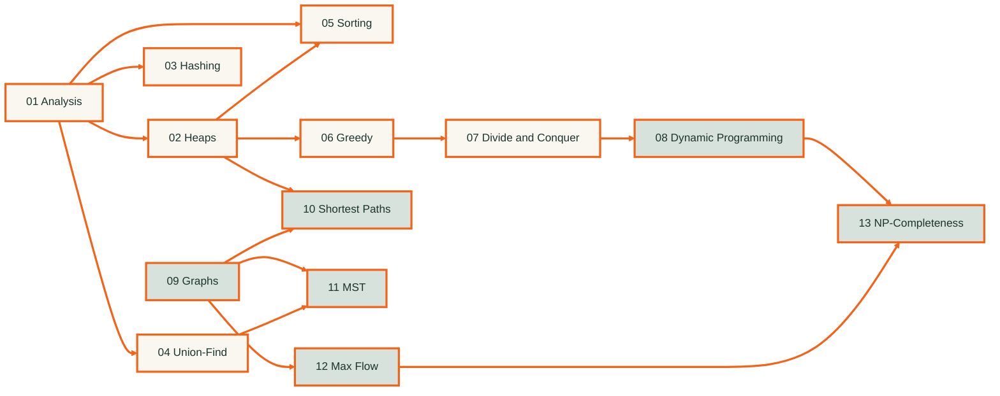

# 00 — Χάρτης Μαθήματος και Εξεταστέα Ύλη
*Course Map, Exam Scope, Strategy Chooser and Complexity Reference*

Η παρούσα ενότητα ορίζει το πλήρες πλαίσιο του μαθήματος Αλγόριθμοι και Πολυπλοκότητα (504), διαχωρίζοντας την εξεταστέα ύλη της Προόδου από τη σωρευτική ύλη της Τελικής Εξέτασης και καταγράφοντας ρητά όλες τις εξαιρέσεις από το σύγγραμμα αναφοράς. Αποτελεί τη μετα-ενότητα αναφοράς από την οποία εξαρτάται η οργάνωση μελέτης όλων των κεφαλαίων `01` έως `13`. Παρέχει τον χάρτη εξαρτήσεων των 13 κεφαλαίων, τον οδηγό επιλογής αλγοριθμικής στρατηγικής, τις επτά βασικές συναρτήσεις αύξησης και τον συγκεντρωτικό πίνακα πολυπλοκοτήτων με ρητή αναφορά της εκάστοτε περίπτωσης ανάλυσης.

> **Εξεταστική κάλυψη:** Πρόοδος και Τελική
> **Κεφάλαιο βιβλίου:** Σύνολο ύλης (`Κεφ. 1`, `5`–`8`, `10`–`17`) | **Διαλέξεις:** Καμία (μετα-ενότητα αναφοράς)
> **Πηγή:** `Resources/Meta/mindmap.md` (Ενότητα 00) και `Resources/Meta/exam_syllabus.md`
> **Εκτός ύλης:** `1.4.1`, `5.5`, σελ. 202–203 (Chernoff), σελ. 208–211 (Λήμμα 6.1), `6.5`, `7.3.1`, σελ. 294–297 (ανάλυση Huffman), `12.4`, `13.4.3`, `13.5`, `14.5.2`, `16.2.2`, `16.3`–`16.5`, `17.3`–`17.5`

## Πίνακας Περιεχομένων

- [1. Εννοιολογικό Πλαίσιο και Συνολική Εικόνα](#1-εννοιολογικό-πλαίσιο-και-συνολική-εικόνα)
- [2. Θεωρητική Θεμελίωση και Τυπικοί Ορισμοί](#2-θεωρητική-θεμελίωση-και-τυπικοί-ορισμοί)
- [3. Αλγόριθμοι, Ιχνηλάτηση και Κώδικας](#3-αλγόριθμοι-ιχνηλάτηση-και-κώδικας)
- [4. Συγκριτική Ανάλυση και Πολυπλοκότητα](#4-συγκριτική-ανάλυση-και-πολυπλοκότητα)
- [5. Πλήρως Λυμένες Ασκήσεις Εξεταστικού Επιπέδου](#5-πλήρως-λυμένες-ασκήσεις-εξεταστικού-επιπέδου)
- [6. Οδηγός Επιβίωσης στις Εξετάσεις και Παγίδες](#6-οδηγός-επιβίωσης-στις-εξετάσεις-και-παγίδες)
- [7. Συνοπτικός Πίνακας Εννοιών](#7-συνοπτικός-πίνακας-εννοιών)

---

## 1. Εννοιολογικό Πλαίσιο και Συνολική Εικόνα

### Ταυτότητα Μαθήματος και Σύγγραμμα Αναφοράς

- **Μάθημα:** Αλγόριθμοι και Πολυπλοκότητα (κωδικός 504), 5ο εξάμηνο, Τμήμα Πληροφορικής και Τηλεπικοινωνιών, Πανεπιστήμιο Ιωαννίνων. Υποχρεωτικό μάθημα, 5 ECTS.
- **Σύγγραμμα αναφοράς (μοναδική εξεταστική πηγή):** M. T. Goodrich και R. Tamassia, *Αλγόριθμοι: Σχεδίαση και Εφαρμογές* (ελληνική έκδοση, εκδόσεις Μ. Γκιούρδας). Η ονοματολογία των αλγορίθμων (`arrayMax`, `MaxsubFastest`, `inPlaceQuickSort`, `UFConnectedComponents`) ακολουθεί το σύγγραμμα.
- **Δομή αξιολόγησης:** Γραπτή **Πρόοδος (`Midterm`)** σε 7 κεφάλαια (`Κεφ. 1, 5, 6, 7, 8, 10, 11`) και σωρευτική γραπτή **Τελική Εξέταση (`Final`)** και στα 13 κεφάλαια. Οι εξετάσεις εστιάζουν σε χειρόγραφες ιχνηλατήσεις (`hand traces`), εξαγωγή και επίλυση αναδρομικών εξισώσεων, αποδείξεις ορθότητας και τεκμηριωμένη επιλογή αλγοριθμικής στρατηγικής.

### Χάρτης Εξαρτήσεων 13 Κεφαλαίων



Κρεμ κόμβοι (`01`–`07`): ενότητες Προόδου (εξετάζονται και στην Τελική). Απαλό πράσινο (`08`–`13`): ενότητες μόνο Τελικής Εξέτασης.

Η Ενότητα `01` θεμελιώνει την ασυμπτωτική και επιμερισμένη ανάλυση για όλες τις επόμενες δομές και αλγορίθμους. Οι δυαδικοί σωροί (`02`) τροφοδοτούν την ταξινόμηση σωρού (`05`), την κωδικοποίηση Huffman (`06`), τον αλγόριθμο `Dijkstra` (`10`) και τον αλγόριθμο `Prim-Jarnik` (`11`). Οι δομές `Union-Find` (`04`) αποτελούν τον μηχανισμό ανίχνευσης κύκλων στον αλγόριθμο `Kruskal` (`11`). Οι διασχίσεις `DFS` και `BFS` (`09`) αποτελούν τη βάση για τις συντομότερες διαδρομές (`10`), τα δέντρα επικάλυψης ελαχίστου κόστους (`11`) και τις επαυξημένες διαδρομές στη μέγιστη ροή (`12`). Ο ψεύδο-πολυωνυμικός χρόνος του `0-1 Knapsack` (`08`) και της μέγιστης ροής (`12`) συνδέεται άμεσα με τη διάκριση πολυωνυμικού και ψεύδο-πολυωνυμικού χρόνου στη θεωρία `NP`-πληρότητας (`13`).

### Αντιστοίχιση Ενοτήτων, Κεφαλαίων, Διαλέξεων και Σημειώσεων

Ο αριθμός ενότητας (`00`–`13`) ακολουθεί τη δομή του `mindmap.md` και διαφέρει από την αρίθμηση κεφαλαίων του βιβλίου.

| Ενότητα | Κεφάλαιο Βιβλίου | Διαλέξεις (`Lectures/`) | Αρχείο Σημειώσεων (`Resources/Notes/`) | Εξεταστική Κάλυψη |
|---|---|---|---|---|
| `00` | Σύνολο ύλης και δομή εξετάσεων | Καμία | `00_course_map_and_exam_scope.md` | Πρόοδος και Τελική |
| `01` | `Κεφ. 1` Ανάλυση Αλγορίθμων | `01_analysis_of_algorithms.pdf` | [01_analysis_of_algorithms.md](01_analysis_of_algorithms.md) | Πρόοδος και Τελική |
| `02` | `Κεφ. 5` Ουρές Προτεραιότητας και Σωροί | `02_priority_queues.pdf`, `03_heaps.pdf` | [02_priority_queues_heaps.md](02_priority_queues_heaps.md) | Πρόοδος και Τελική |
| `03` | `Κεφ. 6` Πίνακες Αντιστοίχισης, Κατακερματισμός, Κούκος | `04_maps.pdf`, `05_hash_tables.pdf`, `06_cuckoo_hashing.pdf` | [03_maps_hash_tables_cuckoo.md](03_maps_hash_tables_cuckoo.md) | Πρόοδος και Τελική |
| `04` | `Κεφ. 7` Δομές Ένωσης-Εύρεσης (`Union-Find`) | `07_union_find.pdf` | [04_union_find.md](04_union_find.md) | Πρόοδος και Τελική |
| `05` | `Κεφ. 8` Ταξινόμηση και Κάτω Όριο Συγκρίσεων | `08_merge_sort.pdf`, `09_quick_sort.pdf`, `10_sorting_lower_bound.pdf` | [05_sorting_and_lower_bound.md](05_sorting_and_lower_bound.md) | Πρόοδος και Τελική |
| `06` | `Κεφ. 10` Η Άπληστη Μέθοδος (`Greedy Method`) | `11_greedy_method.pdf` | [06_greedy_method.md](06_greedy_method.md) | Πρόοδος και Τελική |
| `07` | `Κεφ. 11` Διαίρει και Βασίλευε (`Divide & Conquer`) | `12_divide_and_conquer.pdf` | [07_divide_and_conquer.md](07_divide_and_conquer.md) | Πρόοδος και Τελική |
| `08` | `Κεφ. 12` Δυναμικός Προγραμματισμός (`Dynamic Programming`) | `13_dynamic_programming_matrix_chain.pdf`, `14_telescope_scheduling.pdf`, `15_longest_common_subsequence.pdf`, `16_zero_one_knapsack.pdf` | [08_dynamic_programming.md](08_dynamic_programming.md) | Μόνο Τελική |
| `09` | `Κεφ. 13` Γράφοι, `DFS` και `BFS` | `17_graph_terminology_and_representations.pdf`, `18_depth_first_search.pdf`, `19_breadth_first_search.pdf` | [09_graphs_dfs_bfs.md](09_graphs_dfs_bfs.md) | Μόνο Τελική |
| `10` | `Κεφ. 14` Συντομότερες Διαδρομές (`Shortest Paths`) | `20_shortest_paths.pdf` | [10_shortest_paths.md](10_shortest_paths.md) | Μόνο Τελική |
| `11` | `Κεφ. 15` Δέντρα Επικάλυψης Ελαχίστου Κόστους (`MST`) | `21_minimum_spanning_trees.pdf` | [11_minimum_spanning_trees.md](11_minimum_spanning_trees.md) | Μόνο Τελική |
| `12` | `Κεφ. 16` Μέγιστη Ροή (`Maximum Flow`) | `22_maximum_flow.pdf` | [12_maximum_flow.md](12_maximum_flow.md) | Μόνο Τελική |
| `13` | `Κεφ. 17` `NP`-Πληρότητα (`NP-Completeness`) | `23_np_completeness.pdf` | [13_np_completeness.md](13_np_completeness.md) | Μόνο Τελική |

### Προσανατολισμός Προόδου έναντι Τελικής Εξέτασης

Η **Πρόοδος** (`Κεφ. 1, 5, 6, 7, 8, 10, 11`) εστιάζει στην ασυμπτωτική και επιμερισμένη ανάλυση, στις θεμελιώδεις δομές δεδομένων (σωροί, πίνακες κατακερματισμού, `Union-Find`), στην ταξινόμηση και το κάτω όριο συγκρίσεων, στις άπληστες αποδείξεις ορθότητας και στην επίλυση αναδρομικών εξισώσεων (`Master Theorem`). Η **Τελική Εξέταση** είναι σωρευτική και προσθέτει Δυναμικό Προγραμματισμό (`Κεφ. 12`), Αλγορίθμους Γράφων (`Κεφ. 13`–`16`) και Θεωρία Πολυπλοκότητας (`Κεφ. 17`).

---

## 2. Θεωρητική Θεμελίωση και Τυπικοί Ορισμοί

### 2.1 Πλήρης Εξεταστέα Ύλη Προόδου (7 Κεφάλαια)

1. **`Κεφ. 1` — Ανάλυση Αλγορίθμων** (Διάλεξη `01`): εντός ύλης εκτός από την Ενότητα `1.4.1`.
2. **`Κεφ. 5` — Ουρές Προτεραιότητας και Σωροί** (Διαλέξεις `02`–`03`): εντός ύλης εκτός από την Ενότητα `5.5`.
3. **`Κεφ. 6` — Πίνακες Κατακερματισμού και Κατακερματισμός Κούκου** (Διαλέξεις `04`–`06`): εντός ύλης εκτός από την Ανάλυση Γραμμικής Αναζήτησης (σελ. 202–203), την Ανάλυση Κατακερματισμού Κούκου (σελ. 208–211) και την Ενότητα `6.5`.
4. **`Κεφ. 7` — Δομές Ένωσης-Εύρεσης** (Διάλεξη `07`): εντός ύλης εκτός από την Ενότητα `7.3.1`.
5. **`Κεφ. 8` — Ταξινόμηση και Κάτω Όριο** (Διαλέξεις `08`–`10`): ολόκληρο το κεφάλαιο εντός ύλης.
6. **`Κεφ. 10` — Η Άπληστη Μέθοδος** (Διάλεξη `11`): εντός ύλης εκτός από την Ανάλυση του Αλγορίθμου Κωδικοποίησης Huffman (σελ. 294–297). Ο ίδιος ο αλγόριθμος Huffman είναι εντός ύλης.
7. **`Κεφ. 11` — Διαίρει και Βασίλευε** (Διάλεξη `12`): ολόκληρο το κεφάλαιο εντός ύλης.

### 2.2 Πλήρης Εξεταστέα Ύλη Τελικής Εξέτασης (13 Κεφάλαια)

Η Τελική Εξέταση περιλαμβάνει και τα 7 κεφάλαια της Προόδου με τις ίδιες ακριβώς εξαιρέσεις, συν τα ακόλουθα 6 κεφάλαια:

8. **`Κεφ. 12` — Δυναμικός Προγραμματισμός** (Διαλέξεις `13`–`16`): εντός ύλης εκτός από την Ενότητα `12.4`.
9. **`Κεφ. 13` — Γράφοι, `DFS` και `BFS`** (Διαλέξεις `17`–`19`): εντός ύλης εκτός από τις Ενότητες `13.4.3` και `13.5`.
10. **`Κεφ. 14` — Συντομότερες Διαδρομές** (Διάλεξη `20`): εντός ύλης εκτός από την Ενότητα `14.5.2`.
11. **`Κεφ. 15` — Δέντρα Επικάλυψης Ελαχίστου Κόστους** (Διάλεξη `21`): ολόκληρο το κεφάλαιο εντός ύλης.
12. **`Κεφ. 16` — Μέγιστη Ροή** (Διάλεξη `22`): εντός ύλης εκτός από τις Ενότητες `16.2.2`, `16.3`, `16.4` και `16.5`.
13. **`Κεφ. 17` — `NP`-Πληρότητα** (Διάλεξη `23`): εντός ύλης εκτός από τις Ενότητες `17.3`, `17.4` και `17.5`.

### 2.3 Πίνακας Εξαιρέσεων Ύλης

| Κεφάλαιο Βιβλίου | Κατάσταση | Εκτός Ύλης (δεν διδάσκεται, δεν εξετάζεται) |
|---|---|---|
| `Κεφ. 1` | Μερική εξαίρεση | Ενότητα `1.4.1` |
| `Κεφ. 5` | Μερική εξαίρεση | Ενότητα `5.5` |
| `Κεφ. 6` | Μερική εξαίρεση | Ανάλυση γραμμικής αναζήτησης με φράγμα Chernoff (σελ. 202–203), ανάλυση κατακερματισμού κούκου (σελ. 208–211, Λήμμα 6.1), Ενότητα `6.5` |
| `Κεφ. 7` | Μερική εξαίρεση | Ενότητα `7.3.1` (επιμερισμένη ανάλυση με συνάρτηση Ackermann) |
| `Κεφ. 8` | Πλήρες | Καμία εξαίρεση |
| `Κεφ. 10` | Μερική εξαίρεση | Τυπική ανάλυση κωδικοποίησης Huffman (σελ. 294–297)· ο αλγόριθμος Huffman εξετάζεται κανονικά |
| `Κεφ. 11` | Πλήρες | Καμία εξαίρεση |
| `Κεφ. 12` | Μερική εξαίρεση | Ενότητα `12.4` |
| `Κεφ. 13` | Μερική εξαίρεση | Ενότητες `13.4.3` και `13.5` |
| `Κεφ. 14` | Μερική εξαίρεση | Ενότητα `14.5.2` |
| `Κεφ. 15` | Πλήρες | Καμία εξαίρεση |
| `Κεφ. 16` | Μερική εξαίρεση | Ενότητες `16.2.2`, `16.3`, `16.4`, `16.5` (δεν εξετάζονται παραλλαγές όπως `Edmonds-Karp` ή `Dinic`) |
| `Κεφ. 17` | Μερική εξαίρεση | Ενότητες `17.3`, `17.4`, `17.5` (δεν εξετάζονται αλυσίδες αναγωγών `NP`-πληρότητας όπως `3-SAT` σε `Clique`) |

> Εκτός ύλης: Ανάλυση γραμμικής αναζήτησης με φράγμα Chernoff (σελ. 202–203), ανάλυση κατακερματισμού κούκου (σελ. 208–211), Ενότητα `7.3.1` (Ackermann), τυπική ανάλυση Huffman (σελ. 294–297), παραλλαγές μέγιστης ροής πέραν του `Ford-Fulkerson` (`16.2.2`–`16.5`) και αναγωγές `NP`-πληρότητας πέραν του `Cook-Levin` (`17.3`–`17.5`).

### 2.4 Οι Επτά Σημαντικές Συναρτήσεις Αύξησης (`Seven Functions`)

Οι επτά θεμελιώδεις συναρτήσεις ρυθμού αύξησης του μαθήματος διατάσσονται αυστηρά από τη βραδύτερη προς την ταχύτερη αύξηση:

$$1 \prec \log n \prec n \prec n \log n \prec n^2 \prec n^3 \prec 2^n$$

Ο λογάριθμος σε όλο το μάθημα έχει βάση $2$ ($\log n = \log_2 n$), εκτός αν δηλώνεται ρητά διαφορετική βάση.

| Σειρά | Ονομασία | Συνάρτηση $f(n)$ | Επίδραση Διπλασιασμού ($n \to 2n$) | $n = 8$ | $n = 16$ | $n = 64$ | $n = 1024$ | Χαρακτηριστικός Αλγόριθμος Μαθήματος |
|---|---|---|---|---|---|---|---|---|
| 1 | Σταθερή (`Constant`) | $1$ | Αμετάβλητη ($1$) | $1$ | $1$ | $1$ | $1$ | `min()` σε σωρό, `get()` σε Cuckoo Hashing |
| 2 | Λογαριθμική (`Logarithmic`) | $\log n$ | Προσθετική αύξηση κατά $+1$ ($\log(2n) = \log n + 1$) | $3$ | $4$ | $6$ | $10$ | Δυαδική αναζήτηση, `insert`/`removeMin` σε σωρό |
| 3 | Γραμμική (`Linear`) | $n$ | Διπλασιασμός ($2n$) | $8$ | $16$ | $64$ | $1024$ | `arrayMax`, `MaxsubFastest`, Bottom-Up κατασκευή σωρού |
| 4 | Γραμμικο-λογαριθμική (`n-log-n`) | $n \log n$ | Υπερδιπλασιασμός ($2n \log n + 2n$) | $24$ | $64$ | $384$ | $10240$ | `Merge-Sort`, `Heap-Sort`, `Quick-Sort` (αναμενόμενη) |
| 5 | Τετραγωνική (`Quadratic`) | $n^2$ | Τετραπλασιασμός ($4n^2$) | $64$ | $256$ | $4096$ | $1048576$ | `Selection-Sort`, `Insertion-Sort`, `MaxsubFaster` |
| 6 | Κυβική (`Cubic`) | $n^3$ | Οκταπλασιασμός ($8n^3$) | $512$ | $4096$ | $262144$ | $1073741824$ | `MaxsubSlow`, `Matrix Chain`, `Floyd-Warshall` |
| 7 | Εκθετική (`Exponential`) | $2^n$ | Τετραγωνισμός ($(2^n)^2 = 2^{2n}$) | $256$ | $65536$ | $1.84 \times 10^{19}$ | $\approx 1.80 \times 10^{308}$ | Ωμή δύναμη (`Brute Force`) σε `LCS` και `0-1 Knapsack` |

### 2.5 Τυπικοί Ορισμοί Κατηγοριών Πολυπλοκότητας

Κάθε ασυμπτωτικό φράγμα στις εξετάσεις απαιτεί ρητό χαρακτηρισμό της περίπτωσης ανάλυσης:

- **Χειρότερη περίπτωση (`worst-case`):** Το μέγιστο πλήθος πρωτογενών λειτουργιών επί όλων των δυνατών εισόδων μεγέθους $n$. Παρέχει εγγύηση απόδοσης ανεξάρτητα από την είσοδο.
- **Καλύτερη περίπτωση (`best-case`):** Το ελάχιστο πλήθος πρωτογενών λειτουργιών επί όλων των εισόδων μεγέθους $n$. Δεν επαρκεί για εγγύηση χρόνου εκτέλεσης.
- **Αναμενόμενη περίπτωση (`expected-case`):** Η αναμενόμενη τιμή του χρόνου εκτέλεσης ως προς τις εσωτερικές τυχαίες επιλογές του αλγορίθμου (π.χ. τυχαίο `pivot` στον `Quick-Sort`, τυχαίες συναρτήσεις κατακερματισμού), για οποιαδήποτε σταθερή είσοδο.
- **Επιμερισμένη πολυπλοκότητα (`amortized complexity`):** Ο μέσος χρόνος ανά λειτουργία $T(n)/n$ σε μια ακολουθία $n$ λειτουργιών στη **χειρότερη περίπτωση**, χωρίς καμία υπόθεση πιθανοτήτων (π.χ. διπλασιασμός επεκτάσιμου πίνακα, `Union-Find` με συμπίεση διαδρομής).
- **Ψεύδο-πολυωνυμικός χρόνος (`pseudo-polynomial time`):** Χρόνος πολυωνυμικός στην αριθμητική τιμή ενός παραμέτρου εισόδου (π.χ. $W$ στο `0-1 Knapsack` ή $|f^*|$ στον `Ford-Fulkerson`), αλλά εκθετικός στο πλήθος bits $\log W$ που απαιτούνται για τη δυαδική αναπαράστασή του.

---

## 3. Αλγόριθμοι, Ιχνηλάτηση και Κώδικας

Η παρούσα μετα-ενότητα δεν περιέχει μεμονωμένους αλγορίθμους υλοποίησης, αλλά τον **οδηγό επιλογής αλγοριθμικής στρατηγικής** και τον **οδηγό επιλογής δομής δεδομένων** που συνδέουν τα ερωτήματα εξετάσεων με την κατάλληλη μέθοδο των ενοτήτων `01`–`13`.

### 3.1 Οδηγός Επιλογής Αλγοριθμικής Στρατηγικής (`Strategy Chooser`)

| Τύπος Προβλήματος | Λέξεις-Κλειδιά Εκφώνησης (`Signal Words`) | Τεχνική | Κριτήριο Ορθότητας | Κλασικά Παραδείγματα Μαθήματος |
|---|---|---|---|---|
| Βελτιστοποίηση με τοπικά ασφαλή επιλογή | «ελάχιστος αριθμός μηχανών», «κλασματικό», «βέλτιστος προθεματικός κώδικας», «ελάχιστο βάρος» | **Άπληστη Μέθοδος (`Greedy`)** | Ιδιότητα άπληστης επιλογής με **επιχείρημα ανταλλαγής (`exchange argument`)** και βέλτιστη υποδομή | `Fractional Knapsack`, `Task Scheduling`, `Huffman`, `Dijkstra`, `Prim-Jarnik`, `Kruskal` |
| Βελτιστοποίηση όπου η άπληστη αποτυγχάνει | «αδιαίρετα αντικείμενα (`0-1`)», «παρενθετοποίηση», «μέγιστη κοινή υποακολουθία», «σταθμισμένα διαστήματα», «όλα τα ζεύγη» | **Δυναμικός Προγραμματισμός (`DP`)** | Απλά υποπροβλήματα, βέλτιστη υποδομή και **επικάλυψη υποπροβλημάτων (`overlapping subproblems`)** | `Matrix Chain`, `Telescope Scheduling`, `LCS`, `0-1 Knapsack`, `Floyd-Warshall` |
| Διάσπαση σε ανεξάρτητα υποπροβλήματα | «διάσπαση στο μέσο», «αναδρομική σχέση $T(n) = aT(n/b) + f(n)$», «πολλαπλασιασμός μεγάλων ακεραίων», «σύνολο μεγίστων» | **Διαίρει και Βασίλευε (`Divide & Conquer`)** | Ανεξάρτητα υποπροβλήματα, ορθή συνένωση (`combine`), ανάλυση με **`Master Theorem`** ή δέντρο αναδρομής | `Merge-Sort`, `Quick-Sort`, `Karatsuba`, `Maxima Set`, Δυαδική Αναζήτηση |
| Συνδεσιμότητα, κύκλοι, αποστάσεις σε ακμές | «συνεκτικές συνιστώσες», «εύρεση κύκλου», «ελάχιστος αριθμός ακμών», «παράγον δέντρο» | **Διασχίσεις Γράφων (`DFS` / `BFS`)** | `BFS` για ελάχιστο πλήθος ακμών (επίπεδα $L_i$)· `DFS` για πίσω ακμές (`back edges`) και κύκλους | `DFS`, `BFS`, `pathDFS`, `cycleDFS` |
| Σταθμισμένες διαδρομές | «συντομότερη διαδρομή», «μη αρνητικά βάρη», «αρνητικά βάρη», «αρνητικός κύκλος», «`DAG`» | **Αλγόριθμοι Συντομότερων Διαδρομών** | Χαλάρωση ακμών (`edge relaxation`), υπο-διαδρομή βέλτιστης είναι βέλτιστη | `Dijkstra` (μη αρνητικά), `Bellman-Ford` (αρνητικά / κύκλοι), `DAG` (τοπολογική), `Floyd-Warshall` (όλα τα ζεύγη) |
| Σύνδεση όλων των κόμβων με ελάχιστο κόστος | «δέντρο επικάλυψης ελαχίστου κόστους (`MST`)», «σύνδεση δικτύου με ελάχιστο κόστος» | **Αλγόριθμοι `MST`** | Ιδιότητα κύκλου (`Cycle Property`) και ιδιότητα διαμερισμού (`Cut Property`) | `Prim-Jarnik`, `Kruskal`, `Borůvka` |
| Μέγιστη διαμεταγωγή ή αντιστοίχιση | «χωρητικότητες», «πηγή $s$, καταβόθρα $t$», «διμερές ταίριασμα», «αποκλεισμός ομάδας» | **Αναγωγή σε Μέγιστη Ροή (`Max Flow`)** | Θεώρημα **`Max-Flow Min-Cut`** και επαυξημένες διαδρομές (`augmenting paths`) | `Ford-Fulkerson`, `Maximum Bipartite Matching`, `Baseball Elimination` |
| Απόδειξη υπολογιστικής δυσκολίας | «πρόβλημα απόφασης», «πιστοποιητικό (`certificate`)», «πολυωνυμική αναγωγή», «`NP`-πλήρες» | **Θεωρία Πολυπλοκότητας (`P` / `NP`)** | Επικυρωτής πολυωνυμικού χρόνου (`in NP`) και αναγωγή **από** γνωστό `NP`-δύσκολο **προς** το νέο πρόβλημα | `CIRCUIT-SAT`, Θεώρημα `Cook-Levin` |

### 3.2 Διαδικασία Επιλογής Στρατηγικής στην Εξέταση (Ψευδοκώδικας Απόφασης)

```text
Algorithm chooseStrategy(problem):
Input: Εκφώνηση προβλήματος εξετάσεων
Output: Κατάλληλη αλγοριθμική στρατηγική και αιτιολόγηση

if το πρόβλημα μοντελοποιείται με κορυφές και ακμές then
    if ζητά συνδεσιμότητα, κύκλο ή ελάχιστο πλήθος ακμών (αστάθμητος) then
        return BFS (για αποστάσεις σε ακμές) ή DFS (για κύκλους/συνιστώσες)
    else if ζητά συντομότερη διαδρομή με βάρη then
        if γράφος είναι DAG then return DAG Shortest Paths O(n + m)
        else if όλα τα βάρη >= 0 then return Dijkstra O((n + m) log n)
        else if υπάρχουν αρνητικά βάρη (μία πηγή) then return Bellman-Ford O(n * m)
        else return Floyd-Warshall O(n^3) (όλα τα ζεύγη)
    else if ζητά σύνδεση όλων των κορυφών με ελάχιστο συνολικό βάρος then
        return MST (Prim-Jarnik, Kruskal ή Boruvka)
    else if ζητά μέγιστη ροή, διμερές ταίριασμα ή αποκλεισμό baseball then
        return Ford-Fulkerson (αναγωγή σε δίκτυο ροής)
else if ζητά βελτιστοποίηση (μέγιστο ή ελάχιστο) then
    if υπάρχει τοπικά ασφαλής επιλογή αποδείξιμη με επιχείρημα ανταλλαγής then
        return Άπληστη Μέθοδος (Greedy)
    else if η άπληστη αποτυγχάνει (αντιπαράδειγμα) και τα υποπροβλήματα επικαλύπτονται then
        return Δυναμικός Προγραμματισμός (DP)
else if το πρόβλημα διασπάται σε ανεξάρτητα υποπροβλήματα μεγέθους n/b then
    return Διαίρει και Βασίλευε (Divide & Conquer + Master Theorem)
else if ζητά κατάταξη σε κλάση P ή NP then
    return Επικυρωτής πιστοποιητικού (NP) και πολυωνυμική αναγωγή
```

### 3.3 Οδηγός Επιλογής Δομής Δεδομένων

| Απαίτηση Εργασίας | Βέλτιστη Δομή Δεδομένων | Κύριες Πολυπλοκότητες | Ενότητα |
|---|---|---|---|
| Συνεχής εξαγωγή ελαχίστου και εισαγωγές | Δυαδικός Σωρός (`Binary Heap`, 1-indexed πίνακας) | `insert`/`removeMin`: $O(\log n)$ χειρότερη, `min`: $O(1)$ | [02_priority_queues_heaps.md](02_priority_queues_heaps.md) |
| Γρήγορη αναζήτηση/εισαγωγή `(κλειδί, τιμή)` | Πίνακας Κατακερματισμού (`Hash Table`) | `get`/`put`/`remove`: $O(1)$ αναμενόμενη, $O(n)$ χειρότερη | [03_maps_hash_tables_cuckoo.md](03_maps_hash_tables_cuckoo.md) |
| Εγγυημένο $O(1)$ χειρότερης περίπτωσης στην αναζήτηση | Κατακερματισμός Κούκου (`Cuckoo Hashing`) | `get`/`remove`: $O(1)$ χειρότερη, `put`: $O(1)$ επιμερισμένη | [03_maps_hash_tables_cuckoo.md](03_maps_hash_tables_cuckoo.md) |
| Δυναμική συνένωση ξένων συνόλων και έλεγχος κύκλων | Δομή Ένωσης-Εύρεσης (`Union-Find`, δέντρα + συμπίεση) | $n$ `union` + $m$ `find`: $O((n+m)\alpha(n))$ επιμερισμένη | [04_union_find.md](04_union_find.md) |
| Αναπαράσταση αραιού γράφου ($m \ll n^2$) | Λίστα Γειτνίασης (`Adjacency List`) | Χώρος $O(n+m)$, `incidentEdges(v)`: $O(\deg(v))$ | [09_graphs_dfs_bfs.md](09_graphs_dfs_bfs.md) |
| Αναπαράσταση πυκνού γράφου με $O(1)$ έλεγχο γειτνίασης | Πίνακας Γειτνίασης (`Adjacency Matrix`) | Χώρος $O(n^2)$, `areAdjacent`: $O(1)$ | [09_graphs_dfs_bfs.md](09_graphs_dfs_bfs.md) |

### 3.4 Σύμβαση Κώδικα στις Σημειώσεις `01`–`13`

Στις ενότητες `01` έως `13`, κάθε αλγόριθμος παρουσιάζεται πρώτα σε ψευδοκώδικα τύπου συγγράμματος, έπειτα με πίνακα ιχνηλάτησης και τέλος σε Python 3.10+ με τη δυαδική μορφή: ρητός αλγόριθμος (αυτό που ζητά η γραπτή εξέταση) και, όπου υπάρχει, ο ιδιωματισμός της τυπικής βιβλιοθήκης (`Pythonic idiom`) αποκλειστικά ως επαλήθευση. Οι σημειώσεις επισημαίνουν ρητά διαφορές συμβάσεων, όπως ότι το `heapq` είναι 0-indexed min-heap χωρίς `decrease-key`, ενώ το σύγγραμμα χρησιμοποιεί 1-indexed πίνακα.

---

## 4. Συγκριτική Ανάλυση και Πολυπλοκότητα

Ο ακόλουθος πίνακας συγκεντρώνει όλους τους αλγορίθμους και τις δομές δεδομένων της ύλης (Πρόοδος και Τελική) με ρητό χαρακτηρισμό της περίπτωσης πολυπλοκότητας.

| Ενότητα | Αλγόριθμος / Δομή | Χρόνος (με ρητή περίπτωση) | Επιπλέον Χώρος | Κρίσιμη Προϋπόθεση / Ιδιότητα |
|---|---|---|---|---|
| `01` | `arrayMax` / `recursiveMax` | $\Theta(n)$ χειρότερη ($7n-2$), $\Theta(n)$ καλύτερη ($5n$) | $O(1)$ επαναληπτικός / $O(n)$ αναδρομικός | $T(n) = T(n-1) + 7$ |
| `01` | `MaxsubSlow` / `MaxsubFaster` / `MaxsubFastest` | $O(n^3)$ / $O(n^2)$ / $O(n)$ χειρότερη | $O(1)$ / $O(n)$ / $O(1)$ | `MaxsubFastest`: $M_t = \max\{0, M_{t-1} + A[t]\}$ |
| `01` | Επεκτάσιμος πίνακας: βηματική αύξηση ($+c$) | $O(n)$ επιμερισμένη ανά `add` ($O(n^2)$ σύνολο) | $O(n)$ | $k = n/c$ αντικαταστάσεις |
| `01` | Επεκτάσιμος πίνακας: διπλασιασμός ($\times 2$) | $O(1)$ επιμερισμένη ανά `add` ($3n-1$ σύνολο) | $O(n)$ | Μέθοδος λογιστή: $3$ cyber-δολάρια ανά `add` |
| `02` | `Selection-Sort` (μη ταξινομημένη λίστα PQ) | $O(n^2)$ χειρότερη και καλύτερη | $O(1)$ επί-τόπου | `insert` $O(1)$, `removeMin` $O(n)$ |
| `02` | `Insertion-Sort` (ταξινομημένη λίστα PQ) | $O(n^2)$ χειρότερη, $O(n)$ καλύτερη | $O(1)$ επί-τόπου | `insert` $O(n)$, `removeMin` $O(1)$ |
| `02` | Δυαδικός Σωρός (`insert`, `removeMin`, `min`) | `insert`/`removeMin` $O(\log n)$ χειρότερη, `min` $O(1)$ | $O(n)$ (1-indexed πίνακας) | Ύψος $h \le \log n$, παιδιά $2i, 2i+1$ |
| `02` | Κατασκευή Σωρού `Bottom-Up` | $O(n)$ χειρότερη | $O(1)$ επιπλέον | Κάθε κόμβος σε $\le 2$ διαδρομές |
| `02` | `Heap-Sort` | $O(n \log n)$ χειρότερη | $O(1)$ επί-τόπου | Η `Bottom-Up` επιταχύνει μόνο τη φάση 1 σε $O(n)$ |
| `03` | Πίνακας Αντιστοίχισης (αταξινόμητη λίστα) | `put` $O(1)$, `get`/`remove` $O(n)$ χειρότερη | $O(n)$ | Κατάλληλη μόνο για μικρούς πίνακες |
| `03` | Κατακερματισμός (`Chaining`, `Linear`, `Double`) | $O(1)$ αναμενόμενη, $O(n)$ χειρότερη | $O(N + n)$ / $O(N)$ | `Linear Probing`: $\alpha \le 1/2$, `DEFUNCT` |
| `03` | Κατακερματισμός Κούκου (`Cuckoo Hashing`) | `get`/`remove` $O(1)$ χειρότερη, `put` $O(1)$ επιμερισμένη | $O(N)$ με $N \ge 2n$ | Κλειδί μόνο σε $T_1[h_1(k)]$ ή $T_2[h_2(k)]$ |
| `04` | `Union-Find` (βάσει λίστας, μικρότερο στο μεγαλύτερο) | `find` $O(1)$ χειρότερη, σύνολο $O(n \log n + m)$ επιμερισμένη | $O(n)$ | $\le \log n$ μετακινήσεις ανά στοιχείο |
| `04` | `Union-Find` (δέντρα, ένωση κατά μέγεθος) | `find`/`union` $O(\log n)$ χειρότερη | $O(n)$ | Ύψος $O(\log n)$ λόγω διπλασιασμού |
| `04` | `Union-Find` (κατά μέγεθος + συμπίεση διαδρομής) | $O((n + m)\alpha(n))$ επιμερισμένη | $O(n)$ | $\alpha(n) \le 4$ για πρακτικά $n$ |
| `05` | `Merge-Sort` | $O(n \log n)$ χειρότερη | $O(n)$ | Σειριακή προσπέλαση, ιδανικό για $> 1\text{M}$ σε δίσκο |
| `05` | `Quick-Sort` (τυχαιοποιημένος / `inPlaceQuickSort`) | $O(n \log n)$ αναμενόμενη, $O(n^2)$ χειρότερη | $O(\log n)$ αναμενόμενη στοίβα | Τριμερής διαμερισμός $L, E, G$· ταχύτερος στην πράξη |
| `05` | Κάτω Όριο Ταξινόμησης Συγκρίσεων | $\Omega(n \log n)$ χειρότερη | — | Δέντρο αποφάσεων με $\ge n!$ φύλλα |
| `06` | `Fractional Knapsack` | $O(n \log n)$ χειρότερη | $O(n)$ | Φθίνουσα πυκνότητα $v_i = b_i / w_i$ |
| `06` | `Task Scheduling` (ελάχιστες μηχανές) | $O(n \log n)$ χειρότερη | $O(n)$ | Ταξινόμηση κατά ώρα έναρξης $s_i$ |
| `06` | `Huffman Coding` | $O(n + d \log d)$ χειρότερη | $O(d)$ | $n = |X|$, $d$ διακριτοί χαρακτήρες, προθεματικός κώδικας |
| `07` | Δυαδική Αναζήτηση (`Binary Search`) | $O(\log n)$ χειρότερη | $O(1)$ επαναληπτική | $T(n) = T(n/2) + 1$ (Περίπτωση 2 Master Theorem) |
| `07` | Πολλαπλασιασμός `Karatsuba` | $O(n^{\log_2 3}) \approx O(n^{1.585})$ χειρότερη | $O(n)$ | $T(n) = 3T(n/2) + n$ (3 αντί 4 πολλαπλασιασμοί) |
| `07` | Πρόβλημα Συνόλου Μεγίστων (`Maxima Set`) | $O(n \log n)$ χειρότερη | $O(n)$ | $T(n) = 2T(n/2) + bn$, διάσπαση στη διάμεσο |
| `08` | `Matrix Chain Multiplication` | $O(n^3)$ χειρότερη | $O(n^2)$ | Συμπλήρωση κατά διαγωνίους, αποθήκευση $k$ |
| `08` | `Telescope Scheduling` | $O(n \log n)$ σύνολο ($O(n)$ φάση ΔΠ) χειρότερη | $O(n)$ | Ταξινόμηση κατά $f_i$, προκάτοχοι $P[i]$ |
| `08` | `Longest Common Subsequence (LCS)` | $O(nm)$ χειρότερη | $O(nm)$ | Υποακολουθία $\ne$ υποσυμβολοσειρά |
| `08` | `0-1 Knapsack` | $O(nW)$ χειρότερη (**ψεύδο-πολυωνυμική**) | $O(nW)$ ή $O(W)$ (2 πίνακες) | Εκθετικός ως προς $\log W$ bits |
| `09` | `DFS` και `BFS` (με λίστα γειτνίασης) | $O(n + m)$ χειρότερη | $O(n + m)$ | `DFS`: πίσω ακμές· `BFS`: ακμές διασταύρωσης, αποστάσεις |
| `10` | `Dijkstra` (σωρός + λίστα γειτνίασης) | $O((n + m)\log n)$ χειρότερη | $O(n)$ | Απαιτεί **μη αρνητικά** βάρη ακμών |
| `10` | `Bellman-Ford` | $O(n \cdot m)$ χειρότερη | $O(n)$ | Επιτρέπει αρνητικά βάρη· ανιχνεύει αρνητικούς κύκλους |
| `10` | `DAG Shortest Paths` | $O(n + m)$ χειρότερη | $O(n)$ | Τοπολογική διάταξη· επιτρέπει αρνητικά βάρη |
| `10` | `Floyd-Warshall` (όλα τα ζεύγη) | $O(n^3)$ χειρότερη | $O(n^2)$ | ΔΠ με ενδιάμεσες κορυφές $1 \dots k$ |
| `11` | `Prim-Jarnik` (σωρός + λίστα γειτνίασης) | $O((n + m)\log n)$ χειρότερη | $O(n)$ | Ανάπτυξη ενός σύννεφου από κορυφή $s$ |
| `11` | `Kruskal` (σωρός + `Union-Find`) | $O((n + m)\log n)$ χειρότερη ($O(m\alpha(n))$ προ-ταξινομημένο) | $O(n + m)$ | Συγχώνευση συστάδων κατά αύξον βάρος |
| `11` | `Borůvka` | $O(m \log n)$ χειρότερη | $O(n + m)$ | $O(\log n)$ φάσεις, υποδιπλασιασμός συνιστωσών |
| `12` | `Ford-Fulkerson` | $O(|f^*|(n + m))$ χειρότερη (**ψεύδο-πολυωνυμική**) | $O(n + m)$ | Ακέραιες χωρητικότητες, εμπρός και πίσω ακμές |
| `12` | `Maximum Bipartite Matching` (μέσω ροής) | $O(n \cdot m)$ χειρότερη | $O(n + m)$ | Μοναδιαίες χωρητικότητες, $|f^*| \le n$ |
| `12` | `Baseball Elimination` (μέσω ροής) | Δίκτυο μεγέθους $O(n^2)$ | $O(n^2)$ | Κόμβοι αγώνων $\{i,j\}$ και ομάδων |
| `13` | `CIRCUIT-SAT` (`Cook-Levin`) | Επικύρωση $O(|C|)$· αναγωγή κυκλώματος $O(p(n)^3)$ | $O(p(n)^2)$ ανά βήμα | Πρώτο `NP`-πλήρες πρόβλημα του μαθήματος |

---

## 5. Πλήρως Λυμένες Ασκήσεις Εξεταστικού Επιπέδου

Για τη μετα-ενότητα `00` δεν απαιτούνται ασκήσεις ιχνηλάτησης. Ακολουθεί αυτοέλεγχος 10 εξεταστικών σεναρίων επιλογής τεχνικής και αιτιολόγησης.

### Αυτοέλεγχος: «Ποια Τεχνική και Γιατί»

| # | Σενάριο Εκφώνησης | Σωστή Τεχνική / Αλγόριθμος | Πολυπλοκότητα (με περίπτωση) | Αιτιολόγηση και Απόρριψη Εναλλακτικών |
|---|---|---|---|---|
| 1 | Δίνονται $n$ υγρά προϊόντα με βάρος $w_i$ και κέρδος $b_i$ που μπορούν να κοπούν σε οποιοδήποτε κλάσμα, και χωρητικότητα $W$. Ζητείται μέγιστο κέρδος. | Άπληστη Μέθοδος (`Fractional Knapsack`) | $O(n \log n)$ χειρότερη | Τα αντικείμενα είναι διαιρετά· η ταξινόμηση κατά φθίνουσα πυκνότητα $b_i/w_i$ αποδεικνύεται βέλτιστη με επιχείρημα ανταλλαγής. |
| 2 | Ίδια εκφώνηση με το #1, αλλά κάθε αντικείμενο λαμβάνεται είτε ολόκληρο είτε καθόλου. | Δυναμικός Προγραμματισμός (`0-1 Knapsack`) | $O(nW)$ χειρότερη (ψεύδο-πολυωνυμική) | Η άπληστη κατά πυκνότητα αποτυγχάνει (αντιπαράδειγμα αδιαίρετων βαρών) και τα υποπροβλήματα $B[k,w]$ επικαλύπτονται. |
| 3 | Δίνονται $n$ αιτήματα παρατήρησης $(s_i, f_i, b_i)$ με κέρδος $b_i$ για ένα μόνο τηλεσκόπιο. Ζητείται μέγιστο συνολικό κέρδος χωρίς επικαλύψεις. | Δυναμικός Προγραμματισμός (`Telescope Scheduling`) | $O(n \log n)$ χειρότερη | Η άπληστη επιλογή κατά μέγιστο κέρδος ή κατά ώρα τερματισμού αποτυγχάνει· η εξίσωση $B[i] = \max\{B[i-1], B[P[i]] + b_i\}$ εκμεταλλεύεται επικαλυπτόμενα υποπροβλήματα. |
| 4 | Δίνονται $n$ εργασίες $[s_i, f_i]$ και ζητείται ο ελάχιστος αριθμός μηχανών ώστε να εκτελεστούν όλες χωρίς συγκρούσεις. | Άπληστη Μέθοδος (`Task Scheduling`) | $O(n \log n)$ χειρότερη | Ταξινόμηση κατά ώρα έναρξης $s_i$· αν χρειαστούν $k$ μηχανές, κάποια εργασία συγκρούεται ταυτόχρονα με $k-1$ άλλες, άρα το $k$ είναι κάτω όριο. |
| 5 | Δίνεται κατευθυνόμενος γράφος με ακμές αρνητικού βάρους (χωρίς εγγύηση απουσίας αρνητικών κύκλων) και κορυφή εκκίνησης $s$. Ζητούνται οι συντομότερες διαδρομές από $s$. | `Bellman-Ford` | $O(n \cdot m)$ χειρότερη | Ο `Dijkstra` αποτυγχάνει με αρνητικά βάρη· ο `Bellman-Ford` κάνει $n-1$ γύρους χαλάρωσης και ανιχνεύει αρνητικό κύκλο στον $n$-οστό έλεγχο. |
| 6 | Δίνεται κατευθυνόμενος ακυκλικός γράφος (`DAG`) με αρνητικά βάρη και πηγή $s$. Ζητούνται οι συντομότερες διαδρομές από $s$ στον ταχύτερο δυνατό χρόνο. | `DAG Shortest Paths` (τοπολογική διάταξη) | $O(n + m)$ χειρότερη | Η τοπολογική διάταξη εξασφαλίζει ότι κάθε ακμή χαλαρώνεται μία φορά με οριστικές αποστάσεις, αποφεύγοντας τόσο το $O((n+m)\log n)$ του `Dijkstra` (που αποτυγχάνει σε αρνητικά) όσο και το $O(nm)$ του `Bellman-Ford`. |
| 7 | Πρέπει να ταξινομηθεί αρχείο $5 \times 10^7$ εγγραφών αποθηκευμένο σε δίσκο με εγγύηση χειρότερης περίπτωσης και σειριακή προσπέλαση. | `Merge-Sort` (`Divide & Conquer`) | $O(n \log n)$ χειρότερη | Ο `Merge-Sort` έχει σειριακή προσπέλαση μνήμης/δίσκου και εγγύηση χειρότερης περίπτωσης, αντίθετα από τον `Quick-Sort` ($O(n^2)$ χειρότερη) και τον `Heap-Sort` (τυχαίες προσπελάσεις). |
| 8 | Σύστημα δρομολογητή απαιτεί εγγυημένο $O(1)$ χρόνο στη χειρότερη περίπτωση για αναζήτηση (`get`) διευθύνσεων. | Κατακερματισμός Κούκου (`Cuckoo Hashing`) | `get` $O(1)$ χειρότερη, `put` $O(1)$ επιμερισμένη | Οι κλασικοί πίνακες κατακερματισμού έχουν $O(n)$ χειρότερη περίπτωση· ο κατακερματισμός κούκου ελέγχει αποκλειστικά δύο θέσεις $T_1[h_1(k)], T_2[h_2(k)]$. |
| 9 | Δίνεται διμερής γράφος υποψηφίων και θέσεων εργασίας $(X, Y)$ και ζητείται το μέγιστο πλήθος ταυτόχρονων αναθέσεων ένα-προς-ένα. | Αναγωγή σε Μέγιστη Ροή (`Ford-Fulkerson`) | $O(n \cdot m)$ χειρότερη | Προσθήκη πηγής $s \to X$, καταβόθρας $Y \to t$ και μοναδιαίων χωρητικοτήτων· το μέγιστο ταίριασμα ισούται με τη μέγιστη ακέραια ροή $|f^*| \le n$. |
| 10 | Ζητείται να αποδειχθεί ότι ένα νέο πρόβλημα απόφασης $L$ είναι `NP`-πλήρες, δεδομένου ότι το `CIRCUIT-SAT` είναι `NP`-πλήρες. | Επικυρωτής (`NP`) και πολυωνυμική αναγωγή `CIRCUIT-SAT` $\le_p L$ | Πολυωνυμικός χρόνος $p(n)$ | Απαιτούνται δύο βήματα: (α) απόδειξη $L \in NP$ με πολυωνυμικό επικυρωτή, και (β) πολυωνυμική αναγωγή **από** το γνωστό `NP`-δύσκολο `CIRCUIT-SAT` **προς** το $L$ (όχι αντίστροφα). |

---

## 6. Οδηγός Επιβίωσης στις Εξετάσεις και Παγίδες

### Παγίδες

1. **Ασυμπτωτικό όριο χωρίς χαρακτηρισμό περίπτωσης.**
   - *Λανθασμένη πρακτική:* «Ο `Quick-Sort` είναι $O(n \log n)$» ή «Ο πίνακας κατακερματισμού είναι $O(1)$».
   - *Γιατί είναι λάθος:* Στη χειρότερη περίπτωση ο `Quick-Sort` είναι $O(n^2)$ και η αναζήτηση σε πίνακα κατακερματισμού είναι $O(n)$.
   - *Σωστός κανόνας:* Αναφέρετε πάντα ρητά `χειρότερη`, `αναμενόμενη`, `καλύτερη` ή `επιμερισμένη` περίπτωση.

2. **Σύγχυση ψεύδο-πολυωνυμικού με πολυωνυμικό χρόνο.**
   - *Λανθασμένη πρακτική:* «Το `0-1 Knapsack` σε $O(nW)$ και ο `Ford-Fulkerson` σε $O(|f^*|(n+m))$ είναι πολυωνυμικοί αλγόριθμοι».
   - *Γιατί είναι λάθος:* Το μέγεθος εισόδου μετριέται σε bits ($\log W$), οπότε το $W = 2^{\log W}$ είναι εκθετικό ως προς το μήκος εισόδου.
   - *Σωστός κανόνας:* Χαρακτηρίστε τα $O(nW)$ και $O(|f^*|(n+m))$ ρητά ως **ψεύδο-πολυωνυμικά**.

3. **Μελέτη θεμάτων από εξωτερικές πηγές ή παρωχημένα `README`.**
   - *Λανθασμένη πρακτική:* Προετοιμασία σε `Strassen`, `Edmonds-Karp`, `Dinic`, μηχανές Turing ή αλυσίδες αναγωγών `3-SAT`.
   - *Γιατί είναι λάθος:* Αυτά τα θέματα δεν ανήκουν στην εξεταστέα ύλη του μαθήματος (`exam_syllabus.md` και `mindmap.md`).
   - *Σωστός κανόνας:* Η μοναδική αυθεντική πηγή ύλης είναι ο Πίνακας 2.3 και το σύγγραμμα Goodrich και Tamassia.

4. **Σύγχυση αρίθμησης ενοτήτων `mindmap` με κεφάλαια βιβλίου.**
   - *Λανθασμένη πρακτική:* Υπόθεση ότι η Ενότητα `03` αντιστοιχεί στο Κεφάλαιο 3 ή η Ενότητα `06` στο Κεφάλαιο 6.
   - *Γιατί είναι λάθος:* Το μάθημα παραλείπει τα Κεφάλαια 2, 3, 4 και 9 του βιβλίου.
   - *Σωστός κανόνας:* Ελέγχετε πάντα τον πίνακα αντιστοίχισης της Ενότητας 1 (`03` $\to$ `Κεφ. 6`, `06` $\to$ `Κεφ. 10`, `08` $\to$ `Κεφ. 12`).

5. **Αντίστροφη κατεύθυνση αναγωγής στην `NP`-πληρότητα.**
   - *Λανθασμένη πρακτική:* Αναγωγή του νέου προβλήματος $L$ σε ένα γνωστό `NP`-πλήρες πρόβλημα.
   - *Γιατί είναι λάθος:* Αυτό δείχνει απλώς ότι το $L$ είναι το πολύ εξίσου δύσκολο με το γνωστό πρόβλημα, όχι ότι είναι `NP`-δύσκολο.
   - *Σωστός κανόνας:* Για `NP`-δυσκολία ανάγετε πάντα ένα γνωστό `NP`-δύσκολο πρόβλημα **προς** το $L$.

6. **Παράλειψη κανόνα ισοβαθμίας (`tie-breaking`) στις ιχνηλατήσεις.**
   - *Λανθασμένη πρακτική:* Εκτέλεση `DFS`, `BFS`, `Kruskal` ή `Huffman` χωρίς δήλωση σειράς επιλογής σε ίσα κλειδιά ή βάρη.
   - *Γιατί είναι λάθος:* Παράγει μη μοναδική ιχνηλάτηση και δυσκολεύει την επαλήθευση από τον εξεταστή.
   - *Σωστός κανόνας:* Δηλώστε στην αρχή της λύσης τον κανόνα ισοβαθμίας (π.χ. αλφαβητική σειρά κορυφών ή ακμών).

### Σημεία SOS

1. **Πρόοδος — Αποδείξεις και Φράγματα:** Εύρεση $c, n_0$ για $O, \Omega, \Theta$, επιμερισμένη ανάλυση διπλασιασμού ($3n-1$ και 3 cyber-δολάρια), ύψος σωρού $h \le \log n$, `Bottom-Up` κατασκευή σωρού σε $O(n)$, κάτω όριο ταξινόμησης συγκρίσεων $\Omega(n \log n)$, επιχείρημα ανταλλαγής στο `Fractional Knapsack` και οι τρεις περιπτώσεις του `Master Theorem`.
2. **Πρόοδος — Ιχνηλατήσεις:** `upheap`/`downheap`, `Linear Probing` με `DEFUNCT` και `Cuckoo Hashing` με αλυσίδα απομακρύνσεων, `Union-Find` με συμπίεση διαδρομής, διαμερισμός `Quick-Sort`, δέντρο `Huffman`.
3. **Τελική — Δυναμικός Προγραμματισμός:** Πίνακας διαγωνίων στο `Matrix Chain`, προκάτοχοι $P[i]$ στο `Telescope Scheduling`, πίνακας και ανάκτηση `LCS`, πίνακας `0-1 Knapsack` και αιτιολόγηση ψεύδο-πολυωνυμικού χρόνου.
4. **Τελική — Γράφοι:** Τύποι μη-δεντρικών ακμών (`back edges` σε μη κατευθυνόμενη `DFS`, `cross edges` σε `BFS`), ιχνηλάτηση `Dijkstra` (και αντιπαράδειγμα αρνητικής ακμής), `Bellman-Ford` (ανίχνευση αρνητικού κύκλου), `Floyd-Warshall`, `Prim-Jarnik` έναντι `Kruskal` (και ιδιότητες κύκλου/διαμερισμού).
5. **Τελική — Μέγιστη Ροή:** Επαυξημένη διαδρομή με χρήση πίσω ακμής (`backward edge`), εύρεση ελάχιστης τομής από το υπολειπόμενο γράφημα (`Max-Flow Min-Cut`), αναγωγές `Maximum Bipartite Matching` και `Baseball Elimination`.
6. **Τελική — `NP`-Πληρότητα:** Οι δύο ισοδύναμοι ορισμοί της `NP`, η διάκριση `NP-hard` έναντι `NP-complete` και το σκίτσο απόδειξης `Cook-Levin` για το `CIRCUIT-SAT`.

### Γρήγορη Επανάληψη (Κεντρικοί Τύποι Μαθήματος)

- **Επτά συναρτήσεις:** $1 \prec \log n \prec n \prec n \log n \prec n^2 \prec n^3 \prec 2^n$.
- **Ασυμπτωτική σημειογραφία:** $f(n) = O(g(n)) \iff \exists c > 0, n_0 \ge 1 : f(n) \le c g(n)\ \forall n \ge n_0$.
- **Master Theorem** για $T(n) = aT(n/b) + f(n)$:
  1. $f(n) = O(n^{\log_b a - \varepsilon}) \implies T(n) = \Theta(n^{\log_b a})$.
  2. $f(n) = \Theta(n^{\log_b a} \log^k n) \implies T(n) = \Theta(n^{\log_b a} \log^{k+1} n)$.
  3. $f(n) = \Omega(n^{\log_b a + \varepsilon})$ και $af(n/b) \le \delta f(n)$ ($\delta < 1$) $\implies T(n) = \Theta(f(n))$.
- **Σωρός:** $n \ge 2^h \implies h \le \log n$, παιδιά του $i$: $2i, 2i+1$, γονέας: $\lfloor i/2 \rfloor$.
- **Συντελεστής φόρτωσης:** $\alpha = n / N$ (`Linear Probing`: αναμενόμενες ανιχνεύσεις $\frac{1}{1-\alpha}$).
- **Κάτω όριο συγκρίσεων:** $h \ge \log(n!) \ge \frac{n}{2} \log \frac{n}{2} = \Omega(n \log n)$.
- **Γράφοι:** $\sum_{v \in V} \deg(v) = 2m$, απλός μη κατευθυνόμενος γράφος $m \le \frac{n(n-1)}{2}$.
- **Μέγιστη Ροή:** $|f| \le c(\chi)$ για κάθε τομή $\chi$· στη μέγιστη ροή $|f^*| = c(\chi^*)$.

---

## 7. Συνοπτικός Πίνακας Εννοιών

| Έννοια / Αλγόριθμος | Ορισμός ή τύπος | Πολυπλοκότητα ή κύρια ιδιότητα | Τι ζητά η εξέταση |
|---|---|---|---|
| Εξεταστέα ύλη Προόδου | `Κεφ. 1, 5, 6, 7, 8, 10, 11` (Ενότητες `01`–`07`) | 7 κεφάλαια με ρητές εξαιρέσεις (Πίνακας 2.3) | Ασυμπτωτική ανάλυση, δομές δεδομένων, ταξινόμηση, άπληστοι, αναδρομικές |
| Εξεταστέα ύλη Τελικής | Όλα τα 13 κεφάλαια (`01`–`13`, σωρευτικά) | Προσθέτει `Κεφ. 12`–`17` (`08`–`13`) | ΔΠ, γράφοι, συντομότερες διαδρομές, `MST`, ροή, `NP`-πληρότητα |
| Επτά συναρτήσεις αύξησης | $1, \log n, n, n\log n, n^2, n^3, 2^n$ | Διπλασιασμός: $n^2 \to 4\times$, $n^3 \to 8\times$, $2^n \to$ τετράγωνο | Διάταξη συναρτήσεων, επίδραση διπλασιασμού, απόδειξη $O, \Omega, \Theta$ |
| Περιπτώσεις πολυπλοκότητας | Χειρότερη, καλύτερη, αναμενόμενη, επιμερισμένη | Δεν είναι εναλλάξιμες· επιμερισμένη $\ne$ μέση | Ρητός χαρακτηρισμός σε κάθε απάντηση πολυπλοκότητας |
| Ψεύδο-πολυωνυμικός χρόνος | Πολυωνυμικός στην τιμή $W$ ή $|f^*|$, εκθετικός σε bits | `0-1 Knapsack` $O(nW)$, `Ford-Fulkerson` $O(|f^*|(n+m))$ | Διάκριση από πραγματικά πολυωνυμικούς αλγορίθμους (`P`) |
| Άπληστη Μέθοδος (`Greedy`) | Τοπικά βέλτιστη επιλογή σε κάθε βήμα | Απαιτεί απόδειξη με επιχείρημα ανταλλαγής | Επιλογή στρατηγικής, απόδειξη ορθότητας ή αντιπαράδειγμα αποτυχίας |
| Δυναμικός Προγραμματισμός (`DP`) | Βέλτιστη υποδομή + επικάλυψη υποπροβλημάτων | Συμπλήρωση πίνακα (`bottom-up`) ή `memoization` | Αναδρομική εξίσωση, πίνακας ιχνηλάτησης, ανάκτηση λύσης |
| Διαίρει και Βασίλευε (`D&C`) | Διάσπαση σε ανεξάρτητα υποπροβλήματα + συνένωση | Επίλυση $T(n) = aT(n/b) + f(n)$ με `Master Theorem` | Εφαρμογή `Master Theorem`, δέντρο αναδρομής, `Karatsuba`, `Maxima Set` |
| Αλγόριθμοι Γράφων | `DFS`, `BFS`, `Dijkstra`, `Bellman-Ford`, `MST`, `Max Flow` | $O(n+m)$ έως $O(n^3)$ ανάλογα με βάρη και στόχο | Ιχνηλάτηση με κανόνα ισοβαθμίας, επιλογή κατάλληλου αλγορίθμου |
| Κλάσεις `P`, `NP`, `NP-complete` | $P \subseteq NP$, `NP-complete` $= NP \cap \text{NP-hard}$ | Πολυωνυμική αναγωγή $x \in M \iff x' \in L$ | Ορισμοί, κατεύθυνση αναγωγής, σκίτσο `Cook-Levin` (`CIRCUIT-SAT`) |
