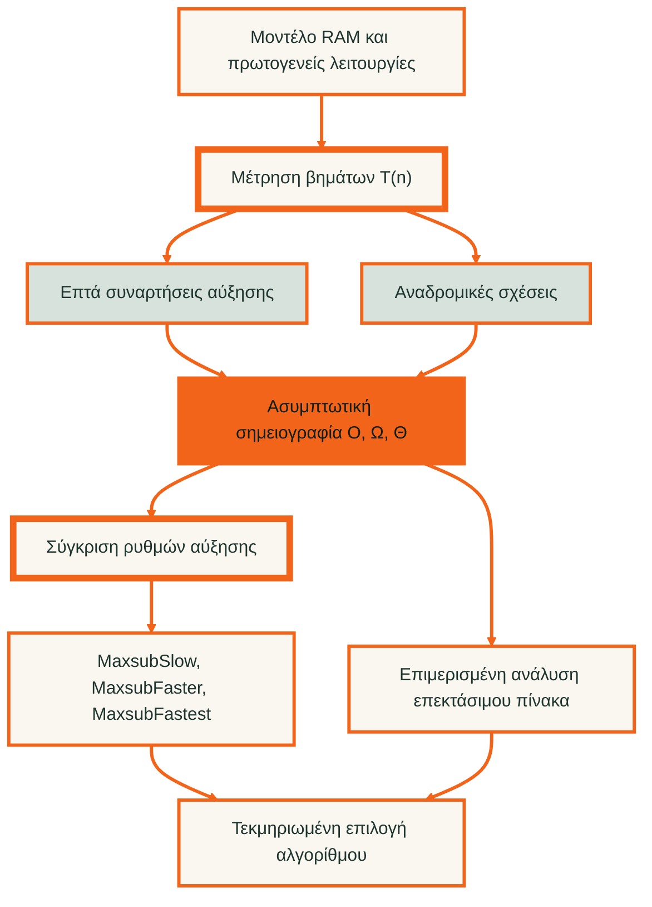

# 01 — Ανάλυση Αλγορίθμων
*Analysis of Algorithms*

Η ενότητα θεμελιώνει τον τρόπο με τον οποίο μετράται και συγκρίνεται η απόδοση αλγορίθμων ανεξάρτητα από υλικό, γλώσσα προγραμματισμού και συγκεκριμένη είσοδο. Ορίζει το μοντέλο `RAM`, τις πρωτογενείς λειτουργίες και τη μέτρηση βημάτων, εξάγει τα ακριβή πλήθη πράξεων του `arrayMax` και του `recursiveMax`, και εισάγει τις επτά συναρτήσεις αύξησης μαζί με τη `Big-Oh`, τη `Big-Omega` και τη `Big-Theta`. Στη συνέχεια εφαρμόζει τα εργαλεία σε τρεις υλοποιήσεις του προβλήματος `Maximum Subarray` και στην επιμερισμένη ανάλυση του επεκτάσιμου πίνακα. Η ενότητα είναι προαπαιτούμενη για κάθε επόμενο κεφάλαιο, διότι όλες οι πολυπλοκότητες των ενοτήτων `02` έως `13` εκφράζονται με το συμβολισμό και τις συμβάσεις μέτρησης που ορίζονται εδώ.

> **Εξεταστική κάλυψη:** Πρόοδος και Τελική
> **Κεφάλαιο βιβλίου:** Κεφ. 1 | **Διαλέξεις:** `01_analysis_of_algorithms.pdf`
> **Πηγή:** `Resources/Meta/mindmap.md` (Ενότητα 01)
> **Εκτός ύλης:** Ενότητα `1.4.1`

## Πίνακας Περιεχομένων

- [1. Εννοιολογικό Πλαίσιο και Συνολική Εικόνα](#1-εννοιολογικό-πλαίσιο-και-συνολική-εικόνα)
- [2. Θεωρητική Θεμελίωση και Τυπικοί Ορισμοί](#2-θεωρητική-θεμελίωση-και-τυπικοί-ορισμοί)
- [3. Αλγόριθμοι, Ιχνηλάτηση και Κώδικας](#3-αλγόριθμοι-ιχνηλάτηση-και-κώδικας)
- [4. Συγκριτική Ανάλυση και Πολυπλοκότητα](#4-συγκριτική-ανάλυση-και-πολυπλοκότητα)
- [5. Πλήρως Λυμένες Ασκήσεις Εξεταστικού Επιπέδου](#5-πλήρως-λυμένες-ασκήσεις-εξεταστικού-επιπέδου)
- [6. Οδηγός Επιβίωσης στις Εξετάσεις και Παγίδες](#6-οδηγός-επιβίωσης-στις-εξετάσεις-και-παγίδες)
- [7. Συνοπτικός Πίνακας Εννοιών](#7-συνοπτικός-πίνακας-εννοιών)

---

## 1. Εννοιολογικό Πλαίσιο και Συνολική Εικόνα

### 1.1 Το πρόβλημα της κλιμάκωσης

Ένα σύστημα ανάλυσης ψηφιακών εικόνων σαρώνει τη σειρά φωτεινοτήτων $A[1..n]$ μιας γραμμής εικονοστοιχείων και αναζητά το συνεχόμενο τμήμα με το μέγιστο άθροισμα, ώστε να εντοπίσει φωτεινά μοτίβα σε σκοτεινό υπόβαθρο. Για $n = 100$ εικονοστοιχεία κάθε υλοποίηση τερματίζει· για $n = 10^7$ μόνο μια υλοποίηση με γραμμικό ρυθμό αύξησης είναι πρακτική. Το ερώτημα δεν είναι πόσα δευτερόλεπτα διαρκεί μια συγκεκριμένη εκτέλεση, αλλά πώς μεταβάλλεται το κόστος όταν το $n$ αυξάνεται.

**Κλιμάκωση (`scalability`):** η ικανότητα ενός συστήματος να διαχειρίζεται αυξανόμενο όγκο δεδομένων ή φόρτο εργασίας με αποδεκτό κόστος. Η ανάλυση αλγορίθμων μετρά την κλιμάκωση με τον **ρυθμό αύξησης (`growth rate`)** του χρόνου ως συνάρτησης του μεγέθους εισόδου $n$, όχι με απόλυτες μετρήσεις χρόνου.

Η επιλογή του αλγορίθμου γίνεται σε δύο στάδια. Πρώτα προσδιορίζεται η ασυμπτωτική κλάση του χρόνου στη χειρότερη περίπτωση, ώστε να εξασφαλίζεται εγγύηση για κάθε είσοδο. Έπειτα συγκρίνονται οι σταθεροί παράγοντες και ο χώρος, που καθορίζουν τη συμπεριφορά για ρεαλιστικά μεγέθη.

### 1.2 Αλγόριθμος και δομή δεδομένων

- **Αλγόριθμος:** πεπερασμένη, σαφώς καθορισμένη ακολουθία βημάτων που δέχεται είσοδο, παράγει έξοδο και τερματίζει. Κάθε βήμα είναι μονοσήμαντα εκτελέσιμο.
- **Δομή δεδομένων (`data structure`):** συστηματικός τρόπος οργάνωσης και αποθήκευσης δεδομένων στη μνήμη, που υποστηρίζει σύνολο λειτουργιών με καθορισμένο κόστος.
- **Σχέση:** ο ίδιος αλγόριθμος πάνω σε διαφορετική δομή έχει διαφορετική πολυπλοκότητα, διότι αλλάζει το κόστος των λειτουργιών πρόσβασης. Στην παρούσα ενότητα, ο επεκτάσιμος πίνακας είναι δομή δεδομένων και η ανάλυση αφορά την ακολουθία κλήσεων `add`.

### 1.3 Περιπτώσεις ανάλυσης

| Περίπτωση | Ορισμός | Ρόλος στην εξέταση |
|---|---|---|
| Καλύτερη (`best-case`) | Ελάχιστο πλήθος πρωτογενών λειτουργιών επί όλων των εισόδων μεγέθους $n$ | Δείχνει το κάτω άκρο· δεν αρκεί ως εγγύηση |
| Χειρότερη (`worst-case`) | Μέγιστο πλήθος πρωτογενών λειτουργιών επί όλων των εισόδων μεγέθους $n$ | Κύρια εγγύηση απόδοσης· ζητείται σχεδόν πάντα |
| Μέση (`average-case`) | Μέσο πλήθος πράξεων ως προς μια **δεδομένη κατανομή εισόδων** | Απαιτεί ρητή δήλωση της κατανομής |
| Αναμενόμενη (`expected-case`) | Μέση τιμή ως προς τις **εσωτερικές τυχαίες επιλογές** του αλγορίθμου, για κάθε σταθερή είσοδο | Χρησιμοποιείται σε τυχαιοποιημένους αλγορίθμους |
| Επιμερισμένη (`amortized`) | Μέσο κόστος ανά λειτουργία σε ακολουθία $n$ λειτουργιών στη χειρότερη περίπτωση, χωρίς πιθανότητες | Απαιτείται για επεκτάσιμους πίνακες και `Union-Find` |

Οι πέντε έννοιες δεν είναι εναλλάξιμες. Μία επιμερισμένη πολυπλοκότητα $O(1)$ ανά `add` συνυπάρχει με μεμονωμένες προσθήκες κόστους $\Theta(n)$.

### 1.4 Πειραματική και θεωρητική ανάλυση

| Κριτήριο | Πειραματική μελέτη | Θεωρητική ανάλυση |
|---|---|---|
| Προϋπόθεση | Υλοποίηση και εκτέλεση | Ψευδοκώδικας και μοντέλο `RAM` |
| Εύρος εισόδων | Πεπερασμένο δείγμα | Όλες οι είσοδοι μεγέθους $n$ |
| Μονάδα μέτρησης | Δευτερόλεπτα, εξαρτώμενα από υλικό και γλώσσα | Πλήθος πρωτογενών λειτουργιών $T(n)$ |
| Εγγύηση | Καμία για εισόδους εκτός δείγματος | Φράγμα με ρητή περίπτωση ανάλυσης |
| Πλεονέκτημα | Αποτυπώνει πραγματικές σταθερές και κρυφό κόστος | Ανεξάρτητη πλατφόρμας, προβλέπει κλιμάκωση |

Η θεωρητική ανάλυση δεν αντικαθιστά τη μέτρηση· την κατευθύνει. Η πειραματική μέτρηση δεν αποδεικνύει ασυμπτωτικό φράγμα· το επιβεβαιώνει ή το διαψεύδει για το εξεταζόμενο εύρος.

### 1.5 Ψευδοκώδικας

**Ψευδοκώδικας:** δομημένη περιγραφή αλγορίθμου υψηλού επιπέδου, ανεξάρτητη από γλώσσα προγραμματισμού. Χρησιμοποιεί ανάθεση με `←`, δομές ελέγχου και επανάληψης, αλλά παραλείπει λεπτομέρειες όπως διαχείριση μνήμης και βιβλιοθήκες. Κάθε γραμμή του αντιστοιχεί σε σταθερό πλήθος πρωτογενών λειτουργιών, γεγονός που επιτρέπει τη μέτρηση βημάτων.

### 1.6 Χάρτης της ενότητας



Πορτοκαλί γέμισμα: ο κεντρικός μηχανισμός της ενότητας. Παχύ περίγραμμα: τα δύο στάδια μέτρησης και σύγκρισης. Απαλό πράσινο: τα μαθηματικά εργαλεία εισόδου. Ο χάρτης δείχνει ότι η μέτρηση βημάτων τροφοδοτεί και τις δύο οικογένειες εργαλείων, οι οποίες συναντώνται στην ασυμπτωτική σημειογραφία και καταλήγουν στην επιλογή αλγορίθμου.

---

## 2. Θεωρητική Θεμελίωση και Τυπικοί Ορισμοί

### 2.1 Μοντέλο `RAM` και πρωτογενείς λειτουργίες

**Ορισμός.** Το μοντέλο `RAM` (`Random Access Machine`) αποτελείται από μία κεντρική μονάδα επεξεργασίας και εν δυνάμει άπειρα αριθμημένα κελιά μνήμης. Κάθε κελί προσπελαύνεται σε μία μονάδα χρόνου, ανεξάρτητα από τη θέση του.

**Ορισμός.** **Πρωτογενής λειτουργία (`primitive operation`):** λειτουργία που εκτελείται σε σταθερό χρόνο στο μοντέλο `RAM`. Στην ενότητα θεωρούνται πρωτογενείς:

1. Ο υπολογισμός μιας αριθμητικής ή λογικής έκφρασης.
2. Η ανάθεση τιμής σε μεταβλητή.
3. Η προσπέλαση θέσης πίνακα (ανάγνωση ή εγγραφή).
4. Η σύγκριση δύο τιμών.
5. Η κλήση μεθόδου και η επιστροφή από αυτήν.

Η σύμβαση μέτρησης της ενότητας αποδίδει μία πράξη σε κάθε στοιχείο της παραπάνω λίστας. Η προσπέλαση `A[i]` κοστίζει $1$, η σύγκριση `A[i] > currentMax` κοστίζει $3$ (μία προσπέλαση, μία ανάγνωση της μεταβλητής σύγκρισης, μία σύγκριση), και η ανάθεση `currentMax ← A[i]` κοστίζει $2$ (μία προσπέλαση, μία εγγραφή). Χωρίς ρητή σύμβαση, τα ακριβή αθροίσματα όπως $7n-2$ δεν είναι αναπαραγώγιμα.

> **Προσοχή:** το μοντέλο `RAM` αγνοεί ιεραρχία μνήμης, κρυφές μνήμες και διανυσματικές εντολές. Οι σταθερές που προκύπτουν είναι συμβατικές, όχι χρόνοι σε δευτερόλεπτα.

### 2.2 Μέτρηση βημάτων του `arrayMax`

**Θεώρημα.** Για πίνακα $A$ με $n \ge 1$ ακέραιους, ο `arrayMax` εκτελεί $T(n) = 5n + 2u$ πρωτογενείς λειτουργίες, όπου $u$ είναι το πλήθος των φορών που εκτελείται η ανάθεση `currentMax ← A[i]`. Ισχύει $0 \le u \le n-1$, άρα:

$$5n \le T(n) \le 7n-2.$$

**Απόδειξη.** Η μέτρηση ανά γραμμή δίνεται στον Πίνακα 2.1. Η αρχικοποίηση `currentMax ← A[0]` κοστίζει $2$. Η αρχικοποίηση του βρόχου `i ← 1` κοστίζει $1$. Ο έλεγχος `i ≤ n-1` εκτελείται $n$ φορές (οι $n-1$ επιτυχείς και μία αποτυχημένη) και κοστίζει $1$ κάθε φορά, άρα $n$. Η αύξηση `i ← i+1` εκτελείται $n-1$ φορές και κοστίζει $n-1$. Η σύγκριση `A[i] > currentMax` εκτελείται $n-1$ φορές και κοστίζει $3(n-1)$. Η ανάθεση στο σώμα εκτελείται $u$ φορές και κοστίζει $2u$. Η εντολή `return` κοστίζει $1$. Αθροίζοντας:

$$T(n) = 2 + 1 + n + (n-1) + 3(n-1) + 2u + 1 = 5n + 2u.$$

Επειδή $u=0$ στην καλύτερη περίπτωση (φθίνων πίνακας) και $u=n-1$ στη χειρότερη (αυστηρά αύξων πίνακας), προκύπτουν $T_{\text{best}}(n)=5n$ και $T_{\text{worst}}(n)=7n-2$. $\square$

**Πίνακας 2.1 — Κόστος γραμμών του `arrayMax`**

| Γραμμή | Πράξεις ανά εκτέλεση | Εκτελέσεις (χειρότερη) | Κόστος (χειρότερη) | Κόστος (καλύτερη) |
|---|---|---|---|---|
| `currentMax ← A[0]` | $2$ | $1$ | $2$ | $2$ |
| `i ← 1` | $1$ | $1$ | $1$ | $1$ |
| έλεγχος `i ≤ n-1` | $1$ | $n$ | $n$ | $n$ |
| `i ← i+1` | $1$ | $n-1$ | $n-1$ | $n-1$ |
| `A[i] > currentMax` | $3$ | $n-1$ | $3(n-1)$ | $3(n-1)$ |
| `currentMax ← A[i]` | $2$ | $n-1$ | $2(n-1)$ | $0$ |
| `return currentMax` | $1$ | $1$ | $1$ | $1$ |
| **Σύνολο** | | | $7n-2$ | $5n$ |

**Πόρισμα.** Επειδή $5n \le T(n) \le 7n-2$ για κάθε $n \ge 1$, ισχύει $T(n) = \Theta(n)$ στη χειρότερη και στην καλύτερη περίπτωση. Η κλάση είναι ίδια· διαφέρουν μόνο οι σταθερές.

### 2.3 Αναδρομικός υπολογισμός μεγίστου: `recursiveMax`

**Θεώρημα.** Για τον `recursiveMax` ισχύει $T(1)=3$ και $T(n)=T(n-1)+7$ για $n \ge 2$. Η λύση είναι:

$$T(n) = 7n-4 = \Theta(n).$$

**Απόδειξη με ανάπτυξη.** Αναπτύσσοντας τη σχέση:

$$\begin{aligned}
T(n) &= T(n-1) + 7\\
&= T(n-2) + 2\cdot 7\\
&= T(n-3) + 3\cdot 7\\
&\;\;\vdots\\
&= T(1) + (n-1)\cdot 7\\
&= 3 + 7n - 7\\
&= 7n - 4.
\end{aligned}$$

**Επαλήθευση με επαγωγή.** Για $n=1$: $7\cdot 1 - 4 = 3$, που συμπίπτει με τη βάση. Έστω $T(n-1)=7(n-1)-4$. Τότε $T(n)=7(n-1)-4+7=7n-4$. $\square$

Οι $7$ πράξεις ανά επίπεδο αντιστοιχούν στον έλεγχο $n=1$, στον υπολογισμό του $n-1$, στην προετοιμασία της αναδρομικής κλήσης, στην προσπέλαση `A[n-1]`, στη σύγκριση των δύο τιμών, στην επιλογή της μεγαλύτερης και στην επιστροφή. Η αναδρομή καταναλώνει $\Theta(n)$ χώρο στη στοίβα κλήσεων, σε αντίθεση με τον επαναληπτικό `arrayMax` που χρησιμοποιεί $O(1)$ επιπλέον χώρο.

### 2.4 Οι επτά σημαντικές συναρτήσεις αύξησης

Οι επτά συναρτήσεις διατάσσονται αυστηρά από τη βραδύτερη προς την ταχύτερη αύξηση:

$$1 \prec \log n \prec n \prec n\log n \prec n^2 \prec n^3 \prec 2^n.$$

Σε όλο το μάθημα $\log n$ σημαίνει $\log_2 n$, εκτός αν δηλώνεται διαφορετική βάση.

**Πίνακας 2.2 — Τιμές των επτά συναρτήσεων**

| $n$ | $1$ | $\log n$ | $n$ | $n\log n$ | $n^2$ | $n^3$ | $2^n$ |
|---|---|---|---|---|---|---|---|
| $2$ | $1$ | $1$ | $2$ | $2$ | $4$ | $8$ | $4$ |
| $4$ | $1$ | $2$ | $4$ | $8$ | $16$ | $64$ | $16$ |
| $8$ | $1$ | $3$ | $8$ | $24$ | $64$ | $512$ | $256$ |
| $16$ | $1$ | $4$ | $16$ | $64$ | $256$ | $4096$ | $65536$ |
| $32$ | $1$ | $5$ | $32$ | $160$ | $1024$ | $32768$ | $4.29\times 10^9$ |
| $64$ | $1$ | $6$ | $64$ | $384$ | $4096$ | $262144$ | $1.84\times 10^{19}$ |

**Πίνακας 2.3 — Επίδραση διπλασιασμού ($n \to 2n$)**

| Συνάρτηση | Τιμή στο $2n$ | Σχέση με την τιμή στο $n$ | Αποτέλεσμα |
|---|---|---|---|
| $1$ | $1$ | ίδια | αμετάβλητη |
| $\log n$ | $\log n + 1$ | προσθέτει $1$ | αύξηση κατά σταθερά |
| $n$ | $2n$ | διπλασιασμός | $\times 2$ |
| $n\log n$ | $2n\log n + 2n$ | ελαφρώς περισσότερο από διπλασιασμό | $\approx \times 2$ |
| $n^2$ | $4n^2$ | τετραπλασιασμός | $\times 4$ |
| $n^3$ | $8n^3$ | οκταπλασιασμός | $\times 8$ |
| $2^n$ | $2^{2n} = (2^n)^2$ | τετραγωνισμός | $\times 2^n$ |

Οι σταθεροί παράγοντες και οι όροι χαμηλότερης τάξης δεν αλλάζουν την κλάση. Για παράδειγμα, οι $3n^2$ και $n^2 + 100n + 7$ ανήκουν και οι δύο στη $\Theta(n^2)$· η διαφορά τους είναι αισθητή μόνο για μικρά $n$.

**Διάγραμμα `log-log`.** Αν $T(n)=c\,n^{a}$ με $c>0$, τότε:

$$\log T(n) = \log c + a\log n.$$

Σε άξονες $\log n$ και $\log T(n)$ η γραφική παράσταση είναι ευθεία με κλίση $a$. Για $T(n)=n^2$ τα σημεία $(0,0),(1,2),(2,4),(3,6)$ δίνουν κλίση $2$· για $T(n)=n^3$ η κλίση είναι $3$. Η κλίση `log-log` προσδιορίζει τον εκθέτη μόνο για πολυωνυμικές συναρτήσεις· η $2^n$ παράγει καμπύλη που ανέρχεται ταχύτερα από κάθε ευθεία.

### 2.5 Ασυμπτωτική σημειογραφία

**Ορισμός `Big-Oh`.** $f(n)=O(g(n))$ αν και μόνο αν υπάρχουν σταθερές $c>0$ και $n_0 \ge 1$ τέτοιες ώστε:

$$0 \le f(n) \le c\,g(n) \quad \text{για κάθε } n \ge n_0.$$

**Ορισμός `Big-Omega`.** $f(n)=\Omega(g(n))$ αν και μόνο αν υπάρχουν σταθερές $c>0$ και $n_0 \ge 1$ τέτοιες ώστε:

$$0 \le c\,g(n) \le f(n) \quad \text{για κάθε } n \ge n_0.$$

**Ορισμός `Big-Theta`.** $f(n)=\Theta(g(n))$ αν και μόνο αν υπάρχουν σταθερές $c_1>0$, $c_2>0$ και $n_0 \ge 1$ τέτοιες ώστε:

$$c_1\,g(n) \le f(n) \le c_2\,g(n) \quad \text{για κάθε } n \ge n_0.$$

Η `Big-Oh` είναι άνω φράγμα, η `Big-Omega` κάτω φράγμα και η `Big-Theta` σφιχτό φράγμα. Η σχέση $f(n)=\Theta(g(n))$ ισχύει αν και μόνο αν $f(n)=O(g(n))$ και $f(n)=\Omega(g(n))$.

**Διαδικασία εύρεσης $c$ και $n_0$.** Πρώτα γράφεται η ανισότητα του ορισμού. Έπειτα διαιρείται με $g(n)>0$ για να απομονωθεί ο λόγος $f(n)/g(n)$. Τέλος υπολογίζεται ένα άνω ή κάτω φράγμα του λόγου για $n \ge n_0$· η σταθερά $c$ είναι το φράγμα αυτό.

**Πίνακας 2.4 — Αναζήτηση σταθερών**

| Ισχυρισμός | Ανισότητα | Επίλυση | Αποτέλεσμα |
|---|---|---|---|
| $7n-2=O(n)$ | $7n-2 \le cn$ | $c=6$: ισοδυναμεί με $n \le 2$, αποτυγχάνει για $n \ge 3$ | απορρίπτεται |
| $7n-2=O(n)$ | $7n-2 \le cn$ | $c=7$: ισοδυναμεί με $-2 \le 0$, αληθές για κάθε $n \ge 1$ | $c=7$, $n_0=1$ |
| $7n-2=O(n)$ | $7n-2 \le cn$ | $c=10$: αληθές για κάθε $n \ge 1$ | έγκυρο αλλά χαλαρότερο |
| $3n^2+5n+2=\Omega(n^2)$ | $c_1 n^2 \le 3n^2+5n+2$ | $c_1=3$: αληθές για $n \ge 1$ | $c_1=3$, $n_0=1$ |
| $3n^2+5n+2=O(n^2)$ | $3n^2+5n+2 \le c_2 n^2$ | $c_2=10$: αφού $5n \le 5n^2$ και $2 \le 2n^2$ | $c_2=10$, $n_0=1$ |
| $n^2 \ne O(n)$ | $n^2 \le cn$ | ισοδυναμεί με $n \le c$ | αδύνατο για κάθε σταθερά $c$ |

**Απόδειξη ότι $n^2 \ne O(n)$.** Έστω ότι υπάρχουν $c>0$ και $n_0 \ge 1$ με $n^2 \le cn$ για κάθε $n \ge n_0$. Διαιρώντας με $n>0$ παίρνουμε $n \le c$ για κάθε $n \ge n_0$. Επιλέγοντας $n = \max\{n_0, \lfloor c \rfloor + 1\}$ προκύπτει $n > c$, άτοπο. $\square$

**Κανόνες `Big-Oh`.** Για πολυωνυμικές εκφράσεις:

1. Αφαιρούνται οι όροι χαμηλότερου βαθμού: $3n^2+5n+2 \to 3n^2$.
2. Αφαιρούνται οι σταθεροί παράγοντες: $3n^2 \to n^2$.
3. Χρησιμοποιείται η μικρότερη δυνατή κλάση: $O(n^2)$ και όχι $O(n^3)$.
4. Χρησιμοποιείται η απλούστερη έκφραση της κλάσης: $O(n^2)$ και όχι $O(2n^2+5n)$.

Ένα χαλαρό άνω φράγμα είναι μαθηματικά ορθό αλλά εξεταστικά ελλιπές: η $2n=O(n^2)$ ισχύει, όμως η σωστή απάντηση είναι $\Theta(n)$.

### 2.6 Επιμερισμένη ανάλυση επεκτάσιμου πίνακα

**Ορισμός.** Για ακολουθία $n$ λειτουργιών, η **επιμερισμένη πολυπλοκότητα (`amortized complexity`)** είναι $T(n)/n$, όπου $T(n)$ το συνολικό κόστος της ακολουθίας στη χειρότερη περίπτωση. Δεν υπεισέρχεται καμία πιθανότητα και καμία υπόθεση για την κατανομή των εισόδων.

Ο επεκτάσιμος πίνακας αποθηκεύει $size$ στοιχεία σε buffer χωρητικότητας $capacity$. Όταν γεμίσει, δεσμεύεται νέος buffer και αντιγράφονται τα ζωντανά στοιχεία. Η επέκταση γίνεται **αμέσως μετά** την προσθήκη που γεμίζει τον πίνακα (σύμβαση της διάλεξης), ώστε μετά από κάθε `add` να ισχύει $size < capacity$. Έτσι, για $n$ προσθήκες με $n = 2^k$, οι αντιγραφές είναι $1+2+4+\dots+2^k$.

**Στρατηγική βηματικής αύξησης.** Κάθε επέκταση προσθέτει σταθερό αριθμό θέσεων $c$. Οι αντικαταστάσεις είναι $k = n/c$ και το συνολικό κόστος:

$$\begin{aligned}
T(n) &= n + c\,(1+2+\dots+k)\\
&= n + c\,\frac{k(k+1)}{2}\\
&= n + \frac{n(n+c)}{2c}\\
&= \Theta(n^2).
\end{aligned}$$

Ο επιμερισμένος χρόνος ανά `add` είναι $T(n)/n = \Theta(n)$.

**Στρατηγική διπλασιασμού.** Κάθε επέκταση διπλασιάζει τη χωρητικότητα. Με $k=\log_2 n$:

$$\begin{aligned}
T(n) &= n + (1+2+4+\dots+2^k)\\
&= n + 2^{k+1}-1\\
&= n + 2n - 1\\
&= 3n-1\\
&= O(n).
\end{aligned}$$

Ο επιμερισμένος χρόνος ανά `add` είναι $T(n)/n = 3 - 1/n < 3 = O(1)$.

**Πίνακας 2.5 — Φάσεις διπλασιασμού**

| $n=2^k$ | $k$ | Χωρητικότητα μετά την επέκταση | Αντιγραφές στη φάση | Αθροιστικές αντιγραφές | $T(n)$ | $T(n)/n$ |
|---|---|---|---|---|---|---|
| $1$ | $0$ | $2$ | $1$ | $1$ | $2$ | $2$ |
| $2$ | $1$ | $4$ | $2$ | $3$ | $5$ | $2.5$ |
| $4$ | $2$ | $8$ | $4$ | $7$ | $11$ | $2.75$ |
| $8$ | $3$ | $16$ | $8$ | $15$ | $23$ | $2.875$ |
| $16$ | $4$ | $32$ | $16$ | $31$ | $47$ | $2.9375$ |
| $32$ | $5$ | $64$ | $32$ | $63$ | $95$ | $2.96875$ |
| $64$ | $6$ | $128$ | $64$ | $127$ | $191$ | $2.984375$ |

Η στήλη $T(n)/n$ τείνει στο $3$ από κάτω. Κάθε μεμονωμένη επέκταση κοστίζει $\Theta(n)$, αλλά το πλήθος των επεκτάσεων είναι $O(\log n)$ και τα κόστη τους σχηματίζουν γεωμετρική πρόοδο.

**Μέθοδος λογιστή (`cyber-dollars`).** Χρεώνεται κάθε `add` με $3$ cyber-δολάρια. Το $1$ πληρώνει την ίδια την προσθήκη. Τα $2$ παραμένουν «αποθηκευμένα» στο νέο στοιχείο. Όταν ο πίνακας μεγέθους $2^i$ γεμίσει, η αντιγραφή $2^i$ στοιχείων κοστίζει $2^i$. Τα $2^{i-1}$ στοιχεία που προστέθηκαν από την προηγούμενη επέκταση (θέσεις $2^{i-1}+1$ έως $2^i$) έχουν από $2$ cyber-δολάρια, σύνολο $2\cdot 2^{i-1}=2^i$, που καλύπτει ακριβώς το κόστος. Κανένα `add` δεν χρεώνεται περισσότερο από $3$, άρα η επιμερισμένη χρόνος είναι $O(1)$.

**Πίνακας 2.6 — Σύγκριση στρατηγικών (παράδειγμα $c=4$)**

| $n$ | Στρατηγική | Επεκτάσεις | Αντιγραφές | Συνολικό κόστος $T(n)$ | $T(n)/n$ |
|---|---|---|---|---|---|
| $4$ | βηματική $+4$ | $1$ | $4$ | $8$ | $2$ |
| $8$ | βηματική $+4$ | $2$ | $12$ | $20$ | $2.5$ |
| $12$ | βηματική $+4$ | $3$ | $24$ | $36$ | $3$ |
| $16$ | βηματική $+4$ | $4$ | $40$ | $56$ | $3.5$ |
| $8$ | διπλασιασμός | $4$ | $15$ | $23$ | $2.875$ |

Στη βηματική στρατηγική το επιμερισμένο κόστος αυξάνεται γραμμικά με το $n$· στη διπλασιαστική φράσσεται από $3$.

> Εκτός ύλης: Ενότητα `1.4.1`. Δεν διδάσκεται και δεν εξετάζεται.

---

## 3. Αλγόριθμοι, Ιχνηλάτηση και Κώδικας

### 3.1 `arrayMax`: γραμμική σάρωση

Σκοπός: εύρεση του μεγαλύτερου στοιχείου πίνακα με μία σάρωση και σταθερό επιπλέον χώρο.

```text
Algorithm arrayMax(A, n):
Input: An array A storing n >= 1 integers
Output: The maximum element of A

currentMax <- A[0]
for i <- 1 to n - 1 do
    if A[i] > currentMax then
        currentMax <- A[i]
return currentMax
```

**Ιχνηλάτηση.** Για $A=[3,9,2,8,5]$ και $n=5$, με τη σύμβαση του Πίνακα 2.1:

| Βήμα | $i$ | $A[i]$ | `currentMax` πριν | Σύγκριση | Ενημέρωση | Πράξεις βήματος | Σωρευτικές |
|---|---|---|---|---|---|---|---|
| Αρχικοποίηση | — | — | $3$ | — | — | $2$ | $2$ |
| `i ← 1` | $1$ | — | $3$ | — | — | $1$ | $3$ |
| Επανάληψη 1 | $1$ | $9$ | $3$ | $9>3$ αληθής | `currentMax ← 9` | $1+3+2+1=7$ | $10$ |
| Επανάληψη 2 | $2$ | $2$ | $9$ | $2>9$ ψευδής | καμία | $1+3+0+1=5$ | $15$ |
| Επανάληψη 3 | $3$ | $8$ | $9$ | $8>9$ ψευδής | καμία | $5$ | $20$ |
| Επανάληψη 4 | $4$ | $5$ | $9$ | $5>9$ ψευδής | καμία | $5$ | $25$ |
| Τελικός έλεγχος | — | — | — | $i \le 4$ ψευδής | — | $1$ | $26$ |
| Επιστροφή | — | — | — | — | `return 9` | $1$ | $27$ |

Το πλήθος ενημερώσεων είναι $u=1$, άρα $T(5)=5\cdot 5+2\cdot 1=27$. Για αυστηρά αύξοντα πίνακα $u=4$ και $T(5)=33=7\cdot 5-2$· για φθίνοντα $u=0$ και $T(5)=25=5\cdot 5$.

**Ρητός αλγόριθμος:**

```python
def arrayMax(numbers: list[int]) -> int:
    """Finds the maximum value in a non-empty array by a linear scan.

    Args:
        numbers (list[int]): A non-empty list of integers.

    Returns:
        int: The largest element of numbers.

    Raises:
        ValueError: If numbers is empty.
    """
    if not numbers:
        raise ValueError("arrayMax requires at least one element")
    current_max = numbers[0]
    for index in range(1, len(numbers)):
        # Each update costs two primitive operations in the textbook count.
        if numbers[index] > current_max:
            current_max = numbers[index]
    return current_max


assert arrayMax([3, 9, 2, 8, 5]) == 9
```

**Ιδιωματισμός (`Pythonic idiom`):**

```python
assert max([3, 9, 2, 8, 5]) == 9
```

| Μορφή | Χρόνος (χειρότερη) | Επιπλέον χώρος | Τροποποιεί είσοδο | Σχόλιο |
|---|---|---|---|---|
| `arrayMax(numbers)` | $\Theta(n)$ | $O(1)$ | όχι | ο αλγόριθμος που ζητά η εξέταση |
| `max(numbers)` | $\Theta(n)$ | $O(1)$ | όχι | βελτιστοποιημένος βρόχος στη C· κρύβει τη μέτρηση βημάτων |

Και οι δύο μορφές είναι $\Theta(n)$· ο ιδιωματισμός είναι συντομότερος, όχι ασυμπτωτικά φθηνότερος. Η εξέταση ζητά τον ρητό αλγόριθμο και την ιχνηλάτηση· ο ιδιωματισμός χρησιμεύει μόνο ως επαλήθευση.

Η ανάλυση γραμμής-γραμμής δίνεται στον Πίνακα 2.1 και καταλήγει σε $T(n)=5n+2u$, άρα $\Theta(n)$ χειρότερη και καλύτερη.

### 3.2 `recursiveMax`: γραμμική αναδρομή

Σκοπός: υπολογισμός του μεγίστου των πρώτων $n$ στοιχείων με αναδρομική μείωση του μεγέθους κατά ένα.

```text
Algorithm recursiveMax(A, n):
Input: An array A storing n >= 1 integers
Output: The maximum among A[0], ..., A[n - 1]

if n = 1 then
    return A[0]
return max{recursiveMax(A, n - 1), A[n - 1]}
```

**Ιχνηλάτηση.** Για $A=[3,9,2,8]$ και $n=4$:

| Κλήση | $n$ | Υπολογισμός | Επιστροφή | Πράξεις επιπέδου | Σωρευτικές |
|---|---|---|---|---|---|
| `recursiveMax(A, 1)` | $1$ | βάση: `A[0]` | $3$ | $3$ | $3$ |
| `recursiveMax(A, 2)` | $2$ | $\max\{3, A[1]=9\}$ | $9$ | $7$ | $10$ |
| `recursiveMax(A, 3)` | $3$ | $\max\{9, A[2]=2\}$ | $9$ | $7$ | $17$ |
| `recursiveMax(A, 4)` | $4$ | $\max\{9, A[3]=8\}$ | $9$ | $7$ | $24$ |

Το σύνολο είναι $24=7\cdot 4-4$, σε συμφωνία με τη σχέση $T(n)=7n-4$.

**Ρητός αλγόριθμος:**

```python
def recursiveMax(numbers: list[int], n: int) -> int:
    """Finds the maximum of the first n elements by linear recursion.

    Args:
        numbers (list[int]): The array that stores the values.
        n (int): The number of leading elements to inspect; n >= 1.

    Returns:
        int: The maximum among numbers[0], ..., numbers[n - 1].
    """
    if n == 1:
        return numbers[0]
    # The recursive call reduces the problem by one element per level.
    return max(recursiveMax(numbers, n - 1), numbers[n - 1])


assert recursiveMax([3, 9, 2, 8], 4) == 9
```

**Ιδιωματισμός:** η ίδια κλήση `max(numbers)` του `arrayMax`. Δεν υπάρχει ξεχωριστή συνάρτηση της βιβλιοθήκης για την αναδρομική εκδοχή· η αναδρομή είναι διδακτική διατύπωση της ίδιας γραμμικής σάρωσης.

| Μορφή | Χρόνος (χειρότερη) | Επιπλέον χώρος | Σχόλιο |
|---|---|---|---|
| `recursiveMax(numbers, n)` | $\Theta(n)$ | $\Theta(n)$ στοίβα | $T(n)=7n-4$ |
| `max(numbers)` | $\Theta(n)$ | $O(1)$ | προτιμάται σε παραγωγή |

> **Προσοχή:** το προεπιλεγμένο όριο αναδρομής της `CPython` είναι περίπου $1000$ επίπεδα. Για $n>1000$ η αναδρομική εκδοχή αποτυγχάνει με `RecursionError`· η επαναληπτική είναι ασφαλής.

### 3.3 `MaxsubSlow`: εξαντλητική απαρίθμηση

Σκοπός: μέγιστο άθροισμα συνεχόμενου υπο-πίνακα $A[j..k]$, με εξέταση όλων των ζευγών $(j,k)$.

```text
Algorithm MaxsubSlow(A):
Input: An array A of n integers
Output: The maximum sum of a contiguous subarray of A

m <- 0
for j <- 1 to n do
    for k <- j to n do
        s <- 0
        for i <- j to k do
            s <- s + A[i]
        if s > m then
            m <- s
return m
```

**Ιχνηλάτηση.** Για $A=[1,-2,3]$ και $n=3$:

| $j$ | $k$ | Υπο-πίνακας | Άθροισμα $s$ | `m` μετά |
|---|---|---|---|---|
| $1$ | $1$ | $[1]$ | $1$ | $1$ |
| $1$ | $2$ | $[1,-2]$ | $-1$ | $1$ |
| $1$ | $3$ | $[1,-2,3]$ | $2$ | $2$ |
| $2$ | $2$ | $[-2]$ | $-2$ | $2$ |
| $2$ | $3$ | $[-2,3]$ | $1$ | $2$ |
| $3$ | $3$ | $[3]$ | $3$ | $3$ |

**Ανάλυση.** Για σταθερό $j$, το εσωτερικό άθροισμα έχει μήκος $k-j+1$. Θέτοντας $r=k-j+1$, το πλήθος προσθέσεων είναι:

$$\sum_{j=1}^{n}\sum_{k=j}^{n}(k-j+1) = \sum_{r=1}^{n}\frac{r(r+1)}{2} = \frac{n(n+1)(n+2)}{6} = \Theta(n^3).$$

Για $n=3$ το πλήθος των προσθέσεων είναι $10$ (οι επιμέρους υπο-πίνακες έχουν μήκη $1,2,3,1,2,1$), ενώ ο πίνακας ιχνηλάτησης έχει μία γραμμή ανά υπο-πίνακα. Η χειρότερη και η καλύτερη περίπτωση ανήκουν στην ίδια κλάση, διότι οι βρόχοι εκτελούνται πλήρως ανεξάρτητα από τις τιμές.

**Ρητός αλγόριθμος:**

```python
def maxsubSlow(values: list[int]) -> int:
    """Computes the maximum subarray sum by enumerating every subarray.

    Args:
        values (list[int]): The input array A.

    Returns:
        int: The largest sum over all contiguous subarrays; 0 if all are negative.
    """
    best = 0
    n = len(values)
    for j in range(n):
        for k in range(j, n):
            running = 0
            for index in range(j, k + 1):
                running += values[index]
            if running > best:
                best = running
    return best


assert maxsubSlow([1, -2, 3]) == 3
assert maxsubSlow([-2, 1, -3, 4, -1, 2, 1, -5]) == 6
```

**Ιδιωματισμός:** δεν υπάρχει συνάρτηση της τυπικής βιβλιοθήκης που να λύνει το `Maximum Subarray`. Οι `max` και `sum` είναι μόνο δομικά στοιχεία· η εξαντλητική απαρίθμηση γράφεται ρητά.

### 3.4 `MaxsubFaster`: προθεματικά αθροίσματα

Σκοπός: αντικατάσταση του εσωτερικού αθροίσματος με διαφορά δύο προθεματικών αθροισμάτων, ώστε κάθε υπο-πίνακας να αξιολογείται σε $O(1)$.

```text
Algorithm MaxsubFaster(A):
Input: An array A of n integers
Output: The maximum sum of a contiguous subarray of A

S[0] <- 0
for i <- 1 to n do
    S[i] <- S[i - 1] + A[i]
m <- 0
for j <- 1 to n do
    for k <- j to n do
        s <- S[k] - S[j - 1]
        if s > m then
            m <- s
return m
```

**Ιχνηλάτηση.** Για $A=[3,-4,2,5,-1]$ και $n=5$, τα προθεματικά αθροίσματα είναι $S=[0,3,-1,1,6,5]$. Κάθε γραμμή υπολογίζει $s=S[k]-S[j-1]$:

| $j$ | $k$ | $S[k]$ | $S[j-1]$ | $s=S[k]-S[j-1]$ | `m` μετά |
|---|---|---|---|---|---|
| $1$ | $1$ | $3$ | $0$ | $3$ | $3$ |
| $1$ | $2$ | $-1$ | $0$ | $-1$ | $3$ |
| $1$ | $3$ | $1$ | $0$ | $1$ | $3$ |
| $1$ | $4$ | $6$ | $0$ | $6$ | $6$ |
| $1$ | $5$ | $5$ | $0$ | $5$ | $6$ |
| $2$ | $2$ | $-1$ | $3$ | $-4$ | $6$ |
| $2$ | $3$ | $1$ | $3$ | $-2$ | $6$ |
| $2$ | $4$ | $6$ | $3$ | $3$ | $6$ |
| $2$ | $5$ | $5$ | $3$ | $2$ | $6$ |
| $3$ | $3$ | $1$ | $-1$ | $2$ | $6$ |
| $3$ | $4$ | $6$ | $-1$ | $7$ | $7$ |
| $3$ | $5$ | $5$ | $-1$ | $6$ | $7$ |
| $4$ | $4$ | $6$ | $1$ | $5$ | $7$ |
| $4$ | $5$ | $5$ | $1$ | $4$ | $7$ |
| $5$ | $5$ | $5$ | $6$ | $-1$ | $7$ |

Το μέγιστο είναι $7$ και επιτυγχάνεται για $j=3$, $k=4$, δηλαδή για τον υπο-πίνακα $A[3..4]=[2,5]$. Πράγματι $S[4]-S[2]=6-(-1)=7$.

**Ανάλυση.** Η κατασκευή των $S$ κοστίζει $\Theta(n)$. Τα δύο ένθετα βρόχια εκτελούν:

$$\sum_{j=1}^{n}(n-j+1) = \frac{n(n+1)}{2} = \Theta(n^2)$$

επαναλήψεις με $O(1)$ πράξεις η καθεμία. Συνολικά $T(n)=\Theta(n^2)$ σε κάθε περίπτωση, με $\Theta(n)$ επιπλέον χώρο για τον πίνακα $S$.

**Ρητός αλγόριθμος:**

```python
def prefixSums(values: list[int]) -> list[int]:
    """Builds the prefix-sum array S with S[0] = 0 and S[t] = S[t-1] + values[t-1].

    Args:
        values (list[int]): The input array A.

    Returns:
        list[int]: A list of length len(values) + 1 with the running totals.
    """
    totals = [0] * (len(values) + 1)
    for index in range(1, len(values) + 1):
        # Every prefix reuses the previous total, so the build is linear.
        totals[index] = totals[index - 1] + values[index - 1]
    return totals


def maxsubFaster(values: list[int]) -> int:
    """Computes the maximum subarray sum using prefix sums.

    Args:
        values (list[int]): The input array A.

    Returns:
        int: The largest sum over all contiguous subarrays; 0 if all are negative.
    """
    prefix = prefixSums(values)
    best = 0
    for j in range(1, len(prefix)):
        for k in range(j, len(prefix)):
            total = prefix[k] - prefix[j - 1]
            if total > best:
                best = total
    return best


assert prefixSums([3, -4, 2, 5, -1]) == [0, 3, -1, 1, 6, 5]
assert maxsubFaster([3, -4, 2, 5, -1]) == 7
```

**Ιδιωματισμός για τα προθεματικά αθροίσματα:**

```python
import itertools

assert list(itertools.accumulate([3, -4, 2, 5, -1], initial=0)) == [0, 3, -1, 1, 6, 5]
```

| Μορφή | Χρόνος | Επιπλέον χώρος | Σχόλιο |
|---|---|---|---|
| `prefixSums(values)` | $\Theta(n)$ | $\Theta(n)$ | ρητός βρόχος, υλικοποιημένη λίστα |
| `itertools.accumulate(values, initial=0)` | $\Theta(n)$ κατά την κατανάλωση | $O(1)$ δημιουργία | τεμπέλης παραγωγός· το κόστος πληρώνεται κατά την επανάληψη |

Ο ιδιωματισμός παράγει τα ίδια προθεματικά αθροίσματα. Δεν λύνει το `Maximum Subarray`· μόνο η κατασκευή του $S$ επιταχύνεται συντακτικά.

### 3.5 `MaxsubFastest`: γραμμική δυναμική σχέση

Σκοπός: υπολογισμός του μεγίστου αθροίσματος με μία διάσχιση, διατηρώντας το μέγιστο επιθεματικό άθροισμα $M_t$.

```text
Algorithm MaxsubFastest(A):
Input: An array A of n integers
Output: The maximum sum of a contiguous subarray of A

M[0] <- 0
for t <- 1 to n do
    M[t] <- max{0, M[t - 1] + A[t]}
m <- 0
for t <- 1 to n do
    m <- max{m, M[t]}
return m
```

**Ιχνηλάτηση.** Για $A=[-2,1,-3,4,-1,2,1,-5]$ και $n=8$:

| $t$ | $A[t]$ | $M[t-1]$ | $M[t-1]+A[t]$ | $M[t]=\max\{0,\cdot\}$ | Καλύτερο έως τώρα $m$ |
|---|---|---|---|---|---|
| $0$ | — | — | — | $0$ | $0$ |
| $1$ | $-2$ | $0$ | $-2$ | $0$ | $0$ |
| $2$ | $1$ | $0$ | $1$ | $1$ | $1$ |
| $3$ | $-3$ | $1$ | $-2$ | $0$ | $1$ |
| $4$ | $4$ | $0$ | $4$ | $4$ | $4$ |
| $5$ | $-1$ | $4$ | $3$ | $3$ | $4$ |
| $6$ | $2$ | $3$ | $5$ | $5$ | $5$ |
| $7$ | $1$ | $5$ | $6$ | $6$ | $6$ |
| $8$ | $-5$ | $6$ | $1$ | $1$ | $6$ |

Το μέγιστο είναι $6$ και επιτυγχάνεται για $A[4..7]=[4,-1,2,1]$, με άθροισμα $4-1+2+1=6$.

**Ανάλυση.** Με τη σύμβαση του Πίνακα 2.1, η αρχικοποίηση `M[0]` κοστίζει $1$, ο πρώτος βρόχος $2n$ για τον έλεγχο, η ανάθεση $M[t]$ κοστίζει $5$ ανά επανάληψη, η αρχικοποίηση `m` κοστίζει $1$, ο δεύτερος βρόχος $2n$, η ενημέρωση του `m` κοστίζει $4$ ανά επανάληψη και η επιστροφή $1$:

$$T(n) = 1 + 2n + 5n + 1 + 2n + 4n + 1 = 13n+3 = \Theta(n).$$

Ο χώρος είναι $\Theta(n)$ για τον πίνακα $M$· αν δεν αποθηκεύεται ο $M$ αλλά μόνο η τρέχουσα τιμή, ο χώρος γίνεται $O(1)$.

**Ρητός αλγόριθμος:**

```python
def maxsubFastest(values: list[int]) -> int:
    """Computes the maximum subarray sum in one linear pass.

    Args:
        values (list[int]): The input array A.

    Returns:
        int: The largest sum over all contiguous subarrays; 0 if all are negative.
    """
    best_suffix = 0
    best = 0
    for value in values:
        # A negative running sum never helps, so the suffix resets to zero.
        best_suffix = max(0, best_suffix + value)
        best = max(best, best_suffix)
    return best


assert maxsubFastest([-2, 1, -3, 4, -1, 2, 1, -5]) == 6
assert maxsubFastest([-3, -1, -7]) == 0
```

Η υλοποίηση συνενώνει τους δύο βρόχους του ψευδοκώδικα σε έναν· η ένωση είναι ασφαλής διότι το `best` ενημερώνεται μετά τον υπολογισμό κάθε $M[t]$. Δεν υπάρχει συνάρτηση της τυπικής βιβλιοθήκης για το πρόβλημα· πρόκειται για τη γνωστή μέθοδο `Kadane`, η οποία είναι η ίδια γραμμική σχέση υπό άλλο όνομα.

> **Προσοχή:** η αρχικοποίηση $m=0$ επιτρέπει κενό υπο-πίνακα. Για είσοδο με αποκλειστικά αρνητικές τιμές η απάντηση είναι $0$. Αν η εκφώνηση απαιτεί μη κενό υπο-πίνακα, αρχικοποιείται $m=A[1]$ και $M_1=A[1]$, με ειδική χειρίσιμη περίπτωση $n=1$.

### 3.6 Επεκτάσιμος πίνακας: προσθήκη με διπλασιασμό

Σκοπός: υποστήριξη `add` σε πίνακα άγνωστου τελικού μεγέθους με επιμερισμένο κόστος $O(1)$ ανά προσθήκη.

```text
Algorithm add(value):
Input: A value to append to the extendable array
Output: None; the array stores one additional element

store value at position size
size <- size + 1
if size = capacity then
    newCapacity <- 2 * capacity
    allocate newArray of size newCapacity
    for i <- 0 to size - 1 do
        newArray[i] <- oldArray[i]
    oldArray <- newArray
    capacity <- newCapacity
```

Η αναλλοίωτη συνθήκη πριν από κάθε `add` είναι $size < capacity$· αρχικά $size=0$ και $capacity=1$, και η επέκταση μετά την προσθήκη την αποκαθιστά.

**Πίνακας 3.1 — Πραγματικές αντιγραφές ανά προσθήκη**

| Προσθήκη | Χωρητικότητα πριν | Χωρητικότητα μετά | Αντιγραφές | Σωρευτικές αντιγραφές | Σωρευτικό κόστος |
|---|---|---|---|---|---|
| $1$ | $1$ | $2$ | $1$ | $1$ | $2$ |
| $2$ | $2$ | $4$ | $2$ | $3$ | $5$ |
| $3$ | $4$ | $4$ | $0$ | $3$ | $6$ |
| $4$ | $4$ | $8$ | $4$ | $7$ | $11$ |
| $5$ | $8$ | $8$ | $0$ | $7$ | $12$ |
| $6$ | $8$ | $8$ | $0$ | $7$ | $13$ |
| $7$ | $8$ | $8$ | $0$ | $7$ | $14$ |
| $8$ | $8$ | $16$ | $8$ | $15$ | $23$ |

Για $n=8$ το συνολικό κόστος είναι $23=3\cdot 8-1$, σε συμφωνία με τη γεωμετρική σειρά.

**Ρητός αλγόριθμος:**

```python
class ExtendableArray:
    """A dynamic array that doubles its capacity whenever it becomes full."""

    def __init__(self) -> None:
        """Initializes an empty buffer with capacity one."""
        self._data: list[int | None] = [None]
        self._size = 0
        self._copies = 0

    def _grow(self) -> None:
        """Doubles the buffer and copies every stored element into it."""
        enlarged: list[int | None] = [None] * (2 * len(self._data))
        for index in range(self._size):
            enlarged[index] = self._data[index]
        # The copy cost is the number of live elements, not the capacity.
        self._copies += self._size
        self._data = enlarged

    def add(self, value: int) -> None:
        """Appends value and restores spare capacity eagerly.

        Args:
            value (int): The element to append.
        """
        self._data[self._size] = value
        self._size += 1
        if self._size == len(self._data):
            # Eager growth keeps the geometric series of copy costs exact.
            self._grow()

    def toList(self) -> list[int]:
        """Returns the stored elements in insertion order.

        Returns:
            list[int]: A copy of the logical contents.
        """
        return [int(self._data[index]) for index in range(self._size)]

    def copyCount(self) -> int:
        """Returns the total number of copied elements so far.

        Returns:
            int: The cumulative copy cost of all expansions.
        """
        return self._copies


buffer = ExtendableArray()
for value in range(1, 9):
    buffer.add(value)
assert buffer.toList() == list(range(1, 9))
assert buffer.copyCount() == 15
```

**Ιδιωματισμός:** η ίδια λειτουργία εκτελείται από το `list.append` της `CPython`.

| Μορφή | Χρόνος ανά `add` | Συνολικό κόστος $n$ προσθηκών | Επιπλέον χώρος | Σχόλιο |
|---|---|---|---|---|
| `ExtendableArray.add` | $O(1)$ επιμερισμένη, $\Theta(n)$ χειρότερη μεμονωμένη | $3n-1$ με διπλασιασμό | $\Theta(n)$, χωρητικότητα $<2n$ | ο αλγόριθμος της εξέτασης |
| `list.append` | $O(1)$ επιμερισμένη | $\Theta(n)$ | $\Theta(n)$ | υλοποίηση της `CPython` |

> **Προσοχή:** η `CPython` αυξάνει τη χωρητικότητα της λίστας με παράγοντα περίπου $1.125$ και όχι ακριβώς $2$. Η επιμερισμένη εγγύηση $O(1)$ διατηρείται, αλλά η γεωμετρική σειρά και η σταθερά $3n-1$ αφορούν τη διπλασιαστική στρατηγική του μαθήματος, όχι την εσωτερική πολιτική της `CPython`.

---

## 4. Συγκριτική Ανάλυση και Πολυπλοκότητα

Η σύγκριση γίνεται σε δύο επίπεδα: πρώτα στην ασυμπτωτική κλάση, που καθορίζει τη συμπεριφορά για μεγάλα $n$, και έπειτα στις σταθερές, στον χώρο και στις λεπτομέρειες υλοποίησης, που καθορίζουν τη συμπεριφορά για τα μεγέθη της πράξης.

### 4.1 Πίνακας σύγκρισης

| Αλγόριθμος / Δομή | Χρόνος (χειρότερη) | Χρόνος (καλύτερη) | Επιπλέον χώρος | Επί τόπου | Παρατήρηση |
|---|---|---|---|---|---|
| `arrayMax` | $\Theta(n)$, $7n-2$ | $\Theta(n)$, $5n$ | $O(1)$ | ναι | μία σάρωση, καμία αντιγραφή |
| `recursiveMax` | $\Theta(n)$, $7n-4$ | $\Theta(n)$ | $\Theta(n)$ στοίβα | όχι | κίνδυνος `RecursionError` |
| `MaxsubSlow` | $\Theta(n^3)$ | $\Theta(n^3)$ | $O(1)$ | ναι | πλήρης απαρίθμηση |
| `MaxsubFaster` | $\Theta(n^2)$ | $\Theta(n^2)$ | $\Theta(n)$ | όχι | προθεματικά αθροίσματα |
| `MaxsubFastest` | $\Theta(n)$ | $\Theta(n)$ | $O(1)$ χωρίς $M$ | ναι | βέλτιστη κλάση για το πρόβλημα |
| Επεκτάσιμος πίνακας, $+c$ | $\Theta(n^2)$ σύνολο, $\Theta(n)$ επιμερισμένη | $\Theta(n)$ μεμονωμένη χωρίς επέκταση | $\Theta(n)$ | όχι | ακατάλληλος για μεγάλα $n$ |
| Επεκτάσιμος πίνακας, $\times 2$ | $\Theta(n)$ σύνολο, $O(1)$ επιμερισμένη | $\Theta(n)$ μεμονωμένη χωρίς επέκταση | $\Theta(n)$, χωρητικότητα $<2n$ | όχι | προτιμώμενη στρατηγική |

Η στήλη «καλύτερη» για τους αλγορίθμους υποπίνακα είναι ίδια με τη χειρότερη, διότι οι βρόχοι εκτελούνται πλήρως ανεξάρτητα από τις τιμές· αλλάζει μόνο το πλήθος των συγκρίσεων που πετυχαίνουν, όχι η κλάση.

### 4.2 Κανόνας επιλογής

| Απαίτηση | Επιλογή | Αιτιολόγηση |
|---|---|---|
| Μέγιστο στοιχείο, μία σάρωση | `arrayMax` | $\Theta(n)$ χρόνος, $O(1)$ χώρος |
| Διδακτική αναδρομική διατύπωση | `recursiveMax` | ίδια κλάση, αλλά $\Theta(n)$ στοίβα |
| Μέγιστο υπο-πίνακα, μεγάλο $n$ | `MaxsubFastest` | $\Theta(n)$ και $O(1)$ χώρος |
| Πολλές επερωτήσεις αθροισμάτων διαστημάτων | Προθεματικά αθροίσματα | $\Theta(n)$ κατασκευή, $O(1)$ ανά επερώτηση |
| Μέγιστο υπο-πίνακα, μικρό $n$, απλότητα | `MaxsubSlow` | μικρός κώδικας· μόνο για μικρά μεγέθη |
| Δυναμική συλλογή, άγνωστο μέγεθος | Διπλασιασμός | επιμερισμένη $O(1)$ ανά `add` |
| Αυστηρός περιορισμός μνήμης, μικρό $n$ | Βηματική αύξηση | λιγότερη σπατάλη χώρου, αλλά $\Theta(n)$ επιμερισμένη |

Η επιλογή γίνεται πάντα με ρητή περίπτωση ανάλυσης. Για διαδραστικό σύστημα με εγγύηση χρόνου απόκρισης ζητείται η χειρότερη περίπτωση· για ακολουθία προσθηκών ζητείται η επιμερισμένη· για τυχαιοποιημένο αλγόριθμο ζητείται η αναμενόμενη.

### 4.3 Σταθερές και ρυθμός αύξησης

Έστω δύο αλγόριθμοι με κόστη $T_1(n)=100n$ και $T_2(n)=2n^2$. Η εξίσωση $2n^2=100n$ δίνει $n=50$. Για $n<50$ ο τετραγωνικός είναι ταχύτερος λόγω μικρότερης σταθεράς· για $n>50$ ο γραμμικός είναι ταχύτερος ανεξάρτητα από τις σταθερές. Η ασυμπτωτική ανάλυση απαντά στο δεύτερο ερώτημα, που είναι το κρίσιμο για την κλιμάκωση.

Οι σταθερές δεν αγνοούνται στην πράξη· αγνοούνται μόνο στη σύγκριση κλάσεων. Γι' αυτό η εξέταση ζητά πρώτα την κλάση και μετά, αν χρειάζεται, τη σύγκριση σταθερών και χώρου.

### 4.4 Χώρος και χρόνος

- Ο `arrayMax` και ο `MaxsubFastest` επιτυγχάνουν $O(1)$ επιπλέον χώρο· ο `MaxsubFastest` χρειάζεται μόνο δύο μεταβλητές αν δεν αποθηκεύσει τον πίνακα $M$.
- Ο `MaxsubFaster` ανταλλάσσει $\Theta(n)$ χώρο για μείωση του χρόνου από $\Theta(n^3)$ σε $\Theta(n^2)$, αλλά παραμένει τετραγωνικός.
- Ο `recursiveMax` ανταλλάσσει $\Theta(n)$ στοίβα για μικρότερη σταθερά πράξεων από τον επαναληπτικό, χωρίς ασυμπτωτικό όφελος.
- Ο επεκτάσιμος πίνακας με διπλασιασμό χρησιμοποιεί χωρητικότητα μικρότερη από $2n$, άρα $\Theta(n)$ χώρο, ανεξάρτητα από το πλήθος των επεκτάσεων.

---

## 5. Πλήρως Λυμένες Ασκήσεις Εξεταστικού Επιπέδου

### Άσκηση 1: Ιχνηλάτηση και ακριβής μέτρηση του `arrayMax`

**Εκφώνηση.** Δίνεται ο πίνακας $A=[6,3,8,1,7,4]$ με $n=6$. Εκτελέστε τον `arrayMax` και καταγράψτε τον πίνακα ιχνηλάτησης με τις σωρευτικές πρωτογενείς πράξεις. Υπολογίστε το ακριβές $T(6)$, επαληθεύστε με τον τύπο $T(n)=5n+2u$ και συγκρίνετε με τα φράγματα $5n$ και $7n-2$.

**Στρατηγική.** Μετράται κάθε γραμμή με τη σύμβαση του Πίνακα 2.1. Καταγράφεται το πλήθος $u$ των ενημερώσεων του `currentMax` και αθροίζονται οι πράξεις ανά επανάληψη: $1$ για τον έλεγχο, $3$ για τη σύγκριση, $2$ για ενδεχόμενη ανάθεση και $1$ για την αύξηση.

**Λύση.**

1. Αρχικοποίηση: `currentMax ← A[0] = 6` κοστίζει $2$· η `i ← 1` κοστίζει $1$· σύνολο $3$.
2. Εκτέλεση των επαναλήψεων:

| Βήμα | $i$ | $A[i]$ | `currentMax` πριν | Σύγκριση | Ενημέρωση | Πράξεις βήματος | Σωρευτικές |
|---|---|---|---|---|---|---|---|
| Αρχή | — | — | $6$ | — | — | $3$ | $3$ |
| 1 | $1$ | $3$ | $6$ | $3>6$ ψευδής | καμία | $1+3+0+1=5$ | $8$ |
| 2 | $2$ | $8$ | $6$ | $8>6$ αληθής | `currentMax ← 8` | $1+3+2+1=7$ | $15$ |
| 3 | $3$ | $1$ | $8$ | $1>8$ ψευδής | καμία | $5$ | $20$ |
| 4 | $4$ | $7$ | $8$ | $7>8$ ψευδής | καμία | $5$ | $25$ |
| 5 | $5$ | $4$ | $8$ | $4>8$ ψευδής | καμία | $5$ | $30$ |
| Τέλος | — | — | — | $i \le 5$ ψευδής | — | $1$ | $31$ |
| Επιστροφή | — | — | — | — | `return 8` | $1$ | $32$ |

3. Το πλήθος ενημερώσεων είναι $u=1$· άρα $T(6)=5\cdot 6+2\cdot 1=32$.
4. Τα φράγματα για $n=6$ είναι $5n=30$ και $7n-2=40$. Ισχύει $30 \le 32 \le 40$, όπως απαιτεί το θεώρημα της Ενότητας 2.2.

**Έλεγχος.** Απευθείας άθροισμα: $3+5+7+5+5+5+1+1=32$. Ο τύπος δίνει $5\cdot 6+2\cdot 1=32$. Αν ο πίνακας ήταν αυστηρά αύξων, θα είχαμε $u=5$ και $T=40$· αν ήταν φθίνων, $u=0$ και $T=30$. Οι τιμές συμπίπτουν με τα φράγματα.

### Άσκηση 2: Απόδειξη σφιχτού φράγματος και απόδειξη άρνησης φράγματος

**Εκφώνηση.** (α) Αποδείξτε με τους ορισμούς ότι $f(n)=4n^2+10n+7=\Theta(n^2)$, δίνοντας ρητές σταθερές $c_1,c_2,n_0$. (β) Αποδείξτε ότι $f(n)\ne O(n)$.

**Στρατηγική.** Για το (α) κατασκευάζονται κάτω και άνω φράγματα με απλοποίηση όρων για $n \ge 1$. Για το (β) χρησιμοποιείται απαγωγή σε άτοπο: η ανισότητα $f(n)\le cn$ οδηγεί σε $4n+10+7/n \le c$, που παραβιάζεται για αρκετά μεγάλο $n$.

**Λύση.**

1. **Κάτω φράγμα.** Για $n \ge 1$ ισχύει $10n \ge 0$ και $7 \ge 0$, άρα
   $$f(n) = 4n^2+10n+7 \ge 4n^2.$$
   Επιλέγεται $c_1=4$ και $n_0=1$.
2. **Άνω φράγμα.** Για $n \ge 1$ ισχύει $10n \le 10n^2$ και $7 \le 7n^2$, άρα
   $$f(n) \le 4n^2+10n^2+7n^2 = 21n^2.$$
   Επιλέγεται $c_2=21$ και $n_0=1$.
3. **Συμπέρασμα (α).** Για κάθε $n \ge 1$:
   $$4n^2 \le f(n) \le 21n^2,$$
   που είναι ο ορισμός της $f(n)=\Theta(n^2)$ με $c_1=4$, $c_2=21$, $n_0=1$.
4. **Βελτίωση άνω φράγματος.** Η $c_2=15$ δεν ισχύει για $n=1$, διότι $f(1)=21>15$. Για $n=2$ ισχύει $f(2)=16+20+7=43 \le 60=15\cdot 4$. Η διαφορά $15n^2-f(n)=11n^2-10n-7$ είναι γνησίως αύξουσα για $n \ge 1$ και θετική για $n \ge 2$, άρα η $c_2=15$ ισχύει με $n_0=2$.
5. **Απόδειξη (β).** Έστω ότι υπάρχουν $c>0$ και $n_0 \ge 1$ με $f(n)\le cn$ για κάθε $n \ge n_0$. Διαιρώντας με $n>0$:
   $$4n+10+\frac{7}{n} \le c.$$
   Για $n>\frac{c}{4}$ ο όρος $4n$ υπερβαίνει το $c$, άρα το αριστερό μέλος υπερβαίνει το $c$ για κάθε τέτοιο $n$. Επιλέγοντας $n=\max\{n_0,\lfloor c/4\rfloor+1\}$ προκύπτει άτοπο. Άρα δεν υπάρχουν τέτοιες σταθερές και $f(n)\ne O(n)$.

**Έλεγχος.** Για $n=1$: $4 \le 21 \le 21$. Για $n=2$: $16 \le 43 \le 84$. Για $n=10$: $400 \le 507 \le 2100$. Η $c_2=21$ είναι έγκυρη παντού για $n \ge 1$· η $c_2=15$ είναι έγκυρη μόνο από $n=2$ και άνω.

### Άσκηση 3: Επίλυση και επαγωγική απόδειξη αναδρομής

**Εκφώνηση.** Ο `recursiveMax` ικανοποιεί $T(1)=3$ και $T(n)=T(n-1)+7$ για $n \ge 2$. (α) Επιλύστε τη σχέση με διαδοχική ανάπτυξη. (β) Αποδείξτε την κλειστή μορφή με επαγωγή. (γ) Υπολογίστε το $T(6)$ και συγκρίνετε με το χειρότερο κόστος του επαναληπτικού `arrayMax` για $n=6$.

**Στρατηγική.** Η σχέση είναι γραμμική πρώτης τάξης με σταθερό βήμα· η ανάπτυξη δίνει αριθμητική πρόοδο. Η επαγωγή επαληθεύει τη βάση και το βήμα. Η σύγκριση γίνεται στην ίδια σύμβαση μέτρησης.

**Λύση.**

1. **Ανάπτυξη.**
   $$\begin{aligned}
   T(n) &= T(n-1)+7\\
   &= T(n-2)+2\cdot 7\\
   &= T(n-3)+3\cdot 7\\
   &\;\;\vdots\\
   &= T(1)+(n-1)\cdot 7\\
   &= 3+7n-7\\
   &= 7n-4.
   \end{aligned}$$
2. **Επαγωγή.** Βάση $n=1$: $7\cdot 1-4=3=T(1)$. Βήμα: έστω $T(n-1)=7(n-1)-4$. Τότε
   $$T(n)=T(n-1)+7=7n-7-4+7=7n-4.$$
   Άρα η κλειστή μορφή ισχύει για κάθε $n \ge 1$.
3. **Υπολογισμός.** $T(6)=7\cdot 6-4=38$. Το χειρότερο κόστος του `arrayMax` για $n=6$ είναι $7\cdot 6-2=40$.
4. **Ερμηνεία.** Η αναδρομική εκδοχή εκτελεί $2$ λιγότερες πράξεις, αλλά καταναλώνει $\Theta(n)$ χώρο στοίβας· η διαφορά είναι σταθερά, όχι κλάση.

**Έλεγχος.** Απευθείας από τη σχέση: $T(1)=3$, $T(2)=10$, $T(3)=17$, $T(4)=24$, $T(5)=31$, $T(6)=38$. Η κλειστή μορφή δίνει διαδοχικά $3,10,17,24,31,38$. Σύμπτωση σε όλα τα σημεία.

### Άσκηση 4: Επιμερισμένη ανάλυση επεκτάσιμου πίνακα

**Εκφώνηση.** Επεκτάσιμος πίνακας εκτελεί $n=1024$ προσθήκες. (α) Με διπλασιασμό, υπολογίστε το συνολικό κόστος και το επιμερισμένο κόστος ανά `add`. (β) Με βηματική αύξηση $c=32$, υπολογίστε τα αντίστοιχα μεγέθη. (γ) Εξηγήστε γιατί η χειρότερη μεμονωμένη προσθήκη είναι $\Theta(n)$ ενώ η επιμερισμένη είναι $O(1)$.

**Στρατηγική.** Χρησιμοποιούνται οι κλειστές μορφές $T(n)=3n-1$ για διπλασιασμό και $T(n)=n+c\,k(k+1)/2$ με $k=n/c$ για βηματική αύξηση. Το επιμερισμένο κόστος είναι πάντα $T(n)/n$.

**Λύση.**

1. **Διπλασιασμός.** Για $n=1024=2^{10}$:
   $$T(1024)=3\cdot 1024-1=3071.$$
   Το επιμερισμένο κόστος είναι
   $$\frac{T(1024)}{1024}=\frac{3071}{1024}=2.9990234375<3.$$
2. **Βηματική αύξηση $c=32$.** Το πλήθος επεκτάσεων είναι $k=n/c=1024/32=32$. Οι αντιγραφές είναι
   $$32\cdot\frac{32\cdot 33}{2}=32\cdot 528=16896.$$
   Άρα
   $$T(1024)=1024+16896=17920,\qquad \frac{T(1024)}{1024}=17.5.$$
3. **Ερμηνεία (γ).** Στον διπλασιασμό, η προσθήκη που γεμίζει πίνακα μεγέθους $1024$ αντιγράφει $1024$ στοιχεία, άρα κοστίζει $\Theta(n)$. Οι ακριβές αυτές προσθήκες είναι σπάνιες: τα κόστη τους σχηματίζουν τη γεωμετρική σειρά $1+2+4+\dots+1024=2047$, που είναι μικρότερη από $2n$. Το επιμερισμένο κόστος διαιρεί το συνολικό κόστος με το πλήθος των λειτουργιών και δεν υπόσχεται φθηνή κάθε μεμονωμένη λειτουργία.

**Έλεγχος.** Για τον διπλασιασμό, οι αντιγραφές είναι $2n-1=2047$ και $1024+2047=3071$, όσο δίνει η $3n-1$. Για τη βηματική αύξηση, $32\cdot 528=16896$ και $1024+16896=17920$. Ο λόγος $17920/3071\approx 5.83$ δείχνει το κόστος της κακής στρατηγικής.

### Άσκηση 5: Επιλογή αλγορίθμου με αιτιολόγηση

**Εκφώνηση.** Υπηρεσία ανάλυσης εικόνων επεξεργάζεται σειρές $n=10^7$ φωτεινοτήτων και πρέπει να επιστρέφει το μέγιστο άθροισμα συνεχόμενου τμήματος. Διαθέτει περιορισμένη μνήμη και επαναλαμβάνει την επεξεργασία πολλές φορές. Επιλέξτε μεταξύ `MaxsubSlow`, `MaxsubFaster` και `MaxsubFastest`, αιτιολογώντας με κλάσεις αύξησης και χώρο. Τι αλλάζει αν απαιτούνται και επερωτήσεις αθροισμάτων αυθαίρετων διαστημάτων;

**Στρατηγική.** Συγκρίνονται τα ακριβή πλήθη πράξεων για $n=10^7$, όχι οι χρόνοι σε δευτερόλεπτα. Η κλάση αύξησης αποφασίζει πρώτη· ο χώρος και οι σταθερές δεύτερα.

**Λύση.**

1. **`MaxsubSlow`.** Απαιτεί
   $$\frac{n(n+1)(n+2)}{6}\approx \frac{10^{21}}{6}\approx 1.67\times 10^{20}$$
   προσθέσεις. Είναι πρακτικά ανέφικτος.
2. **`MaxsubFaster`.** Απαιτεί
   $$\frac{n(n+1)}{2}=\frac{10^7\cdot(10^7+1)}{2}\approx 5.0\times 10^{13}$$
   επαναλήψεις και $\Theta(n)$ επιπλέον χώρο για τα προθεματικά αθροίσματα. Παραμένει τετραγωνικός.
3. **`MaxsubFastest`.** Απαιτεί $2n=2\times 10^7$ επαναλήψεις δύο βρόχων, ή $13n+3\approx 1.3\times 10^8$ πρωτογενείς πράξεις με τη σύμβαση της ενότητας, και $O(1)$ επιπλέον χώρο αν δεν αποθηκευτεί ο πίνακας $M$.
4. **Απόφαση.** Επιλέγεται `MaxsubFastest`. Η διαφορά δεν είναι σταθερά· είναι έξι τάξεις μεγέθους έναντι του `MaxsubFaster` και δεκατρείς έναντι του `MaxsubSlow`. Επιπλέον, ο $O(1)$ χώρος ταιριάζει στον περιορισμό μνήμης.
5. **Επέκταση.** Αν απαιτούνται αθροίσματα αυθαίρετων διαστημάτων, κατασκευάζεται ο πίνακας προθεματικών αθροισμάτων μία φορά σε $\Theta(n)$ χρόνο και χώρο· κάθε επερώτηση απαντάται σε $O(1)$ με $S[k]-S[j-1]$. Η κατασκευή αυτή είναι ανεξάρτητη από τον υπολογισμό του μεγίστου, ο οποίος παραμένει `MaxsubFastest`. Δεν επιλέγεται ο `MaxsubFaster` για το μέγιστο, διότι παραμένει $\Theta(n^2)$.

**Έλεγχος.** $10^7\cdot(10^7+1)/2=50\,000\,005\,000\,000\approx 5\times 10^{13}$. $10^{21}/6\approx 1.67\times 10^{20}$. $2\cdot 10^7=20\,000\,000$. Οι εκτιμήσεις επιβεβαιώνονται με απλή αριθμητική.

---

## 6. Οδηγός Επιβίωσης στις Εξετάσεις και Παγίδες

### Παγίδες

1. **Χαλαρό φράγμα αντί σφιχτού.**
   - *Λανθασμένη πεποίθηση:* «$2n=O(n^2)$, άρα η σωστή απάντηση είναι $O(n^2)$».
   - *Γιατί είναι λάθος:* το φράγμα είναι αληθές αλλά όχι το στενότερο· η $2n$ είναι $\Theta(n)$.
   - *Σωστός κανόνας:* δίνεται η μικρότερη κλάση που ισχύει· αν ισχύουν και κάτω και άνω φράγμα, γράφεται $\Theta$.

2. **Ο ισχυρισμός $n^2=O(n)$.**
   - *Λανθασμένη πεποίθηση:* «για μεγάλο $n$ η $n^2$ συμπεριφέρεται γραμμικά».
   - *Γιατί είναι λάθος:* η ανισότητα $n^2\le cn$ ισοδυναμεί με $n\le c$, που αποτυγχάνει για $n>c$.
   - *Σωστός κανόνας:* η απόδειξη άρνησης φράγματος γίνεται επιλέγοντας $n=\max\{n_0,\lfloor c\rfloor+1\}$.

3. **Η `Big-Oh` ως ισότητα κλάσεων.**
   - *Λανθασμένη πεποίθηση:* «$f(n)=O(n^2)$ σημαίνει ότι η $f$ αυξάνεται τετραγωνικά».
   - *Γιατί είναι λάθος:* η `Big-Oh` είναι μόνο άνω φράγμα· περιλαμβάνει και συναρτήσεις με βραδύτερη αύξηση.
   - *Σωστός κανόνας:* για ακριβή χαρακτηρισμό απαιτείται $\Theta$, δηλαδή και $\Omega$.

4. **Σύγχυση επιμερισμένης με μέση ή αναμενόμενη.**
   - *Λανθασμένη πεποίθηση:* «η επιμερισμένη $O(1)$ σημαίνει ότι κάθε `add` διαρκεί σταθερό χρόνο».
   - *Γιατί είναι λάθος:* η επιμερισμένη ανάλυση αφορά το μέσο κόστος ακολουθίας στη χειρότερη περίπτωση, χωρίς πιθανότητες· μία μεμονωμένη προσθήκη μπορεί να κοστίσει $\Theta(n)$.
   - *Σωστός κανόνας:* αναφέρεται ρητά «επιμερισμένη $O(1)$ ανά λειτουργία» και ξεχωρίζει η χειρότερη μεμονωμένη περίπτωση.

5. **Η βηματική αύξηση ως ισοδύναμη του διπλασιασμού.**
   - *Λανθασμένη πεποίθηση:* «και οι δύο στρατηγίες είναι $O(1)$ επιμερισμένα, γιατί επεκτείνουν περιοδικά».
   - *Γιατί είναι λάθος:* με αύξηση κατά $c$ το πλήθος των αντιγραφών είναι $\Theta(n^2)$, άρα η επιμερισμένη είναι $\Theta(n)$.
   - *Σωστός κανόνας:* μόνο η γεωμετρική αύξηση δίνει επιμερισμένη $O(1)$· η αριθμητική αύξηση δίνει $\Theta(n)$ επιμερισμένα.

6. **Παράλειψη πράξεων στη μέτρηση.**
   - *Λανθασμένη πεποίθηση:* «ο βρόχος κοστίζει όσες οι επαναλήψεις».
   - *Γιατί είναι λάθος:* παραλείπονται ο τελικός αποτυχημένος έλεγχος, οι αυξήσεις του μετρητή και οι αναγνώσεις που απαιτεί η σύγκριση.
   - *Σωστός κανόνας:* δηλώνεται η σύμβαση μέτρησης και αθροίζονται ξεχωριστά αρχικοποίηση, έλεγχοι, αυξήσεις, σώμα και επιστροφή. Τα $7n-2$ και $5n$ είναι συνέπεια της σύμβασης, όχι καθολικές σταθερές.

7. **Κενό υπο-πίνακα στο `Maximum Subarray`.**
   - *Λανθασμένη πεποίθηση:* «για όλες τις αρνητικές τιμές το μέγιστο είναι η λιγότερο αρνητική».
   - *Γιατί είναι λάθος:* η αρχικοποίηση $m=0$ επιτρέπει κενό υπο-πίνακα, άρα επιστρέφεται $0$.
   - *Σωστός κανόνας:* αν η εκφώνηση απαιτεί μη κενό υπο-πίνακα, αλλάζει η αρχικοποίηση και εξετάζεται χωριστά η $n=1$ και η περίπτωση όλων-αρνητικών.

8. **Λάθος δείκτης στα προθεματικά αθροίσματα.**
   - *Λανθασμένη πεποίθηση:* «$S[j]-S[k]$ είναι το άθροισμα $A[j..k]$».
   - *Γιατί είναι λάθος:* με $S[0]=0$ ισχύει $\sum_{i=j}^{k}A[i]=S[k]-S[j-1]$.
   - *Σωστός κανόνας:* γράφεται πρώτα το ορισμένο ζεύγος δεικτών και επαληθεύεται σε μικρό παράδειγμα.

### Σημεία SOS

1. Ακριβής μέτρηση `arrayMax`: $T(n)=5n+2u$, χειρότερη $7n-2$ (αύξων πίνακας), καλύτερη $5n$ (φθίνων), άρα $\Theta(n)$.
2. Αναδρομική σχέση `recursiveMax`: $T(1)=3$, $T(n)=T(n-1)+7$, λύση $T(n)=7n-4=\Theta(n)$.
3. Τυπικοί ορισμοί $O$, $\Omega$, $\Theta$ με ποσοδείκτες και ρητές σταθερές· διαδικασία εύρεσης $c$ και $n_0$.
4. Κλάσεις `Maximum Subarray`: `MaxsubSlow` $\Theta(n^3)$ με $\frac{n(n+1)(n+2)}{6}$ προσθέσεις, `MaxsubFaster` $\Theta(n^2)$ με $\frac{n(n+1)}{2}$ επαναλήψεις, `MaxsubFastest` $\Theta(n)$ με $M_t=\max\{0,M_{t-1}+A[t]\}$.
5. Διπλασιασμός: $T(n)=n+2^{k+1}-1=3n-1=O(n)$, επιμερισμένη $O(1)$· βηματική αύξηση: $\Theta(n^2)$ σύνολο, $\Theta(n)$ επιμερισμένη.
6. Μέθοδος λογιστή: $3$ cyber-δολάρια ανά `add`, $1$ για τη λειτουργία και $2$ αποθηκευμένα στο νέο στοιχείο.
7. Επτά συναρτήσεις με σειρά και επίδραση διπλασιασμού: $n^2$ επί $4$, $n^3$ επί $8$, $2^n$ στο τετράγωνο.
8. Η κλίση `log-log` δίνει τον εκθέτη μόνο για πολυωνυμικές συναρτήσεις.

### Γρήγορη επανάληψη

$$\begin{aligned}
T_{\text{arrayMax}}(n) &= 5n+2u, \quad 0 \le u \le n-1,\\
5n &\le T_{\text{arrayMax}}(n) \le 7n-2,\\
T_{\text{recursiveMax}}(n) &= 3+7(n-1)=7n-4,\\
T_{\text{doubling}}(n) &= n+2^{k+1}-1=3n-1,\\
T_{\text{incremental}}(n) &= n+\frac{n(n+c)}{2c}=\Theta(n^2),\\
T_{\text{MaxsubSlow}} &= \Theta(n^3),\\
T_{\text{MaxsubFaster}} &= \Theta(n^2),\\
T_{\text{MaxsubFastest}} &= \Theta(n).
\end{aligned}$$

Η σειρά αύξησης είναι $1 \prec \log n \prec n \prec n\log n \prec n^2 \prec n^3 \prec 2^n$. Η επιμερισμένη πολυπλοκότητα είναι $T(n)/n$ στη χειρότερη ακολουθία, χωρίς πιθανότητες.

---

## 7. Συνοπτικός Πίνακας Εννοιών

| Έννοια / Αλγόριθμος | Ορισμός ή τύπος | Πολυπλοκότητα ή κύρια ιδιότητα | Τι ζητά η εξέταση |
|---|---|---|---|
| Αλγόριθμος | Πεπερασμένη ακολουθία σαφών βημάτων από είσοδο σε έξοδο | Τερματισμός και ορθότητα | Ορισμός και διάκριση από δομή δεδομένων |
| Δομή δεδομένων | Οργάνωση δεδομένων με σύνολο λειτουργιών | Καθορίζει το κόστος των λειτουργιών | Σύνδεση δομής και πολυπλοκότητας |
| Κλιμάκωση | Ικανότητα διαχείρισης αύξησης $n$ | Μετράται με τον ρυθμό αύξησης | Επιλογή αλγορίθμου για μεγάλα $n$ |
| Μοντέλο `RAM` | Μία CPU, άπειρα κελιά, πρόσβαση $O(1)$ | Βάση για μέτρηση πρωτογενών πράξεων | Παραδοχές και όρια του μοντέλου |
| Πρωτογενής λειτουργία | Έκφραση, ανάθεση, προσπέλαση, σύγκριση, κλήση | Σταθερός χρόνος | Μέτρηση βημάτων με ρητή σύμβαση |
| `arrayMax` | Γραμμική σάρωση με `currentMax` | $5n+2u$, χειρότερη $7n-2$, καλύτερη $5n$, $\Theta(n)$ | Ιχνηλάτηση και ακριβής μέτρηση |
| `recursiveMax` | $T(n)=T(n-1)+7$, $T(1)=3$ | $7n-4=\Theta(n)$, χώρος $\Theta(n)$ | Επίλυση αναδρομής και επαγωγή |
| Επτά συναρτήσεις | $1,\log n,n,n\log n,n^2,n^3,2^n$ | Αυστηρή διάταξη αύξησης | Σύγκριση και επίδραση διπλασιασμού |
| `Big-Oh` | $f(n)\le c\,g(n)$ για $n\ge n_0$ | Άνω φράγμα | Εύρεση $c,n_0$ και απόδειξη |
| `Big-Omega` | $f(n)\ge c\,g(n)$ για $n\ge n_0$ | Κάτω φράγμα | Απόδειξη χαμηλότερης κλάσης |
| `Big-Theta` | $c_1 g(n)\le f(n)\le c_2 g(n)$ | Σφιχτό φράγμα | Απόδειξη και των δύο κατευθύνσεων |
| Κανόνες `Big-Oh` | Αφαίρεση χαμηλών όρων και σταθερών | Μικρότερη απλούστερη κλάση | Απλοποίηση χωρίς αλλαγή κλάσης |
| `MaxsubSlow` | Τρεις ένθετοι βρόχοι | $\Theta(n^3)$, $n(n+1)(n+2)/6$ προσθέσεις | Ιχνηλάτηση και απαρίθμηση |
| `MaxsubFaster` | $S_t=S_{t-1}+A[t]$, $s=S_k-S_{j-1}$ | $\Theta(n^2)$ χρόνος, $\Theta(n)$ χώρος | Κατασκευή και χρήση προθεματικών |
| `MaxsubFastest` | $M_t=\max\{0,M_{t-1}+A[t]\}$ | $\Theta(n)$ χρόνος, $O(1)$ χώρος χωρίς $M$ | Ιχνηλάτηση και βέλτιστη κλάση |
| Επιμερισμένη ανάλυση | $T(n)/n$ σε χειρότερη ακολουθία | Χωρίς πιθανότητες | Διάκριση από μέση και αναμενόμενη |
| Βηματική αύξηση $+c$ | $k=n/c$ επεκτάσεις | $\Theta(n^2)$ σύνολο, $\Theta(n)$ επιμερισμένη | Υπολογισμός και σύγκριση |
| Διπλασιασμός | $O(\log n)$ φάσεις | $3n-1=O(n)$, επιμερισμένη $O(1)$ | Γεωμετρική σειρά και μέθοδος λογιστή |
| Cyber-δολάρια | $3$ ανά `add`, $2$ αποθηκευμένα | Κάλυψη αντιγραφής $2^i$ από $2^{i-1}$ στοιχεία | Απόδειξη επιμερισμένου $O(1)$ |
| Κλίση `log-log` | $\log T=\log c+a\log n$ | Εκθέτης $a$ για πολυωνυμικές | Ανάγνωση ρυθμού από γράφημα |
| Περιπτώσεις ανάλυσης | Καλύτερη, χειρότερη, μέση, αναμενόμενη, επιμερισμένη | Μη εναλλάξιμες | Ρητός χαρακτηρισμός σε κάθε απάντηση |

