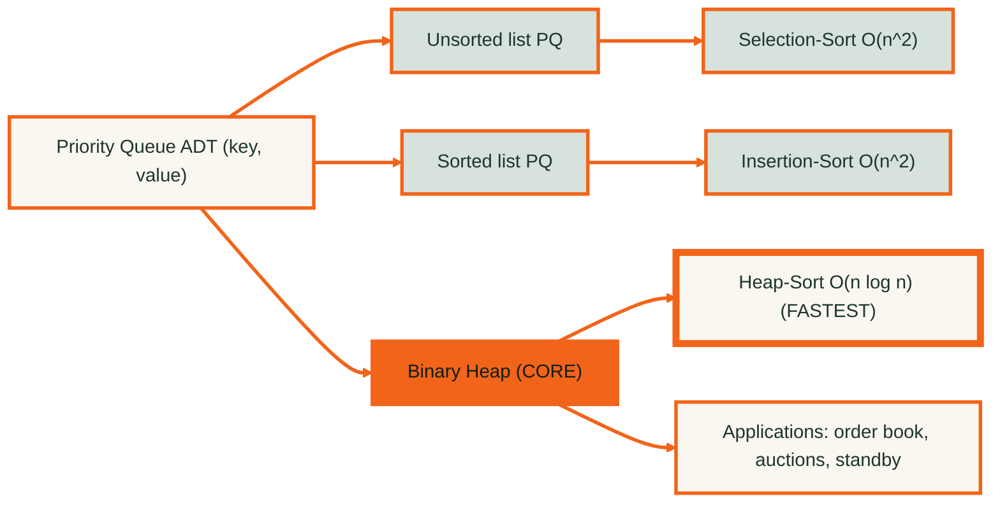
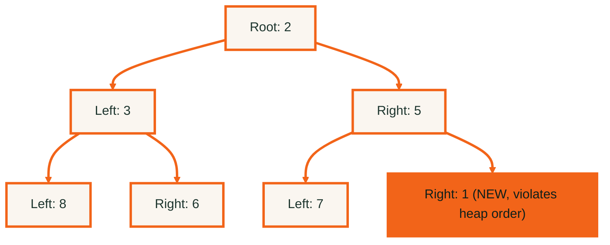
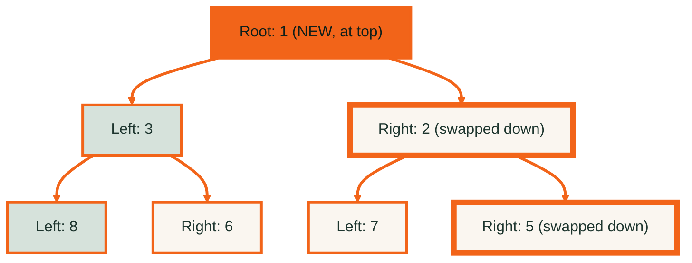

# 02 — Ουρές Προτεραιότητας και Σωροί
*Priority Queues, Binary Heaps, Heap-Sort and Bottom-Up Construction*

Το κεφάλαιο επιλύει το πρόβλημα της αποδοτικής διαχείρισης μιας δυναμικής συλλογής εγγραφών όπου κάθε αφαίρεση αφορά αποκλειστικά την εγγραφή με το ελάχιστο κλειδί. Εξαρτάται από την ασυμπτωτική ανάλυση της Ενότητας [01_analysis_of_algorithms.md](01_analysis_of_algorithms.md) και θεμελιώνει την ταξινόμηση σωρού ([05_sorting_and_lower_bound.md](05_sorting_and_lower_bound.md)), την κωδικοποίηση `Huffman` ([06_greedy_method.md](06_greedy_method.md)), τον αλγόριθμο `Dijkstra` ([10_shortest_paths.md](10_shortest_paths.md)) και τον αλγόριθμο `Prim-Jarnik` ([11_minimum_spanning_trees.md](11_minimum_spanning_trees.md)). Αναπτύσσει δύο υλοποιήσεις ουράς προτεραιότητας βάσει λίστας, τον δυαδικό σωρό σε πίνακα, το θεώρημα ύψους, την κατασκευή από κάτω προς τα πάνω σε γραμμικό χρόνο και τον `Heap-Sort`. Η στοχοθεσία των σημειώσεων είναι η γραπτή εξέταση: ρητοί αλγόριθμοι, πλήρεις χειρόγραφες ιχνηλατήσεις (`hand traces`) και τεκμηριωμένες πολυπλοκότητες προηγούνται κάθε συντομογραφίας υλοποίησης.

> **Εξεταστική κάλυψη:** Πρόοδος και Τελική
> **Κεφάλαιο βιβλίου:** Κεφ. 5 | **Διαλέξεις:** `02_priority_queues.pdf`, `03_heaps.pdf`
> **Πηγή:** `Resources/Meta/mindmap.md` (Ενότητα 02)
> **Εκτός ύλης:** Ενότητα `5.5`

## Πίνακας Περιεχομένων

- [1. Εννοιολογικό Πλαίσιο και Συνολική Εικόνα](#1-εννοιολογικό-πλαίσιο-και-συνολική-εικόνα)
- [2. Θεωρητική Θεμελίωση και Τυπικοί Ορισμοί](#2-θεωρητική-θεμελίωση-και-τυπικοί-ορισμοί)
- [3. Αλγόριθμοι, Ιχνηλάτηση και Κώδικας](#3-αλγόριθμοι-ιχνηλάτηση-και-κώδικας)
- [4. Συγκριτική Ανάλυση και Πολυπλοκότητα](#4-συγκριτική-ανάλυση-και-πολυπλοκότητα)
- [5. Πλήρως Λυμένες Ασκήσεις Εξεταστικού Επιπέδου](#5-πλήρως-λυμένες-ασκήσεις-εξεταστικού-επιπέδου)
- [6. Οδηγός Επιβίωσης στις Εξετάσεις και Παγίδες](#6-οδηγός-επιβίωσης-στις-εξετάσεις-και-παγίδες)
- [7. Συνοπτικός Πίνακας Εννοιών](#7-συνοπτικός-πίνακας-εννοιών)

---

## 1. Εννοιολογικό Πλαίσιο και Συνολική Εικόνα

### Κίνητρο: εξυπηρέτηση κατά προτεραιότητα

Σε ένα βιβλίο συνεχόμενου ορίου εντολών (`continuous limit order book`) ενός χρηματιστηρίου, κάθε εντολή αγοράς είναι μια εγγραφή της οποίας το κλειδί είναι η προσφερόμενη τιμή· σε ισοβαθμία τιμής, δευτερεύον κλειδί είναι ο χρόνος άφιξης. Η μηχανή αντιστοίχισης (`matching engine`) δεν εξυπηρετεί με σειρά `FIFO`, αλλά εξάγει κάθε φορά την εντολή με το ακραίο κλειδί, ενώ νέες εντολές εισέρχονται συνεχώς. Η ίδια απαίτηση εμφανίζεται στις δημοπρασίες (`auctions`), όπου κερδίζει η υψηλότερη προσφορά, και στους επιβάτες πτήσεων σε αναμονή (`standby passengers`), όπου η θέση δίνεται κατά σειρά προτεραιότητας. Κοινό στοιχείο: η δομή πρέπει να υποστηρίζει ταυτόχρονα εισαγωγές και εξαγωγή του ακραίου κλειδιού, όχι μόνο το ένα από τα δύο.

### Συνολική εικόνα των ιδεών του κεφαλαίου



Πορτοκαλί γέμισμα: η κεντρική δομή του κεφαλαίου (ο δυαδικός σωρός, `CORE`). Παχύ περίγραμμα: η ταχύτερη ταξινόμηση που προκύπτει (`FASTEST`). Απαλό πράσινο: οι εναλλακτικές υλοποιήσεις λίστας και οι τετραγωνικές ταξινομήσεις τους.

| Κόμβος διαγράμματος | Ρόλος | Πολυπλοκότητα `PQ-Sort` |
|---|---|---|
| Μη ταξινομημένη λίστα | `insert` $O(1)$, `removeMin` $O(n)$ | `Selection-Sort` $O(n^2)$ |
| Ταξινομημένη λίστα | `insert` $O(n)$, `removeMin` $O(1)$ | `Insertion-Sort` $O(n^2)$ |
| Δυαδικός σωρός (`CORE`) | και οι δύο $O(\log n)$ | `Heap-Sort` $O(n \log n)$ |

### Πότε να χρησιμοποιήσετε τι

Ο κανόνας επιλογής προκύπτει από το πού συγκεντρώνεται το κόστος. Αν ο φόρτος κυριαρχείται από `insert` και οι `removeMin` είναι σπάνιες, η μη ταξινομημένη λίστα δίνει $O(1)$ ανά εισαγωγή. Αν κυριαρχούν οι `min` ή `removeMin`, η ταξινομημένη λίστα δίνει $O(1)$ ανά εξαγωγή. Αν και οι δύο λειτουργίες είναι συχνές ή το $n$ είναι μεγάλο, ο δυαδικός σωρός είναι η μόνη επιλογή με εγγυημένο $O(\log n)$ χειρότερης περίπτωσης (`worst-case`) και για τις δύο. Αν απαιτείται εγγυημένο $O(1)$ στη χειρότερη περίπτωση μόνο για αναζήτηση κλειδιού, η απάντηση δεν ανήκει σε αυτό το κεφάλαιο αλλά στον κατακερματισμό κούκου της Ενότητας [03_maps_hash_tables_cuckoo.md](03_maps_hash_tables_cuckoo.md).

Οι σωροί τροφοδοτούν απευθείας την ταξινόμηση σωρού ([05_sorting_and_lower_bound.md](05_sorting_and_lower_bound.md)), τη συγχώνευση δέντρων ελάχιστης συχνότητας στον `Huffman` ([06_greedy_method.md](06_greedy_method.md)), την εξαγωγή της ελάχιστης απόστασης στον `Dijkstra` ([10_shortest_paths.md](10_shortest_paths.md)) και την εξαγωγή της ελαφρύτερης ακμής στον `Prim-Jarnik` ([11_minimum_spanning_trees.md](11_minimum_spanning_trees.md)). Ο χάρτης εξαρτήσεων όλων των ενοτήτων βρίσκεται στην [00_course_map_and_exam_scope.md](00_course_map_and_exam_scope.md).

---

## 2. Θεωρητική Θεμελίωση και Τυπικοί Ορισμοί

### 2.1 ΑΤΔ Ουράς Προτεραιότητας

Μια **ουρά προτεραιότητας (`Priority Queue`)** είναι ένας **αφηρημένος τύπος δεδομένων (`Abstract Data Type, ADT`)** που αποθηκεύει μια συλλογή από **εγγραφές (`entry`)** της μορφής $(\text{κλειδί}, \text{τιμή})$ (`(key, value)`). Το κλειδί καθορίζει τη σειρά εξυπηρέτησης· η τιμή είναι το ωφέλιμο φορτίο που δεν συμμετέχει στις συγκρίσεις. Ο ΑΤΔ ορίζεται από τις μεθόδους του πίνακα που ακολουθεί.

| Μέθοδος | Είσοδος | Έξοδος | Λειτουργία |
|---|---|---|---|
| `insert(k, v)` | κλειδί $k$, τιμή $v$ | καμία | εισάγει την εγγραφή $(k, v)$ |
| `removeMin()` | καμία | εγγραφή | αφαιρεί και επιστρέφει την εγγραφή με το ελάχιστο κλειδί |
| `min()` | καμία | εγγραφή | επιστρέφει την εγγραφή με το ελάχιστο κλειδί χωρίς αφαίρεση |
| `size()` | καμία | ακέραιος | πλήθος εγγραφών |
| `isEmpty()` | καμία | Boolean | αν η δομή είναι κενή |

Η `removeMin()` προϋποθέτει μη κενή δομή· η `min()` σε κενή δομή δεν ορίζεται. Στις ιχνηλατήσεις που ακολουθούν οι τιμές παραλείπονται και κάθε εγγραφή ταυτίζεται με το ακέραιο κλειδί της· σε πλήρη υλοποίηση κάθε θέση του πίνακα αποθηκεύει την εγγραφή $(k, v)$ και κάθε σύγκριση γίνεται ως προς το $k$.

### 2.2 Ολική διάταξη

**Ορισμός.** Μια **ολική διάταξη (`Total Order`)** επί ενός συνόλου κλειδιών είναι μια δυαδική σχέση $\le$ που ικανοποιεί τέσσερα αξιώματα. Ο ορισμός προηγείται της αιτιολόγησης: χωρίς συγκρισιμότητα δεν υπάρχει μοναδικό ελάχιστο και η `removeMin()` δεν είναι καλώς ορισμένη.

| Αξίωμα | Διατύπωση | Αιτιολόγηση | Αριθμητικό παράδειγμα |
|---|---|---|---|
| Ανακλαστική (`reflexive`) | $x \le x$ | κάθε κλειδί συγκρίνεται με τον εαυτό του | $5 \le 5$ |
| Αντισυμμετρική (`antisymmetric`) | $x \le y \;\land\; y \le x \Rightarrow x = y$ | αποκλείει δύο διαφορετικά κλειδιά να προηγούνται αμοιβαία | $4 \le 4 \Rightarrow 4 = 4$ |
| Μεταβατική (`transitive`) | $x \le y \;\land\; y \le z \Rightarrow x \le z$ | επιτρέπει αλυσιδωτό συμπέρασμα συγκρίσεων | $2 \le 5 \land 5 \le 9 \Rightarrow 2 \le 9$ |
| Συγκρισιμότητα (`comparability`) | $x \le y \;\lor\; y \le x$ | κάθε ζεύγος συγκρίνεται, άρα υπάρχει ελάχιστο | για $3, 7$ ισχύει $3 \le 7$ |

Αντιπαράδειγμα απουσίας ολικής διάταξης: η σχέση «διαιρεί» επί των $\{2, 3\}$ δεν είναι συγκρίσιμη, αφού ούτε $2 \mid 3$ ούτε $3 \mid 2$· μια τέτοια σχέση δεν μπορεί να στηρίξει ουρά προτεραιότητας. Στο συγκεκριμένο `order book` η σύνθετη διάταξη είναι λεξικογραφική ως προς $(\text{τιμή}, \text{χρόνος})$, η οποία είναι ολική.

### 2.3 Ιδιότητα σειράς σωρού και πλήρες δυαδικό δέντρο

Ένας **δυαδικός σωρός (`Binary Heap`)** $T$ είναι ένα **πλήρες δυαδικό δέντρο (`complete binary tree`)** που ικανοποιεί την **ιδιότητα σειράς σωρού (`heap-order property`)**:

$$\text{key}(v) \ge \text{key}(\text{parent}(v))$$

για κάθε κόμβο $v$ εκτός της ρίζας.

- **Κανόνας πληρότητας:** στο βάθος $i$ υπάρχουν ακριβώς $2^i$ κόμβοι για $0 \le i \le h-1$, και στο βάθος $h-1$ όλοι οι εσωτερικοί κόμβοι βρίσκονται αριστερά των εξωτερικών. Λόγος: η πληρότητα εγγυάται ότι το δέντρο χωρά σε συνεχόμενο πίνακα χωρίς κενά.
- **Τελευταίος κόμβος (`last node`):** ο δεξιότερος κόμβος στο μέγιστο βάθος. Παράδειγμα: σε σωρό $7$ κλειδιών ο τελευταίος κόμβος είναι η θέση $7$.
- **Πόρισμα με απόδειξη με επαγωγή:** το ελάχιστο κλειδί βρίσκεται πάντα στη ρίζα. Βάση ($d = 0$): η ρίζα έχει το ελάχιστο κλειδί μεταξύ των κόμβων βάθους $0$. Επαγωγικό βήμα: αν ο κόμβος $u$ στο βάθος $d$ ικανοποιεί $\text{key}(u) \ge \text{key}(\text{root})$, τότε κάθε παιδί $v$ του $u$ ικανοποιεί $\text{key}(v) \ge \text{key}(u) \ge \text{key}(\text{root})$. Άρα κάθε κόμβος έχει κλειδί τουλάχιστον ίσο με της ρίζας, και το `min()` κοστίζει $O(1)$.

> **Προσοχή:** η ιδιότητα σειράς δεν επιβάλλει διάταξη μεταξύ αδελφών. Στον έγκυρο σωρό $[1, 3, 2, 8, 6, 7, 5]$ το αριστερό παιδί ($3$) είναι μεγαλύτερο από το δεξί ($2$)· αυτό διακρίνει τον σωρό από ένα δυαδικό δέντρο αναζήτησης (`Binary Search Tree, BST`).

### 2.4 Θεώρημα ύψους

**Θεώρημα (ύψος σωρού).** Κάθε σωρός με $n$ κλειδιά ικανοποιεί $n \ge 2^h$, επομένως το ύψος του είναι $h \le \log n = O(\log n)$, όπου $h$ είναι το μέγιστο βάθος με τη ρίζα στο βάθος $0$.

**Απόδειξη.** Έστω σωρός ύψους $h$. Από τον κανόνα πληρότητας, τα επίπεδα $0, 1, \dots, h-1$ είναι πλήρως συμπληρωμένα, άρα περιέχουν

$$
2^0 + 2^1 + \cdots + 2^{h-1} = 2^h - 1
$$

κόμβους. Επειδή το ύψος είναι ακριβώς $h$, το επίπεδο $h$ περιέχει τουλάχιστον έναν κόμβο (τον τελευταίο κόμβο). Συνεπώς

$$
n \ge (2^h - 1) + 1 = 2^h.
$$

Παίρνοντας λογάριθμο με βάση $2$ και από τις δύο πλευρές προκύπτει $\log n \ge h$, δηλαδή $h \le \log n$. Επειδή το $h$ είναι ακέραιος, ισχύει το ακριβές $h = \lfloor \log_2 n \rfloor$. $\blacksquare$

| $n$ | $\lfloor \log_2 n \rfloor = h$ | $2^h$ | Έλεγχος $n \ge 2^h$ |
|---|---|---|---|
| $7$ | $2$ | $4$ | $7 \ge 4$ |
| $15$ | $3$ | $8$ | $15 \ge 8$ |
| $1000$ | $9$ | $512$ | $1000 \ge 512$ |

Το θεώρημα είναι το θεμέλιο όλων των πολυπλοκοτήτων του κεφαλαίου: κάθε `upheap` και κάθε `downheap` διασχίζει μία μόνο διαδρομή ρίζας-φύλλου, μήκους το πολύ $h \le \log n$.

### 2.5 Αναπαράσταση με πίνακα (1-indexed)

Ο σωρός αποθηκεύεται σε **πίνακα με δεικτοδότηση από το 1 (`1-indexed array`)** $A$, χωρίς δείκτες προς κόμβους. Για τον κόμβο στη θέση $i$ ισχύει:

$$\text{left}(i) = 2i, \qquad \text{right}(i) = 2i + 1, \qquad \text{parent}(i) = \left\lfloor \frac{i}{2} \right\rfloor.$$

| Κανόνας | Τύπος | Αιτιολόγηση | Παράδειγμα ($i = 3$) |
|---|---|---|---|
| Αριστερό παιδί | $2i$ | τα παιδιά καταλαμβάνουν δύο συνεχόμενες θέσεις | $6$ |
| Δεξί παιδί | $2i + 1$ | αμέσως μετά το αριστερό | $7$ |
| Γονέας | $\lfloor i/2 \rfloor$ | αντίστροφη απεικόνιση | $1$ |
| Προσθήκη | θέση $n + 1$ | ο νέος κόμβος γίνεται ο νέος τελευταίος | — |
| Αφαίρεση | θέση $n$ | ο τελευταίος κόμβος εγκαταλείπει το δέντρο | — |

| Θέση $i$ | 1 | 2 | 3 | 4 | 5 | 6 | 7 |
|---|---|---|---|---|---|---|---|
| Παιδιά | $2, 3$ | $4, 5$ | $6, 7$ | — | — | — | — |
| Γονέας | — | $1$ | $1$ | $2$ | $2$ | $3$ | $3$ |

Η θέση $0$ μένει αχρησιμοποίητη ώστε ο πολλαπλασιασμός επί $2$ να δίνει απευθείας το αριστερό παιδί. Ο χώρος είναι $O(n)$.

### 2.6 Θεώρημα κατασκευής από κάτω προς τα πάνω σε $O(n)$

**Θεώρημα (`Bottom-Up Heap Construction`).** Η κατασκευή σωρού από κάτω προς τα πάνω (`bottom-up heap construction`) για $n = 2^h - 1$ κλειδιά απαιτεί $O(n)$ χρόνο στη **χειρότερη περίπτωση (`worst-case`)**.

**Απόδειξη (επιχείρημα φάσεων).** Η κατασκευή εκτελεί `downheap` σε κάθε εσωτερικό κόμβο, ομαδοποιημένους σε φάσεις $i = 1, \dots, h$ από τα φύλλα προς τη ρίζα. Στη φάση $i$ συγχωνεύονται ζεύγη σωρών με $2^i - 1$ κλειδιά σε σωρούς με $2^{i+1} - 1$ κλειδιά· υπάρχουν $2^{h-i}$ τέτοιες συγχωνεύσεις και καθεμία εκτελεί `downheap` μήκους το πολύ $2i$ συγκρίσεων (το πολύ $i$ ανταλλαγές, δύο συγκρίσεις ανά επίπεδο). Συνολικός χρόνος:

$$
T(n) \le \sum_{i=1}^{h} 2^{h-i} \cdot 2i = 2 \cdot 2^h \sum_{i=1}^{h} \frac{i}{2^i}.
$$

Από την ταυτότητα $\sum_{i=1}^{\infty} i/2^i = 2$ προκύπτει

$$
T(n) \le 2 \cdot 2^h \cdot 2 = 4 \cdot 2^h \le 4n = O(n),
$$

όπου το τελευταίο βήμα χρησιμοποιεί $2^h \le n$ από το θεώρημα ύψους. $\blacksquare$

Για $n = 15$ ($h = 3$) οι όροι είναι: φάση $1$: $2^{2} \cdot 2 = 8$, φάση $2$: $2^{1} \cdot 4 = 8$, φάση $3$: $2^{0} \cdot 6 = 6$, σύνολο $22 \le 4 \cdot 2^3 = 32 \le 4 \cdot 15 = 60$. Ένα δεύτερο, δομικό επιχείρημα («πρώτα δεξιά και μετά πάντα αριστερά», κάθε κόμβος σε το πολύ $2$ διαδρομές) αναπτύσσεται στην Άσκηση 3.

**Επίδραση στον `Heap-Sort`.** Η `Bottom-Up` επιταχύνει **μόνο τη φάση 1** (κατασκευή) από $O(n \log n)$, που θα κόστιζαν $n$ διαδοχικές `insert`, σε $O(n)$. Η φάση 2 ($n$ κλήσεις `removeMin`) παραμένει $O(n \log n)$, επομένως ο συνολικός `Heap-Sort` παραμένει $O(n \log n)$. Ο ισχυρισμός «η `Bottom-Up` κάνει τον `Heap-Sort` $O(n)$» είναι λανθασμένος.

> Εκτός ύλης: Η Ενότητα `5.5` του Κεφ. 5 δεν διδάσκεται και δεν εξετάζεται· δεν αναπτύσσεται παρακάτω.

---

## 3. Αλγόριθμοι, Ιχνηλάτηση και Κώδικας

**Κανόνας ισοβαθμίας (`tie-breaking`) για όλες τις ιχνηλατήσεις:** σε ίσα κλειδιά η `downheap` επιλέγει το αριστερό παιδί και δεν ανταλλάσσει τον γονέα όταν $\text{key}(\text{parent}) \le \text{key}(\text{child})$. Όλα τα παραδείγματα χρησιμοποιούν διακριτά κλειδιά, ώστε το αποτέλεσμα κάθε βήματος να είναι μοναδικό. Οι ανταλλαγές σημειώνονται ως ζεύγος $(\text{γονέας}, \text{παιδί})$ θέσεων του πίνακα.

### 3.1 `PQ-Sort` με λίστες: `Selection-Sort` και `Insertion-Sort`

**Σκοπός.** Η γενική μέθοδος `PQ-Sort` ταξινομεί μια ακολουθία εισάγοντας όλα τα κλειδιά σε μια ουρά προτεραιότητας και εξάγοντάς τα με διαδοχικές `removeMin()`. Η επιλογή της υλοποίησης της ουράς καθορίζει τον αλγόριθμο ταξινόμησης που προκύπτει.

```text
Algorithm PQ-Sort(S, P):
Input: Ακολουθία S με n κλειδιά, κενή ουρά προτεραιότητας P
Output: Τα κλειδιά του S σε αύξουσα σειρά

while S is not empty do
    e ← S.removeFirst()
    P.insert(e.key, e.value)        // Φάση 1: n εισαγωγές
while P.isEmpty() = false do
    e ← P.removeMin()               // Φάση 2: n αφαιρέσεις ελαχίστου
    S.insertLast(e)
return S
```

| Υλοποίηση $P$ | `insert` | `removeMin` | Φάση 1 | Φάση 2 | Ταξινόμηση | Σύνολο |
|---|---|---|---|---|---|---|
| Μη ταξινομημένη λίστα | $O(1)$ | $O(n)$ | $O(n)$ | $O(n^2)$ | **Ταξινόμηση με επιλογή (`Selection-Sort`)** | $O(n^2)$ |
| Ταξινομημένη λίστα | $O(n)$ | $O(1)$ | $O(n^2)$ | $O(n)$ | **Ταξινόμηση με εισαγωγή (`Insertion-Sort`)** | $O(n^2)$ |

**Ιχνηλάτηση `Selection-Sort`** στην είσοδο $[5, 2, 9, 1, 7]$ (η μη ταξινομημένη λίστα σαρώνεται ολόκληρη σε κάθε `removeMin`):

| Εξαγωγή | Υποψήφια σάρωση | Ελάχιστο | Κατάσταση μετά |
|---|---|---|---|
| 1η | $5, 2, 9, 1, 7$ | $1$ | $[1, 2, 9, 5, 7]$ |
| 2η | $2, 9, 5, 7$ | $2$ | $[1, 2, 9, 5, 7]$ |
| 3η | $9, 5, 7$ | $5$ | $[1, 2, 5, 9, 7]$ |
| 4η | $9, 7$ | $7$ | $[1, 2, 5, 7, 9]$ |

Και οι δύο ταξινομήσεις είναι **επί τόπου (`in-place`)** με επιπλέον χώρο $O(1)$. Ο `Selection-Sort` εκτελεί $n(n-1)/2$ συγκρίσεις ανεξάρτητα από την είσοδο, άρα $O(n^2)$ στη χειρότερη, καλύτερη και αναμενόμενη περίπτωση· ο `Insertion-Sort` έχει $O(n)$ στην καλύτερη περίπτωση (ήδη ταξινομημένη είσοδος) και $O(n^2)$ στη χειρότερη.

**Ρητός αλγόριθμος (αυτό που ζητά η εξέταση):**

```python
def selectionSort(items: list[int]) -> list[int]:
    """Sorts a list in place by repeatedly extracting the minimum.

    Args:
        items (list[int]): The list to sort. It is modified in place.

    Returns:
        list[int]: The same list object, sorted in non-decreasing order.
    """
    n = len(items)
    for start in range(n - 1):
        min_index = start
        for j in range(start + 1, n):
            if items[j] < items[min_index]:
                min_index = j
        # The unsorted list PQ makes each removeMin a full scan of the suffix.
        items[start], items[min_index] = items[min_index], items[start]
    return items


def insertionSort(items: list[int]) -> list[int]:
    """Sorts a list in place by inserting each key into a sorted prefix.

    Args:
        items (list[int]): The list to sort. It is modified in place.

    Returns:
        list[int]: The same list object, sorted in non-decreasing order.
    """
    for start in range(1, len(items)):
        key = items[start]
        j = start - 1
        while j >= 0 and items[j] > key:
            items[j + 1] = items[j]
            j -= 1
        items[j + 1] = key
    return items


assert selectionSort([5, 2, 9, 1, 7]) == [1, 2, 5, 7, 9]
assert insertionSort([5, 2, 9, 1, 7]) == [1, 2, 5, 7, 9]
```

**Pythonic ιδίωμα (`idiom`, μόνο ως επαλήθευση):**

```python
data = [5, 2, 9, 1, 7]
ascending = sorted(data)   # new list, original untouched
data.sort()                # in place, returns None
```

| Μορφή | Χρόνος | Επιπλέον χώρος | Τροποποιεί είσοδο | Σημείωση |
|---|---|---|---|---|
| `selectionSort` / `insertionSort` | $O(n^2)$ χειρότερη | $O(1)$ | ναι | η μορφή που ζητά η εξέταση |
| `sorted(data)` | $O(n \log n)$ χειρότερη | $O(n)$ | όχι | κρύβει μία πλήρη αντιγραφή |
| `data.sort()` | $O(n \log n)$ χειρότερη | $O(1)$ έως $O(n)$ | ναι | επί-τόπου |

> **Προσοχή:** οι `sorted` και `list.sort` της CPython υλοποιούν `Timsort` (σταθερός, $O(n \log n)$ χειρότερη), όχι τους $O(n^2)$ αλγορίθμους του κεφαλαίου. Στην εξέταση γράφεται ο ρητός αλγόριθμος και η ιχνηλάτησή του· το ιδίωμα είναι μόνο διασταύρωση.

### 3.2 `insert` και `upheap`

**Σκοπός.** Εισάγει ένα νέο κλειδί στον νέο τελευταίο κόμβο και αποκαθιστά την ιδιότητα σειράς με **ανάβαση (`upheap`)**.

```text
Algorithm insert(k, v):
Input: Κλειδί k και τιμή v
Output: Καμία· η εγγραφή (k, v) προστίθεται στον σωρό

n ← n + 1
z ← νέος κόμβος στη θέση n (ο νέος τελευταίος κόμβος)
store (k, v) στον z
upheap(z)

Algorithm upheap(z):
while z is not the root do
    p ← parent(z)
    if key(p) <= k then break        // Ιδιότητα σειράς αποκαταστάθηκε
    swap τα κλειδιά των z και p
    z ← p
```

**Ιχνηλάτηση 7 διαδοχικών `insert`** με ακολουθία κλειδιών $6, 5, 3, 8, 2, 7, 1$. Ο πίνακας είναι 1-indexed· οι ανταλλαγές δίνονται ως $(\text{γονέας}, \text{παιδί})$.

| Βήμα | `insert(k)` | Ανταλλαγές `upheap` | Πίνακας $A[1..n]$ μετά |
|---|---|---|---|
| 1 | $6$ | καμία | $[6]$ |
| 2 | $5$ | $(1,2)$ | $[5, 6]$ |
| 3 | $3$ | $(1,3)$ | $[3, 6, 5]$ |
| 4 | $8$ | καμία | $[3, 6, 5, 8]$ |
| 5 | $2$ | $(2,5),\ (1,2)$ | $[2, 3, 5, 8, 6]$ |
| 6 | $7$ | καμία | $[2, 3, 5, 8, 6, 7]$ |
| 7 | $1$ | $(3,7),\ (1,3)$ | $[1, 3, 2, 8, 6, 7, 5]$ |

Επαλήθευση ιδιότητας στον τελικό σωρό $[1, 3, 2, 8, 6, 7, 5]$: $1 \le 3$, $1 \le 2$, $3 \le 8$, $3 \le 6$, $2 \le 7$, $2 \le 5$. Η θέση $3$ ($2$) είναι μικρότερη από τη θέση $2$ ($3$), γεγονός έγκυρο επειδή η ιδιότητα αφορά μόνο ζεύγη γονέα-παιδιού.

**Παράδειγμα πριν και μετά μία `upheap`** (εισαγωγή του κλειδιού $1$ στον σωρό $6$ κλειδιών $[2, 3, 5, 8, 6, 7]$).

Δέντρο **πριν** την `upheap`: το νέο κλειδί $1$ βρίσκεται στον νέο τελευταίο κόμβο (θέση $7$) και παραβιάζει την ιδιότητα, αφού ο γονέας του (θέση $3$, κλειδί $5$) είναι μεγαλύτερος.



Πορτοκαλί γέμισμα: το νέο κλειδί $1$ στον τελευταίο κόμβο (`NEW`) πριν την ανάβαση. Οι υπόλοιποι κόμβοι αποτελούν ήδη έγκυρο σωρό $6$ κλειδιών.

Δέντρο **μετά** την `upheap` (ανταλλαγές $(3,7)$ και $(1,3)$): το $1$ έχει ανέβει στη ρίζα.



Πορτοκαλί γέμισμα: κόμβος εστίασης (το νέο κλειδί $1$ πλέον στη ρίζα). Παχύ περίγραμμα: κόμβοι που ανταλλάχθηκαν κατά την `upheap` (θέσεις $3$ και $7$). Απαλό πράσινο: δευτερεύον πλαίσιο.

**Μορφή πίνακα** για το ίδιο βήμα:

| Θέση $i$ | 1 | 2 | 3 | 4 | 5 | 6 | 7 |
|---|---|---|---|---|---|---|---|
| Πριν ($A$) | $2$ | $3$ | $5$ | $8$ | $6$ | $7$ | $1$ |
| Μετά ($A$) | $1$ | $3$ | $2$ | $8$ | $6$ | $7$ | $5$ |

**Πολυπλοκότητα, γραμμή προς γραμμή.** Η τοποθέτηση στη θέση $n+1$ κοστίζει $O(1)$. Κάθε επανάληψη της `upheap` εκτελεί μία σύγκριση και, το πολύ, μία ανταλλαγή, δηλαδή $O(1)$, και ανεβαίνει ένα επίπεδο. Το πλήθος των επιπέδων είναι το πολύ $h \le \log n$ (Θεώρημα 2.4). Άρα $\text{insert} = O(1) + h \cdot O(1) = O(\log n)$ στη χειρότερη περίπτωση· στην καλύτερη περίπτωση (νέο κλειδί $\ge$ γονέα) είναι $O(1)$. **Δυαδική μορφή κώδικα:** η ρητή κλάση `ArrayHeap` και το ιδίωμα `heapq` δίνονται στην Ενότητα 3.4.

### 3.3 `removeMin` και `downheap`

**Σκοπός.** Αφαιρεί την εγγραφή της ρίζας, μεταφέρει τον τελευταίο κόμβο στη ρίζα και αποκαθιστά την ιδιότητα σειράς με **κατάβαση (`downheap`)**.

```text
Algorithm removeMin():
Input: Μη κενός σωρός
Output: Η εγγραφή με το ελάχιστο κλειδί

minEntry ← entry(στη ρίζα)
w ← entry(στον τελευταίο κόμβο, θέση n)
αφαίρεση του τελευταίου κόμβου
n ← n - 1
if n >= 1 then
    store w στη ρίζα                 // Υποχρεωτική επαναφορά του w
    downheap(ρίζα)
return minEntry

Algorithm downheap(z):
while z έχει τουλάχιστον ένα παιδί do
    c ← το παιδί του z με το ΜΙΚΡΟΤΕΡΟ κλειδί
    if key(z) <= key(c) then break  // Ιδιότητα σειράς αποκαταστάθηκε
    swap τα κλειδιά των z και c
    z ← c
```

**Ιχνηλάτηση δύο διαδοχικών `removeMin`** πάνω στον τελικό σωρό της Ενότητας 3.2, $[1, 3, 2, 8, 6, 7, 5]$. Κανόνας: σε κάθε βήμα επιλέγεται το **μικρότερο** παιδί.

| `removeMin` | $w$ (τελευταίος κόμβος) | Επιστρέφεται | Αποφάσεις `downheap` | Ανταλλαγές | Πίνακας $A[1..n]$ μετά |
|---|---|---|---|---|---|
| 1η | $5$ (θέση $7$) | $1$ | ρίζα $5$: παιδιά $3, 2$, μικρότερο το $2$ (θέση $3$), $5 > 2$ άρα swap· θέση $3$: παιδί $7$, $5 \le 7$ άρα stop | $(1,3)$ | $[2, 3, 5, 8, 6, 7]$ |
| 2η | $7$ (θέση $6$) | $2$ | ρίζα $7$: παιδιά $3, 5$, μικρότερο το $3$ (θέση $2$), $7 > 3$ άρα swap· θέση $2$: παιδιά $8, 6$, μικρότερο το $6$ (θέση $5$), $7 > 6$ άρα swap· stop | $(1,2),\ (2,5)$ | $[3, 6, 5, 8, 7]$ |

> **Μνημονικό:** «`downheap` ανταλλάσσει με το ΜΙΚΡΟΤΕΡΟ παιδί». Η ανταλλαγή με το μεγαλύτερο παιδί θα τοποθετούσε ένα μεγάλο κλειδί πάνω από ένα μικρό και θα παραβίαζε την ιδιότητα σειράς.

**Πολυπλοκότητα, γραμμή προς γραμμή.** Αποθήκευση του ελαχίστου, `pop` του τελευταίου και επαναφορά στη ρίζα: $O(1)$. Κάθε επανάληψη της `downheap` κάνει το πολύ δύο συγκρίσεις (εύρεση μικρότερου παιδιού, σύγκριση με τον γονέα) και μία ανταλλαγή, δηλαδή $O(1)$, και κατεβαίνει ένα επίπεδο. Το πλήθος επιπέδων είναι το πολύ $h \le \log n$. Άρα $\text{removeMin} = O(1) + h \cdot O(1) = O(\log n)$ χειρότερη. Οι `min`, `size`, `isEmpty` είναι $O(1)$. **Δυαδική μορφή κώδικα:** βλ. Ενότητα 3.4.

### 3.4 Δυαδική μορφή κώδικα: κλάση `ArrayHeap` έναντι `heapq`

**Ρητός αλγόριθμος (κλάση `ArrayHeap`, 1-indexed πίνακας).** Η βοηθητική `downheapWithin` περιέχει τον πυρήνα της κατάβασης και επαναχρησιμοποιείται από την κατασκευή `Bottom-Up` και τον επί-τόπου `Heap-Sort` στη συνέχεια.

```python
def downheapWithin(a: list[int | None], i: int, n: int) -> None:
    """Sifts position i down within a[1..n] to restore heap order.

    Args:
        a (list[Optional[int]]): 1-indexed array; index 0 is an unused sentinel.
        i (int): Position from which the sift starts.
        n (int): Inclusive upper index of the current heap.
    """
    while 2 * i <= n:
        left, right = 2 * i, 2 * i + 1
        small = left
        if right <= n and a[right] < a[left]:
            small = right
        # Swapping with the SMALLER child keeps each sub-heap minimum on top.
        if a[i] <= a[small]:
            break
        a[i], a[small] = a[small], a[i]
        i = small


class ArrayHeap:
    """A 1-indexed min-heap priority queue backed by an array.

    Attributes:
        data (list[Optional[int]]): Stored keys; index 0 is unused so that the
            children of position i land at 2i and 2i + 1 without pointers.
    """

    def __init__(self) -> None:
        """Initializes an empty heap."""
        self.data: list[int | None] = [None]

    def size(self) -> int:
        """Returns the number of stored keys.

        Returns:
            int: The current count of keys.
        """
        return len(self.data) - 1

    def isEmpty(self) -> bool:
        """Checks whether the heap is empty.

        Returns:
            bool: True when no keys are stored.
        """
        return self.size() == 0

    def min(self) -> int:
        """Returns the minimum key without removing it.

        Returns:
            int: The key at the root.

        Raises:
            IndexError: If the heap is empty.
        """
        if self.isEmpty():
            raise IndexError("min from empty heap")
        return self.data[1]  # type: ignore[return-value]

    def insert(self, key: int) -> None:
        """Inserts a key and restores heap order with upheap.

        Args:
            key (int): The key to insert.
        """
        self.data.append(key)
        i = self.size()
        while i > 1:
            parent = i // 2
            # Only a parent-child violation requires a swap.
            if self.data[parent] <= self.data[i]:
                break
            self.data[parent], self.data[i] = self.data[i], self.data[parent]
            i = parent

    def downheap(self, i: int) -> None:
        """Sifts position i down over the current heap size.

        Args:
            i (int): Position from which the sift starts.
        """
        downheapWithin(self.data, i, self.size())

    def removeMin(self) -> int:
        """Removes and returns the minimum key.

        Returns:
            int: The key that was at the root.

        Raises:
            IndexError: If the heap is empty.
        """
        if self.isEmpty():
            raise IndexError("removeMin from empty heap")
        result = self.data[1]
        last = self.data.pop()
        if not self.isEmpty():
            # The last node must be restored at the root before downheap.
            self.data[1] = last
            self.downheap(1)
        return result  # type: ignore[return-value]


h = ArrayHeap()
for k in [6, 5, 3, 8, 2, 7, 1]:
    h.insert(k)
assert h.data[1:] == [1, 3, 2, 8, 6, 7, 5]
assert h.min() == 1
assert h.removeMin() == 1
assert h.data[1:] == [2, 3, 5, 8, 6, 7]
assert h.removeMin() == 2
assert h.data[1:] == [3, 6, 5, 8, 7]
assert [h.removeMin() for _ in range(h.size())] == [3, 5, 6, 7, 8]
assert h.isEmpty()
```

**Pythonic ιδίωμα (`heapq`, μόνο ως διασταύρωση):**

```python
import heapq

q: list[int] = []
for k in [6, 5, 3, 8, 2, 7, 1]:
    heapq.heappush(q, k)
assert q == [1, 3, 2, 8, 6, 7, 5]
assert [heapq.heappop(q) for _ in range(len(q))] == [1, 2, 3, 5, 6, 7, 8]
```

> **Προσοχή (υποχρεωτική):** το `heapq` είναι **0-indexed min-heap** με παιδιά $2i+1$ και $2i+2$, ενώ το μάθημα χρησιμοποιεί **1-indexed** πίνακα με παιδιά $2i$ και $2i+1$. Το `heapq` δεν διαθέτει `decrease-key`· γι' αυτό ο `Dijkstra` ([10_shortest_paths.md](10_shortest_paths.md)) και ο `Prim-Jarnik` ([11_minimum_spanning_trees.md](11_minimum_spanning_trees.md)) με `heapq` χρησιμοποιούν **lazy deletion** (εισαγωγή νέου ζεύγους αντί για μείωση κλειδιού). Η εσωτερική διάταξη του `heapq` για την ίδια ακολουθία εισαγωγών ταυτίζεται με εκείνη του 1-indexed πίνακα (όπως επαληθεύουν οι `assert`), αλλά η σύμβαση δεικτών διαφέρει.

| Μορφή | Χρόνος | Επιπλέον χώρος | Τροποποιεί είσοδο | Σημείωση |
|---|---|---|---|---|
| `ArrayHeap.insert` / `removeMin` | $O(\log n)$ χειρότερη | $O(n)$ | ναι | η μορφή που ζητά η εξέταση (1-indexed, με `upheap`/`downheap`) |
| `heapq.heappush` / `heappop` | $O(\log n)$ χειρότερη | $O(n)$ | ναι | 0-indexed, χωρίς `decrease-key` |
| `heapq.heapify` | $O(n)$ χειρότερη | $O(1)$ | ναι | ισοδύναμο της `Bottom-Up` |
| `[heapq.heappop(h) for _ in range(len(h))]` | $O(n \log n)$ | $O(n)$ (νέα λίστα) | καταναλώνει τον σωρό | εξωτερική `Heap-Sort`, όχι επί-τόπου |

Στην εξέταση γράφεται ο ρητός αλγόριθμος `ArrayHeap` και η ιχνηλάτησή του· το `heapq` λειτουργεί αποκλειστικά ως επαλήθευση του αποτελέσματος.

### 3.5 Κατασκευή σωρού από κάτω προς τα πάνω (`Bottom-Up`)

**Σκοπός.** Κατασκευάζει σωρό από έναν μη ταξινομημένο πίνακα σε $O(n)$, αντί του $O(n \log n)$ των $n$ διαδοχικών `insert`.

```text
Algorithm BottomUpHeap(S):
Input: Ακολουθία S με n = 2^h - 1 κλειδιά
Output: Σωρός T με τα κλειδιά του S

κατασκευή πλήρους δυαδικού δέντρου T με τα κλειδιά σε σειρά επιπέδων (level order)
for i ← floor(n/2) downto 1 do      // Εσωτερικοί κόμβοι, δεξιά προς αριστερά
    downheap(κόμβος στη θέση i)
return T
```

**Ιχνηλάτηση 15 κλειδιών, φάση προς φάση.** Είσοδος (φθίνουσα, ώστε κάθε `downheap` να είναι ορατή):

$$[16, 15, 14, 13, 12, 11, 10, 9, 8, 7, 6, 5, 4, 3, 2].$$

Οι εσωτερικοί κόμβοι είναι οι θέσεις $1$ έως $\lfloor 15/2 \rfloor = 7$ και επεξεργάζονται με φθίνουσα σειρά $7, 6, 5, 4, 3, 2, 1$.

| Φάση $i$ | Βάθος | Κόμβος $i$ | Ανταλλαγές `downheap` | Πίνακας $A[1..15]$ μετά |
|---|---|---|---|---|
| 1 | 2 | $7$ | $(7,15)$ | $[16, 15, 14, 13, 12, 11, 2, 9, 8, 7, 6, 5, 4, 3, 10]$ |
| 1 | 2 | $6$ | $(6,13)$ | $[16, 15, 14, 13, 12, 4, 2, 9, 8, 7, 6, 5, 11, 3, 10]$ |
| 1 | 2 | $5$ | $(5,11)$ | $[16, 15, 14, 13, 6, 4, 2, 9, 8, 7, 12, 5, 11, 3, 10]$ |
| 1 | 2 | $4$ | $(4,9)$ | $[16, 15, 14, 8, 6, 4, 2, 9, 13, 7, 12, 5, 11, 3, 10]$ |
| 2 | 1 | $3$ | $(3,7),\ (7,14)$ | $[16, 15, 2, 8, 6, 4, 3, 9, 13, 7, 12, 5, 11, 14, 10]$ |
| 2 | 1 | $2$ | $(2,5),\ (5,10)$ | $[16, 6, 2, 8, 7, 4, 3, 9, 13, 15, 12, 5, 11, 14, 10]$ |
| 3 | 0 | $1$ | $(1,3),\ (3,7),\ (7,15)$ | $[2, 6, 3, 8, 7, 4, 10, 9, 13, 15, 12, 5, 11, 14, 16]$ |

| Φάση $i$ | Πλήθος συγχωνεύσεων $2^{h-i}$ | Μέγιστες συγκρίσεις ανά συγχώνευση ($2i$) | Μορφή που συγχωνεύεται |
|---|---|---|---|
| 1 | $2^{2} = 4$ | $2 \cdot 1 = 2$ | $2^1 - 1 = 1 \to 2^2 - 1 = 3$ κλειδιά |
| 2 | $2^{1} = 2$ | $2 \cdot 2 = 4$ | $3 \to 7$ κλειδιά |
| 3 | $2^{0} = 1$ | $2 \cdot 3 = 6$ | $7 \to 15$ κλειδιά |

Συνολικές ανταλλαγές: $4 \cdot 1 + 2 \cdot 2 + 1 \cdot 3 = 11 \le 2n = 30$. Τελικός σωρός $[2, 6, 3, 8, 7, 4, 10, 9, 13, 15, 12, 5, 11, 14, 16]$· έλεγχος ιδιότητας: $2 \le 6$, $2 \le 3$, $6 \le 8$, $6 \le 7$, $3 \le 4$, $3 \le 10$, και ούτω καθεξής. Η `downheap` της ρίζας διασχίζει τη διαδρομή $1 \to 3 \to 7 \to 15$, μήκους $3 = h$ επιπέδων, όσο ακριβώς προβλέπει το θεώρημα ύψους.

**Ρητός αλγόριθμος και ιδίωμα:**

```python
def bottomUpHeap(keys: list[int]) -> ArrayHeap:
    """Builds a 1-indexed min-heap from an unsorted sequence in O(n).

    Args:
        keys (list[int]): The unsorted keys.

    Returns:
        ArrayHeap: The heap whose data array holds the built heap.
    """
    heap = ArrayHeap()
    heap.data = [None] + list(keys)
    for i in range(heap.size() // 2, 0, -1):
        heap.downheap(i)
    return heap


b = bottomUpHeap([16, 15, 14, 13, 12, 11, 10, 9, 8, 7, 6, 5, 4, 3, 2])
assert b.data[1:] == [2, 6, 3, 8, 7, 4, 10, 9, 13, 15, 12, 5, 11, 14, 16]
```

```python
import heapq

q2 = [16, 15, 14, 13, 12, 11, 10, 9, 8, 7, 6, 5, 4, 3, 2]
heapq.heapify(q2)
assert q2 == [2, 6, 3, 8, 7, 4, 10, 9, 13, 15, 12, 5, 11, 14, 16]
assert [heapq.heappop(q2) for _ in range(len(q2))] == list(range(2, 17))
```

Το `heapq.heapify` είναι $O(n)$ χειρότερη και παράγει ακριβώς την ίδια διάταξη με την `Bottom-Up`· η διαφορά περιορίζεται στη δεικτοδότηση (0-indexed). Στην εξέταση γράφεται η ρητή φάση-προς-φάση ιχνηλάτηση.

### 3.6 Ταξινόμηση σωρού (`Heap-Sort`)

**Σκοπός.** Ταξινομεί $n$ κλειδιά σε $O(n \log n)$ με επιπλέον χώρο $O(1)$ (**επί τόπου, `in-place`**), σε δύο φάσεις: κατασκευή σωρού και επαναλαμβανόμενη εξαγωγή του ελαχίστου.

```text
Algorithm InPlaceHeapSort(A):
Input: Πίνακας A[1..n]
Output: Ο A ταξινομημένος σε μη φθίνουσα σειρά

BottomUpHeap(A)                       // Φάση 1: O(n)
for k ← n downto 2 do                 // Φάση 2: n-1 εξαγωγές
    swap A[1] και A[k]                // Το min παγιώνεται στη θέση k
    downheap περιορισμένη στο A[1..k-1]
reverse(A)                            // Αναστροφή O(n): min-heap δίνει φθίνουσα σειρά
return A
```

Ο κανόνας της αναστροφής: με σωρό ελαχίστου η εναλλαγή ρίζας-τελευταίου τοποθετεί το μικρότερο κλειδί στο **δεξιό** άκρο, άρα μετά από $n-1$ εξαγωγές ο πίνακας είναι σε **μη αύξουσα** σειρά από αριστερά προς δεξιά· μία αντιστροφή $O(n)$ δίνει τη ζητούμενη **μη φθίνουσα** σειρά.

**Ιχνηλάτηση των δύο πρώτων εξαγωγών** στην είσοδο $[16, 14, 10, 8, 7, 9, 3]$. Μετά τη `Bottom-Up` (φάση 1) ο σωρός είναι $[3, 7, 9, 8, 14, 16, 10]$.

| Εξαγωγή | `swap` ρίζας-τελευταίου | Ανταλλαγές `downheap` στο $A[1..k-1]$ | Πίνακας $A[1..7]$ μετά | Κλειδί παγιωμένο |
|---|---|---|---|---|
| 1η ($k=7$) | $A[1] \leftrightarrow A[7]$: $3 \leftrightarrow 10$ | $(1,2),\ (2,4)$ | $[7, 8, 9, 10, 14, 16, 3]$ | $3$ στη θέση $7$ |
| 2η ($k=6$) | $A[1] \leftrightarrow A[6]$: $7 \leftrightarrow 16$ | $(1,2),\ (2,4)$ | $[8, 10, 9, 16, 14, 7, 3]$ | $7$ στη θέση $6$ |

Μετά από όλες τις εξαγωγές ο πίνακας είναι $[16, 14, 10, 9, 8, 7, 3]$ (μη αύξουσα)· η αναστροφή δίνει $[3, 7, 8, 9, 10, 14, 16]$.

**Ρητός αλγόριθμος (επί-τόπου) και ιδίωμα:**

```python
def heapSortInPlace(items: list[int]) -> list[int]:
    """Sorts a list in place with a bottom-up min-heap.

    Args:
        items (list[int]): The list to sort. It is modified in place.

    Returns:
        list[int]: The same list object, sorted in non-decreasing order.
    """
    a: list[int | None] = [None] + list(items)
    n = len(a) - 1
    for i in range(n // 2, 0, -1):
        downheapWithin(a, i, n)
    for k in range(n, 1, -1):
        a[1], a[k] = a[k], a[1]
        downheapWithin(a, 1, k - 1)
    result = list(a[1:])
    result.reverse()
    items[:] = result
    return items


assert heapSortInPlace([16, 14, 10, 8, 7, 9, 3]) == [3, 7, 8, 9, 10, 14, 16]
assert heapSortInPlace([5, 2, 9, 1, 7]) == [1, 2, 5, 7, 9]
```

```python
import heapq

q3 = [16, 14, 10, 8, 7, 9, 3]
heapq.heapify(q3)
ascending = [heapq.heappop(q3) for _ in range(len(q3))]
assert ascending == [3, 7, 8, 9, 10, 14, 16]
```

| Μορφή | Χρόνος | Επιπλέον χώρος | Επί-τόπου | Σημείωση |
|---|---|---|---|---|
| `heapSortInPlace` | $O(n \log n)$ χειρότερη | $O(1)$ | ναι | η μορφή που ζητά η εξέταση |
| `heapify` + λίστα `heappop` | $O(n) + O(n \log n)$ | $O(n)$ (νέα λίστα) | όχι | ιδίωμα, παράγει απευθείας αύξουσα σειρά |

**Πολυπλοκότητα, γραμμή προς γραμμή.** Φάση 1 (`Bottom-Up`): $O(n)$ (Θεώρημα 2.6). Φάση 2: η $k$-οστή `downheap` κοστίζει $O(\log k)$, άρα

$$
\sum_{k=2}^{n} O(\log k) = O(\log(n!)) = O(n \log n).
$$

Αναστροφή: $O(n)$. Σύνολο: $O(n) + O(n \log n) + O(n) = O(n \log n)$ στη χειρότερη περίπτωση. Η `Bottom-Up` βελτιώνει μόνο τη σταθερά της φάσης 1· δεν αλλάζει την ασυμπτωτική κλάση.

---

## 4. Συγκριτική Ανάλυση και Πολυπλοκότητα

Κάθε τιμή φέρει ρητή ετικέτα περίπτωσης. Η εξέταση βαθμολογεί αρνητικά ένα $O(\cdot)$ χωρίς τον χαρακτηρισμό `χειρότερη`, `καλύτερη`, `αναμενόμενη` ή `επιμερισμένη`.

### 4.1 Υλοποιήσεις ουράς προτεραιότητας

| Μέθοδος | Μη ταξινομημένη λίστα | Ταξινομημένη λίστα | Δυαδικός σωρός |
|---|---|---|---|
| `insert` | $O(1)$ χειρότερη | $O(n)$ χειρότερη | $O(\log n)$ χειρότερη |
| `removeMin` | $O(n)$ χειρότερη | $O(1)$ χειρότερη | $O(\log n)$ χειρότερη |
| `min` | $O(n)$ χειρότερη | $O(1)$ χειρότερη | $O(1)$ χειρότερη |
| `size`, `isEmpty` | $O(1)$ χειρότερη | $O(1)$ χειρότερη | $O(1)$ χειρότερη |
| Χώρος | $O(n)$ | $O(n)$ | $O(n)$ |
| Αποτέλεσμα `PQ-Sort` | `Selection-Sort` $O(n^2)$ | `Insertion-Sort` $O(n^2)$ | `Heap-Sort` $O(n \log n)$ |

### 4.2 Λειτουργίες σωρού με ετικέτα περίπτωσης

| Λειτουργία | Χειρότερη | Καλύτερη | Αιτιολόγηση |
|---|---|---|---|
| `insert` + `upheap` | $O(\log n)$ | $O(1)$ | μία διαδρομή μήκους $h \le \log n$ |
| `removeMin` + `downheap` | $O(\log n)$ | $O(1)$ | μία διαδρομή μήκους $h \le \log n$ |
| `min`, `size`, `isEmpty` | $O(1)$ | $O(1)$ | απευθείας προσπέλαση ρίζας/μετρητή |
| `BottomUpHeap` | $O(n)$ | $O(n)$ | $\sum 2^{h-i} 2i \le 4 \cdot 2^h \le 4n$ |
| $n$ διαδοχικές `insert` | $O(n \log n)$ | $O(n)$ | αντί της γραμμικής `Bottom-Up` |
| `Heap-Sort` | $O(n \log n)$ | $O(n \log n)$ | κυριαρχεί η φάση 2 |

### 4.3 Ταξινομήσεις του κεφαλαίου

| Αλγόριθμος | Χειρότερη | Καλύτερη | Αναμενόμενη | Επί-τόπου | Σταθερός (`stable`) | Επιπλέον χώρος | Κατάλληλο για |
|---|---|---|---|---|---|---|---|
| `Selection-Sort` | $O(n^2)$ | $O(n^2)$ | $O(n^2)$ | ναι | όχι | $O(1)$ | ελάχιστες μεταθέσεις |
| `Insertion-Sort` | $O(n^2)$ | $O(n)$ | $O(n^2)$ | ναι | ναι | $O(1)$ | σχεδόν ταξινομημένα, μικρά $n$ |
| `Heap-Sort` | $O(n \log n)$ | $O(n \log n)$ | $O(n \log n)$ | ναι | όχι | $O(1)$ | μεγάλα $n$ με εγγύηση χειρότερης |

Για διακριτά κλειδιά ο `Heap-Sort` είναι $\Theta(n \log n)$ σε κάθε περίπτωση. Η σταθερότητα (`stable`) απαιτεί να διατηρείται η σχετική σειρά ίσων κλειδιών· οι ανταλλαγές ρίζας-τελευταίου τη διαταράσσουν, γι' αυτό ο `Heap-Sort` δεν είναι σταθερός, σε αντίθεση με τον `Insertion-Sort`.

### 4.4 Κανόνας επιλογής δομής ή στρατηγικής

| Απαίτηση | Επιλογή | Αιτιολόγηση |
|---|---|---|
| Κυριαρχούν οι `insert`, σπάνιες `removeMin` | Μη ταξινομημένη λίστα | `insert` $O(1)$· το συνολικό κόστος ελαχιστοποιείται |
| Κυριαρχούν οι `min`/`removeMin` | Ταξινομημένη λίστα | εξαγωγή $O(1)$ |
| Ισορροπημένος φόρτος ή μεγάλο $n$ | Δυαδικός σωρός | εγγυημένο $O(\log n)$ χειρότερη και για τις δύο |
| Κατασκευή σωρού από υπάρχοντα πίνακα | `Bottom-Up` αντί $n$ `insert` | $O(n)$ αντί $O(n \log n)$ |
| Εγγυημένο $O(1)$ χειρότερης σε `get` κλειδιού | Κατακερματισμός κούκου ([03_maps_hash_tables_cuckoo.md](03_maps_hash_tables_cuckoo.md)) | ο σωρός δεν υποστηρίζει αναζήτηση αυθαίρετου κλειδιού |

---

## 5. Πλήρως Λυμένες Ασκήσεις Εξεταστικού Επιπέδου

### Άσκηση 1: Ιχνηλάτηση εισαγωγών και `removeMin`

**Εκφώνηση.** Δίνεται κενός σωρός. Εκτελέστε διαδοχικά `insert` των κλειδιών $4, 2, 8, 1, 6$ και στη συνέχεια μία `removeMin()`. Να δοθεί ο πίνακας μετά από κάθε βήμα, όλες οι ανταλλαγές, το επιστρεφόμενο κλειδί και το τελικό δέντρο. Τα κλειδιά είναι διακριτά· σε ισοβαθμία επιλέγεται το αριστερό παιδί.

**Στρατηγική.** Εφαρμογή της `upheap` σε κάθε εισαγωγή (θέση $n+1$, ανταλλαγή με τον γονέα όσο $\text{key}(\text{parent}) > \text{key}(\text{child})$) και της `downheap` μετά την επαναφορά του τελευταίου κόμβου στη ρίζα.

**Λύση.**

1. `insert(4)`: τοποθέτηση στη θέση $1$, καμία ανταλλαγή. Πίνακας $[4]$.
2. `insert(2)`: θέση $2$, γονέας θέση $1$ με $4 > 2$, άρα ανταλλαγή $(1,2)$. Πίνακας $[2, 4]$.
3. `insert(8)`: θέση $3$, γονέας θέση $1$ με $2 \le 8$, καμία ανταλλαγή. Πίνακας $[2, 4, 8]$.
4. `insert(1)`: θέση $4$, γονέας θέση $2$ με $4 > 1$, ανταλλαγή $(2,4)$ και πίνακας $[2, 1, 8, 4]$· νέα θέση $2$, γονέας θέση $1$ με $2 > 1$, ανταλλαγή $(1,2)$. Πίνακας $[1, 2, 8, 4]$.
5. `insert(6)`: θέση $5$, γονέας θέση $2$ με $2 \le 6$, καμία ανταλλαγή. Πίνακας $[1, 2, 8, 4, 6]$.
6. `removeMin()`: ελάχιστο $1$ (ρίζα). Τελευταίος κόμβος $w = 6$ (θέση $5$) μεταφέρεται στη ρίζα, ο σωρός γίνεται $[6, 2, 8, 4]$ με $n = 4$.
7. `downheap`: ρίζα $6$, παιδιά θέσεων $2, 3$ με κλειδιά $2, 8$, μικρότερο το $2$ (θέση $2$), $6 > 2$ άρα ανταλλαγή $(1,2)$ και πίνακας $[2, 6, 8, 4]$. Θέση $2$: παιδί θέση $4$ με κλειδί $4$ (η θέση $5$ δεν υπάρχει πλέον), $6 > 4$ άρα ανταλλαγή $(2,4)$ και πίνακας $[2, 4, 8, 6]$. Η θέση $4$ δεν έχει παιδιά, τέρμα.

| Βήμα | Ενέργεια | Ανταλλαγές | Πίνακας |
|---|---|---|---|
| 1 | `insert(4)` | — | $[4]$ |
| 2 | `insert(2)` | $(1,2)$ | $[2, 4]$ |
| 3 | `insert(8)` | — | $[2, 4, 8]$ |
| 4 | `insert(1)` | $(2,4),\ (1,2)$ | $[1, 2, 8, 4]$ |
| 5 | `insert(6)` | — | $[1, 2, 8, 4, 6]$ |
| 6 | `removeMin` επιστρέφει $1$ | $(1,2),\ (2,4)$ | $[2, 4, 8, 6]$ |

Τελικό δέντρο: ρίζα $2$, παιδιά $4$ και $8$, αριστερό παιδί του $4$ το $6$.

**Έλεγχος.** Ιδιότητα σειράς: $2 \le 4$, $2 \le 8$, $4 \le 6$. Η `removeMin` επέστρεψε το ελάχιστο $1$· το κλειδί $6$ δεν χάθηκε (βρίσκεται στη θέση $4$). Κάθε ανταλλαγή της `downheap` επέλεξε το μικρότερο διαθέσιμο παιδί. $\square$

### Άσκηση 2: Αναδρομή για το χειρότερο πλήθος ανταλλαγών

**Εκφώνηση.** Δώστε και λύστε την αναδρομική εξίσωση για το χειρότερο πλήθος ανταλλαγών $T(h)$ μιας `upheap` ή `downheap` σε σωρό ύψους $h$. Στη συνέχεια εκφράστε το αποτέλεσμα ως συνάρτηση του $n$.

**Στρατηγική.** Μέτρηση ανά επίπεδο: κάθε βήμα κατεβαίνει (ή ανεβαίνει) ακριβώς ένα επίπεδο και εκτελεί το πολύ μία ανταλλαγή. Επίλυση με επαναληπτική αντικατάσταση (`plug-and-chug`).

**Λύση.**

1. Βασική περίπτωση: σωρός ύψους $0$ (μόνο η ρίζα) δεν χρειάζεται ανταλλαγή, $T(0) = 0$.
2. Αναδρομικό βήμα: από ύψος $h$ εκτελείται μία ανταλλαγή και απομένει υπο-πρόβλημα ύψους $h-1$, άρα $T(h) = T(h-1) + 1$ για $h \ge 1$.
3. Αντικατάσταση: $T(h) = T(h-1) + 1 = T(h-2) + 2 = \cdots = T(0) + h = h$.
4. Επαγωγική επαλήθευση: αν $T(h-1) = h-1$, τότε $T(h) = (h-1) + 1 = h$. Ισχύει για κάθε $h \ge 0$.
5. Μετατροπή σε $n$: από το Θεώρημα 2.4, $h \le \log_2 n$, άρα $T = O(\log n)$ ανταλλαγών, καθεμία $O(1)$, συνολικά $O(\log n)$ χειρότερη περίπτωση.

**Έλεγχος.** Για $n = 15$ ($h = 3$): $T(3) = 3$ ανταλλαγές, όσες ακριβώς εκτελεί η `downheap` της ρίζας στην Ενότητα 3.5 (ανταλλαγές $(1,3), (3,7), (7,15)$). Για $n = 7$ ($h = 2$): το πολύ $2$ ανταλλαγές, όσες παρατηρούνται στη 2η `removeMin` της Ενότητας 3.3. $\square$

### Άσκηση 3: Απόδειξη του $O(n)$ με το επιχείρημα των διαδρομών

**Εκφώνηση.** Αποδείξτε ότι το συνολικό πλήθος ανταλλαγών της κατασκευής `Bottom-Up` είναι το πολύ $2n$, χωρίς να χρησιμοποιήσετε το άθροισμα φάσεων της Ενότητας 2.6.

**Στρατηγική.** Χαρακτηρισμός της χειρότερης διαδρομής κάθε `downheap` και μέτρηση του πλήθους των διαδρομών στις οποίες συμμετέχει κάθε κόμβος.

**Λύση.**

1. Στη χειρότερη περίπτωση η `downheap` από έναν εσωτερικό κόμβο ανταλλάσσει πάντα με το μικρότερο παιδί. Κατά την ανάλυση του συγγράμματος, οι διαδρομές κατάβασης έχουν τη μορφή «πρώτα ένα βήμα δεξιά, έπειτα πάντα αριστερά» και αποτελούν τις μακρύτερες δυνατές διαδρομές από κάθε κόμβο.
2. Κάθε `downheap` ξεκινά από διαφορετικό εσωτερικό κόμβο· υπάρχουν το πολύ $n/2$ τέτοιοι κόμβοι, άρα το πολύ $n/2$ διαδρομές.
3. Ένας κόμβος $v$ μπορεί να ανήκει σε μια τέτοια διαδρομή με δύο μόνο τρόπους: είτε ως το αρχικό «δεξιό» βήμα κάποιας διαδρομής που ξεκινά από τον γονέα του, είτε ως σημείο της «πάντα αριστερά» αλυσίδας μιας διαδρομής που ξεκινά από πρόγονό του. Κάθε κόμβος διασχίζεται συνεπώς από το πολύ $2$ διαδρομές.
4. Κάθε διάσχιση ενός κόμβου αντιστοιχεί σε μία ανταλλαγή. Άρα το συνολικό πλήθος ανταλλαγών είναι το πολύ $2n$.
5. Επειδή κάθε ανταλλαγή κοστίζει $O(1)$, ο συνολικός χρόνος είναι $O(n)$ χειρότερη περίπτωση.

**Έλεγχος.** Για την ιχνηλάτηση των $15$ κλειδιών της Ενότητας 3.5 μετρήθηκαν $11$ ανταλλαγές και $11 \le 2 \cdot 15 = 30$. Το φράγμα $2n$ είναι χαλαρό αλλά επαρκές για την κλάση $O(n)$· το άθροισμα φάσεων δίνει το ακριβέστερο $4 \cdot 2^h \le 4n$. $\square$

### Άσκηση 4: Επιλογή υλοποίησης με αιτιολόγηση

**Εκφώνηση.** Για καθένα από τα δύο σενάρια επιλέξτε μεταξύ μη ταξινομημένης λίστας, ταξινομημένης λίστας και δυαδικού σωρού, αιτιολογώντας με το συνολικό κόστος. (α) Σύστημα καταγραφής $n = 10^6$ γεγονότων που δέχεται $10^6$ `insert` και εκτελεί μόνο $10$ `removeMin` στο τέλος. (β) Προσομοιωτής ουράς εκτύπωσης με $n = 10^3$ εργασιών, όπου κάθε `insert` ακολουθείται άμεσα από μία `removeMin`.

**Στρατηγική.** Υπολογισμός του αθροίσματος «αριθμός εισαγωγών επί κόστος `insert` συν αριθμός εξαγωγών επί κόστος `removeMin`» για κάθε υποψήφια δομή και επιλογή του ελαχίστου.

**Λύση.**

1. Σενάριο (α), μη ταξινομημένη λίστα: $10^6 \cdot O(1) + 10 \cdot O(n) = O(n)$, κυριαρχούμενο από $10 \cdot 10^6 = 10^7$ σαρώσεις.
2. Σενάριο (α), ταξινομημένη λίστα: $10^6 \cdot O(n) = O(n^2)$, απορρίπτεται.
3. Σενάριο (α), δυαδικός σωρός: $10^6 \cdot O(\log n) + 10 \cdot O(\log n) \approx 10^6 \cdot 20 = 2 \cdot 10^7$ λειτουργίες, συγκρίσιμο αλλά όχι μικρότερο από τη μη ταξινομημένη λίστα. Επιλογή: **μη ταξινομημένη λίστα**, επειδή οι εξαγωγές είναι αμελητέες και το $O(1)$ `insert` κυριαρχεί.
4. Σενάριο (β), μη ταξινομημένη λίστα: $n \cdot O(n) = O(n^2)$ από τις σαρώσεις, απορρίπτεται.
5. Σενάριο (β), ταξινομημένη λίστα: $n \cdot O(n) = O(n^2)$ από τις εισαγωγές, απορρίπτεται.
6. Σενάριο (β), δυαδικός σωρός: $n \cdot O(\log n) = O(n \log n)$. Επιλογή: **δυαδικός σωρός**, η μόνη δομή με ισορροπημένο $O(\log n)$ και στις δύο λειτουργίες.

| Σενάριο | Μη ταξινομημένη | Ταξινομημένη | Σωρός | Επιλογή |
|---|---|---|---|---|
| (α) $10^6$ `insert`, $10$ `removeMin` | $O(n)$ | $O(n^2)$ | $O(n \log n)$ | Μη ταξινομημένη λίστα |
| (β) εναλλασσόμενες `insert`/`removeMin` | $O(n^2)$ | $O(n^2)$ | $O(n \log n)$ | Δυαδικός σωρός |

**Έλεγχος.** Η επιλογή αλλάζει με τον λόγο εισαγωγών προς εξαγωγές, όχι με το απόλυτο $n$· και τα δύο σενάρια έχουν ίδιο τύπο λειτουργιών αλλά διαφορετική κατανομή, όπως προβλέπει ο Πίνακας 4.4. $\square$

### Άσκηση 5: Γιατί η `Bottom-Up` δεν κάνει τον `Heap-Sort` γραμμικό

**Εκφώνηση.** Φοιτητής ισχυρίζεται: «Αφού η `Bottom-Up` κατασκευάζει τον σωρό σε $O(n)$, ο `Heap-Sort` είναι συνολικά $O(n)$». Εντοπίστε το σφάλμα και υπολογίστε την ορθή πολυπλοκότητα.

**Στρατηγική.** Διάκριση των δύο φάσεων και άθροιση του κόστους της φάσης 2 με τη μέθοδο του αθροίσματος λογαρίθμων.

**Λύση.**

1. Ο `Heap-Sort` έχει δύο φάσεις: φάση 1 (κατασκευή) και φάση 2 ($n$ κλήσεις `removeMin`).
2. Η `Bottom-Up` μειώνει μόνο τη φάση 1 από $O(n \log n)$ (που θα έδιναν $n$ `insert`) σε $O(n)$. Ο ισχυρισμός αγνοεί τη φάση 2.
3. Στη φάση 2, η εξαγωγή από σωρό μεγέθους $k$ κοστίζει $O(\log k)$. Συνολικά:

$$
\sum_{k=2}^{n} \log k = \log(n!) = \Theta(n \log n).
$$

4. Επομένως το σύνολο είναι $O(n) + \Theta(n \log n) = \Theta(n \log n)$ στη χειρότερη περίπτωση.

**Έλεγχος.** Για $n = 15$: φάση 1 κόστος $O(15)$, φάση 2 περίπου $\sum_{k=2}^{15}\log_2 k \approx 40$ μονάδες· η φάση 2 υπερτερεί. Η ταυτότητα $\log(n!) = \Theta(n \log n)$ επαληθεύεται και από τη σχέση $\sum_{k=1}^{n}\log k \ge (n/2)\log(n/2)$ που χρησιμοποιείται στο κάτω όριο ταξινόμησης ([05_sorting_and_lower_bound.md](05_sorting_and_lower_bound.md)). $\square$

---

## 6. Οδηγός Επιβίωσης στις Εξετάσεις και Παγίδες

### Παγίδες

1. **Ανταλλαγή με το μεγαλύτερο παιδί στη `downheap`.**
   - *Λανθασμένη πεποίθηση:* «αρκεί η ανταλλαγή με οποιοδήποτε παιδί μικρότερο του γονέα».
   - *Γιατί είναι λάθος:* αν επιλεγεί το μεγαλύτερο από τα δύο παιδιά, το μικρότερο μένει από κάτω από ένα μεγαλύτερο κλειδί και η ιδιότητα $\text{key}(v) \ge \text{key}(\text{parent}(v))$ παραβιάζεται.
   - *Σωστός κανόνας:* ανταλλαγή **πάντα με το μικρότερο παιδί**. Παράδειγμα: ρίζα $5$ με παιδιά $3$ και $2$, επιλέγεται το $2$ (θέση $3$), όχι το $3$.

2. **Παράλειψη επαναφοράς του τελευταίου κόμβου στη ρίζα κατά τη `removeMin`.**
   - *Λανθασμένη πεποίθηση:* «αρκεί να διαγραφεί η ρίζα και να γίνει `downheap` στα παιδιά της».
   - *Γιατί είναι λάθος:* η διαγραφή αφήνει κενό στη ρίζα και το κλειδί του τελευταίου κόμβου $w$ χάνεται, παραβιάζοντας την πληρότητα.
   - *Σωστός κανόνας:* $w \leftarrow A[n]$, αφαίρεση της θέσης $n$, $A[1] \leftarrow w$, έπειτα `downheap(1)`. Παράδειγμα: από $[1, 3, 2, 8, 6, 7, 5]$ το $w = 5$ μεταφέρεται στη ρίζα πριν την κατάβαση.

3. **«Η `Bottom-Up` κάνει τον `Heap-Sort` $O(n)$ συνολικά».**
   - *Λανθασμένη πεποίθηση:* η γραμμική κατασκευή καθορίζει τη συνολική κλάση.
   - *Γιατί είναι λάθος:* η φάση 2 εκτελεί $n$ `removeMin`, καθεμία $O(\log n)$, δηλαδή $\Theta(n \log n)$ που κυριαρχεί.
   - *Σωστός κανόνας:* φάση 1 $O(n)$, φάση 2 $O(n \log n)$, σύνολο $O(n \log n)$. Αναλυτικά στην Άσκηση 5.

4. **Σύγχυση σωρού με δυαδικό δέντρο αναζήτησης (`BST`).**
   - *Λανθασμένη πεποίθηση:* «ισχύει αριστερό παιδί $<$ γονέας $<$ δεξί παιδί, άρα η διάβαση σε σειρά δίνει ταξινομημένη έξοδο».
   - *Γιατί είναι λάθος:* η ιδιότητα σειράς συγκρίνει μόνο γονέα-παιδί· τα αδέλφια δεν διατάσσονται και ο σωρός είναι υποχρεωτικά πλήρες δέντρο.
   - *Σωστός κανόνας:* στον έγκυρο σωρό $[1, 3, 2, 8, 6, 7, 5]$ το $3 > 2$ μεταξύ αδελφών· ταξινομημένη έξοδος δίνεται μόνο με $n$ `removeMin`.

5. **Χρήση 0-indexed τύπων παιδιών στις χειρόγραφες ιχνηλατήσεις.**
   - *Λανθασμένη πεποίθηση:* «παιδιά της θέσης $i$ είναι $2i+1$ και $2i+2$».
   - *Γιατί είναι λάθος:* αυτή είναι η σύμβαση του `heapq`, όχι του μαθήματος· οδηγεί σε λάθος θέσεις ανταλλαγών και σε αποτυχία της ιχνηλάτησης.
   - *Σωστός κανόνας:* 1-indexed σύμβαση: αριστερό $2i$, δεξί $2i+1$, γονέας $\lfloor i/2 \rfloor$.

### Σημεία SOS

1. **Ιδιότητα σειράς:** $\text{key}(v) \ge \text{key}(\text{parent}(v))$ συνεπάγεται το ελάχιστο στη ρίζα, άρα `min()` σε $O(1)$.
2. **Θεώρημα ύψους:** $n \ge 2^h \Rightarrow h \le \log n$, με την απόδειξη των $2^h - 1$ κόμβων στα επίπεδα $0 \dots h-1$ συν ένας στο επίπεδο $h$.
3. **1-indexed πίνακας:** παιδιά $2i$, $2i+1$, γονέας $\lfloor i/2 \rfloor$, τελευταίος κόμβος στη θέση $n$.
4. **`insert`/`upheap` και `removeMin`/`downheap`:** $O(\log n)$ χειρότερη, $O(1)$ καλύτερη· `min`, `size`, `isEmpty`: $O(1)$.
5. **`removeMin`:** υποχρεωτική επαναφορά του $w$ στη ρίζα· `downheap` με το **μικρότερο** παιδί.
6. **`Bottom-Up`:** $O(n)$ χειρότερη (φάσεις $2^{h-i} \cdot 2i$ ή κάθε κόμβος σε το πολύ $2$ διαδρομές)· επιταχύνει **μόνο** τη φάση 1 του `Heap-Sort`.
7. **`Heap-Sort`:** $O(n \log n)$ χειρότερη, επί-τόπου, όχι σταθερός· το `PQ-Sort` με λίστες δίνει `Selection-Sort`/`Insertion-Sort` $O(n^2)$· το `heapq` είναι 0-indexed χωρίς `decrease-key`.

### Γρήγορη Επανάληψη (Κεντρικοί Τύποι)

- **Ιδιότητα σειράς σωρού:** $\text{key}(v) \ge \text{key}(\text{parent}(v))$ για $v \neq \text{root}$.
- **Θεώρημα ύψους:** $n \ge 2^h \Rightarrow h \le \log n$, με $h = \lfloor \log_2 n \rfloor$.
- **1-indexed πίνακας:** $\text{left}(i) = 2i$, $\text{right}(i) = 2i+1$, $\text{parent}(i) = \lfloor i/2 \rfloor$.
- **`insert` / `removeMin`:** $O(1) + h \cdot O(1) = O(\log n)$ χειρότερη, με $h \le \log n$.
- **`min`, `size`, `isEmpty`:** $O(1)$ χειρότερη· χώρος $O(n)$.
- **`Bottom-Up`:** $\sum_{i=1}^{h} 2^{h-i} \cdot 2i = 2 \cdot 2^h \sum_{i=1}^{h} \frac{i}{2^i} \le 4 \cdot 2^h \le 4n = O(n)$, με $\sum_{i=1}^{\infty} \frac{i}{2^i} = 2$.
- **`Heap-Sort`:** $O(n) + \sum_{k=2}^{n} O(\log k) = O(n \log n)$ χειρότερη.
- **`PQ-Sort` με λίστες:** `Selection-Sort` / `Insertion-Sort` $O(n^2)$ χειρότερη, επί-τόπου.

---

## 7. Συνοπτικός Πίνακας Εννοιών

| Έννοια / Αλγόριθμος | Ορισμός ή τύπος | Πολυπλοκότητα ή κύρια ιδιότητα | Τι ζητά η εξέταση |
|---|---|---|---|
| ΑΤΔ `Priority Queue` | εγγραφές $(\text{κλειδί}, \text{τιμή})$, `insert/removeMin/min/size/isEmpty` | βασίζεται σε ολική διάταξη | ορισμός μεθόδων, εφαρμογές (`order book`, auctions, standby) |
| Ολική διάταξη (`Total Order`) | ανακλαστική, αντισυμμετρική, μεταβατική, συγκρίσιμη | εγγυάται μοναδικό `min` | διατύπωση και αιτιολόγηση των τεσσάρων αξιωμάτων |
| Ιδιότητα σειράς σωρού | $\text{key}(v) \ge \text{key}(\text{parent}(v))$ | `min` στη ρίζα, $O(1)$ | έλεγχος ισχύος σε δοθέν δέντρο, διάκριση από `BST` |
| Πλήρες δυαδικό δέντρο | $2^i$ κόμβοι στο βάθος $i$, τελευταίος κόμβος δεξιότερος | επιτρέπει πίνακα χωρίς δείκτες | εύρεση τελευταίου κόμβου, μετατροπή δέντρου-πίνακα |
| Θεώρημα ύψους | $n \ge 2^h \Rightarrow h \le \log n$ | $h = \lfloor \log_2 n \rfloor = O(\log n)$ | πλήρης απόδειξη και αριθμητικός υπολογισμός |
| Αναπαράσταση 1-indexed | $\text{left}(i)=2i$, $\text{right}(i)=2i+1$, $\text{parent}(i)=\lfloor i/2 \rfloor$ | χώρος $O(n)$, θέση $0$ αχρησιμοποίητη | υπολογισμός θέσεων γονέα/παιδιών σε ιχνηλάτηση |
| `insert` + `upheap` | τοποθέτηση στη θέση $n+1$, ανταλλαγές προς τη ρίζα | $O(\log n)$ χειρότερη | ιχνηλάτηση 7 εισαγωγών με κάθε ανταλλαγή |
| `removeMin` + `downheap` | ρίζα $\leftarrow$ τελευταίος κόμβος $w$, μετά μικρότερο παιδί | $O(\log n)$ χειρότερη | ιχνηλάτηση με κάθε ανταλλαγή, κανόνας μικρότερου παιδιού |
| `PQ-Sort` με λίστες | μη ταξινομημένη δίνει `Selection-Sort`, ταξινομημένη δίνει `Insertion-Sort` | $O(n^2)$ χειρότερη, επί-τόπου | συσχέτιση υλοποίησης PQ με ταξινόμηση |
| `Heap-Sort` | `Bottom-Up` (φάση 1) + $n-1$ εξαγωγές + αναστροφή (φάση 2) | $O(n \log n)$ χειρότερη, επί-τόπου, όχι σταθερός | δύο φάσεις, πρώτες εξαγωγές, γιατί όχι $O(n)$ |
| `Bottom-Up` κατασκευή | $\sum_{i=1}^{h} 2^{h-i}\cdot 2i \le 4\cdot 2^h \le 4n$ | $O(n)$ χειρότερη | απόδειξη φάσεων/διαδρομών, επίδραση μόνο στη φάση 1 |
| `heapq` (ιδίωμα) | 0-indexed min-heap ($2i+1$, $2i+2$), χωρίς `decrease-key` | `heapify` $O(n)$, `heappush`/`heappop` $O(\log n)$ | διαφορά δεικτοδότησης από το 1-indexed μάθημα, lazy deletion |
| Εφαρμογές σωρού | `order book`, auctions, standby, `Huffman`, `Dijkstra`, `Prim-Jarnik` | συνεχής εξαγωγή ελαχίστου | επιλογή κατάλληλης δομής με αιτιολόγηση κόστους |
