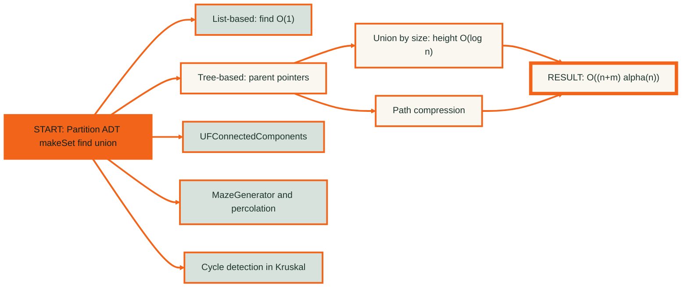
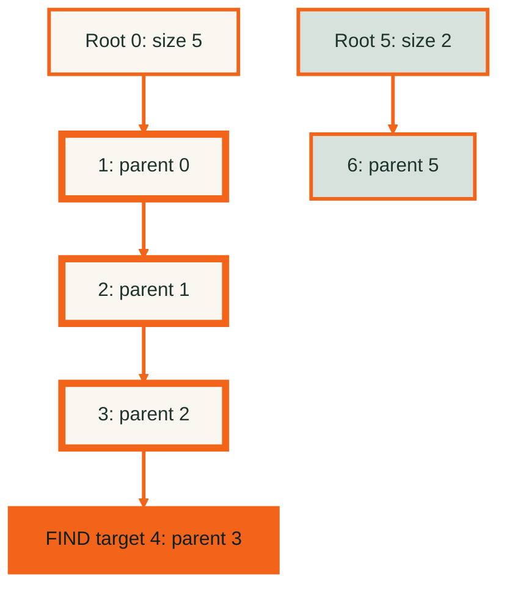
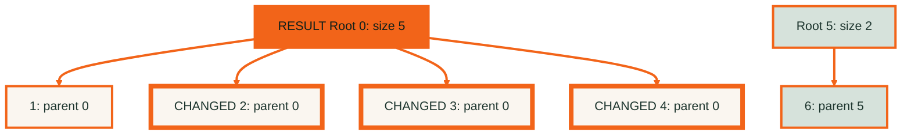

# 04 — Δομές Ένωσης-Εύρεσης
*Union-Find / Disjoint Sets and Partitions*

Η ΑΤΔ Διαμέρισης (`Partition ADT`) διαχειρίζεται μια συλλογή ξένων συνόλων (`disjoint sets`) και απαντά στο ερώτημα αν δύο στοιχεία ανήκουν στο ίδιο σύνολο, χωρίς να απαριθμεί τα μέλη κάθε συνόλου. Το κεφάλαιο επιλύει το πρόβλημα της δυναμικής συνδεσιμότητας (`dynamic connectivity`): οι σχέσεις προστίθενται διαδοχικά και τα ερωτήματα συνδεσιμότητας υποβάλλονται σε πραγματικό χρόνο, χωρίς επανυπολογισμό ολόκληρης της δομής. Στηρίζεται στην ασυμπτωτική και επιμερισμένη ανάλυση της [01_analysis_of_algorithms.md](01_analysis_of_algorithms.md) και χρησιμοποιεί τον πίνακα αντιστοίχισης της [03_maps_hash_tables_cuckoo.md](03_maps_hash_tables_cuckoo.md) ως βοηθητική δομή ομαδοποίησης. Σε αυτήν στηρίζονται οι συνδεδεμένες συνιστώσες γράφων ([09_graphs_dfs_bfs.md](09_graphs_dfs_bfs.md)) και ο έλεγχος κύκλων στον αλγόριθμο `Kruskal` ([11_minimum_spanning_trees.md](11_minimum_spanning_trees.md)).

> **Εξεταστική κάλυψη:** Πρόοδος και Τελική
> **Κεφάλαιο βιβλίου:** `Κεφ. 7` | **Διαλέξεις:** `07_union_find.pdf`
> **Πηγή:** `Resources/Meta/mindmap.md` (Ενότητα 04)
> **Εκτός ύλης:** Ενότητα `7.3.1` (επιμερισμένη ανάλυση με συνάρτηση Ackermann και κυβερνοδολάρια)

## Πίνακας Περιεχομένων

- [1. Εννοιολογικό Πλαίσιο και Συνολική Εικόνα](#1-εννοιολογικό-πλαίσιο-και-συνολική-εικόνα)
- [2. Θεωρητική Θεμελίωση και Τυπικοί Ορισμοί](#2-θεωρητική-θεμελίωση-και-τυπικοί-ορισμοί)
- [3. Αλγόριθμοι, Ιχνηλάτηση και Κώδικας](#3-αλγόριθμοι-ιχνηλάτηση-και-κώδικας)
- [4. Συγκριτική Ανάλυση και Πολυπλοκότητα](#4-συγκριτική-ανάλυση-και-πολυπλοκότητα)
- [5. Πλήρως Λυμένες Ασκήσεις Εξεταστικού Επιπέδου](#5-πλήρως-λυμένες-ασκήσεις-εξεταστικού-επιπέδου)
- [6. Οδηγός Επιβίωσης στις Εξετάσεις και Παγίδες](#6-οδηγός-επιβίωσης-στις-εξετάσεις-και-παγίδες)
- [7. Συνοπτικός Πίνακας Εννοιών](#7-συνοπτικός-πίνακας-εννοιών)

---

## 1. Εννοιολογικό Πλαίσιο και Συνολική Εικόνα

### Το Πρόβλημα

Ένα κοινωνικό δίκτυο με $n$ χρήστες και $m$ δεσμούς φιλίας δέχεται συνεχώς νέους δεσμούς, ενώ οι χρήστες ρωτούν αν δύο πρόσωπα συνδέονται μέσω οποιασδήποτε αλυσίδας φίλων. Μια συνδεδεμένη συνιστώσα (`connected component`) είναι υποσύνολο $T$ του συνόλου των χρηστών με δύο ιδιότητες: κάθε ζεύγος του $T$ συνδέεται με αλυσίδα φιλίας, και κανένα μέλος του $T$ δεν συνδέεται με χρήστη εκτός του $T$. Η επανάληψη μιας διασχίσεως γράφου (`DFS` ή `BFS`) μετά από κάθε νέο δεσμό κοστίζει $O(n + m)$ ανά ερώτημα, δηλαδή $O(m(n + m))$ για $m$ διαδοχικές προσθήκες. Η δομή ένωσης-εύρεσης διατηρεί τη διαμέριση επαυξητικά και απαντά κάθε ερώτημα σε σχεδόν σταθερό επιμερισμένο (`amortized`) χρόνο. Η ίδια ανάγκη εμφανίζεται στην κατασκευή λαβυρίνθων (`MazeGenerator`), στη θεωρία διήθησης (`Percolation Theory`) και στον εντοπισμό κύκλων κατά την επιλογή ακμών ενός δέντρου επικάλυψης ελαχίστου κόστους (`Minimum Spanning Tree`).

### Χάρτης Εννοιών του Κεφαλαίου



Πορτοκαλί γέμισμα: η ΑΤΔ Διαμέρισης (`START`), κοινή αφετηρία υλοποιήσεων και εφαρμογών. Παχύ περίγραμμα: το συνδυασμένο φράγμα (`RESULT`) των δύο ευρετικών μηχανισμών. Απαλό πράσινο: εφαρμογές και η εναλλακτική υλοποίηση βάσει λίστας. Κρεμ: τα στάδια της δενδρικής υλοποίησης.

| Ομάδα | Κόμβοι | Ρόλος |
|---|---|---|
| Αφετηρία | ΑΤΔ Διαμέρισης | Ορίζει `makeSet`, `find`, `union` ανεξάρτητα από υλοποίηση |
| Υλοποιήσεις | Λίστα, δέντρο | Η λίστα δίνει $O(1)$ `find`· το δέντρο επιτρέπει τους δύο ευρετικούς μηχανισμούς |
| Ευρετικοί | Ένωση κατά μέγεθος (`Union by Size`), συμπίεση διαδρομής (`Path Compression`) | Μειώνουν το ύψος και το μήκος των διαδρομών αντίστοιχα |
| Αποτέλεσμα | $O((n+m)\alpha(n))$ | Σχεδόν γραμμικός χρόνος για ακολουθία πράξεων |
| Εφαρμογές | Συνιστώσες, λαβύρινθος, διήθηση, `Kruskal` | Καταναλώνουν μόνο το ερώτημα «ίδιο σύνολο;» |

### Πότε Χρησιμοποιείται Κάθε Υλοποίηση

Η υλοποίηση βάσει λίστας αρκεί όταν οι `find` κυριαρχούν, το $n$ είναι μικρό και επιθυμείται εγγυημένο $O(1)$ ανά εύρεση χωρίς επιμερισμένη ανάλυση. Το δέντρο με μόνο την ένωση κατά μέγεθος επιλέγεται όταν απαιτείται εγγυημένο φράγμα $O(\log n)$ στη χειρότερη περίπτωση ανά πράξη. Το δέντρο με ένωση κατά μέγεθος και συμπίεση διαδρομής επιλέγεται για μεγάλης κλίμακας δυναμική συνδεσιμότητα, όπου ζητείται το σχεδόν γραμμικό συνολικό φράγμα. Καμία παραλλαγή δεν καλύπτει διαγραφή ακμής ή διαχωρισμό συνόλου (`split`): η ΑΤΔ υποστηρίζει μόνο συγχωνεύσεις, οπότε σε τέτοια σενάρια απαιτείται επανυπολογισμός ή άλλη δομή. Η αναζήτηση κατά κλειδί δεν ανήκει στην ΑΤΔ Διαμέρισης και καλύπτεται από το `Map ADT` της [03_maps_hash_tables_cuckoo.md](03_maps_hash_tables_cuckoo.md).

---

## 2. Θεωρητική Θεμελίωση και Τυπικοί Ορισμοί

### 2.1 ΑΤΔ Διαμέρισης

**Ορισμός.** Μια διαμέριση ενός συνόλου $S$ είναι συλλογή $\mathcal{P} = \{A_1, A_2, \dots, A_k\}$ μη κενών υποσυνόλων του $S$ με δύο ιδιότητες: τα υποσύνολα είναι ανά δύο ξένα, $A_i \cap A_j = \emptyset$ για $i \ne j$, και η ένωσή τους είναι όλο το $S$, $\bigcup_{i=1}^{k} A_i = S$. Κάθε $A_i$ ονομάζεται συστάδα ή σύνολο (`cluster`, `set`) και φέρει ένα όνομα (`set name`) που το ταυτοποιεί μονοσήμαντα.

**Ορισμός.** Μια δομή ένωσης-εύρεσης (`union-find`) διατηρεί μια διαμέριση μεταβαλλόμενη μόνο κατά συγχωνεύσεις. Οι τρεις λειτουργίες ορίζονται ως εξής.

| Μέθοδος | Σημασιολογία | Επιστροφή |
|---|---|---|
| `makeSet(e)` | Δημιουργεί μοναδιαίο σύνολο $\{e\}$ (`singleton set`) | Το όνομα του νέου συνόλου |
| `find(e)` | Αναζητά το σύνολο που περιέχει το στοιχείο $e$ | Το όνομα του συνόλου του $e$ |
| `union(A, B)` | Αντικαθιστά τα ξένα σύνολα με ονόματα $A$ και $B$ από το $A \cup B$ | Το όνομα του νέου συνόλου, είτε `A` είτε `B` |

**Αναλλοίωτη.** Μετά από κάθε πράξη ισχύει: κάθε στοιχείο ανήκει σε ακριβώς ένα σύνολο· το `find(e)` επιστρέφει πάντα το τρέχον όνομα του συνόλου του $e$· το `union(A, B)` απαιτεί $A$ και $B$ να είναι τρέχοντα ονόματα συνόλων και $A \ne B$, διαφορετικά η διαμέριση δεν μεταβάλλεται. Η αναλλοίωτη εξηγεί γιατί η `union` δέχεται ονόματα συνόλων και όχι αυθαίρετα στοιχεία: το αποτέλεσμα ονομάζεται είτε `A` είτε `B`, άρα τα ορίσματα πρέπει να είναι ήδη ονόματα.

**Συνέπεια.** Δύο στοιχεία $x$ και $y$ ανήκουν στο ίδιο σύνολο αν και μόνο αν $\text{find}(x) = \text{find}(y)$. Το κριτήριο αυτό είναι το μόνο ερώτημα που χρειάζονται όλες οι εφαρμογές του κεφαλαίου.

Κανόνας ισοβαθμίας για όλες τις ιχνηλατήσεις: όταν δύο σύνολα έχουν ίσο μέγεθος, το νέο σύνολο παίρνει το **μικρότερο αριθμητικό όνομα** των δύο. Ο κανόνας καθιστά κάθε ιχνηλάτηση μονοσήμαντη.

### 2.2 Υλοποίηση Βάσει Λίστας

**Αναπαράσταση.** Κάθε σύνολο αποθηκεύεται σε μια ακολουθία που υλοποιείται με συνδεδεμένη λίστα. Κάθε κόμβος περιέχει το στοιχείο και μια αναφορά στο όνομα του συνόλου στο οποίο ανήκει. Το όνομα του συνόλου παραπέμπει στη λίστα και στο μέγεθός της.

| Λειτουργία | Μηχανισμός | Χρόνος |
|---|---|---|
| `makeSet(e)` | Νέος κόμβος με αναφορά στο νέο όνομα | $O(1)$ χειρότερη |
| `find(e)` | Ανάγνωση της αναφοράς του κόμβου του $e$ | $O(1)$ χειρότερη |
| `union(A, B)` | Μετακίνηση των κόμβων του μικρότερου συνόλου στο μεγαλύτερο και ενημέρωση των αναφορών τους | $O(\min\{|A|, |B|\})$ χειρότερη |
| Χώρος | Ένας κόμβος ανά στοιχείο και ένα όνομα ανά σύνολο | $O(n)$ |

Η επιλογή «μικρότερο στο μεγαλύτερο» (`smaller-into-larger`) είναι ο μόνος κανόνας που ελέγχει το κόστος. Χωρίς αυτόν, μια ακολουθία ενώσεων μπορεί να μετακινεί το ίδιο στοιχείο σε κάθε βήμα και να δώσει $O(n^2)$.

### 2.3 Υλοποίηση Βάσει Δέντρων

**Αναπαράσταση.** Κάθε στοιχείο αποθηκεύεται σε έναν κόμβο με έναν δείκτη προς τον γονέα (`parent pointer`). Ένας κόμβος $v$ του οποίου ο δείκτης δείχνει στον ίδιο τον $v$, $\text{parent}(v) = v$, λειτουργεί και ως όνομα του συνόλου. Κάθε σύνολο είναι επομένως ένα δέντρο του οποίου η ρίζα είναι κόμβος με αυτο-αναφορά· η ρίζα αποθηκεύει επιπλέον το μέγεθος του υποδέντρου της, $n(v)$.

| Λειτουργία | Μηχανισμός | Χρόνος χωρίς ευρετικούς |
|---|---|---|
| `makeSet(e)` | $\text{parent}(e) \leftarrow e$, $n(e) \leftarrow 1$ | $O(1)$ χειρότερη |
| `find(e)` | Ακολουθία δεικτών $\text{parent}$ μέχρι τον κόμβο με αυτο-αναφορά | $O(n)$ χειρότερη (αλυσίδα) |
| `union(A, B)` | Η μία ρίζα δείχνει στην άλλη ρίζα | $O(1)$ χειρότερη επί ονομάτων |
| Χώρος | Δύο πίνακες μήκους $n$ | $O(n)$ |

**Αναλλοίωτη δενδρικής μορφής.** Για κάθε κόμβο $v$, η ακολουθία $\text{parent}(v), \text{parent}(\text{parent}(v)), \dots$ τερματίζει στη ρίζα $r$ με $\text{parent}(r) = r$, και $\text{find}(v) = r$. Η $r$ είναι το όνομα του συνόλου. Η ιδιότητα αυτή διατηρείται από τη συμπίεση διαδρομής, όπως αποδεικνύεται στην Πρόταση 2.3.

### 2.4 Θεωρήματα και Αποδείξεις

**Θεώρημα 2.1 (λιστο-βασισμένη υλοποίηση).** Με τον κανόνα «μικρότερο στο μεγαλύτερο», κάθε στοιχείο μετακινείται το πολύ $\lfloor \log_2 n \rfloor$ φορές, και μια ακολουθία $n$ ενώσεων και $m$ ευρέσεων εκτελείται σε $O(n \log n + m)$ χρόνο στη χειρότερη περίπτωση.

*Απόδειξη.* Έστω στοιχείο $x$ που ανήκει σε σύνολο μεγέθους $s$ αμέσως πριν από μια μετακίνησή του. Η μετακίνηση συμβαίνει μόνο όταν το σύνολο του $x$ είναι το μικρότερο των δύο που συγχωνεύονται, άρα το σύνολο υποδοχής έχει μέγεθος $s' \ge s$. Μετά την ένωση το νέο σύνολο έχει μέγεθος $s + s' \ge 2s$: κάθε μετακίνηση τουλάχιστον διπλασιάζει το μέγεθος του συνόλου του $x$. Αν $x$ μετακινηθεί $k$ φορές και $s_0 = 1$ είναι το αρχικό μέγεθος, τότε $s_k \ge 2^k$. Επειδή κανένα σύνολο δεν υπερβαίνει τα $n$ στοιχεία, $2^k \le n$, άρα $k \le \log_2 n$. Αθροίζοντας επί των $n$ στοιχείων, το συνολικό πλήθος μετακινήσεων είναι το πολύ $n \log_2 n$, καθεμία κόστους $O(1)$ για την ενημέρωση της αναφοράς. Κάθε `find` διαβάζει μία αναφορά σε $O(1)$, άρα οι $m$ ευρέσεις κοστίζουν $O(m)$. Σύνολο: $O(n \log n + m)$. $\square$

**Θεώρημα 2.2 (ένωση κατά μέγεθος).** Αν σε κάθε `union` η ρίζα του μικρότερου δέντρου δείχνει στη ρίζα του μεγαλύτερου, τότε κάθε δέντρο ύψους $h$ έχει τουλάχιστον $2^h$ κόμβους, συνεπώς $h \le \lfloor \log_2 n \rfloor$ και κάθε `find` κοστίζει $O(\log n)$ στη χειρότερη περίπτωση.

*Απόδειξη με επαγωγή επί του πλήθους των ενώσεων.* Ισχυρισμός: για κάθε δέντρο με $n(v)$ κόμβους και ύψος $h(v)$ ισχύει $n(v) \ge 2^{h(v)}$.

Βάση: ένα `makeSet` δίνει $n(v) = 1$ και $h(v) = 0$, και $1 \ge 2^0 = 1$.

Επαγωγικό βήμα: συγχωνεύονται δύο δέντρα με ρίζες $r_1$ και $r_2$, μεγέθη $n_1$ και $n_2$ και ύψη $h_1$ και $h_2$. Χωρίς βλάβη της γενικότητας $n_1 \ge n_2$, άρα η $r_2$ δείχνει στην $r_1$ και νέα ρίζα είναι η $r_1$. Από την επαγωγική υπόθεση $n_1 \ge 2^{h_1}$ και $n_2 \ge 2^{h_2}$. Το νέο δέντρο έχει $n = n_1 + n_2$ κόμβους και ύψος $h = \max\{h_1,\; h_2 + 1\}$, διότι μόνο το υποδέντρο της $r_2$ αποκτά ένα επιπλέον επίπεδο.

Περίπτωση 1, $h = h_1$: τότε $n = n_1 + n_2 \ge n_1 \ge 2^{h_1} = 2^h$.

Περίπτωση 2, $h = h_2 + 1$: επειδή $n_1 \ge n_2$, ισχύει $n = n_1 + n_2 \ge 2 n_2 \ge 2 \cdot 2^{h_2} = 2^{h_2 + 1} = 2^h$.

Και στις δύο περιπτώσεις $n \ge 2^h$, άρα $h \le \log_2 n$. Επειδή το $n$ του μεγαλύτερου δέντρου φράσσεται από το συνολικό πλήθος στοιχείων, κάθε διαδρομή `find` έχει μήκος $O(\log n)$. Ισοδύναμη διατύπωση με τον διπλασιασμό: κάθε φορά που ακολουθείται ένας δείκτης προς τον γονέα, το υποδέντρο στο οποίο εισερχόμαστε έχει τουλάχιστον διπλάσιο μέγεθος από το προηγούμενο, άρα ακολουθούνται το πολύ $O(\log n)$ δείκτες. $\square$

**Πρόταση 2.3 (ορθότητα συμπίεσης διαδρομής).** Η συμπίεση διαδρομής δεν μεταβάλλει τη διαμέριση που αναπαριστά το δάσος.

*Απόδειξη.* Έστω `find(v)` και έστω $r$ η ρίζα που προκύπτει από την ακολουθία των δεικτών. Για κάθε κόμβο $u$ της διαδρομής από τον $v$ έως τον $r$, η ρίζα του $u$ πριν από την πράξη είναι η ίδια $r$, διότι η διαδρομή καταλήγει σε αυτήν. Η συμπίεση θέτει $\text{parent}(u) \leftarrow r$. Μετά την πράξη, το $\text{find}(u)$ ακολουθεί έναν μόνο δείκτη και επιστρέφει πάλι την $r$. Άρα κανένα στοιχείο δεν αλλάζει σύνολο, και το $\text{find}(v)$ επιστρέφει το ίδιο όνομα όπως πριν. Μόνο το μήκος των διαδρομών μειώνεται. $\square$

**Θεώρημα 2.4 (συνδυασμένο φράγμα).** Μια ακολουθία $m$ λειτουργιών `union-find` που ξεκινά από $n$ μοναδιαία σύνολα, με ένωση κατά μέγεθος και συμπίεση διαδρομής, εκτελείται σε $O((n + m)\,\alpha(n))$ χρόνο, όπου

$$\alpha(n) = \min\{x : A(x) \ge n\}$$

είναι η αντίστροφη συνάρτηση Ackermann. Η $A(x)$ αυξάνεται εξαιρετικά γρήγορα, άρα η $\alpha(n)$ αυξάνεται εξαιρετικά αργά· θεωρητικά τείνει στο άπειρο καθώς $n \to \infty$, αλλά για κάθε πρακτική χρήση ισχύει $\alpha(n) \le 4$.

*Αιτιολόγηση.* Το αποτέλεσμα δίνεται ως θεώρημα του συγγράμματος και χρησιμοποιείται ως δεδομένο. Η ένωση κατά μέγεθος μόνη της δίνει $O(\log n)$ ανά πράξη (Θεώρημα 2.2)· η προσθήκη της συμπίεσης διαδρομής μειώνει το συνολικό κόστος σε σχεδόν γραμμικό. Η απόδειξη με βαθμούς κόμβων και κυβερνοδολάρια ανήκει στην Ενότητα `7.3.1`.

> Εκτός ύλης: Ενότητα `7.3.1`, επιμερισμένη ανάλυση με συνάρτηση Ackermann, βαθμούς κόμβων $r(v)$ και κυβερνοδολάρια. Το Θεώρημα 2.4 χρησιμοποιείται ως δεδομένο χωρίς απόδειξη.

**Μνημονικό.** «Μικρό κάτω από μεγάλο»: η ένωση κατά μέγεθος κρεμάει πάντα τη μικρότερη ρίζα κάτω από τη μεγαλύτερη, και «κάθε μετακίνηση διπλασιάζει»: το μέγεθος του συνόλου ενός μετακινούμενου στοιχείου τουλάχιστον διπλασιάζεται.

---

## 3. Αλγόριθμοι, Ιχνηλάτηση και Κώδικας

### 3.1 Υλοποίηση Βάσει Λίστας

**Σκοπός.** Υλοποίηση της ΑΤΔ Διαμέρισης με μία συνδεδεμένη λίστα ανά σύνολο και αναφορά ονόματος σε κάθε κόμβο, ώστε το `find` να είναι $O(1)$.

```text
Algorithm makeSet(e):
Input: Στοιχείο e
Output: Νέο μοναδιαίο σύνολο με όνομα A

A ← new set name
L ← new linked list containing one node (e, A)
size(A) ← 1
return A
```

```text
Algorithm find(e):
Input: Στοιχείο e
Output: Το όνομα του συνόλου του e

return the name reference stored in the node of e
```

```text
Algorithm union(A, B):
Input: Ονόματα δύο ξένων συνόλων A και B
Output: Το ενιαίο σύνολο, με το όνομα του μεγαλύτερου

if size(A) < size(B) then
    swap A and B
for each node x in the list of B do
    append x to the list of A
    set the name reference of x to A
size(A) ← size(A) + size(B)
discard the name B
return A
```

**Ιχνηλάτηση μέτρησης μετακινήσεων.** Στοιχεία $0, \dots, 7$, αρχικά $8$ μοναδιαία σύνολα. Ακολουθία $7$ ενώσεων. Κανόνας ισοβαθμίας: σε ίσα μεγέθη επιβιώνει το μικρότερο όνομα. Η στήλη «μετακινούμενο» δίνει το σύνολο του οποίου οι κόμβοι αλλάζουν αναφορά ονόματος.

| # | `union` | Σύνολα πριν (μέγεθος) | Μετακινούμενο | Μετακινήσεις | Νέο σύνολο (μέγεθος) | Σωρευτικές |
|---|---|---|---|---|---|---|
| 1 | `union(0, 1)` | $\{0\}(1)$, $\{1\}(1)$ | $\{1\}$ | $1$ | $\{0, 1\}(2)$ | $1$ |
| 2 | `union(2, 3)` | $\{2\}(1)$, $\{3\}(1)$ | $\{3\}$ | $1$ | $\{2, 3\}(2)$ | $2$ |
| 3 | `union(0, 2)` | $\{0,1\}(2)$, $\{2,3\}(2)$ | $\{2, 3\}$ | $2$ | $\{0,1,2,3\}(4)$ | $4$ |
| 4 | `union(4, 5)` | $\{4\}(1)$, $\{5\}(1)$ | $\{5\}$ | $1$ | $\{4, 5\}(2)$ | $5$ |
| 5 | `union(6, 7)` | $\{6\}(1)$, $\{7\}(1)$ | $\{7\}$ | $1$ | $\{6, 7\}(2)$ | $6$ |
| 6 | `union(4, 6)` | $\{4,5\}(2)$, $\{6,7\}(2)$ | $\{6, 7\}$ | $2$ | $\{4,5,6,7\}(4)$ | $8$ |
| 7 | `union(0, 4)` | $\{0,1,2,3\}(4)$, $\{4,5,6,7\}(4)$ | $\{4,5,6,7\}$ | $4$ | $\{0,\dots,7\}(8)$ | $12$ |

| Στοιχείο | $0$ | $1$ | $2$ | $3$ | $4$ | $5$ | $6$ | $7$ | Άθροισμα |
|---|---|---|---|---|---|---|---|---|---|
| Μετακινήσεις | $0$ | $1$ | $1$ | $2$ | $1$ | $2$ | $2$ | $3$ | $12$ |

Το στοιχείο $7$ μετακινείται $3 = \log_2 8$ φορές, μία ανά διπλασιασμό:

| Μετακίνηση | Από μέγεθος | Σε μέγεθος | Λόγος |
|---|---|---|---|
| 1 | $1$ ($\{7\}$) | $2$ ($\{6,7\}$) | $2$ |
| 2 | $2$ ($\{6,7\}$) | $4$ ($\{4,5,6,7\}$) | $2$ |
| 3 | $4$ ($\{4,5,6,7\}$) | $8$ ($\{0,\dots,7\}$) | $2$ |

Έλεγχος φράγματος: $12 \le n \log_2 n = 8 \cdot 3 = 24$, σύμφωνα με το Θεώρημα 2.1. Με $m = 10$ ευρέσεις, το συνολικό κόστος είναι $O(12 + 10) = O(n \log n + m)$.

**Ρητή υλοποίηση:**

```python
class ListUnionFind:
    """List-based partition with O(1) find and smaller-into-larger union.

    Attributes:
        _members (dict[int, list[int]]): Current set name -> its member list.
        _owner (list[int]): owner[x] is the current set name of element x.
        _moves (int): Total element moves performed by all unions so far.
    """

    def __init__(self, n: int) -> None:
        """Creates n singleton sets named 0 to n-1.

        Args:
            n (int): The number of elements.
        """
        self._members: dict[int, list[int]] = {i: [i] for i in range(n)}
        self._owner: list[int] = list(range(n))
        self._moves = 0

    def find(self, x: int) -> int:
        """Returns the set name containing x in O(1) worst-case time.

        Args:
            x (int): The element whose set is requested.

        Returns:
            int: The current name of the set containing x.
        """
        return self._owner[x]

    def union(self, a: int, b: int) -> int:
        """Merges the sets named a and b, moving the smaller into the larger.

        Args:
            a (int): A current set name.
            b (int): A current set name.

        Returns:
            int: The name of the merged set.

        Raises:
            KeyError: If a or b is not a current set name.
        """
        if a == b:
            return a
        # On equal sizes the smaller label survives, making traces unique.
        if len(self._members[a]) < len(self._members[b]) or (
            len(self._members[a]) == len(self._members[b]) and a > b
        ):
            a, b = b, a
        moved = self._members.pop(b)
        for element in moved:
            # Each move at least doubles the size of the element's set.
            self._owner[element] = a
        self._members[a].extend(moved)
        self._moves += len(moved)
        return a

    def moves(self) -> int:
        """Returns the cumulative number of element moves.

        Returns:
            int: The total moves performed so far.
        """
        return self._moves


luf = ListUnionFind(8)
assert luf.union(0, 1) == 0
assert luf.union(2, 3) == 2
assert luf.union(0, 2) == 0
assert luf.union(4, 5) == 4
assert luf.union(6, 7) == 6
assert luf.union(4, 6) == 4
assert luf.union(0, 4) == 0
assert luf.moves() == 12                      # Matches the trace table.
assert luf.find(7) == 0                       # O(1): reads one reference.
assert sorted(luf._members[0]) == list(range(8))
```

**Ιδιωματισμός.** Δεν υπάρχει δομή ένωσης-εύρεσης στην τυπική βιβλιοθήκη της Python· κανένα ενσωματωμένο ιδίωμα δεν αντικαθιστά την παραπάνω κλάση. Ως επαλήθευση της τελικής διαμέρισης χρησιμοποιείται ομαδοποίηση με `collections.defaultdict`:

```python
import collections

groups: dict[int, list[int]] = collections.defaultdict(list)
for element in range(8):
    groups[luf.find(element)].append(element)
assert dict(groups) == {0: [0, 1, 2, 3, 4, 5, 6, 7]}
```

| Μορφή | `find` | `union` | Τι κρύβει |
|---|---|---|---|
| `ListUnionFind` | $O(1)$ χειρότερη | $O(\min\{|A|,|B|\})$ χειρότερη | Τίποτα· είναι ο αλγόριθμος που ζητά η εξέταση |
| `defaultdict` ομαδοποίηση | $O(1)$ αναμενόμενη ανά κλειδί | Δεν υποστηρίζει ένωση | Επαληθεύει μόνο το τελικό αποτέλεσμα, όχι τη διαδικασία |

Η εξέταση ζητά τον ρητό αλγόριθμο και την ιχνηλάτηση των μετακινήσεων· η ομαδοποίηση είναι μόνο διασταύρωση.

**Ανάλυση γραμμή προς γραμμή.** Η `find` εκτελεί μία ανάγνωση πίνακα, $\Theta(1)$ χειρότερη. Η `union` εκτελεί έναν βρόχο επί των $|B|$ κόμβων του μικρότερου συνόλου· κάθε επανάληψη κάνει μία ανάθεση αναφοράς και μία προσάρτηση, σταθερό πλήθος πρωτογενών πράξεων στο μοντέλο `RAM`. Άρα μία `union` κοστίζει $\Theta(|B|)$ ως προς το μικρότερο σύνολο. Επειδή κάθε στοιχείο μετακινείται το πολύ $\log_2 n$ φορές (Θεώρημα 2.1), το άθροισμα όλων των $|B|$ επί $n$ ενώσεων είναι $O(n \log n)$, και με $m$ ευρέσεις $O(1)$ προκύπτει $O(n \log n + m)$ χειρότερη.

### 3.2 Δενδρική Υλοποίηση με Ένωση κατά Μέγεθος

**Σκοπός.** Αντικατάσταση των λιστών από δάσος με δείκτες προς γονέα, ώστε η `union` να γίνεται $O(1)$ επί ονομάτων και η ένωση κατά μέγεθος να εγγυάται ύψος $O(\log n)$.

```text
Algorithm makeSet(e):
Input: Στοιχείο e
Output: Μοναδιαίο δέντρο με ρίζα τον e

parent(e) ← e
size(e) ← 1
return e
```

```text
Algorithm find(e):
Input: Στοιχείο e
Output: Η ρίζα (όνομα συνόλου) του δέντρου του e

v ← e
while parent(v) ≠ v do
    v ← parent(v)
return v
```

```text
Algorithm union(A, B):
Input: Ονόματα δύο ξένων συνόλων, δηλαδή ρίζες A και B
Output: Το ενιαίο δέντρο, με όνομα τη ρίζα του μεγαλύτερου

if size(A) < size(B) then
    swap A and B
parent(B) ← A
size(A) ← size(A) + size(B)
return A
```

**Ιχνηλάτηση 8 ενώσεων.** Στοιχεία $0, \dots, 8$, αρχικά $9$ μοναδιαία σύνολα με $\text{parent}[i] = i$ και $\text{size}[i] = 1$. Οι κλήσεις δίνονται απευθείας επί των τρεχόντων ονομάτων συνόλων (ριζών), χωρίς ενδιάμεσες `find`· έτσι η συμπίεση διαδρομής δεν ενεργοποιείται και η ιχνηλάτηση απομονώνει αποκλειστικά την ένωση κατά μέγεθος. Κανόνας ισοβαθμίας: σε ίσα μεγέθη επιβιώνει το μικρότερο όνομα. Ο πίνακας `size` είναι έγκυρος μόνο στις ρίζες· οι τιμές στις υπόλοιπες θέσεις είναι παλιές και αγνοούνται.

| # | `union` | Ρίζες (μέγεθος) | Δείκτης που αλλάζει | `parent[0..8]` | `size[0..8]` | Ρίζες (νέο μέγεθος) |
|---|---|---|---|---|---|---|
| 0 | αρχικοποίηση | $0..8\ (1)$ | — | $[0,1,2,3,4,5,6,7,8]$ | $[1,1,1,1,1,1,1,1,1]$ | $s_i = 1$ |
| 1 | `union(0, 1)` | $0(1), 1(1)$ | $1 \to 0$ | $[0,0,2,3,4,5,6,7,8]$ | $[2,1,1,1,1,1,1,1,1]$ | $s_0 = 2$ |
| 2 | `union(2, 3)` | $2(1), 3(1)$ | $3 \to 2$ | $[0,0,2,2,4,5,6,7,8]$ | $[2,1,2,1,1,1,1,1,1]$ | $s_0=2, s_2=2$ |
| 3 | `union(0, 2)` | $0(2), 2(2)$ | $2 \to 0$ | $[0,0,0,2,4,5,6,7,8]$ | $[4,1,2,1,1,1,1,1,1]$ | $s_0 = 4$ |
| 4 | `union(4, 5)` | $4(1), 5(1)$ | $5 \to 4$ | $[0,0,0,2,4,4,6,7,8]$ | $[4,1,2,1,2,1,1,1,1]$ | $s_0=4, s_4=2$ |
| 5 | `union(6, 7)` | $6(1), 7(1)$ | $7 \to 6$ | $[0,0,0,2,4,4,6,6,8]$ | $[4,1,2,1,2,1,2,1,1]$ | $s_0=4, s_4=2, s_6=2$ |
| 6 | `union(4, 6)` | $4(2), 6(2)$ | $6 \to 4$ | $[0,0,0,2,4,4,4,6,8]$ | $[4,1,2,1,4,1,2,1,1]$ | $s_0=4, s_4=4$ |
| 7 | `union(0, 4)` | $0(4), 4(4)$ | $4 \to 0$ | $[0,0,0,2,0,4,4,6,8]$ | $[8,1,2,1,4,1,2,1,1]$ | $s_0 = 8$ |
| 8 | `union(0, 8)` | $0(8), 8(1)$ | $8 \to 0$ | $[0,0,0,2,0,4,4,6,0]$ | $[9,1,2,1,4,1,2,1,1]$ | $s_0 = 9$ |

Τελικό δάσος: ένα δέντρο με ρίζα τον $0$ και παιδιά $1, 2, 4, 8$· ο $2$ έχει παιδί τον $3$, ο $4$ έχει παιδιά $5, 6$, ο $6$ έχει παιδί τον $7$. Η μεγαλύτερη διαδρομή είναι $7 \to 6 \to 4 \to 0$, μήκους $3 = \lfloor \log_2 9 \rfloor$, όσο ακριβώς επιτρέπει το Θεώρημα 2.2.

**Ρητή υλοποίηση.** Η κλάση περιλαμβάνει και τη συμπίεση διαδρομής της Ενότητας 3.3· στην παρούσα ιχνηλάτηση καλείται μόνο η `union` επί ριζών, οπότε η `find` δεν εκτελείται. Η μέθοδος `unionElements` δείχνει ρητά τη μετατροπή μιας κλήσης επί στοιχείων σε κλήση επί ριζών.

```python
class UnionFind:
    """Tree-based Union-Find with union by size and iterative path compression.

    Attributes:
        _parent (list[int]): parent[i] is the parent of element i; a root has
            parent[i] == i and serves as the set name.
        _size (list[int]): size[r] is the node count of the tree of root r;
            meaningful only while r is a root.
        _count (int): The current number of disjoint sets.
    """

    def __init__(self, n: int) -> None:
        """Creates n singleton sets with names 0 to n-1.

        Args:
            n (int): The number of elements.
        """
        self._parent: list[int] = list(range(n))
        self._size: list[int] = [1] * n
        self._count = n

    def find(self, x: int) -> int:
        """Returns the root (set name) of x, compressing the traversed path.

        Args:
            x (int): The element whose set name is requested.

        Returns:
            int: The root of the tree containing x.

        Raises:
            IndexError: If x is outside [0, n - 1].
        """
        root = x
        while self._parent[root] != root:
            root = self._parent[root]
        # Second pass reattaches every node on the path directly to the root.
        while self._parent[x] != root:
            next_node = self._parent[x]
            self._parent[x] = root
            x = next_node
        return root

    def union(self, a: int, b: int) -> int:
        """Merges the two sets whose current names (roots) are a and b.

        Args:
            a (int): The root name of the first set.
            b (int): The root name of the second set.

        Returns:
            int: The root of the merged set, or -1 if a == b (no change).

        Raises:
            ValueError: If a or b is not a current root.
        """
        if a == b:
            return -1
        if self._parent[a] != a or self._parent[b] != b:
            raise ValueError("union expects set names (roots), not elements")
        # Link the smaller tree under the larger; on a tie keep the smaller label.
        if self._size[a] < self._size[b] or (
            self._size[a] == self._size[b] and a > b
        ):
            a, b = b, a
        self._parent[b] = a
        self._size[a] += self._size[b]
        self._count -= 1
        return a

    def unionElements(self, u: int, v: int) -> int:
        """Merges the sets of two arbitrary elements by first finding their roots.

        Args:
            u (int): An element of the first set.
            v (int): An element of the second set.

        Returns:
            int: The root of the merged set, or -1 if already in one set.
        """
        root_u, root_v = self.find(u), self.find(v)
        return self.union(root_u, root_v)

    def count(self) -> int:
        """Returns the current number of disjoint sets.

        Returns:
            int: The number of sets.
        """
        return self._count


uf = UnionFind(9)
assert uf.union(0, 1) == 0
assert uf.union(2, 3) == 2
assert uf.union(0, 2) == 0
assert uf.union(4, 5) == 4
assert uf.union(6, 7) == 6
assert uf.union(4, 6) == 4
assert uf.union(0, 4) == 0
assert uf.union(0, 8) == 0
assert uf._parent == [0, 0, 0, 2, 0, 4, 4, 6, 0]   # Matches the 8-union trace.
assert uf._size[0] == 9                              # Only the root size is valid.
assert uf.count() == 1
assert uf.union(0, 0) == -1                          # Same set: no operation.
```

**Ιδιωματισμός.** Δεν υπάρχει ενσωματωμένη δομή `Union-Find` στην τυπική βιβλιοθήκη· η κλάση `UnionFind` είναι η μορφή που ζητά η εξέταση και δεν έχει ιδίωμα αντικατάστασης. Η μόνη διασταύρωση γίνεται ως προς το αποτέλεσμα, με ομαδοποίηση των ριζών σε ένα `dict` όπως στην Ενότητα 3.4.

> **Προσοχή στις συμβάσεις.** Η `find` του μαθήματος επιστρέφει το **όνομα του συνόλου** (τη ρίζα), όχι το ίδιο το στοιχείο και όχι μια λίστα μελών. Η `union(A, B)` δέχεται ονόματα συνόλων, δηλαδή ρίζες· η κλήση της με αυθαίρετα στοιχεία είναι λάθος και εδώ απορρίπτεται ρητά με `ValueError`. Το `networkx.connected_components` είναι συνάρτηση εξωτερικού πακέτου, όχι της τυπικής βιβλιοθήκης, και χρησιμοποιείται μόνο ως προαιρετική διασταύρωση αποτελέσματος.

| Μορφή | `find` | `union` | Τι κρύβει |
|---|---|---|---|
| `UnionFind.find`, `UnionFind.union` | $O(\alpha(n))$ επιμερισμένη | $O(1)$ επί ριζών | Τίποτα· ο αλγόριθμος της εξέτασης |
| Ομαδοποίηση με `dict` | $O(1)$ αναμενόμενη ανά κλειδί | Δεν υποστηρίζεται | Επαλήθευση μόνο του τελικού αποτελέσματος |

**Ανάλυση γραμμή προς γραμμή.** Η `makeSet` εκτελεί δύο αναθέσεις, $\Theta(1)$ χειρότερη. Η `union` συγκρίνει δύο μεγέθη, εκτελεί μία ανάθεση δείκτη και μία πρόσθεση μεγέθους, δηλαδή $\Theta(1)$ χειρότερη επί ονομάτων· αν κληθεί επί στοιχείων, προηγούνται δύο `find` που κυριαρχούν. Η `find` διασχίζει μια διαδρομή μήκους $h$· με την ένωση κατά μέγεθος $h \le \lfloor \log_2 n \rfloor$ (Θεώρημα 2.2), άρα $O(\log n)$ χειρότερη για τη δενδρική παραλλαγή χωρίς συμπίεση. Με τη συμπίεση, το συνολικό κόστος $m$ πράξεων είναι $O((n+m)\alpha(n))$ επιμερισμένα (Θεώρημα 2.4). Ο χώρος είναι $O(n)$ για τους δύο πίνακες.

### 3.3 Συμπίεση Διαδρομής

**Σκοπός.** Μείωση του μήκους κάθε μελλοντικής διαδρομής `find`: μετά την εύρεση, όλοι οι δείκτες της διαδρομής που διανύθηκε δείχνουν απευθείας στη ρίζα.

```text
Algorithm findWithCompression(e):
Input: Στοιχείο e
Output: Η ρίζα r του δέντρου του e, με συμπίεση της διαδρομής

v ← e
while parent(v) ≠ v do          // Πρώτη διέλευση: εύρεση της ρίζας
    v ← parent(v)
r ← v
v ← e
while parent(v) ≠ r do          // Δεύτερη διέλευση: συμπίεση
    next ← parent(v)
    parent(v) ← r
    v ← next
return r
```

**Ιχνηλάτηση πριν και μετά.** Δάσος $7$ κόμβων με δύο δέντρα: το πρώτο είναι η αλυσίδα $0 \leftarrow 1 \leftarrow 2 \leftarrow 3 \leftarrow 4$ με ρίζα τον $0$ και μέγεθος $5$, το δεύτερο έχει ρίζα τον $5$ και παιδί τον $6$ με μέγεθος $2$. Η αλυσίδα είναι σκόπιμα μη ισορροπημένη ώστε να φανεί η συμπίεση· προκύπτει αν παραλειφθεί η ένωση κατά μέγεθος. Εκτελείται `find(4)`.

| Κόμβος | $0$ | $1$ | $2$ | $3$ | $4$ | $5$ | $6$ |
|---|---|---|---|---|---|---|---|
| $\text{parent}$ πριν | $0$ | $0$ | $1$ | $2$ | $3$ | $5$ | $5$ |
| $\text{parent}$ μετά | $0$ | $0$ | $0$ | $0$ | $0$ | $5$ | $5$ |
| Μεταβολή | — | — | $1 \to 0$ | $2 \to 0$ | $3 \to 0$ | — | — |

Διαδρομή πριν: $4 \to 3 \to 2 \to 1 \to 0$, μήκους $4$ δεικτών. Η πρώτη διέλευση εντοπίζει τη ρίζα $r = 0$. Η δεύτερη διέλευση εξετάζει τους $4, 3, 2, 1$· ο $1$ έχει ήδη $\text{parent}(1) = 0$, άρα δεν αλλάζει, ενώ οι $2, 3, 4$ επανασυνδέονται στη ρίζα. Μετά την πράξη, το `find(4)` ακολουθεί έναν μόνο δείκτη. Οι $3$ αλλαγές διατηρούν τη διαμέριση αμετάβλητη (Πρόταση 2.3).

**Δάσος πριν τη `find`:**



Πορτοκαλί γέμισμα: ο κόμβος στόχος της `find` (`FIND`). Παχύ περίγραμμα: οι κόμβοι της διαδρομής που θα διανυθεί. Απαλό πράσινο: το δεύτερο δέντρο, ανεπηρέαστο. Τα βέλη δείχνουν γονέα προς παιδί· οι δείκτες `parent` κατευθύνονται αντίστροφα, προς τη ρίζα.

**Δάσος μετά τη `find`:**



Πορτοκαλί γέμισμα: η ρίζα στην οποία καταλήγουν πλέον όλοι οι κόμβοι της διαδρομής (`RESULT`). Παχύ περίγραμμα: οι δείκτες που άλλαξαν (`CHANGED`). Απαλό πράσινο: το ανεπηρέαστο δεύτερο δέντρο. Κρεμ: ο κόμβος που δεν χρειάστηκε αλλαγή.

| Διάγραμμα | Μέγιστο μήκος διαδρομής | Δείκτες προς τη ρίζα από το πρώτο δέντρο |
|---|---|---|
| Πριν | $4$ | $1, 2, 3, 4$ σε αλυσίδα |
| Μετά | $1$ | $1, 2, 3, 4$ απευθείας στον $0$ |

**Επαλήθευση του κώδικα συμπίεσης:**

```python
chain = UnionFind(7)
chain._parent = [0, 0, 1, 2, 3, 5, 5]  # Deliberately unbalanced forest.
chain._size = [5, 1, 1, 1, 1, 2, 1]
assert chain.find(4) == 0
assert chain._parent == [0, 0, 0, 0, 0, 5, 5]   # Three pointers compressed.
assert chain.find(4) == 0                       # Second find follows one pointer.
```

**Ιδιωματισμός.** Δεν υπάρχει ιδίωμα της τυπικής βιβλιοθήκης για τη συμπίεση διαδρομής· ο επαναληπτικός αλγόριθμος δύο διελεύσεων είναι η μορφή που ζητά η εξέταση.

**Ανάλυση γραμμή προς γραμμή.** Η πρώτη διέλευση εκτελεί $h$ βήματα, όσα οι δείκτες της διαδρομής. Η δεύτερη διέλευση εκτελεί το πολύ $h$ αναθέσεις. Άρα μία `find` με συμπίεση κοστίζει $O(h) = O(\log n)$ χειρότερη όταν συνδυάζεται με την ένωση κατά μέγεθος. Το όφελος δεν φαίνεται σε μία κλήση αλλά στο άθροισμα: κάθε κόμβος που επανασυνδέεται αποκτά γονέα υψηλότερο στο δέντρο, οπότε οι επόμενες διαδρομές συντομεύονται, και το σύνολο $m$ πράξεων φράσσεται από $O((n+m)\alpha(n))$ επιμερισμένα (Θεώρημα 2.4).

### 3.4 Συνδεδεμένες Συνιστώσες (`UFConnectedComponents`)

**Σκοπός.** Απόδοση, για κάθε στοιχείο $x$ ενός συνόλου $S$ με $n$ στοιχεία και $m$ ακμών $E$, του αναγνωριστικού της συνδεδεμένης συνιστώσας στην οποία ανήκει ο $x$.

```text
Algorithm UFConnectedComponents(S, E):
Input: Σύνολο S με n στοιχεία, σύνολο E με m ακμές (ζεύγη του S)
Output: Για κάθε x στο S, το όνομα της συνιστώσας του

for each element e in S do
    makeSet(e)
for each edge (u, v) in E do
    A ← find(u)
    B ← find(v)
    if A ≠ B then
        union(A, B)
for each element x in S do
    output (x, find(x))
```

**Ιχνηλάτηση σε γράφο 7 κορυφών.** Κορυφές $0, \dots, 6$. Ακμές σε σταθερή σειρά επεξεργασίας: $(0,1)$, $(1,2)$, $(0,2)$, $(2,3)$, $(4,5)$, $(5,6)$, $(4,6)$. Κανόνας ισοβαθμίας: μικρότερο όνομα ρίζας. Η ιχνηλάτηση καταγράφει μόνο τις ρίζες που επιστρέφει η `find`· η συμπίεση δεν μεταβάλλει ποτέ τη ρίζα (Πρόταση 2.3), άρα οι αποφάσεις αποδοχής είναι ανεξάρτητες από αυτήν. Στο συγκεκριμένο παράδειγμα κανένας κόμβος δεν απέχει περισσότερο από $1$ δείκτη από τη ρίζα του, οπότε η συμπίεση δεν τροποποιεί ούτε έναν δείκτη και ο πίνακας συμπίπτει ακριβώς με την εκτέλεση του κώδικα.

| # | Ακμή | $\text{find}(u)$ | $\text{find}(v)$ | Απόφαση | Ενέργεια | Ρίζες (μέγεθος) μετά | Πλήθος συνόλων |
|---|---|---|---|---|---|---|---|
| 0 | αρχικοποίηση | — | — | $7$ `makeSet` | — | $s_i = 1$ | $7$ |
| 1 | $(0,1)$ | $0$ | $1$ | διαφορετικές | `union(0,1)` | $s_0 = 2$ | $6$ |
| 2 | $(1,2)$ | $0$ | $2$ | διαφορετικές | `union(0,2)` | $s_0 = 3$ | $5$ |
| 3 | $(0,2)$ | $0$ | $0$ | **κύκλος** | καμία | $s_0 = 3$ | $5$ |
| 4 | $(2,3)$ | $0$ | $3$ | διαφορετικές | `union(0,3)` | $s_0 = 4$ | $4$ |
| 5 | $(4,5)$ | $4$ | $5$ | διαφορετικές | `union(4,5)` | $s_0=4, s_4=2$ | $3$ |
| 6 | $(5,6)$ | $4$ | $6$ | διαφορετικές | `union(4,6)` | $s_0=4, s_4=3$ | $2$ |
| 7 | $(4,6)$ | $4$ | $4$ | **κύκλος** | καμία | $s_0=4, s_4=3$ | $2$ |

Τελικές συνιστώσες: $\{0,1,2,3\}$ με όνομα $0$ και $\{4,5,6\}$ με όνομα $4$. Οι $5$ επιτυχείς ενώσεις ισούνται με $n - k = 7 - 2 = 5$, όπου $k = 2$ το πλήθος των συνιστωσών. Οι ακμές $(0,2)$ και $(4,6)$ κλείνουν τρίγωνα και απορρίπτονται· αυτό είναι ακριβώς το κριτήριο εντοπισμού κύκλων στον `Kruskal`.

**Ρητή υλοποίηση με `UnionFind`:**

```python
def ufConnectedComponents(n: int, edges: list[tuple[int, int]]) -> list[list[int]]:
    """Groups vertices into connected components using Union-Find.

    Args:
        n (int): The number of vertices 0 to n-1.
        edges (list[tuple[int, int]]): The undirected edges.

    Returns:
        list[list[int]]: The components, each sorted, in root discovery order.
    """
    uf = UnionFind(n)
    for u, v in edges:
        root_u, root_v = uf.find(u), uf.find(v)
        if root_u != root_v:
            uf.union(root_u, root_v)  # Names, not the original elements.
    groups: dict[int, list[int]] = {}
    for vertex in range(n):
        groups.setdefault(uf.find(vertex), []).append(vertex)
    return [sorted(group) for group in groups.values()]


edges = [(0, 1), (1, 2), (0, 2), (2, 3), (4, 5), (5, 6), (4, 6)]
assert ufConnectedComponents(7, edges) == [[0, 1, 2, 3], [4, 5, 6]]
```

**Ιδιωματισμός και διασταύρωση με `DFS`:**

```python
def connectedComponentsDfs(n: int, edges: list[tuple[int, int]]) -> list[list[int]]:
    """Returns connected components by an explicit iterative DFS.

    Args:
        n (int): The number of vertices 0 to n-1.
        edges (list[tuple[int, int]]): The undirected edges.

    Returns:
        list[list[int]]: The components, each sorted, in discovery order.
    """
    adjacency: dict[int, list[int]] = {vertex: [] for vertex in range(n)}
    for u, v in edges:
        adjacency[u].append(v)
        adjacency[v].append(u)
    visited = [False] * n
    components: list[list[int]] = []
    for start in range(n):
        if visited[start]:
            continue
        stack = [start]
        component: list[int] = []
        while stack:
            vertex = stack.pop()
            if visited[vertex]:
                continue
            visited[vertex] = True
            component.append(vertex)
            for neighbor in adjacency[vertex]:
                if not visited[neighbor]:
                    stack.append(neighbor)
        components.append(sorted(component))
    return components


assert connectedComponentsDfs(7, edges) == [[0, 1, 2, 3], [4, 5, 6]]
assert ufConnectedComponents(7, edges) == connectedComponentsDfs(7, edges)
```

Σε περιβάλλον με το εξωτερικό πακέτο `networkx`, η `networkx.connected_components` δίνει το ίδιο αποτέλεσμα και χρησιμοποιείται μόνο ως διασταύρωση· δεν ανήκει στην τυπική βιβλιοθήκη.

| Μορφή | Χρόνος | Επιπλέον χώρος | Επαυξητική | Τι κρύβει |
|---|---|---|---|---|
| `ufConnectedComponents` | $O((n+m)\alpha(n))$ επιμερισμένη | $O(n)$ για τους πίνακες, $O(n+m)$ με τις ακμές | ναι | Την ΑΤΔ Διαμέρισης που ζητά η εξέταση |
| `connectedComponentsDfs` | $O(n+m)$ χειρότερη ανά πλήρη εκτέλεση | $O(n+m)$ | όχι | Επανυπολογισμό από την αρχή σε κάθε προσθήκη ακμής |

Η `DFS` είναι ταχύτερη για **μία** πλήρη απαρίθμηση, αλλά δεν διατηρεί κατάσταση ανάμεσα σε προσθήκες ακμών. Η `Union-Find` υπερτερεί όταν οι ακμές φτάνουν διαδοχικά και τα ερωτήματα είναι online. Η εξέταση ζητά τον ρητό αλγόριθμο `UFConnectedComponents` και την ιχνηλάτηση αποδοχής ή απόρριψης κάθε ακμής· η `DFS` είναι μόνο διασταύρωση.

**Ανάλυση γραμμή προς γραμμή.** Το πρώτο `for` εκτελεί $n$ `makeSet` σε $O(n)$. Το δεύτερο `for` εκτελεί για καθεμία από τις $m$ ακμές δύο `find` και το πολύ μία `union`· επειδή κάθε επιτυχής `union` μειώνει το πλήθος των συνόλων κατά ένα, υπάρχουν το πολύ $n-1$ επιτυχείς ενώσεις. Συνολικά εκτελούνται $n$ `makeSet`, $2m$ `find` και το πολύ $n-1$ `union`, δηλαδή $O(n+m)$ λειτουργίες `union-find`. Το τρίτο `for` προσθέτει $n$ ακόμη `find`. Με το συμβολισμό της διαλέξεως, αν $t(j,k)$ είναι ο χρόνος για $k$ λειτουργίες `union-find` από $j$ μοναδιαία σύνολα, ο αλγόριθμος κοστίζει $O(t(n, n+m))$, και από το Θεώρημα 2.4

$$t(n, n+m) = O((n+m)\,\alpha(n)).$$

Με μόνο την ένωση κατά μέγεθος το αντίστοιχο φράγμα είναι $O((n+m)\log n)$. Ο χώρος είναι $O(n)$ για τους πίνακες `parent` και `size`, συν $O(n+m)$ για την αποθήκευση των ακμών.

### 3.5 Άλλες Εφαρμογές

**Σκοπός.** Οι τρεις εφαρμογές καταναλώνουν αποκλειστικά το κριτήριο $\text{find}(u) = \text{find}(v)$ και δεν εισάγουν νέα λειτουργία της ΑΤΔ.

```text
Algorithm MazeGenerator(cells, walls):
Input: Πλέγμα κελιών cells και σύνολο τοίχων walls μεταξύ γειτονικών κελιών
Output: Λαβύρινθος χωρίς κύκλους (τέλειος λαβύρινθος)

for each cell c in cells do
    makeSet(c)
while more than one set remains do
    choose a wall w between cells (u, v) uniformly at random
    A ← find(u)
    B ← find(v)
    if A ≠ B then
        remove w from the maze
        union(A, B)
return the remaining walls
```

**Ορθότητα.** Η αφαίρεση τοίχου επιτρέπεται μόνο όταν τα δύο κελιά ανήκουν σε διαφορετικά σύνολα, άρα ποτέ δεν κλείνει κύκλο. Με $|\text{cells}| = n$ κελιά, ο αλγόριθμος τερματίζει μετά από ακριβώς $n-1$ επιτυχείς ενώσεις, αφήνοντας ένα σύνολο· οι αφαιρεθέντες τοίχοι σχηματίζουν παράγον δέντρο επικάλυψης του πλέγματος. Το πλήθος των εξεταζόμενων τοίχων εξαρτάται από τη δειγματοληψία· κάθε έλεγχος κοστίζει $O(\alpha(n))$ επιμερισμένα, και οι $n-1$ επιτυχείς ενώσεις δίνουν συνολικό φράγμα $O((n + w)\,\alpha(n))$ επιμερισμένα, όπου $w$ το πλήθος των εξεταζόμενων τοίχων.

**Θεωρία διήθησης (`Percolation Theory`).** Ένα πορώδες υλικό μοντελοποιείται ως τρισδιάστατο πλέγμα $n \times n \times n$ κελιών. Τα εμπόδια ανάμεσα σε γειτονικά κελιά αφαιρούνται εικονικά με πιθανότητα $p$ και διατηρούνται με πιθανότητα $1-p$. Η προσομοίωση ελέγχει αν τα ανοικτά κελιά σχηματίζουν ενιαία συνιστώσα από την κορυφή έως τη βάση του πλέγματος, χρησιμοποιώντας δύο εικονικά κελιά-πηγές και το ίδιο κριτήριο `find`. Η στατιστική ανάλυση της πιθανότητας $p$ δεν ανήκει στην ύλη.

**Έλεγχος κύκλων στον `Kruskal`.** Κατά την εξέταση των ακμών κατά αύξον βάρος, η ακμή $(u,v)$ γίνεται δεκτή αν $\text{find}(u) \ne \text{find}(v)$ και ακολουθεί `union`· διαφορετικά απορρίπτεται επειδή θα σχημάτιζε κύκλο. Η σύνδεση αναπτύσσεται στο [11_minimum_spanning_trees.md](11_minimum_spanning_trees.md)· εδώ αρκεί η διαπίστωση ότι το κριτήριο είναι ταυτόσημο με εκείνο της ιχνηλάτησης της Ενότητας 3.4.

**Ιδιωματισμός.** Δεν υπάρχει ιδίωμα της τυπικής βιβλιοθήκης για τις τρεις εφαρμογές· όλες χρησιμοποιούν την κλάση `UnionFind` της Ενότητας 3.2 και το `networkx.connected_components` μόνο ως προαιρετική διασταύρωση του αποτελέσματος των συνιστωσών.

---

## 4. Συγκριτική Ανάλυση και Πολυπλοκότητα

Κάθε τιμή φέρει ρητή ετικέτα περίπτωσης. Η εξέταση βαθμολογεί αρνητικά ένα $O(\cdot)$ χωρίς τον χαρακτηρισμό `χειρότερη`, `αναμενόμενη` ή `επιμερισμένη`. Τα κριτήρια «επί-τόπου» και «σταθερός» αφορούν ταξινομήσεις και δεν εφαρμόζονται σε μια δομή διαμέρισης· το αντίστοιχο ερώτημα εδώ είναι ο επιπλέον χώρος, ο οποίος είναι $O(n)$ για όλες τις παραλλαγές, με πράξεις απευθείας επί των πινάκων χωρίς αντίγραφο.

### 4.1 Πλήρης Σύγκριση Υλοποιήσεων

Στις δύο τελευταίες στήλες $n$ είναι το πλήθος των στοιχείων και $m$ το πλήθος των λειτουργιών `find` και `union` μιας ακολουθίας.

| Υλοποίηση | `makeSet` | `find` | `union` (επί ονομάτων) | Ακολουθία $n$ `makeSet` + $m$ πράξεων | Επιπλέον χώρος |
|---|---|---|---|---|---|
| Λίστα με αναφορά ονόματος | $O(1)$ χειρότερη | $O(1)$ χειρότερη | $O(\min\{|A|,|B|\})$ χειρότερη | $O(n \log n + m)$ χειρότερη | $O(n)$ |
| Δέντρο χωρίς ευρετικούς | $O(1)$ χειρότερη | $O(n)$ χειρότερη | $O(1)$ χειρότερη | $O(nm)$ χειρότερη | $O(n)$ |
| Δέντρο + ένωση κατά μέγεθος | $O(1)$ χειρότερη | $O(\log n)$ χειρότερη | $O(1)$ χειρότερη | $O((n+m)\log n)$ χειρότερη | $O(n)$ |
| Δέντρο + ένωση κατά μέγεθος + συμπίεση | $O(1)$ χειρότερη | $O(\alpha(n))$ επιμερισμένη | $O(\alpha(n))$ επιμερισμένη | $O((n+m)\alpha(n))$ επιμερισμένη | $O(n)$ |

Στη δενδρική υλοποίηση η `union` επί **στοιχείων** δεν είναι $O(1)$: απαιτεί δύο `find` που κυριαρχούν. Η στήλη της `union` αφορά αποκλειστικά κλήσεις επί ριζών, όπως ορίζει η ΑΤΔ.

### 4.2 Σύγκριση Ευρετικών Μηχανισμών

| Κριτήριο | Χωρίς ευρετικούς | Μόνο ένωση κατά μέγεθος | Μόνο συμπίεση | Και οι δύο |
|---|---|---|---|---|
| Φράγμα ύψους δέντρου | $O(n)$ | $O(\log n)$ | $O(n)$ πριν την πρώτη `find` | $O(\log n)$ |
| Εγγύηση ανά `find` | $O(n)$ χειρότερη | $O(\log n)$ χειρότερη | επιμερισμένη, όχι εγγύηση χειρότερης | $O(\alpha(n))$ επιμερισμένη |
| Απόδειξη στην ύλη | αντιπαράδειγμα αλυσίδας | Θεώρημα 2.2 (διπλασιασμός) | Πρόταση 2.3 (ορθότητα) | Θεώρημα 2.4 (δεδομένο) |
| Κατάλληλο για | διδακτικό αντιπαράδειγμα | εγγυημένο φράγμα χειρότερης | ενίσχυση επαναλαμβανόμενων `find` | μεγάλη κλίμακα |

Η συμπίεση διαδρομής από μόνη της δεν δίνει το φράγμα $\alpha(n)$· το σχεδόν γραμμικό αποτέλεσμα προϋποθέτει και την ένωση κατά μέγεθος, η οποία φράσσει το ύψος πριν από κάθε συμπίεση.

### 4.3 Σύγκριση Εφαρμογών

| Εφαρμογή | Πράξεις `union-find` | Συνολικός χρόνος | Τι απαντά |
|---|---|---|---|
| `UFConnectedComponents` | $n$ `makeSet`, $2m$ `find`, $\le n-1$ `union`, $n$ τελικές `find` | $O((n+m)\alpha(n))$ επιμερισμένη | Το αναγνωριστικό συνιστώσας κάθε κορυφής |
| `MazeGenerator` | $n$ `makeSet`, $w$ έλεγχοι, $n-1$ επιτυχείς `union` | $O((n+w)\alpha(n))$ επιμερισμένη | Ποιοι τοίχοι αφαιρούνται |
| Διήθηση ($n \times n \times n$) | μία `makeSet` ανά κελί, ενώσεις ανά ανοικτό εμπόδιο | $O((n^3 + w)\,\alpha(n^3))$ επιμερισμένη | Αν κορυφή και βάση συνδέονται |
| Κύκλοι στον `Kruskal` | δύο `find` ανά ακμή, $\le n-1$ `union` | $O(m\,\alpha(n))$ επιμερισμένη | Αποδοχή ή απόρριψη κάθε ακμής |

### 4.4 Κανόνας Επιλογής

| Απαίτηση | Επιλογή | Αιτιολόγηση |
|---|---|---|
| Πολλές `find`, λίγες `union`, μικρό $n$ | Λίστα με αναφορά ονόματος | `find` $O(1)$ χειρότερη χωρίς επιμερισμένη ανάλυση |
| Εγγυημένο $O(\log n)$ ανά πράξη στη χειρότερη περίπτωση | Δέντρο + ένωση κατά μέγεθος | Ύψος $h \le \lfloor \log_2 n \rfloor$ από το Θεώρημα 2.2 |
| Δυναμική συνδεσιμότητα μεγάλης κλίμακας | Δέντρο + και οι δύο ευρετικοί | $O((n+m)\alpha(n))$ επιμερισμένα, $\alpha(n) \le 4$ |
| Μία μόνο πλήρης απαρίθμηση συνιστωσών | `DFS` / `BFS` ([09_graphs_dfs_bfs.md](09_graphs_dfs_bfs.md)) | $O(n+m)$ χειρότερη, χωρίς δομή διαμέρισης |
| Διαγραφή ακμής ή διαχωρισμός συνόλου | Καμία παραλλαγή `Union-Find` | Η ΑΤΔ υποστηρίζει μόνο συγχωνεύσεις |
| Αναζήτηση τιμής κατά κλειδί | `dict` ([03_maps_hash_tables_cuckoo.md](03_maps_hash_tables_cuckoo.md)) | Η διαμέριση δεν παρέχει `get(k)` |

### 4.5 Παραγωγή των Φραγμάτων

- **Λίστα, `union`:** βρόχος επί των $|B|$ κόμβων του μικρότερου συνόλου, καθένας $O(1)$· με $s_k \ge 2^k$ και $s_k \le n$ προκύπτουν το πολύ $\log_2 n$ μετακινήσεις ανά στοιχείο, άρα $O(n \log n)$ συνολικά και $O(n \log n + m)$ με τις $m$ ευρέσεις $O(1)$.
- **Δέντρο χωρίς ευρετικούς:** αντιπαράδειγμα $n$ διαδοχικών ενώσεων `union(0,1)`, `union(1,2)`, ... δίνει αλυσίδα μήκους $n$, άρα μία `find` κοστίζει $\Omega(n)$ και $m$ ευρέσεις $O(nm)$ χειρότερη.
- **Ένωση κατά μέγεθος:** $n(v) \ge 2^{h(v)}$ με επαγωγή δύο περιπτώσεων (Θεώρημα 2.2), άρα $h \le \log_2 n$ και κάθε `find` $O(\log n)$ χειρότερη· για $m$ πράξεις $O((n+m)\log n)$.
- **Συμπίεση διαδρομής:** δύο διελεύσεις $O(h)$ η καθεμία· δεν αλλάζει τη διαμέριση (Πρόταση 2.3) και συντομεύει τις επόμενες διαδρομές.
- **Συνδυασμός:** $n$ `makeSet` σε $O(n)$ συν $m$ πράξεις με επιμερισμένο κόστος $O(\alpha(n))$ η καθεμία δίνουν $O((n+m)\alpha(n))$ επιμερισμένα (Θεώρημα 2.4, δεδομένο).
- **`UFConnectedComponents`:** $O(t(n, n+m))$ κατά τη διατύπωση της διαλέξεως, με $t(n, n+m) = O((n+m)\alpha(n))$ από το Θεώρημα 2.4.

---

## 5. Πλήρως Λυμένες Ασκήσεις Εξεταστικού Επιπέδου

### Άσκηση 1: Ιχνηλάτηση 8 ενώσεων και συμπίεσης διαδρομής

**Εκφώνηση.** Δίνονται $8$ στοιχεία $0, \dots, 7$, αρχικά μοναδιαία σύνολα. Εκτελούνται διαδοχικά οι κλήσεις `union(0,1)`, `union(2,3)`, `union(4,5)`, `union(6,7)`, `union(0,2)`, `union(4,6)`, `union(0,4)` επί των τρεχόντων ονομάτων συνόλων με ένωση κατά μέγεθος, και τέλος μία κλήση επί στοιχείων `unionElements(1, 7)` που εκτελεί `find` με συμπίεση πριν αποφασίσει. Σε ισοβαθμία επιβιώνει το μικρότερο όνομα. Να δοθούν οι πίνακες `parent` και `size` μετά από κάθε ένωση, οι ρίζες της τελικής κλήσης, και ο τελικός πίνακας `parent`.

**Στρατηγική.** Εφαρμογή της `union` επί ριζών με σύγκριση μεγεθών, χωρίς `find` στα επτά πρώτα βήματα· για το όγδοο βήμα, δύο `find` με συμπίεση δύο διελεύσεων και έλεγχος ισότητας ριζών.

**Λύση.**

1. Αρχικοποίηση: $\text{parent}[i] = i$, $\text{size}[i] = 1$ για $i = 0,\dots,7$, πίνακας $[0,1,2,3,4,5,6,7]$, $8$ σύνολα.
2. `union(0,1)`: μεγέθη $1, 1$, ισοβαθμία, επιβιώνει το $0$. $\text{parent}[1] = 0$, $\text{size}[0] = 2$. Πίνακας $[0,0,2,3,4,5,6,7]$.
3. `union(2,3)`: μεγέθη $1, 1$, επιβιώνει το $2$. $\text{parent}[3] = 2$, $\text{size}[2] = 2$. Πίνακας $[0,0,2,2,4,5,6,7]$.
4. `union(4,5)`: επιβιώνει το $4$. $\text{parent}[5] = 4$, $\text{size}[4] = 2$. Πίνακας $[0,0,2,2,4,4,6,7]$.
5. `union(6,7)`: επιβιώνει το $6$. $\text{parent}[7] = 6$, $\text{size}[6] = 2$. Πίνακας $[0,0,2,2,4,4,6,6]$.
6. `union(0,2)`: μεγέθη $2, 2$, επιβιώνει το $0$. $\text{parent}[2] = 0$, $\text{size}[0] = 4$. Πίνακας $[0,0,0,2,4,4,6,6]$.
7. `union(4,6)`: μεγέθη $2, 2$, επιβιώνει το $4$. $\text{parent}[6] = 4$, $\text{size}[4] = 4$. Πίνακας $[0,0,0,2,4,4,4,6]$.
8. `union(0,4)`: μεγέθη $4, 4$, επιβιώνει το $0$. $\text{parent}[4] = 0$, $\text{size}[0] = 8$. Πίνακας $[0,0,0,2,0,4,4,6]$. Απομένει $1$ σύνολο.
9. `unionElements(1, 7)`: πρώτη `find(1)`: διαδρομή $1 \to 0$, ρίζα $0$, καμία αλλαγή διότι $\text{parent}[1] = 0$ ήδη. Δεύτερη `find(7)`: διαδρομή $7 \to 6 \to 4 \to 0$, ρίζα $0$· η δεύτερη διέλευση θέτει $\text{parent}[7] = 0$, $\text{parent}[6] = 0$ και σταματά στον $4$ όπου $\text{parent}[4] = 0$.
10. Οι ρίζες συμπίπτουν ($0 = 0$), άρα δεν εκτελείται `union`. Τελικός πίνακας $\text{parent} = [0,0,0,2,0,4,0,0]$, $\text{size}[0] = 8$.

| # | Κλήση | Ενέργεια | `parent[0..7]` | `size` στις ρίζες |
|---|---|---|---|---|
| 0 | αρχικοποίηση | $8$ `makeSet` | $[0,1,2,3,4,5,6,7]$ | $s_i = 1$ |
| 1 | `union(0,1)` | $1 \to 0$ | $[0,0,2,3,4,5,6,7]$ | $s_0 = 2$ |
| 2 | `union(2,3)` | $3 \to 2$ | $[0,0,2,2,4,5,6,7]$ | $s_0=2, s_2=2$ |
| 3 | `union(4,5)` | $5 \to 4$ | $[0,0,2,2,4,4,6,7]$ | $s_0=2,s_2=2,s_4=2$ |
| 4 | `union(6,7)` | $7 \to 6$ | $[0,0,2,2,4,4,6,6]$ | $s_0=2,s_2=2,s_4=2,s_6=2$ |
| 5 | `union(0,2)` | $2 \to 0$ | $[0,0,0,2,4,4,6,6]$ | $s_0=4, s_4=2, s_6=2$ |
| 6 | `union(4,6)` | $6 \to 4$ | $[0,0,0,2,4,4,4,6]$ | $s_0=4, s_4=4$ |
| 7 | `union(0,4)` | $4 \to 0$ | $[0,0,0,2,0,4,4,6]$ | $s_0 = 8$ |
| 8 | `unionElements(1,7)` | συμπίεση $7, 6$, καμία ένωση | $[0,0,0,2,0,4,0,0]$ | $s_0 = 8$ |

```python
exercise = UnionFind(8)
for root_a, root_b in [(0, 1), (2, 3), (4, 5), (6, 7), (0, 2), (4, 6), (0, 4)]:
    exercise.union(root_a, root_b)
assert exercise._parent == [0, 0, 0, 2, 0, 4, 4, 6]
assert exercise.unionElements(1, 7) == -1       # Same root: no union.
assert exercise._parent == [0, 0, 0, 2, 0, 4, 0, 0]
```

**Έλεγχος.** Ύψος πριν τη συμπίεση: $7 \to 6 \to 4 \to 0$, μήκος $3 = \log_2 8$, εντός του φράγματος του Θεωρήματος 2.2. Μετά τη συμπίεση το `find(7)` ακολουθεί έναν δείκτη. Ο κόμβος $3$ διατήρησε $\text{parent}[3] = 2$ επειδή δεν βρισκόταν στη διαδρομή της `find`· η συμπίεση είναι τοπική, όπως προβλέπει η Πρόταση 2.3. Ο αριθμός των επιτυχών ενώσεων είναι $7 = n - 1$. $\square$

### Άσκηση 2: Αναδρομή για το πλήθος μετακινήσεων

**Εκφώνηση.** Για τη λιστο-βασισμένη υλοποίηση, διατυπώστε και λύστε την αναδρομική σχέση που δίνει το μέγεθος $s_k$ του συνόλου ενός στοιχείου μετά από $k$ μετακινήσεις. Στη συνέχεια συναγάγετε το φράγμα $O(n \log n + m)$ για $n$ ενώσεις και $m$ ευρέσεις.

**Στρατηγική.** Μοντελοποίηση του διπλασιασμού ως αναδρομής πρώτης τάξεως, επίλυση με επαναληπτική αντικατάσταση (`plug-and-chug`), άθροισμα επί των στοιχείων.

**Λύση.**

1. Βασική περίπτωση: πριν από οποιαδήποτε μετακίνηση το στοιχείο ανήκει σε μοναδιαίο σύνολο, $s_0 = 1$.
2. Αναδρομικό βήμα: η $(k+1)$-οστή μετακίνηση συμβαίνει μόνο όταν το σύνολο του στοιχείου είναι το μικρότερο των δύο. Αν το σύνολο υποδοχής έχει μέγεθος $s' \ge s_k$, τότε $s_{k+1} = s_k + s' \ge 2 s_k$.
3. Αντικατάσταση: $s_k \ge 2 s_{k-1} \ge 2^2 s_{k-2} \ge \cdots \ge 2^k s_0 = 2^k$.
4. Επαγωγική επαλήθευση: αν $s_{k-1} \ge 2^{k-1}$, τότε $s_k \ge 2 \cdot 2^{k-1} = 2^k$. Ισχύει για κάθε $k \ge 0$.
5. Φράγμα μετακινήσεων: επειδή $s_k \le n$, έπεται $2^k \le n$ και $k \le \log_2 n$. Κάθε στοιχείο μετακινείται το πολύ $\lfloor \log_2 n \rfloor$ φορές.
6. Άθροισμα: το πολύ $n \log_2 n$ μετακινήσεις επί όλων των στοιχείων, καθεμία $O(1)$. Οι $m$ ευρέσεις διαβάζουν από μία αναφορά, $O(1)$ η καθεμία. Σύνολο $O(n \log n + m)$ χειρότερη.

**Έλεγχος.** Για $n = 8$ η ιχνηλάτηση της Ενότητας 3.1 έδωσε $12$ μετακινήσεις και μέγιστο $3 = \log_2 8$ ανά στοιχείο (το στοιχείο $7$)· $12 \le 8 \cdot 3 = 24$. Η αναδρομή $s_k \ge 2^k$ επαληθεύεται από τα μεγέθη $1 \to 2 \to 4 \to 8$ του στοιχείου $7$. $\square$

### Άσκηση 3: Απόδειξη του φράγματος ύψους με ένωση κατά μέγεθος

**Εκφώνηση.** Αποδείξτε ότι με ένωση κατά μέγεθος κάθε δέντρο ύψους $h$ έχει τουλάχιστον $2^h$ κόμβους, και εξηγήστε γιατί η αντίστροφη πολιτική (μεγαλύτερο κάτω από μικρότερο) καταρρίπτει το φράγμα.

**Στρατηγική.** Επαγωγή επί του πλήθους των ενώσεων με διάκριση δύο περιπτώσεων για το νέο ύψος, και ρητό αντιπαράδειγμα για την αντίστροφη πολιτική.

**Λύση.**

1. Ισχυρισμός: για κάθε δέντρο ισχύει $n(v) \ge 2^{h(v)}$, όπου $n(v)$ το πλήθος κόμβων και $h(v)$ το ύψος.
2. Βάση: `makeSet` δίνει $n(v) = 1$, $h(v) = 0$, και $1 \ge 2^0 = 1$.
3. Επαγωγικό βήμα: συγχωνεύονται δέντρα μεγέθους $n_1 \ge n_2$ και ύψους $h_1, h_2$· η ρίζα του μικρότερου δείχνει στη ρίζα του μεγαλύτερου. Νέο μέγεθος $n = n_1 + n_2$, νέο ύψος $h = \max\{h_1, h_2 + 1\}$.
4. Περίπτωση $h = h_1$: από την υπόθεση $n_1 \ge 2^{h_1}$, άρα $n \ge n_1 \ge 2^h$.
5. Περίπτωση $h = h_2 + 1$: από $n_1 \ge n_2$ και $n_2 \ge 2^{h_2}$ έπεται $n = n_1 + n_2 \ge 2 n_2 \ge 2 \cdot 2^{h_2} = 2^{h}$.
6. Συμπέρασμα: $n \ge 2^h$, δηλαδή $h \le \log_2 n$, και η `find` διασχίζει το πολύ $\lfloor \log_2 n \rfloor$ δείκτες, $O(\log n)$ χειρότερη.
7. Αντίστροφη πολιτική: έστω ενώσεις `union(1,0)`, `union(2,1)`, `union(3,2)` με τον κανόνα «μεγαλύτερο κάτω από μικρότερο». Μετά το πρώτο βήμα το δέντρο $\{0,1\}$ έχει ρίζα τον $0$· στο δεύτερο βήμα η ρίζα του μεγαλύτερου δέντρου δείχνει στον νέο κόμβο $2$, παράγοντας την αλυσίδα $0 \to 1 \to 2$. Με $n$ βήματα προκύπτει αλυσίδα ύψους $n - 1$, για την οποία $n \ge 2^{n-1}$ είναι ψευδές για $n \ge 3$. Άρα το φράγμα καταρρίπτεται και μία `find` κοστίζει $\Omega(n)$.

**Έλεγχος.** Στην ιχνηλάτηση των $8$ ενώσεων της Ενότητας 3.2 το μέγιστο ύψος ήταν $3$ για $n = 9$, και $3 \le \lfloor \log_2 9 \rfloor = 3$. Στην αντίστροφη πολιτική με $n = 3$ η αλυσίδα έχει ύψος $2 > \log_2 3 \approx 1{,}58$. $\square$

### Άσκηση 4: Επιλογή μεθόδου με αιτιολόγηση

**Εκφώνηση.** Ένα δίκτυο κοινωνικής δικτύωσης με $n = 10^6$ χρήστες δέχεται $m = 10^7$ νέους δεσμούς φιλίας σε ροή. Μετά από κάθε δεσμό υποβάλλεται ένα ερώτημα της μορφής «συνδέονται οι χρήστες $u$ και $v$;». Να επιλεγεί μεταξύ (α) επανάληψης `DFS` μετά από κάθε δεσμό, (β) δενδρικής `Union-Find` με ένωση κατά μέγεθος και συμπίεση διαδρομής, (γ) λιστο-βασισμένης `Union-Find`, αιτιολογώντας με το συνολικό κόστος. Στη συνέχεια να εξεταστεί τι αλλάζει αν επιτρέπονται και διαγραφές δεσμών.

**Στρατηγική.** Υπολογισμός του συνολικού κόστους κάθε επιλογής για $m$ επαυξητικά βήματα, και έλεγχος του αν η ΑΤΔ υποστηρίζει τη νέα λειτουργία.

**Λύση.**

1. Επιλογή (α): μία `DFS` κοστίζει $O(n + m_i)$ στο βήμα $i$, με $m_i \le m$. Για $m$ βήματα το άθροισμα είναι $O(m(n+m)) = O(10^7 \cdot (10^6 + 10^7)) \approx O(10^{14})$ πράξεων· απορρίπτεται.
2. Επιλογή (β): κάθε βήμα εκτελεί δύο `find` και το πολύ μία `union`, με συνολικό φράγμα $O((n + m)\alpha(n))$ επιμερισμένα. Με $\alpha(n) \le 4$ το κόστος είναι πρακτικά $O(n + m) \approx 1{,}1 \cdot 10^7$ πράξεων· επιλέγεται.
3. Επιλογή (γ): το `find` είναι $O(1)$ χειρότερη, αλλά το συνολικό κόστος των ενώσεων είναι $O(n \log n + m) \approx O(10^6 \cdot 20 + 10^7) = O(3 \cdot 10^7)$, μεγαλύτερο από την (β) και χωρίς το σχεδόν γραμμικό φράγμα· απορρίπτεται για μεγάλη κλίμακα.
4. Επιλογή: **δενδρική `Union-Find` με τους δύο ευρετικούς μηχανισμούς**, διότι είναι η μόνη που διατηρεί τη διαμέριση επαυξητικά με σχεδόν σταθερό επιμερισμένο κόστος ανά ερώτημα.
5. Με διαγραφές δεσμών: καμία από τις (β) και (γ) δεν επαρκεί. Η ΑΤΔ Διαμέρισης υποστηρίζει μόνο `makeSet`, `find` και `union`· η διαγραφή ακμής απαιτεί διαχωρισμό συνόλου (`split`), τον οποίο η δομή δεν παρέχει. Απαιτείται επανυπολογισμός των συνιστωσών ή πλήρως δυναμική δομή συνδεσιμότητας, εκτός ύλης.

| Επιλογή | Συνολικός χρόνος | Επαυξητική | Απόφαση |
|---|---|---|---|
| (α) `DFS` ανά βήμα | $O(m(n+m))$ χειρότερη | όχι | απορρίπτεται |
| (β) Δέντρο + δύο ευρετικοί | $O((n+m)\alpha(n))$ επιμερισμένη | ναι | **επιλέγεται** |
| (γ) Λίστα | $O(n \log n + m)$ χειρότερη | ναι | απορρίπτεται |

**Έλεγχος.** Η επιλογή αλλάζει με τη φύση των ερωτημάτων, όχι με το απόλυτο $n$: για μία μόνο πλήρη απαρίθμηση η `DFS` θα ήταν $O(n+m)$ και θα υπερτερούσε, αλλά με $m$ online ερωτήματα το επαυξητικό πλεονέκτημα της `Union-Find` είναι καθοριστικό, σύμφωνα με τον Πίνακα 4.4. $\square$

### Άσκηση 5: Εντοπισμός κύκλων και αριθμός ενώσεων

**Εκφώνηση.** Γράφος $6$ κορυφών $0, \dots, 5$ και ακμών, σε σταθερή σειρά, $(0,1)$, $(1,2)$, $(3,4)$, $(0,2)$, $(2,3)$, $(4,5)$, $(1,4)$. Εκτελέστε τον έλεγχο κύκλων με `Union-Find` (ένωση κατά μέγεθος, ισοβαθμία με μικρότερο όνομα), καταγράφοντας μόνο τις ρίζες που επιστρέφει η `find`. Να δοθούν οι αποδεχθείσες και απορριφθείσες ακμές, οι ρίζες ανά βήμα και το τελικό πλήθος συνόλων.

**Στρατηγική.** Για κάθε ακμή, δύο `find`, σύγκριση ριζών, και `union` επί ριζών μόνο όταν διαφέρουν.

**Λύση.**

1. Αρχικοποίηση: $6$ μοναδιαία σύνολα, $\text{parent}[i] = i$, $\text{size}[i] = 1$.
2. $(0,1)$: $\text{find}(0) = 0$, $\text{find}(1) = 1$, διαφέρουν. `union(0,1)` δίνει ρίζα $0$, $\text{size}[0] = 2$. **Δεκτή**.
3. $(1,2)$: $\text{find}(1) = 0$, $\text{find}(2) = 2$, διαφέρουν. `union(0,2)` με μεγέθη $2 > 1$ δίνει ρίζα $0$, $\text{size}[0] = 3$. **Δεκτή**.
4. $(3,4)$: $\text{find}(3) = 3$, $\text{find}(4) = 4$, διαφέρουν. `union(3,4)` δίνει ρίζα $3$, $\text{size}[3] = 2$. **Δεκτή**.
5. $(0,2)$: $\text{find}(0) = 0$, $\text{find}(2) = 0$, συμπίπτουν. Η ακμή κλείνει το τρίγωνο $0-1-2$. **Απορρίπτεται**.
6. $(2,3)$: $\text{find}(2) = 0$, $\text{find}(3) = 3$, διαφέρουν. `union(0,3)` με μεγέθη $3 > 2$ δίνει ρίζα $0$, $\text{size}[0] = 5$. **Δεκτή**.
7. $(4,5)$: $\text{find}(4) = 0$, διότι $\text{parent}[4] = 3$ και $\text{parent}[3] = 0$ μετά το βήμα 6· $\text{find}(5) = 5$. Διαφέρουν. `union(0,5)` δίνει ρίζα $0$, $\text{size}[0] = 6$. **Δεκτή**.
8. $(1,4)$: $\text{find}(1) = 0$, $\text{find}(4) = 0$, συμπίπτουν. **Απορρίπτεται**.
9. Τελικό πλήθος συνόλων: $1$. Αποδεχθείσες ακμές $5 = n - 1$, απορριφθείσες $2$.

| # | Ακμή | Ρίζες | Απόφαση | Ρίζα / μέγεθος μετά | Σύνολα |
|---|---|---|---|---|---|
| 1 | $(0,1)$ | $0, 1$ | Δεκτή | $0\ (2)$ | $5$ |
| 2 | $(1,2)$ | $0, 2$ | Δεκτή | $0\ (3)$ | $4$ |
| 3 | $(3,4)$ | $3, 4$ | Δεκτή | $0\ (3), 3\ (2)$ | $3$ |
| 4 | $(0,2)$ | $0, 0$ | Απορρίπτεται | $0\ (3), 3\ (2)$ | $3$ |
| 5 | $(2,3)$ | $0, 3$ | Δεκτή | $0\ (5)$ | $2$ |
| 6 | $(4,5)$ | $0, 5$ | Δεκτή | $0\ (6)$ | $1$ |
| 7 | $(1,4)$ | $0, 0$ | Απορρίπτεται | $0\ (6)$ | $1$ |

**Έλεγχος.** Οι $5$ αποδεχθείσες ακμές σχηματίζουν παράγον δέντρο επικάλυψης των $6$ κορυφών, συνεπώς είναι ακυκλικές και συνδέουν όλες τις κορυφές. Οι $2$ απορριφθείσες είναι ακριβώς εκείνες των οποίων τα άκρα ανήκαν ήδη στο ίδιο σύνολο. Η ισότητα «επιτυχείς ενώσεις $= n - k$» με $k = 1$ δίνει $5$, όσο και η ιχνηλάτηση. Το κριτήριο ταυτίζεται με την απόρριψη ακμής στον `Kruskal` ([11_minimum_spanning_trees.md](11_minimum_spanning_trees.md)). $\square$

---

## 6. Οδηγός Επιβίωσης στις Εξετάσεις και Παγίδες

### Παγίδες

1. **Σύνδεση του μεγαλύτερου δέντρου κάτω από το μικρότερο.**
   - *Λανθασμένη πεποίθηση:* «αρκεί οποιαδήποτε από τις δύο ρίζες να δείξει στην άλλη, το ύψος δεν επηρεάζεται».
   - *Γιατί είναι λάθος:* η απόδειξη του Θεωρήματος 2.2 χρησιμοποιεί $n_1 \ge n_2$ για να εγγυηθεί $n \ge 2 n_2$. Με την αντίστροφη πολιτική, οι ενώσεις `union(1,0)`, `union(2,1)`, `union(3,2)` δίνουν αλυσίδα ύψους $3$ για $n = 4$, και γενικά ύψος $n - 1$, άρα `find` $\Omega(n)$.
   - *Σωστός κανόνας:* η ρίζα του **μικρότερου** δείχνει στη ρίζα του **μεγαλύτερου**· σε ισοβαθμία επιβιώνει το μικρότερο όνομα. Παράδειγμα: `union(0, 2)` με μεγέθη $2$ και $2$ δίνει $\text{parent}[2] = 0$, όχι $\text{parent}[0] = 2$.

2. **Ισχυρισμός ότι το $\alpha(n)$ είναι μαθηματικά σταθερά.**
   - *Λανθασμένη πεποίθηση:* «αφού $\alpha(n) \le 4$, το $O((n+m)\alpha(n))$ είναι απλώς $O(n+m)$ χειρότερη».
   - *Γιατί είναι λάθος:* η $\alpha(n) = \min\{x : A(x) \ge n\}$ αυξάνεται θεωρητικά προς το άπειρο καθώς $n \to \infty$, έστω και εξαιρετικά αργά· η τιμή $4$ ισχύει μόνο για κάθε πρακτικό $n$. Επιπλέον το φράγμα είναι **επιμερισμένο**, όχι χειρότερης περίπτωσης ανά πράξη.
   - *Σωστός κανόνας:* γράφεται $O((n+m)\alpha(n))$ επιμερισμένα, με $\alpha(n) \le 4$ για πρακτικά μεγέθη, και δεν ταυτίζεται με εγγυημένο $O(1)$ ανά `find` (Θεώρημα 2.4).

3. **Κλήση `union(A, B)` με στοιχεία αντί για ονόματα συνόλων.**
   - *Λανθασμένη πεποίθηση:* «η `union(x, y)` δέχεται οποιαδήποτε δύο στοιχεία και βρίσκει μόνη της τα σύνολά τους».
   - *Γιατί είναι λάθος:* το αποτέλεσμα της `union` ονομάζεται είτε `A` είτε `B`, άρα τα ορίσματα πρέπει να είναι τρέχοντα ονόματα, δηλαδή ρίζες. Αν δοθούν μη-ρίζες, ο δείκτης που αλλάζει δεν ανήκει σε ρίζα και η διαμέριση καταστρέφεται. Παράδειγμα: μετά το $\text{parent}[2] = 0$, η `union(2, 4)` θα έκανε τον $2$ να δείξει στον $4$, αποκόπτοντας το υποδέντρο του $2$ από τη ρίζα $0$.
   - *Σωστός κανόνας:* πρώτα $A \leftarrow \text{find}(u)$ και $B \leftarrow \text{find}(v)$, έπειτα `union(A, B)` επί των ριζών. Η διευκόλυνση `unionElements(u, v)` πρέπει να κάνει ρητά τις δύο `find`.

4. **«Με τη συμπίεση διαδρομής το `find` είναι $O(1)$ στη χειρότερη περίπτωση».**
   - *Λανθασμένη πεποίθηση:* η συμπίεση ισοπεδώνει όλα τα δέντρα, άρα κάθε `find` κοιτά ένα μόνο δείκτη.
   - *Γιατί είναι λάθος:* η πρώτη `find` σε μια μακρά διαδρομή διασχίζει όλη τη διαδρομή πριν τη συμπιέσει. Με ένωση κατά μέγεθος το ύψος φράσσεται από $O(\log n)$, άρα μία `find` κοστίζει $O(\log n)$ χειρότερη· το $O(\alpha(n))$ είναι επιμερισμένο επί ακολουθίας πράξεων.
   - *Σωστός κανόνας:* χειρότερη $O(\log n)$ ανά `find`, επιμερισμένη $O(\alpha(n))$ ανά πράξη σε ακολουθία.

5. **Παράλειψη της `makeSet` για κάποιο στοιχείο.**
   - *Λανθασμένη πεποίθηση:* «τα στοιχεία που δεν εμφανίζονται σε καμία ακμή δεν χρειάζονται σύνολο».
   - *Γιατί είναι λάθος:* η έξοδος του `UFConnectedComponents` ζητά αναγνωριστικό για **κάθε** $x \in S$, και μια μεμονωμένη κορυφή είναι η δική της συνδεδεμένη συνιστώσα. Χωρίς `makeSet`, το `find` της διαβάζει αρχικοποίητο δείκτη.
   - *Σωστός κανόνας:* $n$ `makeSet`, μία για κάθε κορυφή, πριν από οποιαδήποτε ακμή. Παράδειγμα: σε γράφο $7$ κορυφών με $2$ συνιστώσες, και οι $7$ κορυφές λαμβάνουν όνομα στο τελικό `for`.

### Σημεία SOS

1. **ΑΤΔ Διαμέρισης:** `makeSet(e)`, `find(e)` επιστρέφει το όνομα του συνόλου, `union(A, B)` επί ονομάτων ονομάζει το αποτέλεσμα `A` ή `B`. Κριτήριο ίδιου συνόλου: $\text{find}(x) = \text{find}(y)$.
2. **Λίστα:** `find` $O(1)$ χειρότερη, «μικρότερο στο μεγαλύτερο», το πολύ $\lfloor \log_2 n \rfloor$ μετακινήσεις ανά στοιχείο, σύνολο $O(n \log n + m)$ χειρότερη.
3. **Δέντρο:** ρίζα με αυτο-αναφορά είναι το όνομα του συνόλου, κάθε κόμβος κρατά δείκτη προς γονέα, η ρίζα κρατά το μέγεθος $n(v)$.
4. **Ένωση κατά μέγεθος:** $n(v) \ge 2^{h(v)} \Rightarrow h \le \log_2 n$, με επαγωγή δύο περιπτώσεων· `find` $O(\log n)$ χειρότερη.
5. **Συμπίεση διαδρομής:** δύο διελεύσεις, όλοι οι κόμβοι της διαδρομής δείχνουν στη ρίζα· δεν αλλάζει τη διαμέριση, αλλά τοπικά συντομεύει τις διαδρομές.
6. **Συνδυασμένο φράγμα:** $O((n+m)\alpha(n))$ επιμερισμένα, $\alpha(n) \le 4$ για πρακτικά $n$, όχι μαθηματική σταθερά· η ανάλυση Ackermann (`7.3.1`) είναι εκτός ύλης.
7. **Εφαρμογές:** `UFConnectedComponents` $O(t(n,n+m)) = O((n+m)\alpha(n))$· `find(u) = find(v)` σημαίνει κύκλο σε `MazeGenerator` και `Kruskal`· η ΑΤΔ δεν υποστηρίζει διαγραφή ή `split`.

### Γρήγορη Επανάληψη (Κεντρικοί Τύποι)

- **ΑΤΔ:** `makeSet(e)`, `find(e)`, `union(A, B)`· ίδιο σύνολο αν και μόνο αν $\text{find}(x) = \text{find}(y)$.
- **Λίστα:** $s_{k+1} \ge 2 s_k$, $s_0 = 1 \Rightarrow s_k \ge 2^k \le n \Rightarrow k \le \log_2 n$· σύνολο $O(n \log n + m)$ χειρότερη.
- **Ένωση κατά μέγεθος:** $n(v) \ge 2^{h(v)}$, $h = \max\{h_1, h_2 + 1\}$, $n = n_1 + n_2 \ge 2^h$, άρα $h \le \lfloor \log_2 n \rfloor$.
- **Συμπίεση:** $\text{parent}(u) \leftarrow r$ για κάθε κόμβο $u$ της διαδρομής· $\text{find}$ σε $O(h)$ χειρότερη.
- **Συνδυασμός:** $O((n+m)\alpha(n))$ επιμερισμένα, $\alpha(n) = \min\{x : A(x) \ge n\}$, $\alpha(n) \le 4$ για πρακτικά $n$.
- **Συνιστώσες:** $n$ `makeSet` + $2m$ `find` + $\le n-1$ `union` + $n$ τελικές `find` = $O(t(n,n+m)) = O((n+m)\alpha(n))$.
- **Λαβύρινθος:** $n$ `makeSet`, $n-1$ επιτυχείς `union`, $w$ έλεγχοι τοίχων = $O((n+w)\alpha(n))$ επιμερισμένα.
- **Χώρος:** $O(n)$ για `parent` και `size` σε κάθε δενδρική παραλλαγή, $O(n+m)$ με την αποθήκευση ακμών.

---

## 7. Συνοπτικός Πίνακας Εννοιών

| Έννοια / Αλγόριθμος | Ορισμός ή τύπος | Πολυπλοκότητα ή κύρια ιδιότητα | Τι ζητά η εξέταση |
|---|---|---|---|
| ΑΤΔ Διαμέρισης (`Partition ADT`) | $\mathcal{P} = \{A_1,\dots,A_k\}$, ξένα και $\bigcup A_i = S$ | `makeSet`, `find`, `union` | Ορισμός μεθόδων, διατύπωση αναλλοίωτης |
| `makeSet(e)` | $\text{parent}(e) \leftarrow e$, $n(e) \leftarrow 1$ | $O(1)$ χειρότερη | Αρχικοποίηση πριν από κάθε ακμή |
| `find(e)` | Ακολουθία δεικτών έως τη ρίζα $r$ με $\text{parent}(r) = r$ | Επιστρέφει το όνομα του συνόλου | Ιχνηλάτηση διαδρομής, διάκριση από επιστροφή στοιχείου |
| `union(A, B)` | $\text{parent}(B) \leftarrow A$, $n(A) \leftarrow n(A) + n(B)$ | $O(1)$ επί ριζών | Κλήση επί ονομάτων, όχι επί στοιχείων |
| Λιστο-βασισμένη υλοποίηση | Λίστα ανά σύνολο, αναφορά ονόματος ανά κόμβο | `find` $O(1)$, σύνολο $O(n\log n + m)$ χειρότερη | Μέτρηση μετακινήσεων, επιχείρημα διπλασιασμού |
| Κανόνας «μικρότερο στο μεγαλύτερο» | Μετακίνηση του μικρότερου συνόλου | $\le \lfloor \log_2 n \rfloor$ μετακινήσεις ανά στοιχείο | Απόδειξη $s_k \ge 2^k$ |
| Δενδρική υλοποίηση | Δάσος με δείκτες προς γονέα, ρίζα = όνομα | Χώρος $O(n)$ | Μετατροπή δάσους σε πίνακες `parent` και `size` |
| Ένωση κατά μέγεθος (`Union by Size`) | Μικρότερη ρίζα κάτω από μεγαλύτερη | $n(v) \ge 2^{h(v)} \Rightarrow h \le \log_2 n$ | Πλήρης επαγωγή δύο περιπτώσεων |
| Συμπίεση διαδρομής (`Path Compression`) | $\text{parent}(u) \leftarrow r$ για τη διαδρομή | Δεν μεταβάλλει τη διαμέριση | Πίνακας δεικτών πριν/μετά, διάγραμμα δάσους |
| Αντίστροφη Ackermann $\alpha(n)$ | $\alpha(n) = \min\{x : A(x) \ge n\}$ | $\alpha(n) \le 4$ για πρακτικά $n$, όχι σταθερά | Διάκριση επιμερισμένου από χειρότερη περίπτωση |
| Συνδυασμένο φράγμα | Ένωση κατά μέγεθος + συμπίεση | $O((n+m)\alpha(n))$ επιμερισμένα | Δεδομένο θεωρήματος, `7.3.1` εκτός ύλης |
| `UFConnectedComponents` | $n$ `makeSet`, $2m$ `find`, $\le n-1$ `union` | $O(t(n,n+m)) = O((n+m)\alpha(n))$ | Ιχνηλάτηση αποδοχής ή απόρριψης ακμής |
| `MazeGenerator` | Αφαίρεση τοίχου μόνο αν διαφέρουν οι ρίζες | $n-1$ επιτυχείς ενώσεις, παράγον δέντρο | Αιτιολόγηση απουσίας κύκλων |
| Θεωρία διήθησης | Πλέγμα $n \times n \times n$, $p$ και $1-p$ | Έλεγχος ενιαίας συνιστώσας | Συσχέτιση με το κριτήριο `find` |
| Κύκλοι στον `Kruskal` | Απόρριψη αν $\text{find}(u) = \text{find}(v)$ | $O(m\,\alpha(n))$ επιμερισμένα | Σύνδεση με την Ενότητα 11 |
| `Union-Find` και `DFS` | Επαυξητική έναντι πλήρους απαρίθμησης | $O((n+m)\alpha(n))$ έναντι $O(n+m)$ ανά εκτέλεση | Επιλογή μεθόδου και αιτιολόγηση |
| Περιορισμός ΑΤΔ | Μόνο συγχωνεύσεις, όχι `split` | Διαγραφή απαιτεί επανυπολογισμό | Αναγνώριση σεναρίων όπου αποτυγχάνει |


