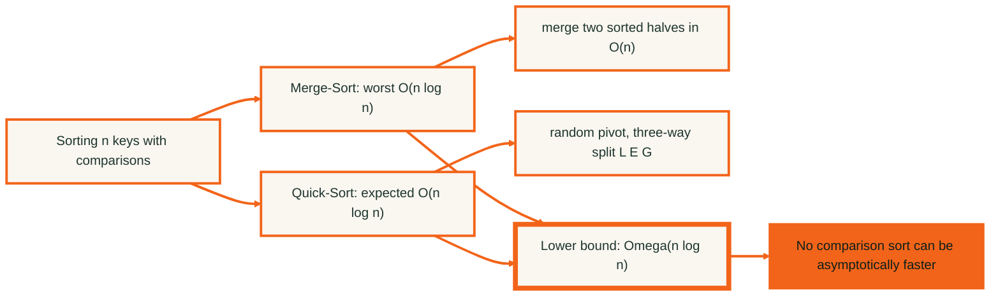
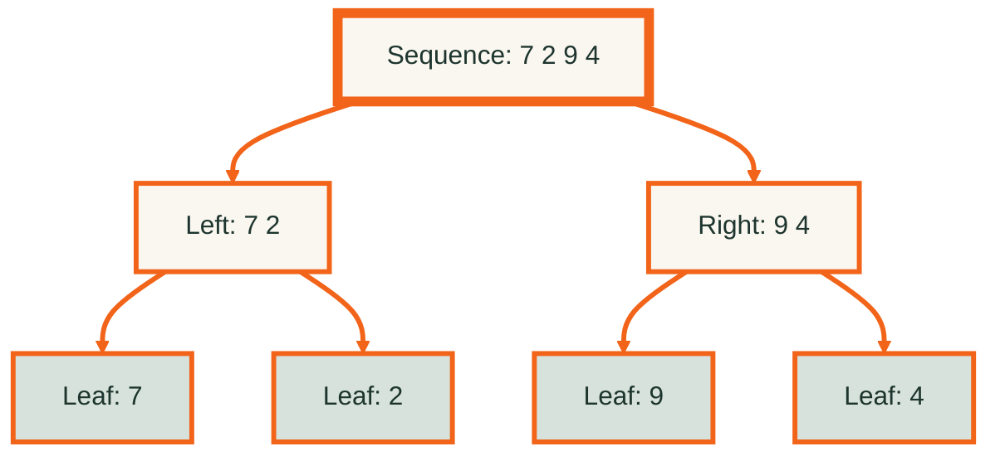
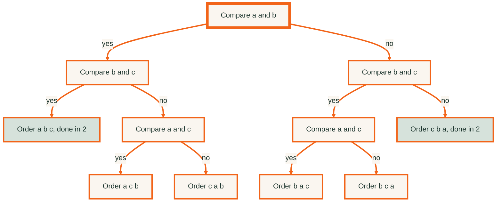

# 05 — Ταξινόμηση και Κάτω Όριο Συγκρίσεων
*Sorting and the Comparison-Sort Lower Bound*

Το κεφάλαιο λύνει το κλασικό πρόβλημα της ταξινόμησης $n$ κλειδιών με δύο αλγορίθμους διαίρει και βασίλευε: την Ταξινόμηση με Συγχώνευση (`Merge-Sort`), που εγγυάται $O(n \log n)$ στη χειρότερη περίπτωση και προσπελάζει τα δεδομένα αποκλειστικά σειριακά, και τη Γρήγορη Ταξινόμηση (`Quick-Sort`), που επιτυγχάνει αναμενόμενο $O(n \log n)$ με τυχαίο σημείο περιστροφής (`pivot`) και είναι στην πράξη η ταχύτερη επιλογή στη μνήμη. Το κεφάλαιο κλείνει με το κάτω όριο ταξινόμησης βάσει συγκρίσεων: κανένας αλγόριθμος που αποφασίζει μόνο με συγκρίσεις ζευγών δεν μπορεί να ταξινομήσει σε χρόνο μικρότερο του $\Omega(n \log n)$ στη χειρότερη περίπτωση, επομένως η `Merge-Sort` και η Ταξινόμηση Σωρού (`Heap-Sort`) της [02_priority_queues_heaps.md](02_priority_queues_heaps.md) είναι ασυμπτωτικά βέλτιστες. Η ανάλυση στηρίζεται στην ασυμπτωτική σημειογραφία της [01_analysis_of_algorithms.md](01_analysis_of_algorithms.md)· οι αναδρομικές εξισώσεις επιλύονται συστηματικά στην [07_divide_and_conquer.md](07_divide_and_conquer.md) και η σειρά που απαιτούν οι άπληστοι αλγόριθμοι της [06_greedy_method.md](06_greedy_method.md) προκύπτει άμεσα από αυτό το κεφάλαιο.

> **Εξεταστική κάλυψη:** Πρόοδος και Τελική
> **Κεφάλαιο βιβλίου:** `Κεφ. 8` | **Διαλέξεις:** `08_merge_sort.pdf`, `09_quick_sort.pdf`, `10_sorting_lower_bound.pdf`
> **Πηγή:** `Resources/Meta/mindmap.md` (Ενότητα 05)
> **Εκτός ύλης:** Καμία — ολόκληρο το Κεφάλαιο 8 εντός ύλης

## Πίνακας Περιεχομένων

- [1. Εννοιολογικό Πλαίσιο και Συνολική Εικόνα](#1-εννοιολογικό-πλαίσιο-και-συνολική-εικόνα)
- [2. Θεωρητική Θεμελίωση και Τυπικοί Ορισμοί](#2-θεωρητική-θεμελίωση-και-τυπικοί-ορισμοί)
- [3. Αλγόριθμοι, Ιχνηλάτηση και Κώδικας](#3-αλγόριθμοι-ιχνηλάτηση-και-κώδικας)
- [4. Συγκριτική Ανάλυση και Πολυπλοκότητα](#4-συγκριτική-ανάλυση-και-πολυπλοκότητα)
- [5. Πλήρως Λυμένες Ασκήσεις Εξεταστικού Επιπέδου](#5-πλήρως-λυμένες-ασκήσεις-εξεταστικού-επιπέδου)
- [6. Οδηγός Επιβίωσης στις Εξετάσεις και Παγίδες](#6-οδηγός-επιβίωσης-στις-εξετάσεις-και-παγίδες)
- [7. Συνοπτικός Πίνακας Εννοιών](#7-συνοπτικός-πίνακας-εννοιών)

---

## 1. Εννοιολογικό Πλαίσιο και Συνολική Εικόνα

### Το Πρόβλημα

Μια μηχανή αναζήτησης στο Διαδίκτυο κατασκευάζει το ανεστραμμένο ευρετήριο (`inverted index`) της: για κάθε λέξη-κλειδί πρέπει να ταξινομηθεί μια λίστα με τις διευθύνσεις των σελίδων που την περιέχουν, ώστε οι ομοιόμορφες εγγραφές να συγχωνεύονται και οι λίστες να σαρώνются αποτελεσματικά. Το σύνολο των ζευγών (λέξη, σελίδα) υπερβαίνει κάθε εύλογη κύρια μνήμη, άρα η ταξινόμηση γίνεται πάνω σε δεδομένα που βρίσκονται σε δίσκο. Εκεί κυριαρχεί η `Merge-Sort`: η συγχώνευση δύο ταξινομημένων αρχείων διαβάζει τα δεδομένα μόνο προς τα μπροστά (`sequential access`), χωρίς τυχαίες προσπελάσεις, που είναι η ακριβή λειτουργία στους μηχανικούς δίσκους. Για δεδομένα μέσα στη μνήμη, η τυχαιοποιημένη `Quick-Sort` είναι η συνήθης επιλογή λόγω των μικρών σταθερών και της επί-τόπου λειτουργίας της. Το κεφάλαιο τεκμηριώνει και τις δύο επιλογές και αποδεικνύει ότι, στο μοντέλο των συγκρίσεων, καμία δεν μπορεί να βελτιωθεί ασυμπτωτικά.

### Χάρτης Εννοιών του Κεφαλαίου



Πορτοκαλί γέμισμα: το τελικό συμπέρασμα του κεφαλαίου. Παχύ περίγραμμα: το θεώρημα του κάτω ορίου. Κρεμ: τα δύο κύτρα του κεφαλαίου και οι μηχανισμοί τους.

Η ανάγνωση του διαγράμματος: τα δύο κύτρα του κεφαλαίου (Merge-Sort, Quick-Sort) επιλύουν το ίδιο πρόβλημα με διαφορετικό μηχανισμό· το θεώρημα του κάτω ορίου εξηγεί γιατί το $O(n \log n)$ δεν είναι τυχαίο επίτευγμα αλλά φυσικό φράγμα του μοντέλου των συγκρίσεων.

### Πότε Χρησιμοποιείται Κάθε Αλγόριθμος

Για μικρά σύνολα (κάτω από $1\text{K}$ στοιχεία) αρκούν η Ταξινόμηση με Επιλογή (`Selection-Sort`) και η Ταξινόμηση με Εισαγωγή (`Insertion-Sort`) της [02_priority_queues_heaps.md](02_priority_queues_heaps.md), με κόστος $\Theta(n^2)$ αλλά πολύ απλό κώδικα. Για μεσαία σύνολα ($1\text{K}$ έως $1\text{M}$) εντός μνήμης προτιμάται η `Quick-Sort` (αναμενόμενα η ταχύτερη στην πράξη) ή η `Heap-Sort` όταν απαιτείται εγγυημένο $O(n \log n)$. Για τεράστια σύνολα (πάνω από $1\text{M}$) και για δεδομένα σε δίσκο προτιμάται η `Merge-Sort`, διότι λειτουργεί με σειριακή προσπέλαση και εγγυάται $O(n \log n)$ στη χειρότερη περίπτωση. Το κεφάλαιο δείχνει ότι η επιλογή αυτή δεν είναι θέμα γούστου: το κάτω όριο απαγορεύει σε κάθε αλγόριθμο συγκρίσεων να είναι ασυμπτωτικά ταχύτερος από τους δύο πρώτους.

---

## 2. Θεωρητική Θεμελίωση και Τυπικοί Ορισμοί

### 2.1 Το Πρόβλημα της Ταξινόμησης και το Μοντέλο των Συγκρίσεων

**Ορισμός.** Δίνεται ακολουθία $S$ με $n$ στοιχεία από ένα σύμπαν με ολική διάταξη (πρβλ. τα αξιώματα ολικής διάταξης της [02_priority_queues_heaps.md](02_priority_queues_heaps.md)). Η ταξινόμηση ζητά μία μετάθεση των στοιχείων του $S$ σε μη φθίνουσα σειρά ως προς τα κλειδιά τους.

**Ορισμός (ταξινόμηση βάσει συγκρίσεων).** Αλγόριθμος ταξινόμησης βάσει συγκρίσεων (`comparison sort`) είναι κάθε αλγόριθμος του οποίου οι αποφάσεις βασίζονται αποκλειστικά στη σύγκριση ζευγών κλειδιών ($x < y$, $x = y$, $x > y$) και όχι στην εσωτερική δομή ή τις τιμές των κλειδιών. Η `Selection-Sort`, η `Insertion-Sort`, η `Heap-Sort`, η `Merge-Sort` και η `Quick-Sort`, αλλά και κλασικές παραλλαγές όπως η `bubble-sort`, ανήκουν όλες σε αυτή την κατηγορία. Ο περιορισμός έχει συνέπεια: στο μοντέλο αυτό δύο κλειδιά διακρίνονται μόνο αν συγκριθούν, και αυτό οδηγεί στο κάτω όριο της Ενότητας 2.4.

| Αλγόριθμος | Τι συγκρίνει | Πού οφείλεται το κόστος |
|---|---|---|
| `Selection-Sort` | Κάθε στοιχείο με το τρέχον ελάχιστο | Επαναλαμβανόμενες σαρώσεις του υπολοίπου |
| `Insertion-Sort` | Κάθε νέο στοιχείο με το ταξινομημένο πρόθεμα | Μετατοπίσεις μέσα στον πίνακα |
| `Heap-Sort` | Παιδί με γονέα στο σωρό | `downheap` σε ύψος $O(\log n)$ |
| `Merge-Sort` | Τα μπροστινά στοιχεία δύο ταξινομημένων ακολουθιών | Σειρά επιπέδων του δέντρου αναδρομής |
| `Quick-Sort` | Κάθε στοιχείο με το `pivot` | Πλήθος και ισορροπία των επιπέδων |

### 2.2 Ταξινόμηση με Συγχώνευση (`Merge-Sort`)

**Ορισμός.** Η `Merge-Sort` είναι η εφαρμογή του προτύπου διαίρει και βασίλευε στην ταξινόμηση, με τρία βήματα:

1. **Διαίρει:** η ακολουθία $S$ χωρίζεται σε δύο ακολουθίες $S_1, S_2$ με μήκη $\lfloor n/2 \rfloor$ και $\lceil n/2 \rceil$.
2. **Επανάλαβε:** τα $S_1, S_2$ ταξινομούνται αναδρομικά με τον ίδιο αλγόριθμο· η βάση της αναδρομής είναι το μονοστοιχείο.
3. **Βασίλευε:** τα δύο ταξινομημένα μισά συγχωνεύονται σε μία ταξινομημένη ακολουθία με τη λειτουργία `merge` σε χρόνο $\Theta(n)$.

**Θεώρημα (χειρότερη περίπτωση της `Merge-Sort`).** *Η `Merge-Sort` ταξινομεί $n$ στοιχεία σε χρόνο $O(n \log n)$ στη χειρότερη περίπτωση, με αναδρομική εξίσωση $T(n) = 2T(n/2) + \Theta(n)$.*

*Απόδειξη.* Η διαίρεση κοστίζει $\Theta(n)$ και η συγχώνευση των δύο μισών κοστίζει $\Theta(n)$, άρα $T(n) = 2T(n/2) + \Theta(n)$ με $T(1) = \Theta(1)$. Λύνουμε με το δέντρο αναδρομής. Στο βάθος $i$ υπάρχουν $2^i$ ακολουθίες, καθεμία μεγέθους το πολύ $n/2^i$. Το άθροισμα των μηκών όλων των ακολουθιών ενός επιπέδου είναι το πολύ $n$, και η συγχώνευση κοστίζει γραμμικά ως προς το συνολικό μήκος, άρα κάθε επίπεδο κοστίζει $O(n)$. Οι ακολουθίες υποδιπλασιάζονται σε κάθε επίπεδο, άρα το ύψος του δέντρου είναι $h = \lceil \log_2 n \rceil = O(\log n)$. Συνολικά $O(n)$ ανά επίπεδο επί $O(\log n)$ επιπέδων δίνει $T(n) = O(n \log n)$ στη χειρότερη περίπτωση. Η ίδια εξίσωση επιλύεται και με το Θεώρημα Master (Περίπτωση 2, ισορροπία) στην [07_divide_and_conquer.md](07_divide_and_conquer.md). $\square$

Ιδιότητες που εξετάζονται:

- Το φράγμα ισχύει για **κάθε** είσοδο: η αναδρομή υποδιπλασιάζει πάντα, ανεξάρτητα από τις τιμές των κλειδιών.
- Η `Merge-Sort` **δεν** είναι επί τόπου: η `merge` χρειάζεται βοηθητική ακολουθία μεγέθους $\Theta(n)$.
- Είναι **σταθερή** (`stable`) με τη σύμβαση «σε ισοβαθμία προηγείται το στοιχείο της $S_1$»: ίσα κλειδιά διατηρούν τη σχετική τους σειρά.
- Λειτουργεί με **σειριακή προσπέλαση** (`sequential access`): η `merge` διαβάζει μόνο τα μπροστινά στοιχεία των δύο ακολουθιών και γράφει μόνο στο τέλος της εξόδου. Το χαρακτηριστικό αυτό την καθιστά κατάλληλη για σύνολα που υπερβαίνουν τη μνήμη και ζουν σε δίσκο, όπως στην κατασκευή ανεστραμμένου ευρετηρίου (`inverted index`) σε μηχανές αναζήτησης.

### 2.3 Γρήγορη Ταξινόμηση (`Quick-Sort`, τυχαιοποιημένη)

**Ορισμός (τριμερές διαμερισμό).** Έστω ακολουθία $S$ και τυχαίο στοιχείο $x$ της, το σημείο περιστροφής (`pivot`). Το **τριμερές διαμερισμό** (`three-way partition`) ορίζει τρεις περιοχές:

$$L = \{y \in S : y < x\},\quad E = \{y \in S : y = x\},\quad G = \{y \in S : y > x\}$$

Η `Quick-Sort` ταξινομεί αναδρομικά τα $L$ και $G$ και επιστρέφει τη συνένωση `quickSort(L)` ακολουθούμενη από το $E$ ακολουθούμενη από το `quickSort(G)`. Το $E$ δεν αναδρομείται: όλα τα στοιχεία του ισούνται με το `pivot` και είναι ήδη στη θέση τους.

**Πρόταση (χειρότερη περίπτωση).** *Αν το `pivot` είναι κάθε φορά το ελάχιστο ή το μέγιστο στοιχείο της τρέχουσας ακολουθίας, τότε $T(n) = T(n-1) + \Theta(n)$ και ο χρόνος είναι $\Theta(n^2)$.*

*Απόδειξη.* Αν $x$ είναι το μέγιστο, τα μεγέθη των περιοχών είναι $|L| = n-1$, $|E| = 1$, $|G| = 0$· αν είναι το ελάχιστο, $|L| = 0$, $|E| = 1$, $|G| = n-1$. Σε κάθε περίπτωση η μία αναδρομή έχει μέγεθος $n-1$ και η άλλη μέγεθος $0$, ενώ η σάρωση του διαμερισμού κοστίζει $c\,n$. Άρα $T(n) = T(n-1) + c\,n$. Αναπτύσσουμε:

$$T(n) = T(n-1) + cn = T(n-2) + c(n + (n-1)) = \cdots = T(1) + c\sum_{k=2}^{n} k = \Theta(n^2)$$

Το άθροισμα είναι το τριγωνικό $n(n+1)/2$ αφαιρούμενο του πρώτου όρου. Η περίπτωση αυτή πραγματοποιείται για παράδειγμα όταν το `pivot` επιλέγεται πάντα ως το πρώτο στοιχείο και η είσοδος είναι ήδη ταξινομημένη. $\square$

**Θεώρημα (αναμενόμενη περίπτωση).** *Η τυχαιοποιημένη `Quick-Sort` τρέχει σε αναμενόμενο χρόνο $O(n \log n)$ για κάθε σταθερή είσοδο.*

*Απόδειξη.* Μία κλήση σε ακολουθία μεγέθους $s$ ονομάζεται **καλή** (`good`) αν $|L| < 3s/4$ και $|G| < 3s/4$, δηλαδή αν η τάξη του `pivot` βρίσκεται στο μεσαίο μισό των τάξεων $s/4$ έως $3s/4$. Επειδή το `pivot` επιλέγεται ομοιόμορφα τυχαία μεταξύ των $s$ στοιχείων, το πλήθος των καλών υποψήφιων είναι $s/2$, άρα

$$\Pr[\text{η κλήση είναι καλή}] = \frac{1}{2}$$

Κάθε καλή κλήση περιορίζει το μέγεθος του προβλήματος σε κατώτερο από $3s/4$· κάθε κλήση, καλή ή όχι, μειώνει το μέγεθος τουλάχιστον κατά $1$ (το $E$ αφαιρείται πάντα). Ο αναμενόμενος αριθμός κλήσεων μέχρι το μέγεθος να συρρικνωθεί από $s$ σε κατώτερο από $3s/4$ είναι το πολύ $2$, γιατί ο αναμενόμενος αριθμός δοκιμών μέχρι την πρώτη επιτυχία με πιθανότητα $1/2$ είναι $2$ (γεωμετρική κατανομή). Για να πέσει το μέγεθος κάτω από $1$ χρειάζονται το πολύ $\log_{4/3} n$ συρρικνώσεις παράγοντα $3/4$, αφού $(3/4)^k \cdot n < 1$ ισοδυναμεί με $k > \log_{4/3} n$. Με τον παράγοντα $2$ κλήσεων ανά συρρικνούμενο βήμα, το αναμενόμενο ύψος του δέντρου αναδρομής είναι το πολύ

$$2\log_{4/3} n = O(\log n)$$

Για αριθμητική αίσθηση: για $n = 10^6$ είναι $\log_{4/3}(10^6) \approx 48$, άρα αναμενόμενο ύψος $\approx 96$, ενώ $\log_2(10^6) \approx 20$.

Το έργο ανά επίπεδο είναι $O(n)$: κάθε στοιχείο ανήκει σε ακριβώς μία ακολουθία του επιπέδου, και κάθε ακολουθία σαρώνεται μία φορά, άρα το συνολικό μέγεθος των ακολουθιών ενός επιπέδου είναι το πολύ $n$. Επομένως ο αναμενόμενος συνολικός χρόνος είναι $O(n)$ ανά επίπεδο επί $O(\log n)$ αναμενόμενα επίπεδα, δηλαδή $O(n \log n)$.

Η προσδοκία λαμβάνεται πάνω στις **τυχαίες επιλογές του αλγορίθμου** και όχι πάνω σε κάποια κατανομή εισόδων: η εξίσωση ισχύει για κάθε σταθερή είσοδο, ακόμη και για εισόδους που κατασκευάζονται εχθρικά. Αυτή είναι ακριβώς η αξία της τυχαιοποίησης: η χειρότερη περίπτωση $\Theta(n^2)$ εξακολουθεί να υπάρχει θεωρητικά, αλλά δεν μπορεί πλέον να προκληθεί από επίλεξη εισόδου. $\square$

### 2.4 Κάτω Όριο Ταξινόμησης βάσει Συγκρίσεων

**Ορισμός (μοντέλο δέντρου αποφάσεων).** Η εκτέλεση κάθε αλγορίθμου ταξινόμησης βάσει συγκρίσεων πάνω σε δεδομένη είσοδο αποδίδεται ένα μονοπάτι σε ένα **δέντρο αποφάσεων** (`decision tree`): κάθε εσωτερικός κόμβος είναι μία σύγκριση δύο κλειδιών με δύο πιθανά αποτελέσματα, κάθε φύλλο είναι μία διάταξη εξόδου, και η εκτέλεση ακολουθεί ένα μονοπάτι από τη ρίζα σε ένα φύλλο. Το ύψος του δέντρου είναι το πλήθος των συγκρίσεων στη χειρότερη περίπτωση.

**Θεώρημα (κάτω όριο).** *Κάθε αλγόριθμος ταξινόμησης βάσει συγκρίσεων που ταξινομεί σωστά $n$ διακριτά στοιχεία εκτελεί στη χειρότερη περίπτωση τουλάχιστον $\lceil \log_2 n! \rceil$ συγκρίσεις, και το φράγμα αυτό είναι $\Omega(n \log n)$.*

*Απόδειξη, βήμα προς βήμα.*

1. Για $n$ διακριτά στοιχεία οι πιθανές έξοδοι είναι όλες οι $n!$ μεταθέσεις τους. Ένας σωστός αλγόριθμος πρέπει για κάθε υποψήφια ταξινόμηση να υπάρχει είσοδος που την προκαλεί, διαφορετικά κάποια είσοδος θα ταξινομείτο λάθος. Άρα το δέντρο αποφάσεων έχει τουλάχιστον $n!$ φύλλα.
2. Ένα δυαδικό δέντρο ύψους $h$ έχει το πολύ $2^h$ φύλλα. Επειδή χρειάζονται τουλάχιστον $n!$ φύλλα, πρέπει $2^h \ge n!$, άρα

$$h \ge \log_2 n!$$

3. Για το γινόμενο ισχύει η κάτω φράση μέσω των $n - \lfloor n/2 \rfloor$ μεγαλύτερων παραγόντων, που είναι καθένας τουλάχιστον $n/2$:

$$n! = 1 \cdot 2 \cdots n \;\ge\; (n/2) \cdot (n/2 + 1) \cdots n \;\ge\; (n/2)^{n/2}$$

4. Συνδυάζοντας τα δύο τελευταία βήματα και αναπτύσσοντας τον λογάριθμο:

$$\log_2 n! \;\ge\; \log_2\bigl((n/2)^{n/2}\bigr) = \frac{n}{2}\log_2\frac{n}{2} = \frac{n}{2}\bigl(\log_2 n - 1\bigr)$$

5. Για $n \ge 4$ είναι $\log_2 n \ge 2$, άρα $\log_2 n - 1 \ge \frac{1}{2}\log_2 n$ και

$$h \;\ge\; \frac{n}{2}\bigl(\log_2 n - 1\bigr) \;\ge\; \frac{n}{4}\log_2 n = \Omega(n \log n)$$

Αριθμητική επαλήθευση κάθε βήματος της αλυσίδας για $n = 8$: $8! = 40320$ και $\log_2 40320 \approx 15{,}30$, άρα $h \ge 16$· το βήμα 3 δίνει $\log_2((8/2)^{8/2}) = 4 \cdot \log_2 4 = 8 \le 15{,}30$· το βήμα 5 δίνει $\frac{8}{4}\log_2 8 = 6 \le 8$. $\square$

**Συνέπεια.** Το φράγμα αφορά τους αλγορίθμους που αποφασίζουν μόνο με συγκρίσεις (`bubble-sort`, `selection-sort`, `insertion-sort`, `heap-sort`, `merge-sort`, `quick-sort`). Επειδή η `Merge-Sort` και η `Heap-Sort` επιτυγχάνουν $O(n \log n)$ στη χειρότερη περίπτωση, είναι **ασυμπτωτικά βέλτιστες** μέσα στο μοντέλο των συγκρίσεων: το κάτω όριο και το άνω όριο συμπίπτουν στην τάξη $n \log n$. Η `Quick-Sort` συμπίπτει με το όριο σε αναμενόμενο χρόνο. Η δήλωση δεν επεκτείνεται σε μεθόδους που επιθεωρούν την εσωτερική δομή των κλειδιών αντί να τα συγκρίνουν· τέτοιες μέθοδοι βρίσκονται εκτός του μοντέλου του δέντρου αποφάσεων και εκτός του πεδίου του κεφαλαίου.

---

## 3. Αλγόριθμοι, Ιχνηλάτηση και Κώδικας

### 3.1 Ταξινόμηση με Συγχώνευση (`Merge-Sort`)

Σκοπός: ταξινόμηση ακολουθίας με διαίρεση σε μισά, αναδρομική επίλυση και γραμμική συγχώνευση των αποτελεσμάτων.

```text
Algorithm mergeSort(S):
Input: Ακολουθία S με n συγκρίσιμα στοιχεία
Output: Η ακολουθία S ταξινομημένη σε μη φθίνουσα σειρά

if size(S) ≤ 1 then
    return S
S1 ← first half of S
S2 ← second half of S
mergeSort(S1)
mergeSort(S2)
S ← merge(S1, S2)
return S
```

```text
Algorithm merge(S1, S2):
Input: Ταξινομημένες ακολουθίες S1 και S2
Output: Ταξινομημένη συγχώνευσή τους

S ← empty sequence
while not isEmpty(S1) and not isEmpty(S2) do
    if first(S1) ≤ first(S2) then
        move the first element of S1 to the end of S
    else
        move the first element of S2 to the end of S
append the remaining elements of S1 to S
append the remaining elements of S2 to S
return S
```

Η σύγκριση με `≤` (και όχι `<`) είναι η σύμβαση ισοβαθμίας: σε ίσα μπροστινά στοιχεία προηγείται το στοιχείο της $S_1$, και αυτή η επιλογή καθιστά τη `Merge-Sort` σταθερή.

**Ιχνηλάτηση της διαίρεσης.** Είσοδος $S = [7, 2, 9, 4, 3, 8, 6, 1]$ με $n = 8$. Το μισό προκύπτει από το $\lfloor n/2 \rfloor$, άρα το πρώτο μισό έχει πάντα $\lfloor n/2 \rfloor$ στοιχεία και το δεύτερο $\lceil n/2 \rceil$.

| Επίπεδο | Ακολουθίες του επιπέδου |
|---|---|
| $0$ | $[7,2,9,4,3,8,6,1]$ |
| $1$ | $[7,2,9,4]$, $[3,8,6,1]$ |
| $2$ | $[7,2]$, $[9,4]$, $[3,8]$, $[6,1]$ |
| $3$ | $[7]$, $[2]$, $[9]$, $[4]$, $[3]$, $[8]$, $[6]$, $[1]$ |

Το μέγεθος ανά επίπεδο επαληθεύει το επιχείρημα της απόδειξης:

| Βάθος $i$ | Πλήθος $2^i$ | Μέγεθος $n/2^i$ | Άθροισμα μηκών |
|---|---|---|---|
| $0$ | $1$ | $8$ | $8$ |
| $1$ | $2$ | $4$ | $8$ |
| $2$ | $4$ | $2$ | $8$ |
| $3$ | $8$ | $1$ | $8$ |

Η διαίρεση σταματά σε μονοστοιχεία μετά από $\lceil \log_2 8 \rceil = 3$ βήματα.

**Ιχνηλάτηση της συγχώνευσης.** Τα μισά συγχωνεύονται από κάτω προς τα πάνω. Κάθε συγχώνευση δύο ακολουθιών συνολικού μήκους $m$ εκτείνει το αποτέλεσμα με μία σύγκριση ανά στοιχείο, με ανώτατο όριο $m - 1$ συγκρίσεων.

| Ζεύγος | Πράξεις | Έξοδος | Συγκρίσεις |
|---|---|---|---|
| $[7]$, $[2]$ | $7 \le 2$ όχι $\to$ 2, υπόλοιπο 7 | $[2,7]$ | $1$ |
| $[9]$, $[4]$ | $9 \le 4$ όχι $\to$ 4, υπόλοιπο 9 | $[4,9]$ | $1$ |
| $[3]$, $[8]$ | $3 \le 8$ ναι $\to$ 3, υπόλοιπο 8 | $[3,8]$ | $1$ |
| $[6]$, $[1]$ | $6 \le 1$ όχι $\to$ 1, υπόλοιπο 6 | $[1,6]$ | $1$ |
| $[2,7]$, $[4,9]$ | 2, 4, 7, υπόλοιπο 9 | $[2,4,7,9]$ | $3$ |
| $[3,8]$, $[1,6]$ | 1, 3, 6, υπόλοιπο 8 | $[1,3,6,8]$ | $3$ |
| $[2,4,7,9]$, $[1,3,6,8]$ | αναλυτικός πίνακας παρακάτω | $[1,2,3,4,6,7,8,9]$ | $7$ |

Σύνολο συγκρίσεων για $n = 8$: $1 + 1 + 1 + 1 + 3 + 3 + 7 = 17$.

Η τελική συγχώνευση βήμα προς βήμα, με τη σύμβαση ισοβαθμίας ρητή:

| Βήμα | Μπροστά $S_1$ | Μπροστά $S_2$ | Σύγκριση και επιλογή | Έξοδος ως τώρα |
|---|---|---|---|---|
| $1$ | $2$ | $1$ | $2 \le 1$ όχι $\to$ από $S_2$ | $[1]$ |
| $2$ | $2$ | $3$ | $2 \le 3$ ναι $\to$ από $S_1$ | $[1,2]$ |
| $3$ | $4$ | $3$ | $4 \le 3$ όχι $\to$ από $S_2$ | $[1,2,3]$ |
| $4$ | $4$ | $6$ | $4 \le 6$ ναι $\to$ από $S_1$ | $[1,2,3,4]$ |
| $5$ | $7$ | $6$ | $7 \le 6$ όχι $\to$ από $S_2$ | $[1,2,3,4,6]$ |
| $6$ | $7$ | $8$ | $7 \le 8$ ναι $\to$ από $S_1$ | $[1,2,3,4,6,7]$ |
| $7$ | $9$ | $8$ | $9 \le 8$ όχι $\to$ από $S_2$ | $[1,2,3,4,6,7,8]$ |
| $8$ | $9$ | κενή | υπόλοιπο $S_1$ | $[1,2,3,4,6,7,8,9]$ |

Επτά συγκρίσεις και μία μεταφορά υπολοίπου, σύμφωνες με το φράγμα $m - 1 = 7$ για $m = 8$.

**Δέντρο αναδρομής.** Το πλήρες δέντρο των 8 φύλλων υπερβαίνει το όριο 12 κόμβων ενός διαγράμματος· το διάγραμμα δείχνει τη διαίρεση ενός μισού των 4 στοιχείων, με τη φάση της συγχώνευσης ήδη αναλυμένη στους πίνακες.



Παχύ περίγραμμα: η ακολουθία της κορυφής. Κρεμ: τα δύο μισά. Απαλό πράσινο: τα φύλλα, όπου η αναδρομή τερματίζει. Το διάγραμμα απεικονίζει μόνο τη φάση της διαίρεσης· η φάση του βασίλευσε είναι οι πίνακες συγχώνευσης παραπάνω.

**Ρητή υλοποίηση:**

```python
def merge(seq_a: list[int], seq_b: list[int]) -> list[int]:
    """Merges two sorted lists into one sorted list.

    Args:
        seq_a (list[int]): First sorted list.
        seq_b (list[int]): Second sorted list.

    Returns:
        list[int]: The sorted merge of the two inputs.
    """
    result: list[int] = []
    i, j = 0, 0
    while i < len(seq_a) and j < len(seq_b):
        # On equal keys the element of seq_a is taken first, which keeps
        # merge-sort stable: equal keys keep their relative order.
        if seq_a[i] <= seq_b[j]:
            result.append(seq_a[i])
            i += 1
        else:
            result.append(seq_b[j])
            j += 1
    result.extend(seq_a[i:])  # Exactly one of the two tails is nonempty.
    result.extend(seq_b[j:])
    return result


def mergeSort(items: list[int]) -> list[int]:
    """Sorts a list with merge-sort, returning a new sorted list.

    Args:
        items (list[int]): The list to sort; it is not modified.

    Returns:
        list[int]: A new list with the same elements in sorted order.
    """
    if len(items) <= 1:
        return list(items)
    mid = len(items) // 2
    # Divide in halves, conquer each half, then merge the sorted halves.
    left_half = mergeSort(items[:mid])
    right_half = mergeSort(items[mid:])
    return merge(left_half, right_half)


assert mergeSort([7, 2, 9, 4, 3, 8, 6, 1]) == [1, 2, 3, 4, 6, 7, 8, 9]
assert mergeSort([5, 5, 5]) == [5, 5, 5]  # Duplicates pass through the E-path.
assert mergeSort([]) == []
```

**Ιδιωματισμός:**

```python
import heapq

unsorted_values = [7, 2, 9, 4, 3, 8, 6, 1]

sorted_copy = sorted(unsorted_values)   # new list, input untouched
assert sorted_copy == [1, 2, 3, 4, 6, 7, 8, 9]

unsorted_values.sort()                  # in place, returns None
assert unsorted_values == [1, 2, 3, 4, 6, 7, 8, 9]

# The merge step itself has a standard-library counterpart:
merged = list(heapq.merge([2, 4, 7, 9], [1, 3, 6, 8]))
assert merged == [1, 2, 3, 4, 6, 7, 8, 9]
```

| Μορφή | Χρόνος | Επιπλέον χώρος | Τι κρύβει |
|---|---|---|---|
| `mergeSort(items)` | $\Theta(n \log n)$ χειρότερη | $\Theta(n)$ | Τίποτα· είναι ο αλγόριθμος που ζητά η εξέταση |
| `sorted(items)` | $O(n \log n)$ χειρότερη | $O(n)$ | Timsort: υβρίδιο `Merge-Sort`/`Insertion-Sort`, σταθερό |
| `heapq.merge(a, b)` | $\Theta(n_1 + n_2)$ | τεμπέλης επαναλήπτης | Την ίδια λογική δύο δεικτών της `merge`, χωρίς πίνακα εξόδου |

Η εξέταση ζητά τον ρητό αλγόριθμο και την ιχνηλάτησή του· το `heapq.merge` επαληθεύει μόνο το βήμα της συγχώνευσης. Το `sorted` είναι ο έτοιμος ανταγωνιστής του κεφαλαίου και συγκρίνεται με τη `Quick-Sort` στην επόμενη ενότητα.

**Ανάλυση γραμμή προς γραμμή.** Στην `merge`, κάθε επανάληψη του βρόχου εκτελεί μία σύγκριση και μία μεταφορά, και αφαιρεί ακριβώς ένα στοιχείο από τα δύο μπροστινά· ο βρόχος τρέχει το πολύ $n_1 + n_2 - 1$ φορές και τουλάχιστον $\min(n_1, n_2)$ φορές, άρα $\Theta(n_1 + n_2)$. Στην `mergeSort`, το slicing και η κλήση της `merge` κοστίζουν μαζί $\Theta(n)$, η αναδρομή δίνει $T(n) = 2T(n/2) + \Theta(n)$ και η απόδειξη της Ενότητας 2.2 δίνει $\Theta(n \log n)$ στη χειρότερη περίπτωση. Ο χώρος είναι $\Theta(n)$ για τη βοηθητική ακολουθία κάθε `merge` συν $O(\log n)$ για τη στοίβα της αναδρομής.

### 3.2 Τυχαιοποιημένη Γρήγορη Ταξινόμηση (`Quick-Sort`) με Τριμερές Διαμερισμό

Σκοπός: ταξινόμηση με διαμερισμό γύρω από τυχαίο `pivot` σε τρεις περιοχές $L$, $E$, $G$, με αναδρομή μόνο στα $L$ και $G$.

```text
Algorithm quickSort(S):
Input: Ακολουθία S με n συγκρίσιμα στοιχεία
Output: Ταξινομημένη ακολουθία

if size(S) ≤ 1 then
    return S
x ← random element of S
L ← empty sequence
E ← empty sequence
G ← empty sequence
for each element y of S do
    if y < x then
        add y to the end of L
    else if y = x then
        add y to the end of E
    else
        add y to the end of G
return concatenation of quickSort(L), E, quickSort(G)
```

**Κανόνας αναπαραγώγιμης ιχνηλάτησης:** το `pivot` της ιχνηλάτησης είναι πάντα το στοιχείο της θέσης $\lfloor m/2 \rfloor$ (με μηδενική βαθμίδα· για άρτιο $m$ η δεξιά από τις δύο μεσαίες θέσεις). Ο κώδικας του μαθήματος χρησιμοποιεί τυχαίο `pivot`· ο σταθερός κανόνας υπηρετεί μόνο την αναπαραγωγή των πινάκων.

**Ιχνηλάτηση.** Είσοδος $S = [6, 3, 8, 1, 6, 4, 9, 6, 2]$ με $m = 9$: $x = S[4] = 6$.

| $y$ | $y < 6$ | $y = 6$ | $y > 6$ | Περιοχή |
|---|---|---|---|---|
| $6$ | | ναι | | $E$ |
| $3$ | ναι | | | $L$ |
| $8$ | | | ναι | $G$ |
| $1$ | ναι | | | $L$ |
| $6$ | | ναι | | $E$ |
| $4$ | ναι | | | $L$ |
| $9$ | | | ναι | $G$ |
| $6$ | | ναι | | $E$ |
| $2$ | ναι | | | $L$ |

Άρα $L = [3, 1, 4, 2]$, $E = [6, 6, 6]$, $G = [8, 9]$. Η περιοχή $E$ δεν αναδρομείται ποτέ.

Οι αναδρομικές κλήσεις μέχρι τη βάση:

| Κλήση | Είσοδος | `pivot` (θέση $\lfloor m/2 \rfloor$) | $L$ | $E$ | $G$ |
|---|---|---|---|---|---|
| 1 | $[6,3,8,1,6,4,9,6,2]$ | $6$ | $[3,1,4,2]$ | $[6,6,6]$ | $[8,9]$ |
| 2 | $[3,1,4,2]$ | $4$ | $[3,1,2]$ | $[4]$ | κενό |
| 3 | $[3,1,2]$ | $1$ | κενό | $[1]$ | $[3,2]$ |
| 4 | $[3,2]$ | $2$ | κενό | $[2]$ | $[3]$ |
| 5 | $[3]$ | βάση ($m \le 1$) | | | |
| 6 | $[8,9]$ | $9$ | $[8]$ | $[9]$ | κενό |
| 7 | $[8]$ | βάση ($m \le 1$) | | | |

Συνένωση από κάτω προς τα πάνω: οι κλήσεις 4 και 5 δίνουν $[2,3]$, η 3 δίνει $[1,2,3]$, η 2 δίνει $[1,2,3,4]$, οι 6 και 7 δίνουν $[8,9]$, και η κορυφή δίνει

$$[1,2,3,4] \;+\; [6,6,6] \;+\; [8,9] = [1,2,3,4,6,6,6,8,9]$$

**Ρητή υλοποίηση:**

```python
import random


def quickSort(items: list[int]) -> list[int]:
    """Sorts a list with randomized three-way quick-sort, one scan per call.

    Args:
        items (list[int]): The list to sort; it is not modified.

    Returns:
        list[int]: A new list with the same elements in sorted order.
    """
    if len(items) <= 1:
        return list(items)
    pivot = random.choice(items)
    less: list[int] = []
    equal: list[int] = []
    greater: list[int] = []
    for y in items:
        # One comparison chain per element: the textbook single-scan partition.
        if y < pivot:
            less.append(y)
        elif y == pivot:
            equal.append(y)
        else:
            greater.append(y)
    return quickSort(less) + equal + quickSort(greater)


values = [6, 3, 8, 1, 6, 4, 9, 6, 2]
assert quickSort(values) == [1, 2, 3, 4, 6, 6, 6, 8, 9]
assert values == [6, 3, 8, 1, 6, 4, 9, 6, 2]  # quickSort does not touch the input.
```

**Ιδιωματισμός (διαμερισμό με λίστες comprehensions):**

```python
import random


def quickSortComprehensions(items: list[int]) -> list[int]:
    """Sorts with quick-sort expressed as three list comprehensions.

    Args:
        items (list[int]): The list to sort.

    Returns:
        list[int]: A new sorted list; the input is not modified.
    """
    if len(items) <= 1:
        return list(items)
    pivot = random.choice(items)
    less = [y for y in items if y < pivot]
    equal = [y for y in items if y == pivot]
    greater = [y for y in items if y > pivot]
    return quickSortComprehensions(less) + equal + quickSortComprehensions(greater)


assert quickSortComprehensions([6, 3, 8, 1, 6, 4, 9, 6, 2]) == [1, 2, 3, 4, 6, 6, 6, 8, 9]
```

| Μορφή | Χρόνος | Τι κρύβει |
|---|---|---|
| `quickSort(items)` | $\Theta(s)$ ανά διαμερισμό, αναμενόμενη $O(n \log n)$ συνολικά | Τίποτα· μία σάρωση με $1$ έως $2$ συγκρίσεις ανά στοιχείο |
| `quickSortComprehensions(items)` | ίδιο ασυμπτωτικά | Τρεις σαρώσεις της εισόδου ($3$ συγκρίσεις ανά στοιχείο) αντί για μία |
| `sorted(items)` | $O(n \log n)$ χειρότερη, σταθερό | Τον αλγόριθμο εντελώς: είναι Timsort, όχι Quick-Sort |

> **Προσοχή στις συμβάσεις.** Οι `sorted` και `list.sort` της CPython υλοποιούν **Timsort**: υβρίδιο `Merge-Sort` και `Insertion-Sort` που είναι **σταθερό** και έχει $O(n \log n)$ στη **χειρότερη** περίπτωση (και $O(n)$ σε ήδη ταξινομημένη είσοδο). Η `Quick-Sort` του μαθήματος είναι τυχαιοποιημένη, **δεν** είναι σταθερή, έχει $\Theta(n^2)$ χειρότερη και $O(n \log n)$ **αναμενόμενη** συμπεριφορά. Η εξέταση ζητά τον ρητό αλγόριθμο και το διαμερισμό του· το `sorted` χρησιμεύει μόνο ως επαλήθευση του αποτελέσματος.

**Ανάλυση γραμμή προς γραμμή.** Ο βρόχος του διαμερισμού εκτελεί $s$ επαναλήψεις, καθεμία με $1$ ή $2$ συγκρίσεις και σταθερό υπόλοιπο κόστος, άρα $\Theta(s)$. Η αναδρομική εξίσωση είναι $\Theta(n)$ για τη ρίζα συν τους δύο όρους των $L$, $G$: στη χειρότερη περίπτωση $T(n) = T(n-1) + \Theta(n) = \Theta(n^2)$ (Πρόταση 2.3), σε αναμενόμενη $O(n \log n)$ με το επιχείρημα της καλής κλήσης (Θεώρημα 2.3). Ο χώρος: οι λίστες κάθε κλήσης αποδεσμεύονται πριν από την επιστροφή· το βάθος της αναδρομής είναι έως $n$ στη χειρότερη περίπτωση και $O(\log n)$ αναμενόμενο.

### 3.3 Επί Τόπου `Quick-Sort` (`inPlaceQuickSort`)

Σκοπός: το ίδιο διαμερισμό $L$, $E$, $G$ μέσα στον ίδιο πίνακα, χωρίς νέες λίστες, με δύο δείκτες $j, k$ που αναδιατάσσουν τα στοιχεία και επιστρέφουν τα όρια $(h, k)$ των τριών περιοχών.

```text
Algorithm inPlaceQuickSort(S, l, r):
Input: Πίνακας S και όρια τμήματος l, r
Output: Το τμήμα S[l..r] ταξινομημένο επί τόπου

if l ≥ r then
    return
x ← random element of S[l..r]
(h, k) ← inPlacePartition(S, l, r, x)
inPlaceQuickSort(S, l, h - 1)
inPlaceQuickSort(S, k + 1, r)
```

```text
Algorithm inPlacePartition(S, l, r, x):
Input: Τμήμα S[l..r] και τιμή pivot x που ανήκει στο τμήμα
Output: Όρια h, k με S[l..h-1] < x, S[h..k] = x, S[k+1..r] > x

h ← l
j ← l
k ← r
while j ≤ k do
    if S[j] < x then
        swap S[h] and S[j]
        h ← h + 1
        j ← j + 1
    else if S[j] > x then
        swap S[j] and S[k]
        k ← k - 1
    else
        j ← j + 1
return (h, k)
```

Ο δείκτης $j$ σαρώνει προς τα δεξιά και ο $k$ προς τα αριστερά και οι δύο ανταλλάσσουν στοιχεία που βρίσκονται στη λάθος πλευρά, ενώ το $h$ συσσωρεύει το όριο της περιοχής των μικρότερων. Κάθε επανάληψη προωθεί τουλάχιστον έναν από τους $j, k$, άρα ο βρόχος τρέχει το πολύ $r - l + 1$ φορές. Η σημασιολογία των ορίων είναι τριμερής: $S[l..h-1]$ αυστηρά μικρότερα, $S[h..k]$ ίσα με το `pivot`, $S[k+1..r]$ αυστηρά μεγαλύτερα· οι δύο αναδρομές αφήνουν το $S[h..k]$ ανέγγιχτο.

**Ιχνηλάτηση.** Πίνακας $S = [5, 9, 5, 3, 5, 1, 8, 5]$, τμήμα $l = 0$, $r = 7$. Κανόνας αναπαραγώγιμης ιχνηλάτησης: `pivot` = το στοιχείο της θέσης $l + \lfloor (r - l + 1)/2 \rfloor$, δηλαδή $x = S[4] = 5$.

| Βήμα | $j$ | $k$ | $S[j]$ | Ενέργεια | Πίνακας μετά το βήμα |
|---|---|---|---|---|---|
| 1 | $0$ | $7$ | $5$ | ίσο με $x$: $j \to 1$ | $[5,9,5,3,5,1,8,5]$ |
| 2 | $1$ | $7$ | $9$ | $> x$: ανταλλαγή $S[1] \leftrightarrow S[7]$, $k \to 6$ | $[5,5,5,3,5,1,8,9]$ |
| 3 | $1$ | $6$ | $5$ | ίσο: $j \to 2$ | $[5,5,5,3,5,1,8,9]$ |
| 4 | $2$ | $6$ | $5$ | ίσο: $j \to 3$ | $[5,5,5,3,5,1,8,9]$ |
| 5 | $3$ | $6$ | $3$ | $< x$: ανταλλαγή $S[h{=}0] \leftrightarrow S[3]$, $h \to 1$, $j \to 4$ | $[3,5,5,5,5,1,8,9]$ |
| 6 | $4$ | $6$ | $5$ | ίσο: $j \to 5$ | $[3,5,5,5,5,1,8,9]$ |
| 7 | $5$ | $6$ | $1$ | $< x$: ανταλλαγή $S[h{=}1] \leftrightarrow S[5]$, $h \to 2$, $j \to 6$ | $[3,1,5,5,5,5,8,9]$ |
| 8 | $6$ | $6$ | $8$ | $> x$: ανταλλαγή $S[6] \leftrightarrow S[6]$, $k \to 5$ | $[3,1,5,5,5,5,8,9]$ |
| 9 | $6$ | $5$ | — | $j > k$: τερματισμός, επιστρέφει $(h, k) = (2, 5)$ | $[3,1,5,5,5,5,8,9]$ |

Επαλήθευση των τριών περιοχών: $S[0..1] = [3, 1] < 5$, $S[2..5] = [5, 5, 5, 5] = 5$, $S[6..7] = [8, 9] > 5$. Οι δύο αναδρομές είναι $[0, 1]$ και $[6, 7]$:

- Τμήμα $[3, 1]$, `pivot` στη θέση $0 + \lfloor 2/2 \rfloor = 1$, άρα $x = 1$: το $3 > 1$ ανταλλάσσεται με το $1$ ($k \to 0$), το $1 = x$ προωθεί το $j$, και προκύπτει $[1, 3]$ με $(h, k) = (0, 0)$· οι αναδρομές $[0, -1]$ και $[1, 1]$ είναι κενές ή μονοστοιχεία.
- Τμήμα $[8, 9]$, `pivot` στη θέση $6 + 1 = 7$, άρα $x = 9$: το $8 < 9$ προωθεί $h, j$, το $9 = x$ προωθεί το $j$, και προκύπτει $(h, k) = (7, 7)$ με $S[6] = 8 < 9$ και $S[7] = 9 = x$.

Τελικός πίνακας: $[1, 3, 5, 5, 5, 5, 8, 9]$.

**Ρητή υλοποίηση:**

```python
import random


def inPlacePartition(items: list[int], left: int, right: int, pivot: int) -> tuple[int, int]:
    """Rearranges items[left..right] in place around the pivot value.

    Args:
        items (list[int]): The list holding the subarray; modified in place.
        left (int): The first index of the subarray.
        right (int): The last index of the subarray.
        pivot (int): The pivot value, an element of items[left..right].

    Returns:
        tuple[int, int]: Bounds (h, k) with items[left..h-1] < pivot,
            items[h..k] == pivot, items[k+1..right] > pivot.
    """
    h, j, k = left, left, right
    while j <= k:
        if items[j] < pivot:
            # The small element joins the left region; both pointers advance.
            items[h], items[j] = items[j], items[h]
            h += 1
            j += 1
        elif items[j] > pivot:
            # The large element is swapped to the right end; the swapped-in
            # value is re-examined, so only k moves.
            items[j], items[k] = items[k], items[j]
            k -= 1
        else:
            j += 1
    return (h, k)


def inPlaceQuickSort(items: list[int], left: int = 0, right: int | None = None) -> list[int]:
    """Sorts items in place with randomized in-place quick-sort.

    Args:
        items (list[int]): The list to sort; it is modified in place.
        left (int): The first index of the current subarray.
        right (int | None): The last index; the whole list when None.

    Returns:
        list[int]: The same list object, now sorted.
    """
    if right is None:
        right = len(items) - 1
    if left >= right:
        return items
    pivot = random.choice(items[left : right + 1])
    h, k = inPlacePartition(items, left, right, pivot)
    # The region items[h..k] equals the pivot and is already in final place.
    inPlaceQuickSort(items, left, h - 1)
    inPlaceQuickSort(items, k + 1, right)
    return items


assert inPlaceQuickSort([5, 9, 5, 3, 5, 1, 8, 5]) == [1, 3, 5, 5, 5, 5, 8, 9]
```

**Ιδιωματισμός.** Δεν υπάρχει συνάρτηση της τυπικής βιβλιοθήκης που να υλοποιεί το επί-τόπου διαμερισμό με όρια $(h, k)$· το `list.sort()` είναι μεν επί τόπου, αλλά υλοποιεί Timsort (σταθερός, $O(n \log n)$ χειρότερη), όχι `Quick-Sort`. Η εξέταση ζητά τον ρητό κώδικα και τον πίνακα ανταλλαγών.

**Ανάλυση γραμμή προς γραμμή.** Κάθε επανάληψη του βρόχου της `inPlacePartition` προωθεί τον $j$, υποχωρεί τον $k$, ή και τα δύο, άρα το πλήθος των επαναλήψεων είναι το πολύ $r - l + 1$ και κάθε επανάληψη κόστος $O(1)$: το διαμερισμό είναι $\Theta(m)$ για τμήμα μήκους $m$, με μία σύγκριση ανά στοιχείο. Οι αναδρομικές κλήσεις είναι δύο, στα $[l, h-1]$ και $[k+1, r]$, και επειδή η περιοχή $[h, k]$ περιέχει τουλάχιστον το `pivot`, το άθροισμα των μηκών τους είναι αυστηρά μικρότερο του αρχικού, άρα ο τερματισμός είναι εγγυημένος. Ο χρόνος ακολουθεί τις δύο περιπτώσεις της `Quick-Sort`: χειρότερη $\Theta(n^2)$ (κακά `pivot` σε σειρά), αναμενόμενη $O(n \log n)$ (καλές κλήσεις με πιθανότητα $1/2$). Ο επιπλέον χώρος ανά κλήση είναι $O(1)$· μόνο η στοίβα της αναδρομής μετρά, με βάθος έως $n$ στη χειρότερη και $O(\log n)$ αναμενόμενη.

### 3.4 Το Δέντρο Αποφάσεων ως Ιχνηλάτηση του Κάτω Ορίου

Σκοπός: οπτικοποίηση του μοντέλου της Ενότητας 2.4 για $n = 3$, ώστε το κάτω όριο να γίνει μετρήσιμο.

**Ιχνηλάτηση.** Τρία διακριτά στοιχεία $a, b, c$. Το δέντρο αποφάσεων κάθε αλγορίθμου συγκρίσεων που τα ταξινομεί σωστά πρέπει να φτάνει και στις $3! = 6$ μεταθέσεις.



Παχύ περίγραμμα: η πρώτη σύγκριση. Απαλό πράσινο: τα δύο φύλλα βάθους 2, όπου η είσοδος ταξινομείται με μόνο 2 συγκρίσεις. Κρεμ: οι ενδιάμεσες συγκρίσεις και τα φύλλα βάθους 3.

| Μέγεθος | Τιμή | Αιτιολόγηση |
|---|---|---|
| Φύλλα | $6$ | $3! = 6$ μεταθέσεις εξόδου |
| Βάθος ρηχότερου φύλλου | $2$ | π.χ. η είσοδος με $a < b < c$ ταξινομείται με 2 συγκρίσεις |
| Ύψος (βαθύτερο φύλλο) | $3$ | ο αριθμός συγκρίσεων στη χειρότερη περίπτωση |
| Θεωρητικό ελάχιστο ύψος | $\lceil \log_2 6 \rceil = 3$ | από το Θεώρημα 2.4 |

Το δέντρο επιτυγχάνει το ελάχιστο ύψος $3 = \lceil \log_2 3! \rceil$: κανένας αλγόριθμος συγκρίσεων δεν μπορεί να ταξινομήσει 3 στοιχεία με λιγότερες από 3 συγκρίσεις στη χειρότερη περίπτωση, διότι δυαδικό δέντρο ύψους 2 έχει το πολύ $2^2 = 4 < 6$ φύλλα.

**Ρητή υλοποίηση (ο ελεγκτής του δέντρου):**

```python
import itertools


def decisionTreeSort(a: int, b: int, c: int) -> tuple[list[int], int]:
    """Sorts three distinct values with the decision tree of the note.

    Args:
        a (int): First value.
        b (int): Second value.
        c (int): Third value.

    Returns:
        tuple[list[int], int]: The sorted values and the comparisons used.
    """
    comparisons = 1
    if a < b:
        comparisons += 1
        if b < c:
            return [a, b, c], comparisons  # yes-yes path: 2 comparisons.
        comparisons += 1
        if a < c:
            return [a, c, b], comparisons
        return [c, a, b], comparisons
    comparisons += 1
    if b < c:
        comparisons += 1
        if a < c:
            return [b, a, c], comparisons
        return [b, c, a], comparisons
    return [c, b, a], comparisons


for a, b, c in itertools.permutations((1, 2, 3)):
    ordered, cost = decisionTreeSort(a, b, c)
    assert ordered == [1, 2, 3]
    assert cost <= 3
assert decisionTreeSort(3, 1, 2)[1] == 3  # worst case: three comparisons.
assert decisionTreeSort(1, 2, 3)[1] == 2  # best case: two comparisons.
```

**Επαλήθευση των αριθμών του κάτω ορίου:**

```python
import math

assert math.ceil(math.log2(math.factorial(3))) == 3
assert math.ceil(math.log2(math.factorial(4))) == 5
assert math.ceil(math.log2(math.factorial(8))) == 16  # 2^15 < 40320 <= 2^16.
```

**Ιδιωματισμός.** Δεν υπάρχει αντίστοιχο της τυπικής βιβλιοθήκης: το δέντρο αποφάσεων είναι μοντέλο ανάλυσης, όχι αλγόριθμος, και ο πίνακας των αριθμών παράγεται από τις `math.factorial` και `math.log2` μόνο ως επαλήθευση.

**Ανάλυση.** Η ιχνηλάτηση μετράει απευθείας τα μεγέθη του Θεωρήματος 2.4: $6$ φύλλα, ελάχιστο ύψος $\lceil \log_2 6 \rceil = 3$, δύο φύλλα ένα επίπεδο ψηλότερα από τα υπόλοιπα. Ο ελεγκτής επιβεβαιώνει ότι κάθε μετάθεση οδηγεί σε σωστή έξοδο με το πολύ $3$ συγκρίσεις και ότι υπάρχουν εισόδοι που απαιτούν και τις $3$.

---

## 4. Συγκριτική Ανάλυση και Πολυπλοκότητα

### 4.1 Σύγκριση των Πέντε Αλγορίθμων του Μαθήματος

Οι πολυπλοκότητες αναφέρονται πάντα με ρητό χαρακτηρισμό περίπτωσης· η εξέταση αφαιρεί μονάδες για ασαφές $O(\cdot)$. Η `Selection-Sort` και η `Insertion-Sort` προέκυψαν ως `PQ-Sort` στην [02_priority_queues_heaps.md](02_priority_queues_heaps.md) και η `Heap-Sort` αναλύθηκε εκεί· επαναλαμβάνονται εδώ μόνο τα σύνορα.

| Αλγόριθμος | Χειρότερη | Καλύτερη ή αναμενόμενη | Επί τόπου | Σταθερή | Σύσταση μεγέθους |
|---|---|---|---|---|---|
| `Selection-Sort` | $\Theta(n^2)$ | καλύτερη $\Theta(n^2)$: σαρώνει πάντα τον υπόλοιπο | ναι | όχι | $< 1\text{K}$, απλότητα |
| `Insertion-Sort` | $\Theta(n^2)$ | καλύτερη $\Theta(n)$ σε ήδη ταξινομημένη είσοδο | ναι | ναι, με σύμβαση ισοβαθμίας | $< 1\text{K}$, σχεδόν ταξινομημένα δεδομένα |
| `Heap-Sort` | $O(n \log n)$ | ενιαία $O(n \log n)$ σε κάθε είσοδο | ναι | όχι | $1\text{K}$ έως $1\text{M}$, απαιτείται εγγύηση |
| `Quick-Sort` | $\Theta(n^2)$ | αναμενόμενη $O(n \log n)$, πάνω στην τυχαιότητα του `pivot`, για κάθε είσοδο | ναι (με `inPlaceQuickSort`) | όχι | $1\text{K}$ έως $1\text{M}$, ταχύτερη στην πράξη |
| `Merge-Sort` | $\Theta(n \log n)$ | ενιαία $\Theta(n \log n)$ σε κάθε είσοδο | όχι: βοηθητικός χώρος $\Theta(n)$ | ναι, με `≤` από τη $S_1$ | $> 1\text{M}$, δίσκος, σειριακή προσπέλαση |

Το μέσο κόστος της `Insertion-Sort` πάνω σε τυχαία είσοδο παραμένει $\Theta(n^2)$: το αναμενόμενο πλήθος των αντιστροφών είναι $\binom{n}{2}/2$, και κάθε αντιστροφή πληρώνεται με μία μετατόπιση.

### 4.2 Κανόνας Επιλογής

| Απαίτηση | Επιλογή | Αιτιολόγηση |
|---|---|---|
| Μικρό $n$, απλός κώδικας | `Insertion-Sort` (ή `Selection-Sort`) | $\Theta(n^2)$ με τόσο μικρές σταθερές που κερδίζει στα σύντομα δεδομένα· καλύτερη $\Theta(n)$ αν είναι ήδη σχεδόν ταξινομημένα |
| Μεσαίο $n$ εντός μνήμης, ταχύτητα | `Quick-Sort` (τυχαιοποιημένη) | αναμενόμενη $O(n \log n)$, μικρές σταθερές, επί τόπου λειτουργία· η τυχαιότητα εξουδετερώνει τις εχθρικές εισόδους |
| Εγγυημένο $O(n \log n)$ εντός μνήμης | `Heap-Sort` | χειρότερη $O(n \log n)$ χωρίς καμία υπόθεση για το `pivot`· επί τόπου |
| Τεράστιο $n$ ή δεδομένα σε δίσκο | `Merge-Sort` | σειριακή προσπέλαση μόνο, χειρότερη $O(n \log n)$: ο δίσκος αποδίδει μόνο με διαδοχική ανάγνωση και η `merge` δεν κάνει τίποτα άλλο, ενώ η εγγύηση της χειρότερης περίπτωσης παραμένει |
| Διατήρηση σειράς ίσων κλειδιών | `Merge-Sort` (ή `Insertion-Sort`) | σταθερότητα με ρητή σύμβαση ισοβαθμίας· η `Quick-Sort` και η `Heap-Sort` μετατοπίζουν ίσα κλειδιά |
| Πολλές επαναλήψεις ίσων κλειδιών | `Quick-Sort` με τριμερές διαμερισμό | η περιοχή $E$ δεν αναδρομείται, άρα οι επαναλήψεις δεν πολλαπλασιάζουν το βάθος |

### 4.3 Παραγωγή των Φραγμάτων

- **`Selection-Sort`:** η κλήση `removeMin` σαρώνει τον υπόλοιπο πίνακα, άρα το σύνολο είναι $(n-1) + (n-2) + \cdots + 1 = \frac{n(n-1)}{2} = \Theta(n^2)$, σε κάθε είσοδο.
- **`Insertion-Sort`:** στη χειρότερη περίπτωση κάθε νέο στοιχείο μετατοπίζει όλο το ταξινομημένο πρόθεμα, άρα $1 + 2 + \cdots + (n-1) = \Theta(n^2)$· στην ήδη ταξινομημένη κάθε νέο στοιχείο συγκρίνεται μία φορά, άρα $\Theta(n)$.
- **`Heap-Sort`:** κατασκευή σωρού από κάτω προς τα πάνω σε $O(n)$ και $n$ εξαγωγές `removeMin` με `downheap` $O(\log n)$ η καθεμία (Ενότητα 02): σύνολο $O(n \log n)$ στη χειρότερη περίπτωση, επί τόπου.
- **`Merge-Sort`:** αναδρομική εξίσωση $T(n) = 2T(n/2) + \Theta(n)$· $2^i$ ακολουθίες μεγέθους $n/2^i$ στο βάθος $i$, $O(n)$ ανά επίπεδο, $\lceil \log_2 n \rceil$ επίπεδα: $O(n \log n)$ στη χειρότερη περίπτωση.
- **`Quick-Sort`, χειρότερη:** $T(n) = T(n-1) + \Theta(n)$, με άθροισμα $\frac{n(n+1)}{2} = \Theta(n^2)$.
- **`Quick-Sort`, αναμενόμενη:** καλή κλήση ($|L|, |G| < 3s/4$) με πιθανότητα $1/2$, αναμενόμενο ύψος $2\log_{4/3} n$, έργο $O(n)$ ανά επίπεδο: $O(n \log n)$.
- **Κάτω όριο:** κάθε αλγόριθμος συγκρίσεων έχει δέντρο αποφάσεων με τουλάχιστον $n!$ φύλλα, άρα ύψος $h \ge \log_2 n! \ge \frac{n}{2}\log_2\frac{n}{2} = \Omega(n \log n)$.

### 4.4 Το Κάτω Όριο ως Αποτέλεσμα

Η σύγκριση του πίνακα 4.1 με το Θεώρημα 2.4 δίνει το κλείσιμο του κεφαλαίου: η `Merge-Sort` και η `Heap-Sort` εκτελούν $O(n \log n)$ στη χειρότερη περίπτωση και κανένας αλγόριθμος συγκρίσεων δεν μπορεί να κατέβει κάτω από $\Omega(n \log n)$ στη χειρότερη περίπτωση, άρα οι δύο αλγόριθμοι είναι βέλτιστοι σε τάξη μέσα στο μοντέλο. Η `Quick-Sort` πλησιάζει το ίδιο φράγμα σε αναμενόμενο χρόνο, με ταχύτερες σταθερές στην πράξη, και πληρώνει το τίμημα της χειρότερης περίπτωσης $\Theta(n^2)$. Η επιλογή μεταξύ τους δεν αλλάζει την τάξη: αλλάζει τις εγγυήσεις (χειρότερη έναντι αναμενόμενης), τον χώρο ($\Theta(n)$ βοηθητικά έναντι επί τόπου) και το μέσο πρόσβασης (σειριακό έναντι τυχαίου).

---

## 5. Πλήρως Λυμένες Ασκήσεις Εξεταστικού Επιπέδου

### Άσκηση 1: Ιχνηλάτηση Τυχαιοποιημένης `Quick-Sort` με Πολλαπλές Επαναλήψεις

**Εκφώνηση.** Να εκτελεσθεί βήμα προς βήμα η `quickSort` με τριμερές διαμερισμό πάνω στην ακολουθία $[5, 1, 7, 3, 5, 9, 2, 5, 8]$. Για αναπαραγώγιμο αποτέλεσμα, το `pivot` κάθε κλήσης είναι το στοιχείο της θέσης $\lfloor m/2 \rfloor$ της τρέχουσας ακολουθίας. Να δοθούν τα $L$, $E$, $G$ κάθε κλήσης και το τελικό αποτέλεσμα.

**Στρατηγική.** Κάθε κλήση επιλύεται με μία σάρωση που ταξινομεί κάθε στοιχείο σε μία από τις τρεις περιοχές· οι επαναλήψεις του $5$ συγκεντρώνονται στο $E$ της κορυφής και δεν αναδρομούνται ποτέ, οπότε το δέντρο των κλήσεων παραμένει ρηχό.

**Λύση.**

1. Κορυφή: είσοδος $[5,1,7,3,5,9,2,5,8]$, $m = 9$, `pivot` στη θέση $\lfloor 9/2 \rfloor = 4$: $x = 5$.

   | $y$ | Περιοχή | | $y$ | Περιοχή | | $y$ | Περιοχή |
   |---|---|---|---|---|---|---|---|
   | $5$ | $E$ | | $3$ | $L$ | | $2$ | $L$ |
   | $1$ | $L$ | | $5$ | $E$ | | $5$ | $E$ |
   | $7$ | $G$ | | $9$ | $G$ | | $8$ | $G$ |

   Άρα $L = [1, 3, 2]$, $E = [5, 5, 5]$, $G = [7, 9, 8]$.

2. Αναδρομή στο $L = [1, 3, 2]$, $m = 3$, `pivot` στη θέση $1$: $x = 3$. Άρα $L = [1, 2]$, $E = [3]$, $G$ κενό.

3. Αναδρομή στο $[1, 2]$, $m = 2$, `pivot` στη θέση $1$: $x = 2$. Άρα $L = [1]$, $E = [2]$, $G$ κενό. Το $[1]$ είναι βάση, άρα $[1, 2]$, και αναδρομικά $[1, 2, 3]$.

4. Αναδρομή στο $G = [7, 9, 8]$, $m = 3$, `pivot` στη θέση $1$: $x = 9$. Άρα $L = [7, 8]$, $E = [9]$, $G$ κενό.

5. Αναδρομή στο $[7, 8]$, `pivot` στη θέση $1$: $x = 8$. Άρα $L = [7]$, $E = [8]$, $G$ κενό: αποτέλεσμα $[7, 8]$, και αναδρομικά $[7, 8, 9]$.

6. Συνένωση: $[1, 2, 3] + [5, 5, 5] + [7, 8, 9] = [1, 2, 3, 5, 5, 5, 7, 8, 9]$.

**Έλεγχος.** Το αποτέλεσμα είναι ταξινομημένο και έχει τα ίδια $9$ στοιχεία με την είσοδο (τρία $5$, ένα $1$, $2$, $3$, $7$, $8$, $9$). Η περιοχή $E$ της κορυφής με τα τρία $5$ δεν μπήκε ποτέ σε αναδρομή, όπως απαιτεί ο ορισμός του τριμερούς διαμερισμού. Το δέντρο των κλήσεων έχει ύψος $3$ ενώ το $E$ εξαλείφσε το ένα τρίτο της εισόδου ήδη στη ρίζα.

### Άσκηση 2: Παραγωγή και Επίλυση της Αναδρομικής Εξίσωσης της Χειρότερης Περίπτωσης

**Εκφώνηση.** Έκδοση της `Quick-Sort` επιλέγει πάντα το **πρώτο** στοιχείο ως `pivot` και καλείται πάνω σε ήδη αύξουσα ταξινομημένη ακολουθία $[1, 2, \dots, n]$. (α) Να διατυπωθεί και να επιλυθεί η αναδρομική εξίσωση του χρόνου. (β) Να υπολογισθεί το αναμενόμενο ύψος της τυχαιοποιημένης εκδοχής για $n = 10^6$ και να συγκριθεί με το $\log_2 n$. (γ) Να εξηγηθεί γιατί η τυχαιοποίηση αλλάζει την κατάσταση παρότι η χειρότερη περίπτωση παραμένει $\Theta(n^2)$.

**Στρατηγική.** Στην ταξινομημένη είσοδο το πρώτο στοιχείο είναι πάντα το ελάχιστο, άρα κάθε διαμερισμός παράγει $|L| = 0$, $|E| = 1$, $|G| = n - 1$: η αναδρομή είναι μονομερής. Η επίλυση γίνεται με επαναληπτική ανάπτυξη και το αναμενόμενο ύψος με τον τύπο $2\log_{4/3} n$ της καλής κλήσης.

**Λύση.**

(α) Κάθε διαμερισμό σαρώνει $n$ στοιχεία με κόστος $c n$, και στη συνέχεια το πρόβλημα μειώνεται από $n$ σε $n - 1$ (μόνο το $G$ αναδρομείται). Άρα

$$T(n) = T(n-1) + c n, \qquad T(1) = \Theta(1)$$

Ανάπτυξη:

$$T(n) = T(n-2) + c(n-1) + cn = \cdots = T(1) + c\sum_{k=2}^{n} k = \Theta(1) + c \cdot \frac{n(n+1)}{2} - c = \Theta(n^2)$$

Η ταξινομημένη είσοδος, η πιο «εύκολη» δυνατή, γίνεται η χειρότερη περίπτωση της μη τυχαιοποιημένης εκδοχής.

(β) Η τυχαιοποιημένη εκδοχή έχει αναμενόμενο ύψος το πολύ $2\log_{4/3} n$. Για $n = 10^6$:

$$\log_{4/3}(10^6) = \frac{\ln 10^6}{\ln(4/3)} \approx \frac{13{,}82}{0{,}288} \approx 48{,}0, \qquad \text{άρα } 2\log_{4/3} n \approx 96$$

ενώ $\log_2(10^6) \approx 19{,}9$. Ο παράγοντας $2$ και η βάση $4/3$ αντί για $2$ κοστίζουν περίπου πενταπλάσιο βάθος, αλλά το ύψος παραμένει λογαριθμικό, άρα ο χρόνος παραμένει $O(n \log n)$ αναμενόμενα.

(γ) Η χειρότερη περίπτωση της τυχαιοποιημένης εκδοχής εξακολουθεί να είναι $\Theta(n^2)$, γιατί υπάρχει αλληλουχία κακών `pivot`· όμως η πιθανότητα μιας τέτοιας αλληλουχίας δεν ελέγχεται από την είσοδο, αλλά από τις τυχαίες επιλογές του ίδιου του αλγορίθμου. Η είσοδος $[1, 2, \dots, n]$ της περίπτωσης (α) δίνει στην τυχαιοποιημένη εκδοχή αναμενόμενο ύψος $O(\log n)$ σαν κάθε άλλη είσοδος: η προσδοκία της Πρότασης 2.3 ισχύει για **κάθε σταθερή είσοδο**.

**Έλεγχος.** Το άθροισμα $\sum_{k=2}^{n} k = \frac{n(n+1)}{2} - 1$ δίνει για $n = 100$: $5049$ μονάδες κόστους διαμερισμού. Ο αριθμητικός υπολογισμός $2\log_{4/3}(10^6) \approx 96$ είναι μεταξύ $95$ και $97$ και $\log_2(10^6) \approx 19{,}93$, όπως προκύπτει από τις $\ln$-τιμές $13{,}82$ και $0{,}288$.

### Άσκηση 3: Το Κάτω Όριο για $n = 4$ και η Συνέπεια για την `Insertion-Sort`

**Εκφώνηση.** (α) Να αποδειχθεί ότι κάθε δέντρο αποφάσεων που ταξινομεί σωστά $4$ διακριτά στοιχεία έχει τουλάχιστον $4!$ φύλλα. (β) Να αποδειχθεί ότι το ύψος του είναι τουλάχιστον $5$ και να δειχθεί ότι το φράγμα επιτυγχάνεται από την αλυσίδα $(n/2)\log_2(n/2)$. (γ) Η `Insertion-Sort` εκτελεί στη χειρότερη περίπτωση $\frac{n(n-1)}{2}$ συγκρίσεις. Για $n = 4$ να ελεγχθεί η συμβατότητά της με το κάτω όριο.

**Στρατηγική.** Το (α) και το (β) είναι τα δύο πρώτα βήματα της απόδειξης του Θεωρήματος 2.4 εφαρμοσμένα σε συγκεκριμένο $n$· το (γ) είναι επαλήθευση ότι ένας υπάρχων αλγόριθμος δεν παραβιάζει το όριο.

**Λύση.**

(α) Τα $4$ διακριτά στοιχεία έχουν $4! = 24$ πιθανές διατάξεις εξόδου. Αν κάποια διάταξη δεν εμφανιζόταν ως φύλλο, η είσοδος που την απαιτεί θα ταξινομείτο λάθος. Άρα κάθε ορθός αλγόριθμος συγκρίσεων έχει δέντρο με τουλάχιστον $24$ φύλλα.

(β) Δυαδικό δέντρο ύψους $h$ έχει το πολύ $2^h$ φύλλα. Η ανίσωση $2^h \ge 24$ δίνει $h \ge \log_2 24$. Επειδή $2^4 = 16 < 24 \le 32 = 2^5$, ακολουθεί $h \ge \lceil \log_2 24 \rceil = 5$. Η αλυσίδα του Θεωρήματος 2.4 στο $n = 4$ δίνει το σύμφωνο χαμηλότερο φράγμα:

$$\log_2 24 \;\ge\; \log_2\bigl((4/2)^{4/2}\bigr) = 2 \cdot \log_2 2 = 2 \;\le\; 4{,}585 \approx \log_2 24$$

Η αλυσίδα δίνει $2$ ως κατώφλι, ενώ η ακριβής τιμή $\log_2 24 \approx 4{,}59$ το ανεβάζει στο $5$: το φράγμα της αλυσίδας είναι έγκυρο αλλά χαλαρό, όπως είναι και η φύση του $\Omega(\cdot)$.

(γ) Η `Insertion-Sort` στη χειρότερη περίπτωση (αντίστροφη είσοδος) εκτελεί $\frac{4 \cdot 3}{2} = 6$ συγκρίσεις. Ισχύει $6 \ge 5$, άρα δεν παραβιάζει το κάτω όριο· η διαφορά μίας συγκρίσεως δείχνει ότι η `Insertion-Sort` δεν είναι βέλτιστη για το $n = 4$, χωρίς όμως να μπορεί να βελτιωθεί ασυμπτωτικά, αφού το κάτω όριο για γενικό $n$ είναι $\Omega(n \log n)$ και η δική της χειρότερη περίπτωση είναι $\Theta(n^2)$.

**Έλεγχος.** $4! = 24$ και $\log_2 24 \approx 4{,}585$, οπότε το ελάχιστο ακέραιο ύψος είναι πράγματι $5$. Το $\frac{n(n-1)}{2}$ για $n = 4$ είναι $6$, μία μονάδα πάνω από το φράγμα. Και τα δύο μεγέθη είναι σύμφωνα με τον πίνακα της Ενότητας 3.4 για $n = 3$, όπου το ελάχιστο ύψος $3$ επιτεύχθηκε ακριβώς από το δέντρο της `decisionTreeSort`.

### Άσκηση 4: Επιλογή Αλγορίθμου και Αιτιολόγηση

**Εκφώνηση.** Να επιλεγεί ο κατάλληλος αλγόριθμος ταξινόμησης για κάθε σενάριο και να αιτιολογηθεί η απάντηση με ρητό χαρακτηρισμό περίπτωσης. (α) $80$ εκατομμύρια εγγραφές ευρετηρίου αποθηκευμένες σε δίσκο, με υποχρέωση ολοκλήρωσης εντός προβλέψιμου χειρότερου χρόνου. (β) $400\,000$ αριθμοί στη κύρια μνήμη, με στόχο την ταχύτερη μέση απόκριση και συχνές επαναλήψεις τιμών. (γ) $300$ δείγματα τηλεμετρίας που φτάνουν ήδη σχεδόν ταξινομημένα. (δ) Πίνακας στη μνήμη με αυστηρό περιορισμό βοηθητικού χώρου $O(1)$ και απαίτηση εγγυημένου $O(n \log n)$, χωρίς ανάγκη σταθερότητας.

**Στρατηγική.** Κάθε σενάριο κλειδώνει ένα διαφορετικό κριτήριο του πίνακα 4.2: μέσο πρόσβασης, εγγύηση χειρότερης περίπτωσης, πλήθος δεδομένων, επαναλήψεις κλειδιών, χώρος.

**Λύση.**

| Σενάριο | Επιλογή | Πολυπλοκότητα με περίπτωση | Αιτιολόγηση |
|---|---|---|---|
| (α) | `Merge-Sort` | χειρότερη $O(n \log n)$, σειριακή προσπέλαση | Ο δίσκος τιμωρεί τις τυχαίες προσπελάσεις· η `merge` διαβάζει μόνο προς τα μπροστά και η εγγύηση της χειρότερης περίπτωσης κάνει τον χρόνο προβλέψιμο, που είναι η υποχρέωση του σεναρίου |
| (β) | `Quick-Sort` (τυχαιοποιημένη, τριμερής) | αναμενόμενη $O(n \log n)$ για κάθε είσοδο, χειρότερη $\Theta(n^2)$ | Μικρότερες σταθερές από τους ανταγωνιστές της στη μνήμη· η περιοχή $E$ απορροφά τις επαναλήψεις χωρίς να τις αναδρομήσει· η τυχαιότητα εξουδετερώνει τις εχθρικές εισόδους |
| (γ) | `Insertion-Sort` | καλύτερη $\Theta(n)$, χειρότερη $\Theta(n^2)$ | Η είσοδος είναι σχεδόν ταξινομημένη, οπότε κάθε νέο στοιχείο μετατοπίζεται λίγες θέσεις: το γραμμικό κατώφλι της καλύτερης περίπτωσης γίνεται ενεργό |
| (δ) | `Heap-Sort` | χειρότερη $O(n \log n)$, επί τόπου | Μοναδική επιλογή που συνδυάζει εγγυημένο $O(n \log n)$ και βοηθητικό χώρο $O(1)$: η `Merge-Sort` θέλει $\Theta(n)$ βοηθητικά και η `Quick-Sort` μόνο αναμενόμενα φράγμα |

**Έλεγχος.** Στο (α) η `Quick-Sort` θα αποτύγχανε στο κριτήριο του προβλέψιμου χρόνου (χειρότερη $\Theta(n^2)$) και στη σειριακή πρόσβαση· στο (β) η `Merge-Sort` θα έχανε σε χώρο και στις σταθερές, και η `Heap-Sort` στις σταθερές και στο χειρισμό επαναλήψεων· στο (γ) κάθε $O(n \log n)$ αλγόριθμος θα ήταν υπερβολικός για $300$ σχεδόν ταξινομημένα στοιχεία· στο (δ) η `Quick-Sort` παραβιάζει την εγγύηση και η `Merge-Sort` τον περιορισμό χώρου. Κάθε επιλογή αποκλείει ρητά τουλάχιστον έναν ανταγωνιστή, άρα ο κανόνας του πίνακα 4.2 εφαρμόστηκε και όχι απλή προτίμηση.

### Άσκηση 5: Ιχνηλάτηση Επί Τόπου Διαμερισμού με Πολλές Επαναλήψεις

**Εκφώνηση.** Να εκτελεσθεί το `inPlacePartition` στο τμήμα $S = [4, 7, 4, 2, 4, 9, 1, 4]$ με $l = 0$, $r = 7$ και `pivot` το στοιχείο της θέσης $l + \lfloor (r - l + 1)/2 \rfloor$. Να δοθεί ο πλήρης πίνακας βημάτων, τα όρια $(h, k)$ και οι δύο αναδρομές του `inPlaceQuickSort`, μέχρι τον τελικό ταξινομημένο πίνακα.

**Στρατηγική.** Το `pivot` πέφτει στη θέση $4$ με τιμή $4$, που επαναλαμβάνεται τέσσερις φορές στην είσοδο: η περιοχή $E$ θα έχει πλάτος $4$ και δείχνει την αντοχή του τριμερούς διαμερισμού στις επαναλήψεις. Κάθε βήμα προωθεί τον $j$ ή υποχωρεί τον $k$, άρα ο πίνακας κλείνει σε λιγότερα από $8$ βήματα.

**Λύση.**

Το `pivot` είναι $x = S[0 + \lfloor 8/2 \rfloor] = S[4] = 4$. Αρχικοποίηση $h = j = 0$, $k = 7$:

| Βήμα | $j$ | $k$ | $S[j]$ | Ενέργεια | Πίνακας μετά το βήμα |
|---|---|---|---|---|---|
| 1 | $0$ | $7$ | $4$ | ίσο με $x$: $j \to 1$ | $[4,7,4,2,4,9,1,4]$ |
| 2 | $1$ | $7$ | $7$ | $> x$: ανταλλαγή $S[1] \leftrightarrow S[7]$, $k \to 6$ | $[4,4,4,2,4,9,1,7]$ |
| 3 | $1$ | $6$ | $4$ | ίσο: $j \to 2$ | $[4,4,4,2,4,9,1,7]$ |
| 4 | $2$ | $6$ | $4$ | ίσο: $j \to 3$ | $[4,4,4,2,4,9,1,7]$ |
| 5 | $3$ | $6$ | $2$ | $< x$: ανταλλαγή $S[h{=}0] \leftrightarrow S[3]$, $h \to 1$, $j \to 4$ | $[2,4,4,4,4,9,1,7]$ |
| 6 | $4$ | $6$ | $4$ | ίσο: $j \to 5$ | $[2,4,4,4,4,9,1,7]$ |
| 7 | $5$ | $6$ | $9$ | $> x$: ανταλλαγή $S[5] \leftrightarrow S[6]$, $k \to 5$ | $[2,4,4,4,4,1,9,7]$ |
| 8 | $5$ | $5$ | $1$ | $< x$: ανταλλαγή $S[h{=}1] \leftrightarrow S[5]$, $h \to 2$, $j \to 6$ | $[2,1,4,4,4,4,9,7]$ |
| 9 | $6$ | $5$ | — | $j > k$: τερματισμός, επιστρέφει $(h, k) = (2, 5)$ | $[2,1,4,4,4,4,9,7]$ |

Επαλήθευση περιοχών: $S[0..1] = [2, 1] < 4$, $S[2..5] = [4, 4, 4, 4] = 4$, $S[6..7] = [9, 7] > 4$.

Οι δύο αναδρομές:

- Τμήμα $[l, h - 1] = [0, 1]$ με περιεχόμενο $[2, 1]$: `pivot` στη θέση $0 + \lfloor 2/2 \rfloor = 1$, άρα $x = 1$. Το $2 > 1$ ανταλλάσσεται με το $1$ ($k \to 0$), μετά το $1 = x$ προωθεί το $j$, και το διαμερισμό επιστρέφει $(h, k) = (0, 0)$ με πίνακα $[1, 2]$: οι αναδρομές $[0, -1]$ και $[1, 1]$ είναι κενές ή μονοστοιχεία.
- Τμήμα $[k + 1, r] = [6, 7]$ με περιεχόμενο $[9, 7]$: `pivot` στη θέση $6 + 1 = 7$, άρα $x = 7$. Το $9 > 7$ ανταλλάσσεται με το $7$ ($k \to 6$), μετά το $7 = x$ προωθεί το $j$: το διαμερισμό επιστρέφει $(h, k) = (6, 6)$ με πίνακα $[7, 9]$, και οι αναδρομές $[6, 5]$ και $[7, 7]$ τερματίζουν.

Τελικός πίνακας: $[1, 2, 4, 4, 4, 4, 7, 9]$.

**Έλεγχος.** Ο τελικός πίνακας είναι ταξινομημένος και περιέχει τα ίδια $8$ στοιχεία με την είσοδο (τέσσερα $4$, ένα $1$, $2$, $7$, $9$). Το πλήθος των βημάτων του κύριου διαμερισμού ($9$ γραμμές, από τις οποίες η τελευταία είναι ο τερματισμός) δεν υπερβαίνει το $r - l + 1 = 8$ επαναλήψεις του βρόχου: τα βήματα 3, 4 και 6 προωθούν μόνο τον $j$, τα βήματα 2 και 7 μόνο τον $k$, και τα βήματα 1 και 8 ισορροπούν. Η περιοχή $E$ πλάτους $4$ στο κέντρο έμεινε εντελώς εκτός αναδρομής, όπως απαιτεί η ιδιότητα $S[h..k] = x$.

---

## 6. Οδηγός Επιβίωσης στις Εξετάσεις και Παγίδες

### Παγίδες

1. **«Το κάτω όριο ισχύει για κάθε ταξινόμηση.»**
   - *Λανθασμένη πρακτική:* «Καμία μέθοδος δεν ταξινομεί κάτω από $n \log n$, άρα κάθε ταξινόμηση κοστίζει τουλάχιστον $n \log n$».
   - *Γιατί είναι λάθος:* Η απόδειξη του Θεωρήματος 2.4 μετρά σύγκρισης ζευγών. Μέθοδοι που επιθεωρούν την εσωτερική δομή των κλειδιών δεν αποφασίζουν με συγκρίσεις και βρίσκονται εκτός του μοντέλου του δέντρου αποφάσεων.
   - *Σωστός κανόνας:* Το κάτω όριο αφορά αποκλειστικά τους αλγορίθμους **βάσει συγκρίσεων**.

2. **Η `Quick-Sort` ως $O(n \log n)$ χωρίς χαρακτηρισμό περίπτωσης.**
   - *Λανθασμένη πρακτική:* «Η Quick-Sort τρέχει σε $O(n \log n)$».
   - *Γιατί είναι λάθος:* Αν το `pivot` είναι διαδοχικά το ελάχιστο ή το μέγιστο, η αναδρομή γίνεται μονομερής και ο χρόνος φτάνει το $\Theta(n^2)$.
   - *Σωστός κανόνας:* Αναμενόμενη $O(n \log n)$ πάνω στην τυχαιότητα του `pivot`, χειρότερη $\Theta(n^2)$: και οι δύο χαρακτηρισμοί γράφονται ρητά.

3. **Σύγχυση αναμενόμενου χρόνου με μέσο όρο εισόδου.**
   - *Λανθασμένη πρακτική:* «Το $O(n \log n)$ είναι μέσος όρος πάνω σε τυχαίες εισόδους».
   - *Γιατί είναι λάθος:* Η προσδοκία της Πρόταση 2.3 λαμβάνεται πάνω στις τυχαίες επιλογές `pivot` του ίδιου του αλγορίθμου και ισχύει για **κάθε** σταθερή είσοδο, ακόμη και εχθρική.
   - *Σωστός κανόνας:* «Για κάθε είσοδο, ο αναμενόμενος χρόνος πάνω στην τυχαιότητα του αλγορίθμου είναι $O(n \log n)$».

4. **Αναδρομή στην περιοχή $E$ του διαμερισμού.**
   - *Λανθασμένη πρακτική:* Ταξινόμηση και του $E$ μαζί με το $L$ ή το $G$.
   - *Γιατί είναι λάθος:* Όλα τα στοιχεία του $E$ ισούνται με το `pivot` και βρίσκονται ήδη στη θέση τους· αν αναδρομήσουν, το διαμερισμό του $E$ επιστρέφει πάλι το $E$ στο σύνολό του και η αναδρομή δεν τερματίζει.
   - *Σωστός κανόνας:* Αναδρομή μόνο στα $L$ και $G$: `quickSort(L) + E + quickSort(G)`· στο επί-τόπου σενάριο, αναδρομή στα $[l, h-1]$ και $[k+1, r]$.

5. **«Η `Merge-Sort` είναι επί τόπου.»**
   - *Λανθασμένη πρακτική:* Απαίτηση μνήμης $O(1)$ για τη `Merge-Sort`.
   - *Γιατί είναι λάθος:* Η `merge` γράφει την έξοδο σε βοηθητική ακολουθία μεγέθους $\Theta(n)$, αφού τα δύο μισά πρέπει να σαρωθούν χωρίς καταστροφή τους.
   - *Σωστός κανόνας:* Χώρος $\Theta(n)$ βοηθητικά και στοίβα $O(\log n)$· επί τόπου είναι η `inPlaceQuickSort` και η `Heap-Sort`.

6. **Το ύψος του δέντρου αποφάσεων ως κόστος κάθε εισόδου.**
   - *Λανθασμένη πρακτική:* «Ο αλγόριθμος εκτελεί πάντα $\lceil \log_2 n! \rceil$ συγκρίσεις».
   - *Γιατί είναι λάθος:* Το ύψος είναι το φράγμα της **χειρότερης** περίπτωσης· το δέντρο του $n = 3$ έχει δύο φύλλα σε βάθος $2$, δηλαδή εισόδους που ταξινομούνται με λιγότερες συγκρίσεις.
   - *Σωστός κανόνας:* «Στη χειρότερη περίπτωση τουλάχιστον $\lceil \log_2 n! \rceil$ συγκρίσεις», με τη χειρότερη περίπτωση ρητή.

### Σημεία SOS

1. **`Merge-Sort`:** $T(n) = 2T(n/2) + \Theta(n)$, $2^i$ ακολουθίες μεγέθους $n/2^i$ ανά επίπεδο, $O(n)$ ανά επίπεδο, ύψος $\lceil \log_2 n \rceil$: χειρότερη $O(n \log n)$· σταθερή με `≤` από τη $S_1$· σειριακή προσπέλαση για δίσκο.
2. **`Quick-Sort`:** χειρότερη $\Theta(n^2)$ (pivot ελάχιστο ή μέγιστο, αναδρομή $T(n-1) + \Theta(n)$).
3. **Καλή κλήση:** $|L|, |G| < 3s/4$ με πιθανότητα $1/2$, άρα αναμενόμενο ύψος $2\log_{4/3} n$ και αναμενόμενη $O(n \log n)$ για κάθε είσοδο.
4. **`inPlacePartition`:** επιστρέφει $(h, k)$ με $S[l..h-1] < x$, $S[h..k] = x$, $S[k+1..r] > x$· αναδρομή στα $[l, h-1]$ και $[k+1, r]$ μόνο.
5. **Κάτω όριο:** τουλάχιστον $n!$ φύλλα, άρα ύψος $\ge \log_2 n! \ge \frac{n}{2}\log_2\frac{n}{2} = \Omega(n \log n)$, και μόνο για αλγορίθμους συγκρίσεων: η `Merge-Sort` και η `Heap-Sort` είναι βέλτιστες στο μοντέλο.
6. **Μεγέθη επιλογής:** $< 1\text{K}$ `Insertion-Sort`/`Selection-Sort`· $1\text{K}$ έως $1\text{M}$ `Quick-Sort` ή `Heap-Sort`· $> 1\text{M}$ ή δίσκος `Merge-Sort`.
7. **Timsort:** το `sorted`/`list.sort` είναι σταθερό με χειρότερη $O(n \log n)$: διαφορετικός αλγόριθμος από την `Quick-Sort` του μαθήματος, χρήσιμος μόνο ως επαλήθευση.

### Γρήγορη Επανάληψη

$$\begin{aligned}
T_{\text{merge}}(n) &= 2T(n/2) + \Theta(n) \;\Rightarrow\; \Theta(n \log n) \text{ χειρότερη} \\
\text{merge}(S_1, S_2) &: \Theta(|S_1| + |S_2|), \text{ συγκρίσεις } \le m - 1, \text{ ισοβαθμία } \to S_1 \\
T_{\text{quick}}^{\text{worst}}(n) &= T(n-1) + \Theta(n) \;\Rightarrow\; \frac{n(n+1)}{2} = \Theta(n^2) \\
\text{καλή κλήση}: |L|, |G| &< 3s/4 \text{ με } \Pr = \tfrac{1}{2} \;\Rightarrow\; \text{ύψος } \le 2\log_{4/3} n \\
\text{inPlacePartition}: S[l..h{-}1] &< x, \; S[h..k] = x, \; S[k{+}1..r] > x \\
h &\ge \log_2 n! \ge \log_2\bigl((n/2)^{n/2}\bigr) = \frac{n}{2}\log_2\frac{n}{2} = \Omega(n \log n)
\end{aligned}$$

**Μνημονικοί κανόνες.** «Το $E$ μένει ακίνητο: ό,τι ισούται με το `pivot` είναι ήδη ταξινομημένο». «Τυχαίο `pivot`: η είσοδος δεν φταίει ποτέ, μόνο η τύχη».

---

## 7. Συνοπτικός Πίνακας Εννοιών

| Έννοια / Αλγόριθμος | Ορισμός ή τύπος | Πολυπλοκότητα ή κύρια ιδιότητα | Τι ζητά η εξέταση |
|---|---|---|---|
| Ταξινόμηση βάσει συγκρίσεων | Αποφάσεις μόνο από συγκρίσεις ζευγών κλειδιών | Υπόκειται στο κάτω όριο $\Omega(n \log n)$ | Διαχωρισμός από μεθόδους εκτός μοντέλου |
| `Merge-Sort` | Διαίρεση σε μισά, αναδρομή, `merge` σε $\Theta(n)$ | Χειρότερη $O(n \log n)$, σταθερή, χώρος $\Theta(n)$, σειριακή προσπέλαση | Δέντρο αναδρομής, πίνακες διαίρεσης και συγχώνευσης |
| `merge` | Δύο ταξινομημένες ακολουθίες γίνονται μία | $\Theta(n_1 + n_2)$, συγκρίσεις έως $m - 1$, ισοβαθμία από τη $S_1$ | Βήμα προς βήμα σύγκριση |
| `Quick-Sort` (τριμερής) | Τυχαίο `pivot`, περιοχές $L < x$, $E = x$, $G > x$ | Αναμενόμενη $O(n \log n)$ για κάθε είσοδο, χειρότερη $\Theta(n^2)$ | Διαμερισμό, μη αναδρομή στο $E$ |
| Καλή κλήση | $\lvert L \rvert, \lvert G \rvert < 3s/4$ | Πιθανότητα $1/2$, αναμενόμενο ύψος $2\log_{4/3} n$ | Αιτιολόγηση του αναμενόμενου $O(n \log n)$ |
| `inPlaceQuickSort` | Δύο δείκτες $j, k$ αναδιατάσσουν, επιστρέφουν όρια $(h, k)$ | Επί τόπου, χώρος ανά κλήση $O(1)$, βάθος αναμενόμενα $O(\log n)$ | Πλήρης πίνακας βημάτων και ανταλλαγών |
| Κάτω όριο συγκρίσεων | Δέντρο αποφάσεων με τουλάχιστον $n!$ φύλλα | $h \ge \log_2 n! \ge \frac{n}{2}\log_2\frac{n}{2} = \Omega(n \log n)$ | Απόδειξη με κάθε βήμα της ανισότητας |
| Δέντρο αποφάσεων ($n = 3$) | Εσωτερικοί κόμβοι σύγκρισης, φύλλα διατάξεις | $6$ φύλλα, ύψος $3 = \lceil \log_2 6 \rceil$ | Σχέδιο δέντρου και μέτρηση βάθους |
| `Selection-Sort`, `Insertion-Sort` | `PQ-Sort` της [02_priority_queues_heaps.md](02_priority_queues_heaps.md) | $\Theta(n^2)$, επί τόπου· η `Insertion` καλύτερη $\Theta(n)$ | Επιλογή για $n < 1\text{K}$ |
| `Heap-Sort` | Σωρός από κάτω προς τα πάνω, $n$ εξαγωγές | Χειρότερη $O(n \log n)$, επί τόπου | Εγγυημένη επιλογή εντός μνήμης |
| Timsort (`sorted`, `list.sort`) | Υβρίδιο της τυπικής βιβλιοθήκης | Σταθερό, χειρότερη $O(n \log n)$ | Προειδοποίηση: διαφορετικός αλγόριθμος από την `Quick-Sort` |
