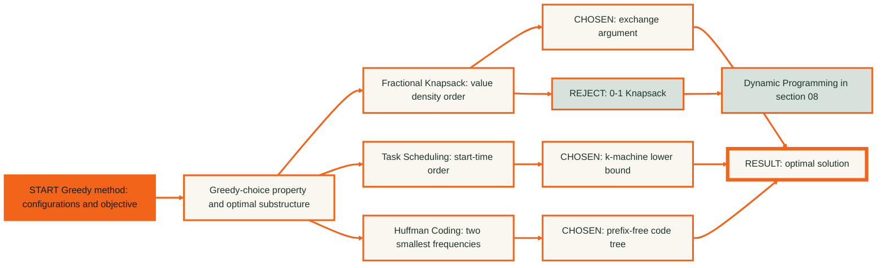
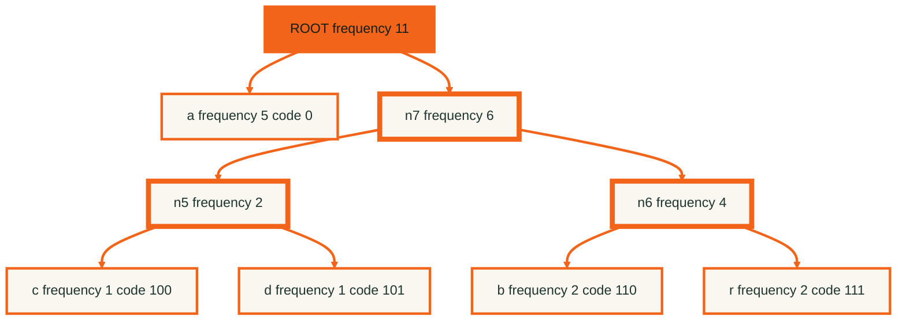

# 06 — Η Άπληστη Μέθοδος
*Greedy Method: Fractional Knapsack, Task Scheduling, Huffman Coding*

Η άπληστη μέθοδος (`greedy method`) κατασκευάζει λύση με μια ακολουθία τοπικά βέλτιστων επιλογών: σε κάθε βήμα επιλέγει τη διαθέσιμη επιλογή που βελτιώνει περισσότερο την αντικειμενική συνάρτηση, χωρίς να εξετάζει αναδρομικά τις συνέπειες. Το κεφάλαιο εφαρμόζει την ιδέα σε τρία προβλήματα: το κλασματικό σακίδιο (`Fractional Knapsack`), τον χρονοπρογραμματισμό εργασιών (`Task Scheduling`) και την κωδικοποίηση Huffman (`Huffman Coding`). Η μέθοδος στηρίζεται στην ταξινόμηση της [05_sorting_and_lower_bound.md](05_sorting_and_lower_bound.md) και στην ουρά προτεραιότητας της [02_priority_queues_heaps.md](02_priority_queues_heaps.md), ενώ η ορθότητά της αποδεικνύεται με επιχείρημα ανταλλαγής (`exchange argument`) και με φράγμα στον αριθμό των απαιτούμενων μηχανών. Η αποτυχία της στο πρόβλημα σακιδίου `0-1` οριοθετεί τη μέθοδο και οδηγεί στον Δυναμικό Προγραμματισμό (`Dynamic Programming`, ΔΠ) της [08_dynamic_programming.md](08_dynamic_programming.md). Οι ίδιες ιδέες επανεμφανίζονται στον αλγόριθμο `Dijkstra` της [10_shortest_paths.md](10_shortest_paths.md) και στους αλγορίθμους ελαχίστου δέντρου επικάλυψης της [11_minimum_spanning_trees.md](11_minimum_spanning_trees.md).

> **Εξεταστική κάλυψη:** Πρόοδος και Τελική
> **Κεφάλαιο βιβλίου:** `Κεφ. 10` | **Διαλέξεις:** `11_greedy_method.pdf`
> **Πηγή:** `Resources/Meta/mindmap.md` (Ενότητα 06)
> **Εκτός ύλης:** Τυπική ανάλυση Κωδικοποίησης Huffman (σελ. 294–297)

## Πίνακας Περιεχομένων

- [1. Εννοιολογικό Πλαίσιο και Συνολική Εικόνα](#1-εννοιολογικό-πλαίσιο-και-συνολική-εικόνα)
- [2. Θεωρητική Θεμελίωση και Τυπικοί Ορισμοί](#2-θεωρητική-θεμελίωση-και-τυπικοί-ορισμοί)
- [3. Αλγόριθμοι, Ιχνηλάτηση και Κώδικας](#3-αλγόριθμοι-ιχνηλάτηση-και-κώδικας)
- [4. Συγκριτική Ανάλυση και Πολυπλοκότητα](#4-συγκριτική-ανάλυση-και-πολυπλοκότητα)
- [5. Πλήρως Λυμένες Ασκήσεις Εξεταστικού Επιπέδου](#5-πλήρως-λυμένες-ασκήσεις-εξεταστικού-επιπέδου)
- [6. Οδηγός Επιβίωσης στις Εξετάσεις και Παγίδες](#6-οδηγός-επιβίωσης-στις-εξετάσεις-και-παγίδες)
- [7. Συνοπτικός Πίνακας Εννοιών](#7-συνοπτικός-πίνακας-εννοιών)

---

## 1. Εννοιολογικό Πλαίσιο και Συνολική Εικόνα

### Το Πρόβλημα

Ένας δικτυακός τόπος δημοπρασιών δέχεται προσφορές της μορφής «$y$ για $x$ μονάδες»: ο συμμετέχων ζητά $x$ μονάδες του πωλούμενου αντικειμένου και προσφέρει $y$ χρήματα γι' αυτές. Ο τόπος πρέπει να κατακυρώσει ένα υποσύνολο των προσφορών ώστε να μεγιστοποιήσει τα συνολικά έσοδα, χωρίς να πουλήσει περισσότερες μονάδες από όσες διαθέτει. Όταν η μερική ικανοποίηση μιας προσφοράς επιτρέπεται — δηλαδή ο τόπος μπορεί να πουλήσει $k < x$ μονάδες και να εισπράξει $y \cdot k / x$ — το πρόβλημα είναι ακριβώς το κλασματικό σακίδιο: κάθε προσφορά είναι αντικείμενο με βάρος $x$ και όφελος $y$, και η χωρητικότητα είναι το απόθεμα. Η άπληστη επιλογή της προσφοράς με τη μεγαλύτερη αξία ανά μονάδα δίνει τη βέλτιστη λύση. Όταν η μερική ικανοποίηση απαγορεύεται, το πρόβλημα γίνεται `0-1 Knapsack` και η ίδια επιλογή μπορεί να αποτύχει.

Το ίδιο μοτίβο εμφανίζεται στη συμπίεση κειμένου και στην κατανομή πόρων. Μια συμβολοσειρά με πολύ συχνούς και πολύ σπάνιους χαρακτήρες κωδικοποιείται οικονομικά αν οι συχνοί χαρακτήρες λάβουν σύντομους δυαδικούς κωδικούς, υπό τον περιορισμό ότι κανένας κωδικός δεν είναι πρόθεμα άλλου. Ένα σύνολο εργασιών με διαστήματα $[s_i, f_i]$ πρέπει να εκτελεστεί σε μηχανές χωρίς επικαλύψεις, με ελάχιστο αριθμό μηχανών. Και στις δύο περιπτώσεις η τοπική επιλογή είναι ασφαλής, αλλά η απόδειξη της ασφάλειας είναι διαφορετική: επιχείρημα ανταλλαγής στο σακίδιο, φράγμα επικάλυψης στον χρονοπρογραμματισμό και πράξη συγχώνευσης στην κωδικοποίηση.

### Τα Τρία Συστατικά της Μεθόδου

Κάθε πρόβλημα της άπληστης μεθόδου περιγράφεται με τρία στοιχεία. Μια **διαμόρφωση** (`configuration`) είναι μια πλήρης ανάθεση τιμών στις παραμέτρους που ορίζουν μια λύση. Η **αντικειμενική συνάρτηση** (`objective function`) αντιστοιχίζει σε κάθε διαμόρφωση μια βαθμολογία που μεγιστοποιείται ή ελαχιστοποιείται. Μια διαμόρφωση είναι **εφικτή** (`feasible`) όταν ικανοποιεί όλους τους περιορισμούς του προβλήματος. Η άπληστη μέθοδος ξεκινά από μια αρχική εφικτή διαμόρφωση και εκτελεί διαδοχικές **τοπικές βελτιώσεις** (`local improvements`), καθεμία από τις οποίες επιλέγει την καλύτερη διαθέσιμη τιμή μιας παραμέτρου.

| Πρόβλημα | Διαμόρφωση | Αντικειμενική συνάρτηση | Τοπική επιλογή | Περιορισμός |
|---|---|---|---|---|
| Κλασματικό σακίδιο | Ποσότητες $x_i \in [0, w_i]$ | $\sum_i (b_i/w_i)\,x_i$ | Μέγιστη πυκνότητα $v_i = b_i/w_i$ | $\sum_i x_i \le W$ |
| Χρονοπρογραμματισμός | Ανάθεση εργασιών σε μηχανές | Πλήθος μηχανών $m$ | Μικρότερος χρόνος έναρξης $s_i$ | Καμία επικάλυψη ανά μηχανή |
| Κωδικοποίηση Huffman | Δυαδικό δέντρο κωδικών | $\sum_c f(c)\,\ell(c)$ | Συγχώνευση δύο ελάχιστων συχνοτήτων | Προθεματική κωδικοποίηση |

Η τοπική επιλογή δεν είναι αυθαίρετη: προκύπτει από την αντικειμενική συνάρτηση και τον περιορισμό. Στο σακίδιο η πυκνότητα είναι ο λόγος οφέλους προς βάρος, επειδή ο περιορισμός είναι στο βάρος. Στον χρονοπρογραμματισμό ο χρόνος έναρξης είναι το κρίσιμο άκρο, επειδή μια εργασία καταλαμβάνει μηχανή από τη στιγμή που ξεκινά. Στην Huffman η συχνότητα είναι το βάρος κάθε φύλλου, επειδή το συνολικό κόστος είναι άθροισμα συχνότητας επί βάθος.

### Χάρτης Εννοιών του Κεφαλαίου



Πορτοκαλί γέμισμα: η αφετηρία της μεθόδου (`START`). Παχύ περίγραμμα: το κοινό αποτέλεσμα (`RESULT`), δηλαδή μια αποδεδειγμένα βέλτιστη λύση. Απαλό πράσινο: η διαδρομή που απορρίπτεται και παραπέμπει στον Δυναμικό Προγραμματισμό. Κρεμ: τα τρία προβλήματα, τα δύο θεωρητικά εργαλεία και οι τρεις μηχανισμοί απόδειξης.

| Ομάδα | Κόμβοι | Ρόλος |
|---|---|---|
| Θεμέλιο | Διαμορφώσεις, αντικειμενική συνάρτηση, ιδιότητα άπληστης επιλογής | Καθορίζουν πότε η τοπική επιλογή μπορεί να οδηγήσει σε καθολικά βέλτιστη λύση |
| Εφαρμογές | Κλασματικό σακίδιο, χρονοπρογραμματισμός, Huffman | Τα τρία προβλήματα του κεφαλαίου με διαφορετικούς περιορισμούς |
| Αποδείξεις | Ανταλλαγή, φράγμα $k$ μηχανών, προθεματικό δέντρο | Κατοχυρώνουν την ορθότητα κάθε τοπικής επιλογής |
| Αποτέλεσμα | Βέλτιστη λύση | Κοινό συμπέρασμα των τριών αποδείξεων |
| Απόρριψη | `0-1 Knapsack` | Δείχνει ότι η επιλογή κατά πυκνότητα δεν είναι καθολικά ασφαλής |

### Πότε Χρησιμοποιείται η Άπληστη Μέθοδος

Η άπληστη μέθοδος επιλέγεται όταν υπάρχει απόδειξη ότι μια τοπική επιλογή εμφανίζεται σε **κάποια** βέλτιστη λύση. Το σήμα στο εκφώνημα είναι η φράση «μεγιστοποιήστε το κέρδος υπό έναν περιορισμό πόρου» ή «ελαχιστοποιήστε τον αριθμό των πόρων», όταν η επιλογή ενός στοιχείου δεν ακυρώνει τη δομή του υπόλοιπου προβλήματος. Η μέθοδος δεν επιλέγεται όταν μια τοπική επιλογή δεσμεύει πόρο που θα χρειαζόταν αργότερα με μεγαλύτερο όφελος· τότε απαιτείται σύγκριση εναλλακτικών και Δυναμικός Προγραμματισμός. Η διάκριση δεν είναι υφολογική αλλά δομική: η άπληστη μέθοδος χρειάζεται την ιδιότητα άπληστης επιλογής, ενώ ο Δυναμικός Προγραμματισμός χρειάζεται βέλτιστη υποδομή και επικάλυψη υποπροβλημάτων.

Ένα δεύτερο κριτήριο είναι το κόστος ταξινόμησης. Και τα τρία προβλήματα του κεφαλαίου απαιτούν διάταξη των στοιχείων: φθίνουσα πυκνότητα, αύξουσα ώρα έναρξης, αύξουσα συχνότητα. Η διάταξη κοστίζει $O(n \log n)$ στη χειρότερη περίπτωση με ταξινόμηση συγκρίσεων, και το κόστος αυτό κυριαρχεί συνήθως στο γραμμικό πέρασμα. Όποιος απαντά «άπληστος αλγόριθμος, άρα $O(n)$» παραβλέπει την ταξινόμηση και χάνει μονάδες.

---

## 2. Θεωρητική Θεμελίωση και Τυπικοί Ορισμοί

### 2.1 Διαμορφώσεις, Αντικειμενική Συνάρτηση και Τοπική Επιλογή

**Ορισμός (πρόβλημα βελτιστοποίησης).** Ένα πρόβλημα βελτιστοποίησης ορίζεται από ένα σύνολο εφικτών διαμορφώσεων $\mathcal{F}$ και μια αντικειμενική συνάρτηση $B: \mathcal{F} \to \mathbb{R}$. Ζητείται διαμόρφωση $x^* \in \mathcal{F}$ με

$$B(x^*) = \max_{x \in \mathcal{F}} B(x)$$

ή, στην περίπτωση ελαχιστοποίησης, $B(x^*) = \min_{x \in \mathcal{F}} B(x)$. Η $x^*$ ονομάζεται βέλτιστη λύση (`optimal solution`) και η τιμή $B(x^*)$ βέλτιστη τιμή.

**Ορισμός (ιδιότητα άπληστης επιλογής).** Έστω ότι κάθε διαμόρφωση παράγεται από ακολουθία επιλογών $e_1, e_2, \dots, e_k$ και έστω $G$ μια συνάρτηση που, για κάθε στιγμιότυπο $P$, επιστρέφει μια διαθέσιμη επιλογή $G(P)$. Η $G$ ικανοποιεί την **ιδιότητα άπληστης επιλογής** (`greedy-choice property`) αν για κάθε στιγμιότυπο $P$ υπάρχει βέλτιστη λύση του $P$ που περιέχει την επιλογή $G(P)$.

Η ιδιότητα δεν απαιτεί η $G(P)$ να είναι η μοναδική βέλτιστη πρώτη επιλογή. Απαιτεί μόνο να υπάρχει **κάποια** βέλτιστη λύση που τη χρησιμοποιεί. Η χαλαρότητα της διατύπωσης είναι ακριβώς ό,τι χρειάζεται η επαγωγή: η άπληστη επιλογή δεν χάνει την καθολικά βέλτιστη λύση, ακόμη και αν υπάρχουν πολλές ισοδύναμες.

> Σημείωση ορολογίας: στο εξής η φράση «η άπληστη επιλογή είναι ασφαλής» σημαίνει ότι ικανοποιείται η παραπάνω ιδιότητα. Δεν σημαίνει ότι η επιλογή είναι η μοναδική βέλτιστη.

**Ορισμός (βέλτιστη υποδομή).** Ένα πρόβλημα έχει **βέλτιστη υποδομή** (`optimal substructure`) αν, για κάθε βέλτιστη λύση $x^*$ που περιέχει μια επιλογή $e$, ο περιορισμός της $x^*$ στο υποπρόβλημα που απομένει μετά την $e$ είναι βέλτιστη λύση αυτού του υποπροβλήματος.

**Λήμμα 2.1 (αρχή ορθότητας της άπληστης μεθόδου).** Αν ένα πρόβλημα έχει την ιδιότητα άπληστης επιλογής και βέλτιστη υποδομή, τότε η άπληστη μέθοδος επιστρέφει βέλτιστη λύση.

*Απόδειξη με επαγωγή στο πλήθος $n$ των διαθέσιμων επιλογών.* Για $n = 1$ η μόνη εφικτή επιλογή είναι και βέλτιστη. Έστω ότι το λήμμα ισχύει για $n - 1$ επιλογές. Από την ιδιότητα άπληστης επιλογής, υπάρχει βέλτιστη λύση $x^*$ του στιγμιότυπου $P$ που περιέχει την άπληστη επιλογή $g = G(P)$. Αφαιρώντας την $g$ και ενημερώνοντας τους περιορισμούς προκύπτει στιγμιότυπο $P'$ με $n - 1$ επιλογές. Από τη βέλτιστη υποδομή, ο περιορισμός της $x^*$ στο $P'$ είναι βέλτιστη λύση του $P'$. Από την επαγωγική υπόθεση, η άπληστη λύση του $P'$ έχει όφελος τουλάχιστον ίσο με τον περιορισμό της $x^*$. Συνδυάζοντας την $g$ με την άπληστη λύση του $P'$ προκύπτει εφικτή λύση του $P$ με όφελος τουλάχιστον $B(x^*)$. Επειδή η $x^*$ είναι βέλτιστη, το όφελος είναι ίσο και η άπληστη λύση είναι βέλτιστη. $\square$

**Παρατήρηση.** Οι δύο ιδιότητες είναι ανεξάρτητες. Το πρόβλημα σακιδίου `0-1` έχει βέλτιστη υποδομή αλλά όχι ιδιότητα άπληστης επιλογής, όπως δείχνεται στην Ενότητα 3.4. Αντίστροφα, υπάρχουν προβλήματα όπου μια τοπική επιλογή είναι ασφαλής αλλά το υπόλοιπο πρόβλημα δεν έχει βέλτιστη υποδομή με την αυστηρή έννοια· εκεί η άπληστη μέθοδος μπορεί να αποδειχθεί ορθή με απευθείας επιχείρημα, όπως στον χρονοπρογραμματισμό.

### 2.2 Κλασματικό Πρόβλημα Σακιδίου

**Ορισμός.** Δίνεται σύνολο $S$ από $n$ αντικείμενα. Κάθε αντικείμενο $i$ έχει βάρος $w_i > 0$ και όφελος $b_i > 0$. Δίνεται επίσης χωρητικότητα $W > 0$. Μια διαμόρφωση είναι διάνυσμα $x = (x_1, \dots, x_n)$ με

$$0 \le x_i \le w_i \quad \text{για κάθε } i, \qquad \sum_{i \in S} x_i \le W.$$

Η ποσότητα $x_i$ μετριέται σε μονάδες βάρους και δηλώνει πόσο από το αντικείμενο $i$ λαμβάνεται. Η αντικειμενική συνάρτηση είναι

$$B(x) = \sum_{i \in S} \frac{b_i}{w_i}\, x_i.$$

Η ποσότητα

$$v_i = \frac{b_i}{w_i}$$

ονομάζεται **πυκνότητα αξίας** (`value density`) ή αξία ανά μονάδα βάρους. Ισοδύναμα, με $t_i = x_i / w_i \in [0, 1]$ να είναι το κλάσμα του αντικειμένου $i$, ζητείται η μεγιστοποίηση του $\sum_i b_i t_i$ υπό τον περιορισμό $\sum_i w_i t_i \le W$.

**Παρατήρηση 2.2 (πληρότητα βέλτιστης λύσης).** Αν $\sum_{i \in S} w_i > W$, κάθε βέλτιστη λύση έχει $\sum_i x_i = W$. Πράγματι, αν μια εφικτή λύση έχει συνολικό βάρος μικρότερο του $W$, τότε κάποιο αντικείμενο έχει ελεύθερο περιθώριο, αφού το άθροισμα όλων των βαρών υπερβαίνει το $W$· αύξηση της ποσότητάς του κατά $\varepsilon > 0$ διατηρεί την εφικτότητα και αυξάνει το όφελος κατά $\varepsilon v_i > 0$. Άρα μια λύση με κενό βάρος δεν είναι βέλτιστη.

**Πρόταση 2.3 (ιδιότητα άπληστης επιλογής).** Έστω ότι τα αντικείμενα είναι διατεταγμένα ώστε $v_1 \ge v_2 \ge \dots \ge v_n$. Τότε υπάρχει βέλτιστη λύση με $x_1 = \min\{w_1, W\}$.

*Απόδειξη με ανταλλαγή.* Έστω $x$ βέλτιστη λύση. Αν $x_1 = \min\{w_1, W\}$, τελειώσαμε. Διαφορετικά $x_1 < \min\{w_1, W\}$. Σε αυτή την περίπτωση ισχύει κατ' ανάγκη $\sum_i w_i > W$· αν $\sum_i w_i \le W$, η βέλτιστη λύση παίρνει όλα τα αντικείμενα και $x_1 = w_1 = \min\{w_1, W\}$, αντίφαση. Από την Παρατήρηση 2.2, $\sum_i x_i = W$, άρα κάποιο $j > 1$ έχει $x_j > 0$· αλλιώς το συνολικό βάρος θα ήταν $x_1 < W$. Θέτουμε

$$y = \min\{w_1 - x_1,\; x_j\} > 0.$$

Ορίζουμε νέα λύση $x'$ με $x'_1 = x_1 + y$, $x'_j = x_j - y$ και $x'_k = x_k$ για κάθε $k \notin \{1, j\}$. Η $x'$ είναι εφικτή: $x'_1 \le w_1$ από τον ορισμό του $y$, $x'_j \ge 0$, και το συνολικό βάρος δεν αλλάζει. Η μεταβολή του οφέλους είναι

$$B(x') - B(x) = y\,v_1 - y\,v_j = y\,(v_1 - v_j) \ge 0,$$

επειδή $v_1 \ge v_j$. Άρα η $x'$ είναι επίσης βέλτιστη και έχει $x'_1 > x_1$. Επαναλαμβάνοντας το ίδιο βήμα, το $x_1$ αυξάνεται αυστηρά σε κάθε επανάληψη και φράσσεται από το $\min\{w_1, W\}$, άρα σε πεπερασμένο πλήθος βημάτων $x_1 = \min\{w_1, W\}$ χωρίς μείωση του οφέλους. $\square$

**Θεώρημα 2.4 (ορθότητα κλασματικού σακιδίου).** Αν τα αντικείμενα επεξεργάζονται κατά φθίνουσα πυκνότητα και λαμβάνεται $x_i = \min\{w_i, W - w\}$ σε κάθε βήμα, όπου $w$ είναι το βάρος που έχει ήδη χρησιμοποιηθεί, τότε η παραγόμενη λύση είναι βέλτιστη.

*Απόδειξη με επαγωγή στο $n$.* Για $n = 1$ η άπληστη λύση παίρνει $\min\{w_1, W\}$ και είναι προφανώς βέλτιστη. Έστω ότι το θεώρημα ισχύει για $n - 1$ αντικείμενα. Από την Πρόταση 2.3, υπάρχει βέλτιστη λύση $x^*$ με $x^*_1 = \min\{w_1, W\}$, δηλαδή με την ίδια πρώτη ποσότητα που επιλέγει ο άπληστος αλγόριθμος. Αφαιρώντας το αντικείμενο $1$ και μειώνοντας τη χωρητικότητα κατά $x^*_1$, το υπόλοιπο είναι κλασματικό σακίδιο με $n - 1$ αντικείμενα και χωρητικότητα $W - x^*_1$. Ο περιορισμός της $x^*$ σε αυτό το υπόλοιπο είναι βέλτιστος, αλλιώς θα μπορούσαμε να βελτιώσουμε την $x^*$ αντικαθιστώντας το υπόλοιπο. Από την επαγωγική υπόθεση, ο άπληστος αλγόριθμος λύνει βέλτιστα το υπόλοιπο. Συνδυάζοντας την πρώτη επιλογή με τη βέλτιστη λύση του υπολοίπου προκύπτει λύση με όφελος ίσο με $B(x^*)$, άρα βέλτιστη. $\square$

*Παρατήρηση (η μορφή εις άτοπον του συγγράμματος).* Η ίδια απόδειξη γράφεται και ως εξής. Έστω $x$ υποθετική βέλτιστη λύση με $B(x) > B(g)$, όπου $g$ η άπληστη λύση. Επειδή η $g$ εξαντλεί τις μεγαλύτερες πυκνότητες, η $x$ πρέπει να αφήνει περιθώριο σε κάποιο αντικείμενο $i$ ($x_i < w_i$) και να χρησιμοποιεί κάποιο αντικείμενο $j$ με $x_j > 0$ και $v_i > v_j$· διαφορετικά η $x$ θα είχε την ίδια δομή προθέματος με την $g$ και δεν θα είχε μεγαλύτερο όφελος. Με

$$y = \min\{w_i - x_i,\; x_j\}$$

αντικαθιστούμε $y$ μονάδες του $j$ με $y$ μονάδες του $i$. Το βάρος μένει ίδιο, ενώ το όφελος αυξάνεται κατά $y(v_i - v_j) > 0$, άτοπο. Όταν οι πυκνότητες είναι ίσες, η ανταλλαγή δεν μειώνει το όφελος και επαναλαμβάνεται μέχρι να φτάσει η $x$ στη δομή της $g$· επειδή $B(x) > B(g)$, τουλάχιστον ένα βήμα έχει αυστηρά μεγαλύτερη πυκνότητα.

**Πόρισμα 2.5 (κλειστός τύπος οφέλους).** Έστω $k$ ο πρώτος δείκτης για τον οποίο η άπληστη λύση παίρνει $x_k < w_k$, με $k = n + 1$ αν όλα τα αντικείμενα ληφθούν πλήρως. Αν $k \le n$, τότε

$$B(g) = \sum_{i=1}^{k-1} b_i + \left(W - \sum_{i=1}^{k-1} w_i\right) v_k,$$

και αν $k = n + 1$, τότε $B(g) = \sum_{i=1}^{n} b_i$.

*Αιτιολόγηση.* Τα πρώτα $k - 1$ αντικείμενα λαμβάνονται ολόκληρα και συνεισφέρουν $\sum_{i<k} b_i$. Το αντικείμενο $k$ λαμβάνεται κατά την εναπομένουσα χωρητικότητα $W - \sum_{i<k} w_i$ και συνεισφέρει το γινόμενο της ποσότητας επί την πυκνότητά του. Τα υπόλοιπα αντικείμενα έχουν ποσότητα μηδέν. $\square$

### 2.3 Χρονοπρογραμματισμός Εργασιών

**Ορισμός.** Δίνεται σύνολο $T$ από $n$ εργασίες. Κάθε εργασία $i$ έχει χρόνο έναρξης $s_i$ και χρόνο λήξης $f_i$ με $s_i < f_i$ και καταλαμβάνει το ημι-ανοιχτό διάστημα $[s_i, f_i)$. Δύο εργασίες $i$ και $j$ **συγκρούονται** (`conflict`) αν τα διαστήματά τους τέμνονται, δηλαδή αν

$$s_i < f_j \quad \text{και} \quad s_j < f_i.$$

Μια **χρονοπρογράφηση** (`schedule`) με $m$ μηχανές είναι μια διαμέριση του $T$ σε $m$ σύνολα, καθένα από τα οποία αποτελείται από ανά δύο μη συγκρουόμενες εργασίες. Ζητείται η ελαχιστοποίηση του $m$.

Η σχέση «δεν συγκρούονται» επιτρέπει εφαπτόμενα διαστήματα: αν $f_i = s_j$, οι εργασίες $i$ και $j$ μπορούν να εκτελεστούν διαδοχικά στην ίδια μηχανή, επειδή το $[s_i, f_i)$ δεν περιέχει το $f_i$. Η σύμβαση αυτή είναι ουσιώδης για τις ιχνηλατήσεις και για την απόδειξη.

**Κανόνας ισοβαθμίας.** Οι εργασίες ταξινομούνται κατά ζεύγος $(s_i, \text{όνομα})$· σε ίσο χρόνο έναρξης προηγείται η αλφαβητικά μικρότερη. Όταν υπάρχουν περισσότερες από μία ελεύθερες μηχανές, επιλέγεται η μικρότερη σε αριθμό. Ο κανόνας καθιστά την έξοδο μονοσήμαντη χωρίς να επηρεάζει το πλήθος των μηχανών.

**Θεώρημα 2.6 (ορθότητα χρονοπρογραμματισμού).** Η άπληστη ανάθεση κατά αύξοντα χρόνο έναρξης χρησιμοποιεί τον ελάχιστο δυνατό αριθμό μηχανών.

*Απόδειξη.* Έστω $k$ το πλήθος των μηχανών που ανοίγει ο αλγόριθμος και έστω $i$ η πρώτη εργασία που τοποθετείται στη μηχανή $k$. Τη στιγμή της επεξεργασίας της $i$, κάθε μηχανή $r$ με $1 \le r < k$ είναι απασχολημένη: η τελευταία εργασία $j_r$ της μηχανής $r$ έχει $f_{j_r} > s_i$, αλλιώς η μηχανή θα ήταν ελεύθερη και θα είχε επιλεγεί. Επειδή οι εργασίες επεξεργάζονται κατά μη φθίνουσα ώρα έναρξης, ισχύει επίσης $s_{j_r} \le s_i$. Άρα

$$s_{j_r} \le s_i < f_{j_r},$$

δηλαδή το σημείο $s_i$ ανήκει στο διάστημα κάθε $j_r$. Επίσης $s_i \in [s_i, f_i)$. Συνεπώς οι $k$ εργασίες $i, j_1, \dots, j_{k-1}$ περιέχουν όλες το ίδιο σημείο $s_i$ και είναι ανά δύο συγκρουόμενες. Μία μηχανή δεν μπορεί να εκτελέσει δύο από αυτές, άρα κάθε χρονοπρογράφηση χρειάζεται τουλάχιστον $k$ μηχανές. Ο αλγόριθμος χρησιμοποιεί $k$, άρα είναι βέλτιστος. $\square$

**Πόρισμα 2.7 (χαρακτηρισμός του βέλτιστου).** Ο ελάχιστος αριθμός μηχανών ισούται με τον μέγιστο αριθμό εργασιών που περιέχουν ένα κοινό χρονικό σημείο.

*Αιτιολόγηση.* Από την απόδειξη του Θεωρήματος 2.6, ο αλγόριθμος χρησιμοποιεί $k$ μηχανές και υπάρχει σημείο που ανήκει σε $k$ εργασίες· άρα το μέγιστο πλήθος επικαλυπτόμενων εργασιών είναι τουλάχιστον $k$. Αντίστροφα, αν ένα σημείο ανήκει σε $q$ εργασίες, αυτές χρειάζονται $q$ διαφορετικές μηχανές, άρα ο βέλτιστος αριθμός είναι τουλάχιστον $q$. Συνδυάζοντας, $k = q_{\max}$. $\square$

### 2.4 Κωδικοποίηση Huffman

**Ορισμός (δυαδικός κώδικας).** Έστω αλφάβητο $\Sigma$ με $d = |\Sigma|$ διακριτούς χαρακτήρες. Ένας δυαδικός κώδικας είναι μια ένεση $\kappa: \Sigma \to \{0, 1\}^*$ που αντιστοιχίζει σε κάθε χαρακτήρα $c \in \Sigma$ μια δυαδική συμβολοσειρά, τον **κωδικό** του (`codeword`). Το μήκος του κωδικού του $c$ συμβολίζεται $\ell_\kappa(c)$.

**Ορισμός (προθεματική κωδικοποίηση).** Ένας κώδικας είναι **προθεματικός** (`prefix-free`) αν κανένας κωδικός δεν είναι γνήσιο πρόθεμα άλλου κωδικού. Δηλαδή δεν υπάρχουν $x, y \in \Sigma$ με $\kappa(x) \ne \kappa(y)$ και $\kappa(x)$ πρόθεμα του $\kappa(y)$.

Η προθεματική ιδιότητα επιτρέπει την αποκωδικοποίηση χωρίς διαχωριστικά: ο αποκωδικοποιητής διαβάζει bits από αριστερά και σταματά μόλις σχηματίσει κωδικό. Κανένας κωδικός δεν μπορεί να επεκταθεί σε άλλον, άρα η ανάγνωση δεν είναι ποτέ αμφίσημη.

**Ορισμός (δέντρο κωδικοποίησης).** Ένα δέντρο κωδικοποίησης (`code tree`) είναι ένα πλήρες δυαδικό δέντρο του οποίου τα φύλλα είναι οι χαρακτήρες του $\Sigma$. Κάθε αριστερή ακμή αντιστοιχεί σε bit $0$ και κάθε δεξιά σε bit $1$. Ο κωδικός ενός χαρακτήρα είναι η ακολουθία bits από τη ρίζα προς το φύλλο του, και το μήκος του κωδικού είναι το βάθος του φύλλου.

**Πρόταση 2.8 (αντιστοιχία κωδίκων και δέντρων).** Οι προθεματικοί κώδικες επί του $\Sigma$ αντιστοιχούν αμφιμονοσήμαντα σε πλήρη δυαδικά δέντρα με $d$ φύλλα εφοδιασμένα με τους χαρακτήρες του $\Sigma$.

*Αιτιολόγηση.* Από δέντρο σε κώδικα: το μονοπάτι ρίζας-φύλλου είναι κωδικός· κανένα φύλλο δεν είναι πρόγονος άλλου, άρα κανένας κωδικός δεν είναι πρόθεμα άλλου. Από κώδικα σε δέντρο: κατασκευάζεται δέντρο από τις κωδικές λέξεις· επειδή ο κώδικας είναι προθεματικός, κάθε κωδική λέξη καταλήγει σε φύλλο. Διαδρομές με ένα μόνο παιδί συμπιέζονται, ώστε το δέντρο να είναι πλήρες, χωρίς αλλαγή των μηκών. $\square$

**Ορισμός (κόστος).** Για συμβολοσειρά $X$ μήκους $n$ και συχνότητα $f(c)$ κάθε χαρακτήρα, το συνολικό μήκος της κωδικοποίησης είναι

$$B(\kappa) = \sum_{c \in \Sigma} f(c)\,\ell_\kappa(c) = \sum_{c \in \Sigma} f(c) \cdot \text{depth}(c).$$

Επειδή $\sum_c f(c) = n$, το κόστος μετριέται σε bits και η μέση τιμή ανά χαρακτήρα είναι $B(\kappa)/n$.

**Θεώρημα 2.9 (βελτιστότητα Huffman).** Το δέντρο που παράγεται από τον αλγόριθμο Huffman ελαχιστοποιεί το $B(\kappa)$ μεταξύ όλων των προθεματικών κωδίκων για τις δεδομένες συχνότητες.

> Εκτός ύλης: Τυπική ανάλυση Κωδικοποίησης Huffman (σελ. 294–297). Το Θεώρημα 2.9 χρησιμοποιείται ως δεδομένο· η πλήρης απόδειξη του θεωρήματος δεν διδάσκεται και δεν ζητείται.

**Διαδικασία.** Ο αλγόριθμος ξεκινά με $d$ δέντρα, ένα για κάθε χαρακτήρα, τα οποία διατάσσει σε ουρά προτεραιότητας με κλειδί τη συχνότητα. Σε κάθε από τις $d - 1$ επαναλήψεις εξάγει τα δύο δέντρα με τη μικρότερη συχνότητα, τα ενώνει σε νέο δέντρο με συχνότητα το άθροισμα και επανεισάγει το νέο δέντρο. Το τελευταίο δέντρο είναι το δέντρο κωδικοποίησης. Το βάρος κάθε εσωτερικού κόμβου είναι το άθροισμα των συχνοτήτων των φύλλων του.

**Κανόνας ισοβαθμίας.** Σε ίσες συχνότητες εξάγεται πρώτο το δέντρο που δημιουργήθηκε νωρίτερα. Με τον κανόνα αυτόν η κατασκευή είναι αναπαραγώγιμη. Χωρίς κανόνα, δύο δέντρα με ίση συχνότητα μπορούν να ανταλλαγούν θέσεις και να παραχθούν διαφορετικοί κωδικοί με το ίδιο συνολικό κόστος.

### 2.5 Γιατί η Άπληστη Μέθοδος Αποτυγχάνει στο Σακίδιο 0-1

**Ορισμός.** Στο πρόβλημα σακιδίου `0-1` (`0-1 Knapsack`) η διαμόρφωση είναι διάνυσμα $x \in \{0, 1\}^n$ με περιορισμό

$$\sum_{i \in S} w_i x_i \le W,$$

και ζητείται η μεγιστοποίηση του $\sum_{i \in S} b_i x_i$. Κάθε αντικείμενο λαμβάνεται ολόκληρο ή καθόλου· δεν επιτρέπεται κλάσμα.

Η δομική διαφορά από το κλασματικό πρόβλημα είναι η εξής: το επιχείρημα ανταλλαγής μεταφέρει ποσότητα $y$ από το αντικείμενο $j$ στο $i$ και διατηρεί το συνολικό βάρος. Στο `0-1` η ποσότητα $y$ δεν είναι ελεύθερα επιλέξιμη· μπορεί να είναι μόνο $0$ ή $w_j$, και η μεταφορά ολόκληρου αντικειμένου αλλάζει το βάρος κατά $w_i - w_j \ne 0$ γενικά. Επιπλέον, το υπόλοιπο της χωρητικότητας μπορεί να μείνει ανεκμετάλλευτο επειδή κανένα διαθέσιμο αντικείμενο δεν χωρά.

Η ιδιότητα άπληστης επιλογής καταρρέει, ενώ η βέλτιστη υποδομή διατηρείται: αν $x^*$ είναι βέλτιστη και $x^*_k = 1$, τότε ο περιορισμός της στα υπόλοιπα αντικείμενα είναι βέλτιστος για χωρητικότητα $W - w_k$. Η βέλτιστη υποδομή είναι ακριβώς η προϋπόθεση του Δυναμικού Προγραμματισμού, ο οποίος επιλύει το `0-1` σε χρόνο $O(nW)$ ([08_dynamic_programming.md](08_dynamic_programming.md)). Το αντιπαράδειγμα της Ενότητας 3.4 δείχνει αριθμητικά την αποτυχία: η άπληστη λύση κατά πυκνότητα χάνει $60$ μονάδες οφέλους σε σχέση με τη βέλτιστη.

---

## 3. Αλγόριθμοι, Ιχνηλάτηση και Κώδικας

### 3.1 Κλασματικό Πρόβλημα Σακιδίου

**Σκοπός.** Επιλογή ποσοτήτων $x_i$ από κάθε αντικείμενο ώστε το συνολικό βάρος να μην υπερβαίνει το $W$ και το συνολικό όφελος να μεγιστοποιείται, με φθίνουσα σειρά πυκνότητας.

```text
Algorithm fractionalKnapsack(S, W):
Input: Σύνολο S από n αντικείμενα με βάρος w_i και όφελος b_i· μέγιστο βάρος W
Output: Ποσότητα x_i για κάθε αντικείμενο i

for each item i in S do
    x_i ← 0
for each item i in S do
    v_i ← b_i / w_i
sort S by v_i in decreasing order
w ← 0
for each item i in S in the sorted order do
    if w = W then
        break
    x_i ← min{w_i, W - w}
    w ← w + x_i
return (x_1, ..., x_n)
```

**Ιχνηλάτηση στο παράδειγμα της διάλεξης.** Πέντε αντικείμενα με βάρη $4, 8, 2, 6, 1$ ml και οφέλη $12, 32, 40, 30, 50$ χρήματα· χωρητικότητα $W = 10$ ml. Η ταξινόμηση κατά φθίνουσα πυκνότητα δίνει τη σειρά $5, 3, 4, 2, 1$. Ο κανόνας ισοβαθμίας είναι η σταθερή ταξινόμηση: σε ίση πυκνότητα διατηρείται η σειρά εισόδου. Στο παράδειγμα οι πυκνότητες είναι διακριτές, άρα ο κανόνας δεν ενεργοποιείται.

| Βήμα | Αντικείμενο | $v_i$ | $w_i$ | $b_i$ | Διαθέσιμο πριν | $x_i$ | Διαθέσιμο μετά | Προστιθέμενο όφελος | Σωρευτικό όφελος |
|---|---|---|---|---|---|---|---|---|---|
| 1 | 5 | $50$ | $1$ | $50$ | $10$ | $\min\{1, 10\} = 1$ | $9$ | $1 \cdot 50 = 50$ | $50$ |
| 2 | 3 | $20$ | $2$ | $40$ | $9$ | $\min\{2, 9\} = 2$ | $7$ | $2 \cdot 20 = 40$ | $90$ |
| 3 | 4 | $5$ | $6$ | $30$ | $7$ | $\min\{6, 7\} = 6$ | $1$ | $6 \cdot 5 = 30$ | $120$ |
| 4 | 2 | $4$ | $8$ | $32$ | $1$ | $\min\{8, 1\} = 1$ | $0$ | $1 \cdot 4 = 4$ | $124$ |
| — | 1 | $3$ | $4$ | $12$ | $0$ | $0$ | $0$ | $0$ | $124$ |

Το αντικείμενο $1$ δεν εξετάζεται καν από τον βρόχο, επειδή το διαθέσιμο βάρος μηδενίστηκε στο βήμα 4· η τιμή $x_1 = 0$ έχει ήδη τεθεί στην αρχικοποίηση. Η λύση είναι $x = (0, 1, 2, 6, 1)$ με συνολικό βάρος $1 + 2 + 6 + 1 = 10$ και όφελος $124$. Ο έλεγχος με τον κλειστό τύπο του Πορίσματος 2.5 γίνεται στη σειρά πυκνότητας: τα πρώτα τρία αντικείμενα είναι $5, 3, 4$ με οφέλη $50, 40, 30$ και βάρη $1, 2, 6$, το τέταρτο είναι το $2$ με πυκνότητα $4$, άρα $k = 4$ και

$$B(g) = (50 + 40 + 30) + (10 - 1 - 2 - 6)\cdot 4 = 120 + 1 \cdot 4 = 124.$$

**Ρητή υλοποίηση (ταξινόμηση και ένα πέρασμα):**

```python
def fractionalKnapsack(
    items: list[tuple[str, float, float]], capacity: float
) -> tuple[float, dict[str, float]]:
    """Solves the fractional knapsack problem by decreasing value density.

    Args:
        items (list[tuple[str, float, float]]): Tuples of the form
            (name, weight, benefit). Weights and benefits are positive.
        capacity (float): The maximum total weight W.

    Returns:
        tuple[float, dict[str, float]]: The maximum benefit and a dictionary
            from item name to the amount taken, in weight units.
    """
    # Stable sorting keeps the input order for equal densities, which makes
    # the produced amounts reproducible in traces.
    order = sorted(items, key=lambda item: item[2] / item[1], reverse=True)
    taken: dict[str, float] = {}
    total_benefit = 0.0
    remaining = capacity
    for name, weight, benefit in order:
        if remaining <= 0:
            break
        amount = min(weight, remaining)
        taken[name] = amount
        total_benefit += amount * (benefit / weight)
        remaining -= amount
    return total_benefit, taken


lecture_items = [("1", 4, 12), ("2", 8, 32), ("3", 2, 40), ("4", 6, 30), ("5", 1, 50)]
total, amounts = fractionalKnapsack(lecture_items, 10)
assert total == 124.0
assert amounts == {"5": 1, "3": 2, "4": 6, "2": 1}
```

**Ρητή υλοποίηση (χωρίς ταξινόμηση, με επαναληπτική επιλογή μέγιστου):**

```python
def fractionalKnapsackNaive(
    items: list[tuple[str, float, float]], capacity: float
) -> tuple[float, dict[str, float]]:
    """Solves the fractional knapsack by repeatedly scanning for the best density.

    Args:
        items (list[tuple[str, float, float]]): Tuples of the form
            (name, weight, benefit).
        capacity (float): The maximum total weight W.

    Returns:
        tuple[float, dict[str, float]]: The maximum benefit and the amounts taken.
    """
    unused = list(items)
    taken: dict[str, float] = {}
    total_benefit = 0.0
    remaining = capacity
    while unused and remaining > 0:
        # max returns the first maximal element, so the input order breaks ties.
        best = max(unused, key=lambda item: item[2] / item[1])
        unused.remove(best)
        name, weight, benefit = best
        amount = min(weight, remaining)
        taken[name] = amount
        total_benefit += amount * (benefit / weight)
        remaining -= amount
    return total_benefit, taken


lecture_items = [("1", 4, 12), ("2", 8, 32), ("3", 2, 40), ("4", 6, 30), ("5", 1, 50)]
assert fractionalKnapsackNaive(lecture_items, 10) == (
    124.0, {"5": 1, "3": 2, "4": 6, "2": 1}
)
```

**Ιδιωματισμός.** Δεν υπάρχει συνάρτηση κλασματικού σακιδίου στην τυπική βιβλιοθήκη. Το μόνο ιδίωμα είναι η ταξινόμηση με κλειδί πυκνότητας, `sorted(items, key=lambda item: item[2] / item[1], reverse=True)`, η οποία είναι σταθερή και κοστίζει $O(n \log n)$ χειρότερη. Η `functools.cmp_to_key` δεν προσφέρει κάτι εδώ· μια συνάρτηση σύγκρισης θα ήταν μακρύτερη και όχι ταχύτερη.

| Μορφή | Χρόνος χειρότερη | Χώρος | Τι κρύβει |
|---|---|---|---|
| `fractionalKnapsack` | $O(n \log n)$ | $O(n)$ | Τίποτα· είναι ο αλγόριθμος της εξέτασης |
| `fractionalKnapsackNaive` | $O(n^2)$ | $O(n)$ | Κάθε επανάληψη σαρώνει όλα τα υπόλοιπα αντικείμενα |
| `sorted` ως μεμονωμένο βήμα | $O(n \log n)$ | $O(n)$ | Καμία επίλυση του προβλήματος· μόνο η διάταξη |

**Ανάλυση γραμμή προς γραμμή.** Η αρχικοποίηση εκτελεί $n$ αναθέσεις, $\Theta(n)$. Ο υπολογισμός των πυκνοτήτων εκτελεί $n$ διαιρέσεις, $\Theta(n)$. Η ταξινόμηση κυριαρχεί με $O(n \log n)$ χειρότερη. Το πέρασμα εκτελεί το πολύ $n$ επαναλήψεις, καθεμία με σταθερό πλήθος πράξεων (μία σύγκριση, ένα `min`, έναν πολλαπλασιασμό, μία αφαίρεση), άρα $\Theta(n)$. Το συνολικό κόστος είναι $O(n) + O(n \log n) + O(n) = O(n \log n)$ χειρότερη και $\Theta(n \log n)$ όταν η ταξινόμηση είναι συγκρίσεων. Ο χώρος είναι $O(n)$ για τη λίστα διάταξης και τον πίνακα ποσοτήτων.

### 3.2 Χρονοπρογραμματισμός Εργασιών

**Σκοπός.** Ανάθεση όλων των εργασιών σε μηχανές χωρίς επικαλύψεις, με ελάχιστο πλήθος μηχανών, επεξεργαζόμενοι τις εργασίες κατά αύξοντα χρόνο έναρξης.

```text
Algorithm taskSchedule(T):
Input: Σύνολο T από n εργασίες με διάστημα [s_i, f_i), όπου s_i < f_i
Output: Χρονοπρογράφηση χωρίς συγκρούσεις με ελάχιστο πλήθος μηχανών

sort T by s_i in increasing order; on ties use the task name
m ← 0
for each task i in T in the sorted order do
    if there is a machine j whose last finish time is <= s_i then
        choose the free machine j with the smallest index
        schedule i on machine j
    else
        m ← m + 1
        schedule i on machine m
return the schedule and m
```

**Ιχνηλάτηση στις επτά εργασίες της διάλεξης.** Εργασίες $A[1,4)$, $B[1,3)$, $C[2,5)$, $D[3,7)$, $E[4,7)$, $F[6,9)$, $G[7,8)$, ήδη ταξινομημένες κατά χρόνο έναρξης· σε ισοβαθμία $s = 1$ προηγείται η $A$. Η στήλη «απασχολημένες» δίνει την τελευταία ώρα λήξης κάθε ανοιγμένης μηχανής πριν από την ανάθεση.

| Βήμα | Εργασία | Διάστημα | Απασχολημένες μηχανές πριν | Ελεύθερη μηχανή | Ανάθεση | Πλήθος |
|---|---|---|---|---|---|---|
| 1 | $A$ | $[1,4)$ | καμία | — | νέα $M_1$, λήξη $4$ | $1$ |
| 2 | $B$ | $[1,3)$ | $M_1{:}4 > 1$ | καμία | νέα $M_2$, λήξη $3$ | $2$ |
| 3 | $C$ | $[2,5)$ | $M_1{:}4 > 2$, $M_2{:}3 > 2$ | καμία | νέα $M_3$, λήξη $5$ | $3$ |
| 4 | $D$ | $[3,7)$ | $M_1{:}4 > 3$, $M_2{:}3 \le 3$, $M_3{:}5 > 3$ | $M_2$ | $M_2$, λήξη $7$ | $3$ |
| 5 | $E$ | $[4,7)$ | $M_1{:}4 \le 4$, $M_3{:}5 > 4$ | $M_1$ | $M_1$, λήξη $7$ | $3$ |
| 6 | $F$ | $[6,9)$ | $M_1{:}7 > 6$, $M_2{:}7 > 6$, $M_3{:}5 \le 6$ | $M_3$ | $M_3$, λήξη $9$ | $3$ |
| 7 | $G$ | $[7,8)$ | $M_1{:}7 \le 7$, $M_2{:}7 \le 7$ | $M_1, M_2$ | $M_1$, λήξη $8$ | $3$ |

| Μηχανή | Εργασίες σε σειρά | Διαστήματα |
|---|---|---|
| $M_1$ | $A, E, G$ | $[1,4)$, $[4,7)$, $[7,8)$ |
| $M_2$ | $B, D$ | $[1,3)$, $[3,7)$ |
| $M_3$ | $C, F$ | $[2,5)$, $[6,9)$ |

Οι εργασίες $A, B, C$ περιέχουν όλες το σημείο $t = 2$: $1 \le 2 < 4$, $1 \le 2 < 3$, $2 \le 2 < 5$. Άρα το μέγιστο πλήθος επικαλυπτόμενων εργασιών είναι τουλάχιστον $3$ και, από το Πόρισμα 2.7, ο βέλτιστος αριθμός μηχανών είναι ακριβώς $3$. Η εργασία $C$ είναι η πρώτη που ανοίγει τη μηχανή $3$, και οι $A, B$ είναι οι τελευταίες εργασίες των μηχανών $1, 2$ τη στιγμή $s_C = 2$.

**Ρητή υλοποίηση (δύο σωροί: απασχολημένες και ελεύθερες μηχανές):**

```python
import heapq


def scheduleTasks(
    tasks: list[tuple[str, int, int]]
) -> dict[int, list[tuple[str, int, int]]]:
    """Schedules interval tasks on the minimum number of machines.

    Args:
        tasks (list[tuple[str, int, int]]): Tuples of the form
            (name, start, finish) with start < finish.

    Returns:
        dict[int, list[tuple[str, int, int]]]: Machine id -> tasks assigned,
            each list in nondecreasing start order.
    """
    order = sorted(tasks, key=lambda task: (task[1], task[0]))
    busy: list[tuple[int, int]] = []   # (finish time, machine id)
    free: list[int] = []              # Available machine ids
    machines: dict[int, list[tuple[str, int, int]]] = {}
    for name, start, finish in order:
        while busy and busy[0][0] <= start:
            _, machine_id = heapq.heappop(busy)
            heapq.heappush(free, machine_id)
        if free:
            # The smallest free id is reused, matching the trace tie-break.
            machine_id = heapq.heappop(free)
        else:
            machine_id = len(machines) + 1
            machines[machine_id] = []
        machines[machine_id].append((name, start, finish))
        heapq.heappush(busy, (finish, machine_id))
    return machines


tasks = [("A", 1, 4), ("B", 1, 3), ("C", 2, 5), ("D", 3, 7),
         ("E", 4, 7), ("F", 6, 9), ("G", 7, 8)]
assert scheduleTasks(tasks) == {
    1: [("A", 1, 4), ("E", 4, 7), ("G", 7, 8)],
    2: [("B", 1, 3), ("D", 3, 7)],
    3: [("C", 2, 5), ("F", 6, 9)],
}
```

**Ρητή υλοποίηση (γραμμική σάρωση μηχανών, χωρίς σωρό):**

```python
def scheduleTasksNaive(
    tasks: list[tuple[str, int, int]]
) -> list[list[tuple[str, int, int]]]:
    """Schedules tasks by scanning every open machine for a free one.

    Args:
        tasks (list[tuple[str, int, int]]): Tuples of the form
            (name, start, finish).

    Returns:
        list[list[tuple[str, int, int]]]: One list of tasks per machine.
    """
    order = sorted(tasks, key=lambda task: (task[1], task[0]))
    machines: list[list[tuple[str, int, int]]] = []
    for name, start, finish in order:
        for machine in machines:
            if machine[-1][2] <= start:
                machine.append((name, start, finish))
                break
        else:
            machines.append([(name, start, finish)])
    return machines


tasks = [("A", 1, 4), ("B", 1, 3), ("C", 2, 5), ("D", 3, 7),
         ("E", 4, 7), ("F", 6, 9), ("G", 7, 8)]
assert scheduleTasksNaive(tasks) == [
    [("A", 1, 4), ("E", 4, 7), ("G", 7, 8)],
    [("B", 1, 3), ("D", 3, 7)],
    [("C", 2, 5), ("F", 6, 9)],
]
```

**Ιδιωματισμός.** Δεν υπάρχει συνάρτηση χρονοπρογραμματισμού διαστημάτων στην τυπική βιβλιοθήκη. Το ιδίωμα είναι η χρήση δύο σωρών με `heapq`: έναν σωρό `(finish, machine_id)` για τις απασχολημένες μηχανές και έναν σωρό ακεραίων για τις ελεύθερες. Η `heapq` είναι σωρός ελαχίστου, άρα εξάγει πρώτα τη μηχανή που ελευθερώνεται νωρίτερα και, σε ισοβαθμία λήξης, τη μικρότερη σε αριθμό. Η επιλογή της μικρότερης ελεύθερης μηχανής απαιτεί τον δεύτερο σωρό· χωρίς αυτόν, η σειρά ανάθεσης θα εξαρτιόταν από τη σειρά εξαγωγής και η ιχνηλάτηση δεν θα ήταν αναπαραγώγιμη.

| Μορφή | Χρόνος χειρότερη | Χώρος | Τι κρύβει |
|---|---|---|---|
| `scheduleTasks` με δύο σωρούς | $O(n \log n)$ | $O(n + k)$ | Κάθε εργασία εισέρχεται και εξέρχεται μία φορά από κάθε σωρό |
| `scheduleTasksNaive` με σάρωση | $O(n \log n + nk) \le O(n^2)$ | $O(n + k)$ | Ελέγχει έως $k$ μηχανές για κάθε εργασία |
| Εξωτερική βιβλιοθήκη | — | — | Δεν υπάρχει στην τυπική βιβλιοθήκη· δεν επινοείται |

**Ανάλυση γραμμή προς γραμμή.** Η ταξινόμηση κοστίζει $O(n \log n)$ χειρότερη. Κάθε εργασία εισάγεται μία φορά στον σωρό `busy` και εξάγεται το πολύ μία φορά, άρα το σύνολο των εξαγωγών είναι $O(n)$ και κάθε μία κοστίζει $O(\log n)$. Η εισαγωγή στον σωρό `free` και η εξαγωγή από αυτόν γίνονται επίσης μία φορά ανά εργασία, με κόστος $O(\log k) \le O(\log n)$. Το συνολικό κόστος είναι $O(n \log n) + O(n \log n) = O(n \log n)$ χειρότερη. Ο χώρος είναι $O(n)$ για τις λίστες και $O(k)$ για τους σωρούς. Η αφελής εκδοχή εκτελεί για κάθε εργασία έως $k$ ελέγχους σταθερού χρόνου, άρα $O(n \log n + nk)$ χειρότερη, που φτάνει $O(n^2)$ όταν $k = \Theta(n)$.

### 3.3 Κωδικοποίηση Huffman

**Σκοπός.** Κατασκευή προθεματικού δυαδικού κώδικα που ελαχιστοποιεί το συνολικό μήκος της κωδικοποίησης μιας συμβολοσειράς, δίνοντας σύντομους κωδικούς στους συχνούς χαρακτήρες και μεγάλους στους σπάνιους.

**Καταμέτρηση συχνοτήτων, δύο μορφές.** Η ρητή μορφή διατρέχει τη συμβολοσειρά και ενημερώνει ένα λεξικό· η ιδιωματική χρησιμοποιεί `collections.Counter`.

```python
def countFrequencies(text: str) -> dict[str, int]:
    """Counts the occurrences of every distinct character in a string.

    Args:
        text (str): The input string.

    Returns:
        dict[str, int]: Character -> number of occurrences.
    """
    frequencies: dict[str, int] = {}
    for char in text:
        frequencies[char] = frequencies.get(char, 0) + 1
    return frequencies


import collections

assert countFrequencies("abracadabra") == dict(collections.Counter("abracadabra"))
assert collections.Counter("abracadabra")["a"] == 5
```

| Μορφή | Χρόνος αναμενόμενη | Χώρος | Τι κρύβει |
|---|---|---|---|
| `countFrequencies` | $O(n)$ | $O(d)$ | Καμία· είναι ο βρόχος της εξέτασης |
| `collections.Counter` | $O(n)$ | $O(d)$ | Υποκλάση `dict` με μετρητές· η σύμβαση «missing key δίνει 0» κρύβεται στην υλοποίηση |

Και οι δύο μορφές είναι $\Theta(n)$ αναμενόμενη με κατακερματισμό, επειδή κάθε προσπέλαση λεξικού είναι $O(1)$ αναμενόμενη. Η `Counter` είναι ταχύτερη στην πράξη επειδή ο βρόχος εκτελείται σε επίπεδο C, αλλά δεν αλλάζει την ασυμπτωτική τάξη.

**Ψευδοκώδικας κατασκευής δέντρου:**

```text
Algorithm buildHuffmanTree(X):
Input: Συμβολοσειρά X μήκους n
Output: Το δέντρο κωδικοποίησης με d φύλλα

compute f(c) for each distinct character c in X
Q ← empty priority queue
for each distinct character c in increasing lexicographic order do
    z ← new leaf node with character c and frequency f(c)
    insert z into Q with key f(c)
counter ← d
while Q has more than one node do
    z1 ← removeMin(Q)
    z2 ← removeMin(Q)
    z ← new internal node with frequency f(z1) + f(z2)
    make z1 the left child of z and z2 the right child of z
    insert z into Q with key f(z) and tie-break counter
    counter ← counter + 1
return the only node remaining in Q as the root
```

**Ιχνηλάτηση στη συμβολοσειρά `abracadabra`.** Μήκος $n = 11$, διακριτοί χαρακτήρες $d = 5$ με συχνότητες $f(a) = 5$, $f(b) = 2$, $f(r) = 2$, $f(c) = 1$, $f(d) = 1$. Τα φύλλα εισάγονται αλφαβητικά και παίρνουν μετρητές $0, 1, 2, 3, 4$ αντίστοιχα. Σε κάθε βήμα η ουρά δίνεται σε σειρά εξαγωγής, δηλαδή αύξουσα ως προς το ζεύγος (συχνότητα, μετρητής).

| Βήμα | Εξαγωγή 1 | Εξαγωγή 2 | Νέος κόμβος | Ουρά μετά |
|---|---|---|---|---|
| 0 | — | — | — | $(1,2,c)$, $(1,3,d)$, $(2,1,b)$, $(2,4,r)$, $(5,0,a)$ |
| 1 | $c$: $(1,2)$ | $d$: $(1,3)$ | $n_5$: $(2,5)$ | $(2,1,b)$, $(2,4,r)$, $(2,5,n_5)$, $(5,0,a)$ |
| 2 | $b$: $(2,1)$ | $r$: $(2,4)$ | $n_6$: $(4,6)$ | $(2,5,n_5)$, $(4,6,n_6)$, $(5,0,a)$ |
| 3 | $n_5$: $(2,5)$ | $n_6$: $(4,6)$ | $n_7$: $(6,7)$ | $(5,0,a)$, $(6,7,n_7)$ |
| 4 | $a$: $(5,0)$ | $n_7$: $(6,7)$ | ρίζα: $(11,8)$ | κενή |

Στο βήμα 2 η ισοβαθμία συχνότητας $2$ μεταξύ $b$ και $r$ λύνεται από τον μετρητή: το $b$ δημιουργήθηκε πρώτο (μετρητής $1$) και εξάγεται πρώτο. Στο βήμα 3 το $n_5$ έχει συχνότητα $2$ και το $n_6$ συχνότητα $4$· δεν υπάρχει ισοβαθμία.

| Χαρακτήρας | Συχνότητα | Κωδικός | Μήκος | Συνεισφορά $f(c)\ell(c)$ |
|---|---|---|---|---|
| $a$ | $5$ | `0` | $1$ | $5$ |
| $b$ | $2$ | `110` | $3$ | $6$ |
| $r$ | $2$ | `111` | $3$ | $6$ |
| $c$ | $1$ | `100` | $3$ | $3$ |
| $d$ | $1$ | `101` | $3$ | $3$ |
| Σύνολο | $11$ | — | — | $23$ |

Η κωδικοποίηση της `abracadabra` έχει μήκος $23$ bits. Ένας κώδικας σταθερού μήκους $\lceil \log_2 5 \rceil = 3$ bits ανά χαρακτήρα θα απαιτούσε $11 \cdot 3 = 33$ bits· η Huffman εξοικονομεί $10$ bits, δηλαδή περίπου $30.3\%$. Η μέση τιμή είναι $23/11 \approx 2.09$ bits ανά χαρακτήρα. Η περίπτωση $d = 1$ παράγει κενό κώδικα και δεν εξετάζεται· υποθέτουμε $d \ge 2$.

**Δέντρο κωδικοποίησης:**



Πορτοκαλί γέμισμα: η ρίζα του δέντρου (`ROOT`). Παχύ περίγραμμα: οι εσωτερικοί κόμβοι συγχώνευσης. Κρεμ: τα φύλλα με τον κωδικό και τη συχνότητά τους. Η αριστερή ακμή κάθε κόμβου αντιστοιχεί σε bit `0` και η δεξιά σε bit `1`. Το δέντρο είναι πλήρες: κάθε εσωτερικός κόμβος έχει ακριβώς δύο παιδιά.

**Ρητή υλοποίηση:**

```python
import collections
import heapq
import itertools


class HuffmanNode:
    """A node of a Huffman code tree.

    Attributes:
        char (str | None): The character at a leaf, or None at an internal node.
        frequency (int): The sum of the frequencies of the leaves below.
        left (HuffmanNode | None): The child reached by bit 0.
        right (HuffmanNode | None): The child reached by bit 1.
    """

    def __init__(
        self,
        char: str | None,
        frequency: int,
        left: "HuffmanNode | None" = None,
        right: "HuffmanNode | None" = None,
    ) -> None:
        """Creates a Huffman node.

        Args:
            char (str | None): The character for a leaf, or None for an internal node.
            frequency (int): The frequency weight of the node.
            left (HuffmanNode | None): The child for bit 0.
            right (HuffmanNode | None): The child for bit 1.
        """
        self.char = char
        self.frequency = frequency
        self.left = left
        self.right = right


def buildHuffmanTree(frequencies: dict[str, int]) -> HuffmanNode | None:
    """Builds the Huffman tree for the given character frequencies.

    Args:
        frequencies (dict[str, int]): Character -> positive frequency.

    Returns:
        HuffmanNode | None: The root of the code tree, or None for empty input.
    """
    counter = itertools.count()
    # The counter is the second tuple element, so equal frequencies never
    # compare HuffmanNode objects and creation order breaks ties deterministically.
    heap = [
        (frequencies[char], next(counter), HuffmanNode(char, frequencies[char]))
        for char in sorted(frequencies)
    ]
    heapq.heapify(heap)
    if not heap:
        return None
    while len(heap) > 1:
        freq_a, _, node_a = heapq.heappop(heap)
        freq_b, _, node_b = heapq.heappop(heap)
        parent = HuffmanNode(None, freq_a + freq_b, node_a, node_b)
        heapq.heappush(heap, (parent.frequency, next(counter), parent))
    return heap[0][2]


def buildHuffmanCodes(
    root: HuffmanNode | None,
    prefix: str = "",
    codes: dict[str, str] | None = None,
) -> dict[str, str]:
    """Reads the codeword of every leaf by a left-first traversal.

    Args:
        root (HuffmanNode | None): The current subtree root.
        prefix (str): The bits accumulated from the global root.
        codes (dict[str, str] | None): The output dictionary being filled.

    Returns:
        dict[str, str]: Character -> binary codeword.
    """
    if codes is None:
        codes = {}
    if root is None:
        return codes
    if root.char is not None:
        codes[root.char] = prefix
        return codes
    buildHuffmanCodes(root.left, prefix + "0", codes)
    buildHuffmanCodes(root.right, prefix + "1", codes)
    return codes


def encodeHuffman(text: str, codes: dict[str, str]) -> str:
    """Encodes a string with the given prefix-free code.

    Args:
        text (str): The string to encode.
        codes (dict[str, str]): Character -> binary codeword.

    Returns:
        str: The concatenated bit string.
    """
    return "".join(codes[char] for char in text)


def decodeHuffman(bits: str, root: HuffmanNode) -> str:
    """Decodes a bit string by walking the code tree from the root.

    Args:
        bits (str): A valid concatenation of codewords.
        root (HuffmanNode): The root of the Huffman tree.

    Returns:
        str: The decoded string.
    """
    decoded: list[str] = []
    node = root
    for bit in bits:
        node = node.left if bit == "0" else node.right
        if node.char is not None:
            decoded.append(node.char)
            node = root
    return "".join(decoded)


text = "abracadabra"
frequencies = dict(collections.Counter(text))
root = buildHuffmanTree(frequencies)
codes = buildHuffmanCodes(root)
assert codes == {"a": "0", "b": "110", "c": "100", "d": "101", "r": "111"}
bits = encodeHuffman(text, codes)
assert len(bits) == 23
assert decodeHuffman(bits, root) == "abracadabra"
assert sum(frequencies[ch] * len(codes[ch]) for ch in frequencies) == 23

frequencies_2 = {"a": 4, "b": 3, "c": 2, "d": 2, "e": 1}
codes_2 = buildHuffmanCodes(buildHuffmanTree(frequencies_2))
assert codes_2 == {"a": "11", "b": "01", "c": "101", "d": "00", "e": "100"}
assert sum(frequencies_2[ch] * len(codes_2[ch]) for ch in frequencies_2) == 27
```

**Ιδιωματισμός.** Δεν υπάρχει συνάρτηση Huffman στην τυπική βιβλιοθήκη της Python· οι `collections.Counter` και `heapq` είναι τα δύο δομικά ιδιώματα που χρησιμοποιεί ο κώδικας. Η `heapq` είναι σωρός ελαχίστου, άρα η εξαγωγή των δύο μικρότερων συχνοτήτων είναι δύο διαδοχικά `heappop` χωρίς αρνήσεις προσήμου. Η `Counter` αντικαθιστά τον ρητό βρόχο καταμέτρησης. Καμία από τις δύο δεν λύνει το πρόβλημα μόνη της: η δομή του δέντρου και η ανάθεση bits είναι ο αλγόριθμος.

> **Προσοχή στη σύγκριση κόμβων.** Αν ο σωρός περιείχε ζεύγη `(frequency, node)`, τότε σε ισοβαθμία συχνότητας η Python θα προσπαθούσε να συγκρίνει δύο `HuffmanNode` αντικείμενα και θα ήγειρε `TypeError`. Ο μετρητής ως δεύτερο στοιχείο του ζεύγους αποφεύγει τη σύγκριση αντικειμένων και ταυτόχρονα ορίζει αιτιοκρατικό κανόνα ισοβαθμίας.

| Μορφή | Χρόνος χειρότερη | Χώρος | Τι κρύβει |
|---|---|---|---|
| Ρητή κατασκευή με `heapq` | $O(n + d \log d)$ | $O(d)$ | Τίποτα· είναι ο αλγόριθμος της εξέτασης |
| `Counter` για συχνότητες | $O(n)$ αναμενόμενη | $O(d)$ | Κατακερματισμό και επίπεδο C |
| `heapq.heapify` + `heappop` | $O(d)$ + $O(d \log d)$ | $O(d)$ | Ελαχιστοσωρό 0-indexed, χωρίς decrease-key |
| Έτοιμη βιβλιοθήκη συμπίεσης | — | — | Δεν υπάρχει στην τυπική βιβλιοθήκη ως διδακτικός Huffman |

**Ανάλυση γραμμή προς γραμμή.** Η καταμέτρηση εκτελεί $n$ προσπελάσεις λεξικού, $\Theta(n)$ αναμενόμενη. Η αρχικοποίηση του σωρού δημιουργεί $d$ ζεύγη και εκτελεί μία `heapify`, συνολικά $O(d)$. Κάθε μία από τις $d - 1$ επαναλήψεις εκτελεί δύο εξαγωγές και μία εισαγωγή, καθεμία $O(\log d)$, άρα το σύνολο είναι

$$\sum_{i=1}^{d-1} O(\log d) = O(d \log d).$$

Η ανάγνωση των κωδικών επισκέπτεται κάθε κόμβο μία φορά, $O(d)$, και η κωδικοποίηση διατρέχει τους $n$ χαρακτήρες, $O(n)$. Το συνολικό κόστος είναι $O(n) + O(d \log d)$ χειρότερη, που γράφεται $O(n + d \log d)$. Επειδή $d \le n$, το φράγμα είναι πάντοτε $O(n \log n)$, αλλά η ακριβής μορφή είναι σημαντικά καλύτερη όταν το αλφάβητο είναι μικρό· για DNA με $d = 4$ ο όρος $d \log d$ είναι αμελητέος και το κόστος κυριαρχείται από την καταμέτρηση $O(n)$.

### 3.4 Αποτυχία στο Σακίδιο 0-1

**Αντιπαράδειγμα.** Τρία αντικείμενα $A(10, 60)$, $B(20, 100)$, $C(30, 120)$ με ζεύγη (βάρος, όφελος) και χωρητικότητα $W = 50$. Οι πυκνότητες είναι $v_A = 6$, $v_B = 5$, $v_C = 4$, άρα η σειρά πυκνότητας είναι $A, B, C$.

| Στρατηγική | Επιλογή | Βάρος | Όφελος |
|---|---|---|---|
| Κλασματικό, κατά πυκνότητα | $A$ ολόκληρο, $B$ ολόκληρο, $20/30$ του $C$ | $10 + 20 + 20 = 50$ | $60 + 100 + 80 = 240$ |
| `0-1`, κατά πυκνότητα | $A$ ολόκληρο, $B$ ολόκληρο, $C$ απορρίπτεται | $10 + 20 = 30$ | $60 + 100 = 160$ |
| `0-1`, βέλτιστο | $B$ ολόκληρο, $C$ ολόκληρο | $20 + 30 = 50$ | $100 + 120 = 220$ |

Ο άπληστος `0-1` δεσμεύει $30$ μονάδες βάρους στα $A$ και $B$ και αφήνει $20$ διαθέσιμες. Το $C$ χρειάζεται $30$, άρα απορρίπτεται, και κανένα άλλο αντικείμενο δεν χωρά στις $20$ μονάδες. Η βέλτιστη λύση παραιτείται από το $A$ — παρότι έχει τη μεγαλύτερη πυκνότητα — και συνδυάζει $B$ και $C$ ώστε να γεμίσει ακριβώς τη χωρητικότητα. Η διαφορά είναι $220 - 160 = 60$ μονάδες οφέλους, δηλαδή η άπληστη λύση χάνει το $60/220 \approx 27.3\%$ του βέλτιστου.

**Πλήρης απαρίθμηση για έλεγχο.** Τα εφικτά υποσύνολα με βάρος το πολύ $50$ είναι: $\{A\}$ με $(10, 60)$, $\{B\}$ με $(20, 100)$, $\{C\}$ με $(30, 120)$, $\{A, B\}$ με $(30, 160)$, $\{A, C\}$ με $(40, 180)$, $\{B, C\}$ με $(50, 220)$. Το $\{A, B, C\}$ έχει βάρος $60$ και απορρίπτεται. Μέγιστο όφελος $220$, μοναδικό βέλτιστο σύνολο $\{B, C\}$.

**Κώδικας επαλήθευσης (όχι αλγόριθμος της εξέτασης):**

```python
import itertools


def zeroOneBruteForce(
    items: list[tuple[str, int, int]], capacity: int
) -> tuple[int, tuple[str, ...]]:
    """Finds the optimal 0-1 knapsack selection by exhaustive enumeration.

    Args:
        items (list[tuple[str, int, int]]): Tuples of the form
            (name, weight, benefit).
        capacity (int): The maximum total weight W.

    Returns:
        tuple[int, tuple[str, ...]]: The maximum benefit and the chosen names.
    """
    best_benefit = 0
    best_choice: tuple[str, ...] = ()
    for size in range(len(items) + 1):
        for chosen in itertools.combinations(items, size):
            weight = sum(item[1] for item in chosen)
            if weight <= capacity:
                benefit = sum(item[2] for item in chosen)
                if benefit > best_benefit:
                    best_benefit = benefit
                    best_choice = tuple(item[0] for item in chosen)
    return best_benefit, best_choice


counterexample = [("A", 10, 60), ("B", 20, 100), ("C", 30, 120)]
assert zeroOneBruteForce(counterexample, 50) == (220, ("B", "C"))

exercise_items = [("A", 6, 30), ("B", 4, 16), ("C", 10, 40), ("D", 3, 15), ("E", 8, 24)]
assert zeroOneBruteForce(exercise_items, 18) == (71, ("B", "C", "D"))
```

Η εξαντλητική απαρίθμηση κοστίζει $O(2^n)$ και χρησιμοποιείται μόνο ως έλεγχος σε μικρά στιγμιότυπα. Η εξέταση ζητά τον πίνακα των έξι εφικτών υποσυνόλων και την αιτιολόγηση της απόρριψης, όχι κώδικα. Η συστηματική επίλυση του `0-1` με βέλτιστη υποδομή και πίνακα δίνεται στην [08_dynamic_programming.md](08_dynamic_programming.md).

---

## 4. Συγκριτική Ανάλυση και Πολυπλοκότητα

### 4.1 Πίνακας Πολυπλοκότητας

| Αλγόριθμος | Χρόνος χειρότερη | Χρόνος αναμενόμενη | Χώρος | Κύριο μέσο | Έξοδος |
|---|---|---|---|---|---|
| `fractionalKnapsack` | $\Theta(n \log n)$ | $\Theta(n \log n)$ | $O(n)$ | Ταξινομημένος πίνακας | Ποσότητες $x_i$ και όφελος |
| `fractionalKnapsackNaive` | $O(n^2)$ | $O(n^2)$ | $O(n)$ | Λίστα και γραμμική σάρωση | Ποσότητες $x_i$ και όφελος |
| `scheduleTasks` | $\Theta(n \log n)$ | $\Theta(n \log n)$ | $O(n + k)$ | Δύο σωροί `heapq` | Ανάθεση σε $k$ μηχανές |
| `scheduleTasksNaive` | $O(n \log n + nk) \le O(n^2)$ | $O(n \log n + nk)$ | $O(n + k)$ | Λίστα μηχανών | Ανάθεση σε $k$ μηχανές |
| `buildHuffmanTree` | $O(n + d \log d)$ με $O(1)$ ανά προσπέλαση λεξικού | $O(n + d \log d)$ | $O(d)$ | Σωρός ελαχίστου | Δέντρο και κωδικοί |
| `zeroOneBruteForce` | $O(2^n)$ | $O(2^n)$ | $O(n)$ | Απαρίθμηση `combinations` | Βέλτιστο υποσύνολο |

Κάθε φράγμα στον πίνακα δηλώνει ρητά την περίπτωση· όπου η τιμή εξαρτάται από την παραδοχή $O(1)$ αναμενόμενης προσπέλασης λεξικού, αυτό σημειώνεται. Η αναμενόμενη χρονική πολυπλοκότητα της `buildHuffmanTree` περιλαμβάνει την καταμέτρηση με λεξικό, η οποία είναι $O(n)$ αναμενόμενη λόγω κατακερματισμού· το τμήμα του σωρού είναι ντετερμινιστικό $O(d \log d)$. Η αφελής εκδοχή του χρονοπρογραμματισμού εξαρτάται από το $k$ και φτάνει το $O(n^2)$ μόνο όταν $k = \Theta(n)$· σε προβλήματα με σταθερό πλήθος μηχανών κυριαρχείται από την ταξινόμηση, δηλαδή $O(n \log n)$. Κανένας από τους τρεις αλγορίθμους δεν είναι αλγόριθμος ταξινόμησης, άρα οι έννοιες `in-place` και `stable` δεν έχουν εδώ την ίδια σημασία· η σταθερότητα αφορά μόνο τη διάταξη εισόδου και ορίζεται στον κανόνα ισοβαθμίας.

### 4.2 Κανόνας Επιλογής Στρατηγικής

| Κατάσταση | Τεχνική | Αιτιολόγηση | Κόστος |
|---|---|---|---|
| Προσφορές με μερική ικανοποίηση, διαιρετός πόρος | Κλασματικό σακίδιο | Το επιχείρημα ανταλλαγής αποδεικνύει ασφαλή την επιλογή πυκνότητας | $O(n \log n)$ |
| Αντικείμενα αδιαίρετα, χωρητικότητα $W$ | `0-1` με ΔΠ | Η ιδιότητα άπληστης επιλογής αποτυγχάνει· η βέλτιστη υποδομή επιτρέπει πίνακα | $O(nW)$ ψευδο-πολυωνυμικά |
| Ελαχιστοποίηση μηχανών για διαστήματα | Χρονοπρογραμματισμός | Το φράγμα $k$ επικαλυπτόμενων εργασιών αποδεικνύει βελτιστότητα | $O(n \log n)$ |
| Συμπίεση με ανισομερείς συχνότητες | Huffman | Η συγχώνευση των δύο ελάχιστων παράγει βέλτιστο προθεματικό δέντρο | $O(n + d \log d)$ |
| Υποπροβλήματα ανεξάρτητα, χωρίς τοπική επιλογή | Διαίρει και Βασίλευε | Η διάσπαση δεν απαιτεί απόδειξη ασφάλειας τοπικής επιλογής | Εξαρτάται από την αναδρομή |

Ο διαχωρισμός από τον Δυναμικό Προγραμματισμό είναι ο εξής. Η άπληστη μέθοδος κάνει **μία** επιλογή ανά βήμα και δεν επανεξετάζει· η ορθότητά της αποδεικνύεται με ανταλλαγή. Ο ΔΠ εξετάζει **όλες** τις εναλλακτικές για κάθε υποπρόβλημα και τις συνδυάζει· η ορθότητά του στηρίζεται στη βέλτιστη υποδομή και στην επικάλυψη υποπροβλημάτων. Όταν η άπληστη επιλογή αποτυγχάνει, η ύπαρξη βέλτιστης υποδομής δεν αρκεί για άπληστη λύση, αλλά αρκεί για ΔΠ. Η διάκριση αυτή είναι το κρίσιμο σημείο των ασκήσεων «επιλέξτε μέθοδο και αιτιολογήστε».

| Κριτήριο | Άπληστη μέθοδος | Δυναμικός Προγραμματισμός |
|---|---|---|
| Απόφαση | Μία τοπική επιλογή, οριστική | Εξέταση όλων των εναλλακτικών |
| Απόδειξη | Επιχείρημα ανταλλαγής | Σχέση βελτιστότητας και επαγωγή |
| Τυπικό κόστος | $O(n \log n)$ | $O(nW)$, $O(n^2)$, $O(n^3)$ |
| Αποτυχία | `0-1 Knapsack` | Δεν εφαρμόζεται χωρίς βέλτιστη υποδομή |
| Μνήμη | $O(1)$ ή $O(n)$ | Πίνακας $O(nW)$ ή $O(n^2)$ |

### 4.3 Κόστος Ταξινόμησης και Φράγματα

Και τα τρία προβλήματα απαιτούν μια διάταξη: φθίνουσα πυκνότητα, αύξουσα ώρα έναρξης, αύξουσα συχνότητα. Όταν η διάταξη παράγεται με ταξινόμηση συγκρίσεων, το κόστος της είναι $\Omega(n \log n)$ στη χειρότερη περίπτωση και κυριαρχεί στο γραμμικό πέρασμα. Άρα οι αλγόριθμοι `fractionalKnapsack` και `scheduleTasks` είναι $\Theta(n \log n)$ στη χειρότερη περίπτωση, όχι $O(n)$.

Το φράγμα αυτό αφορά την **ταξινόμηση**, όχι τα ίδια τα προβλήματα. Αν η είσοδος δίνεται ήδη ταξινομημένη κατά πυκνότητα, το κλασματικό σακίδιο λύνεται σε $\Theta(n)$ με ένα πέρασμα. Αν οι εργασίες δίνονται ήδη κατά ώρα έναρξης, η ταξινόμηση παραλείπεται και μένει το κόστος των σωρών, $O(n \log k)$, όπου $k$ το πλήθος των μηχανών. Η εξέταση συχνά δίνει ταξινομημένη είσοδο και ζητά να διακρίνει κανείς αυτή την περίπτωση.

Η Huffman δεν ταξινομεί. Κατασκευάζει σωρό σε $O(d)$ και εκτελεί $d - 1$ επαναλήψεις, καθεμία με δύο εξαγωγές ελάχιστου και μία εισαγωγή, όλες $O(\log d)$. Το $O(d \log d)$ δεν προέρχεται από το κάτω όριο της ταξινόμησης· είναι το κόστος της επαναλαμβανόμενης εξαγωγής ελάχιστου. Γι' αυτό η σωστή γραφή είναι $O(n + d \log d)$ και όχι $O(n \log n)$, παρότι η δεύτερη είναι τεχνικά αληθής ως άνω φράγμα.

### 4.4 Μοναδικότητα και Κανόνες Ισοβαθμίας

| Πρόβλημα | Τι είναι μοναδικό | Τι δεν είναι μοναδικό | Κανόνας ισοβαθμίας |
|---|---|---|---|
| Κλασματικό σακίδιο | Το βέλτιστο όφελος | Οι ποσότητες όταν δύο πυκνότητες είναι ίσες | Σταθερή ταξινόμηση· διατήρηση σειράς εισόδου |
| Χρονοπρογραμματισμός | Το ελάχιστο πλήθος μηχανών | Η ανάθεση σε μηχανές | Μικρότερος δείκτης ελεύθερης μηχανής |
| Huffman | Το βέλτιστο συνολικό κόστος | Το σχήμα του δέντρου, τα μήκη ανά χαρακτήρα, οι κωδικοί | Μετρητής δημιουργίας ως δεύτερο κλειδί |

Παράδειγμα μη μοναδικότητας στο κλασματικό σακίδιο: δύο αντικείμενα $A(4, 20)$ και $B(6, 30)$ έχουν και τα δύο πυκνότητα $5$, με χωρητικότητα $W = 5$. Κάθε κατανομή με $x_A + x_B = 5$, $0 \le x_A \le 4$, $0 \le x_B \le 6$ δίνει όφελος $25$. Ο άπληστος αλγόριθμος επιστρέφει $x_A = 4$, $x_B = 1$, αλλά η λύση $x_A = 2$, $x_B = 3$ είναι εξίσου βέλτιστη. Γι' αυτό η εξέταση ζητά κανόνα ισοβαθμίας όταν απαιτεί μοναδική απάντηση.

Στην Huffman το βέλτιστο κόστος είναι μοναδικό, αλλά το δέντρο δεν είναι. Στο παράδειγμα της Ενότητας 3.3, η συγχώνευση του $b$ με το $c+d$ αντί με το $r$ στο δεύτερο βήμα παράγει διαφορετικό δέντρο με το ίδιο κόστος $23$. Η εξέταση βαθμολογεί το κόστος και την προθεματική ιδιότητα, όχι την ταύτιση με ένα συγκεκριμένο δέντρο, εκτός αν έχει δοθεί ρητός κανόνας ισοβαθμίας.

---

## 5. Πλήρως Λυμένες Ασκήσεις Εξεταστικού Επιπέδου

### Άσκηση 1: Ιχνηλάτηση Κλασματικού Σακιδίου και Σύγκριση με το 0-1

**Εκφώνηση.** Δίνονται πέντε αντικείμενα με (βάρος, όφελος): $A(6, 30)$, $B(4, 16)$, $C(10, 40)$, $D(3, 15)$, $E(8, 24)$ και χωρητικότητα $W = 18$. (α) Εκτελέστε τον άπληστο αλγόριθμο του κλασματικού σακιδίου με φθίνουσα πυκνότητα και αλφαβητικό κανόνα ισοβαθμίας σε ίσες πυκνότητες. Δώστε ποσότητες, συνολικό βάρος και όφελος. (β) Εκτελέστε τον άπληστο αλγόριθμο για το `0-1` με την ίδια σειρά, λαμβάνοντας ολόκληρα αντικείμενα. (γ) Βρείτε τη βέλτιστη λύση του `0-1` και συγκρίνετε τα τρία οφέλη.

**Στρατηγική.** Η πυκνότητα είναι $v_i = b_i/w_i$. Η ταξινόμηση γίνεται κατά φθίνουσα πυκνότητα· σε ισοβαθμία διατηρείται η αλφαβητική σειρά. Στο κλασματικό πρόβλημα λαμβάνεται $x_i = \min\{w_i, W - w\}$. Στο `0-1` λαμβάνεται ολόκληρο αντικείμενο μόνο αν χωρά· για τη βέλτιστη λύση απαριθμούνται τα υποσύνολα με βάρος το πολύ $18$.

**Λύση.**

Βήμα 1, πυκνότητες:

| Αντικείμενο | $A$ | $B$ | $C$ | $D$ | $E$ |
|---|---|---|---|---|---|
| Βάρος $w_i$ | $6$ | $4$ | $10$ | $3$ | $8$ |
| Όφελος $b_i$ | $30$ | $16$ | $40$ | $15$ | $24$ |
| Πυκνότητα $v_i$ | $5$ | $4$ | $4$ | $5$ | $3$ |

Σειρά πυκνότητας με αλφαβητικό κανόνα ισοβαθμίας: $A, D, B, C, E$.

Βήμα 2, κλασματική εκτέλεση:

| Βήμα | Αντικείμενο | Διαθέσιμο πριν | $x_i$ | Διαθέσιμο μετά | Όφελος βήματος | Σωρευτικό |
|---|---|---|---|---|---|---|
| 1 | $A$ | $18$ | $\min\{6, 18\} = 6$ | $12$ | $30$ | $30$ |
| 2 | $D$ | $12$ | $\min\{3, 12\} = 3$ | $9$ | $15$ | $45$ |
| 3 | $B$ | $9$ | $\min\{4, 9\} = 4$ | $5$ | $16$ | $61$ |
| 4 | $C$ | $5$ | $\min\{10, 5\} = 5$ | $0$ | $5 \cdot 4 = 20$ | $81$ |
| 5 | $E$ | $0$ | $0$ | $0$ | $0$ | $81$ |

Άρα, σε σειρά $A, B, C, D, E$, $x = (6, 4, 5, 3, 0)$ με βάρος $6 + 3 + 4 + 5 = 18$ και όφελος $81$.

Βήμα 3, άπληστο `0-1`: $A$ χωρά ($6 \le 18$, υπόλοιπο $12$, όφελος $30$), $D$ χωρά ($3 \le 12$, υπόλοιπο $9$, όφελος $45$), $B$ χωρά ($4 \le 9$, υπόλοιπο $5$, όφελος $61$), $C$ δεν χωρά ($10 > 5$), $E$ δεν χωρά ($8 > 5$). Αποτέλεσμα $61$ με βάρος $13$.

Βήμα 4, βέλτιστο `0-1`. Ελέγχονται τα υποσύνολα με βάρος το πολύ $18$ που μπορούν να ανταγωνιστούν το $61$:

| Υποσύνολο | Βάρος | Όφελος |
|---|---|---|
| $\{A, B, E\}$ | $6 + 4 + 8 = 18$ | $30 + 16 + 24 = 70$ |
| $\{A, C\}$ | $6 + 10 = 16$ | $30 + 40 = 70$ |
| $\{A, D, E\}$ | $6 + 3 + 8 = 17$ | $30 + 15 + 24 = 69$ |
| $\{B, C, D\}$ | $4 + 10 + 3 = 17$ | $16 + 40 + 15 = 71$ |
| $\{C, E\}$ | $10 + 8 = 18$ | $40 + 24 = 64$ |

Όλα τα υπόλοιπα υποσύνολα είτε υπερβαίνουν το $18$ (για παράδειγμα $\{A, B, C\}$ με $20$, $\{A, D, C\}$ με $19$) είτε έχουν μικρότερο όφελος. Άρα βέλτιστο `0-1` είναι το $\{B, C, D\}$ με όφελος $71$.

Βήμα 5, σύγκριση: κλασματικό $81$, βέλτιστο `0-1` $71$, άπληστο `0-1` $61$. Η διαφορά $81 - 71 = 10$ είναι το τίμημα της αδιαιρετότητας· η διαφορά $71 - 61 = 10$ είναι το τίμημα της άπληστης επιλογής στο `0-1`.

**Έλεγχος.** Τα βάρη των τριών λύσεων είναι $18$, $13$, $17$ και τα οφέλη $81$, $61$, $71$ αντίστοιχα. Το κλασματικό όφελος υπερβαίνει το βέλτιστο `0-1`, όπως οφείλει, επειδή κάθε `0-1` λύση είναι και κλασματική. Ο κώδικας της Ενότητας 3.1 επιστρέφει `81.0` για αυτά τα δεδομένα και η απαρίθμηση της Ενότητας 3.4 επιστρέφει `71` με επιλογή `("B", "C", "D")`.

### Άσκηση 2: Κατασκευή και Μη Μοναδικότητα Κώδικα Huffman

**Εκφώνηση.** Δίνονται οι συχνότητες $f(a) = 4$, $f(b) = 3$, $f(c) = 2$, $f(d) = 2$, $f(e) = 1$ για συμβολοσειρά μήκους $n = 12$. (α) Κατασκευάστε το δέντρο Huffman με κανόνα ισοβαθμίας τον μετρητή δημιουργίας και δώστε τους κωδικούς. (β) Υπολογίστε το συνολικό κόστος και συγκρίνετε με κώδικα σταθερού μήκους. (γ) Δείξτε ένα δεύτερο δέντρο Huffman με το ίδιο κόστος αλλά διαφορετικούς κωδικούς για τους $c$ και $d$.

**Στρατηγική.** Τα φύλλα εισάγονται αλφαβητικά με μετρητές $0$ έως $4$. Σε κάθε βήμα εξάγονται τα δύο δέντρα με τη μικρότερη συχνότητα· σε ισοβαθμία εξάγεται το μικρότερο μετρητή. Το κόστος είναι $\sum_c f(c)\ell(c)$.

**Λύση.**

Βήμα 1, αρχική ουρά: $e(1,4)$, $c(2,2)$, $d(2,3)$, $b(3,1)$, $a(4,0)$, όπου το ζεύγος είναι (συχνότητα, μετρητής).

| Βήμα | Εξαγωγή 1 | Εξαγωγή 2 | Νέος κόμβος | Ουρά μετά |
|---|---|---|---|---|
| 1 | $e$: $(1,4)$ | $c$: $(2,2)$ | $n_5$: $(3,5)$ | $d(2,3)$, $b(3,1)$, $n_5(3,5)$, $a(4,0)$ |
| 2 | $d$: $(2,3)$ | $b$: $(3,1)$ | $n_6$: $(5,6)$ | $n_5(3,5)$, $a(4,0)$, $n_6(5,6)$ |
| 3 | $n_5$: $(3,5)$ | $a$: $(4,0)$ | $n_7$: $(7,7)$ | $n_6(5,6)$, $n_7(7,7)$ |
| 4 | $n_6$: $(5,6)$ | $n_7$: $(7,7)$ | ρίζα: $(12,8)$ | κενή |

Βήμα 2, δομή: η ρίζα έχει αριστερό παιδί το $n_6$ και δεξί το $n_7$. Το $n_6$ έχει αριστερό το $d$ και δεξί το $b$. Το $n_7$ έχει αριστερό το $n_5$ και δεξί το $a$. Το $n_5$ έχει αριστερό το $e$ και δεξί το $c$.

| Χαρακτήρας | Συχνότητα | Κωδικός | Μήκος | Συνεισφορά |
|---|---|---|---|---|
| $a$ | $4$ | `11` | $2$ | $8$ |
| $b$ | $3$ | `01` | $2$ | $6$ |
| $c$ | $2$ | `101` | $3$ | $6$ |
| $d$ | $2$ | `00` | $2$ | $4$ |
| $e$ | $1$ | `100` | $3$ | $3$ |
| Σύνολο | $12$ | — | — | $27$ |

Βήμα 3, κόστος $27$ bits, μέση τιμή $27/12 = 2.25$ bits ανά χαρακτήρα. Κώδικας σταθερού μήκους $\lceil \log_2 5 \rceil = 3$ bits δίνει $12 \cdot 3 = 36$ bits· η Huffman εξοικονομεί $9$ bits, δηλαδή $25\%$.

Βήμα 4, δεύτερο δέντρο. Αν στο πρώτο βήμα το $e$ συγχωνευτεί με το $d$ αντί με το $c$ — τα $c$ και $d$ έχουν ίση συχνότητα $2$ — προκύπτει: $n'_5 = d + e$ με συχνότητα $3$, $n'_6 = c + b$ με συχνότητα $5$, $n'_7 = n'_5 + a$ με συχνότητα $7$, ρίζα $n'_6 + n'_7$ με συχνότητα $12$. Οι κωδικοί είναι $a = 11$, $b = 01$, $c = 00$, $d = 100$, $e = 101$. Το κόστος είναι $4 \cdot 2 + 3 \cdot 2 + 2 \cdot 2 + 2 \cdot 3 + 1 \cdot 3 = 8 + 6 + 4 + 6 + 3 = 27$, ίδιο με το πρώτο δέντρο. Οι κωδικοί των $c$ και $d$ άλλαξαν μήκος ($3 \to 2$ και $2 \to 3$), άρα το δέντρο και οι κωδικοί δεν είναι μοναδικά, ενώ το βέλτιστο κόστος είναι μοναδικό.

**Έλεγχος.** Και οι δύο κωδικοποιήσεις είναι προθεματικές: στο πρώτο δέντρο οι κωδικοί είναι `00`, `01`, `100`, `101`, `11`· κανένας δεν είναι πρόθεμα άλλου. Το άθροισμα συχνοτήτων είναι $12$ και το κόστος $27 \le 36$. Η κωδικοποίηση της `abcde` με το πρώτο δέντρο είναι `110110100100`, μήκους $12$, και η αποκωδικοποίηση επιστρέφει `abcde`. Ο κώδικας της Ενότητας 3.3 επιβεβαιώνει τους κωδικούς και το κόστος $27$.

### Άσκηση 3: Παραγωγή των Τριών Φραγμάτων

**Εκφώνηση.** Παράγετε αναλυτικά τα φράγματα χρόνου (α) του `fractionalKnapsack`, (β) του `scheduleTasks` με δύο σωρούς και (γ) του `buildHuffmanTree`. Για κάθε περίπτωση γράψτε το άθροισμα ή το γινόμενο που οδηγεί στο φράγμα και χαρακτηρίστε την περίπτωση (χειρότερη ή αναμενόμενη). (δ) Συγκρίνετε το $O(n + d \log d)$ της Huffman με το $O(n \log n)$ για $n = 10^6$ και $d \in \{4, 26\}$. (ε) Εξηγήστε γιατί το κάτω όριο $\Omega(n \log n)$ της ταξινόμησης δεν εφαρμόζεται στην Huffman.

**Στρατηγική.** Για κάθε αλγόριθμο απομονώνονται οι φάσεις, υπολογίζεται το κόστος κάθε φάσης και λαμβάνεται το άθροισμα. Το κυρίαρχο άθροισμα δίνει το φράγμα. Η σύγκριση γίνεται με αριθμητική αντικατάσταση, όχι με εκτέλεση.

**Λύση.**

(α) Κλασματικό σακίδιο. Οι φάσεις είναι η αρχικοποίηση, ο υπολογισμός πυκνοτήτων, η ταξινόμηση και το πέρασμα.

$$T(n) = \underbrace{\Theta(n)}_{\text{αρχικοποίηση}} + \underbrace{\Theta(n)}_{\text{πυκνότητες}} + \underbrace{O(n \log n)}_{\text{ταξινόμηση}} + \underbrace{O(n)}_{\text{πέρασμα}} = O(n \log n).$$

Η ταξινόμηση συγκρίσεων έχει κάτω όριο $\Omega(n \log n)$ στη χειρότερη περίπτωση, άρα το φράγμα είναι σφιχτό: $\Theta(n \log n)$ χειρότερη. Αν η είσοδος είναι ήδη ταξινομημένη κατά πυκνότητα, ο όρος της ταξινόμησης αφαιρείται και ο χρόνος γίνεται $\Theta(n)$.

(β) Χρονοπρογραμματισμός. Η ταξινόμηση κοστίζει $O(n \log n)$. Για κάθε εργασία εκτελούνται το πολύ τέσσερις πράξεις σωρού: μία εξαγωγή από τον `busy`, μία εισαγωγή στον `free`, μία εξαγωγή από τον `free` και μία εισαγωγή στον `busy`. Κάθε πράξη κοστίζει $O(\log n)$. Άρα

$$T(n) = O(n \log n) + \sum_{i=1}^{n} 4\,O(\log n) = O(n \log n) + O(n \log n) = O(n \log n).$$

Το φράγμα είναι χειρότερη περίπτωση. Η αφελής εκδοχή αντικαθιστά τις τέσσερις πράξεις σωρού με σάρωση έως $k$ μηχανών, δίνοντας

$$T_{\text{scan}}(n) = O(n \log n) + \sum_{i=1}^{n} O(k) = O(n \log n + nk),$$

που είναι $O(n^2)$ όταν $k = \Theta(n)$ και $O(n \log n)$ όταν $k = O(\log n)$.

(γ) Huffman. Η καταμέτρηση κοστίζει $O(n)$ αναμενόμενη. Η κατασκευή του σωρού κοστίζει $O(d)$ με `heapify`. Οι $d - 1$ επαναλήψεις εκτελούν τρεις πράξεις σωρού η καθεμία, άρα

$$T(n, d) = O(n) + O(d) + \sum_{i=1}^{d-1} 3\,O(\log d) = O(n) + O(d \log d) = O(n + d \log d).$$

Η ανάγνωση των κωδικών κοστίζει $O(d)$ και η κωδικοποίηση $O(n)$, άρα δεν αλλάζουν το φράγμα. Ο χαρακτηρισμός είναι: $O(n)$ αναμενόμενη για την καταμέτρηση λόγω κατακερματισμού, $O(d \log d)$ ντετερμινιστική για το τμήμα του σωρού.

(δ) Αριθμητική σύγκριση. Είναι $\log_2 n = \log_2 10^6 \approx 19.93$, άρα $n \log_2 n \approx 1.993 \times 10^7$. Για την Huffman:

| $d$ | $\log_2 d$ | $d \log_2 d$ | $n + d \log_2 d$ |
|---|---|---|---|
| $4$ | $2$ | $8$ | $1{,}000{,}008$ |
| $26$ | $\approx 4.70$ | $\approx 122.2$ | $\approx 1{,}000{,}122$ |

Το $n \log_2 n$ είναι περίπου $19.9$ εκατομμύρια, δηλαδή περίπου $20$ φορές μεγαλύτερο από το $n + d \log_2 d$ για αλφάβητο $26$ χαρακτήρων. Ο λόγος είναι ότι η Huffman δεν ταξινομεί τους $n$ χαρακτήρες· καταμετρά συχνότητες και δουλεύει μόνο στο αλφάβητο των $d$ διακριτών χαρακτήρων.

(ε) Το κάτω όριο $\Omega(n \log n)$ ισχύει για αλγορίθμους που βασίζονται σε συγκρίσεις για την παραγωγή της διάταξης των $n$ στοιχείων. Η Huffman δεν παράγει διάταξη των $n$ χαρακτήρες· παράγει δέντρο από $d$ φύλλα. Η διάταξη που χρειάζεται είναι μόνο η επαναλαμβανόμενη εξαγωγή ελάχιστου από $d$ στοιχεία, η οποία κοστίζει $O(d \log d)$ και είναι ανεξάρτητη από το $n$ όταν το αλφάβητο είναι σταθερό. Άρα δεν υπάρχει αντίφαση με το όριο της ταξινόμησης.

**Έλεγχος.** Τα αθροίσματα είναι συνεπή με τις αναλύσεις γραμμή προς γραμμή της Ενότητας 3: $O(n \log n)$ για το σακίδιο, $O(n \log n)$ για τον χρονοπρογραμματισμό, $O(n + d \log d)$ για την Huffman. Η αριθμητική αντικατάσταση δεν χρησιμοποιεί μετρήσεις χρόνου· είναι απλή σύγκριση συναρτήσεων. Ο ισχυρισμός «η Huffman είναι $O(n \log n)$» είναι αληθής ως άνω φράγμα αλλά χάνει την εξάρτηση από το $d$ και γι' αυτό δεν είναι η αναμενόμενη απάντηση.

### Άσκηση 4: Απόδειξη Ορθότητας με Επιχείρημα Ανταλλαγής

**Εκφώνηση.** (α) Διατυπώστε και αποδείξτε την ιδιότητα άπληστης επιλογής για το κλασματικό σακίδιο. (β) Εφαρμόστε την στο στιγμιότυπο της Ενότητας 3.1 με λύση $x = (1, 0, 2, 6, 1)$, η οποία έχει όφελος $123$, και δείξτε μια ανταλλαγή που το αυξάνει σε $124$ χωρίς αλλαγή βάρους.

**Στρατηγική.** Η απόδειξη χρησιμοποιεί το επιχείρημα ανταλλαγής: μεταφέρεται ποσότητα $y$ από αντικείμενο μικρότερης πυκνότητας σε αντικείμενο μεγαλύτερης, κρατώντας το βάρος σταθερό. Στο συγκεκριμένο στιγμιότυπο εντοπίζονται το αντικείμενο $i$ με ελεύθερο περιθώριο και το αντικείμενο $j$ που χρησιμοποιείται με μικρότερη πυκνότητα.

**Λύση.**

(α) Έστω $v_1 \ge v_2 \ge \dots \ge v_n$. Ισχυρισμός: υπάρχει βέλτιστη λύση με $x_1 = \min\{w_1, W\}$.

Έστω $x$ βέλτιστη λύση. Αν $x_1 = \min\{w_1, W\}$, ο ισχυρισμός ισχύει. Διαφορετικά $x_1 < \min\{w_1, W\}$. Επειδή $\sum_i w_i > W$ (αλλιώς η λύση που παίρνει όλα τα αντικείμενα είναι βέλτιστη και $x_1 = w_1$), κάθε βέλτιστη λύση έχει συνολικό βάρος $W$ (Παρατήρηση 2.2). Άρα υπάρχει $j > 1$ με $x_j > 0$. Ορίζουμε

$$y = \min\{w_1 - x_1,\; x_j\} > 0.$$

Η νέα λύση $x'$ έχει $x'_1 = x_1 + y$, $x'_j = x_j - y$ και $x'_k = x_k$ για $k \notin \{1, j\}$. Ελέγχουμε την εφικτότητα:

$$0 \le x'_1 = x_1 + y \le x_1 + (w_1 - x_1) = w_1, \qquad 0 \le x'_j = x_j - y \le x_j \le w_j,$$

και το συνολικό βάρος μένει $\sum_i x'_i = \sum_i x_i = W$. Η μεταβολή του οφέλους είναι

$$B(x') - B(x) = y\,v_1 - y\,v_j = y\,(v_1 - v_j) \ge 0,$$

επειδή $v_1 \ge v_j$. Άρα η $x'$ είναι βέλτιστη, έχει $x'_1 > x_1$ και συνολικό βάρος $W$. Επαναλαμβάνοντας, το $x_1$ αυξάνεται αυστηρά· κάθε βήμα είτε μηδενίζει το $x_j$ — άρα μειώνει το πλήθος των θετικών ποσοτήτων — είτε θέτει $x_1 = w_1$. Άρα σε πεπερασμένο πλήθος βημάτων $x_1 = \min\{w_1, W\}$, χωρίς μείωση οφέλους. Ο ισχυρισμός αποδείχθηκε. Η επαγωγή του Θεωρήματος 2.4 δίνει την ορθότητα ολόκληρου του αλγορίθμου.

(β) Στο στιγμιότυπο, $v_1 = 3$, $v_2 = 4$, $v_3 = 20$, $v_4 = 5$, $v_5 = 50$, με βάρη $4, 8, 2, 6, 1$ και χωρητικότητα $10$. Η λύση $x = (1, 0, 2, 6, 1)$ έχει βάρος

$$1 + 0 + 2 + 6 + 1 = 10$$

και όφελος

$$1 \cdot 3 + 0 \cdot 4 + 2 \cdot 20 + 6 \cdot 5 + 1 \cdot 50 = 3 + 40 + 30 + 50 = 123.$$

Επιλέγουμε $i = 2$ (πυκνότητα $4$, περιθώριο $w_2 - x_2 = 8 - 0 = 8$) και $j = 1$ (πυκνότητα $3$, ποσότητα $x_1 = 1 > 0$). Τότε

$$y = \min\{8 - 0,\; 1\} = 1.$$

Η ανταλλαγή δίνει $x' = (0, 1, 2, 6, 1)$ με βάρος $0 + 1 + 2 + 6 + 1 = 10$ και όφελος

$$0 \cdot 3 + 1 \cdot 4 + 2 \cdot 20 + 6 \cdot 5 + 1 \cdot 50 = 4 + 40 + 30 + 50 = 124.$$

Η βελτίωση είναι $y(v_2 - v_1) = 1 \cdot (4 - 3) = 1$, όσο ακριβώς η διαφορά $124 - 123$.

**Έλεγχος.** Πριν και μετά η χωρητικότητα είναι πλήρης, το βάρος $10$ και οι ποσότητες εντός ορίων. Η νέα λύση συμπίπτει με τη λύση της Ενότητας 3.1, που είναι βέλτιστη. Η ανταλλαγή δεν άλλαξε το βάρος και αύξησε το όφελος, άρα η αρχική λύση δεν ήταν βέλτιστη· αυτό είναι ακριβώς το συμπέρασμα του επιχειρήματος.

### Άσκηση 5: Φράγμα Μηχανών και το Λάθος της Ταξινόμησης κατά Λήξη

**Εκφώνηση.** (α) Αποδείξτε ότι αν ο αλγόριθμος `taskSchedule` ανοίξει μηχανή $k$ για μια εργασία $i$, τότε κάθε χρονοπρογράφηση χρειάζεται τουλάχιστον $k$ μηχανές. (β) Εφαρμόστε το στην ιχνηλάτηση των επτά εργασιών και προσδιορίστε τις $k$ εργασίες που συγκρούονται στο κρίσιμο σημείο. (γ) Εξηγήστε ποιο βήμα της απόδειξης χρησιμοποιεί τη διάταξη κατά χρόνο έναρξης και γιατί η διάταξη κατά χρόνο λήξης το ακυρώνει.

**Στρατηγική.** Η απόδειξη είναι τοπική: εξετάζεται η στιγμή που ανοίγει η μηχανή $k$ και δείχνεται ότι οι $k$ εργασίες περιέχουν όλες το ίδιο σημείο. Η απαίτηση μηχανών προκύπτει από την αδυναμία μίας μηχανής να εκτελέσει δύο εργασίες που περιέχουν το ίδιο σημείο.

**Λύση.**

(α) Έστω ότι η μηχανή $k$ ανοίγει για πρώτη φορά για την εργασία $i$. Τη στιγμή αυτή, για κάθε μηχανή $r < k$ υπάρχει τελευταία εργασία $j_r$ με $f_{j_r} > s_i$· αλλιώς η μηχανή $r$ θα ήταν ελεύθερη και θα είχε επιλεγεί. Επειδή η επεξεργασία γίνεται κατά μη φθίνουσα ώρα έναρξης, ισχύει $s_{j_r} \le s_i$. Άρα

$$s_{j_r} \le s_i < f_{j_r},$$

δηλαδή $s_i \in [s_{j_r}, f_{j_r})$. Επίσης $s_i \in [s_i, f_i)$. Οι $k$ εργασίες $i, j_1, \dots, j_{k-1}$ περιέχουν όλες το σημείο $s_i$ και είναι ανά δύο συγκρουόμενες. Μία μηχανή δεν μπορεί να εκτελέσει δύο εργασίες που περιέχουν το ίδιο σημείο, άρα οποιαδήποτε χρονοπρογράφηση χρειάζεται τουλάχιστον $k$ μηχανές. Ο αλγόριθμος χρησιμοποιεί $k$, άρα είναι βέλτιστος.

(β) Στην ιχνηλάτηση, η μηχανή $M_3$ ανοίγει για την εργασία $C$ με $s_C = 2$. Οι προηγούμενες μηχανές είναι η $M_1$ με τελευταία εργασία την $A[1,4)$ και η $M_2$ με τελευταία εργασία την $B[1,3)$. Και οι τρεις εργασίες περιέχουν το $t = 2$:

$$1 \le 2 < 4, \qquad 1 \le 2 < 3, \qquad 2 \le 2 < 5.$$

Άρα $k = 3$ και κάθε πρόγραμμα χρειάζεται τουλάχιστον $3$ μηχανές. Η χρονοπρογράφηση της Ενότητας 3.2 χρησιμοποιεί $3$, άρα είναι βέλτιστη.

(γ) Το κρίσιμο βήμα είναι η ανισότητα $s_{j_r} \le s_i$. Αυτή ισχύει επειδή όλες οι εργασίες που έχουν ήδη προγραμματιστεί, άρα και η $j_r$, έχουν χρόνο έναρξης μικρότερο ή ίσο από την τρέχουσα $i$. Αν οι εργασίες ταξινομούνταν κατά χρόνο λήξης, μια ήδη προγραμματισμένη εργασία $j_r$ θα μπορούσε να έχει $s_{j_r} > s_i$. Τότε η $j_r$ δεν θα περιείχε το $s_i$, η $i$ δεν θα συγκρουόταν μαζί της στο σημείο αυτό, και το επιχείρημα των $k$ επικαλυπτόμενων εργασιών δεν θα ίσχυε. Η ορθή σειρά για την ελαχιστοποίηση μηχανών είναι η αύξουσα ώρα έναρξης· η ώρα λήξης δεν είναι το κριτήριο αυτού του προβλήματος.

**Έλεγχος.** Το σημείο $t = 2$ ανήκει στα τρία διαστήματα και ο αλγόριθμος χρησιμοποιεί τρεις μηχανές, άρα το φράγμα είναι σφιχτό. Η εξήγηση της αποτυχίας της κατά-λήξη σειράς αφορά μόνο την απόδειξη· δεν αποδεικνύει από μόνη της ότι η κατά-λήξη σειρά δίνει πάντα περισσότερες μηχανές, αλλά δείχνει γιατί το επιχείρημα δεν μεταφέρεται και γιατί η εξέταση απαιτεί τη σωστή διάταξη.

### Άσκηση 6: Επιλογή Μεθόδου και Αιτιολόγηση

**Εκφώνηση.** Για καθεμία από τις παρακάτω περιπτώσεις επιλέξτε τεχνική από το κεφάλαιο, αιτιολογήστε την επιλογή με μία πρόταση και δώστε το κόστος. (1) Δημοπρασία 500 smartphones με προσφορές «$y$ για $x$ μονάδες» και δυνατή μερική ικανοποίηση. (2) Ίδια δημοπρασία με κανόνα «όλα ή τίποτα». (3) Συμπίεση αρχείου καταγραφής 200 MB με αγγλικό κείμενο. (4) Ανάθεση 40 εξετάσεων σε αίθουσες, ώστε εξετάσεις με επικαλυπτόμενα διαστήματα να μη μοιράζονται αίθουσα, με ελάχιστες αίθουσες. (5) Επιλογή αντικειμένων `0-1` με $n = 100$ και $W = 10^{12}$. (6) Κατανομή εύρους ζώνης όπου κάθε ροή μπορεί να εξυπηρετηθεί κατά κλάσμα της ζήτησής της.

**Στρατηγική.** Αναγνωρίζεται το πρόβλημα από τον περιορισμό και τη φύση της ποσότητας: διαιρετή ποσότητα οδηγεί σε κλασματικό σακίδιο, αδιαίρετη σε `0-1`, διαστήματα σε χρονοπρογραμματισμό, συχνότητες σε Huffman. Η αιτιολόγηση επικαλείται την αντίστοιχη απόδειξη ή την αποτυχία της.

**Λύση.**

| # | Πρόβλημα | Τεχνική | Αιτιολόγηση | Κόστος |
|---|---|---|---|---|
| 1 | Μερική ικανοποίηση προσφορών | Κλασματικό σακίδιο | Η ποσότητα είναι διαιρετή· το επιχείρημα ανταλλαγής καθιστά ασφαλή την επιλογή πυκνότητας | $O(n \log n)$ |
| 2 | Προσφορές όλα-ή-τίποτα | `0-1` με ΔΠ | Η άπληστη επιλογή αποτυγχάνει· η βέλτιστη υποδομή επιτρέπει πίνακα | $O(nW)$ |
| 3 | Συμπίεση κειμένου | Huffman | Οι συχνότητες είναι ανισομερείς· η συγχώνευση δύο ελάχιστων δίνει βέλτιστο προθεματικό δέντρο | $O(n + d \log d)$ |
| 4 | Ελάχιστες αίθουσες | Χρονοπρογραμματισμός | Οι εξετάσεις είναι διαστήματα· το φράγμα $k$ επικαλυπτόμενων διαστημάτων είναι σφιχτό | $O(n \log n)$ |
| 5 | `0-1` με τεράστιο $W$ | ΔΠ, αλλά πρακτικά απαγορευτικό | Το $O(nW) = O(100 \cdot 10^{12})$ είναι ψευδο-πολυωνυμικό ως προς το μέγεθος εισόδου | $O(nW)$, μη πρακτικό |
| 6 | Διαιρετή ζήτηση εύρους ζώνης | Κλασματικό σακίδιο | Κάθε ροή μπορεί να λάβει κλάσμα, άρα ο περιορισμός είναι γραμμικός και διαιρετός | $O(n \log n)$ |

Για την περίπτωση 5, η σωστή απάντηση δεν είναι «άπληστα» ούτε «ΔΠ με κόστος $O(nW)$ και τελειώσαμε». Το $O(nW)$ είναι πολυωνυμικό ως προς την **τιμή** $W$ αλλά εκθετικό ως προς το πλήθος bits της $W$· για $W = 10^{12}$ ο πίνακας έχει $10^{14}$ κελιά και δεν είναι πρακτικός. Η άπληστη λύση είναι ταχύτερη αλλά όχι ορθή, όπως δείχνει το αντιπαράδειγμα της Ενότητας 3.4. Άρα κανένα από τα δύο εργαλεία δεν δίνει πρακτική ακριβή λύση· η περίπτωση αυτή δείχνει τα όρια του κεφαλαίου.

**Έλεγχος.** Κάθε επιλογή αντιστοιχεί σε ένα από τα τρία προβλήματα του κεφαλαίου ή σε ρητή διαπίστωση αδυναμίας. Οι περιπτώσεις 1 και 6 είναι το ίδιο πρόβλημα με διαφορετικό όνομα· η περίπτωση 2 είναι η μη διαιρετή εκδοχή· η 3 είναι Huffman· η 4 είναι χρονοπρογραμματισμός· η 5 είναι το αντιπαράδειγμα του ψευδο-πολυωνυμικού κόστους. Καμία απάντηση δεν επικαλείται τεχνική εκτός ύλης.

---

## 6. Οδηγός Επιβίωσης στις Εξετάσεις και Παγίδες

### 6.1 Παγίδες

| Λανθασμένη πεποίθηση | Γιατί είναι λάθος | Σωστός κανόνας |
|---|---|---|
| «Ο άπληστος αλγόριθμος είναι πάντα βέλτιστος.» | Η βελτιστότητα απαιτεί απόδειξη· το `0-1 Knapsack` είναι αντιπαράδειγμα | Αποδεικνύεται πρώτα η ιδιότητα άπληστης επιλογής και η βέλτιστη υποδομή |
| «Στο κλασματικό σακίδιο επιλέγουμε το αντικείμενο με το μεγαλύτερο όφελος.» | Το κριτήριο είναι το όφελος ανά μονάδα βάρους, όχι το συνολικό όφελος | Κατά φθίνουσα πυκνότητα $v_i = b_i/w_i$ |
| «Στο `0-1` η επιλογή κατά πυκνότητα είναι βέλτιστη.» | Η αδιαιρετότητα αφήνει κενό βάρος και το επιχείρημα ανταλλαγής καταρρέει | Αντιπαράδειγμα Ενότητας 3.4· επίλυση με ΔΠ |
| «Στον χρονοπρογραμματισμό ταξινομούμε κατά ώρα λήξης.» | Η απόδειξη χρειάζεται $s_{j_r} \le s_i$, που ισχύει μόνο κατά ώρα έναρξης | Αύξουσα ώρα έναρξης $s_i$ |
| «Οι κωδικοί Huffman είναι μοναδικοί.» | Μόνο το βέλτιστο κόστος είναι μοναδικό· το δέντρο και τα μήκη ανά χαρακτήρα μπορούν να αλλάξουν | Αναφέρεται ο κανόνας ισοβαθμίας και ελέγχεται η προθεματική ιδιότητα |
| «Η Huffman είναι $O(n \log n)$ και δεν είναι γραμμική.» | Η ακριβής μορφή είναι $O(n + d \log d)$· για μικρό αλφάβητο κυριαρχεί ο γραμμικός όρος | Γράφονται και οι δύο όροι με το $d$ |
| «Ο άπληστος χρόνος είναι $O(n)$ επειδή γίνεται μία επιλογή ανά στοιχείο.» | Η ταξινόμηση ή ο σωρός κυριαρχούν | Στο φράγμα περιλαμβάνεται η διάταξη: $O(n \log n)$ |
| «Στο κλασματικό σακίδιο οι ποσότητες είναι μοναδικές.» | Σε ίσες πυκνότητες πολλές κατανομές δίνουν το ίδιο βέλτιστο όφελος | Δηλώνεται κανόνας ισοβαθμίας ή ότι η λύση δεν είναι μοναδική |

Για την παγίδα του κριτηρίου: αντικείμενα $A(100, 100)$ και $B(1, 2)$ με $W = 100$ έχουν πυκνότητες $1$ και $2$. Η επιλογή κατά μέγιστο όφελος παίρνει το $A$ και δίνει $100$, ενώ η βέλτιστη κλασματική λύση παίρνει το $B$ και $99$ μονάδες του $A$ με όφελος $2 + 99 = 101$. Το κριτήριο είναι πάντα η πυκνότητα, όχι το συνολικό όφελος.

Η πρώτη παγίδα είναι η μητρική όλων των άλλων: η φράση «άπληστος» δεν είναι απόδειξη. Σε κάθε απάντηση ζητείται είτε το επιχείρημα ανταλλαγής είτε το φράγμα των $k$ μηχανών είτε η αναφορά ότι η απόδειξη Huffman είναι εκτός ύλης και το θεώρημα χρησιμοποιείται ως δεδομένο.

### 6.2 Σημεία SOS

1. **Τρία συστατικά.** Διαμόρφωση, αντικειμενική συνάρτηση, τοπική επιλογή. Χωρίς αυτά δεν ορίζεται πρόβλημα άπληστης μεθόδου.
2. **Κλασματικό σακίδιο.** Πυκνότητα $v_i = b_i/w_i$, φθίνουσα σειρά, $x_i = \min\{w_i, W - w\}$, χρόνος $O(n \log n)$ χειρότερη, ορθότητα με ανταλλαγή.
3. **Ποσότητα ανταλλαγής.** $y = \min\{w_i - x_i, x_j\}$· η μεταφορά διατηρεί το βάρος και αλλάζει το όφελος κατά $y(v_i - v_j) \ge 0$.
4. **`0-1` και αποτυχία.** Ο άπληστος κατά πυκνότητα δεν είναι ορθός· αντιπαράδειγμα $A(10,60)$, $B(20,100)$, $C(30,120)$, $W = 50$ με άπληστο $160$ και βέλτιστο $220$.
5. **Χρονοπρογραμματισμός.** Αύξων χρόνος έναρξης, επαναχρησιμοποίηση ελεύθερης μηχανής, ελάχιστο πλήθος ίσο με τη μέγιστη επικάλυψη, $O(n \log n)$.
6. **Huffman.** Δύο ελάχιστες συχνότητες, προθεματικός κώδικας, κόστος $\sum_c f(c)\ell(c)$, χρόνος $O(n + d \log d)$, κόστος μοναδικό· δέντρο όχι.
7. **Χαρακτηρισμός περιπτώσεων.** Κάθε $O(\cdot)$ συνοδεύεται από «χειρότερη» ή «αναμενόμενη». Η εξέταση αφαιρεί μονάδες από αχαρακτήριστο φράγμα.

### 6.3 Γρήγορη Επανάληψη

```text
Fractional Knapsack:
  v_i = b_i / w_i
  sort by v_i descending
  x_i = min(w_i, W - w)
  T(n) = O(n log n) worst case

Exchange:
  y = min(w_i - x_i, x_j)
  Delta B = y * (v_i - v_j) >= 0, weight unchanged

0-1 Knapsack:
  x_i in {0, 1}
  greedy by density fails
  A(10,60) B(20,100) C(30,120), W = 50
  greedy 160, optimal 220
  DP O(nW), pseudo-polynomial

Task Scheduling:
  sort by s_i ascending
  reuse machine with last finish <= s_i, else open new
  T(n) = O(n log n) worst case
  min machines = maximum number of intervals through one point

Huffman:
  frequencies f(c)
  repeat: merge the two smallest trees
  prefix-free code tree
  cost = sum f(c) * depth(c)
  T(n, d) = O(n + d log d)
```

### 6.4 Μνημονικό

«Ζύγισε πυκνότητα, όχι όφελος»: στο σακίδιο το κρίσιμο μέγεθος είναι το όφελος ανά μονάδα βάρους. «Πρώτα οι σπάνιοι ενώνονται»: στην Huffman τα δύο σπανιότερα σύμβολα γίνονται αδέλφια πρώτα, ώστε να αποκτήσουν το μεγαλύτερο βάθος.

---

## 7. Συνοπτικός Πίνακας Εννοιών

| Έννοια / Αλγόριθμος | Ορισμός ή τύπος | Πολυπλοκότητα ή κύρια ιδιότητα | Τι ζητά η εξέταση |
|---|---|---|---|
| Διαμόρφωση | Ανάθεση τιμών στις παραμέτρους λύσης | Εφικτή ή μη | Αναγνώριση μεταβλητών απόφασης |
| Αντικειμενική συνάρτηση | Βαθμολογία κάθε διαμόρφωσης | Μεγιστοποίηση ή ελαχιστοποίηση | Διατύπωση του στόχου |
| Ιδιότητα άπληστης επιλογής | Υπάρχει βέλτιστη λύση με την τοπική επιλογή | Απαιτεί απόδειξη | Έλεγχος ασφάλειας της επιλογής |
| Βέλτιστη υποδομή | Βέλτιστη λύση από βέλτιστα υποπροβλήματα | Προϋπόθεση ΔΠ | Διάκριση από την άπληστη μέθοδο |
| Κλασματικό σακίδιο | $\max \sum_i v_i x_i$ με $\sum_i x_i \le W$, $0 \le x_i \le w_i$ | $O(n \log n)$ χειρότερη | Ταξινόμηση πυκνότητας και $x_i = \min\{w_i, W-w\}$ |
| Επιχείρημα ανταλλαγής | $y = \min\{w_i - x_i, x_j\}$ | Διατήρηση βάρους, αύξηση οφέλους | Απόδειξη ορθότητας |
| Σακίδιο `0-1` | $\max \sum_i b_i x_i$ με $x_i \in \{0,1\}$ | Άπληστο αποτυγχάνει· ΔΠ $O(nW)$ | Αντιπαράδειγμα και επιλογή ΔΠ |
| Χρονοπρογραμματισμός | Ελάχιστες μηχανές για διαστήματα $[s_i, f_i)$ | $O(n \log n)$ χειρότερη | Ταξινόμηση κατά $s_i$ |
| Φράγμα $k$ μηχανών | $k$ εργασίες περιέχουν κοινό σημείο | $\text{OPT} = \max_t \#\{i : t \in [s_i, f_i)\}$ | Απόδειξη βελτιστότητας |
| Huffman | $\min \sum_c f(c)\ell(c)$ | $O(n + d \log d)$ | Συγχώνευση δύο ελάχιστων |
| Προθεματικός κώδικας | Κανένας κωδικός δεν είναι πρόθεμα άλλου | Επιτρέπει αποκωδικοποίηση χωρίς διαχωριστικά | Έλεγχος ιδιότητας |
| Δέντρο κωδικοποίησης | Πλήρες δυαδικό δέντρο με φύλλα τους χαρακτήρες | Βάθος φύλλου = μήκος κωδικού | Ανάγνωση κωδικών από το δέντρο |
| Κανόνες ισοβαθμίας | Σταθερή πυκνότητα· $(s_i, \text{όνομα})$· μετρητής Huffman | Μοναδική έξοδος | Δήλωση κανόνα σε κάθε ιχνηλάτηση |
| Χαρακτηρισμός κόστους | Χειρότερη, αναμενόμενη, επιμερισμένη | Δεν είναι ισοδύναμες | Ρητή ετικέτα σε κάθε φράγμα |

