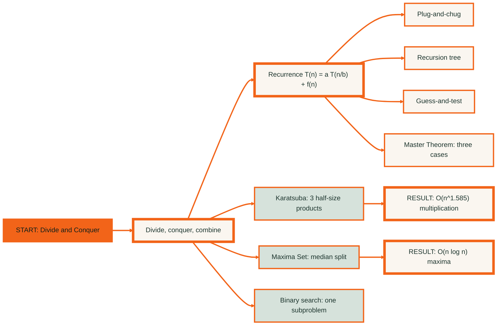
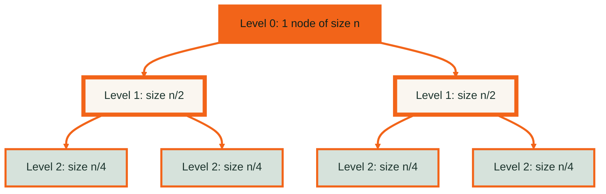

# 07 — Διαίρει και Βασίλευε
*Divide and Conquer: Recurrences, the Master Theorem, Karatsuba Multiplication and Maxima Set*

Η μέθοδος διαίρει και βασίλευε (`Divide and Conquer`) ανάγει την επίλυση ενός προβλήματος μεγέθους $n$ στην επίλυση μικρότερων, ανεξάρτητων υποπροβλημάτων και στη συνένωση των λύσεών τους. Το κεφάλαιο παρέχει το γενικό πρότυπο των τριών βημάτων και το μαθηματικό εργαλείο για την ανάλυση του χρόνου του: τις αναδρομικές εξισώσεις και τέσσερις τεχνικές επίλυσής τους. Στηρίζεται στην ασυμπτωτική ανάλυση της [01_analysis_of_algorithms.md](01_analysis_of_algorithms.md) και στην ταξινόμηση με συγχώνευση της [05_sorting_and_lower_bound.md](05_sorting_and_lower_bound.md). Τροφοδοτεί τον δυναμικό προγραμματισμό της [08_dynamic_programming.md](08_dynamic_programming.md), όπου τα υποπροβλήματα επικαλύπτονται, και εφαρμόζεται στον γρήγορο πολλαπλασιασμό ακεραίων (`Karatsuba`) και στο σύνολο μεγίστων (`Maxima Set`).

> **Εξεταστική κάλυψη:** Πρόοδος και Τελική
> **Κεφάλαιο βιβλίου:** `Κεφ. 11` | **Διαλέξεις:** `12_divide_and_conquer.pdf`
> **Πηγή:** `Resources/Meta/mindmap.md` (Ενότητα 07)
> **Εκτός ύλης:** Καμία

## Πίνακας Περιεχομένων

- [1. Εννοιολογικό Πλαίσιο και Συνολική Εικόνα](#1-εννοιολογικό-πλαίσιο-και-συνολική-εικόνα)
- [2. Θεωρητική Θεμελίωση και Τυπικοί Ορισμοί](#2-θεωρητική-θεμελίωση-και-τυπικοί-ορισμοί)
- [3. Αλγόριθμοι, Ιχνηλάτηση και Κώδικας](#3-αλγόριθμοι-ιχνηλάτηση-και-κώδικας)
- [4. Συγκριτική Ανάλυση και Πολυπλοκότητα](#4-συγκριτική-ανάλυση-και-πολυπλοκότητα)
- [5. Πλήρως Λυμένες Ασκήσεις Εξεταστικού Επιπέδου](#5-πλήρως-λυμένες-ασκήσεις-εξεταστικού-επιπέδου)
- [6. Οδηγός Επιβίωσης στις Εξετάσεις και Παγίδες](#6-οδηγός-επιβίωσης-στις-εξετάσεις-και-παγίδες)
- [7. Συνοπτικός Πίνακας Εννοιών](#7-συνοπτικός-πίνακας-εννοιών)

---

## 1. Εννοιολογικό Πλαίσιο και Συνολική Εικόνα

### Το Πρόβλημα

Ένας ταξιδιωτικός οδηγός αξιολογεί ξενοδοχεία με δύο μόνο κριτήρια: το μέγεθος της πισίνας $x$ και την ποιότητα του εστιατορίου $y$. Κάθε ξενοδοχείο αναπαρίσταται ως σημείο $(x,y)$ στο επίπεδο. Ένα σημείο $p$ είναι **μέγιστο** (`maximal`) ή **μη κυριαρχούμενο** (`non-dominated`) αν δεν υπάρχει άλλο σημείο $q$ με $x(p) \le x(q)$ και $y(p) \le y(q)$. Τα μέγιστα σημεία είναι οι υποψήφιες βέλτιστες επιλογές ως προς τα δύο κριτήρια και σχηματίζουν το **σύνολο μεγίστων** (`Maxima Set`, `Pareto layer`). Ο τετριμμένος έλεγχος συγκρίνει κάθε ζεύγος σημείων και κοστίζει $\Theta(n^2)$. Η μέθοδος διαίρει και βασίλευε, με μία προεπεξεργασία ταξινόμησης, απαντά στο ίδιο ερώτημα σε $\Theta(n \log n)$.

Το δεύτερο πρόβλημα του κεφαλαίου είναι ο πολλαπλασιασμός δύο ακεραίων $n$ bits. Ο σχολικός αλγόριθμος εκτελεί $\Theta(n^2)$ στοιχειώδεις πολλαπλασιασμούς ψηφίων. Ο αλγόριθμος `Karatsuba` μειώνει τους τέσσερις αναδρομικούς πολλαπλασιασμούς σε τρεις και πετυχαίνει χρόνο $\Theta(n^{\log_2 3}) \approx \Theta(n^{1.585})$. Και τα δύο προβλήματα έχουν την ίδια δομή: ανεξάρτητα υποπροβλήματα, γραμμικό κόστος συνένωσης και αναδρομική εξίσωση που επιλύεται με τις τεχνικές της Ενότητας 2. Η ταξινόμηση με συγχώνευση (`Merge-Sort`) της [05_sorting_and_lower_bound.md](05_sorting_and_lower_bound.md) είναι το πληρέστερο παράδειγμα του ίδιου προτύπου.

### Χάρτης Εννοιών του Κεφαλαίου

Πορτοκαλί γέμισμα: η αφετηρία (`START`) του κεφαλαίου. Παχύ περίγραμμα: το γενικό πρότυπο, η αναδρομική εξίσωση και τα δύο τελικά αποτελέσματα. Κρεμ: οι τέσσερις τεχνικές επίλυσης αναδρομών. Απαλό πράσινο: οι τρεις εφαρμογές του κεφαλαίου.

| Ομάδα | Κόμβοι | Ρόλος |
|---|---|---|
| Αφετηρία | Διαίρει και βασίλευε | Ενιαίο παράδειγμα σχεδίασης για ανεξάρτητα υποπροβλήματα |
| Πρότυπο | Διαίρει, βασίλευε, συνένωσε | Καθορίζει τη διάσπαση, την αναδρομή και το κόστος συνένωσης |
| Ανάλυση | Αναδρομική εξίσωση | Εκφράζει τον χρόνο ως $T(n)=aT(n/b)+f(n)$ |
| Τεχνικές | `Plug-and-chug`, δέντρο, εικασία, Μάστερ | Επιλύουν την αναδρομική εξίσωση σε κλειστή μορφή ή σε ασυμπτωτικό φράγμα |
| Εφαρμογές | `Karatsuba`, `Maxima Set`, δυαδική αναζήτηση | Δείχνουν το πρότυπο σε πολλαπλασιασμό, γεωμετρία και αναζήτηση |

### Πότε Χρησιμοποιείται Διαίρει και Βασίλευε

Η μέθοδος επιλέγεται όταν τα υποπροβλήματα είναι **ανεξάρτητα**, δηλαδή η λύση του ενός δεν χρειάζεται τη λύση του άλλου, και όταν η συνένωση κοστίζει το πολύ γραμμικά ως προς το μέγεθος της εισόδου. Η ισορροπημένη διάσπαση κρατά το βάθος της αναδρομής σε $\Theta(\log n)$· μια διάσπαση σε $1$ και $n-1$ στοιχεία δίνει βάθος $n$ και χάνει το λογαριθμικό πλεονέκτημα. Η βασική περίπτωση πρέπει να έχει σταθερό μέγεθος, ώστε η αναδρομή να τερματίζει. Όταν τα υποπροβλήματα **επικαλύπτονται**, η απλή αναδρομή επαναλαμβάνει εργασία και απαιτείται δυναμικός προγραμματισμός ([08_dynamic_programming.md](08_dynamic_programming.md))· όταν μια τοπική επιλογή αποδεικνύεται ασφαλής με επιχείρημα ανταλλαγής, η άπληστη μέθοδος είναι απλούστερη ([06_greedy_method.md](06_greedy_method.md)). Η διαίρει και βασίλευε δεν είναι συνώνυμη με κάθε αναδρομή: η αναδρομική μέγιστη τιμή $T(n)=T(n-1)+\Theta(1)$ είναι αναδρομή αλλά όχι διαίρει και βασίλευε, διότι δεν διαιρεί την είσοδο σε ανεξάρτητα τμήματα.

---

## 2. Θεωρητική Θεμελίωση και Τυπικοί Ορισμοί

### 2.1 Το Γενικό Πρότυπο

**Ορισμός (διαίρει και βασίλευε).** Μια αλγοριθμική τεχνική ακολουθεί το πρότυπο διαίρει και βασίλευε όταν εκτελεί τρία βήματα:

1. **Διαίρει** (`Divide`): διαχωρίζει την είσοδο $S$ μεγέθους $n$ σε $a \ge 2$ διακριτά υποσύνολα $S_1,\dots,S_a$, συνήθως ίσου μεγέθους $n/b$ με $b>1$.
2. **Βασίλευε** (`Conquer`): επιλύει αναδρομικά κάθε υποπρόβλημα, μέχρι να φτάσει σε βασική περίπτωση σταθερού μεγέθους $n<d$.
3. **Συνένωσε** (`Combine`): συνθέτει τις λύσεις των υποπροβλημάτων σε λύση του αρχικού προβλήματος.

**Ορισμός (αναδρομική εξίσωση).** Ο χρόνος εκτέλεσης περιγράφεται από την εξίσωση

$$T(n)=aT(n/b)+f(n) \quad (n\ge d), \qquad T(n)=c \quad (n<d),$$

όπου $a\ge1$ και $b>1$ είναι σταθερές, $f(n)$ είναι το κόστος διάσπασης και συνένωσης, και $c$ είναι το κόστος της βασικής περίπτωσης. Η $T(n)$ δηλώνει πάντα τον χρόνο στη **χειρότερη περίπτωση**, εκτός αν δηλώνεται διαφορετικά.

**Πρόταση 2.1 (σχήμα ορθότητας).** Αν ο αλγόριθμος είναι ορθός για κάθε βασική περίπτωση $n<d$ και αν η συνένωση ορθών λύσεων των υποπροβλημάτων παράγει ορθή λύση του αρχικού προβλήματος, τότε ο αλγόριθμος είναι ορθός για κάθε $n$.

*Απόδειξη με ισχυρή επαγωγή στο $n$.* Βάση: για $n<d$ η ορθότητα δίνεται από την υπόθεση. Επαγωγικό βήμα: έστω $n\ge d$ και έστω ότι ο αλγόριθμος είναι ορθός για κάθε μέγεθος μικρότερο του $n$. Κάθε υποπρόβλημα έχει μέγεθος $n/b<n$, διότι $b>1$, άρα από την επαγωγική υπόθεση η αναδρομική κλήση επιστρέφει ορθή λύση του υποπροβλήματος. Η συνένωση αυτών των ορθών λύσεων παράγει, από την υπόθεση, ορθή λύση του προβλήματος μεγέθους $n$. Επομένως ο αλγόριθμος είναι ορθός για κάθε $n$. $\square$

**Παρατήρηση (γιατί η ισορροπημένη διάσπαση είναι κρίσιμη).** Αν η διάσπαση είναι $1$ και $n-1$ αντί για $n/2$ και $n/2$, η αναδρομή γίνεται $T(n)=T(n-1)+T(1)+f(n)$ και το βάθος είναι $n$. Ακόμη και με $f(n)=\Theta(1)$ προκύπτει $T(n)=\Theta(n)$, ενώ μια ισορροπημένη διάσπαση με γραμμική συνένωση δίνει $\Theta(n\log n)$ για το ίδιο είδος εργασίας. Η ισορροπία δεν αλλάζει μόνο σταθερές· αλλάζει τον ρυθμό αύξησης όταν η συνένωση είναι υπεργραμμική.

**Σύμβαση συμβόλων.** Στο Μάστερ Θεώρημα το $b$ δηλώνει τον παράγοντα διάσπασης. Στα παραδείγματα η σταθερά του γραμμικού έργου συμβολίζεται $\beta$, ώστε να μη συγκρούεται με το $b$· η διάλεξη χρησιμοποιεί το ίδιο γράμμα και για τις δύο έννοιες.

### 2.2 Τεχνική 1: Επαναληπτική Αντικατάσταση (`Plug-and-Chug`)

**Ιδέα.** Εφαρμόζουμε την αναδρομική εξίσωση στον εαυτό της διαδοχικά, μέχρι να εμφανιστεί μοτίβο και να φτάσουμε στη βασική περίπτωση. Η μέθοδος ονομάζεται και `iterative substitution`.

**Παράδειγμα.** Για $T(n)=2T(n/2)+\beta n$ με $T(1)=\beta$:

$$
\begin{aligned}
T(n) &= 2T(n/2)+\beta n \\
&= 2\left(2T(n/4)+\beta\,\frac{n}{2}\right)+\beta n
   &&= 4T(n/4)+2\beta n \\
&= 4\left(2T(n/8)+\beta\,\frac{n}{4}\right)+2\beta n
   &&= 8T(n/8)+3\beta n \\
&\;\;\vdots \\
&= 2^{i}T(n/2^{i})+i\beta n.
\end{aligned}
$$

Η αναδρομή τερματίζει όταν $n/2^{i}=1$, δηλαδή όταν $i=\log_2 n$. Τότε

$$T(n)=2^{\log_2 n}T(1)+\beta n\log_2 n=n\cdot\beta+\beta n\log_2 n=\Theta(n\log n).$$

**Γενική μορφή.** Για $T(n)=aT(n/b)+f(n)$:

$$
\begin{aligned}
T(n) &= aT(n/b)+f(n) \\
&= a^{2}T(n/b^{2})+a f(n/b)+f(n) \\
&= a^{i}T(n/b^{i})+\sum_{j=0}^{i-1}a^{j}f(n/b^{j}).
\end{aligned}
$$

Για $i=\log_b n$, δηλαδή $n/b^{i}=1$,

$$T(n)=a^{\log_b n}T(1)+\sum_{j=0}^{\log_b n-1}a^{j}f(n/b^{j}).$$

Η ταυτότητα $a^{\log_b n}=n^{\log_b a}$ δίνει την **κλειστή μορφή**

$$T(n)=n^{\log_b a}T(1)+\sum_{j=0}^{\log_b n-1}a^{j}f(n/b^{j}).$$

*Αιτιολόγηση της ταυτότητας.* Λαμβάνοντας $\log_b$ και στα δύο μέλη, $\log_b(a^{\log_b n})=\log_b n\cdot\log_b a=\log_b(n^{\log_b a})$. $\square$

**Περιορισμοί.** Η μέθοδος προϋποθέτει ότι το μοτίβο είναι ορατό και ότι το $n$ είναι δύναμη του $b$. Για γενικό $n$, τα πατώματα και οι οροφές αλλάζουν μόνο σταθερές και όχι την ασυμπτωτική κλάση· η εξέταση επιτρέπεται να τα αγνοεί, αρκεί να το δηλώσει.

### 2.3 Τεχνική 2: Δέντρο Αναδρομής

**Κατασκευή.** Η ρίζα παριστάνει το αρχικό πρόβλημα μεγέθους $n$ και κόστος $f(n)$. Κάθε κόμβος μεγέθους $m$ έχει $a$ παιδιά μεγέθους $m/b$, στα οποία μοιράζεται το κόστος $f(m)$. Το επίπεδο $i$ περιέχει $a^{i}$ κόμβους μεγέθους $n/b^{i}$, άρα έχει συνολικό κόστος $a^{i}f(n/b^{i})$. Το δέντρο έχει βάθος $\log_b n$ και $a^{\log_b n}=n^{\log_b a}$ φύλλα, καθένα με κόστος $T(1)$. Επομένως

$$T(n)=\sum_{i=0}^{\log_b n-1}a^{i}f(n/b^{i})+n^{\log_b a}T(1).$$

Ο πρώτος όρος αθροίζει τα εσωτερικά επίπεδα και ο δεύτερος τα φύλλα.

**Δέντρο για $T(n)=2T(n/2)+\beta n$:**

Πορτοκαλί γέμισμα: η ρίζα (`Level 0`) με το αρχικό κόστος. Παχύ περίγραμμα: το πρώτο επίπεδο αναδρομής. Απαλό πράσινο: το δεύτερο επίπεδο, όπου φαίνεται ο διπλασιασμός των κόμβων. Οι ετικέτες δίνουν μέγεθος, όχι κόστος ανά κόμβο· το κόστος είναι ανά επίπεδο.

| Βάθος $i$ | Πλήθος κόμβων | Μέγεθος κόμβου | Κόστος ανά κόμβο | Συνολικό κόστος επιπέδου |
|---|---|---|---|---|
| $0$ | $1$ | $n$ | $\beta n$ | $\beta n$ |
| $1$ | $2$ | $n/2$ | $\beta n/2$ | $\beta n$ |
| $2$ | $4$ | $n/4$ | $\beta n/4$ | $\beta n$ |
| $i$ | $2^{i}$ | $n/2^{i}$ | $\beta n/2^{i}$ | $\beta n$ |
| $\log_2 n$ | $n$ | $1$ | $\beta$ | $\beta n$ |

Το δέντρο έχει $\log_2 n+1$ επίπεδα, καθένα με κόστος $\beta n$, άρα $T(n)=\beta n(\log_2 n+1)=\Theta(n\log n)$. Το τελευταίο επίπεδο είναι τα φύλλα· το συνολικό τους κόστος είναι επίσης $\beta n$, όχι αμελητέο.

### 2.4 Τεχνική 3: Εικασία και Έλεγχος (`Guess-and-Test`)

**Ιδέα.** Μαντεύουμε μια κλειστή μορφή $T(n)\le C\,g(n)$ και την αποδεικνύουμε με επαγωγή, προσδιορίζοντας τη σταθερά $C$ και το κατώφλι $n_0$. Η μέθοδος απαιτεί καλή εικασία· μια λανθασμένη εικασία αποτυγχάνει στον επαγωγικό βήμα.

**Εφαρμογή.** Για την αναδρομή της διάλεξης

$$T(n)=2T(n/2)+\beta n\log_2 n \quad (n\ge2), \qquad T(1)=c_0.$$

**Αποτυχημένη εικασία: $T(n)\le Cn\log_2 n$.** Έστω ότι ισχύει για $n/2$. Τότε

$$
\begin{aligned}
T(n)&\le 2C\,\frac{n}{2}\log_2\frac{n}{2}+\beta n\log_2 n\\
&=Cn(\log_2 n-1)+\beta n\log_2 n\\
&=Cn\log_2 n+n(\beta\log_2 n-C).
\end{aligned}
$$

Ο όρος $n(\beta\log_2 n-C)$ είναι θετικός για $n>2^{C/\beta}$, άρα το δεξί μέλος **δεν** φράσσεται από $Cn\log_2 n$. Η εικασία αποτυγχάνει και δεν αρκεί να αυξήσουμε το $C$.

**Επιτυχημένη εικασία: $T(n)\le Cn\log_2^2 n$.** Βάση $n=2$: $T(2)=2c_0+2\beta$, άρα αρκεί $2c_0+2\beta\le 2C$, δηλαδή $C\ge c_0+\beta$. Επαγωγικό βήμα για $n\ge4$:

$$
\begin{aligned}
T(n)&\le 2C\,\frac{n}{2}\log_2^2\frac{n}{2}+\beta n\log_2 n\\
&=Cn(\log_2 n-1)^2+\beta n\log_2 n\\
&=Cn\log_2^2 n-2Cn\log_2 n+Cn+\beta n\log_2 n\\
&=Cn\log_2^2 n-n\bigl[(2C-\beta)\log_2 n-C\bigr].
\end{aligned}
$$

Η αγκύλη είναι μη αρνητική όταν $(2C-\beta)\log_2 n\ge C$. Για $n\ge2$ ισχύει $\log_2 n\ge1$, άρα αρκεί $2C-\beta\ge C$, δηλαδή $C\ge\beta$. Με $C\ge c_0+\beta$ (και $c_0>0$) καλύπτονται και η βάση και το βήμα. Επομένως $T(n)=O(n\log^2 n)$. Το Μάστερ Θεώρημα δίνει αργότερα και το κάτω φράγμα, άρα $T(n)=\Theta(n\log^2 n)$.

**Παρατήρηση.** Η εικασία αποδεικνύει μόνο το άνω φράγμα. Για σφιχτό αποτέλεσμα χρειάζεται ξεχωριστό κάτω φράγμα ή το Μάστερ Θεώρημα.

---

<!--APPEND-HERE-->
