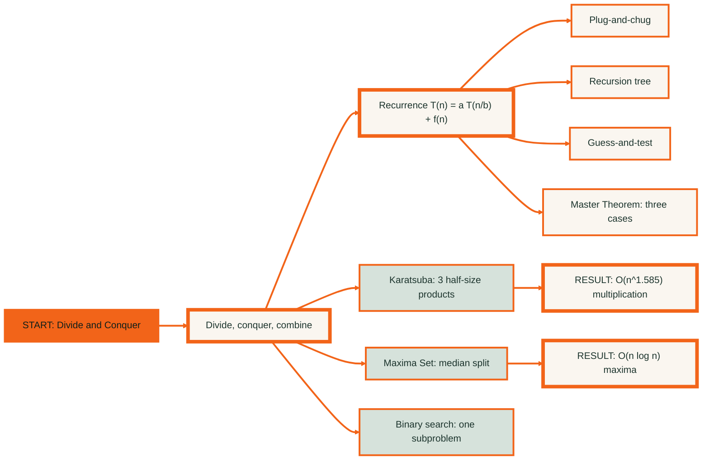
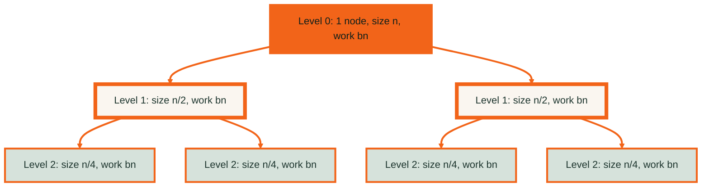
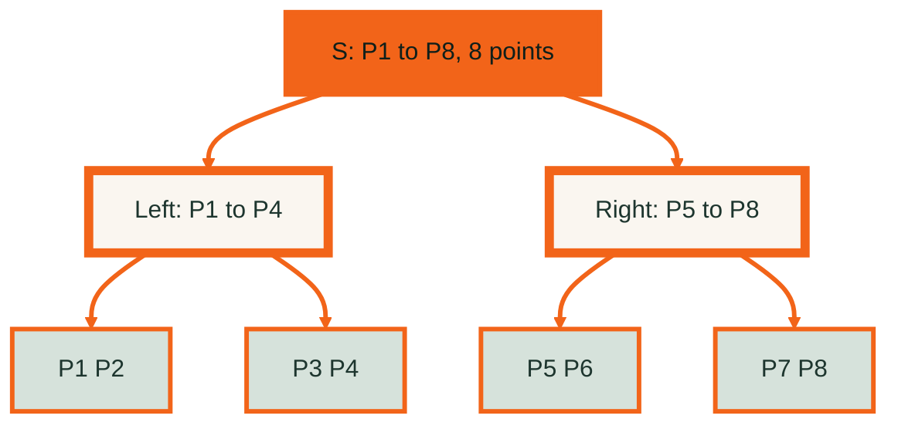

# 07 — Διαίρει και Βασίλευε
*Divide and Conquer: Recurrences, the Master Theorem, Karatsuba Multiplication and Maxima Set*

Η μέθοδος διαίρει και βασίλευε (`Divide and Conquer`) ανάγει την επίλυση ενός προβλήματος μεγέθους $n$ στην επίλυση μικρότερων, ανεξάρτητων υποπροβλημάτων και στη συνένωση των λύσεών τους. Το κεφάλαιο παρέχει το γενικό πρότυπο των τριών βημάτων και το μαθηματικό εργαλείο για την ανάλυση του χρόνου του: τις αναδρομικές εξισώσεις και τέσσερις τεχνικές επίλυσής τους. Στηρίζεται στην ασυμπτωτική ανάλυση της [01_analysis_of_algorithms.md](01_analysis_of_algorithms.md) και στην ταξινόμηση με συγχώνευση της [05_sorting_and_lower_bound.md](05_sorting_and_lower_bound.md). Τροφοδοτεί τον δυναμικό προγραμματισμό της [08_dynamic_programming.md](08_dynamic_programming.md), όπου τα υποπροβλήματα επικαλύπτονται, και εφαρμόζεται στον γρήγορο πολλαπλασιασμό ακεραίων (`Karatsuba`) και στο σύνολο μεγίστων (`Maxima Set`).

> **Εξεταστική κάλυψη:** Πρόοδος και Τελική
> **Κεφάλαιο βιβλίου:** `Κεφ. 11` | **Διαλέξεις:** `12_divide_and_conquer.pdf`
> **Πηγή:** `Resources/Meta/mindmap.md` (Ενότητα 07)
> **Εκτός ύλης:** Καμία

## Πίνακας Περιεχομένων

- [1. Εννοιολογικό Πλαίσιο και Συνολική Εικόνα](#1-εννοιολογικό-πλαίσιο-και-συνολική-εικόνα)
- [2. Θεωρητική Θεμελίωση και Τυπικοί Ορισμοί](#2-θεωρητική-θεμελίωση-και-τυπικοί-ορισμοί)
- [3. Αλγόριθμοι, Ιχνηλάτηση και Κώδικας](#3-αλγόριθμοι-ιχνηλάτηση-και-κώδικας)
- [4. Συγκριτική Ανάλυση και Πολυπλοκότητα](#4-συγκριτική-ανάλυση-και-πολυπλοκότητα)
- [5. Πλήρως Λυμένες Ασκήσεις Εξεταστικού Επιπέδου](#5-πλήρως-λυμένες-ασκήσεις-εξεταστικού-επιπέδου)
- [6. Οδηγός Επιβίωσης στις Εξετάσεις και Παγίδες](#6-οδηγός-επιβίωσης-στις-εξετάσεις-και-παγίδες)
- [7. Συνοπτικός Πίνακας Εννοιών](#7-συνοπτικός-πίνακας-εννοιών)

---

## 1. Εννοιολογικό Πλαίσιο και Συνολική Εικόνα

### Το Πρόβλημα

Ένας ταξιδιωτικός οδηγός αξιολογεί ξενοδοχεία με δύο μόνο κριτήρια: το μέγεθος της πισίνας $x$ και την ποιότητα του εστιατορίου $y$. Κάθε ξενοδοχείο αναπαρίσταται ως σημείο $(x,y)$ στο επίπεδο. Ένα σημείο $p$ είναι **μέγιστο** (`maximal`) ή **μη κυριαρχούμενο** (`non-dominated`) αν δεν υπάρχει άλλο σημείο $q$ με $x(p) \le x(q)$ και $y(p) \le y(q)$. Τα μέγιστα σημεία είναι οι υποψήφιες βέλτιστες επιλογές ως προς τα δύο κριτήρια και σχηματίζουν το **σύνολο μεγίστων** (`Maxima Set`, `Pareto layer`). Ο τετριμμένος έλεγχος συγκρίνει κάθε ζεύγος σημείων και κοστίζει $\Theta(n^2)$. Η μέθοδος διαίρει και βασίλευε, με μία προεπεξεργασία ταξινόμησης, απαντά στο ίδιο ερώτημα σε $\Theta(n \log n)$.

Το δεύτερο πρόβλημα του κεφαλαίου είναι ο πολλαπλασιασμός δύο ακεραίων $n$ bits. Ο σχολικός αλγόριθμος εκτελεί $\Theta(n^2)$ στοιχειώδεις πολλαπλασιασμούς ψηφίων. Ο αλγόριθμος `Karatsuba` μειώνει τους τέσσερις αναδρομικούς πολλαπλασιασμούς σε τρεις και πετυχαίνει χρόνο $\Theta(n^{\log_2 3}) \approx \Theta(n^{1.585})$. Και τα δύο προβλήματα έχουν την ίδια δομή: ανεξάρτητα υποπροβλήματα, γραμμικό κόστος συνένωσης και αναδρομική εξίσωση που επιλύεται με τις τεχνικές της Ενότητας 2. Η ταξινόμηση με συγχώνευση (`Merge-Sort`) της [05_sorting_and_lower_bound.md](05_sorting_and_lower_bound.md) είναι το πληρέστερο παράδειγμα του ίδιου προτύπου.

### Χάρτης Εννοιών του Κεφαλαίου



Πορτοκαλί γέμισμα: η αφετηρία (`START`) του κεφαλαίου. Παχύ περίγραμμα: το γενικό πρότυπο, η αναδρομική εξίσωση και τα δύο τελικά αποτελέσματα. Κρεμ: οι τέσσερις τεχνικές επίλυσης αναδρομών. Απαλό πράσινο: οι τρεις εφαρμογές του κεφαλαίου.

| Ομάδα | Κόμβοι | Ρόλος |
|---|---|---|
| Αφετηρία | Διαίρει και βασίλευε | Ενιαίο παράδειγμα σχεδίασης για ανεξάρτητα υποπροβλήματα |
| Πρότυπο | Διαίρει, βασίλευε, συνένωσε | Καθορίζει τη διάσπαση, την αναδρομή και το κόστος συνένωσης |
| Ανάλυση | Αναδρομική εξίσωση | Εκφράζει τον χρόνο ως $T(n)=aT(n/b)+f(n)$ |
| Τεχνικές | `Plug-and-chug`, δέντρο, εικασία, Μάστερ | Επιλύουν την αναδρομική εξίσωση σε κλειστή μορφή ή σε ασυμπτωτικό φράγμα |
| Εφαρμογές | `Karatsuba`, `Maxima Set`, δυαδική αναζήτηση | Δείχνουν το πρότυπο σε πολλαπλασιασμό, γεωμετρία και αναζήτηση |

### Πότε Χρησιμοποιείται Διαίρει και Βασίλευε

Η μέθοδος επιλέγεται όταν τα υποπροβλήματα είναι **ανεξάρτητα**, δηλαδή η λύση του ενός δεν χρειάζεται τη λύση του άλλου, και όταν η συνένωση κοστίζει το πολύ γραμμικά ως προς το μέγεθος της εισόδου. Η ισορροπημένη διάσπαση κρατά το βάθος της αναδρομής σε $\Theta(\log n)$· μια διάσπαση σε $1$ και $n-1$ στοιχεία δίνει βάθος $n$ και χάνει το λογαριθμικό πλεονέκτημα. Η βασική περίπτωση πρέπει να έχει σταθερό μέγεθος, ώστε η αναδρομή να τερματίζει. Όταν τα υποπροβλήματα **επικαλύπτονται**, η απλή αναδρομή επαναλαμβάνει εργασία και απαιτείται δυναμικός προγραμματισμός ([08_dynamic_programming.md](08_dynamic_programming.md))· όταν μια τοπική επιλογή αποδεικνύεται ασφαλής με επιχείρημα ανταλλαγής, η άπληστη μέθοδος είναι απλούστερη ([06_greedy_method.md](06_greedy_method.md)). Η μέθοδος διαίρει και βασίλευε δεν είναι συνώνυμη με κάθε αναδρομή: η αναδρομική μέγιστη τιμή $T(n)=T(n-1)+\Theta(1)$ είναι αναδρομή αλλά όχι διαίρει και βασίλευε, διότι δεν διαιρεί την είσοδο σε ανεξάρτητα τμήματα.

---

## 2. Θεωρητική Θεμελίωση και Τυπικοί Ορισμοί

### 2.1 Το Γενικό Πρότυπο

**Ορισμός (διαίρει και βασίλευε).** Μια αλγοριθμική τεχνική ακολουθεί το πρότυπο διαίρει και βασίλευε όταν εκτελεί τρία βήματα:

1. **Διαίρει** (`Divide`): διαχωρίζει την είσοδο $S$ μεγέθους $n$ σε $a \ge 2$ διακριτά υποσύνολα $S_1,\dots,S_a$, συνήθως ίσου μεγέθους $n/b$ με $b>1$.
2. **Βασίλευε** (`Conquer`): επιλύει αναδρομικά κάθε υποπρόβλημα, μέχρι να φτάσει σε βασική περίπτωση σταθερού μεγέθους $n<d$.
3. **Συνένωσε** (`Combine`): συνθέτει τις λύσεις των υποπροβλημάτων σε λύση του αρχικού προβλήματος.

**Ορισμός (αναδρομική εξίσωση).** Ο χρόνος εκτέλεσης περιγράφεται από την εξίσωση

$$T(n)=aT(n/b)+f(n) \quad (n\ge d), \qquad T(n)=c \quad (n<d),$$

όπου $a\ge1$ και $b>1$ είναι σταθερές, $f(n)$ είναι το κόστος διάσπασης και συνένωσης, και $c$ είναι το κόστος της βασικής περίπτωσης. Η $T(n)$ δηλώνει πάντα τον χρόνο στη **χειρότερη περίπτωση**, εκτός αν δηλώνεται διαφορετικά.

**Πρόταση 2.1 (σχήμα ορθότητας).** Αν ο αλγόριθμος είναι ορθός για κάθε βασική περίπτωση $n<d$ και αν η συνένωση ορθών λύσεων των υποπροβλημάτων παράγει ορθή λύση του αρχικού προβλήματος, τότε ο αλγόριθμος είναι ορθός για κάθε $n$.

*Απόδειξη με ισχυρή επαγωγή στο $n$.* Βάση: για $n<d$ η ορθότητα δίνεται από την υπόθεση. Επαγωγικό βήμα: έστω $n\ge d$ και έστω ότι ο αλγόριθμος είναι ορθός για κάθε μέγεθος μικρότερο του $n$. Κάθε υποπρόβλημα έχει μέγεθος $n/b<n$, διότι $b>1$, άρα από την επαγωγική υπόθεση η αναδρομική κλήση επιστρέφει ορθή λύση του υποπροβλήματος. Η συνένωση αυτών των ορθών λύσεων παράγει, από την υπόθεση, ορθή λύση του προβλήματος μεγέθους $n$. Επομένως ο αλγόριθμος είναι ορθός για κάθε $n$. $\square$

**Παρατήρηση (γιατί η ισορροπημένη διάσπαση είναι κρίσιμη).** Αν η διάσπαση είναι $1$ και $n-1$ αντί για $n/2$ και $n/2$, η αναδρομή γίνεται $T(n)=T(n-1)+T(1)+f(n)$ και το βάθος είναι $n$. Ακόμη και με $f(n)=\Theta(1)$ προκύπτει $T(n)=\Theta(n)$, ενώ μια ισορροπημένη διάσπαση με γραμμική συνένωση δίνει $\Theta(n\log n)$ για το ίδιο είδος εργασίας. Η ισορροπία δεν αλλάζει μόνο σταθερές· αλλάζει τον ρυθμό αύξησης όταν η συνένωση είναι υπεργραμμική.

**Σύμβαση συμβόλων.** Στο Μάστερ Θεώρημα το $b$ δηλώνει τον παράγοντα διάσπασης. Στα παραδείγματα η σταθερά του γραμμικού έργου συμβολίζεται $\beta$, ώστε να μη συγκρούεται με το $b$· η διάλεξη χρησιμοποιεί το ίδιο γράμμα και για τις δύο έννοιες.

### 2.2 Τεχνική 1: Επαναληπτική Αντικατάσταση (`Plug-and-Chug`)

**Ιδέα.** Εφαρμόζουμε την αναδρομική εξίσωση στον εαυτό της διαδοχικά, μέχρι να εμφανιστεί μοτίβο και να φτάσουμε στη βασική περίπτωση. Η μέθοδος ονομάζεται και `iterative substitution`.

**Παράδειγμα.** Για $T(n)=2T(n/2)+\beta n$ με $T(1)=\beta$ (για $\beta=1$ είναι η $T(n)=2T(n/2)+n$):

$$
\begin{aligned}
T(n) &= 2T(n/2)+\beta n \\
&= 2\left(2T(n/4)+\beta\,\frac{n}{2}\right)+\beta n
   &&= 4T(n/4)+2\beta n \\
&= 4\left(2T(n/8)+\beta\,\frac{n}{4}\right)+2\beta n
   &&= 8T(n/8)+3\beta n \\
&\;\;\vdots \\
&= 2^{i}T(n/2^{i})+i\beta n.
\end{aligned}
$$

Η αναδρομή τερματίζει όταν $n/2^{i}=1$, δηλαδή όταν $i=\log_2 n$. Τότε

$$T(n)=2^{\log_2 n}T(1)+\beta n\log_2 n=n\cdot\beta+\beta n\log_2 n=\Theta(n\log n).$$

**Γενική μορφή.** Για $T(n)=aT(n/b)+f(n)$:

$$
\begin{aligned}
T(n) &= aT(n/b)+f(n) \\
&= a^{2}T(n/b^{2})+a f(n/b)+f(n) \\
&= a^{i}T(n/b^{i})+\sum_{j=0}^{i-1}a^{j}f(n/b^{j}).
\end{aligned}
$$

Για $i=\log_b n$, δηλαδή $n/b^{i}=1$,

$$T(n)=a^{\log_b n}T(1)+\sum_{j=0}^{\log_b n-1}a^{j}f(n/b^{j}).$$

Η ταυτότητα $a^{\log_b n}=n^{\log_b a}$ δίνει την **κλειστή μορφή**

$$T(n)=n^{\log_b a}T(1)+\sum_{j=0}^{\log_b n-1}a^{j}f(n/b^{j}).$$

*Αιτιολόγηση της ταυτότητας.* Λαμβάνοντας $\log_b$ και στα δύο μέλη, $\log_b(a^{\log_b n})=\log_b n\cdot\log_b a=\log_b(n^{\log_b a})$. $\square$

**Περιορισμοί.** Η μέθοδος προϋποθέτει ότι το μοτίβο είναι ορατό και ότι το $n$ είναι δύναμη του $b$. Για γενικό $n$, τα πατώματα και οι οροφές αλλάζουν μόνο σταθερές και όχι την ασυμπτωτική κλάση· η εξέταση επιτρέπεται να τα αγνοεί, αρκεί να το δηλώσει.

### 2.3 Τεχνική 2: Δέντρο Αναδρομής

**Κατασκευή.** Η ρίζα παριστάνει το αρχικό πρόβλημα μεγέθους $n$ και κόστος $f(n)$. Κάθε κόμβος μεγέθους $m$ έχει $a$ παιδιά μεγέθους $m/b$, στα οποία μοιράζεται το κόστος $f(m)$. Το επίπεδο $i$ περιέχει $a^{i}$ κόμβους μεγέθους $n/b^{i}$, άρα έχει συνολικό κόστος $a^{i}f(n/b^{i})$. Το δέντρο έχει βάθος $\log_b n$ και $a^{\log_b n}=n^{\log_b a}$ φύλλα, καθένα με κόστος $T(1)$. Επομένως

$$T(n)=\sum_{i=0}^{\log_b n-1}a^{i}f(n/b^{i})+n^{\log_b a}T(1).$$

Ο πρώτος όρος αθροίζει τα εσωτερικά επίπεδα και ο δεύτερος τα φύλλα.

**Δέντρο για $T(n)=2T(n/2)+\beta n$:**



Πορτοκαλί γέμισμα: η ρίζα (`Level 0`) με το αρχικό κόστος. Παχύ περίγραμμα: το πρώτο επίπεδο αναδρομής. Απαλό πράσινο: το δεύτερο επίπεδο, όπου φαίνεται ο διπλασιασμός των κόμβων. Οι ετικέτες δίνουν μέγεθος και συνολικό έργο επιπέδου· το έργο κατανέμεται στους κόμβους του ίδιου επιπέδου.

| Βάθος $i$ | Πλήθος κόμβων | Μέγεθος κόμβου | Κόστος ανά κόμβο | Συνολικό κόστος επιπέδου |
|---|---|---|---|---|
| $0$ | $1$ | $n$ | $\beta n$ | $\beta n$ |
| $1$ | $2$ | $n/2$ | $\beta n/2$ | $\beta n$ |
| $2$ | $4$ | $n/4$ | $\beta n/4$ | $\beta n$ |
| $i$ | $2^{i}$ | $n/2^{i}$ | $\beta n/2^{i}$ | $\beta n$ |
| $\log_2 n$ | $n$ | $1$ | $\beta$ | $\beta n$ |

Το δέντρο έχει $\log_2 n+1$ επίπεδα, καθένα με κόστος $\beta n$, άρα $T(n)=\beta n(\log_2 n+1)=\Theta(n\log n)$. Το τελευταίο επίπεδο είναι τα φύλλα· το συνολικό τους κόστος είναι επίσης $\beta n$, όχι αμελητέο.

### 2.4 Τεχνική 3: Εικασία και Έλεγχος (`Guess-and-Test`)

**Ιδέα.** Μαντεύουμε μια κλειστή μορφή $T(n)\le C\,g(n)$ και την αποδεικνύουμε με επαγωγή, προσδιορίζοντας τη σταθερά $C$ και το κατώφλι $n_0$. Η μέθοδος απαιτεί καλή εικασία· μια λανθασμένη εικασία αποτυγχάνει στον επαγωγικό βήμα.

**Εφαρμογή.** Για την αναδρομή της διάλεξης

$$T(n)=2T(n/2)+\beta n\log_2 n \quad (n\ge2), \qquad T(1)=c_0.$$

**Αποτυχημένη εικασία: $T(n)\le Cn\log_2 n$.** Έστω ότι ισχύει για $n/2$. Τότε

$$
\begin{aligned}
T(n)&\le 2C\,\frac{n}{2}\log_2\frac{n}{2}+\beta n\log_2 n\\
&=Cn(\log_2 n-1)+\beta n\log_2 n\\
&=Cn\log_2 n+n(\beta\log_2 n-C).
\end{aligned}
$$

Ο όρος $n(\beta\log_2 n-C)$ είναι θετικός για $n>2^{C/\beta}$, άρα το δεξί μέλος **δεν** φράσσεται από $Cn\log_2 n$. Η εικασία αποτυγχάνει και δεν αρκεί να αυξήσουμε το $C$.

**Επιτυχημένη εικασία: $T(n)\le Cn\log_2^2 n$.** Βάση $n=2$: $T(2)=2c_0+2\beta$, άρα αρκεί $2c_0+2\beta\le 2C$, δηλαδή $C\ge c_0+\beta$. Επαγωγικό βήμα για $n\ge4$:

$$
\begin{aligned}
T(n)&\le 2C\,\frac{n}{2}\log_2^2\frac{n}{2}+\beta n\log_2 n\\
&=Cn(\log_2 n-1)^2+\beta n\log_2 n\\
&=Cn\log_2^2 n-2Cn\log_2 n+Cn+\beta n\log_2 n\\
&=Cn\log_2^2 n-n\bigl[(2C-\beta)\log_2 n-C\bigr].
\end{aligned}
$$

Η αγκύλη είναι μη αρνητική όταν $(2C-\beta)\log_2 n\ge C$. Για $n\ge2$ ισχύει $\log_2 n\ge1$, άρα αρκεί $2C-\beta\ge C$, δηλαδή $C\ge\beta$. Με $C\ge c_0+\beta$ (και $c_0>0$) καλύπτονται και η βάση και το βήμα. Επομένως $T(n)=O(n\log^2 n)$. Το Μάστερ Θεώρημα δίνει αργότερα και το κάτω φράγμα, άρα $T(n)=\Theta(n\log^2 n)$.

**Παρατήρηση.** Η εικασία αποδεικνύει μόνο το άνω φράγμα. Για σφιχτό αποτέλεσμα χρειάζεται ξεχωριστό κάτω φράγμα ή το Μάστερ Θεώρημα.

---

### 2.5 Τεχνική 4: Μάστερ Θεώρημα (`Master Theorem`)

**Θεώρημα 2.2 (Μάστερ Θεώρημα).** Έστω $a\ge1$ και $b>1$ σταθερές, $f(n)$ ασυμπτωτικά θετική, και

$$T(n)=aT(n/b)+f(n) \quad (n\ge d), \qquad T(n)=c \quad (n<d).$$

Τότε, αν ισχύει μία από τις τρεις επόμενες συνθήκες, ισχύει το αντίστοιχο συμπέρασμα:

1. **Κυριαρχούν τα φύλλα.** Αν $f(n)=O(n^{\log_b a-\varepsilon})$ για κάποιο $\varepsilon>0$, τότε $T(n)=\Theta(n^{\log_b a})$.
2. **Ισορροπία.** Αν $f(n)=\Theta(n^{\log_b a}\log^{k}n)$ για κάποιο $k\ge0$, τότε $T(n)=\Theta(n^{\log_b a}\log^{k+1}n)$.
3. **Κυριαρχεί η ρίζα.** Αν $f(n)=\Omega(n^{\log_b a+\varepsilon})$ για κάποιο $\varepsilon>0$ **και** υπάρχει σταθερά $\delta<1$ με $a f(n/b)\le\delta f(n)$ για όλα τα αρκετά μεγάλα $n$, τότε $T(n)=\Theta(f(n))$.

Η συνθήκη της περίπτωσης 3 ονομάζεται **συνθήκη κανονικότητας** (`regularity condition`). Χωρίς αυτήν, η περίπτωση 3 δεν εφαρμόζεται, ακόμη και όταν η $f(n)$ υπερέχει πολυωνυμικά.

**Αιτιολόγηση μέσω της κλειστής μορφής.** Από την Ενότητα 2.2,

$$T(n)=n^{\log_b a}T(1)+\sum_{j=0}^{\log_b n-1}a^{j}f(n/b^{j}).$$

Για $f(n)=n^{p}$, ο όρος του επιπέδου $j$ είναι

$$a^{j}\left(\frac{n}{b^{j}}\right)^{p}=n^{p}\left(\frac{a}{b^{p}}\right)^{j}=n^{p}\left(b^{\log_b a-p}\right)^{j}.$$

Ο λόγος $r=a/b^{p}=b^{\log_b a-p}$ καθορίζει ποιο τμήμα κυριαρχεί:

| Σχέση $f(n)$ με $n^{\log_b a}$ | Λόγος $r$ | Κυρίαρχο τμήμα | Περίπτωση | Αποτέλεσμα |
|---|---|---|---|---|
| Μικρότερη κατά πολυώνυμο | $r>1$ | Τα φύλλα | 1 | $\Theta(n^{\log_b a})$ |
| Ίση, με επιπλέον $\log^{k}n$ | $r=1$ | Όλα τα επίπεδα | 2 | $\Theta(n^{\log_b a}\log^{k+1}n)$ |
| Μεγαλύτερη κατά πολυώνυμο | $r<1$ | Η ρίζα | 3 | $\Theta(f(n))$ |

**Πίνακας αποφάσεων.** Ο επόμενος πίνακας εφαρμόζει το θεώρημα σε οκτώ αναδρομές. Η στήλη «Σύγκριση» δείχνει ποια σχέση της $f(n)$ με την $n^{\log_b a}$ ισχύει· στην περίπτωση 3 ελέγχεται ρητά η κανονικότητα.

| # | Αναδρομή | $a$ | $b$ | $f(n)$ | $\log_b a$ | Σύγκριση | Περίπτωση | Αποτέλεσμα |
|---|---|---|---|---|---|---|---|---|
| 1 | $4T(n/2)+n$ | $4$ | $2$ | $n$ | $2$ | $n=O(n^{2-1})$ | 1, $\varepsilon=1$ | $\Theta(n^{2})$ |
| 2 | $2T(n/2)+n\log n$ | $2$ | $2$ | $n\log n$ | $1$ | $f=\Theta(n^{1}\log^{1}n)$ | 2, $k=1$ | $\Theta(n\log^{2}n)$ |
| 3 | $T(n/2)+1$ | $1$ | $2$ | $1$ | $0$ | $f=\Theta(n^{0}\log^{0}n)$ | 2, $k=0$ | $\Theta(\log n)$ |
| 4 | $T(n/3)+n\log n$ | $1$ | $3$ | $n\log n$ | $0$ | $f=\Omega(n^{0+1})$· $f(n/3)\le\frac13 f(n)$ | 3, $\delta=1/3$ | $\Theta(n\log n)$ |
| 5 | $2T(n/2)+\log n$ | $2$ | $2$ | $\log n$ | $1$ | $\log n=O(n^{1-\varepsilon})$ | 1, $\varepsilon=1/2$ | $\Theta(n)$ |
| 6 | $3T(n/2)+n$ | $3$ | $2$ | $n$ | $\log_2 3\approx1.585$ | $n=O(n^{1.585-\varepsilon})$ | 1, $\varepsilon\approx0.585$ | $\Theta(n^{1.585})$ |
| 7 | $2T(n/2)+n^{2}$ | $2$ | $2$ | $n^{2}$ | $1$ | $f=\Omega(n^{1+1})$· $2(n/2)^{2}=n^{2}/2\le\frac12 n^{2}$ | 3, $\delta=1/2$ | $\Theta(n^{2})$ |
| 8 | $T(n/2)+T(n/4)+n$ | — | — | $n$ | — | Δεν έχει μορφή $aT(n/b)+f(n)$ | Δεν εφαρμόζεται | $\Theta(n)$ με δέντρο |

Για την περίπτωση 2, το άθροισμα $\sum_{j=0}^{L-1}\log^{k}(n/b^{j})$ με $L=\log_b n$ είναι $\Theta(L^{k+1})$, διότι οι όροι είναι $(L-j)^{k}\log^{k}b$· προκύπτει ο επιπλέον παράγοντας $\log n$. Για την περίπτωση 3, η κανονικότητα δίνει επαγωγικά $a^{j}f(n/b^{j})\le\delta^{j}f(n)$, άρα το άθροισμα φράσσεται από τη γεωμετρική σειρά $f(n)\sum_{j\ge0}\delta^{j}=f(n)/(1-\delta)=O(f(n))$, και ο ριζικός όρος $f(n)$ δίνει το κάτω φράγμα. Στην τελευταία γραμμή του πίνακα, το δέντρο αναδρομής δίνει $n+\frac34 n+\frac{9}{16}n+\dots=4n=\Theta(n)$· το Μάστερ Θεώρημα δεν εφαρμόζεται, διότι τα δύο υποπροβλήματα έχουν διαφορετικό μέγεθος.

**Πότε δεν εφαρμόζεται.** Το θεώρημα απαιτεί ένα μόνο $b$ για όλα τα υποπροβλήματα, σταθερές $a,b$ και σύγκριση της $f(n)$ με την $n^{\log_b a}$ σε πολυωνυμική κλίμακα. Δεν εφαρμόζεται σε άνισες διασπάσεις όπως $T(n)=T(n/2)+T(n/4)+n$, σε αναδρομές όπου το $a$ ή το $b$ εξαρτάται από το $n$, ούτε σε συναρτήσεις που βρίσκονται ανάμεσα στις περιπτώσεις, όπως $f(n)=n/\log n$ (ούτε $O(n^{1-\varepsilon})$ ούτε $\Theta(n\log^{k}n)$ ούτε $\Omega(n^{1+\varepsilon})$).

**Μνημονικό.** Σύγκρινε την $f(n)$ με την $n^{\log_b a}$: αν χάνει, κερδίζουν τα φύλλα· αν ισοπαλία, μοιράζονται όλα τα επίπεδα· αν κερδίζει, κερδίζει η ρίζα.

### 2.6 Γρήγορος Πολλαπλασιασμός Ακεραίων (`Karatsuba`)

**Σχολικός πολλαπλασιασμός ως διαίρει και βασίλευε.** Έστω $I$ και $J$ δύο ακέραιοι με $n$ bits, όπου το $n$ είναι άρτιο, και $B=2^{n/2}$. Γράφουμε

$$I=I_h B+I_l, \qquad J=J_h B+J_l,$$

όπου $I_h,I_l,J_h,J_l$ είναι τα υψηλά και χαμηλά μισά. Τότε

$$IJ=I_hJ_hB^{2}+(I_hJ_l+I_lJ_h)B+I_lJ_l.$$

Η έκφραση απαιτεί τέσσερις πολλαπλασιασμούς μισού μεγέθους, $I_hJ_h$, $I_hJ_l$, $I_lJ_h$, $I_lJ_l$, και γραμμικό κόστος για προσθέσεις και ολισθήσεις. Άρα $T(n)=4T(n/2)+\Theta(n)$· για $f(n)=n$ γράφεται $T(n)=4T(n/2)+n$. Από το Μάστερ Θεώρημα με $\log_2 4=2$ και $f(n)=\Theta(n)=O(n^{2-\varepsilon})$ προκύπτει $T(n)=\Theta(n^{2})$. Η αναδρομική εκδοχή έχει την ίδια ασυμπτωτική τάξη με τον σχολικό αλγόριθμο, αλλά μεγαλύτερες σταθερές.

**Ταυτότητα Karatsuba.** Παρατηρούμε ότι

$$(I_h-I_l)(J_l-J_h)=I_hJ_l-I_hJ_h-I_lJ_l+I_lJ_h,$$

άρα

$$I_hJ_l+I_lJ_h=(I_h-I_l)(J_l-J_h)+I_hJ_h+I_lJ_l.$$

Ορίζουμε

$$z_2=I_hJ_h,\qquad z_0=I_lJ_l,\qquad z_1'=(I_h-I_l)(J_l-J_h),\qquad z_1=z_1'+z_2+z_0.$$

Τότε

$$IJ=z_2B^{2}+z_1B+z_0.$$

Οι τρεις πολλαπλασιασμοί είναι οι $z_2$, $z_0$ και $z_1'$. Οι υπόλοιπες πράξεις είναι προσθέσεις, αφαιρέσεις και ολισθήσεις μεγέθους $O(n)$. Άρα

Για $f(n)=n$ η αναδρομή γράφεται

$$T(n)=3T(n/2)+n,$$

δηλαδή $T(n)=3T(n/2)+\Theta(n)$.

Από το Μάστερ Θεώρημα, $\log_2 3\approx1.585$ και $f(n)=\Theta(n)=O(n^{1.585-\varepsilon})$ για $\varepsilon\approx0.585$, άρα

$$T(n)=\Theta(n^{\log_2 3})=\Theta(n^{1.585}).$$

**Ορθότητα.** Η ταυτότητα είναι αλγεβρική ισότητα και δεν εξαρτάται από τη βάση αναπαράστασης. Οι διαφορές $I_h-I_l$ και $J_l-J_h$ μπορούν να είναι αρνητικές· ο αλγόριθμος τις χειρίζεται ως προσημασμένους ακεραίους, ενώ σε υλικό αρκεί συμπλήρωμα ως προς δύο ή διαχείριση προσήμου. Η βασική περίπτωση $n=1$ είναι ο στοιχειώδης πολλαπλασιασμός ενός bit. Για $n$ που δεν είναι δύναμη του $2$, γίνεται συμπλήρωση με μηδενικά μέχρι την επόμενη δύναμη του $2$, χωρίς αλλαγή της ασυμπτωτικής τάξης.

**Παρατήρηση.** Η μείωση $4\to3$ πολλαπλασιασμών είναι ουσιαστική: το πλήθος των στοιχειωδών πολλαπλασιασμών στα φύλλα είναι $3^{\log_2 n}=n^{\log_2 3}$ αντί για $4^{\log_2 n}=n^{2}$. Για $n=2^{10}=1024$ bits, ο σχολικός αλγόριθμος απαιτεί $1024^{2}=1\,048\,576$ στοιχειώδεις πολλαπλασιασμούς, ενώ ο `Karatsuba` $3^{10}=59\,049$, περίπου $17.8$ φορές λιγότερους. Οι προσθέσεις και οι ολισθήσεις δεν εξαφανίζονται· είναι το $\Theta(n)$ της αναδρομής.

### 2.7 Σύνολο Μεγίστων (`Maxima Set`)

**Ορισμός (κυριαρχία).** Έστω $p=(x_p,y_p)$ και $q=(x_q,y_q)$ δύο σημεία. Το $q$ **κυριαρχεί** (`dominates`) του $p$ αν $x_p\le x_q$ και $y_p\le y_q$ και $p\ne q$. Ένα σημείο $p$ είναι **μέγιστο** (`maximal`) αν κανένα σημείο του συνόλου δεν το κυριαρχεί. Το **σύνολο μεγίστων** (`Maxima Set`) είναι το σύνολο των μέγιστων σημείων.

**Λήμμα 2.3 (σκάλα των μεγίστων).** Αν $p$ και $q$ είναι μέγιστα σημεία με $x_p<x_q$, τότε $y_p>y_q$. Επιπλέον, δύο μέγιστα σημεία δεν μπορούν να έχουν την ίδια $x$.

*Απόδειξη.* Αν $y_p\le y_q$, τότε το $q$ έχει $x_p\le x_q$ και $y_p\le y_q$ με $p\ne q$, άρα κυριαρχεί του $p$, που αντιφάσκει με τη μεγιστότητα του $p$. Επομένως $y_p>y_q$. Αν δύο σημεία έχουν την ίδια $x$, το ένα με τη μεγαλύτερη $y$ κυριαρχεί του άλλου, άρα μόνο ένα μπορεί να είναι μέγιστο. $\square$

**Θεώρημα 2.4 (ορθότητα του `MaximaSet`).** Έστω $S$ σύνολο $n$ σημείων ταξινομημένο λεξικογραφικά ως προς $(x,y)$. Η αναδρομική διαδικασία της Ενότητας 3.3 επιστρέφει ακριβώς το σύνολο μεγίστων του $S$.

*Απόδειξη.* Έστω $S_1$ τα πρώτα $\lfloor n/2\rfloor$ σημεία, $S_2$ τα υπόλοιπα, $M_1$ και $M_2$ τα σύνολα μεγίστων τους, και $q$ το αριστερότερο σημείο του $M_2$, δηλαδή το σημείο με τη μικρότερη $x$ (και, από το Λήμμα 2.3, τη μεγαλύτερη $y$ μέσα στο $M_2$).

Κανένα σημείο του $S_1$ δεν κυριαρχεί σημείο του $M_2$: για κάθε $p\in S_1$ και $r\in M_2$ ισχύει $x_p\le x_r$ από τη λεξικογραφική διάταξη, και αν $x_p=x_r$ τότε $y_p\le y_r$· άρα το $p$ δεν μπορεί να κυριαρχήσει του $r$. Επομένως κάθε σημείο του $M_2$ είναι μέγιστο του $S$.

Για τα σημεία του $M_1$: αν $y_p\le y_q$, το $q$ κυριαρχεί του $p$, άρα το $p$ δεν είναι μέγιστο του $S$. Αντίστροφα, αν $y_p>y_q$, κανένα $r\in M_2$ δεν κυριαρχεί του $p$, αφού $y_r\le y_q<y_p$· και κανένα σημείο του $S_2\setminus M_2$ δεν μπορεί να κυριαρχήσει του $p$, αφού κυριαρχείται από κάποιο $r\in M_2$ με $y_r\le y_q<y_p$· επομένως η $y$ του είναι μικρότερη από $y_p$. Επίσης, κάθε σημείο του $S_1\setminus M_1$ κυριαρχείται από κάποιο σημείο του $M_1$, άρα δεν είναι μέγιστο του $S$. Επομένως το σύνολο μεγίστων του $S$ είναι ακριβώς

$$\{p\in M_1: y_p>y_q\}\cup M_2. \qquad\square$$

**Ανάλυση.** Η διάσπαση και η συνένωση κοστίζουν $\Theta(n)$, άρα

$$T(n)=2T(n/2)+\Theta(n), \qquad T(1)=\Theta(1).$$

Για $f(n)=\beta n$ γράφεται $T(n)=2T(n/2)+\beta n$. Από το Μάστερ Θεώρημα, $a=2$, $b=2$, $\log_2 2=1$ και $f(n)=\Theta(n)=\Theta(n^{1}\log^{0}n)$, δηλαδή περίπτωση 2 με $k=0$. Άρα $T(n)=\Theta(n\log n)$. Η προεπεξεργασία ταξινόμησης κοστίζει $\Theta(n\log n)$, οπότε ο συνολικός χρόνος παραμένει $\Theta(n\log n)$. Ο χώρος είναι $\Theta(n)$ στη χειρότερη περίπτωση, λόγω των λιστών που επιστρέφονται και των τμημάτων που δημιουργούνται.

**Σημείωση για τη διάμεσο.** Η διάσπαση γίνεται στο μεσαίο σημείο της λεξικογραφικά ταξινομημένης λίστας. Η ταξινόμηση ως προεπεξεργασία δίνει άμεσα τη διάμεσο σε $\Theta(1)$· εναλλακτικά, η διάμεσος μπορεί να βρεθεί με αλγόριθμο γραμμικής επιλογής, οπότε το κόστος διάσπασης παραμένει $\Theta(n)$ και η αναδρομή δεν αλλάζει. Η εξέταση ζητά τη διάσπαση στο μεσαίο σημείο και την αναδρομή, όχι την υλοποίηση της επιλογής.

---

## 3. Αλγόριθμοι, Ιχνηλάτηση και Κώδικας

### 3.1 Επισκόπηση: Ταξινόμηση με Συγχώνευση ως Πρότυπο

**Σκοπός.** Η `Merge-Sort` είναι το πρότυπο της μεθόδου σε πρόβλημα ταξινόμησης: διαιρεί την ακολουθία σε δύο μισά, τα ταξινομεί αναδρομικά και τα συγχωνεύει σε γραμμικό χρόνο.

```text
Algorithm mergeSort(S):
Input: Ακολουθία S με n στοιχεία
Output: Η S ταξινομημένη

if S.size() > 1 then
    (S1, S2) ← partition(S, n/2)
    mergeSort(S1)
    mergeSort(S2)
    S ← merge(S1, S2)
```

Η αναδρομική εξίσωση είναι

$$T(n)=2T(n/2)+\beta n \quad (n\ge2), \qquad T(1)=\beta,$$

η οποία, όπως αποδείχθηκε στην Ενότητα 2.2, δίνει $T(n)=\Theta(n\log n)$ σε κάθε περίπτωση. Η πλήρης ιχνηλάτηση, ο κώδικας και η σύγκριση με το `sorted` της Python βρίσκονται στην [05_sorting_and_lower_bound.md](05_sorting_and_lower_bound.md). Εδώ η `Merge-Sort` χρησιμοποιείται μόνο ως παράδειγμα αναδρομικής εξίσωσης και ως σημείο αναφοράς για τις επόμενες εφαρμογές.

### 3.2 Γρήγορος Πολλαπλασιασμός Ακεραίων (`Karatsuba`)

**Σκοπός.** Πολλαπλασιασμός δύο μη αρνητικών ακεραίων $n$ bits με τρεις αναδρομικούς πολλαπλασιασμούς μισού μεγέθους αντί για τέσσερις.

```text
Algorithm karatsuba(I, J, n):
Input: Μη αρνητικοί ακέραιοι I, J με n bits, όπου n δύναμη του 2
Output: I · J

if n = 1 then
    return I · J
Ih ← I div 2^(n/2);  Il ← I mod 2^(n/2)
Jh ← J div 2^(n/2);  Jl ← J mod 2^(n/2)
z2 ← karatsuba(Ih, Jh, n/2)
z0 ← karatsuba(Il, Jl, n/2)
z1 ← karatsuba(Ih - Il, Jl - Jh, n/2) + z2 + z0
return z2 · 2^n + z1 · 2^(n/2) + z0
```

**Ιχνηλάτηση σε 4ψήφιο πολλαπλασιασμό.** Για αναγνωσιμότητα η ιχνηλάτηση γίνεται σε δεκαδική βάση με $B=100$· η δομή είναι ίδια με τη δυαδική περίπτωση όπου $B=2^{n/2}$. Έστω $I=1234$ και $J=5678$. Τα μισά είναι

| Μέγεθος | $I$ | $J$ | Υψηλό μισό | Χαμηλό μισό | Βάση $B$ |
|---|---|---|---|---|---|
| Τιμή | $1234$ | $5678$ | $I_h=12$, $J_h=56$ | $I_l=34$, $J_l=78$ | $100$ |

**Βήμα 1: $z_2=I_hJ_h=12\cdot56$.** Εφαρμόζεται αναδρομικά η ίδια μέθοδος με μονοψήφια μισά: $12=1\cdot10+2$ και $56=5\cdot10+6$. Τότε $z_2'=1\cdot5=5$, $z_0'=2\cdot6=12$ και $z_1''=(1-2)(6-5)=(-1)(1)=-1$, άρα ο μεσαίος συντελεστής είναι $-1+5+12=16$ και

$$12\cdot56=5\cdot100+16\cdot10+12=500+160+12=672.$$

**Βήμα 2: $z_0=I_lJ_l=34\cdot78$.** Με $34=3\cdot10+4$ και $78=7\cdot10+8$: $z_2'=3\cdot7=21$, $z_0'=4\cdot8=32$, $z_1''=(3-4)(8-7)=(-1)(1)=-1$, άρα ο μεσαίος συντελεστής είναι $-1+21+32=52$ και

$$34\cdot78=21\cdot100+52\cdot10+32=2100+520+32=2652.$$

**Βήμα 3: $z_1'=(I_h-I_l)(J_l-J_h)=(12-34)(78-56)=(-22)(22)=-484$.** Το γινόμενο $22\cdot22$ υπολογίζεται αναδρομικά ως $4\cdot100+8\cdot10+4=484$, με πρόσημο μείον.

**Βήμα 4: συνδυασμός.** $z_1=z_2+z_0+z_1'=672+2652-484=2840$. Άρα

$$
\begin{aligned}
I\cdot J &= z_2B^{2}+z_1B+z_0\\
&=672\cdot10000+2840\cdot100+2652\\
&=6\,720\,000+284\,000+2\,652\\
&=7\,006\,652.
\end{aligned}
$$

| Βήμα | Υπολογισμός | Αποτέλεσμα |
|---|---|---|
| Διάσπαση | $I=12\cdot100+34$, $J=56\cdot100+78$ | $I_h=12$, $I_l=34$, $J_h=56$, $J_l=78$ |
| $z_2$ | $12\cdot56$ | $672$ |
| $z_0$ | $34\cdot78$ | $2652$ |
| $z_1'$ | $(12-34)(78-56)=(-22)(22)$ | $-484$ |
| $z_1$ | $672+2652-484$ | $2840$ |
| Ανασύσταση | $672\cdot10000+2840\cdot100+2652$ | $7\,006\,652$ |

**Πλήθος πολλαπλασιασμών.** Στο επίπεδο 0 εκτελείται ένας κόμβος, στο επίπεδο 1 τρεις αναδρομικοί πολλαπλασιασμοί, στο επίπεδο 2 εννέα. Ο σχολικός αλγόριθμος θα είχε $16$ στο επίπεδο 2. Γενικά, ο `Karatsuba` έχει $3^{k}$ κόμβους στο βάθος $k$, ενώ ο σχολικός $4^{k}$· για $k=\log_2 n$ προκύπτει $n^{\log_2 3}$ έναντι $n^{2}$.

**Ρητή υλοποίηση:**

```python
def karatsuba(i: int, j: int) -> int:
    """Multiplies two integers using three half-size recursive products.

    Args:
        i (int): The first integer. Negative values are supported.
        j (int): The second integer. Negative values are supported.

    Returns:
        int: The exact product i * j.
    """
    if i < 0 or j < 0:
        # Extract the sign so that shifts and masks operate on magnitudes.
        sign = -1 if (i < 0) != (j < 0) else 1
        return sign * karatsuba(abs(i), abs(j))
    if i < 2 or j < 2:
        # The base case is one bit, matching the textbook recurrence.
        return i * j
    n = max(i.bit_length(), j.bit_length())
    half = n // 2
    mask = (1 << half) - 1
    i_high, i_low = i >> half, i & mask
    j_high, j_low = j >> half, j & mask
    z2 = karatsuba(i_high, j_high)
    z0 = karatsuba(i_low, j_low)
    # The signed difference product plus z2 and z0 gives the middle coefficient.
    z1 = karatsuba(i_high - i_low, j_low - j_high) + z2 + z0
    return (z2 << (2 * half)) + (z1 << half) + z0


assert karatsuba(1234, 5678) == 7_006_652
assert karatsuba(2468, 1357) == 3_349_076
assert karatsuba(-1234, 5678) == -7_006_652
assert karatsuba(123456, 654321) == 123456 * 654321
```

**Ιδιωματισμός.** Η πράξη `i * j` της Python είναι η πρακτική μορφή:

```python
assert 1234 * 5678 == 7_006_652
assert 2468 * 1357 == 3_349_076
```

Η CPython υλοποιεί τον πολλαπλασιασμό μεγάλων ακεραίων με αλγόριθμο διαίρει και βασίλευε (`Karatsuba`) σε επίπεδο C, άρα ο ρητός κώδικας είναι εκπαιδευτικός και όχι ταχύτερος. Η εξέταση ζητά τον ρητό αλγόριθμο, την αναδρομή και την ιχνηλάτηση· το `*` είναι μόνο επαλήθευση.

| Μορφή | Χρόνος (χειρότερη) | Χώρος | Τι κρύβει |
|---|---|---|---|
| `karatsuba(i, j)` | $\Theta(n^{\log_2 3})=\Theta(n^{1.585})$ | $O(n)$ bits | Τίποτα· ο αλγόριθμος της εξέτασης |
| `i * j` (CPython) | $\Theta(n^{1.585})$ ασυμπτωτικά | $O(n)$ bits | Τη διαχείριση προσήμου, τη βάση και τις βελτιστοποιήσεις σταθερών |
| Σχολικός αλγόριθμος | $\Theta(n^{2})$ | $O(n)$ bits | Καμία αναδρομή· απλός αλλά τετραγωνικός |

**Ανάλυση γραμμή προς γραμμή.** Ο έλεγχος προσήμου και η βασική περίπτωση κοστίζουν $\Theta(1)$. Ο υπολογισμός του `n`, οι ολισθήσεις και οι μάσκες κοστίζουν $\Theta(n)$ σε επίπεδο bits. Ακολουθούν τρεις αναδρομικές κλήσεις μεγέθους $n/2$, άρα $3T(n/2)$, και σταθερό πλήθος προσθέσεων, αφαιρέσεων και ολισθήσεων σε αριθμούς $n$ bits, δηλαδή $\Theta(n)$. Η αναδρομή είναι $T(n)=3T(n/2)+\Theta(n)$ με $T(1)=\Theta(1)$. Από το Μάστερ Θεώρημα, $\log_2 3\approx1.585$ και $f(n)=\Theta(n)=O(n^{1.585-\varepsilon})$ για $\varepsilon\approx0.585$, άρα $T(n)=\Theta(n^{1.585})$ χειρότερη. Ο χώρος κορυφής είναι $O(n)$ bits, λόγω των προσωρινών αριθμών κατά μήκος μιας διαδρομής αναδρομής, και το βάθος αναδρομής $\Theta(\log n)$.

---

### 3.3 Σύνολο Μεγίστων (`Maxima Set`)

**Σκοπός.** Εύρεση όλων των μη κυριαρχούμενων σημείων ενός συνόλου $n$ σημείων στο επίπεδο, σε χρόνο $\Theta(n\log n)$ μετά από ταξινόμηση.

```text
Algorithm maximaSet(S):
Input: Πίνακας S με n σημεία, ταξινομημένος λεξικογραφικά ως προς (x, y)
Output: Πίνακας M με τα μέγιστα σημεία του S, ταξινομημένος κατά αύξουσα x

if n <= 1 then
    return S
m ← floor(n/2)
S1 ← S[1..m]
S2 ← S[m+1..n]
M1 ← maximaSet(S1)
M2 ← maximaSet(S2)
q ← M2[1]                       // αριστερότερο σημείο του M2, ελάχιστη x
M ← empty list
for each p in M1 do
    if y(p) > y(q) then
        append p to M
append all points of M2 to M
return M
```

**Ιχνηλάτηση σε 8 σημεία.** Έστω τα σημεία, ήδη ταξινομημένα λεξικογραφικά:

| Σημείο | $P_1$ | $P_2$ | $P_3$ | $P_4$ | $P_5$ | $P_6$ | $P_7$ | $P_8$ |
|---|---|---|---|---|---|---|---|---|
| $x$ | $1$ | $2$ | $3$ | $4$ | $5$ | $6$ | $7$ | $8$ |
| $y$ | $2$ | $9$ | $7$ | $5$ | $8$ | $3$ | $6$ | $4$ |

Κανόνας ισοβαθμίας: για ίδιο $x$, το μικρότερο $y$ προηγείται· η λεξικογραφική διάταξη είναι ολική, άρα η διάσπαση και το αποτέλεσμα είναι μονοσήμαντα.

Η αναδρομική διάσπαση φαίνεται στο παρακάτω δέντρο· κάθε κόμβος περιέχει το σύνολο των σημείων του.



Πορτοκαλί γέμισμα: το αρχικό σύνολο. Παχύ περίγραμμα: τα δύο μισά του πρώτου επιπέδου. Απαλό πράσινο: τα τέσσερα ζεύγη του δευτέρου επιπέδου, όπου εμφανίζονται οι βασικές περιπτώσεις. Η ένωση γίνεται από κάτω προς τα πάνω.

Οι βασικές περιπτώσεις και οι συνενώσεις δίνονται στον επόμενο πίνακα. Το $q$ είναι πάντα το αριστερότερο σημείο του $M_2$· κρατούνται τα σημεία του $M_1$ με $y>y(q)$.

| Σύνολο | $M_1$ | $M_2$ | $q$ | $y(q)$ | Αριστερά που κρατιούνται | $M$ |
|---|---|---|---|---|---|---|
| $\{P_1,P_2\}$ | $\{P_1\}$ | $\{P_2\}$ | $P_2=(2,9)$ | $9$ | κανένα ($2\le9$) | $\{P_2\}$ |
| $\{P_3,P_4\}$ | $\{P_3\}$ | $\{P_4\}$ | $P_4=(4,5)$ | $5$ | $P_3$ ($7>5$) | $\{P_3,P_4\}$ |
| $\{P_1,\dots,P_4\}$ | $\{P_2\}$ | $\{P_3,P_4\}$ | $P_3=(3,7)$ | $7$ | $P_2$ ($9>7$) | $\{P_2,P_3,P_4\}$ |
| $\{P_5,P_6\}$ | $\{P_5\}$ | $\{P_6\}$ | $P_6=(6,3)$ | $3$ | $P_5$ ($8>3$) | $\{P_5,P_6\}$ |
| $\{P_7,P_8\}$ | $\{P_7\}$ | $\{P_8\}$ | $P_8=(8,4)$ | $4$ | $P_7$ ($6>4$) | $\{P_7,P_8\}$ |
| $\{P_5,\dots,P_8\}$ | $\{P_5,P_6\}$ | $\{P_7,P_8\}$ | $P_7=(7,6)$ | $6$ | $P_5$ ($8>6$)· $P_6$ απορρίπτεται ($3\le6$) | $\{P_5,P_7,P_8\}$ |
| $\{P_1,\dots,P_8\}$ | $\{P_2,P_3,P_4\}$ | $\{P_5,P_7,P_8\}$ | $P_5=(5,8)$ | $8$ | $P_2$ ($9>8$)· $P_3,P_4$ απορρίπτονται | $\{P_2,P_5,P_7,P_8\}$ |

**Έλεγχος κάθε σημείου.** Η τελική απόφαση επιβεβαιώνεται με άμεση σύγκριση:

| Σημείο | Απόφαση | Αιτιολόγηση |
|---|---|---|
| $P_1=(1,2)$ | απορρίπτεται | κυριαρχείται από $P_2=(2,9)$ |
| $P_2=(2,9)$ | μέγιστο | κανένα σημείο δεξιότερα με $y\ge9$ |
| $P_3=(3,7)$ | απορρίπτεται | κυριαρχείται από $P_5=(5,8)$ |
| $P_4=(4,5)$ | απορρίπτεται | κυριαρχείται από $P_5=(5,8)$ |
| $P_5=(5,8)$ | μέγιστο | κανένα σημείο δεξιότερα με $y\ge8$ |
| $P_6=(6,3)$ | απορρίπτεται | κυριαρχείται από $P_7=(7,6)$ |
| $P_7=(7,6)$ | μέγιστο | κανένα σημείο δεξιότερα με $y\ge6$ |
| $P_8=(8,4)$ | μέγιστο | τελευταίο σημείο, κανένα δεξιότερα |

Το τελικό σύνολο $\{P_2,P_5,P_7,P_8\}=\{(2,9),(5,8),(7,6),(8,4)\}$ είναι σκάλα: καθώς η $x$ αυξάνεται, η $y$ μειώνεται αυστηρά, όπως προβλέπει το Λήμμα 2.3.

**Ρητή υλοποίηση:**

```python
def findMaxima(points: list[tuple[int, int]]) -> list[tuple[int, int]]:
    """Returns the maxima set of points sorted lexicographically by (x, y).

    Args:
        points (list[tuple[int, int]]): Points sorted by x, then by y.
            The function assumes this preprocessing has already been done.

    Returns:
        list[tuple[int, int]]: The maximal points, sorted by increasing x,
            with strictly decreasing y.
    """
    if len(points) <= 1:
        return list(points)
    mid = len(points) // 2
    left_maxima = findMaxima(points[:mid])
    right_maxima = findMaxima(points[mid:])
    # The leftmost right maximum has the largest y on the right side.
    threshold = right_maxima[0][1]
    kept_left = [point for point in left_maxima if point[1] > threshold]
    return kept_left + right_maxima


points = [(1, 2), (2, 9), (3, 7), (4, 5), (5, 8), (6, 3), (7, 6), (8, 4)]
assert findMaxima(points) == [(2, 9), (5, 8), (7, 6), (8, 4)]
```

**Ιδιωματισμός.** Δεν υπάρχει συνάρτηση της τυπικής βιβλιοθήκης που να επιστρέφει σύνολο μεγίστων· ούτε το `max` ούτε το `sorted` αρκούν, διότι το πρόβλημα είναι διδιάστατο. Η μόνη διασταύρωση είναι ο τετριμμένος έλεγχος όλων των ζευγαριών:

```python
def bruteForceMaxima(
    points: list[tuple[int, int]],
) -> set[tuple[int, int]]:
    """Returns the maxima set by checking every pair of points.

    Args:
        points (list[tuple[int, int]]): The input points.

    Returns:
        set[tuple[int, int]]: The points not dominated by any other point.
    """
    return {
        p
        for p in points
        if not any(
            q[0] >= p[0] and q[1] >= p[1] and q != p
            for q in points
        )
    }


assert bruteForceMaxima(points) == set(findMaxima(points))
```

| Μορφή | Χρόνος (χειρότερη) | Χώρος | Τι κρύβει |
|---|---|---|---|
| `findMaxima` με ταξινόμηση | $\Theta(n\log n)$ | $\Theta(n)$ | Τίποτα· ο αλγόριθμος της εξέτασης |
| `bruteForceMaxima` | $\Theta(n^{2})$ | $\Theta(n)$ | Καμία δομή· ελέγχει όλα τα ζεύγη |

Η εξέταση ζητά τη διάσπαση στο μεσαίο σημείο, τη συνθήκη $y>y(q)$ και την αναδρομή· ο τετριμμένος έλεγχος είναι μόνο επαλήθευση του αποτελέσματος.

**Ανάλυση γραμμή προς γραμμή.** Η βασική περίπτωση `len(points) <= 1` κοστίζει $\Theta(1)$. Η εύρεση του μέσου και οι δύο τομές (`points[:mid]`, `points[mid:]`) κοστίζουν $\Theta(n)$ συνολικά, λόγω αντιγραφής των στοιχείων. Ακολουθούν δύο αναδρομικές κλήσεις μεγέθους $n/2$ και η συνένωση, η οποία διατρέχει τη λίστα `left_maxima` μία φορά και αντιγράφει τα κρατούμενα και τη `right_maxima`, δηλαδή $\Theta(n)$ στη χειρότερη περίπτωση. Άρα $T(n)=2T(n/2)+\Theta(n)$ με $T(1)=\Theta(1)$. Από το Μάστερ Θεώρημα με $a=2$, $b=2$, $f(n)=\Theta(n)$ και $k=0$ προκύπτει $T(n)=\Theta(n\log n)$ χειρότερη. Η προεπεξεργασία ταξινόμησης κοστίζει $\Theta(n\log n)$ και κυριαρχείται ασυμπτωτικά. Ο χώρος κορυφής είναι $\Theta(n)$· το βάθος αναδρομής είναι $\Theta(\log n)$.

---

### 3.4 Δυαδική Αναζήτηση (`Binary Search`)

**Σκοπός.** Εύρεση κλειδιού σε ταξινομημένο πίνακα με διαδοχική διχοτόμηση του διαστήματος αναζήτησης.

```text
Algorithm binarySearch(A, key, low, high):
Input: Ταξινομημένος πίνακας A[low..high], κλειδί key
Output: Θέση του key ή -1 αν δεν υπάρχει

if low > high then
    return -1
mid ← floor((low + high) / 2)
if A[mid] = key then
    return mid
if key < A[mid] then
    return binarySearch(A, key, low, mid - 1)
else
    return binarySearch(A, key, mid + 1, high)
```

**Ιχνηλάτηση.** Έστω $A=[2,5,8,12,16,23,38,56,72,91]$. Για `key = 23`:

| Βήμα | `low` | `high` | `mid` | $A[mid]$ | Σύγκριση | Νέα όρια |
|---|---|---|---|---|---|---|
| 1 | $0$ | $9$ | $4$ | $16$ | $16<23$ | `low = 5` |
| 2 | $5$ | $9$ | $7$ | $56$ | $56>23$ | `high = 6` |
| 3 | $5$ | $6$ | $5$ | $23$ | ίσο | επιστροφή $5$ |

Για `key = 20`, η αναζήτηση αποτυγχάνει:

| Βήμα | `low` | `high` | `mid` | $A[mid]$ | Σύγκριση | Νέα όρια |
|---|---|---|---|---|---|---|
| 1 | $0$ | $9$ | $4$ | $16$ | $16<20$ | `low = 5` |
| 2 | $5$ | $9$ | $7$ | $56$ | $56>20$ | `high = 6` |
| 3 | $5$ | $6$ | $5$ | $23$ | $23>20$ | `high = 4` |
| 4 | $5$ | $4$ | — | — | `low > high` | επιστροφή $-1$ |

Η αναδρομική εξίσωση είναι

$$T(n)=T(n/2)+1 \quad (n\ge2), \qquad T(1)=1.$$

Με επαναληπτική αντικατάσταση, $T(n)=T(n/2)+1=T(n/4)+2=\dots=T(n/2^{i})+i$. Για $i=\log_2 n$ προκύπτει $T(n)=T(1)+\log_2 n=\Theta(\log n)$ χειρότερη. Το Μάστερ Θεώρημα δίνει το ίδιο αποτέλεσμα: $a=1$, $b=2$, $\log_2 1=0$, $f(n)=1=\Theta(n^{0}\log^{0}n)$, περίπτωση 2 με $k=0$, άρα $\Theta(\log n)$.

**Ρητή υλοποίηση (επαναληπτική):**

```python
def binarySearch(values: list[int], target: int) -> int:
    """Returns the index of target in a sorted list, or -1 if absent.

    Args:
        values (list[int]): A list sorted in non-decreasing order.
        target (int): The value to search for.

    Returns:
        int: The index of target, or -1 when target is not present.
    """
    low_index, high_index = 0, len(values) - 1
    while low_index <= high_index:
        mid_index = (low_index + high_index) // 2
        if values[mid_index] == target:
            return mid_index
        if values[mid_index] < target:
            low_index = mid_index + 1
        else:
            high_index = mid_index - 1
    return -1


values = [2, 5, 8, 12, 16, 23, 38, 56, 72, 91]
assert binarySearch(values, 23) == 5
assert binarySearch(values, 20) == -1
```

**Ιδιωματισμός.** Η `bisect` της τυπικής βιβλιοθήκης υλοποιεί τη δυαδική αναζήτηση σε C:

```python
import bisect

assert bisect.bisect_left(values, 23) == 5
assert values[bisect.bisect_left(values, 23)] == 23

position = bisect.bisect_left(values, 20)
assert position == 5
assert values[position] != 20   # Insertion point, not a found flag.
```

> **Προσοχή στη σύμβαση.** Η `bisect_left` επιστρέφει το **σημείο εισαγωγής** στο διάστημα $[0,n]$, όχι $-1$ όταν το στοιχείο λείπει. Για αναζήτηση με σημαία επιτυχίας απαιτείται επιπλέον έλεγχος `position < len(values) and values[position] == target`. Η `bisect_right` επιστρέφει τη θέση μετά τα ίσα στοιχεία· σε πίνακα με διπλότυπα οι δύο συναρτήσεις διαφέρουν. Η `bisect` απαιτεί ταξινομημένη είσοδο και χρησιμοποιεί μόνο τη σύγκριση `<`, όπως και η δυαδική αναζήτηση του μαθήματος.

| Μορφή | Χρόνος (χειρότερη) | Χώρος | Τι κρύβει |
|---|---|---|---|
| `binarySearch` | $\Theta(\log n)$ | $\Theta(1)$ επαναληπτικά | Τίποτα· η μορφή της εξέτασης |
| `bisect_left` | $\Theta(\log n)$ | $\Theta(1)$ | Τη σύμβαση «θέση εισαγωγής» αντί για $-1$, και την υλοποίηση σε C |

### 3.5 Έλεγχος του Κρίσιμου Εκθέτη

Ο κρίσιμος εκθέτης $\log_b a$ καθορίζει την περίπτωση του Μάστερ Θεωρήματος. Ο υπολογισμός του με λογαρίθμους είναι χρήσιμος ως έλεγχος, όχι ως αντικατάσταση της αλγεβρικής σύγκρισης.

```python
import math


def criticalExponent(a: int, b: int) -> float:
    """Returns log_b(a), the exponent separating Master Theorem cases.

    Args:
        a (int): The number of recursive subproblems, at least 1.
        b (int): The size reduction factor, greater than 1.

    Returns:
        float: The value log(a) / log(b).

    Raises:
        ValueError: If a < 1 or b <= 1.
    """
    if a < 1 or b <= 1:
        raise ValueError("requires a >= 1 and b > 1")
    return math.log(a, b)


assert math.isclose(criticalExponent(3, 2), 1.5849625007211563)
assert math.isclose(criticalExponent(4, 2), 2.0)
assert criticalExponent(2, 2) == 1.0
```

> **Προσοχή στους πραγματικούς αριθμούς.** Η `math.log(a, b)` υπολογίζει πηλίκο λογαρίθμων και συσσωρεύει σφάλμα κινητής υποδιαστολής. Για ακριβή σύγκριση με ακέραιο εκθέτη, σύγκρινε ακέραια μεγέθη (για παράδειγμα, έλεγξε αν $a=b^{p}$) ή χρησιμοποίησε ανοχή. Η συνάρτηση είναι εργαλείο επαλήθευσης, όχι μέρος του αλγορίθμου.

---

## 4. Συγκριτική Ανάλυση και Πολυπλοκότητα

### 4.1 Σύγκριση των Τεσσάρων Τεχνικών Επίλυσης Αναδρομών

| Τεχνική | Πότε χρησιμοποιείται | Προϋπόθεση | Τι παράγει | Κίνδυνος |
|---|---|---|---|---|
| Επαναληπτική αντικατάσταση | Απλές αναδρομές με εμφανές μοτίβο | Το μοτίβο αναγνωρίζεται και το $n$ είναι δύναμη του $b$ | Κλειστή μορφή | Λάθος στον δείκτη τερματισμού· παράλειψη πατωμάτων |
| Δέντρο αναδρομής | Αναδρομές με διαφορετικό κόστος ανά επίπεδο | Σωστή καταγραφή κόμβων και βάθους | Άθροισμα επιπέδων και φράγμα | Διπλή μέτρηση· λάθος πλήθος φύλλων |
| Εικασία και έλεγχος | Όταν υπάρχει βάσιμη εικασία | Επαγωγή με σταθερές $C$ και $n_0$ | Άνω φράγμα (και κάτω με ξεχωριστή απόδειξη) | Λανθασμένη εικασία· παράλειψη βάσης |
| Μάστερ Θεώρημα | Αναδρομή $aT(n/b)+f(n)$ με σταθερές $a,b$ | Μία μορφή διάσπασης, πολυωνυμική σύγκριση, κανονικότητα στην περίπτωση 3 | $\Theta$ άμεσα | Λάθος περίπτωση· παράλειψη κανονικότητας· μη εφαρμόσιμη μορφή |

### 4.2 Σύγκριση Αλγορίθμων

| Αλγόριθμος | Αναδρομή | Χρόνος (χειρότερη) | Χώρος | In-place / Ευστάθεια | Βασική προϋπόθεση |
|---|---|---|---|---|---|
| `Merge-Sort` | $2T(n/2)+\beta n$ | $\Theta(n\log n)$ | $\Theta(n)$ βοηθητικός | Όχι / Ναι με σταθερή συγχώνευση | Καμία |
| Δυαδική αναζήτηση | $T(n/2)+1$ | $\Theta(\log n)$ | $\Theta(1)$ επαναληπτικά | Ναι / — | Ταξινομημένος πίνακας |
| Σχολικός (αναδρομική εκδοχή 4 γινομένων) | $4T(n/2)+\Theta(n)$ | $\Theta(n^{2})$ | $\Theta(n)$ bits | Όχι / — | Καμία |
| `Karatsuba` | $3T(n/2)+\Theta(n)$ | $\Theta(n^{\log_2 3})=\Theta(n^{1.585})$ | $\Theta(n)$ bits | Όχι / — | Ακέραιοι· διαχείριση προσήμου |
| `MaximaSet` | $2T(n/2)+\Theta(n)$ | $\Theta(n\log n)$ μετά από ταξινόμηση | $\Theta(n)$ | Όχι / — | Λεξικογραφική ταξινόμηση |
| Τετριμμένο σύνολο μεγίστων | Κανένα | $\Theta(n^{2})$ | $\Theta(n)$ | Όχι / — | Καμία |

**Αριθμητική επίδραση του εκθέτη.** Για $n=2^{k}$ bits, ο `Karatsuba` εκτελεί $3^{k}$ στοιχειώδεις πολλαπλασιασμούς στα φύλλα, ενώ ο σχολικός $4^{k}=n^{2}$. Η διαφορά μεγαλώνει με το $n$:

| $n$ (bits) | $k=\log_2 n$ | Σχολικός: $n^{2}$ | `Karatsuba`: $3^{k}$ | Λόγος |
|---|---|---|---|---|
| $16$ | $4$ | $256$ | $81$ | $3.16$ |
| $64$ | $6$ | $4\,096$ | $729$ | $5.62$ |
| $256$ | $8$ | $65\,536$ | $6\,561$ | $9.99$ |
| $1024$ | $10$ | $1\,048\,576$ | $59\,049$ | $17.76$ |
| $4096$ | $12$ | $16\,777\,216$ | $531\,441$ | $31.57$ |

Οι τιμές αφορούν μόνο τους στοιχειώδεις πολλαπλασιασμούς· οι προσθέσεις και οι ολισθήσεις προσθέτουν έργο της ίδιας ασυμπτωτικής τάξης, $\Theta(n^{1.585})$ συνολικά, και δεν αλλάζουν την κατάταξη.

### 4.3 Κανόνας Επιλογής

| Σήμα προβλήματος | Τεχνική | Αιτιολόγηση |
|---|---|---|
| Ανεξάρτητα υποπροβλήματα, γραμμική συνένωση | Διαίρει και βασίλευε | Κάθε υποπρόβλημα λύνεται μία φορά· το βάθος είναι λογαριθμικό |
| Επικαλυπτόμενα υποπροβλήματα, βέλτιστη υποδομή | Δυναμικός προγραμματισμός | Η απλή αναδρομή θα επαναλάμβανε εκθετικά την ίδια εργασία ([08_dynamic_programming.md](08_dynamic_programming.md)) |
| Τοπική επιλογή με απόδειξη ανταλλαγής | Άπληστη μέθοδος | Η τοπική βέλτιστη επιλογή παραμένει σε κάποια καθολικά βέλτιστη λύση ([06_greedy_method.md](06_greedy_method.md)) |
| Ταξινομημένος πίνακας, ένα κλειδί | Δυαδική αναζήτηση | Κάθε σύγκριση απορρίπτει το μισό διάστημα |
| Πολλαπλασιασμός μεγάλων ακεραίων | `Karatsuba` | Τρεις αντί για τέσσερις αναδρομικοί πολλαπλασιασμοί |
| Πολυκριτηριακή κυριαρχία | `MaximaSet` | Η διάσπαση στο μεσαίο σημείο επιτρέπει γραμμική συνένωση |

**Μνημονικό.** «Αν τα υποπροβλήματα μοιράζονται δουλειά, δεν είναι διαίρει και βασίλευε· είναι δυναμικός προγραμματισμός.» Η φράση διακρίνει τις δύο τεχνικές σε ένα δευτερόλεπτο.

---

## 5. Πλήρως Λυμένες Ασκήσεις Εξεταστικού Επιπέδου

### Άσκηση 1: Ιχνηλάτηση `Karatsuba` σε 4ψήφιο πολλαπλασιασμό

**Εκφώνηση.** Να υπολογιστεί το γινόμενο $2468\cdot1357$ με τον αλγόριθμο `Karatsuba`, με βάση $B=100$. Να δειχθούν οι τρεις πολλαπλασιασμοί, η αναδρομική εκτέλεση για τα 2ψήφια γινόμενα, η ανασύσταση και ένας ανεξάρτητος έλεγχος.

**Στρατηγική.** Διαχωρίζουμε κάθε τετραψήφιο αριθμό σε δύο διψήφια μισά. Υπολογίζουμε $z_2$, $z_0$ και $z_1'=(I_h-I_l)(J_l-J_h)$, συνθέτουμε $z_1=z_1'+z_2+z_0$ και ανασυνθέτουμε με βάση $B=100$. Κάθε διψήφιο γινόμενο υπολογίζεται με την ίδια μέθοδο και βάση $B=10$.

**Λύση.**

1. **Διάσπαση.** $2468=24\cdot100+68$ και $1357=13\cdot100+57$. Άρα $I_h=24$, $I_l=68$, $J_h=13$, $J_l=57$.

2. **$z_2=I_hJ_h=24\cdot13$.** Με $24=2\cdot10+4$ και $13=1\cdot10+3$: $z_2'=2\cdot1=2$, $z_0'=4\cdot3=12$, $z_1''=(2-4)(3-1)=(-2)(2)=-4$. Άρα ο μεσαίος συντελεστής είναι $-4+2+12=10$ και
$$24\cdot13=2\cdot100+10\cdot10+12=200+100+12=312.$$

3. **$z_0=I_lJ_l=68\cdot57$.** Με $68=6\cdot10+8$ και $57=5\cdot10+7$: $z_2'=6\cdot5=30$, $z_0'=8\cdot7=56$, $z_1''=(6-8)(7-5)=(-2)(2)=-4$. Άρα ο μεσαίος συντελεστής είναι $-4+30+56=82$ και
$$68\cdot57=30\cdot100+82\cdot10+56=3000+820+56=3876.$$

4. **$z_1'=(I_h-I_l)(J_l-J_h)=(24-68)(57-13)=(-44)(44)=-1936$.** Το $44\cdot44$ υπολογίζεται ως $4\cdot4=16$, $4\cdot4=16$, $(4-4)(4-4)=0$, άρα ο μεσαίος συντελεστής είναι $0+16+16=32$ και $44\cdot44=16\cdot100+32\cdot10+16=1936$.

5. **Συνδυασμός.** $z_1=z_2+z_0+z_1'=312+3876-1936=2252$. Άρα
$$
\begin{aligned}
2468\cdot1357 &=312\cdot10000+2252\cdot100+3876\\
&=3\,120\,000+225\,200+3\,876\\
&=3\,349\,076.
\end{aligned}
$$

**Έλεγχος.** Άμεσος υπολογισμός: $2468\cdot1357=2468\cdot(1300+57)=3\,208\,400+140\,676=3\,349\,076$. Έλεγχος mod $9$: $2468\equiv2+4+6+8=20\equiv2$, $1357\equiv1+3+5+7=16\equiv7$, άρα γινόμενο $\equiv14\equiv5$. Το $3\,349\,076$ έχει άθροισμα ψηφίων $3+3+4+9+0+7+6=32\equiv5$. Συμφωνεί. Πλήθος πολλαπλασιασμών: στο επίπεδο των μονοψήφιων γινομένων εκτελούνται $3^{2}=9$ πολλαπλασιασμοί, ενώ ο σχολικός αλγόριθμος θα εκτελούσε $4^{2}=16$. Συνολικά, το δέντρο του `Karatsuba` έχει $1+3+9=13$ κόμβους έναντι $1+4+16=21$ του σχολικού σχήματος 4 γινομένων.

### Άσκηση 2: Επίλυση $T(n)=2T(n/2)+n^{2}$ με επαναληπτική αντικατάσταση

**Εκφώνηση.** Να λυθεί η αναδρομή $T(n)=2T(n/2)+n^{2}$ για $n$ δύναμη του $2$, με $T(1)=1$. Να βρεθεί ακριβής κλειστή μορφή, να επιβεβαιωθεί με το Μάστερ Θεώρημα και να ελεγχθεί αριθμητικά για $n=1,2,4,8,16$.

**Στρατηγική.** Αναπτύσσουμε διαδοχικά, αναγνωρίζουμε γεωμετρική σειρά με λόγο $1/2$ και τερματίζουμε στο $n/2^{i}=1$. Στη συνέχεια συγκρίνουμε με την περίπτωση 3 του Μάστερ Θεωρήματος και επαληθεύουμε με μικρές τιμές.

**Λύση.**

1. **Ανάπτυξη.**
$$
\begin{aligned}
T(n)&=2T(n/2)+n^{2}\\
&=2\left(2T(n/4)+\frac{n^{2}}{4}\right)+n^{2}
 &&=4T(n/4)+\frac{n^{2}}{2}+n^{2}\\
&=4\left(2T(n/8)+\frac{n^{2}}{16}\right)+\frac{n^{2}}{2}+n^{2}
 &&=8T(n/8)+\frac{n^{2}}{4}+\frac{n^{2}}{2}+n^{2}.
\end{aligned}
$$

2. **Γενικό βήμα.** Μετά από $i$ βήματα,
$$T(n)=2^{i}T(n/2^{i})+n^{2}\sum_{j=0}^{i-1}\left(\frac{1}{2}\right)^{j}.$$

3. **Τερματισμός.** Για $i=\log_2 n$ ισχύει $n/2^{i}=1$ και $2^{i}=n$. Άρα
$$
\begin{aligned}
T(n)&=nT(1)+n^{2}\cdot\frac{1-(1/2)^{\log_2 n}}{1-1/2}\\
&=n+2n^{2}\left(1-\frac{1}{n}\right)\\
&=n+2n^{2}-2n\\
&=2n^{2}-n.
\end{aligned}
$$

4. **Μάστερ Θεώρημα.** $a=2$, $b=2$, $\log_2 2=1$, $f(n)=n^{2}$. Ισχύει $f(n)=\Omega(n^{1+\varepsilon})$ με $\varepsilon=1$. Έλεγχος κανονικότητας: $a f(n/b)=2(n/2)^{2}=n^{2}/2\le\delta n^{2}$ με $\delta=1/2<1$. Άρα περίπτωση 3 και $T(n)=\Theta(n^{2})$, που συμφωνεί με την κλειστή μορφή.

**Έλεγχος.** Από την αναδρομή: $T(1)=1$, $T(2)=2\cdot1+4=6$, $T(4)=2\cdot6+16=28$, $T(8)=2\cdot28+64=120$, $T(16)=2\cdot120+256=496$. Από τον τύπο $2n^{2}-n$: $T(2)=8-2=6$, $T(4)=32-4=28$, $T(8)=128-8=120$, $T(16)=512-16=496$. Συμφωνεί για όλες τις τιμές.

---

### Άσκηση 3: Απόδειξη της Περίπτωσης 1 του Μάστερ Θεωρήματος

**Εκφώνηση.** Να αποδειχθεί, ξεκινώντας από την κλειστή μορφή, ότι αν $f(n)=O(n^{\log_b a-\varepsilon})$ για κάποιο $\varepsilon>0$, τότε $T(n)=\Theta(n^{\log_b a})$.

**Στρατηγική.** Θέτουμε $p=\log_b a$, αντικαθιστούμε το φράγμα της $f(n)$ σε κάθε όρο του αθροίσματος, αναγνωρίζουμε γεωμετρική σειρά με λόγο $b^{\varepsilon}>1$ και χρησιμοποιούμε το ότι $b^{\log_b n}=n$. Το κάτω φράγμα προκύπτει από τον όρο των φύλλων.

**Λύση.**

1. **Υπόθεση.** Από $f(n)=O(n^{p-\varepsilon})$ υπάρχουν σταθερές $c>0$ και $n_0$ ώστε $f(n)\le c\,n^{p-\varepsilon}$ για κάθε $n\ge n_0$.

2. **Κλειστή μορφή.** Από την Ενότητα 2.2,
$$T(n)=n^{p}T(1)+\sum_{j=0}^{L-1}a^{j}f(n/b^{j}), \qquad L=\log_b n.$$

3. **Φράγμα κάθε όρου.** Για $n/b^{j}\ge n_0$,
$$a^{j}f(n/b^{j})\le c\,a^{j}\left(\frac{n}{b^{j}}\right)^{p-\varepsilon}=c\,n^{p-\varepsilon}\left(\frac{a}{b^{p-\varepsilon}}\right)^{j}.$$

4. **Απλοποίηση του λόγου.** Επειδή $a=b^{p}$,
$$\frac{a}{b^{p-\varepsilon}}=\frac{b^{p}}{b^{p-\varepsilon}}=b^{\varepsilon}.$$

5. **Γεωμετρικό άθροισμα.**
$$
\begin{aligned}
\sum_{j=0}^{L-1}a^{j}f(n/b^{j})
&\le c\,n^{p-\varepsilon}\sum_{j=0}^{L-1}(b^{\varepsilon})^{j}\\
&=c\,n^{p-\varepsilon}\cdot\frac{b^{\varepsilon L}-1}{b^{\varepsilon}-1}\\
&=c\,n^{p-\varepsilon}\cdot\frac{n^{\varepsilon}-1}{b^{\varepsilon}-1}\\
&\le \frac{c}{b^{\varepsilon}-1}\,n^{p}.
\end{aligned}
$$
Η ισότητα $b^{\varepsilon L}=(b^{L})^{\varepsilon}=n^{\varepsilon}$ χρησιμοποιήθηκε στο τρίτο βήμα.

6. **Άνω φράγμα.** Από τα βήματα 2 και 5,
$$T(n)\le n^{p}T(1)+\frac{c}{b^{\varepsilon}-1}n^{p}=O(n^{p}).$$

7. **Κάτω φράγμα.** Επειδή όλοι οι όροι του αθροίσματος είναι μη αρνητικοί, $T(n)\ge n^{p}T(1)$. Με $T(1)>0$ έπεται $T(n)=\Omega(n^{p})$.

8. **Συμπέρασμα.** $T(n)=\Theta(n^{p})=\Theta(n^{\log_b a})$. Τα πατώματα και οι οροφές για $n$ που δεν είναι δύναμη του $b$ αλλάζουν μόνο σταθερές και δεν επηρεάζουν το ασυμπτωτικό συμπέρασμα. $\square$

**Έλεγχος.** Για $4T(n/2)+n$: $p=\log_2 4=2$ και $f(n)=n=O(n^{2-1})$, άρα $\Theta(n^{2})$. Για $3T(n/2)+n$: $p=\log_2 3\approx1.585$ και $f(n)=n=O(n^{1.585-0.585})$, άρα $\Theta(n^{1.585})$, όσο ακριβώς απαιτεί ο `Karatsuba`. Και στις δύο περιπτώσεις το αποτέλεσμα συμφωνεί με τον πίνακα αποφάσεων της Ενότητας 2.5.

### Άσκηση 4: Εικασία και Έλεγχος για $T(n)=2T(n/2)+\beta n\log_2 n$

**Εκφώνηση.** Να αποδειχθεί ότι η λύση της $T(n)=2T(n/2)+\beta n\log_2 n$, με $T(1)=c_0>0$ και $\beta>0$, είναι $O(n\log^2 n)$. Να δειχθεί πρώτα γιατί η εικασία $O(n\log n)$ αποτυγχάνει.

**Στρατηγική.** Δοκιμάζουμε δύο εικασίες. Η πρώτη οδηγεί σε θετικό υπόλοιπο και απορρίπτεται. Η δεύτερη οδηγεί σε μη αρνητική αγκύλη για κατάλληλο $C$ και αποδεικνύεται με επαγωγή· η βάση προσδιορίζει το $C$.

**Λύση.**

1. **Αποτυχημένη εικασία.** Έστω $T(n)\le Cn\log_2 n$ για $n/2$. Τότε
$$
\begin{aligned}
T(n)&\le 2C\,\frac{n}{2}\log_2\frac{n}{2}+\beta n\log_2 n\\
&=Cn(\log_2 n-1)+\beta n\log_2 n\\
&=Cn\log_2 n+n(\beta\log_2 n-C).
\end{aligned}
$$
Για $n>2^{C/\beta}$ ο όρος $n(\beta\log_2 n-C)$ είναι θετικός, άρα το δεξί μέλος δεν φράσσεται από $Cn\log_2 n$. Η εικασία απορρίπτεται.

2. **Νέα εικασία.** Έστω $T(n)\le Cn\log_2^2 n$.

3. **Βάση $n=2$.** $T(2)=2c_0+2\beta\log_2 2=2c_0+2\beta$. Το φράγμα στο $n=2$ είναι $C\cdot2\cdot(\log_2 2)^2=2C$, άρα απαιτείται $2c_0+2\beta\le 2C$, δηλαδή $C\ge c_0+\beta$.

4. **Επαγωγικό βήμα $n\ge4$.** Από την επαγωγική υπόθεση για $n/2$,
$$
\begin{aligned}
T(n)&\le 2C\,\frac{n}{2}\log_2^2\frac{n}{2}+\beta n\log_2 n\\
&=Cn(\log_2 n-1)^2+\beta n\log_2 n\\
&=Cn\log_2^2 n-2Cn\log_2 n+Cn+\beta n\log_2 n\\
&=Cn\log_2^2 n-n\bigl[(2C-\beta)\log_2 n-C\bigr].
\end{aligned}
$$

5. **Επιλογή σταθεράς.** Αρκεί η αγκύλη να είναι μη αρνητική:
$$(2C-\beta)\log_2 n\ge C.$$
Για $n\ge2$ ισχύει $\log_2 n\ge1$, άρα αρκεί $2C-\beta\ge C$, δηλαδή $C\ge\beta$. Με $C\ge c_0+\beta$ ισχύουν και η βάση και το βήμα.

6. **Συμπέρασμα.** $T(n)=O(n\log^2 n)$. Από το Μάστερ Θεώρημα, με $a=2$, $b=2$, $f(n)=\beta n\log_2 n=\Theta(n^{1}\log^{1}n)$, η περίπτωση 2 με $k=1$ δίνει $T(n)=\Theta(n\log^{2}n)$, άρα η εικασία είναι σφιχτή.

**Έλεγχος.** Με $\beta=1$ και $c_0=1$: $T(2)=4$, $T(4)=16$, $T(8)=56$, $T(16)=176$. Για $C=2$, το φράγμα στο $n=16$ είναι $2\cdot16\cdot(\log_2 16)^2=2\cdot16\cdot16=512$, και $176\le512$. Για $n=4$ το φράγμα είναι $2\cdot4\cdot4=32$, και $16\le32$. Η επαγωγή ισχύει για όλες τις δυνάμεις του $2$.

### Άσκηση 5: Επιλογή Μεθόδου και Αιτιολόγηση

**Εκφώνηση.** Για καθεμία από τις επόμενες περιπτώσεις να επιλεγεί τεχνική και να αιτιολογηθεί με την αναδρομή ή τη δομή του προβλήματος: (α) πολλαπλασιασμός δύο ακεραίων $4096$ bits· (β) εύρεση μη κυριαρχούμενων ξενοδοχείων από $10^6$ σημεία δύο κριτηρίων· (γ) αναζήτηση κλειδιού σε ταξινομημένο πίνακα $10^6$ στοιχείων· (δ) βέλτιστη παρένθεση γινομένου αλυσίδας πινάκων· (ε) μέγιστο στοιχείο μη ταξινομημένου πίνακα.

**Στρατηγική.** Ελέγχουμε αν τα υποπροβλήματα είναι ανεξάρτητα, αν η συνένωση είναι φθηνή και αν η αναδρομή έχει τη μορφή $aT(n/b)+f(n)$. Αν τα υποπροβλήματα επικαλύπτονται, η μέθοδος διαίρει και βασίλευε δεν αρκεί.

**Λύση.**

1. **Περίπτωση (α), `Karatsuba`.** Τα δύο μισά είναι ανεξάρτητα· η συνένωση γίνεται με προσθέσεις και ολισθήσεις σε $\Theta(n)$ και οι αναδρομικοί πολλαπλασιασμοί είναι τρεις. Αναδρομή $T(n)=3T(n/2)+\Theta(n)$, άρα $\Theta(n^{\log_2 3})=\Theta(n^{1.585})$, έναντι $\Theta(n^{2})$ του σχολικού αλγορίθμου. Για $4096$ bits, $3^{12}=531\,441$ έναντι $4096^{2}=16\,777\,216$ στοιχειωδών πολλαπλασιασμών.

2. **Περίπτωση (β), `MaximaSet`.** Η λεξικογραφική ταξινόμηση κοστίζει $\Theta(n\log n)$· η αναδρομική διάσπαση στο μεσαίο σημείο δίνει δύο ανεξάρτητα μισά και η συνένωση αφαιρεί τα αριστερά μέγιστα με $y\le y(q)$ σε γραμμικό χρόνο. Αναδρομή $T(n)=2T(n/2)+\Theta(n)$, άρα $\Theta(n\log n)$ συνολικά. Ο τετριμμένος έλεγχος είναι $\Theta(n^{2})$ και απορρίπτεται για $n=10^6$.

3. **Περίπτωση (γ), δυαδική αναζήτηση.** Κάθε σύγκριση απορρίπτει το μισό του διαστήματος και υπάρχει ένα μόνο υποπρόβλημα. Αναδρομή $T(n)=T(n/2)+1$, άρα $\Theta(\log n)$ χειρότερη. Η προϋπόθεση ταξινόμησης ισχύει εξ υποθέσεως· αν ο πίνακας δεν ήταν ταξινομημένος, θα χρειαζόταν ταξινόμηση $\Theta(n\log n)$ ή δομή κατακερματισμού με αναμενόμενο $\Theta(n)$ χρόνο κατασκευής και $\Theta(1)$ αναμενόμενη αναζήτηση ([03_maps_hash_tables_cuckoo.md](03_maps_hash_tables_cuckoo.md)).

4. **Περίπτωση (δ), δυναμικός προγραμματισμός, όχι διαίρει και βασίλευε.** Η επιλογή του σημείου παρένθεσης παράγει υποπροβλήματα που επικαλύπτονται: το ίδιο διάστημα $A_i\cdots A_j$ εμφανίζεται σε πολλές παρενθέσεις. Η απλή αναδρομή θα είχε καταλανικό πλήθος κλήσεων, περίπου $4^{n}$. Ο δυναμικός προγραμματισμός συμπληρώνει πίνακα $N_{i,j}$ σε $O(n^{3})$ χρόνο και $O(n^{2})$ χώρο ([08_dynamic_programming.md](08_dynamic_programming.md)). Άρα η διαίρει και βασίλευε δεν εφαρμόζεται.

5. **Περίπτωση (ε), γραμμική σάρωση.** Το μέγιστο υπολογίζεται με έναν βρόχο σε $\Theta(n)$ χρόνο και $\Theta(1)$ χώρο. Μια αναδρομική διαίρει και βασίλευε εκδοχή $T(n)=2T(n/2)+\Theta(1)$ δίνει επίσης $\Theta(n)$, με τις ίδιες περίπου συγκρίσεις αλλά επιπλέον αναδρομικές κλήσεις και στοίβα· δεν προσφέρει ασυμπτωτικό πλεονέκτημα. Επιλέγεται η απλή σάρωση.

**Έλεγχος.** Οι αναδρομές επιβεβαιώνονται με το Μάστερ Θεώρημα: (α) περίπτωση 1 με $p=\log_2 3$· (β) περίπτωση 2 με $k=0$· (γ) περίπτωση 2 με $k=0$· (ε) περίπτωση 1 με $p=1$ και $f(n)=\Theta(1)=O(n^{1-\varepsilon})$, άρα $\Theta(n)$, που δεν βελτιώνει τη γραμμική σάρωση. Η περίπτωση (δ) δεν έχει μορφή $aT(n/b)+f(n)$ με ανεξάρτητα υποπροβλήματα, γι' αυτό εξαιρείται από το Μάστερ Θεώρημα.

---

## 6. Οδηγός Επιβίωσης στις Εξετάσεις και Παγίδες

### Παγίδες

| Παγίδα | Λάθος πεποίθηση | Γιατί είναι λάθος | Σωστός κανόνας |
|---|---|---|---|
| Περίπτωση 2 σε πολυωνυμικά μεγαλύτερη $f$ | «$2T(n/2)+n^{2}$ είναι περίπτωση 2, επειδή η $f$ είναι πολυώνυμο του $n$» | Εδώ $\log_2 2=1$, άρα συγκρίνεται η $n^{2}$ με την $n^{1}$· η διαφορά είναι πολυωνυμική, όχι λογαριθμική | Η περίπτωση 2 απαιτεί $f(n)=\Theta(n^{\log_b a}\log^{k}n)$· η συγκεκριμένη είναι περίπτωση 3 και δίνει $\Theta(n^{2})$ |
| Παράλειψη κανονικότητας | «Αν $f(n)=\Omega(n^{\log_b a+\varepsilon})$, τότε $T(n)=\Theta(f(n))$» | Η περίπτωση 3 απαιτεί επιπλέον $a f(n/b)\le\delta f(n)$ με $\delta<1$· χωρίς αυτήν το θεώρημα δεν εφαρμόζεται | Έλεγξε ρητά την ανισότητα, π.χ. $2(n/2)^{2}=n^{2}/2\le\frac12 n^{2}$ |
| Άνισες διασπάσεις | «Στην $T(n)=T(n/2)+T(n/4)+n$ βάζω $a=2$, $b=4$» | Τα δύο υποπροβλήματα έχουν διαφορετικό μέγεθος· δεν υπάρχει ενιαίο $b$ | Χρησιμοποίησε δέντρο αναδρομής· εδώ το άθροισμα $n+\frac34 n+\frac{9}{16}n+\dots$ δίνει $\Theta(n)$ |
| Σύγχυση $n$ με $n\log n$ | «$2T(n/2)+n$ και $2T(n/2)+n\log n$ έχουν την ίδια λύση» | Στην πρώτη $\log_b a=1$ και $f=\Theta(n^{1}\log^{0}n)$· στη δεύτερη $f=\Theta(n^{1}\log^{1}n)$, άρα $k=1$ | Πρώτη: $\Theta(n\log n)$· δεύτερη: $\Theta(n\log^{2}n)$ |
| Λάθος φράγμα `Karatsuba` | «Τρεις πολλαπλασιασμοί σημαίνουν $T(n)=3T(n/2)$ χωρίς άλλο κόστος, άρα $\Theta(n^{1.5})$» | Οι προσθέσεις, οι αφαιρέσεις και οι ολισθήσεις κοστίζουν $\Theta(n)$ ανά επίπεδο· ο εκθέτης είναι $\log_2 3\approx1.585$, όχι $1.5$ | $T(n)=3T(n/2)+\Theta(n)=\Theta(n^{\log_2 3})=\Theta(n^{1.585})$ |
| `MaximaSet` χωρίς φίλτρο | «Όλα τα αριστερά μέγιστα ανήκουν στο τελικό σύνολο» | Αριστερά μέγιστα με $y\le y(q)$ κυριαρχούνται από το αριστερότερο δεξί μέγιστο $q$ | Κράτησε μόνο όσα έχουν $y>y(q)$· τα δεξιά μέγιστα σώζονται όλα· η είσοδος πρέπει να είναι ταξινομημένη |
| Λάθος πολυπλοκότητα δυαδικής αναζήτησης | «Η $T(n)=T(n/2)+1$ δίνει $\Theta(n)$ επειδή υπάρχει ένα υποπρόβλημα» | Το μέγεθος μειώνεται στο μισό σε κάθε βήμα· το βάθος είναι $\log_2 n$ | $T(n)=\Theta(\log n)$· απαιτείται ταξινομημένος πίνακας· η `bisect_left` επιστρέφει θέση εισαγωγής, όχι $-1$ |
| Εικασία χωρίς επαγωγή | «Αν μαντέψω $Cn\log n$, η απόδειξη τελείωσε» | Η εικασία είναι μόνο υπόθεση· χρειάζεται βάση, επαγωγικό βήμα και κατάλληλο $C$· για $2T(n/2)+\beta n\log n$ η $Cn\log n$ αποτυγχάνει | Απόδειξε με επαγωγή· η σωστή κλάση εδώ είναι $Cn\log^{2}n$ |

### Σημεία SOS

1. **Διατύπωση του Μάστερ Θεωρήματος.** Οι τρεις περιπτώσεις, η σύγκριση με την $n^{\log_b a}$ και η συνθήκη κανονικότητας στην περίπτωση 3. Τυπική απαίτηση: ταξινόμηση της αναδρομής και αναφορά της περίπτωσης.
2. **Κλειστή μορφή.** $T(n)=n^{\log_b a}T(1)+\sum_{j=0}^{\log_b n-1}a^{j}f(n/b^{j})$. Εξηγεί γιατί υπάρχουν τρεις περιπτώσεις μέσω του λόγου της γεωμετρικής σειράς.
3. **Επαναληπτική αντικατάσταση.** Η πλήρης ανάπτυξη της $T(n)=2T(n/2)+\beta n$ μέχρι το $2^{i}=n$ και το τελικό $\Theta(n\log n)$.
4. **`Karatsuba`.** Η ταυτότητα με τους τρεις πολλαπλασιασμούς, η αναδρομή $3T(n/2)+\Theta(n)$ και ο εκθέτης $\log_2 3\approx1.585$.
5. **`MaximaSet`.** Η διάσπαση στο μεσαίο σημείο, το $q$ ως αριστερότερο σημείο του $M_2$, η συνθήκη $y>y(q)$ και η αναδρομή $2T(n/2)+\Theta(n)$.
6. **Δυαδική αναζήτηση.** $T(n)=T(n/2)+1=\Theta(\log n)$ και η απαίτηση ταξινομημένης εισόδου.
7. **Πότε δεν εφαρμόζεται το Μάστερ.** Άνισες διασπάσεις, μη σταθερές $a,b$, $f$ ανάμεσα στις περιπτώσεις, παράλειψη κανονικότητας.

### Γρήγορη Επανάληψη

$$
T(n)=aT(n/b)+f(n) \quad (n\ge d), \qquad T(n)=c \quad (n<d)
$$

$$
T(n)=n^{\log_b a}T(1)+\sum_{j=0}^{\log_b n-1}a^{j}f(n/b^{j})
$$

| Περίπτωση | Συνθήκη | Αποτέλεσμα |
|---|---|---|
| 1 | $f(n)=O(n^{\log_b a-\varepsilon})$ για κάποιο $\varepsilon>0$ | $T(n)=\Theta(n^{\log_b a})$ |
| 2 | $f(n)=\Theta(n^{\log_b a}\log^{k}n)$ για κάποιο $k\ge0$ | $T(n)=\Theta(n^{\log_b a}\log^{k+1}n)$ |
| 3 | $f(n)=\Omega(n^{\log_b a+\varepsilon})$ και $a f(n/b)\le\delta f(n)$ με $\delta<1$ | $T(n)=\Theta(f(n))$ |

| Αναδρομή | Λύση | Μέθοδος |
|---|---|---|
| $2T(n/2)+\beta n$ | $\Theta(n\log n)$ | `Plug-and-chug`, δέντρο, Μάστερ (περίπτωση 2, $k=0$) |
| $2T(n/2)+n^{2}$ | $\Theta(n^{2})$ | Μάστερ (περίπτωση 3, $\delta=1/2$) |
| $2T(n/2)+n\log n$ | $\Theta(n\log^{2}n)$ | Μάστερ (περίπτωση 2, $k=1$) |
| $T(n/2)+1$ | $\Theta(\log n)$ | Μάστερ (περίπτωση 2, $k=0$) |
| $3T(n/2)+n$ | $\Theta(n^{1.585})$ | Μάστερ (περίπτωση 1) |
| $T(n/2)+T(n/4)+n$ | $\Theta(n)$ | Δέντρο αναδρομής, όχι Μάστερ |

---

## 7. Συνοπτικός Πίνακας Εννοιών

| Έννοια / Αλγόριθμος | Ορισμός ή τύπος | Πολυπλοκότητα ή κύρια ιδιότητα | Τι ζητά η εξέταση |
|---|---|---|---|
| Διαίρει και βασίλευε | Διαίρει, βασίλευε, συνένωσε | Ανεξάρτητα υποπροβλήματα· βάθος $\Theta(\log n)$ σε ισορροπημένη διάσπαση | Αναγνώριση προτύπου και συγγραφή αναδρομής |
| Αναδρομική εξίσωση | $T(n)=aT(n/b)+f(n)$, $T(n)=c$ για $n<d$ | Περιγράφει τον χρόνο χειρότερης περίπτωσης | Συγγραφή και ερμηνεία των σταθερών |
| Επαναληπτική αντικατάσταση | Διαδοχική ανάπτυξη μέχρι τη βάση | Κλειστή μορφή | Πλήρης αλυσίδα αντικαταστάσεων |
| Δέντρο αναδρομής | Κόστος ανά επίπεδο $a^{i}f(n/b^{i})$ | Άθροισμα επιπέδων συν φύλλα | Σχεδίαση δέντρου και άθροισμα |
| Εικασία και έλεγχος | Υπόθεση $T(n)\le C g(n)$ | Επαγωγική απόδειξη με σταθερές | Βάση, βήμα, επιλογή $C$ |
| Μάστερ Θεώρημα | Τρεις περιπτώσεις σύγκρισης με $n^{\log_b a}$ | $\Theta$ άμεσα | Ταξινόμηση αναδρομής και αναφορά περίπτωσης |
| Κανονικότητα | $a f(n/b)\le\delta f(n)$, $\delta<1$ | Απαραίτητη στην περίπτωση 3 | Ρητός έλεγχος της ανισότητας |
| `Karatsuba` | $z_2$, $z_0$, $z_1'=(I_h-I_l)(J_l-J_h)$ | $T(n)=3T(n/2)+\Theta(n)=\Theta(n^{1.585})$ | Ιχνηλάτηση και σύγκριση με $n^{2}$ |
| Σχολικός πολλαπλασιασμός | Τέσσερις πολλαπλασιασμοί μισού μεγέθους | $\Theta(n^{2})$ | Βάση σύγκρισης |
| `MaximaSet` | Διάσπαση στη διάμεσο· κράτησε $y>y(q)$ | $T(n)=2T(n/2)+\Theta(n)=\Theta(n\log n)$ | Ιχνηλάτηση 8 σημείων και αναδρομή |
| Κυριαρχία | $x_p\le x_q$ και $y_p\le y_q$, $p\ne q$ | Ορίζει τα μέγιστα σημεία | Έλεγχος αν ένα σημείο κυριαρχείται |
| Σκάλα μεγίστων | Αύξουσα $x$, φθίνουσα $y$ | Το πολύ ένα μέγιστο ανά $x$ | Αιτιολόγηση της μονοτονίας |
| Δυαδική αναζήτηση | $T(n)=T(n/2)+1$ | $\Theta(\log n)$ χειρότερη | Ιχνηλάτηση και αναδρομή |
| `Merge-Sort` | $T(n)=2T(n/2)+\beta n$ | $\Theta(n\log n)$ χειρότερη | Σύνδεση με την Ενότητα 05 |
| Κρίσιμος εκθέτης | $\log_b a$ | Καθορίζει την περίπτωση του Μάστερ | Υπολογισμός και σύγκριση |
| Τετριμμένο σύνολο μεγίστων | Σύγκριση όλων των ζευγαριών | $\Theta(n^{2})$ | Σύγκριση με τη μέθοδο διαίρει και βασίλευε |

