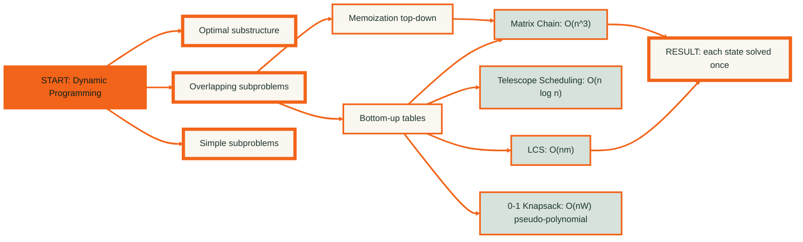
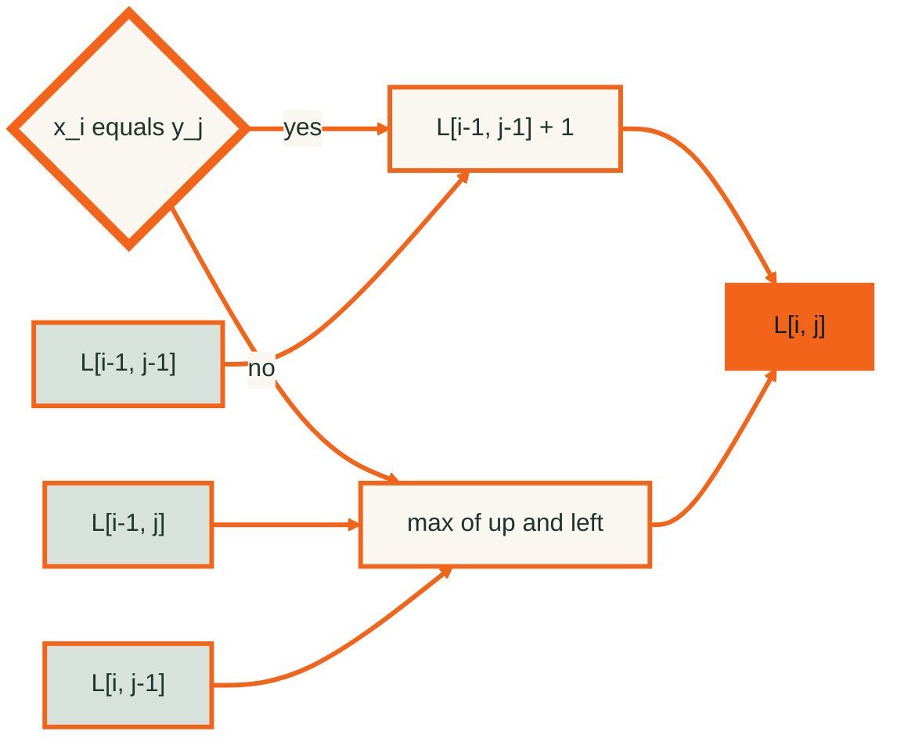

# 08 — Δυναμικός Προγραμματισμός
*Dynamic Programming: Matrix Chain, Telescope Scheduling, LCS and 0-1 Knapsack*

Ο δυναμικός προγραμματισμός (`Dynamic Programming`) επιλύει προβλήματα βελτιστοποίησης στα οποία η αναδρομική διάσπαση παράγει το ίδιο υποπρόβλημα πολλές φορές. Αντί να επαναλαμβάνει την επίλυση, αποθηκεύει τη λύση κάθε διακριτής κατάστασης και την ανακυκλώνει. Το κεφάλαιο εφαρμόζει την τεχνική σε τέσσερα προβλήματα: γινόμενο αλυσίδας πινάκων (`Matrix Chain Multiplication`), προγραμματισμό τηλεσκοπίων (`Telescope Scheduling`), μέγιστη κοινή υποακολουθία (`Longest Common Subsequence`, `LCS`) και πρόβλημα σακιδίου 0-1 (`0-1 Knapsack`). Στηρίζεται στην ασυμπτωτική ανάλυση της [01_analysis_of_algorithms.md](01_analysis_of_algorithms.md), στις αναδρομικές εξισώσεις της [07_divide_and_conquer.md](07_divide_and_conquer.md) και στην αποτυχία της άπληστης επιλογής που τεκμηριώνεται στην [06_greedy_method.md](06_greedy_method.md). Τροφοδοτεί την [13_np_completeness.md](13_np_completeness.md), όπου ο χρόνος $O(nW)$ του σακιδίου χρησιμοποιείται ως παράδειγμα ψευδο-πολυωνυμικής και όχι πολυωνυμικής πολυπλοκότητας, και μοιράζεται την ίδια τεχνική με τον αλγόριθμο `Floyd-Warshall` της [10_shortest_paths.md](10_shortest_paths.md).

> **Εξεταστική κάλυψη:** Μόνο Τελική
> **Κεφάλαιο βιβλίου:** `Κεφ. 12` | **Διαλέξεις:** `13_dynamic_programming_matrix_chain.pdf`, `14_telescope_scheduling.pdf`, `15_longest_common_subsequence.pdf`, `16_zero_one_knapsack.pdf`
> **Πηγή:** `Resources/Meta/mindmap.md` (Ενότητα 08)
> **Εκτός ύλης:** Ενότητα `12.4`

## Πίνακας Περιεχομένων

- [1. Εννοιολογικό Πλαίσιο και Συνολική Εικόνα](#1-εννοιολογικό-πλαίσιο-και-συνολική-εικόνα)
- [2. Θεωρητική Θεμελίωση και Τυπικοί Ορισμοί](#2-θεωρητική-θεμελίωση-και-τυπικοί-ορισμοί)
- [3. Αλγόριθμοι, Ιχνηλάτηση και Κώδικας](#3-αλγόριθμοι-ιχνηλάτηση-και-κώδικας)
- [4. Συγκριτική Ανάλυση και Πολυπλοκότητα](#4-συγκριτική-ανάλυση-και-πολυπλοκότητα)
- [5. Πλήρως Λυμένες Ασκήσεις Εξεταστικού Επιπέδου](#5-πλήρως-λυμένες-ασκήσεις-εξεταστικού-επιπέδου)
- [6. Οδηγός Επιβίωσης στις Εξετάσεις και Παγίδες](#6-οδηγός-επιβίωσης-στις-εξετάσεις-και-παγίδες)
- [7. Συνοπτικός Πίνακας Εννοιών](#7-συνοπτικός-πίνακας-εννοιών)

---

## 1. Εννοιολογικό Πλαίσιο και Συνολική Εικόνα

### Τέσσερα Προβλήματα με Κοινή Δομή

Ένας μεταγλωττιστής μετατρέπει την παράσταση `A0 * A1 * A2 * A3` σε κώδικα μηχανής. Ο πολλαπλασιασμός πινάκων είναι προσεταιριστικός, άρα η σειρά εκτέλεσης δεν αλλάζει το αποτέλεσμα· αλλάζει όμως δραστικά το πλήθος των στοιχειωδών πράξεων. Για πίνακες διαστάσεων $4 \times 10$, $10 \times 3$, $3 \times 12$ και $12 \times 20$, η παρένθεση `((A0 A1)(A2 A3))` απαιτεί $1080$ πολλαπλασιασμούς, ενώ η `(A0 (A1 (A2 A3)))` απαιτεί $2120$. Ο μεταγλωττιστής πρέπει να βρει την πρώτη χωρίς να δοκιμάσει όλες τις παρενθέσεις, των οποίων το πλήθος είναι καταλανικός αριθμός και αυξάνεται εκθετικά.

Ένα εργαστήριο βιοπληροφορικής συγκρίνει δύο αλληλουχίες DNA μήκους $m$ και $n$ και αναζητά το μεγαλύτερο κοινό μοτίβο που διατηρεί τη σειρά των βάσεων. Ένα τηλεσκόπιο δέχεται αιτήματα παρατήρησης με χρονικά διαστήματα και οφέλη, και πρέπει να επιλέξει μη επικαλυπτόμενα αιτήματα μέγιστου συνολικού οφέλους. Ένας διαχειριστής έργου έχει προϋπολογισμό $W$ και αδιαίρετα έργα με κόστος και όφελος, και πρέπει να μεγιστοποιήσει το όφελος χωρίς υπέρβαση. Και τα τέσσερα προβλήματα έχουν βέλτιστη υποδομή και επικαλυπτόμενα υποπροβλήματα· η ωμή αναδρομή είναι εκθετική, ενώ η αποθήκευση των λύσεων δίνει πολυωνυμικό χρόνο ως προς το πλήθος των καταστάσεων.

### Χάρτης Εννοιών του Κεφαλαίου



Πορτοκαλί γέμισμα: η αφετηρία (`START`) της τεχνικής. Παχύ περίγραμμα: οι τρεις ιδιότητες που πρέπει να ισχύουν και το τελικό αποτέλεσμα. Κρεμ: οι δύο τρόποι υλοποίησης. Απαλό πράσινο: τα τέσσερα προβλήματα του κεφαλαίου.

| Ομάδα | Κόμβοι | Ρόλος |
|---|---|---|
| Αφετηρία | Δυναμικός προγραμματισμός | Ενιαία τεχνική για επικαλυπτόμενα υποπροβλήματα |
| Ιδιότητες | Βέλτιστη υποδομή, επικάλυψη, απλά υποπροβλήματα | Εξασφαλίζουν ότι η αποθήκευση είναι ορθή και ωφέλιμη |
| Υλοποίηση | Απομνημόνευση, πίνακας από κάτω προς τα πάνω | Ίδια αναδρομή, διαφορετική σειρά υπολογισμού |
| Εφαρμογές | `Matrix Chain`, `Telescope Scheduling`, `LCS`, `0-1 Knapsack` | Δείχνουν το πρότυπο σε τέσσερις διαφορετικές δομές κατάστασης |

### Πότε Επιλέγεται Δυναμικός Προγραμματισμός

Η τεχνική επιλέγεται όταν ισχύουν τρεις συνθήκες ταυτόχρονα. Πρώτον, η βέλτιστη λύση του προβλήματος περιέχει βέλτιστες λύσεις υποπροβλημάτων, ώστε να αρκεί η βελτιστοποίηση κάθε υποπροβλήματος χωριστά. Δεύτερον, το ίδιο υποπρόβλημα εμφανίζεται σε πολλές διαδρομές της αναδρομής, ώστε η αποθήκευση να εξοικονομεί πραγματικό έργο. Τρίτον, το πλήθος των διακριτών καταστάσεων είναι διαχειρίσιμο ως προς τις παραμέτρους του προβλήματος· όταν μια παράμετρος είναι αριθμητική τιμή, όπως το $W$ του σακιδίου, ο χρόνος είναι ψευδο-πολυωνυμικός και όχι πολυωνυμικός ως προς τα bits της εισόδου.

Όταν τα υποπροβλήματα είναι **ανεξάρτητα**, δηλαδή κανένα δεν εμφανίζεται δύο φορές, η μέθοδος διαίρει και βασίλευε είναι απλούστερη και δεν απαιτεί πίνακα ([07_divide_and_conquer.md](07_divide_and_conquer.md)). Όταν μια τοπική επιλογή αποδεικνύεται ασφαλής με επιχείρημα ανταλλαγής, η άπληστη μέθοδος είναι ταχύτερη και απλούστερη ([06_greedy_method.md](06_greedy_method.md)). Ο δυναμικός προγραμματισμός είναι η σωστή επιλογή όταν η άπληστη επιλογή αποτυγχάνει **και** τα υποπροβλήματα επικαλύπτονται. Δεν είναι προσεγγιστική μέθοδος: επιστρέφει ακριβώς τη βέλτιστη λύση, εφόσον η αναδρομική εξίσωση καλύπτει εξαντλητικά όλες τις περιπτώσεις.

---

## 2. Θεωρητική Θεμελίωση και Τυπικοί Ορισμοί

### 2.1 Απλά Υποπροβλήματα, Βέλτιστη Υποδομή και Επικάλυψη

**Ορισμός (κατάσταση).** Μια **κατάσταση** (`state`) είναι μια πλειάδα δεικτών, για παράδειγμα $(i,j)$ ή $(k,w)$, που προσδιορίζει πλήρως ένα υποπρόβλημα. Η λύση του υποπροβλήματος εξαρτάται μόνο από τις τιμές αυτών των δεικτών και από τα δεδομένα εισόδου, όχι από τη διαδρομή που οδήγησε σε αυτό.

**Ορισμός (απλό υποπρόβλημα).** Ένα υποπρόβλημα είναι **απλό** (`simple subproblem`) όταν η κατάστασή του ορίζεται με σταθερό πλήθος δεικτών, ανεξάρτητο του $n$. Το γινόμενο αλυσίδας πινάκων έχει κατάσταση $(i,j)$ με δύο δείκτες· το σακίδιο έχει $(k,w)$· η `LCS` έχει $(i,j)$· ο προγραμματισμός τηλεσκοπίων έχει έναν δείκτη $i$. Αν η κατάσταση απαιτούσε, για παράδειγμα, ολόκληρο υποσύνολο αντικειμένων, το πλήθος των καταστάσεων θα ήταν εκθετικό και η τεχνική θα έχανε το πλεονέκτημά της.

**Ορισμός (βέλτιστη υποδομή).** Ένα πρόβλημα έχει **βέλτιστη υποδομή** (`optimal substructure`) όταν κάθε βέλτιστη λύση του περιέχει βέλτιστες λύσεις των υποπροβλημάτων από τα οποία αποτελείται. Η ιδιότητα επιτρέπει την αναδρομική εξίσωση: η βέλτιστη τιμή της κατάστασης εκφράζεται ως συνάρτηση βέλτιστων τιμών μικρότερων καταστάσεων.

**Θεώρημα 2.1 (επιχείρημα αντιγραφής και επικόλλησης).** Έστω πρόβλημα του οποίου κάθε λύση διασπάται σε ανεξάρτητα μέρη. Αν μια βέλτιστη λύση περιείχε μη βέλτιστη λύση για κάποιο μέρος, τότε η αντικατάσταση του μέρους με τη βέλτιστη λύση του θα παρήγαγε λύση του όλου με αυστηρά καλύτερη τιμή, το οποίο αντιφάσκει με τη βελτιστότητα της αρχικής λύσης. Επομένως κάθε βέλτιστη λύση περιέχει βέλτιστες λύσεις όλων των μερών της.

*Απόδειξη.* Έστω $S$ βέλτιστη λύση του όλου και έστω $S_i$ το μέρος της που αντιστοιχεί στο υποπρόβλημα $i$. Έστω ότι το $S_i$ δεν είναι βέλτιστο, δηλαδή υπάρχει λύση $S_i'$ του ίδιου υποπροβλήματος με καλύτερη τιμή. Επειδή τα μέρη είναι ανεξάρτητα, η αντικατάσταση του $S_i$ από το $S_i'$ διατηρεί τη συμβατότητα των υπολοίπων μερών και παράγει λύση $S'$ του όλου. Η τιμή του $S'$ είναι καλύτερη από την τιμή του $S$, άτοπο. Άρα το $S_i$ είναι βέλτιστο. $\square$

**Ορισμός (επικάλυψη υποπροβλημάτων).** Δύο υποπροβλήματα **επικαλύπτονται** (`overlapping subproblems`) όταν ανάγονται στην ίδια κατάσταση. Στο δέντρο αναδρομής η ίδια κατάσταση εμφανίζεται σε πολλούς κόμβους, άρα η απλή αναδρομή επαναλαμβάνει την ίδια εργασία. Το πλήθος των **διακριτών** καταστάσεων είναι το μέτρο του χώρου του πίνακα· το πλήθος των κόμβων του δέντρου είναι το μέτρο της εργασίας χωρίς αποθήκευση.

**Παράδειγμα (ακολουθία Fibonacci).** Η αναδρομή $F(n)=F(n-1)+F(n-2)$ με $F(0)=0$ και $F(1)=1$ έχει $n+1$ διακριτές καταστάσεις, αλλά το δέντρο κλήσεων έχει $\Theta(\varphi^{n})$ κόμβους, όπου $\varphi=(1+\sqrt{5})/2\approx1.618$. Η απομνημόνευση υποβιβάζει τον χρόνο σε $\Theta(n)$, διότι κάθε κατάσταση υπολογίζεται μία φορά. Το παράδειγμα δείχνει ότι η επικάλυψη δεν είναι λεπτομέρεια υλοποίησης· είναι η διαφορά ανάμεσα σε εκθετικό και γραμμικό χρόνο.

**Πρόταση 2.2 (χρόνος δυναμικού προγραμματισμού).** Αν το σύνολο των καταστάσεων έχει μέγεθος $S(n)$ και κάθε κατάσταση εξετάζει το πολύ $T(n)$ μεταβάσεις, τότε τόσο η απομνημόνευση όσο και η συμπλήρωση πίνακα από κάτω προς τα πάνω εκτελούν $O(S(n)\,T(n))$ εργασία, αγνοώντας το κόστος αναζήτησης στον πίνακα ή στη μνήμη cache.

*Σκιαγράφηση.* Κάθε κατάσταση υπολογίζεται μία φορά. Η απομνημόνευση το εγγυάται με έλεγχο παρουσίας στη μνήμη cache πριν από την αναδρομική κλήση· η bottom-up εκδοχή το εγγυάται με τη σειρά συμπλήρωσης, η οποία σέβεται τις εξαρτήσεις. Το άθροισμα του κόστους όλων των μεταβάσεων φράσσεται από $S(n)\,T(n)$. $\square$

**Οδηγός σχεδίασης.** Η κατασκευή μιας λύσης δυναμικού προγραμματισμού ακολουθεί έξι αποφάσεις:

1. **Κατάσταση:** ποιοι δείκτες προσδιορίζουν ένα υποπρόβλημα.
2. **Αναδρομική εξίσωση:** πώς εκφράζεται η βέλτιστη τιμή μέσω μικρότερων καταστάσεων.
3. **Βασικές περιπτώσεις:** ποιες καταστάσεις έχουν γνωστή τιμή χωρίς αναδρομή.
4. **Σειρά υπολογισμού:** ποια τοπολογική διάταξη των καταστάσεων σέβεται τις εξαρτήσεις.
5. **Κατάσταση απάντησης:** ποια κατάσταση περιέχει τη λύση του αρχικού προβλήματος.
6. **Πληροφορία ανάκτησης:** ποιος πίνακας αποθηκεύει την επιλογή που οδήγησε στη βέλτιστη τιμή.

Η παράλειψη οποιουδήποτε από τα έξι σημεία παράγει είτε λάθος τιμή είτε σωστή τιμή χωρίς δυνατότητα ανακατασκευής της λύσης.

### 2.2 Απομνημόνευση έναντι Συμπλήρωσης Πίνακα από Κάτω προς τα Πάνω

**Ορισμός (απομνημόνευση).** Η **απομνημόνευση** (`memoization`) διατηρεί την αναδρομική διατύπωση και αποθηκεύει το αποτέλεσμα κάθε κατάστασης σε μνήμη cache με κλειδί την κατάσταση. Πριν από κάθε αναδρομική κλήση ελέγχει αν η κατάσταση έχει ήδη υπολογιστεί· αν ναι, επιστρέφει την αποθηκευμένη τιμή, αλλιώς υπολογίζει και αποθηκεύει.

**Ορισμός (bottom-up).** Η **συμπλήρωση πίνακα από κάτω προς τα πάνω** (`bottom-up`) δημιουργεί έναν πίνακα με μία θέση ανά κατάσταση και τον γεμίζει επαναληπτικά, με σειρά που εξασφαλίζει ότι όλες οι καταστάσεις από τις οποίες εξαρτάται μια θέση έχουν ήδη υπολογιστεί.

| Κριτήριο | Απομνημόνευση | Bottom-up |
|---|---|---|
| Κατεύθυνση | Από το αρχικό πρόβλημα προς τις βασικές περιπτώσεις | Από τις βασικές περιπτώσεις προς το αρχικό πρόβλημα |
| Καταστάσεις που υπολογίζονται | Μόνο όσες είναι προσβάσιμες από την αφετηρία | Όλες οι καταστάσεις του πίνακα |
| Αναδρομή | Ναι· κίνδυνος υπέρβασης ορίου βάθους | Όχι· κατάλληλη για μεγάλα βάθη |
| Κόστος ανά κατάσταση | Σταθερό κόστος cache και κλήσης συν τη μετάβαση | Μόνο η μετάβαση και η εγγραφή στον πίνακα |
| Βελτιστοποίηση χώρου | Δύσκολη· η cache κρατά όλες τις καταστάσεις | Ευκολότερη· επιτρέπει δύο γραμμές ή έναν πίνακα |
| Ανάκτηση λύσης | Αποθήκευση επιλογών στην cache ή σε ξεχωριστό πίνακα | Αποθήκευση επιλογών σε πίνακα ή ανάστροφη διάσχιση |
| Τυπική χρήση | Αραιός χώρος καταστάσεων, ευκολία διατύπωσης | Πυκνός πίνακας, μέγιστη απόδοση, εξεταστική απάντηση |

**Ισοδυναμία.** Οι δύο μορφές υπολογίζουν την ίδια συνάρτηση και έχουν την ίδια ασυμπτωτική πολυπλοκότητα όταν και οι δύο επισκέπτονται όλες τις καταστάσεις. Η διαφορά είναι στους σταθερούς παράγοντες: η απομνημόνευση πληρώνει αναδρομικές κλήσεις και αναζήτηση σε λεξικό, ενώ η bottom-up πληρώνει εγγραφές σε πίνακα ακόμη και για καταστάσεις που δεν χρειάζεται το αρχικό πρόβλημα. Στην πράξη η bottom-up είναι ταχύτερη στους πυκνούς πίνακες των τεσσάρων προβλημάτων του κεφαλαίου· η απομνημόνευση είναι χρησιμότερη όταν ο χώρος καταστάσεων είναι αραιός ή όταν η αναδρομή είναι φυσική διατύπωση.

> **Προσοχή στη βιβλιοθήκη.** Η `functools.cache` της Python είναι η τυπική μορφή απομνημόνευσης. Απαιτεί ορίσματα κατακερματίσιμα (`hashable`), κρατά όλες τις καταστάσεις μέχρι να τερματιστεί η διεργασία και δεν προστατεύει από το προεπιλεγμένο όριο βάθους αναδρομής, περίπου $1000$ κλήσεις. Για αναδρομές βάθους $n$ σε πίνακα $n \times m$ η bottom-up εκδοχή είναι ασφαλέστερη. Η `functools.cache` δεν είναι αλγόριθμος· είναι μηχανισμός αποθήκευσης, και η ορθότητα εξαρτάται από τη σωστή αναδρομική εξίσωση.

### 2.3 Γινόμενο Αλυσίδας Πινάκων (`Matrix Chain Multiplication`)

**Διατύπωση.** Δίνεται αλυσίδα $A_0 A_1 \cdots A_{n-1}$, όπου ο πίνακας $A_i$ έχει διαστάσεις $d_i \times d_{i+1}$. Το διάνυσμα διαστάσεων έχει $n+1$ στοιχεία, $d_0,d_1,\dots,d_n$, και η συμβατότητα του γινομένου απαιτεί το δεξί μέλος κάθε $A_i$ να ισούται με το αριστερό μέλος του $A_{i+1}$. Ζητείται πλήρης παρενθετοποίηση που ελαχιστοποιεί το πλήθος των στοιχειωδών πολλαπλασιασμών βαθμωτών μεγεθών.

**Κόστος γινομένου.** Ο πολλαπλασιασμός πίνακα $p \times q$ με πίνακα $q \times r$ παράγει πίνακα $p \times r$ και απαιτεί $pqr$ στοιχειωδούς πολλαπλασιασμούς. Το κόστος εξαρτάται από τη σειρά· για $A_0$ διαστάσεων $4 \times 10$, $A_1$ διαστάσεων $10 \times 3$ και $A_2$ διαστάσεων $3 \times 12$, η παρένθεση $(A_0 A_1)A_2$ κοστίζει $4\cdot10\cdot3+4\cdot3\cdot12=120+144=264$, ενώ η $A_0(A_1 A_2)$ κοστίζει $10\cdot3\cdot12+4\cdot10\cdot12=360+480=840$.

**Πλήθος παρενθετοποιήσεων.** Έστω $P(n)$ το πλήθος των πλήρων παρενθετοποιήσεων $n$ πινάκων. Ισχύει $P(1)=1$ και
$$P(n)=\sum_{k=1}^{n-1}P(k)P(n-k).$$
Η λύση είναι ο καταλανικός αριθμός
$$P(n)=C_{n-1}=\frac{1}{n}\binom{2n-2}{n-1},$$
ο οποίος από τον τύπο του Stirling είναι $\Theta\!\left(\frac{4^{n}}{n^{3/2}}\right)$. Για $n=4$ υπάρχουν $C_3=5$ παρενθετοποιήσεις· για $n=10$ υπάρχουν $C_9=4862$· για $n=20$ υπάρχουν $C_{19}=1\,767\,263\,190$. Η εξαντλητική απαρίθμηση είναι επομένως εκθετική και δεν αποτελεί αλγόριθμο για ρεαλιστικές αλυσίδες.

**Αναδρομική εξίσωση.** Έστω $N_{i,j}$ το ελάχιστο κόστος για το γινόμενο $A_i A_{i+1}\cdots A_j$. Η τελευταία πράξη της βέλτιστης παρενθετοποίησης πολλαπλασιάζει ένα αποτέλεσμα διαστάσεων $d_i \times d_{k+1}$ με ένα αποτέλεσμα διαστάσεων $d_{k+1} \times d_{j+1}$, για κάποιο $k$ με $i \le k < j$. Άρα
$$N_{i,j}=\min_{i \le k < j}\left\{N_{i,k}+N_{k+1,j}+d_i\,d_{k+1}\,d_{j+1}\right\}, \qquad N_{i,i}=0.$$
Ο όρος $N_{i,k}$ είναι το κόστος του αριστερού τμήματος, ο όρος $N_{k+1,j}$ το κόστος του δεξιού και ο όρος $d_i d_{k+1} d_{j+1}$ το κόστος της τελικής σύνθεσης. Η βέλτιστη παρενθετοποίηση του $A_i\cdots A_j$ περιέχει βέλτιστες παρενθετοποιήσεις και των δύο τμημάτων· αν μία από αυτές δεν ήταν βέλτιστη, η αντικατάστασή της θα μείωνε το συνολικό κόστος, άτοπο από το Θεώρημα 2.1.

**Σειρά συμπλήρωσης.** Η τιμή $N_{i,j}$ εξαρτάται από διαστήματα μικρότερου μήκους, $N_{i,k}$ και $N_{k+1,j}$ με $k<j$. Επομένως ο πίνακας συμπληρώνεται κατά **διαγωνίους αύξοντος μήκους**: πρώτα τα διαστήματα μήκους $2$ ($N_{0,1},N_{1,2},\dots$), μετά μήκους $3$, και ούτω καθεξής. Η σειρά γραμμής προς γραμμή θα διάβαζε μη υπολογισμένες θέσεις και θα παρήγαγε λάθος τιμές ή εξάρτηση από τη σειρά αρχικοποίησης.

**Αποτυχία της άπληστης επιλογής.** Έστω $d=(2,7,5,3,4)$, δηλαδή $A_0$ είναι $2 \times 7$, $A_1$ είναι $7 \times 5$, $A_2$ είναι $5 \times 3$ και $A_3$ είναι $3 \times 4$. Η άπληστη στρατηγική που πολλαπλασιάζει πρώτα το γειτονικό ζεύγος με το μικρότερο άμεσο κόστος βλέπει κόστη $70$, $105$ και $60$, άρα επιλέγει πρώτα το $A_2A_3$ με κόστος $60$. Στη συνέχεια η αλυσίδα γίνεται $A_0,A_1,A_2'$ με διαστάσεις $2,7,5,4$· τα άμεσα κόστη είναι $70$ και $140$, άρα επιλέγει $A_0A_1$ με κόστος $70$. Η τελευταία πράξη κοστίζει $2\cdot5\cdot4=40$. Σύνολο $170$.

Η βέλτιστη λύση είναι η $((A_0A_1)A_2)A_3$ με κόστος $70+30+24=124$. Η άπληστη επιλογή του πρώτου βήματος δεν είναι ασφαλής: το φθηνότερο τοπικό γινόμενο παρήγαγε ενδιάμεσο πίνακα $5 \times 4$ που ανάγκασε ακριβότερη τελική σύνθεση. Δεν υπάρχει επιχείρημα ανταλλαγής που να δικαιολογεί τοπική επιλογή, διότι το κόστος κάθε απόφασης εξαρτάται από τις διαστάσεις που θα προκύψουν αργότερα.

| Στρατηγική | Πράξεις | Κόστος | Αποτέλεσμα |
|---|---|---|---|
| Άπληστη: πρώτα $A_2A_3$ | $60+70+40$ | $170$ | όχι βέλτιστη |
| Εναλλακτική: πρώτα $A_0A_1$ | $70+30+24$ | $124$ | συμπίπτει με τη βέλτιστη, αλλά δεν την εγγυάται ο κανόνας |
| Βέλτιστη: $((A_0A_1)A_2)A_3$ | $70+30+24$ | $124$ | βέλτιστη |

**Πολυπλοκότητα.** Υπάρχουν $\binom{n}{2}+n=\frac{n(n+1)}{2}$ διαστήματα $[i,j]$. Ένα διάστημα μήκους $L=j-i+1$ εξετάζει $L-1$ διαχωρισμούς $k$. Το συνολικό πλήθος μεταβάσεων είναι
$$\sum_{L=2}^{n}(n-L+1)(L-1)=\frac{n^{3}-n}{6}=\Theta(n^{3}),$$
το οποίο αποδεικνύεται αναλυτικά στην Άσκηση 2. Ο χώρος είναι $\Theta(n^{2})$ για τον πίνακα $N$ και τον πίνακα διαχωρισμών $K$. Η ανάκτηση της παρενθετοποίησης γίνεται αναδρομικά από το $K$: ο διαχωρισμός $K_{0,n-1}$ χωρίζει το πρόβλημα σε $[0,K]$ και $[K+1,n-1]$, και η διαδικασία επαναλαμβάνεται μέχρι τα μονοστοιχειακά διαστήματα.

### 2.4 Προγραμματισμός Τηλεσκοπίων (`Telescope Scheduling`)

**Διατύπωση.** Δίνονται $n$ αιτήματα παρατήρησης, καθένα με χρόνο έναρξης $s_i$, χρόνο τερματισμού $f_i$ και όφελος $b_i>0$. Δύο αιτήματα είναι **συμβατά** (`compatible`) όταν τα διαστήματά τους δεν επικαλύπτονται· με τη σύμβαση ημιτελών διαστημάτων $[s_i,f_i)$, η συνθήκη είναι $f_i \le s_j$ ή $f_j \le s_i$. Ζητείται υποσύνολο ανά ζεύγη συμβατών αιτημάτων μέγιστου συνολικού οφέλους.

**Κανονικοποίηση.** Τα αιτήματα ταξινομούνται κατά μη φθίνοντα χρόνο τερματισμού $f_1 \le f_2 \le \cdots \le f_n$. Σε ισοπαλία χρόνου τερματισμού η σειρά είναι αύξουσα ως προς χρόνο έναρξης και, αν και αυτός ισούται, αύξουσα ως προς όφελος· έτσι η σειρά είναι ντετερμινιστική και η ιχνηλάτηση επαναλήψιμη.

**Προκάτοχος.** Ορίζεται
$$P[i]=\max\{j<i : f_j \le s_i\},$$
δηλαδή το μεγαλύτερο ευρετήριο προηγούμενου αιτήματος που τελειώνει το αργότερο τη στιγμή έναρξης του $i$. Αν δεν υπάρχει τέτοιο αίτημα, $P[i]=0$. Επειδή οι χρόνοι τερματισμού είναι ταξινομημένοι, ο $P[i]$ βρίσκεται με δυαδική αναζήτηση στον πίνακα $f_1,\dots,f_{i-1}$ σε $O(\log n)$ ανά αίτημα, άρα όλοι οι προκάτοχοι σε $O(n \log n)$.

**Αναδρομική εξίσωση.** Έστω $B[i]$ το μέγιστο όφελος από τα πρώτα $i$ αιτήματα. Τότε
$$B[0]=0, \qquad B[i]=\max\{B[i-1],\; B[P[i]]+b_i\}.$$
Η πρώτη επιλογή σημαίνει ότι το αίτημα $i$ δεν επιλέγεται· η δεύτερη ότι επιλέγεται, οπότε κάθε άλλο επιλεγμένο αίτημα μέσα στα πρώτα $i$ πρέπει να είναι συμβατό με το $i$ και ανήκει στα πρώτα $P[i]$.

**Ορθότητα.** Κάθε βέλτιστη λύση των πρώτων $i$ αιτημάτων είτε περιέχει το $i$ είτε όχι· οι δύο περιπτώσεις είναι εξαντλητικές και αμοιβαία αποκλειόμενες. Αν δεν το περιέχει, το όφελος είναι το πολύ $B[i-1]$. Αν το περιέχει, τα υπόλοιπα αιτήματα από τα πρώτα $i$ ανήκουν στα πρώτα $P[i]$, άρα το όφελος είναι το πολύ $b_i+B[P[i]]$· η ισότητα επιτυγχάνεται με τη βέλτιστη λύση των πρώτων $P[i]$ μαζί με το $i$, η οποία είναι συμβατή λόγω του ορισμού του $P[i]$. Άρα η μέγιστη από τις δύο ποσότητες είναι η βέλτιστη τιμή. Η βέλτιστη υποδομή εξασφαλίζει ότι αρκεί η βέλτιστη λύση των πρώτων $P[i]$ και όχι κάποια μη βέλτιστη.

**Αποτυχία της άπληστης επιλογής κατά όφελος.** Έστω τρία αιτήματα: $r_1=(0,10,100)$, $r_2=(0,5,60)$ και $r_3=(6,10,60)$. Το $r_1$ επικαλύπτεται και με τα δύο άλλα, ενώ τα $r_2$ και $r_3$ είναι συμβατά μεταξύ τους. Η άπληστη επιλογή του μεγαλύτερου οφέλους παίρνει το $r_1$ με όφελος $100$ και απορρίπτει τα άλλα δύο, ενώ η βέλτιστη λύση είναι $\{r_2,r_3\}$ με όφελος $120$. Η άπληστη επιλογή είναι τοπικά βέλτιστη αλλά όχι καθολικά.

> **Διάκριση από τον χρονοπρογραμματισμό εργασιών.** Στο `Task Scheduling` της [06_greedy_method.md](06_greedy_method.md) ζητείται ελαχιστοποίηση του πλήθους μηχανών και η ταξινόμηση γίνεται κατά **ώρα έναρξης**· εκεί η άπληστη επιλογή είναι ορθή. Εδώ ζητείται μεγιστοποίηση οφέλους και η ταξινόμηση γίνεται κατά **ώρα τερματισμού**, με δυναμικό προγραμματισμό. Η αντιμετάθεση των δύο κριτηρίων παράγει λάθος αλγόριθμο.

**Πολυπλοκότητα.** Η ταξινόμηση κοστίζει $O(n \log n)$, οι προκάτοχοι $O(n \log n)$, η συμπλήρωση του $B$ μία σταθερή εργασία ανά αίτημα, δηλαδή $O(n)$, και η ανάκτηση της λύσης $O(n)$. Συνολικά $O(n \log n)$ στη χειρότερη περίπτωση και χώρος $O(n)$.

### 2.5 Μέγιστη Κοινή Υποακολουθία (`Longest Common Subsequence`)

**Διατύπωση.** Δίνονται δύο συμβολοσειρές $X=x_0x_1\cdots x_{m-1}$ και $Y=y_0y_1\cdots y_{n-1}$ πάνω σε ένα αλφάβητο, για παράδειγμα $\{A,C,G,T\}$ για DNA. Μια **υποακολουθία** (`subsequence`) του $X$ προκύπτει διαγράφοντας μηδέν ή περισσότερους χαρακτήρες χωρίς να αλλάξει η σχετική σειρά των υπολοίπων. Μια **υποσυμβολοσειρά** (`substring`) είναι συνεχές τμήμα· κάθε υποσυμβολοσειρά είναι υποακολουθία, αλλά το αντίστροφο δεν ισχύει. Ζητείται κοινή υποακολουθία μέγιστου μήκους.

**Παράδειγμα διάκρισης.** Για $X=\text{AGCATC}$ και $Y=\text{GACTA}$, η ακολουθία $\text{ACA}$ είναι κοινή υποακολουθία: επιλέγονται οι θέσεις $0,2,3$ του $X$ και $1,2,4$ του $Y$. Δεν είναι κοινή υποσυμβολοσειρά, διότι δεν εμφανίζεται συνεχόμενη σε καμία από τις δύο. Η διάκριση είναι κρίσιμη: ο αλγόριθμος υποσυμβολοσειράς είναι διαφορετικός και δεν λύνει το πρόβλημα της `LCS`.

**Ωμή δύναμη.** Το $X$ έχει $2^{m}$ υποακολουθίες, μία για κάθε υποσύνολο θέσεων. Ο έλεγχος αν μια υποακολουθία είναι και υποακολουθία του $Y$ κοστίζει $O(n)$ με έναν δείκτη· η ωμή μέθοδος κοστίζει $O(n\,2^{m})$, εκθετικά.

**Αναδρομική εξίσωση.** Έστω $L[i,j]$ το μήκος της `LCS` των προθεμάτων μήκους $i$ και $j$, δηλαδή των $X[0..i-1]$ και $Y[0..j-1]$, με $L[0,j]=L[i,0]=0$ για κάθε $i,j$. Τότε
$$
L[i,j]=
\begin{cases}
L[i-1,j-1]+1, & X[i-1]=Y[j-1],\\[4pt]
\max\{L[i-1,j],\,L[i,j-1]\}, & X[i-1]\ne Y[j-1].
\end{cases}
$$
Η πρώτη περίπτωση επεκτείνει μια `LCS` των δύο προηγούμενων προθεμάτων με τον κοινό χαρακτήρα. Η δεύτερη περιγράφει ότι, όταν οι τελευταίοι χαρακτήρες διαφέρουν, καμία κοινή υποακολουθία δεν μπορεί να χρησιμοποιήσει **και** τους δύο ως ταιριασμένο ζεύγος· άρα παραλείπεται τουλάχιστον ένας από τους δύο τελευταίους χαρακτήρες. Η αρίθμηση εδώ είναι μήκη προθεμάτων· η μορφή $X[0..i]$ με δείκτη χαρακτήρα είναι ισοδύναμη με μετατόπιση κατά ένα.

**Ορθότητα της αναδρομής.** Η απόδειξη γίνεται με διάκριση ως προς τους δύο τελευταίους χαρακτήρες $X[i-1]$ και $Y[j-1]$ και με το λήμμα ότι η προσθήκη ενός χαρακτήρα σε ένα πρόθεμα αυξάνει την `LCS` το πολύ κατά ένα. Αν οι χαρακτήρες ισούνται, υπάρχει βέλτιστη κοινή υποακολουθία που τους χρησιμοποιεί ως τελευταίο ζεύγος· αφαιρώντας τους, το πρόβλημα ανάγεται στα προθέματα μήκους $i-1$ και $j-1$, και η βέλτιστη υποδομή δίνει $L[i-1,j-1]+1$. Αν διαφέρουν, καμία κοινή υποακολουθία δεν μπορεί να χρησιμοποιήσει και τους δύο ως ταιριασμένο ζεύγος· άρα παραλείπει τον έναν από τους δύο και ανήκει σε ένα από τα δύο μικρότερα προβλήματα, οπότε το μέγιστο των δύο τιμών είναι η απάντηση. Η πλήρης απόδειξη με όλες τις περιπτώσεις βρίσκεται στην Άσκηση 3. $\square$

**Πολυπλοκότητα.** Ο πίνακας έχει $(m+1)(n+1)$ θέσεις και κάθε θέση εκτελεί σταθερό αριθμό πράξεων, άρα χρόνος $\Theta(mn)$ στη χειρότερη περίπτωση. Ο χώρος είναι $\Theta(mn)$. Για το μήκος μόνο αρκούν δύο γραμμές, δηλαδή $\Theta(\min(m,n))$ χώρος· η ανάκτηση της ίδιας της υποακολουθίας απαιτεί ολόκληρο τον πίνακα ή τεχνική διαίρει και βασίλευε.

**Ανάκτηση.** Ξεκινάμε από τη θέση $(m,n)$. Στη θέση $(i,j)$, αν οι χαρακτήρες $X[i-1]$ και $Y[j-1]$ ισούνται, ο χαρακτήρας ανήκει στη λύση και μεταβαίνουμε στο $(i-1,j-1)$. Αλλιώς μεταβαίνουμε στη γειτονική θέση με τη μεγαλύτερη τιμή· σε ισοπαλία ανεβαίνουμε στο $(i-1,j)$, ώστε η επιλογή να είναι ντετερμινιστική. Η διαδρομή μήκους $O(m+n)$ παράγει την υποακολουθία ανάστροφα.

### 2.6 Πρόβλημα Σακιδίου 0-1 (`0-1 Knapsack`)

**Διατύπωση.** Δίνονται $n$ αντικείμενα, καθένα με ακέραιο βάρος $w_i>0$ και όφελος $b_i>0$, και σακίδιο χωρητικότητας $W$. Κάθε αντικείμενο είτε επιλέγεται ολόκληρο είτε δεν επιλέγεται· δεν επιτρέπεται κλάσμα. Ζητείται υποσύνολο $T$ με $\sum_{i\in T}w_i\le W$ που μεγιστοποιεί το $\sum_{i\in T}b_i$.

**Αναδρομική εξίσωση.** Έστω $B[k,w]$ το μέγιστο όφελος χρησιμοποιώντας τα πρώτα $k$ αντικείμενα με διαθέσιμη χωρητικότητα $w$. Ισχύει $B[0,w]=0$ για κάθε $w$ και $B[k,0]=0$ για κάθε $k$. Για $k\ge1$:
$$
B[k,w]=
\begin{cases}
B[k-1,w], & w_k>w,\\[4pt]
\max\{B[k-1,w],\;B[k-1,w-w_k]+b_k\}, & w_k\le w.
\end{cases}
$$
Αν το αντικείμενο $k$ δεν χωρά, αποκλείεται υποχρεωτικά. Αν χωρά, η βέλτιστη λύση είτε το αποκλείει και ταυτίζεται με τη βέλτιστη λύση των πρώτων $k-1$ αντικειμένων, είτε το περιλαμβάνει και συνδυάζει το όφελός του με τη βέλτιστη λύση των πρώτων $k-1$ αντικειμένων σε χωρητικότητα $w-w_k$. Οι δύο περιπτώσεις είναι εξαντλητικές, άρα το μέγιστο είναι η βέλτιστη τιμή· η βέλτιστη υποδομή εξασφαλίζει ότι το υπόλοιπο είναι βέλτιστο και όχι απλώς εφικτό.

**Αποτυχία της άπληστης επιλογής κατά πυκνότητα.** Έστω αντικείμενα $(w,b)=(10,60),(20,100),(30,120)$ και $W=50$. Οι πυκνότητες είναι $6$, $5$ και $4$ ανά μονάδα βάρους. Η άπληστη μέθοδος επιλέγει πρώτα το αντικείμενο $1$ (βάρος $10$, όφελος $60$), μετά το αντικείμενο $2$ (βάρος $20$, όφελος $100$) και δεν χωρά πλέον το αντικείμενο $3$ (βάρος $30$), αφού το συνολικό βάρος θα γινόταν $60>50$. Το όφελος είναι $160$. Η βέλτιστη λύση είναι τα αντικείμενα $2$ και $3$ με βάρος $50$ και όφελος $220$. Η ακέραια φύση της επιλογής καταστρέφει το επιχείρημα ανταλλαγής που ισχύει στο κλασματικό πρόβλημα.

**Ψευδο-πολυωνυμικός χρόνος.** Ο πίνακας έχει $(n+1)(W+1)$ θέσεις και κάθε θέση κοστίζει $O(1)$, άρα χρόνος $\Theta(nW)$ και χώρος $\Theta(nW)$. Η ποσότητα $W$ είναι **τιμή**, όχι μέγεθος εισόδου: η δυαδική αναπαράσταση του $W$ χρειάζεται $\lceil\log_2(W+1)\rceil$ bits. Αν $W=2^{m}$, ο πίνακας έχει $W+1=2^{m}+1$ στήλες, ενώ η είσοδος περιγράφει το $W$ με $m+1$ bits· ο χρόνος είναι εκθετικός ως προς το μήκος της εισόδου. Γι' αυτό ο $O(nW)$ χαρακτηρίζεται **ψευδο-πολυωνυμικός** (`pseudo-polynomial`) και δεν αποτελεί αντίφαση με την `NP`-πληρότητα του προβλήματος απόφασης ([13_np_completeness.md](13_np_completeness.md)).

**Βελτιστοποίηση χώρου.** Για την τιμή μόνο αρκούν δύο πίνακες μήκους $W+1$: ο `previous` κρατά τη γραμμή $k-1$ και ο `current` χτίζει τη γραμμή $k$· μετά την ολοκλήρωση της γραμμής, ο `previous` αντικαθίσταται. Ο χώρος γίνεται $\Theta(W)$. Η ανάκτηση των επιλεγμένων αντικειμένων απαιτεί είτε ολόκληρο τον πίνακα $\Theta(nW)$ είτε αποθήκευση αποφάσεων. Μια παραλλαγή με έναν μόνο πίνακα είναι δυνατή μόνο με διάσχιση της χωρητικότητας **φθίνουσα**, ώστε κάθε θέση να διαβάζει την προηγούμενη γραμμή και όχι την τρέχουσα.

**Ανάκτηση.** Ξεκινάμε από το $(n,W)$ και κινούμαστε προς τα πάνω. Αν $B[k,w]\ne B[k-1,w]$, το αντικείμενο $k$ ανήκει στη λύση, διότι η συμπερίληψή του βελτίωσε την τιμή· τότε μειώνεται το $w$ κατά $w_k$. Αν $B[k,w]=B[k-1,w]$, το αντικείμενο δεν ανήκει στη λύση και μεταβαίνουμε στο $k-1$. Σε ισοπαλία επιλέγεται ο αποκλεισμός, ώστε η λύση να είναι ντετερμινιστική.

> Εκτός ύλης: Ενότητα `12.4`. Δεν αναπτύσσεται και δεν εξετάζεται.

---

## 3. Αλγόριθμοι, Ιχνηλάτηση και Κώδικας

### 3.1 Γινόμενο Αλυσίδας Πινάκων (`Matrix Chain`)

**Σκοπός.** Εύρεση της παρενθετοποίησης της αλυσίδας $A_0A_1\cdots A_{n-1}$ που ελαχιστοποιεί το πλήθος των βαθμωτών πολλαπλασιασμών.

```text
Algorithm matrixChain(d):
Input: Διαστάσεις d[0..n], όπου A_i είναι d[i] x d[i+1]
Output: Πίνακας N[0..n-1, 0..n-1] και πίνακας διαχωρισμών K

for i <- 0 to n-1 do
    N[i, i] <- 0
for length <- 2 to n do
    for i <- 0 to n - length do
        j <- i + length - 1
        N[i, j] <- +infinity
        for k <- i to j - 1 do
            q <- N[i, k] + N[k+1, j] + d[i] * d[k+1] * d[j+1]
            if q < N[i, j] then
                N[i, j] <- q
                K[i, j] <- k
return N[0, n-1], K
```

**Ιχνηλάτηση σε 4 πίνακες.** Έστω $d=(4,10,3,12,20)$, δηλαδή $A_0$ είναι $4 \times 10$, $A_1$ είναι $10 \times 3$, $A_2$ είναι $3 \times 12$ και $A_3$ είναι $12 \times 20$.

*Διαγώνιος μήκους 2:*

| Διάστημα $(i,j)$ | $k$ | Υπολογισμός | $N_{i,j}$ | $K_{i,j}$ |
|---|---|---|---|---|
| $(0,1)$ | $0$ | $0+0+4\cdot10\cdot3$ | $120$ | $0$ |
| $(1,2)$ | $1$ | $0+0+10\cdot3\cdot12$ | $360$ | $1$ |
| $(2,3)$ | $2$ | $0+0+3\cdot12\cdot20$ | $720$ | $2$ |

*Διαγώνιος μήκους 3:*

| Διάστημα $(i,j)$ | $k$ | Αριστερό + δεξί + σύνθεση | Τιμή | Ελάχιστο |
|---|---|---|---|---|
| $(0,2)$ | $0$ | $N_{0,0}+N_{1,2}+4\cdot10\cdot12=0+360+480$ | $840$ | |
| $(0,2)$ | $1$ | $N_{0,1}+N_{2,2}+4\cdot3\cdot12=120+0+144$ | $264$ | $264$, $K=1$ |
| $(1,3)$ | $1$ | $N_{1,1}+N_{2,3}+10\cdot3\cdot20=0+720+600$ | $1320$ | |
| $(1,3)$ | $2$ | $N_{1,2}+N_{3,3}+10\cdot12\cdot20=360+0+2400$ | $2760$ | $1320$, $K=1$ |

*Διαγώνιος μήκους 4:*

| Διάστημα $(i,j)$ | $k$ | Αριστερό + δεξί + σύνθεση | Τιμή | Ελάχιστο |
|---|---|---|---|---|
| $(0,3)$ | $0$ | $N_{0,0}+N_{1,3}+4\cdot10\cdot20=0+1320+800$ | $2120$ | |
| $(0,3)$ | $1$ | $N_{0,1}+N_{2,3}+4\cdot3\cdot20=120+720+240$ | $1080$ | $1080$, $K=1$ |
| $(0,3)$ | $2$ | $N_{0,2}+N_{3,3}+4\cdot12\cdot20=264+0+960$ | $1224$ | |

**Πίνακας κόστους $N$:**

| $i \backslash j$ | $0$ | $1$ | $2$ | $3$ |
|---|---|---|---|---|
| $0$ | $0$ | $120$ | $264$ | $1080$ |
| $1$ | — | $0$ | $360$ | $1320$ |
| $2$ | — | — | $0$ | $720$ |
| $3$ | — | — | — | $0$ |

**Πίνακας διαχωρισμών $K$:**

| $i \backslash j$ | $0$ | $1$ | $2$ | $3$ |
|---|---|---|---|---|
| $0$ | — | $0$ | $1$ | $1$ |
| $1$ | — | — | $1$ | $1$ |
| $2$ | — | — | — | $2$ |
| $3$ | — | — | — | — |

**Ανάκτηση παρενθετοποίησης.** Από $K_{0,3}=1$ προκύπτει ο διαχωρισμός $(A_0A_1)(A_2A_3)$. Από $K_{0,1}=0$ προκύπτει $A_0A_1$ και από $K_{2,3}=2$ προκύπτει $A_2A_3$. Η τελική μορφή είναι
$$\bigl((A_0A_1)(A_2A_3)\bigr).$$
**Κανόνας ισοπαλίας.** Αν δύο διαχωρισμοί έχουν την ίδια ελάχιστη τιμή, επιλέγεται ο μικρότερος δείκτης $k$. Η υλοποίηση το πετυχαίνει επειδή το `min` συγκρίνει λεξικογραφικά τις πλειάδες $(\text{τιμή},k)$· η σύμβαση καθιστά την παραγόμενη παρενθετοποίηση ντετερμινιστική.
**Έλεγχος κόστους.** $A_0A_1$ είναι $4 \times 3$ με κόστος $4\cdot10\cdot3=120$· $A_2A_3$ είναι $3 \times 20$ με κόστος $3\cdot12\cdot20=720$· η τελική σύνθεση $4 \times 3$ με $3 \times 20$ είναι $4 \times 20$ με κόστος $4\cdot3\cdot20=240$. Σύνολο $120+720+240=1080$, όσο ο $N_{0,3}$.

**Ρητή υλοποίηση, από πάνω προς τα κάτω:**

```python
from functools import cache


def matrixChainMemo(dims: list[int]) -> int:
    """Returns the minimum scalar multiplications for a matrix chain.

    Args:
        dims (list[int]): Dimensions d[0..n], where matrix A_i is d[i] by d[i+1].

    Returns:
        int: The minimum number of scalar multiplications for A_0 ... A_{n-1}.
    """
    n = len(dims) - 1

    @cache
    def cost(i: int, j: int) -> int:
        """Returns the minimum cost of the subchain A_i ... A_j.

        Args:
            i (int): The first matrix index of the subchain.
            j (int): The last matrix index of the subchain.

        Returns:
            int: The minimum scalar multiplication count for the subchain.
        """
        if i == j:
            return 0
        return min(
            cost(i, k) + cost(k + 1, j) + dims[i] * dims[k + 1] * dims[j + 1]
            for k in range(i, j)
        )

    return cost(0, n - 1)


assert matrixChainMemo([4, 10, 3, 12, 20]) == 1080
assert matrixChainMemo([2, 3, 5, 7, 11]) == 254
```

**Ρητή υλοποίηση, από κάτω προς τα πάνω, με ανάκτηση:**

```python
def matrixChainBottomUp(
    dims: list[int],
) -> tuple[int, list[list[int]], list[list[int]]]:
    """Fills the matrix-chain cost and split tables by diagonals.

    Args:
        dims (list[int]): Dimensions d[0..n], where matrix A_i is d[i] by d[i+1].

    Returns:
        tuple[int, list[list[int]], list[list[int]]]: The optimal cost, the
            cost table N, and the split table K.
    """
    n = len(dims) - 1
    cost_table = [[0] * n for _ in range(n)]
    split_table = [[0] * n for _ in range(n)]
    for length in range(2, n + 1):
        for i in range(0, n - length + 1):
            j = i + length - 1
            # Every split k is tried; shorter intervals are already computed.
            candidates = [
                (
                    cost_table[i][k]
                    + cost_table[k + 1][j]
                    + dims[i] * dims[k + 1] * dims[j + 1],
                    k,
                )
                for k in range(i, j)
            ]
            best_cost, best_split = min(candidates)
            cost_table[i][j] = best_cost
            split_table[i][j] = best_split
    return cost_table[0][n - 1], cost_table, split_table


def parenthesize(split_table: list[list[int]], i: int, j: int) -> str:
    """Recovers an optimal parenthesization from the split table.

    Args:
        split_table (list[list[int]]): The stored split index for every interval.
        i (int): The first matrix index of the interval.
        j (int): The last matrix index of the interval.

    Returns:
        str: The fully parenthesized product of the interval.
    """
    if i == j:
        return f"A{i}"
    k = split_table[i][j]
    return (
        f"({parenthesize(split_table, i, k)} "
        f"{parenthesize(split_table, k + 1, j)})"
    )


best_cost, cost_table, split_table = matrixChainBottomUp([4, 10, 3, 12, 20])
assert best_cost == 1080
assert parenthesize(split_table, 0, 3) == "((A0 A1) (A2 A3))"
```

**Έλεγχος με ωμή δύναμη.** Η αναδρομική απαρίθμηση όλων των διαχωρισμών επιβεβαιώνει την τιμή· το πλήθος των κλήσεων είναι καταλανικό και γι' αυτό η μέθοδος χρησιμοποιείται μόνο σε μικρά $n$.

```python
def bruteForceMatrixChain(dims: list[int], i: int, j: int) -> int:
    """Returns the optimal cost by trying every parenthesization.

    Args:
        dims (list[int]): Dimensions d[0..n].
        i (int): The first matrix index of the interval.
        j (int): The last matrix index of the interval.

    Returns:
        int: The minimum scalar multiplication count for the interval.
    """
    if i == j:
        return 0
    return min(
        bruteForceMatrixChain(dims, i, k)
        + bruteForceMatrixChain(dims, k + 1, j)
        + dims[i] * dims[k + 1] * dims[j + 1]
        for k in range(i, j)
    )


assert bruteForceMatrixChain([4, 10, 3, 12, 20], 0, 3) == 1080
```

**Ιδιωματισμός.** Δεν υπάρχει συνάρτηση της τυπικής βιβλιοθήκης που να επιλύει το γινόμενο αλυσίδας πινάκων· ούτε το `min` ούτε το `functools.cache` αντικαθιστούν την αναδρομική εξίσωση. Η `functools.cache` είναι μόνο ο μηχανισμός απομνημόνευσης και η σύγκριση των δύο μορφών δίνεται στον επόμενο πίνακα.

| Μορφή | Χρόνος (χειρότερη) | Χώρος | Τι κρύβει |
|---|---|---|---|
| `matrixChainMemo` | $\Theta(n^{3})$ | $\Theta(n^{2})$ cache + $O(n)$ στοίβα | Αναδρομή και έλεγχο cache· ίδιες μεταβάσεις |
| `matrixChainBottomUp` | $\Theta(n^{3})$ | $\Theta(n^{2})$ δύο πίνακες | Τίποτα· η μορφή της εξέτασης |
| `bruteForceMatrixChain` | $\Theta\!\left(4^{n}/n^{3/2}\right)$ | $O(n)$ στοίβα | Καμία αποθήκευση· εκθετική απαρίθμηση |

**Ανάλυση γραμμή προς γραμμή.** Η αρχικοποίηση της διαγωνίου κοστίζει $O(n)$. Οι δύο εξωτερικοί βρόχοι παράγουν $\frac{n(n-1)}{2}$ διαστήματα μήκους τουλάχιστον $2$. Ένα διάστημα μήκους $L$ εκτελεί $L-1$ επαναλήψεις του εσωτερικού βρόχου, καθεμία με σταθερό αριθμό πράξεων. Το άθροισμα είναι $\sum_{L=2}^{n}(n-L+1)(L-1)=\frac{n^{3}-n}{6}=\Theta(n^{3})$. Η bottom-up εκδοχή εκτελεί ακριβώς αυτές τις μεταβάσεις· η top-down εκτελεί τις ίδιες, με πρόσθετο σταθερό κόστος cache ανά κατάσταση, άρα επίσης $\Theta(n^{3})$. Η `parenthesize` επισκέπτεται τα $2n-1$ τμήματα του δέντρου παρενθετοποίησης, δηλαδή $O(n)$ χρόνο, και δεν αλλάζει την ασυμπτωτική τάξη. Ο χώρος κυριαρχείται από τους δύο πίνακες $n \times n$.

### 3.2 Προγραμματισμός Τηλεσκοπίων (`Telescope Scheduling`)

**Σκοπός.** Επιλογή ανά ζεύγη συμβατών αιτημάτων παρατήρησης μέγιστου συνολικού οφέλους, με ταξινόμηση κατά χρόνο τερματισμού.

```text
Algorithm telescopeSchedule(requests):
Input: n αιτήματα (s_i, f_i, b_i)
Output: Πίνακας B[0..n] και επιλεγμένα αιτήματα

sort requests by f_i increasingly
for i <- 1 to n do
    P[i] <- largest j < i with f_j <= s_i, or 0
B[0] <- 0
for i <- 1 to n do
    B[i] <- max(B[i-1], B[P[i]] + b_i)
return B[n]
```

**Ιχνηλάτηση σε 6 αιτήματα.** Τα αιτήματα είναι ήδη ταξινομημένα κατά χρόνο τερματισμού:

| $i$ | $(s_i,f_i,b_i)$ | $P[i]$ | $B[i-1]$ | $B[P[i]]+b_i$ | $B[i]$ | Τοπική απόφαση |
|---|---|---|---|---|---|---|
| $1$ | $(1,3,5)$ | $0$ | $0$ | $0+5=5$ | $5$ | επιλογή |
| $2$ | $(2,5,6)$ | $0$ | $5$ | $0+6=6$ | $6$ | επιλογή |
| $3$ | $(4,6,4)$ | $1$ | $6$ | $5+4=9$ | $9$ | επιλογή |
| $4$ | $(6,9,8)$ | $3$ | $9$ | $9+8=17$ | $17$ | επιλογή |
| $5$ | $(7,10,3)$ | $3$ | $17$ | $9+3=12$ | $17$ | αποκλεισμός |
| $6$ | $(9,12,7)$ | $4$ | $17$ | $17+7=24$ | $24$ | επιλογή |

**Υπολογισμός προκατόχων.** $P[3]=1$ διότι $f_1=3\le s_3=4$ και $f_2=5>4$. $P[4]=3$ διότι $f_3=6\le s_4=6$. $P[5]=3$ διότι $f_3=6\le s_5=7$ και $f_4=9>7$. $P[6]=4$ διότι $f_4=9\le s_6=9$ και $f_5=10>9$.

**Ανάκτηση επιλογής.** Από $B[6]=24>B[5]=17$ επιλέγεται το αίτημα $6$ και μεταβαίνουμε στο $P[6]=4$. Από $B[4]=17>B[3]=9$ επιλέγεται το $4$ και μεταβαίνουμε στο $P[4]=3$. Από $B[3]=9>B[2]=6$ επιλέγεται το $3$ και μεταβαίνουμε στο $P[3]=1$. Από $B[1]=5>B[0]=0$ επιλέγεται το $1$. Η λύση είναι $\{1,3,4,6\}$ με όφελος $5+4+8+7=24$ και διαστήματα $[1,3)$, $[4,6)$, $[6,9)$, $[9,12)$.

**Ρητή υλοποίηση, από πάνω προς τα κάτω:**

```python
from functools import cache


def computePredecessors(requests: list[tuple[int, int, int]]) -> list[int]:
    """Returns 1-based predecessors for requests sorted by finish time.

    Args:
        requests (list[tuple[int, int, int]]): Tuples (start, finish, benefit)
            sorted by non-decreasing finish time.

    Returns:
        list[int]: predecessors[i] is the largest j < i with
            finish[j - 1] <= start[i - 1], or 0 when no such request exists.
    """
    finishes = [request[1] for request in requests]
    predecessors = [0] * (len(requests) + 1)
    for index in range(1, len(requests) + 1):
        low_index, high_index = 0, index - 2
        position = -1
        while low_index <= high_index:
            mid_index = (low_index + high_index) // 2
            if finishes[mid_index] <= requests[index - 1][0]:
                position = mid_index
                low_index = mid_index + 1
            else:
                high_index = mid_index - 1
        predecessors[index] = position + 1
    return predecessors


def telescopeMemo(requests: list[tuple[int, int, int]]) -> int:
    """Returns the maximum total benefit of compatible requests.

    Args:
        requests (list[tuple[int, int, int]]): Tuples (start, finish, benefit)
            in arbitrary order.

    Returns:
        int: The maximum total benefit of a pairwise compatible subset.
    """
    ordered = sorted(
        requests,
        key=lambda request: (request[1], request[0], request[2]),
    )
    predecessors = computePredecessors(ordered)

    @cache
    def best(index: int) -> int:
        """Returns the best benefit using the first index requests.

        Args:
            index (int): The number of requests considered, from 0 to n.

        Returns:
            int: The maximum benefit for that prefix of ordered requests.
        """
        if index == 0:
            return 0
        previous = predecessors[index]
        return max(best(index - 1), best(previous) + ordered[index - 1][2])

    return best(len(ordered))


requests = [(1, 3, 5), (2, 5, 6), (4, 6, 4), (6, 9, 8), (7, 10, 3), (9, 12, 7)]
assert telescopeMemo(requests) == 24
```

**Ρητή υλοποίηση, από κάτω προς τα πάνω, με ανάκτηση:**

```python
def telescopeBottomUp(
    requests: list[tuple[int, int, int]],
) -> tuple[int, list[int], list[int]]:
    """Fills the telescope-scheduling table from left to right.

    Args:
        requests (list[tuple[int, int, int]]): Tuples (start, finish, benefit)
            in arbitrary order.

    Returns:
        tuple[int, list[int], list[int]]: The optimal benefit, the table B with
            B[0] = 0, and the 1-based predecessor table.
    """
    ordered = sorted(
        requests,
        key=lambda request: (request[1], request[0], request[2]),
    )
    predecessors = computePredecessors(ordered)
    best = [0] * (len(ordered) + 1)
    for index in range(1, len(ordered) + 1):
        previous = predecessors[index]
        best[index] = max(best[index - 1], best[previous] + ordered[index - 1][2])
    return best[-1], best, predecessors


def telescopeSelection(predecessors: list[int], best: list[int]) -> list[int]:
    """Recovers selected request indices from the dynamic-programming table.

    Args:
        predecessors (list[int]): The 1-based predecessor table.
        best (list[int]): The optimal benefit for every prefix length.

    Returns:
        list[int]: The selected 1-based request indices in increasing order.
    """
    selected: list[int] = []
    index = len(best) - 1
    while index > 0:
        if best[index] == best[index - 1]:
            index -= 1
        else:
            selected.append(index)
            index = predecessors[index]
    return list(reversed(selected))


requests = [(1, 3, 5), (2, 5, 6), (4, 6, 4), (6, 9, 8), (7, 10, 3), (9, 12, 7)]
benefit, best_table, predecessors = telescopeBottomUp(requests)
assert benefit == 24
assert best_table == [0, 5, 6, 9, 17, 17, 24]
assert predecessors == [0, 0, 0, 1, 3, 3, 4]
assert telescopeSelection(predecessors, best_table) == [1, 3, 4, 6]
```

**Ιδιωματισμός.** Δεν υπάρχει συνάρτηση της τυπικής βιβλιοθήκης για προγραμματισμό διαστημάτων με βάρη· η δυαδική αναζήτηση των προκατόχων θα μπορούσε να γραφεί με `bisect.bisect_right`, αλλά το δυναμικό πρόγραμμα παραμένει ο αλγόριθμος και η βιβλιοθήκη καλύπτει μόνο ένα βοηθητικό βήμα.

| Μορφή | Χρόνος (χειρότερη) | Χώρος | Τι κρύβει |
|---|---|---|---|
| `telescopeMemo` | $O(n\log n)$ | $O(n)$ cache + $O(n)$ στοίβα | Αναδρομή και έλεγχο cache |
| `telescopeBottomUp` | $O(n\log n)$ | $O(n)$ δύο πίνακες | Τίποτα· η μορφή της εξέτασης |
| Τετριμμένη απαρίθμηση | $O(2^{n})$ | $O(n)$ | Καμία δομή· ελέγχει όλα τα υποσύνολα |

**Ανάλυση γραμμή προς γραμμή.** Η ταξινόμηση κοστίζει $O(n\log n)$ στη χειρότερη περίπτωση. Ο υπολογισμός των προκατόχων εκτελεί $n$ δυαδικές αναζητήσεις των $O(\log n)$ βημάτων, άρα $O(n\log n)$. Η συμπλήρωση του $B$ έχει $n$ θέσεις και σταθερή εργασία ανά θέση, άρα $O(n)$. Η `telescopeSelection` διασχίζει κάθε αίτημα μία φορά και μειώνει αυστηρά τον δείκτη, άρα $O(n)$. Συνολικά $O(n\log n)$ χρόνος και $O(n)$ χώρος. Η top-down μορφή έχει τα ίδια ασυμπτωτικά όρια, με πρόσθετο κόστος αναδρομικών κλήσεων και βάθος στοίβας $O(n)$.

### 3.3 Μέγιστη Κοινή Υποακολουθία (`LCS`)

**Σκοπός.** Υπολογισμός του μήκους και μιας μέγιστης κοινής υποακολουθίας δύο συμβολοσειρών με πίνακα δυναμικού προγραμματισμού.

```text
Algorithm lcsLength(X, Y):
Input: X[0..m-1], Y[0..n-1]
Output: Πίνακας L[0..m, 0..n] και πίνακας κατεύθυνσης D

for i <- 0 to m do
    L[i, 0] <- 0
for j <- 0 to n do
    L[0, j] <- 0
for i <- 1 to m do
    for j <- 1 to n do
        if X[i-1] = Y[j-1] then
            L[i, j] <- L[i-1, j-1] + 1
            D[i, j] <- "diag"
        else if L[i-1, j] >= L[i, j-1] then
            L[i, j] <- L[i-1, j]
            D[i, j] <- "up"
        else
            L[i, j] <- L[i, j-1]
            D[i, j] <- "left"
return L[m, n], D
```

**Ιχνηλάτηση σε $X=\text{AGCATC}$ και $Y=\text{GACTA}$.** Οι γραμμές αντιστοιχούν στα προθέματα του $X$ και οι στήλες στα προθέματα του $Y$. Η γραμμή $0$ και η στήλη $0$ είναι μηδενικές. Η γραμμή $i$ αντιστοιχεί στο πρόθεμα μήκους $i$, άρα στον χαρακτήρα $X[i-1]$.

| $i$ | $X[i-1]$ | $j=0$ | $1$: G | $2$: A | $3$: C | $4$: T | $5$: A |
|---|---|---|---|---|---|---|---|
| $0$ | — | $0$ | $0$ | $0$ | $0$ | $0$ | $0$ |
| $1$ | A | $0$ | $0$ | $1$ | $1$ | $1$ | $1$ |
| $2$ | G | $0$ | $1$ | $1$ | $1$ | $1$ | $1$ |
| $3$ | C | $0$ | $1$ | $1$ | $2$ | $2$ | $2$ |
| $4$ | A | $0$ | $1$ | $2$ | $2$ | $2$ | $3$ |
| $5$ | T | $0$ | $1$ | $2$ | $2$ | $3$ | $3$ |
| $6$ | C | $0$ | $1$ | $2$ | $3$ | $3$ | $3$ |

**Ενδεικτικά κελιά.** Στο $(1,2)$ ισχύει $X[0]=\text{A}=Y[1]$, άρα $L[1,2]=L[0,1]+1=1$. Στο $(3,3)$ ισχύει $X[2]=\text{C}=Y[2]$, άρα $L[3,3]=L[2,2]+1=2$. Στο $(4,5)$ ισχύει $X[3]=\text{A}=Y[4]$, άρα $L[4,5]=L[3,4]+1=3$. Στο $(6,5)$ οι χαρακτήρες $X[5]=\text{C}$ και $Y[4]=\text{A}$ διαφέρουν, άρα $L[6,5]=\max\{L[5,5],L[6,4]\}=\max\{3,3\}=3$.

**Ανάκτηση με οπισθοδρόμηση.** Η διαδρομή ξεκινά από το $(6,5)$ και καταλήγει στο $(0,1)$.

| Βήμα | Θέση $(i,j)$ | $X[i-1]$ | $Y[j-1]$ | Σύγκριση | Ενέργεια | Επιλεγμένο γράμμα |
|---|---|---|---|---|---|---|
| $1$ | $(6,5)$ | C | A | διαφέρουν, $L[5,5]=3=L[6,5]$ | πάνω σε $(5,5)$ | — |
| $2$ | $(5,5)$ | T | A | διαφέρουν, $L[4,5]=3=L[5,5]$ | πάνω σε $(4,5)$ | — |
| $3$ | $(4,5)$ | A | A | ίσα | διαγώνια σε $(3,4)$ | A |
| $4$ | $(3,4)$ | C | T | διαφέρουν, $L[2,4]=1<L[3,3]=2$ | αριστερά σε $(3,3)$ | — |
| $5$ | $(3,3)$ | C | C | ίσα | διαγώνια σε $(2,2)$ | C |
| $6$ | $(2,2)$ | G | A | διαφέρουν, $L[1,2]=1=L[2,1]$ | πάνω σε $(1,2)$ | — |
| $7$ | $(1,2)$ | A | A | ίσα | διαγώνια σε $(0,1)$ | A |

Η ανάστροφη σειρά των επιλεγμένων γραμμάτων είναι $\text{A},\text{C},\text{A}$, άρα η `LCS` είναι $\text{ACA}$ μήκους $3$.

**Εξάρτηση ενός κελιού.** Κάθε κελί διαβάζει τους τρεις γείτονες που βρίσκονται πάνω, αριστερά και διαγώνια· η ισότητα των χαρακτήρων καθορίζει ποιος συνδυασμός χρησιμοποιείται.



Πορτοκαλί γέμισμα: το κελί που συμπληρώνεται. Παχύ περίγραμμα: η απόφαση ισότητας. Απαλό πράσινο: οι τρεις γείτονες από τις προηγούμενες γραμμές και στήλες. Κρεμ: οι δύο υπολογισμοί που οδηγούν στο κελί. Η σειρά γραμμής προς γραμμή εξασφαλίζει ότι και οι τρεις γείτονες έχουν ήδη υπολογιστεί.

**Ρητή υλοποίηση, από πάνω προς τα κάτω:**

```python
from functools import cache


def lcsMemo(x: str, y: str) -> int:
    """Returns the length of a longest common subsequence.

    Args:
        x (str): The first string.
        y (str): The second string.

    Returns:
        int: The length of a longest common subsequence of x and y.
    """

    @cache
    def length(i: int, j: int) -> int:
        """Returns the LCS length of the prefixes x[0..i] and y[0..j].

        Args:
            i (int): The last index of the prefix of x, or -1 for empty.
            j (int): The last index of the prefix of y, or -1 for empty.

        Returns:
            int: The LCS length of the two prefixes.
        """
        if i < 0 or j < 0:
            return 0
        if x[i] == y[j]:
            return length(i - 1, j - 1) + 1
        return max(length(i - 1, j), length(i, j - 1))

    return length(len(x) - 1, len(y) - 1)


assert lcsMemo("AGCATC", "GACTA") == 3
```

**Ρητή υλοποίηση, από κάτω προς τα πάνω, με ανάκτηση:**

```python
def lcsBottomUp(x: str, y: str) -> tuple[int, str]:
    """Fills the LCS table and reconstructs one optimal subsequence.

    Args:
        x (str): The first string.
        y (str): The second string.

    Returns:
        tuple[int, str]: The LCS length and one longest common subsequence.
    """
    m, n = len(x), len(y)
    table = [[0] * (n + 1) for _ in range(m + 1)]
    for i in range(1, m + 1):
        for j in range(1, n + 1):
            if x[i - 1] == y[j - 1]:
                table[i][j] = table[i - 1][j - 1] + 1
            else:
                table[i][j] = max(table[i - 1][j], table[i][j - 1])
    letters: list[str] = []
    i, j = m, n
    while i > 0 and j > 0:
        if x[i - 1] == y[j - 1]:
            letters.append(x[i - 1])
            i -= 1
            j -= 1
        elif table[i - 1][j] >= table[i][j - 1]:
            i -= 1
        else:
            j -= 1
    return table[m][n], "".join(reversed(letters))


assert lcsBottomUp("AGCATC", "GACTA") == (3, "ACA")
```

**Έλεγχος με ωμή δύναμη.** Η απαρίθμηση όλων των υποακολουθιών της μικρότερης συμβολοσειράς επιβεβαιώνει το μήκος.

```python
from itertools import combinations


def bruteForceLcs(x: str, y: str) -> int:
    """Returns the LCS length by enumerating subsequences of the shorter string.

    Args:
        x (str): The first string.
        y (str): The second string.

    Returns:
        int: The LCS length, checked by exhaustive enumeration.
    """
    shorter, longer = (x, y) if len(x) <= len(y) else (y, x)
    best = 0
    for size in range(len(shorter) + 1):
        for indices in combinations(range(len(shorter)), size):
            candidate = "".join(shorter[index] for index in indices)
            iterator = iter(longer)
            # all() consumes the iterator in order, which tests subsequence membership.
            if all(character in iterator for character in candidate):
                best = max(best, size)
    return best


assert bruteForceLcs("AGCATC", "GACTA") == 3
```

**Ιδιωματισμός.** Δεν υπάρχει συνάρτηση της τυπικής βιβλιοθήκης που να υπολογίζει `LCS`. Η `difflib.SequenceMatcher` εντοπίζει κοινά συνεχή τμήματα και δεν είναι ο αλγόριθμος της μέγιστης κοινής υποακολουθίας· δεν πρέπει να χρησιμοποιηθεί ως αντικατάσταση.

| Μορφή | Χρόνος (χειρότερη) | Χώρος | Τι κρύβει |
|---|---|---|---|
| `lcsMemo` | $\Theta(mn)$ | $\Theta(mn)$ cache + $O(m+n)$ στοίβα | Αναδρομή και cache· όλες οι καταστάσεις είναι προσβάσιμες |
| `lcsBottomUp` | $\Theta(mn)$ | $\Theta(mn)$ πίνακας | Τίποτα· η μορφή της εξέτασης |
| `bruteForceLcs` | $O(n\,2^{m})$ | $O(m)$ | Καμία αποθήκευση· εκθετική απαρίθμηση |

**Ανάλυση γραμμή προς γραμμή.** Η αρχικοποίηση της πρώτης γραμμής και στήλης κοστίζει $O(m+n)$. Οι δύο βρόχοι εκτελούν $mn$ επαναλήψεις, καθεμία με σταθερό αριθμό συγκρίσεων και αναθέσεων, άρα $\Theta(mn)$ χρόνος. Η οπισθοδρόμηση μειώνει είτε το $i$ είτε το $j$ σε κάθε βήμα, άρα εκτελεί το πολύ $m+n$ βήματα, δηλαδή $O(m+n)$, το οποίο δεν κυριαρχεί. Ο πίνακας έχει $(m+1)(n+1)$ ακέραιους, άρα $\Theta(mn)$ χώρος. Η top-down εκδοχή επισκέπτεται τις ίδιες $mn$ καταστάσεις, με πρόσθετο κόστος cache και βάθος αναδρομής έως $m+n$.

### 3.4 Πρόβλημα Σακιδίου 0-1 (`0-1 Knapsack`)

**Σκοπός.** Επιλογή αδιαίρετων αντικειμένων μέγιστου συνολικού οφέλους με συνολικό βάρος το πολύ $W$.

```text
Algorithm knapsack01(items, W):
Input: n αντικείμενα (w_i, b_i), χωρητικότητα W
Output: Πίνακας B[0..n, 0..W] και επιλεγμένα αντικείμενα

for w <- 0 to W do
    B[0, w] <- 0
for k <- 1 to n do
    for w <- 0 to W do
        B[k, w] <- B[k-1, w]
        if w_k <= w then
            B[k, w] <- max(B[k, w], B[k-1, w-w_k] + b_k)
return B[n, W]
```

**Ιχνηλάτηση σε 4 αντικείμενα και $W=8$.** Τα αντικείμενα είναι $(w_1,b_1)=(2,3)$, $(w_2,b_2)=(3,5)$, $(w_3,b_3)=(4,6)$ και $(w_4,b_4)=(5,9)$.

| $k$ | Αντικείμενο | $w=0$ | $1$ | $2$ | $3$ | $4$ | $5$ | $6$ | $7$ | $8$ |
|---|---|---|---|---|---|---|---|---|---|---|
| $0$ | κανένα | $0$ | $0$ | $0$ | $0$ | $0$ | $0$ | $0$ | $0$ | $0$ |
| $1$ | $(2,3)$ | $0$ | $0$ | $3$ | $3$ | $3$ | $3$ | $3$ | $3$ | $3$ |
| $2$ | $(3,5)$ | $0$ | $0$ | $3$ | $5$ | $5$ | $8$ | $8$ | $8$ | $8$ |
| $3$ | $(4,6)$ | $0$ | $0$ | $3$ | $5$ | $6$ | $8$ | $9$ | $11$ | $11$ |
| $4$ | $(5,9)$ | $0$ | $0$ | $3$ | $5$ | $6$ | $9$ | $9$ | $12$ | $14$ |

**Ενδεικτικά κελιά.** Στο $B[2,5]$ το αντικείμενο $2$ χωρά· $B[2,5]=\max\{B[1,5],B[1,2]+5\}=\max\{3,3+5\}=8$. Στο $B[3,7]$: $\max\{B[2,7],B[2,3]+6\}=\max\{8,5+6\}=11$. Στο $B[4,8]$: $\max\{B[3,8],B[3,3]+9\}=\max\{11,5+9\}=14$.

**Ανάκτηση επιλογής.** Από $B[4,8]=14\ne B[3,8]=11$ επιλέγεται το αντικείμενο $4$ και το υπόλοιπο βάρος γίνεται $8-5=3$. Στο $B[3,3]=5=B[2,3]$, άρα το αντικείμενο $3$ δεν επιλέγεται. Στο $B[2,3]=5\ne B[1,3]=3$ επιλέγεται το αντικείμενο $2$ και το υπόλοιπο βάρος γίνεται $0$. Στο $B[1,0]=0=B[0,0]$, άρα το αντικείμενο $1$ δεν επιλέγεται. Η βέλτιστη λύση είναι $\{2,4\}$ με βάρος $3+5=8$ και όφελος $5+9=14$.

**Ρητή υλοποίηση, από πάνω προς τα κάτω:**

```python
from functools import cache


def knapsackMemo(items: list[tuple[int, int]], capacity: int) -> int:
    """Returns the best benefit of a 0-1 knapsack.

    Args:
        items (list[tuple[int, int]]): Tuples (weight, benefit) for each item.
        capacity (int): The maximum total weight.

    Returns:
        int: The maximum total benefit with total weight at most capacity.
    """

    @cache
    def best(k: int, remaining: int) -> int:
        """Returns the best benefit using the first k items and remaining capacity.

        Args:
            k (int): The number of items considered, from 0 to n.
            remaining (int): The remaining capacity, from 0 to capacity.

        Returns:
            int: The maximum benefit for that state.
        """
        if k == 0 or remaining == 0:
            return 0
        weight, benefit = items[k - 1]
        if weight > remaining:
            return best(k - 1, remaining)
        return max(
            best(k - 1, remaining),
            best(k - 1, remaining - weight) + benefit,
        )

    return best(len(items), capacity)


items = [(2, 3), (3, 5), (4, 6), (5, 9)]
assert knapsackMemo(items, 8) == 14
```

**Ρητή υλοποίηση, από κάτω προς τα πάνω, με ανάκτηση:**

```python
def knapsackBottomUp(
    items: list[tuple[int, int]], capacity: int
) -> tuple[int, list[int], list[list[int]]]:
    """Fills the 0-1 knapsack table and recovers the selected items.

    Args:
        items (list[tuple[int, int]]): Tuples (weight, benefit) for each item.
        capacity (int): The maximum total weight.

    Returns:
        tuple[int, list[int], list[list[int]]]: The optimal benefit, the
            selected 1-based item indices in increasing order, and the table B.
    """
    n = len(items)
    table = [[0] * (capacity + 1) for _ in range(n + 1)]
    for k in range(1, n + 1):
        weight, benefit = items[k - 1]
        for w in range(capacity + 1):
            table[k][w] = table[k - 1][w]
            if weight <= w:
                table[k][w] = max(
                    table[k][w],
                    table[k - 1][w - weight] + benefit,
                )
    selected: list[int] = []
    w = capacity
    for k in range(n, 0, -1):
        if table[k][w] != table[k - 1][w]:
            selected.append(k)
            w -= items[k - 1][0]
    return table[n][capacity], list(reversed(selected)), table


items = [(2, 3), (3, 5), (4, 6), (5, 9)]
value, selected, knapsack_table = knapsackBottomUp(items, 8)
assert value == 14
assert selected == [2, 4]
assert knapsack_table[4][8] == 14
```

**Βελτιστοποίηση χώρου με δύο γραμμές:**

```python
def knapsackTwoRows(items: list[tuple[int, int]], capacity: int) -> int:
    """Returns the optimal benefit using only two rows of length W + 1.

    Args:
        items (list[tuple[int, int]]): Tuples (weight, benefit) for each item.
        capacity (int): The maximum total weight.

    Returns:
        int: The maximum total benefit with total weight at most capacity.
    """
    previous = [0] * (capacity + 1)
    for weight, benefit in items:
        current = previous[:]
        for w in range(weight, capacity + 1):
            current[w] = max(previous[w], previous[w - weight] + benefit)
        previous = current
    return previous[capacity]


items = [(2, 3), (3, 5), (4, 6), (5, 9)]
assert knapsackTwoRows(items, 8) == 14
```

**Έλεγχος με ωμή δύναμη.** Η απαρίθμηση όλων των υποσυνόλων επιβεβαιώνει την τιμή· το πλήθος των υποσυνόλων είναι $2^{n}$.

```python
from itertools import combinations


def bruteForceKnapsack(items: list[tuple[int, int]], capacity: int) -> int:
    """Returns the optimal 0-1 knapsack benefit by enumerating subsets.

    Args:
        items (list[tuple[int, int]]): Tuples (weight, benefit) for each item.
        capacity (int): The maximum total weight.

    Returns:
        int: The maximum total benefit over all feasible subsets.
    """
    best = 0
    for size in range(len(items) + 1):
        for indices in combinations(range(len(items)), size):
            weight = sum(items[index][0] for index in indices)
            if weight <= capacity:
                best = max(best, sum(items[index][1] for index in indices))
    return best


items = [(2, 3), (3, 5), (4, 6), (5, 9)]
assert bruteForceKnapsack(items, 8) == 14
```

**Ιδιωματισμός.** Δεν υπάρχει συνάρτηση της τυπικής βιβλιοθήκης για το πρόβλημα σακιδίου· ούτε το `max` ούτε το `itertools.combinations` αποτελούν πολυωνυμικό αλγόριθμο. Η `functools.cache` είναι μόνο μηχανισμός απομνημόνευσης.

| Μορφή | Χρόνος (χειρότερη) | Χώρος | Τι κρύβει |
|---|---|---|---|
| `knapsackMemo` | $\Theta(nW)$ | $\Theta(nW)$ cache + $O(n)$ στοίβα | Αναδρομή και cache |
| `knapsackBottomUp` | $\Theta(nW)$ | $\Theta(nW)$ πίνακας | Τίποτα· επιτρέπει ανάκτηση |
| `knapsackTwoRows` | $\Theta(nW)$ | $\Theta(W)$ | Μόνο την τιμή· δεν ανακτά τη λύση |
| `bruteForceKnapsack` | $\Theta(2^{n})$ | $O(n)$ | Καμία αποθήκευση |

**Ανάλυση γραμμή προς γραμμή.** Η αρχικοποίηση της γραμμής $0$ κοστίζει $O(W)$. Οι δύο βρόχοι εκτελούν $n(W+1)$ επαναλήψεις, καθεμία με σταθερό αριθμό συγκρίσεων και αναθέσεων, άρα $\Theta(nW)$ χρόνος. Η ανάκτηση διασχίζει μία φορά τα $n$ αντικείμενα, άρα $O(n)$, και δεν κυριαρχεί. Ο πλήρης πίνακας έχει $(n+1)(W+1)$ θέσεις, άρα $\Theta(nW)$ χώρος· η εκδοχή δύο γραμμών κρατά δύο πίνακες μήκους $W+1$, άρα $\Theta(W)$. Ο χρόνος $\Theta(nW)$ είναι ψευδο-πολυωνυμικός, όπως εξηγήθηκε στην Ενότητα 2.6.

---

## 4. Συγκριτική Ανάλυση και Πολυπλοκότητα

### 4.1 Σύγκριση των Τεσσάρων Προβλημάτων

| Πρόβλημα | Κατάσταση | Αναδρομική εξίσωση | Πλήθος καταστάσεων | Κόστος μετάβασης | Χρόνος (χειρότερη) | Χώρος | Ανάκτηση |
|---|---|---|---|---|---|---|---|
| `Matrix Chain` | $(i,j)$ | $N_{i,j}=\min_k\{N_{i,k}+N_{k+1,j}+d_id_{k+1}d_{j+1}\}$ | $\frac{n(n+1)}{2}$ | $O(j-i)$ | $\Theta(n^{3})$ | $\Theta(n^{2})$ | Πίνακας $K$ |
| `Telescope Scheduling` | $i$ | $B[i]=\max\{B[i-1],B[P[i]]+b_i\}$ | $n+1$ | $O(1)$ | $O(n\log n)$ με ταξινόμηση | $O(n)$ | Πίνακας $B$ και $P$ |
| `LCS` | $(i,j)$ | δύο περιπτώσεις ισότητας | $(m+1)(n+1)$ | $O(1)$ | $\Theta(mn)$ | $\Theta(mn)$ | Οπισθοδρόμηση |
| `0-1 Knapsack` | $(k,w)$ | $\max$ αποκλεισμού και συμπερίληψης | $(n+1)(W+1)$ | $O(1)$ | $\Theta(nW)$ ψευδο-πολυωνυμικός | $\Theta(nW)$ ή $\Theta(W)$ | Πίνακας $B$ ή αποφάσεις |

**Κοινό μοτίβο.** Και τα τέσσερα προβλήματα ορίζουν μια κατάσταση με ένα ή δύο ευρετήρια, εκφράζουν τη βέλτιστη τιμή ως μέγιστο ή ελάχιστο πάνω σε έναν μικρό αριθμό προηγούμενων καταστάσεων και συμπληρώνουν τον πίνακα με τοπολογική σειρά. Η διαφορά βρίσκεται στο μέγεθος του χώρου καταστάσεων: γραμμικό στον προγραμματισμό τηλεσκοπίων, τετραγωνικό στο γινόμενο αλυσίδας και στην `LCS`, γινόμενο $nW$ στο σακίδιο. Η τελευταία περίπτωση είναι η μόνη όπου το μέγεθος του πίνακα δεν είναι πολυωνυμικό ως προς το μήκος της δυαδικής εισόδου.

### 4.2 Κριτήρια Επιλογής Υλοποίησης

| Περίσταση | Προτιμώμενη μορφή | Αιτιολόγηση |
|---|---|---|
| Πυκνός πίνακας, όλες οι καταστάσεις προσβάσιμες | Bottom-up | Λιγότερη επιβάρυνση, δυνατή βελτιστοποίηση χώρου |
| Αραιός χώρος καταστάσεων | Απομνημόνευση | Υπολογίζονται μόνο οι καταστάσεις που χρειάζεται η απάντηση |
| Βάθος αναδρομής κοντά στο όριο της Python | Bottom-up | Αποφεύγεται `RecursionError` |
| Απαιτείται ανάκτηση λύσης | Bottom-up με πίνακα αποφάσεων | Η cache της απομνημόνευσης δεν αρκεί από μόνη της |
| Περιορισμένη μνήμη, μόνο η τιμή | Bottom-up με κυλιόμενες γραμμές | Ο χώρος μειώνεται από $\Theta(nW)$ σε $\Theta(W)$ |
| Διατύπωση και απόδειξη σε εξεταστικό χαρτί | Οποιαδήποτε, με ρητή αναδρομή | Η εξέταση βαθμολογεί την αναδρομή και την ορθότητα |

### 4.3 Άπληστη Μέθοδος, Διαίρει και Βασίλευε, Δυναμικός Προγραμματισμός

| Σήμα του προβλήματος | Τεχνική | Παράδειγμα | Αιτιολόγηση |
|---|---|---|---|
| Τοπική επιλογή με απόδειξη ανταλλαγής | Άπληστη μέθοδος | `Fractional Knapsack`, `Task Scheduling`, `Huffman` | Η τοπική επιλογή ανήκει σε κάποια βέλτιστη λύση |
| Ανεξάρτητα υποπροβλήματα, καμία επικάλυψη | Διαίρει και βασίλευε | `Merge-Sort`, `Karatsuba`, `MaximaSet` | Κάθε υποπρόβλημα λύνεται μία φορά, χωρίς πίνακα |
| Η άπληστη επιλογή αποτυγχάνει και τα υποπροβλήματα επικαλύπτονται | Δυναμικός προγραμματισμός | `0-1 Knapsack`, `Matrix Chain`, `LCS`, `Telescope Scheduling` | Η αποθήκευση μετατρέπει την εκθετική αναδρομή σε πολυωνυμική |
| Επιλογή διαστημάτων με βάρη | Δυναμικός προγραμματισμός κατά χρόνο τερματισμού | `Telescope Scheduling` | Η επιλογή κατά όφελος δεν είναι ασφαλής |
| Ευθυγράμμιση ακολουθιών | Δυναμικός προγραμματισμός σε πίνακα $(i,j)$ | `LCS` | Η ωμή δύναμη είναι εκθετική ως προς το μήκος |
| Παρενθετοποίηση αλυσίδας | Δυναμικός προγραμματισμός σε διαστήματα | `Matrix Chain` | Η βέλτιστη διάσπαση εξαρτάται από όλα τα $k$ |

**Μνημονικό.** «Άπληστη όταν η τοπική επιλογή αντέχει σε ανταλλαγή· διαίρει και βασίλευε όταν τα μέρη είναι ανεξάρτητα· δυναμικός προγραμματισμός όταν τα μέρη επαναλαμβάνονται.» Η φράση συνοψίζει την επιλογή στρατηγικής σε μία γραμμή.

### 4.4 Χώρος, Χρόνος και Αριθμητική Επίδραση

| Μέγεθος | `Matrix Chain` μεταβάσεις $\frac{n^{3}-n}{6}$ | `LCS` κελιά $n^{2}$ | `0-1 Knapsack` κελιά $nW$ με $W=n$ |
|---|---|---|---|
| $n=10$ | $165$ | $100$ | $100$ |
| $n=50$ | $20\,825$ | $2\,500$ | $2\,500$ |
| $n=100$ | $166\,650$ | $10\,000$ | $10\,000$ |
| $n=500$ | $20\,833\,250$ | $250\,000$ | $250\,000$ |

Η αύξηση του $n$ κατά παράγοντα $5$ πολλαπλασιάζει τις μεταβάσεις του γινομένου αλυσίδας κατά $125$ και τα κελιά της `LCS` κατά $25$. Η διαφορά αντανακλά τους εκθέτες $3$ και $2$. Στο σακίδιο ο χρόνος εξαρτάται από δύο ανεξάρτητες παραμέτρους· η αύξηση του $W$ χωρίς αύξηση του $n$ αυξάνει γραμμικά τον χρόνο, αλλά η δυαδική αναπαράσταση του $W$ μεγαλώνει μόνο λογαριθμικά, και εκεί οφείλεται ο ψευδο-πολυωνυμικός χαρακτηρισμός.

| Ανάγκες | `Matrix Chain` | `Telescope` | `LCS` | `0-1 Knapsack` |
|---|---|---|---|---|
| Ελάχιστος χρόνος | $\Theta(n^{3})$ | $O(n\log n)$ | $\Theta(mn)$ | $\Theta(nW)$ |
| Ελάχιστος χώρος | $\Theta(n^{2})$ | $O(n)$ | $\Theta(\min(m,n))$ για μήκος | $\Theta(W)$ για τιμή |
| Ανάκτηση λύσης | $\Theta(n^{2})$ | $O(n)$ | $\Theta(mn)$ | $\Theta(nW)$ ή αποφάσεις |
| Κυριότερος περιορισμός | Παρενθέσεις | Ταξινόμηση και προκάτοχοι | Μέγεθος αλφαβήτου και μηκών | Τιμή $W$ |

---

## 5. Πλήρως Λυμένες Ασκήσεις Εξεταστικού Επιπέδου

### Άσκηση 1: Ιχνηλάτηση Γινομένου Αλυσίδας Πινάκων

**Εκφώνηση.** Δίνεται η αλυσίδα $A_0A_1A_2A_3$ με διαστάσεις $d=(2,3,5,7,11)$, δηλαδή $A_0$ είναι $2 \times 3$, $A_1$ είναι $3 \times 5$, $A_2$ είναι $5 \times 7$ και $A_3$ είναι $7 \times 11$. Να συμπληρωθούν οι πίνακες $N$ και $K$ κατά διαγωνίους, να βρεθεί η βέλτιστη παρενθετοποίηση και να ελεγχθεί με απαρίθμηση όλων των παρενθετοποιήσεων.

**Στρατηγική.** Εφαρμόζεται η αναδρομική εξίσωση $N_{i,j}=\min_{i\le k<j}\{N_{i,k}+N_{k+1,j}+d_id_{k+1}d_{j+1}\}$ για διαστήματα αύξοντος μήκους. Κάθε διάστημα μήκους $L$ εξετάζει $L-1$ διαχωρισμούς. Η παρενθετοποίηση ανακτάται από τον πίνακα $K$ με αναδρομική διάσπαση.

**Λύση.**

1. **Βασικές περιπτώσεις.** $N_{i,i}=0$ για $i=0,1,2,3$.

2. **Διαγώνιος μήκους $2$.** Κάθε διάστημα έχει έναν μόνο διαχωρισμό:
$$N_{0,1}=d_0d_1d_2=2\cdot3\cdot5=30,\quad K_{0,1}=0,$$
$$N_{1,2}=d_1d_2d_3=3\cdot5\cdot7=105,\quad K_{1,2}=1,$$
$$N_{2,3}=d_2d_3d_4=5\cdot7\cdot11=385,\quad K_{2,3}=2.$$

3. **Διαγώνιος μήκους $3$, διάστημα $(0,2)$.** Οι υποψήφιοι είναι:
$$k=0:\;N_{0,0}+N_{1,2}+d_0d_1d_3=0+105+2\cdot3\cdot7=105+42=147,$$
$$k=1:\;N_{0,1}+N_{2,2}+d_0d_2d_3=30+0+2\cdot5\cdot7=30+70=100.$$
Άρα $N_{0,2}=100$ και $K_{0,2}=1$.

4. **Διαγώνιος μήκους $3$, διάστημα $(1,3)$.** Οι υποψήφιοι είναι:
$$k=1:\;N_{1,1}+N_{2,3}+d_1d_2d_4=0+385+3\cdot5\cdot11=385+165=550,$$
$$k=2:\;N_{1,2}+N_{3,3}+d_1d_3d_4=105+0+3\cdot7\cdot11=105+231=336.$$
Άρα $N_{1,3}=336$ και $K_{1,3}=2$.

5. **Διαγώνιος μήκους $4$, διάστημα $(0,3)$.** Οι υποψήφιοι είναι:
$$k=0:\;N_{0,0}+N_{1,3}+d_0d_1d_4=0+336+2\cdot3\cdot11=336+66=402,$$
$$k=1:\;N_{0,1}+N_{2,3}+d_0d_2d_4=30+385+2\cdot5\cdot11=415+110=525,$$
$$k=2:\;N_{0,2}+N_{3,3}+d_0d_3d_4=100+0+2\cdot7\cdot11=100+154=254.$$
Άρα $N_{0,3}=254$ και $K_{0,3}=2$.

6. **Πίνακας $N$:**

| $i \backslash j$ | $0$ | $1$ | $2$ | $3$ |
|---|---|---|---|---|
| $0$ | $0$ | $30$ | $100$ | $254$ |
| $1$ | — | $0$ | $105$ | $336$ |
| $2$ | — | — | $0$ | $385$ |
| $3$ | — | — | — | $0$ |

7. **Πίνακας $K$:**

| $i \backslash j$ | $0$ | $1$ | $2$ | $3$ |
|---|---|---|---|---|
| $0$ | — | $0$ | $1$ | $2$ |
| $1$ | — | — | $1$ | $2$ |
| $2$ | — | — | — | $2$ |
| $3$ | — | — | — | — |

8. **Ανάκτηση.** $K_{0,3}=2$ χωρίζει το διάστημα σε $(0,2)$ και $(3,3)$. $K_{0,2}=1$ χωρίζει το $(0,2)$ σε $(0,1)$ και $(2,2)$. Άρα η παρενθετοποίηση είναι
$$\bigl(((A_0A_1)A_2)A_3\bigr).$$

**Έλεγχος.** Υπολογίζονται και οι πέντε παρενθετοποιήσεις των τεσσάρων πινάκων:

| Παρενθετοποίηση | Ενδιάμεσα κόστη | Σύνολο |
|---|---|---|
| $((A_0A_1)A_2)A_3$ | $30+70+154$ | $254$ |
| $(A_0(A_1A_2))A_3$ | $105+42+154$ | $301$ |
| $A_0((A_1A_2)A_3)$ | $105+231+66$ | $402$ |
| $A_0(A_1(A_2A_3))$ | $385+165+66$ | $616$ |
| $(A_0A_1)(A_2A_3)$ | $30+385+110$ | $525$ |

Η ελάχιστη τιμή είναι $254$, όσο ο $N_{0,3}$. Το πλήθος των παρενθετοποιήσεων είναι $C_3=5$, όπως προβλέπει ο καταλανικός τύπος.

### Άσκηση 2: Παραγωγή της $\Theta(n^{3})$ Πολυπλοκότητας του `Matrix Chain`

**Εκφώνηση.** Να αποδειχθεί ότι το πλήθος των μεταβάσεων της αναδρομικής εξίσωσης του γινομένου αλυσίδας είναι $\frac{n^{3}-n}{6}$, άρα $\Theta(n^{3})$, και να υπολογιστεί για $n=4$, $n=10$ και $n=100$. Να δειχθεί επίσης το κάτω φράγμα $\Omega(n^{3})$.

**Στρατηγική.** Αθροίζονται τα διαστήματα ανά μήκος. Για μήκος $L$ υπάρχουν $n-L+1$ διαστήματα και καθένα εξετάζει $L-1$ διαχωρισμούς. Η αλλαγή μεταβλητής $m=L-1$ μετατρέπει το άθροισμα σε άθροισμα δυνάμεων του $m$, το οποίο υπολογίζεται με τους γνωστούς τύπους $\sum m$ και $\sum m^{2}$. Το κάτω φράγμα προκύπτει από ένα σταθερό ποσοστό όρων γύρω από το μέσο του αθροίσματος.

**Λύση.**

1. **Άθροισμα μεταβάσεων.**
$$S(n)=\sum_{L=2}^{n}(n-L+1)(L-1).$$

2. **Αλλαγή μεταβλητής.** Θέτουμε $m=L-1$. Όταν $L=2$ τότε $m=1$· όταν $L=n$ τότε $m=n-1$. Επίσης $n-L+1=n-(m+1)+1=n-m$. Άρα
$$S(n)=\sum_{m=1}^{n-1}(n-m)m.$$

3. **Ανάπτυξη.**
$$S(n)=n\sum_{m=1}^{n-1}m-\sum_{m=1}^{n-1}m^{2}.$$

4. **Τύποι αθροισμάτων.**
$$\sum_{m=1}^{n-1}m=\frac{n(n-1)}{2}, \qquad \sum_{m=1}^{n-1}m^{2}=\frac{(n-1)n(2n-1)}{6}.$$

5. **Αντικατάσταση.**
$$
\begin{aligned}
S(n)&=n\cdot\frac{n(n-1)}{2}-\frac{(n-1)n(2n-1)}{6}\\
&=\frac{n(n-1)}{6}\bigl[3n-(2n-1)\bigr]\\
&=\frac{n(n-1)(n+1)}{6}\\
&=\frac{n^{3}-n}{6}.
\end{aligned}
$$

6. **Ασυμπτωτική τάξη.** Για $n\ge2$, $\frac{n^{3}-n}{6}\le\frac{n^{3}}{6}=O(n^{3})$ και $\frac{n^{3}-n}{6}\ge\frac{n^{3}}{12}=\Omega(n^{3})$, διότι $n^{3}-n\ge n^{3}/2$ για $n\ge2$. Άρα $S(n)=\Theta(n^{3})$.

7. **Αριθμητικές τιμές.**
$$S(4)=\frac{64-4}{6}=10, \qquad S(10)=\frac{1000-10}{6}=165, \qquad S(100)=\frac{1\,000\,000-100}{6}=166\,650.$$

8. **Κάτω φράγμα με επιχείρημα μέσου.** Εναλλακτικά, για $m$ στο διάστημα $[n/4,3n/4]$ ισχύει $m\ge n/4$ και $n-m\ge n/4$, άρα κάθε τέτοιος όρος είναι τουλάχιστον $n^{2}/16$. Το διάστημα περιέχει $\Theta(n)$ ακέραιους, άρα $S(n)\ge\frac{n^{2}}{16}\cdot\Theta(n)=\Omega(n^{3})$.

9. **Χώρος.** Ο πίνακας $N$ έχει $\frac{n(n+1)}{2}$ ανεξάρτητες θέσεις, άρα $\Theta(n^{2})$ χώρο· ο πίνακας $K$ έχει την ίδια τάξη.

**Έλεγχος.** Για $n=4$ οι μεταβάσεις είναι $3\cdot1+2\cdot2+1\cdot3=3+4+3=10$, όσο $\frac{64-4}{6}$. Για $n=10$ είναι $165$, και ο πίνακας έχει $55$ θέσεις. Για $n=100$ είναι $166\,650$, και ο πίνακας έχει $5050$ θέσεις. Η αναλογία χρόνου προς χώρο είναι περίπου $n/3$, όπως αναμένεται από τους εκθέτες $3$ και $2$.

### Άσκηση 3: Απόδειξη της Αναδρομικής Εξίσωσης της `LCS`

**Εκφώνηση.** Έστω $X=x_0x_1\cdots x_{m-1}$ και $Y=y_0y_1\cdots y_{n-1}$. Για $i,j\ge0$ έστω $L[i,j]$ το μήκος της μέγιστης κοινής υποακολουθίας των προθεμάτων μήκους $i$ και $j$, δηλαδή των $X[0..i-1]$ και $Y[0..j-1]$, με $L[0,j]=L[i,0]=0$. Να αποδειχθεί ότι
$$
L[i,j]=
\begin{cases}
L[i-1,j-1]+1, & X[i-1]=Y[j-1],\\
\max\{L[i-1,j],L[i,j-1]\}, & X[i-1]\ne Y[j-1].
\end{cases}
$$

**Στρατηγική.** Αποδεικνύεται πρώτα ένα λήμμα μονοτονίας: η προσθήκη ενός χαρακτήρα σε ένα πρόθεμα αυξάνει το μήκος της `LCS` το πολύ κατά ένα. Στη συνέχεια αποδεικνύονται δύο ανισότητες για κάθε περίπτωση: ένα άνω φράγμα για κάθε κοινή υποακολουθία και ένα κάτω φράγμα με κατασκευή. Η ισότητα προκύπτει από τη σύζευξη των δύο.

**Λύση.**

1. **Λήμμα μονοτονίας.** Για κάθε $i,j\ge1$ ισχύει
$$L[i,j]\le L[i-1,j]+1 \quad\text{και}\quad L[i,j]\le L[i,j-1]+1.$$
*Απόδειξη.* Έστω $Z$ κοινή υποακολουθία των προθεμάτων μήκους $i$ και $j$. Αν το $Z$ δεν χρησιμοποιεί το $X[i-1]$, είναι κοινή υποακολουθία των προθεμάτων μήκους $i-1$ και $j$, άρα $|Z|\le L[i-1,j]$. Αν το χρησιμοποιεί, η αφαίρεση του $X[i-1]$ από το $Z$ παράγει κοινή υποακολουθία των προθεμάτων μήκους $i-1$ και $j$, μήκους $|Z|-1$, άρα $|Z|-1\le L[i-1,j]$. Και στις δύο περιπτώσεις $|Z|\le L[i-1,j]+1$. Η δεύτερη ανισότητα είναι συμμετρική ως προς $Y$. $\square$

2. **Περίπτωση $X[i-1]=Y[j-1]$, κάτω φράγμα.** Έστω $Z'$ μια `LCS` των προθεμάτων μήκους $i-1$ και $j-1$, με $|Z'|=L[i-1,j-1]$. Η $Z'X[i-1]$ είναι κοινή υποακολουθία των προθεμάτων μήκους $i$ και $j$, διότι $X[i-1]=Y[j-1]$ και ο χαρακτήρας είναι ο τελευταίος και των δύο. Άρα
$$L[i,j]\ge L[i-1,j-1]+1.$$

3. **Περίπτωση $X[i-1]=Y[j-1]$, άνω φράγμα.** Έστω $Z$ κοινή υποακολουθία των δύο προθεμάτων μήκους $\ell$. Διακρίνονται τρεις εξαντλητικές περιπτώσεις ως προς τη χρήση των τελευταίων χαρακτήρων.
   - Το $Z$ χρησιμοποιεί και το $X[i-1]$ και το $Y[j-1]$. Επειδή και τα δύο είναι οι τελευταίοι χαρακτήρες των αντίστοιχων προθεμάτων, το τελευταίο ζεύγος της αντιστοίχισης είναι $(X[i-1],Y[j-1])$. Αφαιρώντας το ζεύγος προκύπτει κοινή υποακολουθία των προθεμάτων μήκους $i-1$ και $j-1$, μήκους $\ell-1$, άρα $\ell-1\le L[i-1,j-1]$ και $\ell\le L[i-1,j-1]+1$.
   - Το $Z$ δεν χρησιμοποιεί το $X[i-1]$. Τότε είναι κοινή υποακολουθία των προθεμάτων μήκους $i-1$ και $j$, άρα $\ell\le L[i-1,j]\le L[i-1,j-1]+1$ από το λήμμα.
   - Το $Z$ δεν χρησιμοποιεί το $Y[j-1]$. Τότε $\ell\le L[i,j-1]\le L[i-1,j-1]+1$ από το λήμμα.
   Σε κάθε περίπτωση $\ell\le L[i-1,j-1]+1$, άρα $L[i,j]\le L[i-1,j-1]+1$. Με το κάτω φράγμα, $L[i,j]=L[i-1,j-1]+1$.

4. **Περίπτωση $X[i-1]\ne Y[j-1]$, άνω φράγμα.** Έστω $Z$ κοινή υποακολουθία μήκους $\ell$. Το $Z$ δεν μπορεί να χρησιμοποιεί και το $X[i-1]$ και το $Y[j-1]$ ως ταιριασμένο ζεύγος, διότι τότε θα έπρεπε $X[i-1]=Y[j-1]$, που αποκλείεται. Άρα το $Z$ δεν χρησιμοποιεί το $X[i-1]$ ή δεν χρησιμοποιεί το $Y[j-1]$. Στην πρώτη περίπτωση είναι κοινή υποακολουθία των προθεμάτων μήκους $i-1$ και $j$, άρα $\ell\le L[i-1,j]$· στη δεύτερη, $\ell\le L[i,j-1]$. Επομένως
$$\ell\le\max\{L[i-1,j],L[i,j-1]\}.$$

5. **Περίπτωση $X[i-1]\ne Y[j-1]$, κάτω φράγμα.** Κάθε `LCS` των προθεμάτων μήκους $i-1$ και $j$ είναι κοινή υποακολουθία και των προθεμάτων μήκους $i$ και $j$, άρα $L[i,j]\ge L[i-1,j]$. Ομοίως $L[i,j]\ge L[i,j-1]$. Άρα $L[i,j]\ge\max\{L[i-1,j],L[i,j-1]\}$. Με το άνω φράγμα, $L[i,j]=\max\{L[i-1,j],L[i,j-1]\}$.

6. **Βασικές περιπτώσεις.** Αν $i=0$ ή $j=0$, ένα τουλάχιστον πρόθεμα είναι κενό, άρα η μόνη κοινή υποακολουθία είναι η κενή και $L[i,j]=0$.

**Έλεγχος.** Στο κελί $(1,2)$ του πίνακα της Ενότητας 3.3 ισχύει $X[0]=\text{A}=Y[1]$, άρα $L[1,2]=L[0,1]+1=0+1=1$. Στο $(2,2)$ ισχύει $X[1]=\text{G}\ne Y[1]=\text{A}$, άρα $L[2,2]=\max\{L[1,2],L[2,1]\}=\max\{1,1\}=1$. Στο $(3,3)$ ισχύει $X[2]=\text{C}=Y[2]=\text{C}$, άρα $L[3,3]=L[2,2]+1=2$. Στο $(6,5)$ ισχύει $X[5]=\text{C}\ne Y[4]=\text{A}$, άρα $L[6,5]=\max\{L[5,5],L[6,4]\}=\max\{3,3\}=3$. Και τα τέσσερα κελιά συμφωνούν με την αναδρομή και με τον πίνακα.

### Άσκηση 4: Επιλογή Μεθόδου και Αιτιολόγηση

**Εκφώνηση.** Για καθεμία από τις επόμενες περιπτώσεις να επιλεγεί άπληστη μέθοδος, διαίρει και βασίλευε ή δυναμικός προγραμματισμός και να αιτιολογηθεί με τη δομή του προβλήματος: (α) κλασματικό σακίδιο με $10^{5}$ διαιρετά αντικείμενα· (β) σακίδιο 0-1 με $n=100$ και $W=10\,000$· (γ) προγραμματισμός $200$ τηλεσκοπικών αιτημάτων· (δ) γινόμενο αλυσίδας $60$ πινάκων· (ε) `LCS` δύο ακολουθιών μήκους $2000$· (στ) ελαχιστοποίηση μηχανών για $10^{5}$ εργασίες με διαστήματα.

**Στρατηγική.** Ελέγχεται αν η τοπική επιλογή είναι ασφαλής, αν τα υποπροβλήματα είναι ανεξάρτητα ή αν επικαλύπτονται και ποιο είναι το μέγεθος του χώρου καταστάσεων. Η επιλογή δικαιολογείται με την αναδρομή, το επιχείρημα ανταλλαγής ή την αδυναμία του ενός από τα δύο.

**Λύση.**

1. **Περίπτωση (α), κλασματικό σακίδιο: άπληστη μέθοδος.** Τα αντικείμενα είναι διαιρετά, άρα η ποσότητα $y=\min\{w_i-x_i,x_j\}$ μπορεί να μεταφερθεί από το αντικείμενο $j$ στο αντικείμενο $i$ όταν $v_i>v_j$, χωρίς να παραβιαστεί ο περιορισμός χωρητικότητας. Το επιχείρημα ανταλλαγής αποδεικνύει ότι η ταξινόμηση κατά φθίνουσα πυκνότητα $b_i/w_i$ και η λήψη $x_i=\min\{w_i,W-w\}$ είναι βέλτιστη. Χρόνος $O(n\log n)$ λόγω ταξινόμησης και $O(n)$ σάρωση. Ο δυναμικός προγραμματισμός θα ήταν περιττός και θα αγνοούσε τη διαιρετότητα.

2. **Περίπτωση (β), σακίδιο 0-1: δυναμικός προγραμματισμός.** Η ακεραιότητα καταστρέφει το επιχείρημα ανταλλαγής· το αντιπαράδειγμα της Ενότητας 2.6 δείχνει ότι η πυκνότητα δεν αρκεί. Ο πίνακας $B[k,w]$ έχει $(101)(10\,001)=1\,010\,101$ θέσεις, άρα είναι πρακτικά υπολογίσιμος. Η ωμή απαρίθμηση $2^{100}$ είναι ανέφικτη. Ο χρόνος $\Theta(nW)$ είναι ψευδο-πολυωνυμικός· αν το $W$ ήταν $10^{9}$, ο πίνακας θα είχε περίπου $10^{11}$ θέσεις και η μέθοδος θα ήταν ακατάλληλη.

3. **Περίπτωση (γ), τηλεσκοπικά αιτήματα: δυναμικός προγραμματισμός.** Η άπληστη επιλογή κατά όφελος αποτυγχάνει, όπως δείχνει το αντιπαράδειγμα με τα τρία αιτήματα. Η ταξινόμηση κατά χρόνο τερματισμού και η αναδρομή $B[i]=\max\{B[i-1],B[P[i]]+b_i\}$ δίνουν βέλτιστη λύση σε $O(n\log n)$ με $n=200$. Η ωμή απαρίθμηση $2^{200}$ είναι ανέφικτη.

4. **Περίπτωση (δ), γινόμενο αλυσίδας: δυναμικός προγραμματισμός.** Η βέλτιστη παρενθετοποίηση δεν προκύπτει από τοπική επιλογή· το αντιπαράδειγμα της Ενότητας 2.3 δείχνει ότι η άπληστη επιλογή αστοχεί. Ο πίνακας έχει $\frac{60\cdot61}{2}=1830$ διαστήματα και $\frac{60^{3}-60}{6}=35\,990$ μεταβάσεις, άρα είναι μικρός. Η ωμή απαρίθμηση έχει $C_{59}$ παρενθετοποιήσεις, πρακτικά ανέφικτες.

5. **Περίπτωση (ε), `LCS`: δυναμικός προγραμματισμός.** Ο πίνακας έχει $2001^{2}=4\,004\,001$ κελιά, καθένα με σταθερή εργασία, άρα περίπου $4\cdot10^{6}$ πράξεις. Η ωμή απαρίθμηση έχει $2^{2000}$ υποακολουθίες. Η δομή είναι γνήσια επικαλυπτόμενη: το ίδιο πρόθεμα εμφανίζεται σε πολλές διαδρομές.

6. **Περίπτωση (στ), ελαχιστοποίηση μηχανών: άπληστη μέθοδος.** Εδώ ζητείται ελαχιστοποίηση πλήθους μηχανών, όχι μεγιστοποίηση οφέλους. Η ταξινόμηση κατά ώρα έναρξης και η ανάθεση σε ελεύθερη μηχανή ή σε νέα μηχανή είναι βέλτιστη, όπως αποδεικνύεται στην [06_greedy_method.md](06_greedy_method.md). Η αντιμετάθεση με το κριτήριο του οφέλους θα παρήγαγε λάθος μέθοδο.

**Έλεγχος.**

| Περίπτωση | Μέθοδος | Πολυπλοκότητα | Απορριπτόμενη εναλλακτική |
|---|---|---|---|
| (α) κλασματικό σακίδιο | Άπληστη κατά πυκνότητα | $O(n\log n)$ | Δυναμικός προγραμματισμός, περιττός |
| (β) σακίδιο 0-1, $W=10^{4}$ | Δυναμικός προγραμματισμός | $\Theta(nW)$· $1\,010\,101$ θέσεις | Ωμή δύναμη $2^{100}$ |
| (γ) τηλεσκοπικά αιτήματα | Δυναμικός προγραμματισμός | $O(n\log n)$ | Άπληστη κατά όφελος, λάθος |
| (δ) αλυσίδα $60$ πινάκων | Δυναμικός προγραμματισμός | $\Theta(n^{3})$· $35\,990$ μεταβάσεις | Ωμή δύναμη $C_{59}$ |
| (ε) `LCS` $2000\times2000$ | Δυναμικός προγραμματισμός | $\Theta(mn)$· $4\,004\,001$ κελιά | Ωμή δύναμη $2^{2000}$ |
| (στ) ελαχιστοποίηση μηχανών | Άπληστη κατά ώρα έναρξης | $O(n\log n)$ | Δυναμικός προγραμματισμός, περιττός |

### Άσκηση 5: Γιατί ο $O(nW)$ Είναι Ψευδο-πολυωνυμικός

**Εκφώνηση.** Να αποδειχθεί ότι ο χρόνος $\Theta(nW)$ του προβλήματος σακιδίου 0-1 δεν είναι πολυωνυμικός ως προς το μήκος της δυαδικής εισόδου. Να υπολογιστεί η αύξηση του πίνακα όταν η χωρητικότητα διπλασιάζεται και να εξηγηθεί γιατί το αποτέλεσμα δεν συνεπάγεται $P=NP$.

**Στρατηγική.** Κρατάμε το $n$ σταθερό και κωδικοποιούμε το $W$ σε δυαδική μορφή με $b=\lfloor\log_2 W\rfloor+1$ bits. Ο χρόνος είναι γραμμικός στην **τιμή** $W$ αλλά εκθετικός στο **μήκος** $b$. Η αντίθεση με την unary κωδικοποίηση δείχνει ότι ο χαρακτηρισμός εξαρτάται από την κωδικοποίηση της εισόδου.

**Λύση.**

1. **Μέγεθος εισόδου.** Τα $n$ βάρη και οφέλη κωδικοποιούνται σε δυαδική μορφή· έστω $L$ το συνολικό μήκος τους σε bits. Η χωρητικότητα $W$ απαιτεί $b=\lfloor\log_2 W\rfloor+1$ bits. Το συνολικό μέγεθος εισόδου είναι $L+b$, και για σταθερό $n$ είναι $\Theta(b)$.

2. **Χρόνος συναρτήσει των bits.** Ο αλγόριθμος εκτελεί $\Theta(nW)$ εργασία. Για $W=2^{m}$ ισχύει $b=m+1$ και
$$T(n,W)=\Theta(n2^{m})=\Theta(n2^{b-1}).$$
Η $T$ είναι εκθετική ως προς $b$.

3. **Απόδειξη μη πολυωνυμικότητας.** Αν η $T$ ήταν πολυωνυμική ως προς το μέγεθος εισόδου, θα υπήρχε πολυώνυμο $p$ με $T\le p(L+b)$ για όλα τα $n,W$. Για σταθερό $n$ και $W=2^{m}$, το $L$ είναι σταθερό και η ανισότητα γίνεται $c\,n2^{m}\le p(L+m+1)$ για κάποια σταθερά $c>0$ και για κάθε $m$. Το αριστερό μέλος αυξάνεται εκθετικά και το δεξί πολυωνυμικά, άρα η ανισότητα αποτυγχάνει για αρκετά μεγάλο $m$. Επομένως ο χρόνος δεν είναι πολυωνυμικός ως προς το μήκος της δυαδικής εισόδου.

4. **Αριθμητική επίδραση του διπλασιασμού.** Για $n=10$:

| $W$ | Bits $\lfloor\log_2 W\rfloor+1$ | Κελιά $n(W+1)$ |
|---|---|---|
| $8$ | $4$ | $90$ |
| $16$ | $5$ | $170$ |
| $32$ | $6$ | $330$ |
| $64$ | $7$ | $650$ |
| $128$ | $8$ | $1290$ |
| $1024$ | $11$ | $10\,250$ |

Κάθε επιπλέον bit διπλασιάζει προσεγγιστικά τα κελιά, ενώ το μέγεθος εισόδου αυξάνεται κατά ένα bit. Η συμπεριφορά είναι εκθετική ως προς το μήκος.

5. **Αντίθεση με την unary κωδικοποίηση.** Αν το $W$ κωδικοποιούνταν σε unary, η είσοδος θα είχε μήκος τουλάχιστον $W$ και ο χρόνος $nW$ θα ήταν πολυωνυμικός ως προς το μήκος της εισόδου. Η δυαδική κωδικοποίηση είναι η πρότυπη και γι' αυτό ο αλγόριθμος χαρακτηρίζεται ψευδο-πολυωνυμικός, όχι πολυωνυμικός.

6. **Σχέση με την `NP`-πληρότητα.** Το πρόβλημα απόφασης «υπάρχει υποσύνολο βάρους το πολύ $W$ με όφελος τουλάχιστον $B$;» είναι `NP`-πλήρες. Ο αλγόριθμος $\Theta(nW)$ δεν αποδεικνύει $P=NP$, διότι ο χρόνος του είναι πολυωνυμικός στην αριθμητική τιμή $W$ και όχι στο μήκος της δυαδικής αναπαράστασης. Η διάκριση αναλύεται στην [13_np_completeness.md](13_np_completeness.md).

**Έλεγχος.** Για $n=100$ και $W=10^{9}$ το $W$ απαιτεί $\lfloor\log_2 10^{9}\rfloor+1=30$ bits, αλλά ο πίνακας έχει $100(10^{9}+1)=100\,000\,000\,100$ θέσεις, δηλαδή περίπου $10^{11}$ εργασίες. Για $W=8$ και $n=4$ ο πίνακας έχει $5\cdot9=45$ θέσεις, όσες ακριβώς εμφανίζονται στην ιχνηλάτηση της Ενότητας 3.4. Η χωρητικότητα αυξήθηκε από $8$ σε $10^{9}$, δηλαδή κατά παράγοντα $1.25\cdot10^{8}$, ενώ η δυαδική περιγραφή της πέρασε από $4$ σε $30$ bits· μια πολυωνυμική αύξηση του μήκους δεν μπορεί να εξηγήσει αύξηση $10^{8}$ στον αριθμό των θέσεων για σταθερό $n$.

---

## 6. Οδηγός Επιβίωσης στις Εξετάσεις και Παγίδες

### Παγίδες

| Παγίδα | Λάθος πεποίθηση | Γιατί είναι λάθος | Σωστός κανόνας |
|---|---|---|---|
| Ψευδο-πολυωνυμικός χρόνος | «Ο $O(nW)$ είναι πολυωνυμικός, άρα το σακίδιο ανήκει στο $P$» | Το $W$ είναι τιμή· η δυαδική είσοδος το περιγράφει με $\Theta(\log W)$ bits | Ο χρόνος είναι πολυωνυμικός στην τιμή και εκθετικός στο μήκος· χαρακτηρίζεται ψευδο-πολυωνυμικός |
| Μήκος του $d$ | «Το διάνυσμα διαστάσεων έχει $n$ στοιχεία» | Για $n$ πίνακες χρειάζονται $n+1$ όρια· ο $A_i$ είναι $d_i\times d_{i+1}$ | Χρησιμοποίησε $d_0,\dots,d_n$ και έλεγξε ότι το τελευταίο $d_n$ εμφανίζεται μόνο ως δεξί όριο |
| Υποακολουθία και υποσυμβολοσειρά | «Η `LCS` είναι το μεγαλύτερο κοινό συνεχές τμήμα» | Η υποακολουθία δεν απαιτεί συνέχεια· η $\text{ACA}$ είναι υποακολουθία αλλά όχι υποσυμβολοσειρά | Διάκρινε ρητά τις δύο έννοιες· η `LCS` επιτρέπει κενά |
| Σειρά συμπλήρωσης | «Μπορώ να γεμίσω τον πίνακα με όποια σειρά θέλω» | Η ανάγνωση μη υπολογισμένης θέσης δίνει μηδέν ή λάθος τιμή | `Matrix Chain` κατά μήκος, `LCS` κατά γραμμή, σακίδιο κατά $k$ με την προηγούμενη γραμμή |
| Άπληστη επιλογή σε τηλεσκόπια | «Παίρνω το αίτημα με το μεγαλύτερο όφελος» | Το ακριβό αίτημα μπορεί να αποκλείσει δύο φθηνότερα που μαζί αποδίδουν περισσότερο | Ταξινόμηση κατά χρόνο τερματισμού και δυναμικός προγραμματισμός |
| Άπληστη πυκνότητα σε 0-1 | «Η ταξινόμηση κατά $b_i/w_i$ λύνει και το ακέραιο πρόβλημα» | Το αντιπαράδειγμα $(10,60),(20,100),(30,120)$ με $W=50$ δίνει $160$ αντί $220$ | Η ακεραιότητα απαιτεί εξέταση αποκλεισμού και συμπερίληψης |
| Απομνημόνευση πάντα ταχύτερη | «Η cache κάνει κάθε αναδρομή γρήγορη» | Αν δεν υπάρχει επικάλυψη, η cache προσθέτει κόστος χωρίς εξοικονόμηση | Χρησιμοποίησε απομνημόνευση μόνο όταν οι καταστάσεις επαναλαμβάνονται |
| Παράλειψη βασικών περιπτώσεων | «Ο πίνακας αρχικοποιείται μόνος του» | Οι διαγώνιοι και οι μηδενικές γραμμές/στήλες δεν συμπληρώνονται από την αναδρομή | $N_{i,i}=0$, $B[0]=0$, $L[0,j]=L[i,0]=0$, $B[k,0]=0$ |
| Ανάκτηση χωρίς πίνακα αποφάσεων | «Από την τιμή $B[n,W]$ βρίσκω τα αντικείμενα» | Η τιμή μόνη της δεν προσδιορίζει ποια επιλογή οδήγησε σε αυτήν | Κράτησε πίνακα $K$, κατεύθυνσης ή πλήρη πίνακα $B$· οι δύο γραμμές δίνουν μόνο την τιμή |
| Κάθε αναδρομή με πίνακα είναι DP | «Αφού αποθηκεύω, κάνω δυναμικό προγραμματισμό» | Χωρίς βέλτιστη υποδομή ή επικάλυψη, η αποθήκευση δεν εξασφαλίζει ορθότητα ή κέρδος | Έλεγξε πρώτα τις τρεις ιδιότητες· αλλιώς εξέτασε άπληστη μέθοδο ή διαίρει και βασίλευε |

### Σημεία SOS

1. **Τρεις ιδιότητες.** Απλά υποπροβλήματα, βέλτιστη υποδομή, επικάλυψη. Η εξέταση ζητά ορισμό και ένα παράδειγμα ή αντιπαράδειγμα για καθεμία.
2. **Γινόμενο αλυσίδας.** Η αναδρομή $N_{i,j}=\min_{i\le k<j}\{N_{i,k}+N_{k+1,j}+d_id_{k+1}d_{j+1}\}$, η διάταξη $d_0,\dots,d_n$, η συμπλήρωση κατά διαγωνίους, τα $\Theta(n^{3})$ και $\Theta(n^{2})$ και η ανάκτηση από το $K$.
3. **Τηλεσκοπικός προγραμματισμός.** Ταξινόμηση κατά χρόνο τερματισμού, προκάτοχος $P[i]$ με δυαδική αναζήτηση, $B[i]=\max\{B[i-1],B[P[i]]+b_i\}$, $O(n\log n)$ και αντιπαράδειγμα κατά όφελος.
4. **`LCS`.** Η αναδρομή με τις δύο περιπτώσεις, η διάκριση υποακολουθίας και υποσυμβολοσειράς, ο πίνακας $(m+1)(n+1)$, η οπισθοδρόμηση με κανόνα ισοπαλίας και ο χρόνος $\Theta(mn)$.
5. **Σακίδιο 0-1.** Η αναδρομή $B[k,w]$, η περίπτωση $w_k>w$, ο ψευδο-πολυωνυμικός χρόνος $\Theta(nW)$ και η βελτιστοποίηση δύο γραμμών.
6. **Απομνημόνευση και bottom-up.** Ίδια ασυμπτωτικά όρια, διαφορετικοί σταθεροί παράγοντες· η bottom-up είναι ασφαλέστερη για μεγάλο βάθος και φυσική για ανάκτηση.
7. **Ανάκτηση λύσης.** $K$ για παρενθετοποίηση, $B$ και $P$ για επιλεγμένα αιτήματα, πίνακας κατεύθυνσης ή οπισθοδρόμηση για `LCS`, σύγκριση γραμμών για σακίδιο.

### Γρήγορη Επανάληψη

$$
N_{i,j}=\min_{i\le k<j}\left\{N_{i,k}+N_{k+1,j}+d_i d_{k+1} d_{j+1}\right\}, \qquad N_{i,i}=0
$$

$$
B[i]=\max\{B[i-1],\,B[P[i]]+b_i\}, \qquad B[0]=0
$$

$$
L[i,j]=L[i-1,j-1]+1 \;\text{αν } X[i-1]=Y[j-1], \qquad L[i,j]=\max\{L[i-1,j],L[i,j-1]\} \;\text{αν } X[i-1]\ne Y[j-1]
$$

$$
B[k,w]=B[k-1,w] \;\text{αν } w_k>w, \qquad B[k,w]=\max\{B[k-1,w],B[k-1,w-w_k]+b_k\} \;\text{αν } w_k\le w
$$

| Πρόβλημα | Χρόνος (χειρότερη) | Χώρος | Τετριμμένη εναλλακτική |
|---|---|---|---|
| `Matrix Chain` | $\Theta(n^{3})$ | $\Theta(n^{2})$ | Καταλανικός, $\Theta(4^{n}/n^{3/2})$ |
| `Telescope Scheduling` | $O(n\log n)$ | $O(n)$ | $O(2^{n})$ υποσύνολα |
| `LCS` | $\Theta(mn)$ | $\Theta(mn)$· $\Theta(\min(m,n))$ για μήκος | $O(n\,2^{m})$ |
| `0-1 Knapsack` | $\Theta(nW)$ ψευδο-πολυωνυμικός | $\Theta(nW)$· $\Theta(W)$ για τιμή | $\Theta(2^{n})$ υποσύνολα |

---

## 7. Συνοπτικός Πίνακας Εννοιών

| Έννοια / Αλγόριθμος | Ορισμός ή τύπος | Πολυπλοκότητα ή κύρια ιδιότητα | Τι ζητά η εξέταση |
|---|---|---|---|
| Δυναμικός προγραμματισμός | Αποθήκευση λύσεων διακριτών καταστάσεων | Εκθετική αναδρομή σε πολυωνυμικό χρόνο ως προς τις καταστάσεις | Αναγνώριση των τριών ιδιοτήτων και σχεδίαση αναδρομής |
| Κατάσταση | Πλειάδα δεικτών που προσδιορίζει υποπρόβλημα | Σταθερό πλήθος δεικτών για απλό υποπρόβλημα | Ορισμός της κατάστασης και της απάντησης |
| Βέλτιστη υποδομή | Η βέλτιστη λύση περιέχει βέλτιστες λύσεις μερών | Απόδειξη με αντιγραφή και επικόλληση | Απόδειξη ή αντιπαράδειγμα |
| Επικάλυψη υποπροβλημάτων | Η ίδια κατάσταση εμφανίζεται πολλές φορές | Η αποθήκευση εξοικονομεί επαναλαμβανόμενη εργασία | Διάκριση από ανεξάρτητα υποπροβλήματα |
| Απομνημόνευση | Αναδρομή με cache ανά κατάσταση | Ίδια ασυμπτωτική τάξη, κόστος cache και βάθους | Σύγκριση με bottom-up |
| Bottom-up | Επαναληπτική συμπλήρωση πίνακα κατά τοπολογική σειρά | Επιτρέπει βελτιστοποίηση χώρου | Σειρά συμπλήρωσης και αναδρομή |
| `Matrix Chain` | $N_{i,j}=\min_k\{N_{i,k}+N_{k+1,j}+d_id_{k+1}d_{j+1}\}$ | $\Theta(n^{3})$ χρόνος, $\Theta(n^{2})$ χώρος | Ιχνηλάτηση, παρενθετοποίηση, σύγκριση με Catalan |
| Καταλανικός αριθμός | $C_{n-1}=\frac{1}{n}\binom{2n-2}{n-1}$ | $\Theta(4^{n}/n^{3/2})$ παρενθετοποιήσεις | Αιτιολόγηση της ανάγκης για DP |
| Πίνακας $K$ | $K_{i,j}$ είναι ο βέλτιστος διαχωρισμός | Ανακτά την παρενθετοποίηση σε $O(n)$ | Ανάκτηση λύσης |
| `Telescope Scheduling` | $B[i]=\max\{B[i-1],B[P[i]]+b_i\}$ | $O(n\log n)$ χρόνος, $O(n)$ χώρος | Ιχνηλάτηση, προκάτοχοι, ανάκτηση |
| Προκάτοχος $P[i]$ | Μέγιστο $j<i$ με $f_j\le s_i$ | Υπολογισμός με δυαδική αναζήτηση σε $O(n\log n)$ | Εύρεση και ορθότητα |
| `LCS` | Δύο περιπτώσεις ανάλογα με $X[i-1]=Y[j-1]$ | $\Theta(mn)$ χρόνος και χώρος | Ιχνηλάτηση και οπισθοδρόμηση |
| Υποακολουθία | Διαγραφή χαρακτήρων χωρίς αλλαγή σειράς | Δεν απαιτεί συνέχεια | Διάκριση από υποσυμβολοσειρά |
| `0-1 Knapsack` | $B[k,w]=\max$ αποκλεισμού και συμπερίληψης | $\Theta(nW)$ ψευδο-πολυωνυμικός χρόνος | Ιχνηλάτηση και ανάκτηση |
| Ψευδο-πολυωνυμικός | Πολυωνυμικός στην τιμή, όχι στα bits | Εκθετικός ως προς $\log W$ | Αιτιολόγηση με $W=2^{m}$ |
| Δύο γραμμές | Μόνο η προηγούμενη γραμμή χρειάζεται | Χώρος $\Theta(W)$ | Πότε χάνεται η ανάκτηση |
| Κανόνας επιλογής | Άπληστη με ανταλλαγή· D&C με ανεξαρτησία· DP με επικάλυψη | Καθορίζει την τεχνική από τη δομή | Αιτιολόγηση επιλογής μεθόδου |
| Ανασυμπίεση χώρου | Rolling rows ή cache μόνο προσβάσιμων καταστάσεων | Μείωση μνήμης χωρίς αλλαγή χρόνου | Επιλογή κατά περίπτωση |

