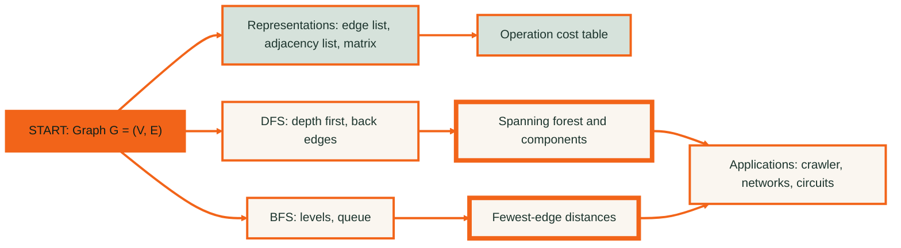
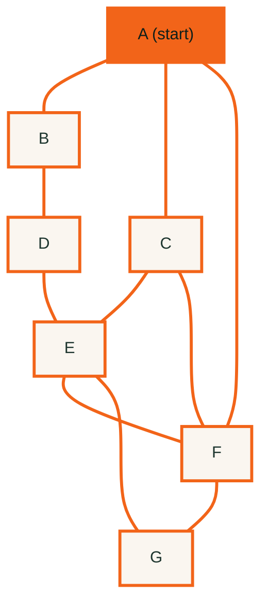
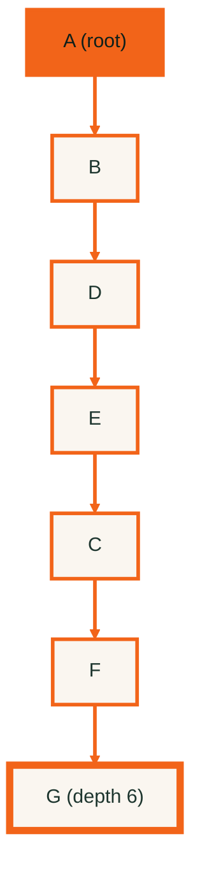
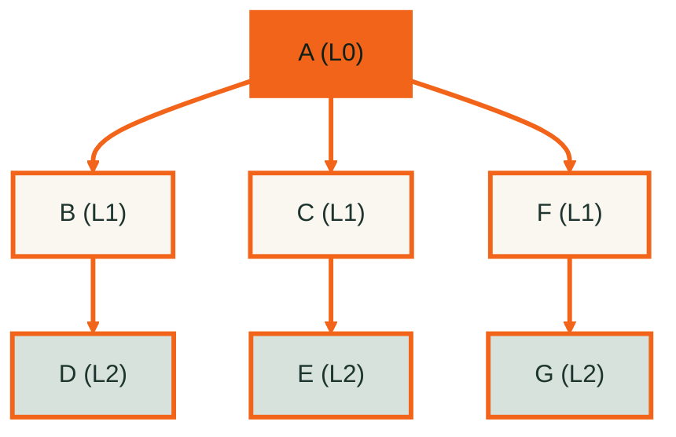

# 09 — Γράφοι, Αναπαραστάσεις και Διασχίσεις
*Graphs, DFS and BFS*

Ένας γράφος $G=(V,E)$ αναπαριστά ένα σύνολο κορυφών και τις σχέσεις μεταξύ τους, με $n=|V|$ κορυφές και $m=|E|$ ακμές. Το κεφάλαιο ορίζει την ορολογία, τις τρεις βασικές αναπαραστάσεις και τις δύο θεμελιώδεις διασχίσεις, τη διάσχιση πρώτα σε βάθος (`DFS`) και τη διάσχιση πρώτα σε πλάτος (`BFS`). Η διάσχιση είναι το εργαλείο που ανάγει ερωτήματα συνδεσιμότητας, κύκλων και αποστάσεων σε γραμμικό χρόνο $O(n+m)$ πάνω σε λίστα γειτνίασης. Το κεφάλαιο στηρίζεται στην ανάλυση της [01_analysis_of_algorithms.md](01_analysis_of_algorithms.md) και στις δομές της [03_maps_hash_tables_cuckoo.md](03_maps_hash_tables_cuckoo.md), ενώ τροφοδοτεί τις [10_shortest_paths.md](10_shortest_paths.md), [11_minimum_spanning_trees.md](11_minimum_spanning_trees.md) και [12_maximum_flow.md](12_maximum_flow.md).

> **Εξεταστική κάλυψη:** Μόνο Τελική
> **Κεφάλαιο βιβλίου:** `Κεφ. 13` | **Διαλέξεις:** `17_graph_terminology_and_representations.pdf`, `18_depth_first_search.pdf`, `19_breadth_first_search.pdf`
> **Πηγή:** `Resources/Meta/mindmap.md` (Ενότητα 09)
> **Εκτός ύλης:** Ενότητες `13.4.3` και `13.5`

## Πίνακας Περιεχομένων

- [1. Εννοιολογικό Πλαίσιο και Συνολική Εικόνα](#1-εννοιολογικό-πλαίσιο-και-συνολική-εικόνα)
- [2. Θεωρητική Θεμελίωση και Τυπικοί Ορισμοί](#2-θεωρητική-θεμελίωση-και-τυπικοί-ορισμοί)
- [3. Αλγόριθμοι, Ιχνηλάτηση και Κώδικας](#3-αλγόριθμοι-ιχνηλάτηση-και-κώδικας)
- [4. Συγκριτική Ανάλυση και Πολυπλοκότητα](#4-συγκριτική-ανάλυση-και-πολυπλοκότητα)
- [5. Πλήρως Λυμένες Ασκήσεις Εξεταστικού Επιπέδου](#5-πλήρως-λυμένες-ασκήσεις-εξεταστικού-επιπέδου)
- [6. Οδηγός Επιβίωσης στις Εξετάσεις και Παγίδες](#6-οδηγός-επιβίωσης-στις-εξετάσεις-και-παγίδες)
- [7. Συνοπτικός Πίνακας Εννοιών](#7-συνοπτικός-πίνακας-εννοιών)

---

## 1. Εννοιολογικό Πλαίσιο και Συνολική Εικόνα

### Το Πρόβλημα

Ένας ανιχνευτής ιστού (`web crawler`) ξεκινά από μία αρχική σελίδα $s$ και πρέπει να ανακαλύψει όλες τις σελίδες που είναι προσβάσιμες μέσω υπερσυνδέσμων. Οι σελίδες είναι κορυφές και οι υπερσύνδεσμοι είναι ακμές ενός γράφου $G=(V,E)$ με $n=|V|$ και $m=|E|$. Ο ανιχνευτής οφείλει να επισκεφθεί κάθε κορυφή και κάθε ακμή της συνιστώσας του $s$ ακριβώς όσο χρειάζεται, χωρίς να επαναλαμβάνει άπειρους κύκλους και χωρίς να χάσει σελίδες. Το ίδιο πρόβλημα εμφανίζεται σε δίκτυα μεταφορών, σε ηλεκτρονικά κυκλώματα, σε βάσεις δεδομένων με μοντέλο οντοτήτων-συσχετίσεων (`ER`) και σε κοινωνικά δίκτυα. Η διάσχιση (`traversal`) είναι η συστηματική διαδικασία επίσκεψης όλων των κορυφών και ακμών· είναι αποδοτική όταν ολοκληρώνεται σε χρόνο γραμμικό ως προς το μέγεθος της αναπαράστασης, $O(n+m)$.

Η `DFS` απαντά στο ερώτημα «τι είναι προσβάσιμο αν ακολουθήσω ένα μονοπάτι μέχρι τέλους;» και παράγει δέντρο ή δάσος επικάλυψης. Η `BFS` απαντά στο ερώτημα «πόσο μακριά είναι κάθε κορυφή από την αφετηρία μετρώντας ακμές;» και παράγει επίπεδα $L_0,L_1,\dots$. Οι δύο διασχίσεις χρησιμοποιούν την ίδια αναπαράσταση γράφου αλλά διαφορετική δομή αναμονής: στοίβα ή αναδρομή για την `DFS`, ουρά για την `BFS`.

### Χάρτης Εννοιών του Κεφαλαίου



Πορτοκαλί γέμισμα: η αφετηρία που ορίζει όλες τις έννοιες (`START`). Απαλό πράσινο: βοηθητικές δομές αναπαράστασης και κόστους. Παχύ περίγραμμα: τα δύο αποτελέσματα που ζητά η εξέταση, το δάσος επικάλυψης και οι αποστάσεις σε ακμές. Κρεμ: οι δύο διασχίσεις και η κοινή εφαρμογή τους.

| Ομάδα | Κόμβοι | Ρόλος |
|---|---|---|
| Αφετηρία | Γράφος $G=(V,E)$ | Καθορίζει κορυφές, ακμές και μέγεθος εισόδου |
| Αναπαράσταση | Λίστα ακμών, λίστα γειτνίασης, πίνακας γειτνίασης | Καθορίζει το κόστος κάθε πράξης |
| Διασχίσεις | `DFS`, `BFS` | Παράγουν δέντρο/δάσος, συνιστώσες, διαδρομές |
| Αποτελέσματα | Δάσος επικάλυψης, αποστάσεις ακμών | Απαντούν στα ερωτήματα της εξέτασης |
| Εφαρμογές | Ανιχνευτής ιστού, δίκτυα, κυκλώματα | Καταναλώνουν τη διάσχιση ως υπορουτίνα |

### Πότε Χρησιμοποιείται Κάθε Διάσχιση

Η `BFS` επιλέγεται όταν το ζητούμενο είναι η ελάχιστη απόσταση σε πλήθος ακμών, η κατάταξη σε επίπεδα ή ο έλεγχος αν δύο κορυφές απέχουν το πολύ $k$ ακμές· η ουρά εγγυάται ότι καμία κορυφή δεν εξετάζεται πριν ολοκληρωθεί το προηγούμενο επίπεδο. Η `DFS` επιλέγεται όταν το ζητούμενο είναι η εξερεύνηση βάθους, η παραγωγή δάσους επικάλυψης, η εύρεση διαδρομής ή κύκλου, και όταν η αναδρομική δομή ταιριάζει με το πρόβλημα. Και οι δύο είναι $O(n+m)$ με λίστα γειτνίασης, άρα η επιλογή γίνεται με βάση τη σημασιολογία και όχι την ασυμπτωτική τάξη. Η αναπαράσταση επιλέγεται από την πυκνότητα: λίστα γειτνίασης για αραιούς γράφους, πίνακας γειτνίασης όταν οι ερωτήσεις γειτνίασης είναι συχνές και ο γράφος είναι πυκνός.

> Εκτός ύλης: Ενότητες `13.4.3` και `13.5`. Η επέκταση της `DFS` σε δισυνδεδεμένες συνιστώσες αναφέρεται μόνο ως ιδιότητα σύγκρισης, χωρίς ανάπτυξη.

---

## 2. Θεωρητική Θεμελίωση και Τυπικοί Ορισμοί

### 2.1 Βασικοί Ορισμοί

**Ορισμός (γράφος).** Ένας γράφος είναι ζεύγος $G=(V,E)$, όπου $V$ είναι πεπερασμένο σύνολο κορυφών (`vertices`) και $E$ είναι συλλογή ζευγών κορυφών, των ακμών (`edges`). Συμβολίζουμε $n=|V|$ και $m=|E|$. Κάθε κορυφή και κάθε ακμή μπορεί να αποθηκεύει ένα στοιχείο (`element`), για παράδειγμα κωδικό αεροδρομίου ή απόσταση πτήσης.

**Ορισμός (κατευθυνόμενη και μη κατευθυνόμενη ακμή).** Μια ακμή $e=(u,v)$ είναι κατευθυνόμενη (`directed`) όταν είναι διατεταγμένο ζεύγος· η $u$ είναι η αφετηρία (`origin`) και η $v$ ο προορισμός (`destination`). Είναι μη κατευθυνόμενη (`undirected`) όταν είναι μη διατεταγμένο ζεύγος, οπότε $(u,v)$ και $(v,u)$ δηλώνουν την ίδια ακμή. Ένας γράφος είναι κατευθυνόμενος ή μη κατευθυνόμενος όταν όλες οι ακμές του είναι αντίστοιχα κατευθυνόμενες ή μη κατευθυνόμενες.

**Ορισμός (παράλληλες ακμές, self-loop, απλός γράφος).** Δύο ακμές είναι παράλληλες (`parallel edges`) όταν έχουν το ίδιο ζεύγος τελικών κορυφών. Μια ακμή $(v,v)$ είναι βρόχος (`self-loop`). Ένας γράφος είναι απλός (`simple`) όταν δεν έχει παράλληλες ακμές και δεν έχει self-loops.

**Ορισμός (τελικές κορυφές, εφαπτόμενη ακμή, γειτονικές κορυφές).** Οι $u$ και $v$ είναι οι τελικές κορυφές (`endpoints`) της ακμής $(u,v)$. Μια ακμή $e$ είναι εφαπτόμενη (`incident`) στην κορυφή $v$ όταν η $v$ είναι τελική κορυφή της $e$. Δύο κορυφές $u$ και $w$ είναι γειτονικές (`adjacent`) όταν υπάρχει ακμή με τελικές κορυφές τις $u$ και $w$.

**Ορισμός (βαθμός, `degree`).** Ο βαθμός `deg(v)` μιας κορυφής $v$ σε μη κατευθυνόμενο γράφο είναι το πλήθος των εφαπτόμενων ακμών, με κάθε self-loop να συνεισφέρει $2$. Σε κατευθυνόμενο γράφο ορίζονται ο βαθμός εισόδου `inDegree(v)` και ο βαθμός εξόδου `outDegree(v)`, ως το πλήθος των εισερχόμενων και εξερχόμενων ακμών αντίστοιχα.

Οι έννοιες αυτές είναι ανεξάρτητες από την αναπαράσταση. Η αναπαράσταση καθορίζει μόνο το κόστος των πράξεων και όχι τη σημασιολογία του γράφου.

### 2.2 Ιδιότητες Βαθμών και Πλήθους Ακμών

**Θεώρημα 2.1 (χειραψία, `handshake lemma`).** Για κάθε μη κατευθυνόμενο γράφο $G=(V,E)$ ισχύει

$$\sum_{v\in V}\deg(v)=2m.$$

*Απόδειξη (διπλή απαρίθμηση).* Μετράμε τα ζεύγη $(v,e)$ όπου η κορυφή $v$ είναι τελική κορυφή της ακμής $e$. Από τη μία πλευρά, κάθε ακμή έχει ακριβώς δύο τελικές κορυφές, άρα παράγει δύο ζεύγη· ένα self-loop έχει δύο εμφανίσεις της ίδιας κορυφής και πάλι δύο ζεύγη. Συνολικά τα ζεύγη είναι $2m$. Από την άλλη πλευρά, κάθε κορυφή $v$ εμφανίζεται σε τόσα ζεύγη όσες οι εφαπτόμενες ακμές της, δηλαδή `deg(v)`. Αθροίζοντας ως προς $v$ προκύπτει $\sum_v \deg(v)$. Οι δύο μετρήσεις αφορούν το ίδιο σύνολο ζευγών, άρα είναι ίσες. $\square$

**Πόρισμα 2.2 (άνω φράγμα ακμών).** Σε απλό μη κατευθυνόμενο γράφο με $n$ κορυφές ισχύει

$$m\le \frac{n(n-1)}{2}.$$

*Απόδειξη.* Επειδή ο γράφος είναι απλός, κάθε κορυφή $v$ μπορεί να συνδέεται με κάθε άλλη κορυφή το πολύ μία φορά και όχι με τον εαυτό της, άρα $\deg(v)\le n-1$. Αθροίζοντας, $\sum_v \deg(v)\le n(n-1)$. Από το Θεώρημα 2.1, $2m=\sum_v \deg(v)$, άρα $2m\le n(n-1)$ και το ζητούμενο έπεται. $\square$

Σε απλό κατευθυνόμενο γράφο ισχύει $m\le n(n-1)$, διότι κάθε διατεταγμένο ζεύγος διακεκριμένων κορυφών μπορεί να είναι ακμή το πολύ μία φορά. Το φράγμα είναι διπλάσιο από το μη κατευθυνόμενο επειδή η σειρά $(u,v)$ διαφέρει από την $(v,u)$.

**Παράδειγμα.** Στον γράφο του Σχήματος 1 με $n=7$ και $m=10$, οι βαθμοί είναι $\deg(A)=3$, $\deg(B)=2$, $\deg(C)=3$, $\deg(D)=2$, $\deg(E)=4$, $\deg(F)=4$, $\deg(G)=2$. Το άθροισμα είναι $20=2m$, και το φράγμα $m\le 7\cdot 6/2=21$ ισχύει με περιθώριο $11$ ακμών.

### 2.3 Διαδρομές, Κύκλοι, Δέντρα και Συνιστώσες

**Ορισμός (διαδρομή).** Διαδρομή (`path`) μήκους $k$ είναι ακολουθία

$$v_0,e_1,v_1,e_2,\dots,e_k,v_k$$

όπου κάθε $e_i$ είναι ακμή με τελικές κορυφές τις $v_{i-1}$ και $v_i$. Το μήκος είναι το πλήθος $k$ των ακμών. Η διαδρομή είναι απλή (`simple path`) όταν όλες οι κορυφές και όλες οι ακμές της είναι διακεκριμένες.

**Ορισμός (κύκλος).** Κύκλος (`cycle`) είναι διαδρομή με $v_0=v_k$ και $k\ge 1$. Απλός κύκλος (`simple cycle`) είναι κύκλος όπου όλες οι κορυφές και όλες οι ακμές είναι διακεκριμένες, εκτός από την ταύτιση $v_0=v_k$. Σε απλό μη κατευθυνόμενο γράφο ένας απλός κύκλος έχει μήκος τουλάχιστον $3$.

**Ορισμός (υπογράφος και παράγων υπογράφος).** Υπογράφος (`subgraph`) του $G=(V,E)$ είναι γράφος $S=(V',E')$ με $V'\subseteq V$ και $E'\subseteq E$, όπου κάθε ακμή του $E'$ έχει τελικές κορυφές στο $V'$. Παράγων υπογράφος (`spanning subgraph`) είναι υπογράφος με $V'=V$.

**Ορισμός (συνεκτικότητα και συνιστώσα).** Ένας μη κατευθυνόμενος γράφος είναι συνεκτικός (`connected`) όταν για κάθε ζεύγος κορυφών $u,w$ υπάρχει διαδρομή από την $u$ στην $w$. Συνεκτική συνιστώσα (`connected component`) είναι μέγιστος συνεκτικός υπογράφος· ισοδύναμα, είναι κλάση ισοδυναμίας της σχέσης «συνδέονται με διαδρομή».

**Ορισμός (ελεύθερο δέντρο, δάσος, παράγον δέντρο).** Ελεύθερο δέντρο (`free tree`) είναι μη κατευθυνόμενος γράφος που είναι συνεκτικός και ακυκλικός. Δάσος (`forest`) είναι μη κατευθυνόμενος γράφος χωρίς κύκλους· οι συνεκτικές συνιστώσες του είναι δέντρα. Παράγον δέντρο (`spanning tree`) συνεκτικού γράφου είναι παράγων υπογράφος που είναι δέντρο· παράγον δάσος (`spanning forest`) είναι παράγων υπογράφος που είναι δάσος.

**Πρόταση 2.3 (πλήθος ακμών δέντρου).** Κάθε δέντρο με $n\ge 1$ κορυφές έχει ακριβώς $n-1$ ακμές. Κάθε δάσος με $n$ κορυφές και $c$ συνεκτικές συνιστώσες έχει $n-c$ ακμές.

*Απόδειξη.* Για δέντρο με $n=1$ το πλήθος ακμών είναι $0=n-1$. Για $n\ge 2$, έστω $P$ απλή διαδρομή μέγιστου μήκους και $v$ ένα άκρο της. Αν η $v$ είχε γείτονα $u$ εκτός της $P$, η $P$ θα επεκτεινόταν· αν είχε άλλον γείτονα εντός της $P$ εκτός από τον προηγούμενό της, θα σχηματιζόταν κύκλος. Άρα η $v$ έχει βαθμό $1$. Αφαιρώντας την $v$ και τη μοναδική ακμή της προκύπτει δέντρο με $n-1$ κορυφές, που από επαγωγή έχει $n-2$ ακμές· προσθέτοντας πάλι την ακμή, το αρχικό δέντρο έχει $n-1$ ακμές. Για δάσος, εφαρμόζουμε το αποτέλεσμα σε κάθε συνιστώσα: αν η συνιστώσα $i$ έχει $n_i$ κορυφές, έχει $n_i-1$ ακμές, και αθροίζοντας $\sum_i (n_i-1)=n-c$. $\square$

Η Πρόταση 2.3 εξηγεί γιατί ένα δέντρο επικάλυψης συνεκτικού γράφου με $n$ κορυφές έχει ακριβώς $n-1$ ακμές: είναι το ελάχιστο σύνολο ακμών που συνδέει όλες τις κορυφές χωρίς κύκλο.

### 2.4 Αναπαραστάσεις Γράφων και Κόστος Πράξεων

Οι τρεις αναπαραστάσεις αποθηκεύουν το ίδιο αφηρημένο γράφο με διαφορετικό ισοζύγιο χώρου και χρόνου.

**Λίστα ακμών (`edge list`).** Δύο ακολουθίες: μία με τα αντικείμενα κορυφών και μία με τα αντικείμενα ακμών. Κάθε ακμή αποθηκεύει τις δύο τελικές κορυφές της και τη θέση της στην ακολουθία ακμών. Ο χώρος είναι $O(n+m)$.

**Λίστα γειτνίασης (`adjacency list`).** Κάθε κορυφή $v$ διατηρεί ακολουθία αναφορών στις ακμές που εφάπτονται στην $v$. Σε μη κατευθυνόμενο γράφο κάθε ακμή εμφανίζεται σε δύο ακολουθίες, άρα ο συνολικός αριθμός αναφορών είναι $2m$ και ο χώρος $O(n+m)$.

**Πίνακας γειτνίασης (`adjacency matrix`).** Δισδιάστατος πίνακας $A$ μεγέθους $n\times n$, όπου το κελί $A[i][j]$ περιέχει αναφορά στην ακμή $(i,j)$ ή `null` όταν δεν υπάρχει ακμή. Σε μη κατευθυνόμενο γράφο ο πίνακας είναι συμμετρικός. Ο χώρος είναι $O(n^2)$.

| Πράξη | Λίστα ακμών | Λίστα γειτνίασης | Πίνακας γειτνίασης |
|---|---|---|---|
| Χώρος | $O(n+m)$ | $O(n+m)$ | $O(n^2)$ |
| `incidentEdges(v)` | $O(m)$ | $O(\deg(v))$ | $O(n)$ |
| `areAdjacent(v,w)` | $O(m)$ | $O(\min\{\deg(v),\deg(w)\})$ | $O(1)$ |
| `insertVertex(o)` | $O(1)$ | $O(1)$ | $O(n^2)$ |
| `insertEdge(v,w,o)` | $O(1)$ | $O(1)$ | $O(1)$ |
| `removeVertex(v)` | $O(m)$ | $O(\deg(v))$ | $O(n^2)$ |
| `removeEdge(e)` | $O(1)$ | $O(1)$ | $O(1)$ |

Οι πράξεις `endpoints(e)`, `opposite(v,e)`, `numVertices()`, `numEdges()` κοστίζουν $O(1)$ και στις τρεις αναπαραστάσεις όταν υπάρχουν απευθείας αναφορές στα αντικείμενα. Το `insertEdge` στη λίστα γειτνίασης είναι $O(1)$ όταν οι θέσεις των δύο κορυφών είναι γνωστές· αν απαιτείται αναζήτηση των κορυφών, το κόστος της αναζήτησης προστίθεται.

Η επιλογή είναι συνάρτηση της πυκνότητας. Όταν $m=O(n)$, η λίστα γειτνίασης είναι η μόνη αναπαράσταση με χώρο $O(n)$ και διάσχιση $O(n+m)$. Όταν $m=\Theta(n^2)$, ο πίνακας έχει ίδια τάξη χώρου με τη λίστα και προσφέρει `areAdjacent` σε $O(1)$. Η λίστα ακμών είναι κατάλληλη όταν η εφαρμογή διατρέχει όλες τις ακμές και δεν εκτελεί γειτονικές αναζητήσεις.

### 2.5 Θεωρία της Αναζήτησης Πρώτα σε Βάθος

Η `DFS` χρωματίζει αρχικά όλες τις κορυφές και όλες τις ακμές ως `UNEXPLORED`. Όταν επισκέπτεται μια κορυφή $v$, τη σημαίνει `VISITED` και εξετάζει μία προς μία τις εφαπτόμενες ακμές της. Αν μια ακμή $e=(v,w)$ είναι `UNEXPLORED` και η $w$ είναι `UNEXPLORED`, η $e$ σημαίνεται `DISCOVERY` και η `DFS` συνεχίζει αναδρομικά από την $w$. Αν η $w$ είναι ήδη `VISITED`, η $e$ σημαίνεται `BACK`. Οι ακμές `DISCOVERY` ονομάζονται ακμές ανακάλυψης (`discovery edges`) και οι υπόλοιπες πίσω ακμές (`back edges`).

**Ορισμός (πίσω ακμή).** Πίσω ακμή είναι ακμή $(v,w)$ όπου η $w$ είναι πρόγονος της $v$ στο δέντρο των ακμών ανακάλυψης. Σε μη κατευθυνόμενο γράφο, κάθε μη δενδρική ακμή είναι πίσω ακμή, όπως αποδεικνύεται στο Θεώρημα 2.4.

**Ορισμός (δάσος DFS).** Η γενική `DFS(G)` εκτελεί `DFS(G,v)` για κάθε κορυφή $v$ που παραμένει `UNEXPLORED`. Το σύνολο των ακμών ανακάλυψης όλων των κλήσεων σχηματίζει δάσος επικάλυψης (`DFS forest`)· κάθε συνεκτική συνιστώσα παράγει ένα δέντρο του δάσους.

**Θεώρημα 2.4 (ιδιότητες DFS).** Για μη κατευθυνόμενο γράφο $G$ και κορυφή $v$:

1. Η `DFS(G,v)` επισκέπτεται όλες τις κορυφές και όλες τις ακμές της συνεκτικής συνιστώσας της $v$.
2. Οι ακμές ανακάλυψης σχηματίζουν παράγον δέντρο της συνιστώσας της $v$.
3. Κάθε μη δενδρική ακμή είναι πίσω ακμή· δεν υπάρχουν ακμές διασταύρωσης σε μη κατευθυνόμενο `DFS`.
4. Η διάσχιση εκτελείται σε χρόνο $O(n+m)$ στη χειρότερη περίπτωση με λίστα γειτνίασης.

*Απόδειξη.*

1. Έστω $C$ η συνιστώσα της $v$ και $u\in C$. Υπάρχει απλή διαδρομή $v=x_0,x_1,\dots,x_k=u$. Με επαγωγή στο $i$ δείχνουμε ότι η $x_i$ επισκέπτεται: η $x_0=v$ επισκέπτεται στην κλήση· αν η $x_i$ επισκέπτεται, τότε όταν η `DFS` εξετάσει την ακμή $(x_i,x_{i+1})$, είτε η $x_{i+1}$ είναι ανεξερεύνητη και ανακαλύπτεται, είτε είναι ήδη σημασμένη ως `VISITED`. Άρα κάθε κορυφή της $C$ επισκέπτεται. Κάθε ακμή της $C$ έχει τουλάχιστον ένα άκρο σημασμένο ως `VISITED`· όταν το πρώτο άκρο εξετάσει την ακμή, η ακμή σημαίνεται `DISCOVERY` ή `BACK`. Άρα όλες οι ακμές της $C$ σημαίνονται.
2. Κάθε ακμή ανακάλυψης ενώνει μια κορυφή σημασμένη ως `VISITED` με μια ανεξερεύνητη κορυφή, άρα προσθέτει νέα κορυφή στο δάσος και δεν δημιουργεί κύκλο. Επειδή κάθε κορυφή εκτός της ρίζας αποκτά ακριβώς μία ακμή ανακάλυψης, το δάσος έχει $n_C-1$ ακμές για $n_C$ κορυφές. Κάθε ανακαλυφθείσα κορυφή συνδέεται με αλυσίδα ακμών ανακάλυψης προς τη ρίζα, άρα το δάσος είναι συνεκτικό· επομένως είναι δέντρο.
3. Έστω $e=(x,y)$ μη δενδρική ακμή και έστω ότι εξετάζεται πρώτη φορά από την $x$, οπότε η $y$ είναι ήδη `VISITED` (αλλιώς θα γινόταν `DISCOVERY`). Αν η $y$ ήταν απόγονος της $x$ που είχε ήδη ολοκληρωθεί, τότε η $e$ θα είχε εξεταστεί από την $y$ όσο η $x$ ήταν πρόγονος της, θα είχε σημανθεί `BACK` και δεν θα ήταν τώρα `UNEXPLORED`. Άρα η $y$ δεν είναι απολύτως ολοκληρωμένος απόγονος. Αν η $y$ ανήκε σε άλλο ολοκληρωμένο υποδέντρο, η $e$ θα είχε εξεταστεί από την $y$ πριν ολοκληρωθεί το υποδέντρο. Αν η $x$ ήταν τότε ανεξερεύνητη, η $e$ θα γινόταν `DISCOVERY` και η $x$ θα ανήκε στο υποδέντρο της $y$, άτοπο· αν η $x$ ήταν ήδη σημασμένη ως `VISITED`, η $e$ θα είχε σημανθεί `BACK` και δεν θα ήταν τώρα `UNEXPLORED`. Και στις δύο περιπτώσεις υπάρχει αντίφαση. Επομένως η $y$ είναι πρόγονος της $x$ και η $e$ είναι πίσω ακμή.
4. Η αρχικοποίηση σημαίνει $n$ κορυφές και $m$ ακμές σε $O(n+m)$. Κάθε κορυφή σημαίνεται `VISITED` μία φορά. Κάθε ακμή εξετάζεται από τα δύο άκρα της, άρα το πολύ $2m$ εξετάσεις, και σημαίνεται μία φορά. Η `incidentEdges(v)` καλείται μία φορά για κάθε κορυφή σημασμένη ως `VISITED`· με λίστα γειτνίασης το συνολικό της κόστος είναι $\sum_v \deg(v)=2m$. Άρα ο συνολικός χρόνος είναι $O(n+m)$. $\square$

Η ιδιότητα 3 είναι ο λόγος που η `DFS` σε μη κατευθυνόμενο γράφο παράγει μόνο δύο τύπους ακμών, `DISCOVERY` και `BACK`. Σε κατευθυνόμενο γράφο εμφανίζονται επιπλέον τύποι, οι οποίοι δεν εξετάζονται στο παρόν κεφάλαιο.

### 2.6 Θεωρία της Αναζήτησης Πρώτα σε Πλάτος

Η `BFS` οργανώνει την εξερεύνηση σε επίπεδα. Το επίπεδο $L_0$ περιέχει μόνο την αφετηρία $s$. Για $i=0,1,2,\dots$, όσο το $L_i$ δεν είναι κενό, η `BFS` εξετάζει κάθε κορυφή $v\in L_i$ και κάθε ανεξερεύνητη εφαπτόμενη ακμή της. Αν η απέναντι κορυφή $w$ είναι ανεξερεύνητη, η ακμή σημαίνεται `DISCOVERY`, η $w$ σημαίνεται `VISITED` και προστίθεται στο επόμενο επίπεδο $L_{i+1}$. Αν η $w$ είναι ήδη σημασμένη ως `VISITED`, η ακμή σημαίνεται `CROSS` (ακμή διασταύρωσης, `cross edge`). Οι ακμές `DISCOVERY` σχηματίζουν το δέντρο `BFS` της συνιστώσας, $T_s$.

**Θεώρημα 2.5 (ιδιότητες BFS).** Για μη κατευθυνόμενο γράφο $G$ και αφετηρία $s$:

1. Η `BFS(G,s)` επισκέπτεται όλες τις κορυφές και όλες τις ακμές της συνεκτικής συνιστώσας της $s$.
2. Οι ακμές ανακάλυψης σχηματίζουν παράγον δέντρο $T_s$ της συνιστώσας.
3. Για κάθε $v\in L_i$, η διαδρομή της $T_s$ από την $s$ στην $v$ έχει $i$ ακμές, και κάθε διαδρομή από την $s$ στην $v$ στη συνιστώσα έχει τουλάχιστον $i$ ακμές. Άρα $i$ είναι η ελάχιστη απόσταση σε πλήθος ακμών.
4. Κάθε μη δενδρική ακμή είναι ακμή διασταύρωσης και ενώνει κορυφές του ίδιου ή διαδοχικού επιπέδου.
5. Η διάσχιση εκτελείται σε χρόνο $O(n+m)$ στη χειρότερη περίπτωση με λίστα γειτνίασης.

*Απόδειξη.*

1. Έστω $u$ κορυφή της συνιστώσας της $s$ και έστω $s=x_0,x_1,\dots,x_k=u$ μια απλή διαδρομή. Με επαγωγή στο $i$, κάθε $x_i$ βρίσκεται σε κάποιο επίπεδο: η $x_0=s$ είναι στο $L_0$· αν η $x_i$ βρίσκεται στο $L_j$, τότε όταν η $x_i$ εξεταστεί, η ακμή $(x_i,x_{i+1})$ είτε ανακαλύπτει την $x_{i+1}$ και την προσθέτει στο $L_{j+1}$, είτε τη βρίσκει ήδη σημασμένη ως `VISITED`. Άρα όλες οι κορυφές της συνιστώσας επισκέπτονται. Κάθε ακμή εξετάζεται όταν εξετάζεται το πρώτο από τα άκρα της και σημαίνεται `DISCOVERY` ή `CROSS`, άρα όλες οι ακμές σημαίνονται.
2. Κάθε ακμή ανακάλυψης ενώνει μια κορυφή του $L_i$ με μια νέα κορυφή του $L_{i+1}$, άρα προσθέτει νέο κόμβο χωρίς κύκλο. Κάθε κορυφή εκτός της $s$ αποκτά ακριβώς μία ακμή ανακάλυψης, άρα το δέντρο έχει $n_s-1$ ακμές. Κάθε κορυφή συνδέεται με αλυσίδα ακμών ανακάλυψης προς την $s$, άρα το δέντρο είναι συνεκτικό και επικαλύπτει τη συνιστώσα.
3. Αποδεικνύουμε με επαγωγή στο $i$ την πρόταση: για κάθε $j\le i$, κάθε κορυφή του $L_j$ έχει απόσταση $j$ από την $s$, και κάθε κορυφή με απόσταση $j$ ανήκει στο $L_j$. Για $j=0$, $L_0=\{s\}$ και η απόσταση είναι $0$. Έστω ότι ισχύει για όλα τα επίπεδα μέχρι το $i$ και έστω $v\in L_{i+1}$. Η $v$ προστέθηκε όταν εξεταζόταν μια κορυφή $u\in L_i$ μέσω της ακμής $(u,v)$, άρα υπάρχει διαδρομή $s\rightsquigarrow u\to v$ μήκους $i+1$ και $\text{dist}(s,v)\le i+1$. Αν $\text{dist}(s,v)=d\le i$, έστω $z$ ο προηγούμενος της $v$ σε μια συντομότερη διαδρομή· τότε $\text{dist}(s,z)=d-1\le i-1$ και, από την επαγωγική υπόθεση, $z\in L_{d-1}$. Όταν η $z$ εξεταζόταν, η $v$ θα ήταν ανεξερεύνητη και θα προστίθετο στο $L_d$, ή θα ήταν ήδη σημασμένη ως `VISITED` σε επίπεδο $\le d$· και στις δύο περιπτώσεις η $v$ δεν θα μπορούσε να προστεθεί στο $L_{i+1}$, αντίφαση. Άρα $\text{dist}(s,v)\ge i+1$ και επομένως $\text{dist}(s,v)=i+1$. Αντίστροφα, αν $\text{dist}(s,v)=i+1$, έστω $u$ ο προηγούμενος της $v$ σε μια συντομότερη διαδρομή· τότε $\text{dist}(s,u)=i$ και, από την επαγωγή, $u\in L_i$. Όταν η $u$ εξετάζεται, η $v$ είτε ανακαλύπτεται και προστίθεται στο $L_{i+1}$, είτε είναι ήδη σημασμένη ως `VISITED`· η τελευταία περίπτωση δεν μπορεί να δώσει επίπεδο $<i+1$ από το προηγούμενο σκέλος, ούτε $>i+1$ επειδή οι ανακαλύψεις από το $L_i$ γίνονται στο $L_{i+1}$. Άρα $v\in L_{i+1}$. Η διαδρομή της $T_s$ έχει ακριβώς $i$ ακμές επειδή κάθε βήμα προσθέτει μία ακμή ανακάλυψης και ανεβάζει το επίπεδο κατά ένα.
4. Μια μη δενδρική ακμή $(u,v)$ σημαίνεται `CROSS` όταν εξετάζεται το πρώτο άκρο της και το δεύτερο είναι ήδη σημασμένο ως `VISITED`. Για κάθε ακμή ισχύει $|\text{dist}(s,u)-\text{dist}(s,v)|\le 1$, αλλιώς θα υπήρχε συντομότερη διαδρομή προς το ένα άκρο μέσω του άλλου. Από την ιδιότητα 3, τα επίπεδα ταυτίζονται με τις αποστάσεις, άρα τα δύο άκρα βρίσκονται στο ίδιο ή σε διαδοχικά επίπεδα.
5. Κάθε κορυφή προστίθεται σε επίπεδο μία φορά και εξετάζεται μία φορά. Κάθε ακμή εξετάζεται από τα δύο άκρα της, άρα το πολύ $2m$ φορές, και η `incidentEdges(v)` καλείται μία φορά ανά κορυφή· με λίστα γειτνίασης το άθροισμα των μηκών είναι $\sum_v \deg(v)=2m$. Συνολικά $O(n+m)$. $\square$

Η ιδιότητα 3 είναι το θεωρητικό θεμέλιο της χρήσης της `BFS` για συντομότερες διαδρομές σε μη σταθμισμένο γράφο: το επίπεδο $L_i$ περιέχει ακριβώς τις κορυφές που απέχουν $i$ ακμές από την $s$. Η ιδιότητα 4 εξηγεί γιατί οι ακμές διασταύρωσης δεν μπορούν να «πηδήξουν» περισσότερα από ένα επίπεδα.

---

## 3. Αλγόριθμοι, Ιχνηλάτηση και Κώδικας

### 3.1 Παράδειγμα Γράφου και Κανόνας Ισοβαθμίας

Όλες οι ιχνηλατήσεις της ενότητας χρησιμοποιούν τον ίδιο μη κατευθυνόμενο γράφο $G$ με κορυφές $V=\{A,B,C,D,E,F,G\}$ και ακμές

$$E=\{AB,AC,AF,BD,CE,CF,DE,EF,EG,FG\}.$$

Ο γράφος έχει $n=7$ κορυφές και $m=10$ ακμές. Είναι συνεκτικός, απλός και περιέχει κύκλους, άρα οι δύο διασχίσεις παράγουν δέντρο επικάλυψης και τουλάχιστον μία μη δενδρική ακμή.



**Σχήμα 1.** Πορτοκαλί γέμισμα: η κορυφή εκκίνησης $A$. Κρεμ: οι υπόλοιπες κορυφές. Όλες οι γραμμές είναι μη κατευθυνόμενες ακμές, άρα η σειρά των άκρων δεν ορίζει προσανατολισμό.

| Κορυφή | Γειτονικές κορυφές (αλφαβητικά) | Βαθμός |
|---|---|---|
| $A$ | $B,C,F$ | $3$ |
| $B$ | $A,D$ | $2$ |
| $C$ | $A,E,F$ | $3$ |
| $D$ | $B,E$ | $2$ |
| $E$ | $C,D,F,G$ | $4$ |
| $F$ | $A,C,E,G$ | $4$ |
| $G$ | $E,F$ | $2$ |

Το άθροισμα βαθμών είναι $3+2+3+2+4+4+2=20=2m$, όπως απαιτεί το Θεώρημα 2.1.

**Κανόνας ισοβαθμίας.** Όταν μια κορυφή έχει πολλούς ανεξερεύνητους γείτονες, εξετάζονται με αλφαβητική σειρά. Ο κανόνας καθιστά μονοσήμαντη τη σειρά επίσκεψης, το δέντρο και τον χαρακτηρισμό κάθε ακμής. Χωρίς τον κανόνα, το ίδιο γράφημα παράγει διαφορετικό δέντρο `DFS` ή `BFS` και διαφορετικό σύνολο πίσω ή διασταυρούμενων ακμών.

```python
example_graph: dict[str, list[str]] = {
    "A": ["B", "C", "F"],
    "B": ["A", "D"],
    "C": ["A", "E", "F"],
    "D": ["B", "E"],
    "E": ["C", "D", "F", "G"],
    "F": ["A", "C", "E", "G"],
    "G": ["E", "F"],
}

assert sum(len(neighbors) for neighbors in example_graph.values()) == 20
```

### 3.2 Αναζήτηση Πρώτα σε Βάθος

**Σκοπός.** Η `DFS` εξερευνά όσο το δυνατόν βαθύτερα πριν επιστρέψει, παράγοντας δάσος επικάλυψης και χαρακτηρίζοντας κάθε ακμή ως ανακάλυψης ή πίσω.

```text
Algorithm DFS(G):
Input: Γράφος G
Output: Σήμανση όλων των κορυφών και ακμών του G

for all u ∈ G.vertices():
    setLabel(u, UNEXPLORED)
for all e ∈ G.edges():
    setLabel(e, UNEXPLORED)
for all v ∈ G.vertices():
    if getLabel(v) = UNEXPLORED:
        DFS(G, v)
```

```text
Algorithm DFS(G, v):
Input: Γράφος G, κορυφή εκκίνησης v
Output: Σήμανση κορυφών και ακμών της συνιστώσας του v

setLabel(v, VISITED)
for all e ∈ G.incidentEdges(v):
    if getLabel(e) = UNEXPLORED:
        w ← opposite(v, e)
        if getLabel(w) = UNEXPLORED:
            setLabel(e, DISCOVERY)
            DFS(G, w)
        else:
            setLabel(e, BACK)
```

**Ιχνηλάτηση.** Η στοίβα κλήσεων εμφανίζεται μετά την εξέταση της ακμής· η κορυφή $v$ είναι η τρέχουσα κορυφή της αναδρομικής κλήσης.

| Βήμα | $v$ | Στοίβα κλήσεων | Ακμή | Τύπος | Αιτιολόγηση |
|---|---|---|---|---|---|
| 1 | $A$ | $[A,B]$ | $AB$ | `DISCOVERY` | Η $B$ είναι ανεξερεύνητη |
| 2 | $B$ | $[A,B,D]$ | $BD$ | `DISCOVERY` | Η $D$ είναι ανεξερεύνητη |
| 3 | $D$ | $[A,B,D,E]$ | $DE$ | `DISCOVERY` | Η $E$ είναι ανεξερεύνητη |
| 4 | $E$ | $[A,B,D,E,C]$ | $EC$ | `DISCOVERY` | Η $C$ είναι ανεξερεύνητη |
| 5 | $C$ | $[A,B,D,E,C]$ | $CA$ | `BACK` | Η $A$ είναι πρόγονος της $C$ |
| 6 | $C$ | $[A,B,D,E,C,F]$ | $CF$ | `DISCOVERY` | Η $F$ είναι ανεξερεύνητη |
| 7 | $F$ | $[A,B,D,E,C,F]$ | $FA$ | `BACK` | Η $A$ είναι πρόγονος της $F$ |
| 8 | $F$ | $[A,B,D,E,C,F]$ | $FE$ | `BACK` | Η $E$ είναι πρόγονος της $F$ |
| 9 | $F$ | $[A,B,D,E,C,F,G]$ | $FG$ | `DISCOVERY` | Η $G$ είναι ανεξερεύνητη |
| 10 | $G$ | $[A,B,D,E,C,F,G]$ | $GE$ | `BACK` | Η $E$ είναι πρόγονος της $G$ |

Μετά το βήμα 10 η αναδρομή επιστρέφει από την $G$ στην $F$, στην $C$, στην $E$, στην $D$, στην $B$ και στην $A$. Οι ακμές $AC$ και $AF$ έχουν ήδη σημανθεί ως `BACK` από την $C$ και την $F$ αντίστοιχα, άρα δεν σημαίνονται δεύτερη φορά.

| Αποτέλεσμα | Σύνολο |
|---|---|
| Σειρά επίσκεψης | $A,B,D,E,C,F,G$ |
| Ακμές δέντρου (`DISCOVERY`) | $AB,BD,DE,EC,CF,FG$ |
| Πίσω ακμές (`BACK`) | $AC,AF,EF,EG$ |
| Πλήθος ακμών δέντρου | $6=n-1$ |



Πορτοκαλί γέμισμα: η ρίζα $A$. Παχύ περίγραμμα: ο βαθύτερος κόμβος $G$, σε βάθος $6$ ακμών. Κρεμ: οι υπόλοιπες κορυφές του δέντρου. Το δέντρο περιέχει όλες τις κορυφές και $n-1=6$ ακμές· οι υπόλοιπες $m-(n-1)=4$ ακμές είναι πίσω ακμές.

**Υπολογισμός πολυπλοκότητας.** Η αρχικοποίηση σημαίνει $n$ κορυφές και $m$ ακμές, κόστος $O(n+m)$. Κάθε κορυφή σημαίνεται `VISITED` μία φορά, κόστος $O(n)$. Κάθε ακμή εξετάζεται από τα δύο άκρα της και σημαίνεται μία φορά, κόστος $O(m)$. Η `incidentEdges(v)` καλείται μία φορά ανά κορυφή· με λίστα γειτνίασης το άθροισμα των μηκών είναι $\sum_v \deg(v)=2m=O(m)$. Άρα ο χρόνος είναι $O(n+m)$ στη χειρότερη περίπτωση. Με πίνακα γειτνίασης η `incidentEdges(v)` κοστίζει $O(n)$ ανά κορυφή και ο συνολικός χρόνος γίνεται $O(n^2)$.

**Ρητή αναδρομική υλοποίηση.** Η αναδρομή χρησιμοποιεί την στοίβα κλήσεων της γλώσσας και επισκέπτεται τους γείτονες με αλφαβητική σειρά.

```python
def dfsRecursive(graph: dict[str, list[str]], start: str) -> list[str]:
    """Επιστρέφει τη σειρά επίσκεψης μιας αναδρομικής DFS.

    Args:
        graph (dict[str, list[str]]): Λίστα γειτνίασης με ταξινομημένους γείτονες.
        start (str): Η κορυφή εκκίνησης.

    Returns:
        list[str]: Οι κορυφές με τη σειρά που επισκέπτονται πρώτη φορά.
    """
    visited: set[str] = set()
    order: list[str] = []

    def visit(vertex: str) -> None:
        """Επισκέπτεται μια κορυφή και εξερευνά αναδρομικά τους γείτονές της.

        Args:
            vertex (str): Η κορυφή που επισκέπτεται η τρέχουσα κλήση.

        Returns:
            None: Η συνάρτηση δεν επιστρέφει τιμή.
        """
        visited.add(vertex)
        order.append(vertex)
        for neighbor in graph[vertex]:
            if neighbor not in visited:
                visit(neighbor)

    visit(start)
    return order


assert dfsRecursive(example_graph, "A") == ["A", "B", "D", "E", "C", "F", "G"]
```

**Επαναληπτική υλοποίηση με ρητή στοίβα.** Η στοίβα περιέχει κορυφές προς εξέταση· η σήμανση γίνεται κατά την έξοδο από τη στοίβα, ώστε η σειρά να ταιριάζει με την αναδρομική εκδοχή.

```python
def dfsIterative(graph: dict[str, list[str]], start: str) -> list[str]:
    """Επιστρέφει τη σειρά επίσκεψης μιας επαναληπτικής DFS.

    Args:
        graph (dict[str, list[str]]): Λίστα γειτνίασης με ταξινομημένους γείτονες.
        start (str): Η κορυφή εκκίνησης.

    Returns:
        list[str]: Οι κορυφές με τη σειρά που επισκέπτονται πρώτη φορά.
    """
    visited: set[str] = set()
    order: list[str] = []
    stack: list[str] = [start]
    while stack:
        vertex = stack.pop()
        if vertex in visited:
            continue  # Μια κορυφή μπορεί να έχει προωθηθεί από πολλούς γείτονες.
        visited.add(vertex)
        order.append(vertex)
        # Η αντίστροφη σειρά κάνει τη στοίβα να εξάγει αλφαβητικά.
        for neighbor in reversed(graph[vertex]):
            if neighbor not in visited:
                stack.append(neighbor)
    return order


assert dfsIterative(example_graph, "A") == ["A", "B", "D", "E", "C", "F", "G"]
```

| Μορφή | Χρόνος (χειρότερη) | Χώρος (χειρότερη) | Σειρά επίσκεψης | Περιορισμός |
|---|---|---|---|---|
| `dfsRecursive` | $O(n+m)$ | $O(n)$ στοίβα κλήσεων | Αλφαβητική | Όριο βάθους αναδρομής στην Python |
| `dfsIterative` | $O(n+m)$ | $O(n+m)$ στη στοίβα με διπλότυπα | Αλφαβητική με αντίστροφη ώθηση | Καμία εξάρτηση από το όριο αναδρομής |

Δεν υπάρχει έτοιμη συνάρτηση διάσχισης γράφου στη βιβλιοθήκη της Python· και οι δύο μορφές είναι ρητές. Η επαναληπτική μορφή είναι υποχρεωτική όταν το βάθος μπορεί να υπερβεί το προεπιλεγμένο όριο αναδρομής των $1000$ κλήσεων, για παράδειγμα σε γράφο-αλυσίδα με $n>1000$.

### 3.3 Επεκτάσεις της DFS: pathDFS και cycleDFS

**Σκοπός της `pathDFS`.** Η `pathDFS(G,v,z)` επιστρέφει μια διαδρομή από την κορυφή εκκίνησης έως την κορυφή προορισμού $z$, αν υπάρχει, χρησιμοποιώντας στοίβα $S$ που παρακολουθεί τη διαδρομή από την αφετηρία έως την τρέχουσα κορυφή.

```text
Algorithm pathDFS(G, v, z):
Input: Γράφος G, τρέχουσα κορυφή v, προορισμός z
Output: Στοίβα με τη διαδρομή v → z ή null

setLabel(v, VISITED)
S.push(v)
if v = z:
    return S.elements()
for all e ∈ G.incidentEdges(v):
    if getLabel(e) = UNEXPLORED:
        w ← opposite(v, e)
        if getLabel(w) = UNEXPLORED:
            setLabel(e, DISCOVERY)
            S.push(e)
            result ← pathDFS(G, w, z)
            if result ≠ null:
                return result
            S.pop(e)
        else:
            setLabel(e, BACK)
S.pop(v)
return null
```

Η αναδρομική κλήση επιστρέφει `null` όταν εξαντλήσει ένα υποδέντρο χωρίς να βρει τον προορισμό· τότε αφαιρείται η ακμή από τη στοίβα και η αναζήτηση συνεχίζει με τον επόμενο γείτονα. Μόλις βρεθεί ο προορισμός, η στοίβα περιέχει ακριβώς τη διαδρομή και επιστρέφεται χωρίς περαιτέρω εκκαθάριση.

**Σκοπός της `cycleDFS`.** Η `cycleDFS(G,v)` επιστρέφει έναν απλό κύκλο της συνιστώσας, αν υπάρχει. Όταν συναντήσει πίσω ακμή $(v,w)$, ο κύκλος αποτελείται από την ακμή αυτή και το τμήμα της στοίβας από την $v$ έως την $w$.

```text
Algorithm cycleDFS(G, v):
Input: Γράφος G, τρέχουσα κορυφή v
Output: Στοίβα με κύκλο ή null

setLabel(v, VISITED)
S.push(v)
for all e ∈ G.incidentEdges(v):
    if getLabel(e) = UNEXPLORED:
        w ← opposite(v, e)
        S.push(e)
        if getLabel(w) = UNEXPLORED:
            setLabel(e, DISCOVERY)
            result ← cycleDFS(G, w)
            if result ≠ null:
                return result
            S.pop(e)
        else:
            setLabel(e, BACK)
            T ← new empty stack
            repeat
                o ← S.pop()
                T.push(o)
            until o = w
            return T.elements()
S.pop(v)
return null
```

Ο βρόχος `repeat ... until o = w` αντιγράφει στη στοίβα $T$ την ακμή της πίσω ακμής, την κορυφή $v$ και τα εναλλασσόμενα στοιχεία της διαδρομής έως την $w$. Το αποτέλεσμα είναι ο κύκλος με φορά επιστροφής προς τον πρόγονο. Και οι δύο επεκτάσεις εκτελούν τις ίδιες επισκέψεις με τη `DFS` και $O(1)$ επιπλέον εργασία ανά ακμή για τις πράξεις στοίβας· άρα χρόνος $O(n+m)$ χειρότερη με λίστα γειτνίασης και χώρος $O(n+m)$.

Δεν υπάρχει έτοιμη συνάρτηση της βιβλιοθήκης για εύρεση απλής διαδρομής ή κύκλου σε γράφο· οι δύο επεκτάσεις είναι ρητές. Η παρακάτω υλοποίηση της `dfsPath` επιστρέφει τη διαδρομή με πίνακα γονέων, και η `hasCycle` αποφασίζει την ύπαρξη κύκλου σε απλό μη κατευθυνόμενο γράφο.

```python
def dfsPath(
    graph: dict[str, list[str]], start: str, target: str
) -> list[str]:
    """Επιστρέφει μια διαδρομή DFS από την start στην target.

    Args:
        graph (dict[str, list[str]]): Λίστα γειτνίασης.
        start (str): Κορυφή εκκίνησης.
        target (str): Κορυφή προορισμού.

    Returns:
        list[str]: Οι κορυφές της διαδρομής ή κενή λίστα αν δεν υπάρχει.
    """
    parent: dict[str, str | None] = {}
    visited: set[str] = set()
    stack: list[tuple[str, str | None]] = [(start, None)]
    while stack:
        vertex, parent_vertex = stack.pop()
        if vertex in visited:
            continue  # Μια κορυφή μπορεί να έχει προωθηθεί πολλές φορές.
        visited.add(vertex)
        parent[vertex] = parent_vertex
        if vertex == target:
            path: list[str] = []
            while vertex is not None:
                path.append(vertex)
                vertex = parent[vertex]
            return path[::-1]
        for neighbor in reversed(graph[vertex]):
            if neighbor not in visited:
                stack.append((neighbor, vertex))
    return []


def hasCycle(graph: dict[str, list[str]]) -> bool:
    """Ελέγχει αν ένα απλό μη κατευθυνόμενο γράφο έχει κύκλο.

    Args:
        graph (dict[str, list[str]]): Λίστα γειτνίασης.

    Returns:
        bool: True αν υπάρχει κύκλος, αλλιώς False.
    """
    visited: set[str] = set()

    def visit(vertex: str, parent: str | None) -> bool:
        """Επισκέπτεται την κορυφή και επιστρέφει True αν βρει κύκλο.

        Args:
            vertex (str): Η κορυφή που επισκέπτεται η τρέχουσα κλήση.
            parent (str | None): Η κορυφή από την οποία έγινε η κλήση.

        Returns:
            bool: True αν βρεθεί κύκλος στο υποδέντρο, αλλιώς False.
        """
        visited.add(vertex)
        for neighbor in graph[vertex]:
            if neighbor == parent:
                continue  # Η ακμή προς τον γονέα δεν είναι κύκλος.
            if neighbor in visited:
                return True
            if visit(neighbor, vertex):
                return True
        return False

    for vertex in graph:
        if vertex not in visited and visit(vertex, None):
            return True
    return False


assert dfsPath(example_graph, "A", "G") == ["A", "B", "D", "E", "C", "F", "G"]
assert hasCycle(example_graph) is True
```

Η `dfsPath` βρίσκει διαδρομή μήκους $6$ προς την $G$, όχι τη συντομότερη· η `DFS` δεν εγγυάται ελάχιστο πλήθος ακμών. Η `hasCycle` βασίζεται στην ίδια αρχή με την `cycleDFS`: μια ακμή προς κορυφή σημασμένη ως `VISITED` που δεν είναι ο γονέας αποκαλύπτει κύκλο.

### 3.4 Αναζήτηση Πρώτα σε Πλάτος

**Σκοπός.** Η `BFS` εξερευνά τον γράφο κατά επίπεδα απόστασης από την αφετηρία $s$, χρησιμοποιεί ουρά και παράγει δέντρο επικάλυψης με τις ακμές ανακάλυψης.

```text
Algorithm BFS(G, s):
Input: Γράφος G, κορυφή εκκίνησης s
Output: Σήμανση κορυφών και ακμών, επίπεδα L_i

i ← 0
L_i ← empty sequence
setLabel(s, VISITED)
L_0.addLast(s)
while L_i is not empty:
    L_{i+1} ← empty sequence
    for all v ∈ L_i:
        for all e ∈ G.incidentEdges(v):
            if getLabel(e) = UNEXPLORED:
                w ← opposite(v, e)
                if getLabel(w) = UNEXPLORED:
                    setLabel(e, DISCOVERY)
                    setLabel(w, VISITED)
                    L_{i+1}.addLast(w)
                else:
                    setLabel(e, CROSS)
    i ← i + 1
```

Η γενική `BFS(G)` αρχικοποιεί όλες τις σημάνσεις και καλεί `BFS(G,s)` για κάθε κορυφή $s$ που παραμένει `UNEXPLORED`, όπως ακριβώς η γενική `DFS(G)`. Η κλήση `BFS(G,s)` καλύπτει ολόκληρη τη συνεκτική συνιστώσα της $s$.

**Ιχνηλάτηση.** Η ουρά εμφανίζεται μετά την επεξεργασία της ακμής· το $L_{i+1}$ είναι το επόμενο επίπεδο που χτίζεται.

| Βήμα | Επίπεδο | $v$ | Ακμή | Τύπος | Ουρά μετά | $L_{i+1}$ |
|---|---|---|---|---|---|---|
| 1 | $L_0$ | $A$ | $AB$ | `DISCOVERY` | $[B]$ | $[B]$ |
| 2 | $L_0$ | $A$ | $AC$ | `DISCOVERY` | $[B,C]$ | $[B,C]$ |
| 3 | $L_0$ | $A$ | $AF$ | `DISCOVERY` | $[B,C,F]$ | $[B,C,F]$ |
| 4 | $L_1$ | $B$ | $BD$ | `DISCOVERY` | $[C,F,D]$ | $[D]$ |
| 5 | $L_1$ | $C$ | $CE$ | `DISCOVERY` | $[F,D,E]$ | $[D,E]$ |
| 6 | $L_1$ | $C$ | $CF$ | `CROSS` | $[F,D,E]$ | $[D,E]$ |
| 7 | $L_1$ | $F$ | $FE$ | `CROSS` | $[D,E]$ | $[D,E]$ |
| 8 | $L_1$ | $F$ | $FG$ | `DISCOVERY` | $[D,E,G]$ | $[D,E,G]$ |
| 9 | $L_2$ | $D$ | $DE$ | `CROSS` | $[E,G]$ | $[]$ |
| 10 | $L_2$ | $E$ | $EG$ | `CROSS` | $[G]$ | $[]$ |

Η κορυφή $G$ εξετάζεται τελευταία· οι ακμές $GE$ και $GF$ έχουν ήδη σημανθεί, άρα δεν παράγεται νέα σήμανση. Τα επίπεδα είναι $L_0=\{A\}$, $L_1=\{B,C,F\}$, $L_2=\{D,E,G\}$.

| Αποτέλεσμα | Σύνολο |
|---|---|
| Σειρά επίσκεψης | $A,B,C,F,D,E,G$ |
| Ακμές δέντρου (`DISCOVERY`) | $AB,AC,AF,BD,CE,FG$ |
| Ακμές διασταύρωσης (`CROSS`) | $CF,EF,DE,EG$ |
| Αποστάσεις από την $A$ | $A:0$, $B:1$, $C:1$, $F:1$, $D:2$, $E:2$, $G:2$ |



Πορτοκαλί γέμισμα: η αφετηρία $A$ στο επίπεδο $L_0$. Κρεμ: οι κορυφές του $L_1$. Απαλό πράσινο: οι κορυφές του $L_2$. Οι ετικέτες περιέχουν το επίπεδο, άρα η πληροφορία δεν βασίζεται μόνο στο χρώμα.

**Υπολογισμός πολυπλοκότητας.** Κάθε κορυφή προστίθεται σε ένα επίπεδο και εξετάζεται μία φορά, κόστος $O(n)$. Κάθε ακμή εξετάζεται από τα δύο άκρα της και σημαίνεται το πολύ μία φορά, κόστος $O(m)$. Με λίστα γειτνίασης, το άθροισμα των `incidentEdges` είναι $\sum_v \deg(v)=2m=O(m)$. Άρα χρόνος $O(n+m)$ στη χειρότερη περίπτωση και χώρος $O(n+m)$ για τα επίπεδα και την ουρά. Με πίνακα γειτνίασης ο χρόνος γίνεται $O(n^2)$.

**Υλοποίηση με `deque`.** Η `collections.deque` παρέχει αφαίρεση από την αρχή σε $O(1)$ και είναι η κατάλληλη δομή ουράς για `BFS`.

```python
from collections import deque


def bfsOrder(graph: dict[str, list[str]], start: str) -> list[str]:
    """Επιστρέφει τη σειρά επίσκεψης μιας BFS.

    Args:
        graph (dict[str, list[str]]): Λίστα γειτνίασης με ταξινομημένους γείτονες.
        start (str): Η κορυφή εκκίνησης.

    Returns:
        list[str]: Οι κορυφές με τη σειρά που εξέρχονται από την ουρά.
    """
    visited: set[str] = {start}
    order: list[str] = [start]
    queue: deque[str] = deque([start])
    while queue:
        vertex = queue.popleft()
        for neighbor in graph[vertex]:
            if neighbor not in visited:
                visited.add(neighbor)
                order.append(neighbor)
                queue.append(neighbor)
    return order


def bfsDistances(
    graph: dict[str, list[str]], start: str
) -> dict[str, int]:
    """Επιστρέφει την απόσταση σε πλήθος ακμών από την start.

    Args:
        graph (dict[str, list[str]]): Λίστα γειτνίασης.
        start (str): Η κορυφή εκκίνησης.

    Returns:
        dict[str, int]: Απόσταση κάθε προσβάσιμης κορυφής από την start.
    """
    distances: dict[str, int] = {start: 0}
    queue: deque[str] = deque([start])
    while queue:
        vertex = queue.popleft()
        for neighbor in graph[vertex]:
            if neighbor not in distances:
                distances[neighbor] = distances[vertex] + 1
                queue.append(neighbor)
    return distances


def bfsPath(
    graph: dict[str, list[str]], start: str, target: str
) -> list[str]:
    """Επιστρέφει μια συντομότερη διαδρομή σε πλήθος ακμών.

    Args:
        graph (dict[str, list[str]]): Λίστα γειτνίασης.
        start (str): Κορυφή εκκίνησης.
        target (str): Κορυφή προορισμού.

    Returns:
        list[str]: Οι κορυφές μιας συντομότερης διαδρομής ή κενή λίστα.
    """
    parent: dict[str, str | None] = {start: None}
    queue: deque[str] = deque([start])
    while queue:
        vertex = queue.popleft()
        if vertex == target:
            path: list[str] = []
            while vertex is not None:
                path.append(vertex)
                vertex = parent[vertex]
            return path[::-1]
        for neighbor in graph[vertex]:
            if neighbor not in parent:
                parent[neighbor] = vertex
                queue.append(neighbor)
    return []


assert bfsOrder(example_graph, "A") == ["A", "B", "C", "F", "D", "E", "G"]
assert bfsDistances(example_graph, "A") == {
    "A": 0,
    "B": 1,
    "C": 1,
    "F": 1,
    "D": 2,
    "E": 2,
    "G": 2,
}
assert bfsPath(example_graph, "A", "G") == ["A", "F", "G"]
assert dfsPath(example_graph, "A", "G") == ["A", "B", "D", "E", "C", "F", "G"]
```

> **Προσοχή.** Η `list.pop(0)` αφαιρεί το πρώτο στοιχείο σε $O(n)$ επειδή μετατοπίζει όλα τα υπόλοιπα. Με `list.pop(0)` η `BFS` θα κόστιζε $O(n^2+m)$ αντί για $O(n+m)$· η `deque.popleft()` είναι η σωστή επιλογή.

Η `bfsPath` επιστρέφει $A\to F\to G$ μήκους $2$, ενώ η `dfsPath` επιστρέφει $A\to B\to D\to E\to C\to F\to G$ μήκους $6$. Η διαφορά δείχνει ότι μόνο η `BFS` εγγυάται ελάχιστο πλήθος ακμών· η `DFS` βρίσκει μια διαδρομή, όχι απαραίτητα τη συντομότερη.

---

## 4. Συγκριτική Ανάλυση και Πολυπλοκότητα

### 4.1 DFS και BFS ως Στρατηγικές Διάσχισης

| Κριτήριο | `DFS` | `BFS` |
|---|---|---|
| Δομή αναμονής | Στοίβα κλήσεων ή ρητή στοίβα | Ουρά (`deque`) |
| Σειρά εξερεύνησης | Πρώτα σε βάθος, με επιστροφή | Κατά επίπεδα απόστασης |
| Μη δενδρικές ακμές σε μη κατευθυνόμενο γράφο | Μόνο πίσω ακμές (`BACK`) | Μόνο ακμές διασταύρωσης (`CROSS`) |
| Σχήμα δέντρου | Συνήθως βαθύ και στενό | Συνήθως ρηχό και πλατύ |
| Ελάχιστο πλήθος ακμών από την αφετηρία | Δεν εγγυάται | Εγγυάται |
| Συνιστώσες και δάσος επικάλυψης | Ναι | Ναι |
| Εύρεση κύκλου | Ναι, μέσω πίσω ακμής | Ναι, μέσω ακμής διασταύρωσης |
| Δισυνδεδεμένες συνιστώσες | Ναι, δηλώνεται μόνο | Όχι |
| Χρόνος με λίστα γειτνίασης | $O(n+m)$ χειρότερη | $O(n+m)$ χειρότερη |
| Χρόνος με πίνακα γειτνίασης | $O(n^2)$ χειρότερη | $O(n^2)$ χειρότερη |
| Επιπλέον χώρος | $O(n)$ για την αναδρομή | $O(n)$ για την ουρά |

Η διάκριση «μόνο η `BFS` βρίσκει συντομότερες διαδρομές» αφορά αποκλειστικά διαδρομές με ελάχιστο πλήθος ακμών. Μόλις οι ακμές αποκτήσουν βάρη, η `BFS` δεν αρκεί και απαιτούνται αλγόριθμοι της [10_shortest_paths.md](10_shortest_paths.md), όπως ο `Dijkstra` για μη αρνητικά βάρη. Αντίστοιχα, η δήλωση ότι μόνο η `DFS` βρίσκει δισυνδεδεμένες συνιστώσες είναι ιδιότητα του κεφαλαίου και δεν αναπτύσσεται εδώ.

> Εκτός ύλης: Ενότητες `13.4.3` και `13.5`. Οι δισυνδεδεμένες συνιστώσες αναφέρονται μόνο ως δυνατότητα της `DFS` και δεν αποδεικνύονται ούτε κωδικοποιούνται.

### 4.2 Αναπαραστάσεις στον Συγκεκριμένο Γράφο

Για τον γράφο του Σχήματος 1 ισχύει $n=7$ και $m=10$. Ο πίνακας δίνει το πραγματικό κόστος των πράξεων, όχι μόνο την ασυμπτωτική τάξη.

| Πράξη | Λίστα ακμών | Λίστα γειτνίασης | Πίνακας γειτνίασης |
|---|---|---|---|
| Χώρος | $7+10=17$ αντικείμενα | $7$ λίστες με $20$ αναφορές | $7\times 7=49$ κελιά |
| `incidentEdges(A)` | Σάρωση $10$ ακμών | $3$ αναφορές | Σάρωση $7$ κελιών |
| `areAdjacent(B,D)` | Σάρωση $10$ ακμών | $\min\{2,2\}=2$ έλεγχοι | $1$ προσπέλαση |
| `insertVertex(o)` | $1$ προσθήκη | $1$ προσθήκη | Αντιγραφή $49$ κελιών σε $8\times 8$ |
| `insertEdge(v,w,o)` | $1$ προσθήκη | $1$ προσθήκη | $1$ ανάθεση |
| `removeVertex(E)` | Σάρωση $10$ ακμών | $4$ αναφορές και αφαίρεση ακμών | Αντιγραφή $49$ κελιών σε $6\times 6$ |
| `removeEdge(e)` | $1$ αφαίρεση | $1$ αφαίρεση | $1$ ανάθεση |

Η λίστα γειτνίασης αποθηκεύει $2m=20$ αναφορές ακμών επειδή κάθε μη κατευθυνόμενη ακμή εμφανίζεται και στις δύο άκρες της· γι' αυτό ο πραγματικός αριθμός αναφορών είναι $n+2m=27$ και όχι $n+m=17$. Ασυμπτωτικά όμως $n+2m=O(n+m)$. Ο πίνακας έχει σταθερό `areAdjacent` αλλά πληρώνει $O(n^2)$ χώρο ακόμη και όταν ο γράφος είναι αραιός.

### 4.3 Πολυπλοκότητα και Κανόνας Επιλογής

| Περίπτωση | `DFS` | `BFS` | Σχόλιο |
|---|---|---|---|
| Λίστα γειτνίασης, πλήρης διάσχιση | $O(n+m)$ χειρότερη | $O(n+m)$ χειρότερη | Η προτιμώμενη αναπαράσταση για αραιούς γράφους |
| Πίνακας γειτνίασης, πλήρης διάσχιση | $O(n^2)$ χειρότερη | $O(n^2)$ χειρότερη | Η σάρωση γραμμής κοστίζει $O(n)$ ανά κορυφή |
| Λίστα ακμών, πλήρης διάσχιση | $O(nm)$ χειρότερη | $O(nm)$ χειρότερη | Κάθε `incidentEdges` σαρώνει $m$ ακμές |
| Χώρος με λίστα γειτνίασης | $O(n+m)$ | $O(n+m)$ | Ο γράφος κυριαρχεί· η αναδρομή/ουρά είναι $O(n)$ |
| Χώρος με πίνακα | $O(n^2)$ | $O(n^2)$ | Ο πίνακας κυριαρχεί |

Ο κανόνας επιλογής συνοψίζεται ως εξής.

| Ζητούμενο | Επιλογή | Αιτιολόγηση |
|---|---|---|
| Ελάχιστο πλήθος ακμών από μία πηγή | `BFS` | Τα επίπεδα ταυτίζονται με τις αποστάσεις σε ακμές |
| Δάσος επικάλυψης, κύκλος, διαδρομή με `backtracking` | `DFS` | Η αναδρομική επιστροφή παράγει δέντρο και πίσω ακμές |
| Αραιός γράφος, $m=O(n)$ | Λίστα γειτνίασης | Χώρος και διάσχιση $O(n+m)$ |
| Πυκνός γράφος, συχνές ερωτήσεις γειτνίασης | Πίνακας γειτνίασης | `areAdjacent` σε $O(1)$ |
| Μόνο σάρωση όλων των ακμών | Λίστα ακμών | `removeEdge` και `insertEdge` σε $O(1)$ |
| Δισυνδεδεμένες συνιστώσες | `DFS` | Δηλώνεται ως δυνατότητα, εκτός αναλυτικής ύλης |

Η επιλογή αναπαράστασης δεν αλλάζει το αποτέλεσμα της διάσχισης, αλλά αλλάζει το κόστος. Η επιλογή διάσχισης αλλάζει το αποτέλεσμα: μόνο η `BFS` δίνει επίπεδα και ελάχιστες αποστάσεις σε ακμές, ενώ η `DFS` δίνει τη δομή του δάσους επικάλυψης και τις πίσω ακμές.

---

## 5. Πλήρως Λυμένες Ασκήσεις Εξεταστικού Επιπέδου

### Άσκηση 1: Ιχνηλάτηση DFS με Αλφαβητική Σειρά

**Εκφώνηση.** Δίνεται ο μη κατευθυνόμενος γράφος $H$ με κορυφές $V=\{A,B,C,D,E,F\}$ και ακμές

$$E_H=\{AB,AC,BC,BD,CE,DE,DF,EF\}.$$

Εκτελέστε `DFS(H,A)` με αλφαβητική σειρά γειτόνων. Δώστε τη σειρά επίσκεψης, τις ακμές ανακάλυψης, τις πίσω ακμές και χαρακτηρίστε τις ακμές $AC$ και $BD$.

**Στρατηγική.** Η στοίβα κλήσεων ακολουθεί τον κανόνα της αναδρομής· μια ακμή σημαίνεται `DISCOVERY` όταν οδηγεί σε ανεξερεύνητη κορυφή και `BACK` όταν οδηγεί σε κορυφή σημασμένη ως `VISITED`. Η αλφαβητική σειρά των γειτόνων καθορίζει ποια ακμή εξετάζεται πρώτη.

**Λύση.**

1. Από την $A$ οι γείτονες είναι $B,C$. Η $AB$ οδηγεί σε ανεξερεύνητη $B$, άρα `DISCOVERY`.
2. Από την $B$ οι γείτονες είναι $A,C,D$. Η $BA$ έχει ήδη σημανθεί. Η $BC$ οδηγεί σε ανεξερεύνητη $C$, άρα `DISCOVERY`.
3. Από την $C$ οι γείτονες είναι $A,B,E$. Η $CA$ οδηγεί στην $A$, που είναι πρόγονος της $C$ στη στοίβα, άρα `BACK`. Η $CB$ έχει ήδη σημανθεί. Η $CE$ οδηγεί σε ανεξερεύνητη $E$, άρα `DISCOVERY`.
4. Από την $E$ οι γείτονες είναι $C,D,F$. Η $EC$ έχει ήδη σημανθεί. Η $ED$ οδηγεί σε ανεξερεύνητη $D$, άρα `DISCOVERY`.
5. Από την $D$ οι γείτονες είναι $B,E,F$. Η $DB$ οδηγεί στην $B$, που είναι πρόγονος της $D$, άρα `BACK`. Η $DE$ έχει ήδη σημανθεί. Η $DF$ οδηγεί σε ανεξερεύνητη $F$, άρα `DISCOVERY`.
6. Από την $F$ οι γείτονες είναι $D,E$. Η $FD$ έχει ήδη σημανθεί. Η $FE$ οδηγεί στην $E$, που είναι πρόγονος της $F$, άρα `BACK`.
7. Η αναδρομή επιστρέφει· όλες οι υπόλοιπες ακμές έχουν ήδη σημανθεί.

| Βήμα | $v$ | Στοίβα κλήσεων | Ακμή | Τύπος | Αιτιολόγηση |
|---|---|---|---|---|---|
| 1 | $A$ | $[A,B]$ | $AB$ | `DISCOVERY` | Ανεξερεύνητη $B$ |
| 2 | $B$ | $[A,B,C]$ | $BC$ | `DISCOVERY` | Ανεξερεύνητη $C$ |
| 3 | $C$ | $[A,B,C]$ | $CA$ | `BACK` | Η $A$ είναι πρόγονος |
| 4 | $C$ | $[A,B,C,E]$ | $CE$ | `DISCOVERY` | Ανεξερεύνητη $E$ |
| 5 | $E$ | $[A,B,C,E,D]$ | $ED$ | `DISCOVERY` | Ανεξερεύνητη $D$ |
| 6 | $D$ | $[A,B,C,E,D]$ | $DB$ | `BACK` | Η $B$ είναι πρόγονος |
| 7 | $D$ | $[A,B,C,E,D,F]$ | $DF$ | `DISCOVERY` | Ανεξερεύνητη $F$ |
| 8 | $F$ | $[A,B,C,E,D,F]$ | $FE$ | `BACK` | Η $E$ είναι πρόγονος |

Η σειρά επίσκεψης είναι $A,B,C,E,D,F$. Οι ακμές ανακάλυψης είναι $AB,BC,CE,ED,DF$ και σχηματίζουν δέντρο με $6-1=5$ ακμές. Οι πίσω ακμές είναι $AC$ (σημάνθηκε ως $CA$), $BD$ (σημάνθηκε ως $DB$) και $EF$ (σημάνθηκε ως $FE$). Η $AC$ είναι πίσω ακμή επειδή η $A$ είναι πρόγονος της $C$. Η $BD$ είναι πίσω ακμή επειδή η $B$ είναι πρόγονος της $D$.

**Έλεγχος.** Το γράφημα έχει $m=8$ ακμές, το δέντρο έχει $5$ και οι πίσω ακμές είναι $3$· $5+3=8$. Το άθροισμα βαθμών είναι $2+3+3+3+3+2=16=2m$. Κάθε μη δενδρική ακμή σημαίνεται ακριβώς μία φορά, από το άκρο που την εξετάζει πρώτο.

### Άσκηση 2: Ιχνηλάτηση BFS και Σύγκριση Διαδρομών

**Εκφώνηση.** Στον γράφο $H$ της Άσκησης 1 εκτελέστε `BFS(H,A)` με αλφαβητική σειρά γειτόνων. Δώστε τα επίπεδα, το δέντρο `BFS`, τις ακμές διασταύρωσης, τις αποστάσεις από την $A$ και μια συντομότερη διαδρομή $A\to F$. Συγκρίνετε το μήκος της με τη διαδρομή που βρήκε η `DFS` της Άσκησης 1.

**Στρατηγική.** Η `BFS` εξετάζει ολόκληρο το επίπεδο πριν προχωρήσει στο επόμενο. Μια ακμή προς ανεξερεύνητη κορυφή γίνεται `DISCOVERY` και προσθέτει την κορυφή στο επόμενο επίπεδο· μια ακμή προς κορυφή σημασμένη ως `VISITED` γίνεται `CROSS`.

**Λύση.**

1. $L_0=\{A\}$. Από την $A$, οι $AB$ και $AC$ ανακαλύπτουν τις $B$ και $C$· το $L_1$ γίνεται $\{B,C\}$.
2. Από την $B$, η $BA$ έχει ήδη σημανθεί, η $BC$ οδηγεί στην $C$ που είναι σημασμένη ως `VISITED` και σημαίνεται `CROSS`, και η $BD$ ανακαλύπτει την $D$.
3. Από την $C$, η $CA$ έχει ήδη σημανθεί, η $CB$ έχει ήδη σημανθεί ως `CROSS`, και η $CE$ ανακαλύπτει την $E$. Το $L_2$ είναι $\{D,E\}$.
4. Από την $D$, η $DB$ έχει ήδη σημανθεί, η $DE$ οδηγεί στην $E$ που είναι σημασμένη ως `VISITED` και σημαίνεται `CROSS`, και η $DF$ ανακαλύπτει την $F$.
5. Από την $E$, η $EC$ έχει ήδη σημανθεί, η $ED$ έχει ήδη σημανθεί ως `CROSS`, και η $EF$ οδηγεί στην $F$ που είναι σημασμένη ως `VISITED` και σημαίνεται `CROSS`. Το $L_3$ είναι $\{F\}$.
6. Από την $F$, οι $FD$ και $FE$ έχουν ήδη σημανθεί.

| Επίπεδο | $v$ | Ακμές με σειρά | Νέα σήμανση | Ουρά μετά |
|---|---|---|---|---|
| $L_0$ | $A$ | $AB,AC$ | $AB$ `DISCOVERY`, $AC$ `DISCOVERY` | $[B,C]$ |
| $L_1$ | $B$ | $BA,BC,BD$ | $BC$ `CROSS`, $BD$ `DISCOVERY` | $[C,D]$ |
| $L_1$ | $C$ | $CA,CB,CE$ | $CE$ `DISCOVERY` | $[D,E]$ |
| $L_2$ | $D$ | $DB,DE,DF$ | $DE$ `CROSS`, $DF$ `DISCOVERY` | $[E,F]$ |
| $L_2$ | $E$ | $EC,ED,EF$ | $EF$ `CROSS` | $[F]$ |
| $L_3$ | $F$ | $FD,FE$ | Καμία νέα σήμανση | $[]$ |

Τα επίπεδα είναι $L_0=\{A\}$, $L_1=\{B,C\}$, $L_2=\{D,E\}$, $L_3=\{F\}$. Οι ακμές δέντρου είναι $AB,AC,BD,CE,DF$ και οι ακμές διασταύρωσης είναι $BC,DE,EF$. Οι αποστάσεις είναι $\text{dist}(A)=0$, $\text{dist}(B)=\text{dist}(C)=1$, $\text{dist}(D)=\text{dist}(E)=2$, $\text{dist}(F)=3$.

Η διαδρομή του δέντρου `BFS` προς την $F$ είναι $A\to B\to D\to F$ με $3$ ακμές. Μια εναλλακτική συντομότερη διαδρομή είναι $A\to C\to E\to F$, επίσης $3$ ακμές. Η `DFS` της Άσκησης 1 βρήκε τη διαδρομή $A\to B\to C\to E\to D\to F$ με $5$ ακμές, που δεν είναι ελάχιστη.

**Έλεγχος.** Το δέντρο `BFS` έχει $6-1=5$ ακμές και οι ακμές διασταύρωσης είναι $3$· $5+3=8=m$. Το επίπεδο κάθε κορυφής ισούται με την απόσταση που δίνει ο πίνακας `bfsDistances` για τον γράφο $H$: $A:0$, $B:1$, $C:1$, $D:2$, $E:2$, $F:3$. Η διαφορά $5$ έναντι $3$ επιβεβαιώνει ότι η `DFS` δεν εγγυάται ελάχιστο πλήθος ακμών.

### Άσκηση 3: Παραγωγή Πολυπλοκότητας από το Μέγεθος Εισόδου

**Εκφώνηση.** Ένας μη κατευθυνόμενος γράφος έχει $n=200{,}000$ κορυφές και $m=1{,}000{,}000$ ακμές και αναπαρίσταται με λίστα γειτνίασης. (α) Υπολογίστε το μέγεθος $n+m$ και εξηγήστε γιατί μια πλήρης `DFS` ή `BFS` κοστίζει $O(n+m)$ και όχι $O(nm)$. (β) Συγκρίνετε με πίνακα γειτνίασης. (γ) Συγκρίνετε με λίστα ακμών.

**Στρατηγική.** Η ασυμπτωτική τάξη προκύπτει από το άθροισμα των επί μέρους βημάτων: αρχικοποίηση, σήμανση κορυφών, εξέταση ακμών και κλήσεις `incidentEdges`. Οι σταθερές παραλείπονται μόνο αφού γραφτεί το πλήρες άθροισμα.

**Λύση.**

1. Ισχύει $m=5n$, άρα $n+m=6n=1{,}200{,}000$.
2. Η αρχικοποίηση σημαίνει $n$ κορυφές και $m$ ακμές, κόστος $n+m=1{,}200{,}000$.
3. Κάθε κορυφή σημαίνεται `VISITED` μία φορά: $n=200{,}000$ βήματα.
4. Κάθε ακμή σημαίνεται μία φορά: $m=1{,}000{,}000$ βήματα. Επειδή ο γράφος είναι μη κατευθυνόμενος, κάθε ακμή εξετάζεται από τα δύο άκρα της, άρα το πολύ $2m=2{,}000{,}000$ εξετάσεις.
5. Η `incidentEdges(v)` καλείται μία φορά ανά κορυφή. Με λίστα γειτνίασης το άθροισμα των μηκών είναι $\sum_v \deg(v)=2m=2{,}000{,}000$, όχι $nm$. Άρα το συνολικό άθροισμα είναι της τάξης μερικών εκατομμυρίων βημάτων, δηλαδή $O(n+m)$.
6. Με πίνακα γειτνίασης ο χώρος είναι $n^2=(200{,}000)^2=4\times 10^{10}$ κελιά. Η διάσχιση σαρώνει τη γραμμή κάθε κορυφής, άρα κοστίζει $O(n^2)=4\times 10^{10}$ βήματα. Ο λόγος ως προς $n+m$ είναι περίπου $4\times 10^{10}/(1.2\times 10^{6})\approx 33{,}333$.
7. Με λίστα ακμών, κάθε `incidentEdges(v)` σαρώνει και τις $m$ ακμές. Για $n$ κορυφές το κόστος γίνεται $nm=200{,}000\cdot 1{,}000{,}000=2\times 10^{11}$ βήματα, δηλαδή $O(nm)$. Ο λόγος ως προς τη λίστα γειτνίασης είναι περίπου $2\times 10^{11}/(1.2\times 10^{6})\approx 166{,}667$.

**Έλεγχος.** Η λίστα γειτνίασης είναι η μόνη από τις τρεις που δίνει διάσχιση $O(n+m)$ και χώρο $O(n+m)$. Ο πίνακας είναι χρήσιμος μόνο αν ο γράφος είναι πυκνός ή αν οι ερωτήσεις `areAdjacent` κυριαρχούν· εδώ $m=5n$ είναι αραιός γράφος και ο πίνακας σπαταλά τέσσερις τάξεις μεγέθους. Η λίστα ακμών είναι χειρότερη για διάσχιση επειδή δεν απαντά σε $O(1)$ στο «ποιες ακμές εφάπτονται στην $v$».

### Άσκηση 4: Απόδειξη Ιδιοτήτων DFS και BFS

**Εκφώνηση.** (α) Αποδείξτε ότι σε μη κατευθυνόμενο γράφο κάθε μη δενδρική ακμή της `DFS` είναι πίσω ακμή. (β) Αποδείξτε ότι για κάθε κορυφή $v$ ισχύει $v\in L_i$ αν και μόνο αν η ελάχιστη απόσταση από την αφετηρία $s$ σε πλήθος ακμών είναι $i$.

**Στρατηγική.** Και στις δύο αποδείξεις χρησιμοποιείται η χρονική σειρά ανακάλυψης. Στην `DFS` εξετάζεται η πρώτη φορά που μια μη δενδρική ακμή βλέπει άκρο σημασμένο ως `VISITED`· στην `BFS` γίνεται επαγωγή στο επίπεδο.

**Λύση.**

**(α)** Έστω $e=(x,y)$ μη δενδρική ακμή και έστω ότι εξετάζεται πρώτη φορά από την $x$. Επειδή δεν έγινε `DISCOVERY`, η $y$ είναι ήδη `VISITED`. Θα δείξουμε ότι η $y$ είναι πρόγονος της $x$.

1. Αν η $y$ ήταν απόγονος της $x$ που είχε ήδη ολοκληρωθεί, τότε κατά την εξερεύνηση της $y$ η ακμή $(y,x)$ θα είχε εξεταστεί ενώ η $x$ ήταν πρόγονος και σημασμένη ως `VISITED`, άρα θα είχε σημανθεί `BACK`. Τότε η $e$ δεν θα ήταν `UNEXPLORED` όταν την εξέτασε η $x$, αντίφαση.
2. Έστω ότι η $y$ ανήκει σε άλλο ολοκληρωμένο υποδέντρο. Όταν η $y$ εξερευνούσε την ακμή $(y,x)$, αν η $x$ ήταν ανεξερεύνητη, η $e$ θα γινόταν `DISCOVERY` και η $x$ θα ήταν απόγονος της $y$, άρα η $y$ θα ήταν πρόγονος και όχι άλλο υποδέντρο. Αν η $x$ ήταν ήδη σημασμένη ως `VISITED`, η $e$ θα είχε σημανθεί `BACK` και πάλι δεν θα ήταν `UNEXPLORED` τώρα.
3. Οι δύο παραπάνω περιπτώσεις εξαντλούν τις δυνατότητες εκτός από το να είναι η $y$ πρόγονος της $x$. Άρα η $e$ σημαίνεται `BACK`. Επειδή η επιλογή της $e$ ήταν τυχαία, όλες οι μη δενδρικές ακμές είναι πίσω ακμές.

**(β)** Αποδεικνύουμε με επαγωγή στο $i$ την ισχυρότερη πρόταση: για κάθε $j\le i$, $v\in L_j$ αν και μόνο αν $\text{dist}(s,v)=j$.

1. Για $i=0$, $L_0=\{s\}$ και $\text{dist}(s,s)=0$. Δεν υπάρχει κορυφή με αρνητική απόσταση.
2. Έστω ότι η πρόταση ισχύει μέχρι το επίπεδο $i$. Έστω $v\in L_{i+1}$. Η $v$ προστέθηκε από κάποια $u\in L_i$ μέσω ακμής $(u,v)$, άρα $\text{dist}(s,v)\le i+1$.
3. Αν $\text{dist}(s,v)=d\le i$, έστω $z$ ο προηγούμενος της $v$ σε μια συντομότερη διαδρομή. Τότε $\text{dist}(s,z)=d-1\le i-1$ και, από την επαγωγική υπόθεση, $z\in L_{d-1}$. Όταν η $z$ εξεταζόταν, η $v$ θα ήταν ανεξερεύνητη και θα προστίθετο στο $L_d$, ή θα ήταν ήδη σημασμένη ως `VISITED` σε επίπεδο $\le d$. Καμία από τις δύο περιπτώσεις δεν επιτρέπει την $v$ στο $L_{i+1}$, αντίφαση. Άρα $\text{dist}(s,v)\ge i+1$, και μαζί με το προηγούμενο όριο $\text{dist}(s,v)=i+1$.
4. Αντίστροφα, έστω $\text{dist}(s,v)=i+1$ και έστω $z$ ο προηγούμενος της $v$ σε μια συντομότερη διαδρομή. Τότε $\text{dist}(s,z)=i$ και, από την επαγωγή, $z\in L_i$. Όταν η $z$ εξετάζεται, η $v$ είτε ανακαλύπτεται και προστίθεται στο $L_{i+1}$, είτε είναι ήδη σημασμένη ως `VISITED`. Στη δεύτερη περίπτωση το επίπεδό της δεν μπορεί να είναι $<i+1$ από το βήμα 3, ούτε $>i+1$ επειδή οι ανακαλύψεις από το $L_i$ γίνονται στο $L_{i+1}$. Άρα $v\in L_{i+1}$.

**Έλεγχος.** Στο παράδειγμα της ενότητας 3, $L_0=\{A\}$, $L_1=\{B,C,F\}$, $L_2=\{D,E,G\}$ και οι αποστάσεις είναι ακριβώς $0,1,2$. Στο γράφημα $H$ της Άσκησης 2, $L_3=\{F\}$ και $\text{dist}(A,F)=3$. Η απόδειξη (α) εξηγεί επίσης γιατί στο ίδιο γράφημα οι μη δενδρικές ακμές $AC,BD,EF$ σημαίνονται όλες `BACK` και καμία `CROSS`.

### Άσκηση 5: Επιλογή Δομής και Αλγορίθμου με Αιτιολόγηση

**Εκφώνηση.** Για καθεμία από τις παρακάτω απαιτήσεις επιλέξτε αναπαράσταση και διάσχιση και δικαιολογήστε την επιλογή με πολυπλοκότητα.

1. Κοινωνικό δίκτυο με $n=10^8$ χρήστες και $m=10^9$ σχέσεις φιλίας· ζητείται αν δύο χρήστες απέχουν το πολύ $3$ σχέσεις.
2. Πυκνός γράφος με $n=3{,}000$ κορυφές και $m\approx 4.5\times 10^6$ ακμές· ζητούνται πολλές ερωτήσεις «είναι γειτονικές οι $u$ και $v$;».
3. Μη κατευθυνόμενος γράφος με $n=10^5$ κορυφές και $m=2\times 10^5$ ακμές· ζητείται η επιστροφή ενός κύκλου ή η απόδειξη ότι δεν υπάρχει.

**Στρατηγική.** Η αναπαράσταση επιλέγεται από την πυκνότητα και το είδος των ερωτήσεων· η διάσχιση επιλέγεται από το ζητούμενο αποτέλεσμα. Η απάντηση πρέπει να αναφέρει ρητά τη χειρότερη περίπτωση.

**Λύση.**

1. **Αραιό κοινωνικό δίκτυο, απόσταση το πολύ $3$.** Επιλέγεται λίστα γειτνίασης και `BFS` από τον έναν χρήστη. Ο γράφος είναι αραιός ($m=10n$), άρα η λίστα έχει χώρο $O(n+m)$ και η `BFS` χρόνο $O(n+m)$ χειρότερη. Η αναζήτηση σταματά μόλις εξεταστεί το επίπεδο $L_3$ ή βρεθεί ο στόχος, άρα στην πράξη εξετάζεται μικρό μέρος του γράφου. Ο πίνακας γειτνίασης θα απαιτούσε $n^2=10^{16}$ κελιά και είναι πρακτικά αδύνατος. Η `DFS` δεν αρκεί επειδή δεν παράγει επίπεδα απόστασης.
2. **Πυκνός γράφος, συχνές ερωτήσεις γειτνίασης.** Επιλέγεται πίνακας γειτνίασης. Ο χώρος είναι $n^2=9{,}000{,}000$ κελιά, που είναι της ίδιας τάξης με τις $2m\approx 9{,}000{,}000$ αναφορές μιας λίστας γειτνίασης. Το `areAdjacent(u,v)` γίνεται μία προσπέλαση, $O(1)$, ενώ στη λίστα κοστίζει $O(\min\{\deg(u),\deg(v)\})$, δηλαδή έως $O(n)$ στον πυκνό γράφο. Η διάσχιση με πίνακα κοστίζει $O(n^2)$ χειρότερη, αλλά στον πυκνό γράφο $m=\Theta(n^2)$ άρα η λίστα δεν προσφέρει καλύτερη τάξη.
3. **Εύρεση κύκλου σε αραιό γράφο.** Επιλέγεται λίστα γειτνίασης και επαναληπτική `DFS` με ανίχνευση πίσω ακμής, όπως η `cycleDFS`. Ο χρόνος είναι $O(n+m)$ χειρότερη, δηλαδή περίπου $3\cdot 10^5$ βήματα για τις δεδομένες τιμές, και ο χώρος $O(n+m)$. Η `DFS` επιστρέφει φυσικά τον κύκλο από τη στοίβα όταν συναντήσει πίσω ακμή· η `BFS` μπορεί επίσης να ανιχνεύσει κύκλο μέσω ακμής διασταύρωσης, αλλά δεν δίνει απευθείας τον κύκλο με την ίδια ευκολία. Η αναδρομική `DFS` θα κινδύνευε από το όριο βάθους για $n=10^5$, άρα χρησιμοποιείται η επαναληπτική μορφή.

**Έλεγχος.** Και στις τρεις περιπτώσεις η επιλογή είναι συνεπής με τον κανόνα της ενότητας 4.3: αραιός γράφος σημαίνει λίστα γειτνίασης, πυκνός με ερωτήσεις γειτνίασης σημαίνει πίνακα, ελάχιστες ακμές σημαίνει `BFS`, κύκλος και δάσος σημαίνουν `DFS`. Καμία επιλογή δεν απαιτεί αλγόριθμο εκτός ύλης.

---

## 6. Οδηγός Επιβίωσης στις Εξετάσεις και Παγίδες

### Παγίδες

**Παγίδα 1: «Η `DFS` σε μη κατευθυνόμενο γράφο παράγει και ακμές διασταύρωσης.»** Λάθος. Σε μη κατευθυνόμενο γράφο κάθε μη δενδρική ακμή είναι πίσω ακμή, επειδή όταν εξετάζεται πρώτη φορά το ένα άκρο της, το άλλο είναι πρόγονος στο δέντρο `DFS`. Ακμές διασταύρωσης εμφανίζονται στη `BFS` και σε κατευθυνόμενη `DFS`, όχι σε μη κατευθυνόμενη `DFS`. Ο σωστός κανόνας: μη κατευθυνόμενη `DFS` δίνει μόνο `DISCOVERY` και `BACK`.

**Παγίδα 2: «Ο πίνακας γειτνίασης είναι πάντα καλύτερος επειδή το `areAdjacent` είναι $O(1)$.»** Λάθος. Ο πίνακας απαιτεί $O(n^2)$ χώρο και η διάσχιση κοστίζει $O(n^2)$ ακόμη και αν ο γράφος έχει λίγες ακμές. Σε αραιό γράφο με $m=O(n)$ η λίστα γειτνίασης δίνει $O(n+m)$ χρόνο και χώρο. Ο σωστός κανόνας: πίνακας για πυκνό γράφο και συχνές ερωτήσεις γειτνίασης, λίστα για αραιό γράφο και διάσχιση.

**Παγίδα 3: «Η `BFS` βρίσκει τη συντομότερη διαδρομή σε οποιονδήποτε γράφο.»** Λάθος. Η `BFS` ελαχιστοποιεί το πλήθος των ακμών, όχι το άθροισμα των βαρών. Αν οι ακμές έχουν βάρη, απαιτείται αλγόριθμος της [10_shortest_paths.md](10_shortest_paths.md), όπως ο `Dijkstra` για μη αρνητικά βάρη ή ο `Bellman-Ford` για αρνητικά. Ο σωστός κανόνας: `BFS` για μη σταθμισμένο γράφο, αλγόριθμος βαρών για σταθμισμένο.

**Παγίδα 4: «Η `DFS` και η `BFS` είναι $O(n)$ ή $O(m)$.»** Λάθος. Το κόστος είναι $O(n+m)$ με λίστα γειτνίασης, επειδή πρέπει να αρχικοποιηθούν και να εξεταστούν και κορυφές και ακμές. Με πίνακα γειτνίασης γίνεται $O(n^2)$ και με λίστα ακμών $O(nm)$. Ο σωστός κανόνας: γράψτε πρώτα το άθροισμα των βημάτων και μετά την τάξη.

**Παγίδα 5: «Η σειρά των γειτόνων δεν επηρεάζει το αποτέλεσμα.»** Λάθος. Η σειρά καθορίζει ποια ακμή ανακαλύπτει κάθε κορυφή, άρα το δέντρο, τις πίσω ή διασταυρούμενες ακμές και τη σειρά επίσκεψης. Χωρίς κανόνα ισοβαθμίας, δύο ορθές εκτελέσεις μπορεί να δώσουν διαφορετικά δέντρα. Ο σωστός κανόνας: δηλώστε ρητά «αλφαβητική σειρά γειτόνων» ή άλλον κανόνα και εφαρμόστε τον σε κάθε βήμα.

**Παγίδα 6: «Η επαναληπτική `DFS` μπορεί να σημάνει την κορυφή μόνο όταν τη βγάλει από τη στοίβα, χωρίς συνέπειες.»** Η σήμανση κατά την έξοδο είναι ορθή μόνο αν η κορυφή ελέγχεται και δεν επισκέπτεται δεύτερη φορά· επιτρέπει όμως διπλότυπα στη στοίβα και χώρο $O(n+m)$ στη χειρότερη περίπτωση. Η σήμανση κατά την ώθηση αποτρέπει τα διπλότυπα αλλά μπορεί να αλλάξει τη σειρά σε σχέση με την αναδρομική εκδοχή. Ο σωστός κανόνας: επιλέξτε μία σύμβαση και ελέγξτε τη σειρά με παράδειγμα.

**Παγίδα 7: «Η αναδρομική `DFS` δεν έχει όριο βάθους.»** Λάθος. Η Python έχει προεπιλεγμένο όριο περίπου $1000$ αναδρομικών κλήσεων· ένας γράφος-αλυσίδα με $n>1000$ προκαλεί `RecursionError`. Η επαναληπτική `DFS` με ρητή στοίβα δεν εξαρτάται από το όριο. Ο σωστός κανόνας: για άγνωστο ή μεγάλο βάθος χρησιμοποιείται επαναληπτική διάσχιση.

**Παγίδα 8: «Η `BFS` μπορεί να χρησιμοποιήσει `list.pop(0)` χωρίς κόστος.»** Λάθος. Η `list.pop(0)` μετατοπίζει όλα τα υπόλοιπα στοιχεία και κοστίζει $O(n)$ ανά αφαίρεση, άρα η συνολική `BFS` γίνεται $O(n^2+m)$. Η `collections.deque.popleft()` κοστίζει $O(1)$ και διατηρεί τη συνολική πολυπλοκότητα $O(n+m)$. Ο σωστός κανόνας: ουρά σημαίνει `deque`, όχι λίστα με αφαίρεση από την αρχή.

**Παγίδα 9: «Ένα δέντρο `DFS` έχει $m-1$ ακμές.»** Λάθος. Το δέντρο μιας συνεκτικής συνιστώσας με $n_c$ κορυφές έχει $n_c-1$ ακμές, ανεξάρτητα από το $m$. Οι υπόλοιπες ακμές της ίδιας συνιστώσας είναι μη δενδρικές και σε μη κατευθυνόμενο γράφο είναι πίσω ακμές· αν η συνιστώσα έχει $m_c$ ακμές, το πλήθος τους είναι $m_c-(n_c-1)$. Ο σωστός κανόνας: μετρήστε κορυφές και ακμές της συνιστώσας, όχι ακμές ολόκληρου του γράφου.

**Παγίδα 10: «Ένας γράφος με $n$ κορυφές και $n-1$ ακμές είναι δέντρο.»** Λάθος. Μπορεί να είναι μη συνεκτικός με κύκλο σε μία συνιστώσα και απομονωμένη κορυφή αλλού· παράδειγμα με $n=4$: τρίγωνο $ABC$ και μεμονωμένη $D$ έχει $3=n-1$ ακμές αλλά δεν είναι δέντρο. Ο σωστός κανόνας: δέντρο σημαίνει συνεκτικό και ακυκλικό· οι $n-1$ ακμές είναι συνέπεια, όχι ικανή συνθήκη.

**Παγίδα 11: «Το self-loop συνεισφέρει $1$ στον βαθμό.»** Λάθος. Στο άθροισμα $\sum_v \deg(v)=2m$ κάθε self-loop συνεισφέρει $2$, επειδή έχει δύο εμφανίσεις της ίδιας τελικής κορυφής. Ο σωστός κανόνας: μετράμε ζεύγη (κορυφή, ακμή), όχι γείτονες.

### Σημεία SOS

1. **Χρόνος διάσχισης:** $O(n+m)$ χειρότερη περίπτωση με λίστα γειτνίασης, $O(n^2)$ με πίνακα, $O(nm)$ με λίστα ακμών.
2. **Δέντρο `DFS`:** $n_c-1$ ακμές ανά συνιστώσα· κάθε μη δενδρική ακμή σε μη κατευθυνόμενο γράφο είναι `BACK`.
3. **Επίπεδα `BFS`:** $v\in L_i$ αν και μόνο αν $\text{dist}(s,v)=i$· οι μη δενδρικές ακμές είναι `CROSS` και ενώνουν ίδιο ή διαδοχικό επίπεδο.
4. **Μόνο `BFS`** εγγυάται ελάχιστο πλήθος ακμών· **μόνο `DFS`** δίνει δισυνδεδεμένες συνιστώσες (δήλωση χωρίς ανάπτυξη).
5. **Χειραψία:** $\sum_v \deg(v)=2m$ και $m\le n(n-1)/2$ σε απλό μη κατευθυνόμενο γράφο.
6. **Αναπαραστάσεις:** λίστα γειτνίασης $O(n+m)$ χώρο, `incidentEdges` $O(\deg(v))$· πίνακας $O(n^2)$ χώρο, `areAdjacent` $O(1)$.
7. **Υλοποίηση:** στοίβα για `DFS`, `deque` για `BFS`, έλεγχος ορίου αναδρομής και αλφαβητική σειρά γειτόνων.

### Γρήγορη Επανάληψη

$$
\begin{aligned}
T_{\text{DFS/BFS}} &= O(n+m) &&\text{με λίστα γειτνίασης, χειρότερη} \\
T_{\text{DFS/BFS}} &= O(n^2) &&\text{με πίνακα γειτνίασης, χειρότερη} \\
T_{\text{DFS/BFS}} &= O(nm) &&\text{με λίστα ακμών, χειρότερη} \\
|E_{\text{tree}}| &= n_c-1 &&\text{ανά συνεκτική συνιστώσα} \\
v\in L_i &\iff \operatorname{dist}(s,v)=i &&\text{για τη BFS} \\
\sum_{v\in V}\deg(v) &= 2m, \quad m\le \frac{n(n-1)}{2} &&\text{απλός μη κατευθυνόμενος γράφος}
\end{aligned}
$$

---

## 7. Συνοπτικός Πίνακας Εννοιών

| Έννοια / Αλγόριθμος | Ορισμός ή τύπος | Πολυπλοκότητα ή κύρια ιδιότητα | Τι ζητά η εξέταση |
|---|---|---|---|
| Γράφος $G=(V,E)$ | Σύνολο κορυφών και συλλογή ακμών· $n=\lvert V\rvert$, $m=\lvert E\rvert$ | Η αναπαράσταση καθορίζει το κόστος | Ορισμός και μέγεθος εισόδου |
| Βαθμός κορυφής | Πλήθος εφαπτόμενων ακμών, self-loop μετρά $2$ | $\sum_v \deg(v)=2m$ | Υπολογισμός και χειραψία |
| Απλός μη κατευθυνόμενος γράφος | Χωρίς parallel edges και self-loops | $m\le n(n-1)/2$ | Έλεγχος φράγματος |
| Λίστα ακμών | Ακολουθία κορυφών και ακολουθία ακμών | Χώρος $O(n+m)$· `incidentEdges` $O(m)$ | Επιλογή αναπαράστασης |
| Λίστα γειτνίασης | Ακολουθία εφαπτόμενων ακμών ανά κορυφή | Χώρος $O(n+m)$· `incidentEdges` $O(\deg(v))$ | Επιλογή για αραιό γράφο |
| Πίνακας γειτνίασης | $n\times n$ πίνακας με αναφορά ή `null` | Χώρος $O(n^2)$· `areAdjacent` $O(1)$ | Επιλογή για πυκνό γράφο |
| `DFS` | Εξερεύνηση βάθους με στοίβα ή αναδρομή | $O(n+m)$ με λίστα· δέντρο $n_c-1$ ακμών | Ιχνηλάτηση και χαρακτηρισμός ακμών |
| Πίσω ακμή | Ακμή προς πρόγονο στο δέντρο `DFS` | Μόνη μη δενδρική ακμή σε μη κατευθυνόμενο `DFS` | Αναγνώριση `BACK` |
| `BFS` | Εξερεύνηση κατά επίπεδα με ουρά | $O(n+m)$ με λίστα· $v\in L_i\iff\text{dist}(s,v)=i$ | Ιχνηλάτηση επιπέδων |
| Ακμή διασταύρωσης | Μη δενδρική ακμή σε `BFS` | Ενώνει ίδιο ή διαδοχικό επίπεδο | Αναγνώριση `CROSS` |
| `pathDFS` | Διαδρομή με στοίβα από την αφετηρία στον στόχο | $O(n+m)$ χειρότερη | Επιστροφή διαδρομής ή `null` |
| `cycleDFS` | Κύκλος από πίσω ακμή και στοίβα | $O(n+m)$ χειρότερη | Επιστροφή κύκλου ή `null` |
| Δάσος επικάλυψης | Παράγων υπογράφος χωρίς κύκλους | $n-c$ ακμές για $c$ συνιστώσες | Σύνδεση με συνιστώσες |
| Συντομότερη διαδρομή σε ακμές | Ελάχιστο πλήθος ακμών από την πηγή | Μόνο `BFS` την εγγυάται | Επιλογή `BFS` έναντι `DFS` |
| Δισυνδεδεμένες συνιστώσες | Επέκταση της `DFS` | Δηλώνεται μόνο, χωρίς ανάπτυξη | Αναγνώριση περιορισμού ύλης |
