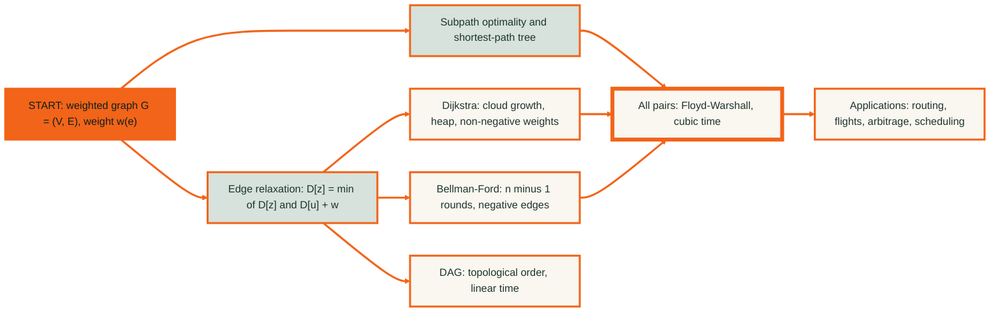
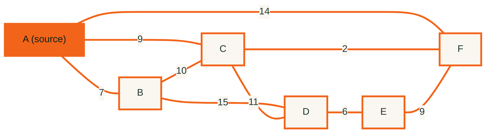
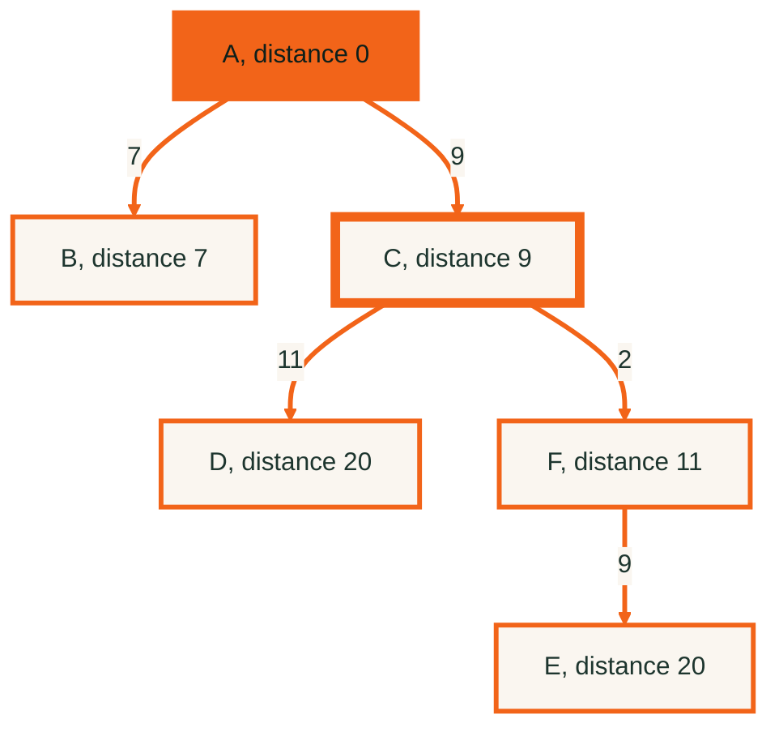

# 10 — Συντομότερες Διαδρομές
*Shortest Paths*

Ένας σταθμισμένος γράφος αποδίδει σε κάθε ακμή ένα αριθμητικό βάρος, και το μήκος μιας διαδρομής είναι το άθροισμα των βαρών της. Το κεφάλαιο λύνει το πρόβλημα εύρεσης της διαδρομής ελάχιστου μήκους από μία αφετηρία προς κάθε κορυφή, καθώς και προς όλα τα ζεύγη κορυφών. Η λύση στηρίζεται σε μία μόνο τοπική πράξη, τη χαλάρωση ακμής (`edge relaxation`), και σε τέσσερις διαφορετικές στρατηγικές οργάνωσης των χαλαρώσεων: την άπληστη ανάπτυξη σύννεφου του `Dijkstra`, τις επαναλαμβανόμενες σάρωσεις του `Bellman-Ford`, τη γραμμική σάρωση τοπολογικής διάταξης στα `DAG` και τη δυναμική συμπλήρωση πινάκων του `Floyd-Warshall`. Το κεφάλαιο στηρίζεται στις αναπαραστάσεις και τη διάσχιση της [09_graphs_dfs_bfs.md](09_graphs_dfs_bfs.md), στους σωρούς της [02_priority_queues_heaps.md](02_priority_queues_heaps.md) και στη δομή αναδρομικών εξισώσεων της [08_dynamic_programming.md](08_dynamic_programming.md). Τροφοδοτεί την ανάλυση των [11_minimum_spanning_trees.md](11_minimum_spanning_trees.md) και [12_maximum_flow.md](12_maximum_flow.md), ενώ η έννοια του κύκλου αρνητικού βάρους συνδέεται με τις αναγωγές της [13_np_completeness.md](13_np_completeness.md).

> **Εξεταστική κάλυψη:** Μόνο Τελική
> **Κεφάλαιο βιβλίου:** `Κεφ. 14` | **Διαλέξεις:** `20_shortest_paths.pdf`
> **Πηγή:** `Resources/Meta/mindmap.md` (Ενότητα 10)
> **Εκτός ύλης:** Ενότητα `14.5.2`

## Πίνακας Περιεχομένων

- [1. Εννοιολογικό Πλαίσιο και Συνολική Εικόνα](#1-εννοιολογικό-πλαίσιο-και-συνολική-εικόνα)
- [2. Θεωρητική Θεμελίωση και Τυπικοί Ορισμοί](#2-θεωρητική-θεμελίωση-και-τυπικοί-ορισμοί)
- [3. Αλγόριθμοι, Ιχνηλάτηση και Κώδικας](#3-αλγόριθμοι-ιχνηλάτηση-και-κώδικας)
- [4. Συγκριτική Ανάλυση και Πολυπλοκότητα](#4-συγκριτική-ανάλυση-και-πολυπλοκότητα)
- [5. Πλήρως Λυμένες Ασκήσεις Εξεταστικού Επιπέδου](#5-πλήρως-λυμένες-ασκήσεις-εξεταστικού-επιπέδου)
- [6. Οδηγός Επιβίωσης στις Εξετάσεις και Παγίδες](#6-οδηγός-επιβίωσης-στις-εξετάσεις-και-παγίδες)
- [7. Συνοπτικός Πίνακας Εννοιών](#7-συνοπτικός-πίνακας-εννοιών)

---

## 1. Εννοιολογικό Πλαίσιο και Συνολική Εικόνα

### Το Πρόβλημα

Ένας δρομολογητής (`router`) σε δίκτυο πακέτων γνωρίζει τη χωρητικότητα ή την καθυστέρηση κάθε ζεύγους γειτονικών κόμβων και πρέπει να προωθήσει κάθε πακέτο από τον κόμβο προέλευσης $s$ προς τον κόμβο προορισμού $t$ μέσω της διαδρομής ελάχιστης συνολικής καθυστέρησης. Οι κόμβοι είναι κορυφές και οι ζεύγη κόμβων με σύνδεση είναι ακμές ενός σταθμισμένου γράφου $G=(V,E)$ με $n=|V|$ και $m=|E|$· το βάρος $w(e)$ παριστά το κόστος της ακμής. Το ίδιο πρόβλημα εμφανίζεται στην εύρεση φθηνότερων πτήσεων, στη δρομολόγηση οχημάτων, στην ανάλυση κοινωνικών δικτύων και στην ανίχνευση ευκαιριών αρμπιτράζ σε αγορές συναλλάγματος. Σε όλες τις περιπτώσεις ζητείται μία ακολουθία ακμών που συνδέει δύο κορυφές και ελαχιστοποιεί το άθροισμα των βαρών, όχι απαραίτητα το πλήθος των ακμών.

Η απάντηση δεν είναι μοναδική όταν υπάρχουν ισοπαλίες· γι' αυτό κάθε ιχνηλάτηση ορίζει κανόνα ισοβαθμίας. Η απάντηση μπορεί να μην υπάρχει όταν δύο κορυφές ανήκουν σε διαφορετικές συνεκτικές συνιστώσες· τότε η απόσταση είναι άπειρη. Η απάντηση μπορεί να είναι απροσδιόριστη όταν υπάρχει κύκλος αρνητικού συνολικού βάρους προσβάσιμος από την αφετηρία· τότε η διαδρομή μπορεί να γίνει αυθαίρετα μικρή με επανάληψη του κύκλου και η απόσταση ορίζεται ως $-\infty$.

### Χάρτης Εννοιών του Κεφαλαίου



Πορτοκαλί γέμισμα: η αφετηρία του κεφαλαίου, ο σταθμισμένος γράφος (`START`). Απαλό πράσινο: οι δύο θεωρητικές έννοιες που ισχύουν ανεξάρτητα από αλγόριθμο, η χαλάρωση και η βέλτιστη υπο-διαδρομή. Κρεμ: οι τρεις αλγόριθμοι μίας πηγής. Παχύ περίγραμμα: το πρόβλημα όλων των ζευγών που συντίθεται από τους προηγούμενους. Κρεμ: η κοινή εφαρμογή.

| Ομάδα | Κόμβοι | Ρόλος |
|---|---|---|
| Αφετηρία | Σταθμισμένος γράφος $G=(V,E)$ | Ορίζει κορυφές, ακμές, βάρη και μέγεθος εισόδου |
| Θεωρία | Χαλάρωση ακμής, βέλτιστη υπο-διαδρομή | Επιτρέπει τη σταδιακή βελτίωση και την απόδειξη ορθότητας |
| Μία πηγή | `Dijkstra`, `Bellman-Ford`, `DAG` | Επιλύουν το πρόβλημα σε διαφορετικές υποθέσεις |
| Όλα τα ζεύγη | `Floyd-Warshall` | Επαναχρησιμοποιεί τη δομή των ενδιάμεσων κορυφών |
| Εφαρμογές | Δρομολόγηση, πτήσεις, αρμπιτράζ | Καταναλώνουν τις αποστάσεις ως υπορουτίνα |

### Πότε Χρησιμοποιείται Κάθε Αλγόριθμος

Ο `Dijkstra` επιλέγεται όταν όλα τα βάρη είναι μη αρνητικά και ζητείται μία πηγή· είναι ο ταχύτερος πρακτικά αλγόριθμος με σωρό και λίστα γειτνίασης. Ο `Bellman-Ford` επιλέγεται όταν υπάρχουν αρνητικά βάρη αλλά όχι αρνητικός κύκλος προσβάσιμος από την πηγή, ή όταν πρέπει να ανιχνευθεί αρνητικός κύκλος. Η τοπολογική διάταξη επιλέγεται όταν ο γράφος είναι `DAG`· τότε επιτρέπονται αρνητικά βάρη και ο χρόνος είναι γραμμικός. Ο `Floyd-Warshall` επιλέγεται όταν ζητούνται όλα τα ζεύγη και ο γράφος είναι πυκνός ή όταν υπάρχουν αρνητικά βάρη χωρίς αρνητικό κύκλο. Η επιλογή δεν γίνεται με κριτήριο την ασυμπτωτική τάξη μόνο· οι υποθέσεις για τα πρόσημα των βαρών και η απαίτηση για ένα ή όλα τα ζεύγη καθορίζουν ποιος αλγόριθμος είναι έγκυρος.

> Εκτός ύλης: Ενότητα `14.5.2`. Το κεφάλαιο καλύπτει τους τέσσερις αλγορίθμους και τη σύγκρισή τους· η εξειδικευμένη ύλη της ενότητας δεν αναπτύσσεται.

---

## 2. Θεωρητική Θεμελίωση και Τυπικοί Ορισμοί

### 2.1 Σταθμισμένοι Γράφοι, Μήκος Διαδρομής και Απόσταση

**Ορισμός (σταθμισμένος γράφος).** Σταθμισμένος γράφος είναι ζεύγος $(G,w)$, όπου $G=(V,E)$ είναι γράφος και $w:E\to\mathbb{R}$ είναι συνάρτηση βάρους (`weight function`) που αποδίδει σε κάθε ακμή $e$ ένα πραγματικό βάρος $w(e)$. Το βάρος μπορεί να είναι θετικό, μηδέν ή αρνητικό. Σε μη κατευθυνόμενο γράφο η ακμή $\{u,v\}$ έχει ένα βάρος· σε κατευθυνόμενο γράφο η ακμή $(u,v)$ έχει βάρος $w(u,v)$ και η $(v,u)$ μπορεί να έχει διαφορετικό βάρος.

**Ορισμός (μήκος διαδρομής).** Έστω διαδρομή $P=v_0,e_1,v_1,\dots,e_k,v_k$ από την $v_0$ στην $v_k$. Το μήκος (`length`) της $P$ είναι το άθροισμα των βαρών των ακμών της,
$$w(P)=\sum_{i=1}^{k} w(e_i).$$
Το μήκος μετρά βάρος, όχι πλήθος ακμών· μια διαδρομή με περισσότερες ακμές μπορεί να έχει μικρότερο μήκος.

**Ορισμός (απόσταση).** Η απόσταση (`distance`) από την κορυφή $s$ στην κορυφή $v$ είναι το ελάχιστο μήκος διαδρομής από την $s$ στην $v$,
$$d(s,v)=\min\{w(P): P \text{ είναι διαδρομή από την } s \text{ στην } v\}.$$
Αν δεν υπάρχει διαδρομή, ορίζεται $d(s,v)=+\infty$. Αν υπάρχει κύκλος αρνητικού βάρους προσβάσιμος από την $s$ και από αυτόν μπορεί να φτάσει κανείς στην $v$, τότε δεν υπάρχει ελάχιστο και ορίζεται $d(s,v)=-\infty$.

**Ορισμός (κύκλος αρνητικού βάρους).** Κύκλος αρνητικού βάρους (`negative cycle`) είναι κύκλος $C$ με $\sum_{e\in C} w(e)<0$. Αν η $s$ φτάνει σε κορυφή του $C$, τότε επαναλαμβάνοντας τον κύκλο το μήκος της διαδρομής μειώνεται χωρίς όριο· γι' αυτό το πρόβλημα συντομότερων διαδρομών έχει νόημα μόνο όταν κανένας αρνητικός κύκλος δεν είναι προσβάσιμος από την πηγή.

**Παράδειγμα.** Στον γράφο του Σχήματος 1, η διαδρομή $A\to C\to F\to E$ έχει μήκος $9+2+9=20$, ενώ η διαδρομή $A\to B\to C\to D\to E$ έχει μήκος $7+10+11+6=34$. Η πρώτη είναι συντομότερη ακόμη και αν και οι δύο χρησιμοποιούν το ίδιο πλήθος ή διαφορετικό πλήθος ακμών· το κριτήριο είναι το άθροισμα βαρών.

**Παρατήρηση (ακέραια βάρη και σύγκριση).** Στο μάθημα τα βάρη είναι συνήθως ακέραιοι. Η υπόθεση αυτή επιτρέπει ασφαλείς συγκρίσεις χωρίς σφάλματα κινητής υποδιαστολής και χρησιμοποιείται στις ιχνηλατήσεις. Σε γράφους με πραγματικά βάρη οι αλγόριθμοι παραμένουν σωστοί, αλλά η σύγκριση γίνεται με ανοχή.

### 2.2 Βελτιστότητα Υπο-διαδρομής και Δέντρο Συντομότερων Διαδρομών

**Λήμμα 2.1 (βελτιστότητα υπο-διαδρομής, `subpath optimality`).** Έστω $P$ συντομότερη διαδρομή από την $s$ στην $t$ και έστω $x,y$ δύο κορυφές της $P$, με την $x$ να προηγείται της $y$. Τότε το τμήμα $P_{xy}$ της $P$ από την $x$ στην $y$ είναι συντομότερη διαδρομή από την $x$ στην $y$.

*Απόδειξη.* Έστω $P=P_{sx}\cdot P_{xy}\cdot P_{yt}$, όπου το σύμβολο $\cdot$ δηλώνει παράθεση διαδρομών. Υποθέτουμε ότι υπάρχει διαδρομή $Q$ από την $x$ στην $y$ με $w(Q)<w(P_{xy})$. Τότε η παράθεση $P_{sx}\cdot Q\cdot P_{yt}$ είναι διαδρομή (ή βάδισμα, αν επαναλαμβάνει κορυφές) από την $s$ στην $t$ με μήκος
$$w(P_{sx})+w(Q)+w(P_{yt})<w(P_{sx})+w(P_{xy})+w(P_{yt})=w(P).$$
Αν η παράθεση επαναλαμβάνει κορυφές, αφαιρώντας τους κύκλους που σχηματίζονται προκύπτει διαδρομή από την $s$ στην $t$ με μήκος το πολύ ίσο με το παραπάνω. Επειδή δεν υπάρχει αρνητικός κύκλος, η αφαίρεση κύκλων δεν αυξάνει το μήκος. Έτσι προκύπτει διαδρομή από την $s$ στην $t$ μικρότερη από την $P$, που αντιφάσκει με τη βελτιστότητα της $P$. Άρα $w(Q)\ge w(P_{xy})$ για κάθε $Q$, δηλαδή η $P_{xy}$ είναι συντομότερη. $\square$

Το λήμμα είναι μονόδρομο: από τη βελτιστότητα της συνολικής διαδρομής συνεπάγεται η βελτιστότητα κάθε υπο-διαδρομής, όχι αντίστροφα. Μια διαδρομή της οποίας κάθε ακμή είναι συντομότερη μεταξύ των άκρων της μπορεί να μην είναι συνολικά συντομότερη, όπως δείχνει το παράδειγμα της Ενότητας 4.1.

**Θεώρημα 2.2 (ύπαρξη δέντρου συντομότερων διαδρομών).** Αν κανένας κύκλος αρνητικού βάρους δεν είναι προσβάσιμος από την $s$, τότε υπάρχει δέντρο $T$ με ρίζα την $s$, που επικαλύπτει όλες τις κορυφές τις προσβάσιμες από την $s$, τέτοιο ώστε για κάθε τέτοια κορυφή $v$ η διαδρομή της $T$ από την $s$ στην $v$ να έχει μήκος $d(s,v)$.

*Απόδειξη.* Για κάθε προσβάσιμη κορυφή $v$ επιλέγουμε μία συντομότερη διαδρομή $P_v$ από την $s$ στην $v$ που είναι απλή. Τέτοια διαδρομή υπάρχει: μια συντομότερη διαδρομή με επαναλαμβανόμενη κορυφή περιέχει κύκλο· ο κύκλος δεν μπορεί να έχει αρνητικό βάρος, αφού τότε η $s$ θα έφτανε σε αρνητικό κύκλο, άρα έχει βάρος μη αρνητικό και η αφαίρεσή του δεν αυξάνει το μήκος. Για κάθε $v\ne s$ ορίζουμε ως γονέα $\text{pred}(v)$ την κορυφή που προηγείται της $v$ στην $P_v$. Επειδή η $P_v$ είναι απλή, η αλυσίδα $\text{pred}(v),\text{pred}(\text{pred}(v)),\dots$ δεν επαναλαμβάνει κορυφή και καταλήγει στην $s$. Άρα οι δείκτες γονέα σχηματίζουν δέντρο με $n_s-1$ ακμές, όπου $n_s$ είναι το πλήθος των προσβάσιμων κορυφών. Για κάθε $v$, η διαδρομή της $T$ από την $s$ στην $v$ είναι η $P_v$, άρα έχει μήκος $d(s,v)$. $\square$

Το δέντρο δεν είναι κατ' ανάγκη μοναδικό όταν υπάρχουν ισοπαλίες. Ο κανόνας ισοβαθμίας των ιχνηλατήσεων καθορίζει ποιο από τα πολλά δέντρα παράγεται. Το δέντρο συντομότερων διαδρομών δεν ταυτίζεται με το δέντρο επικάλυψης ελαχίστου κόστους (`MST`) της [11_minimum_spanning_trees.md](11_minimum_spanning_trees.md): το πρώτο ελαχιστοποιεί την απόσταση από μία ρίζα, το δεύτερο το συνολικό βάρος όλων των ακμών.

### 2.3 Χαλάρωση Ακμής

**Ορισμός (χαλάρωση ακμής, `edge relaxation`).** Έστω $D[v]$ τρέχουσα εκτίμηση της απόστασης της $v$ από την πηγή $s$ και έστω ακμή $e=(u,z)$ με βάρος $w(e)$. Η χαλάρωση της $e$ εκτελεί
$$D[z]\leftarrow\min\{D[z],\,D[u]+w(e)\}.$$
Αν η τιμή μειωθεί, ενημερώνεται και ο προκάτοχος $\text{pred}(z)\leftarrow u$. Η πράξη είναι τοπική, διαρκεί $O(1)$ και αποτελεί το μοναδικό δομικό στοιχείο όλων των αλγορίθμων του κεφαλαίου· αυτό που διαφέρει είναι η σειρά και το πλήθος των χαλαρώσεων.

**Λήμμα 2.3 (φράγμα εκτίμησης).** Αν αρχικοποιήσουμε $D[s]=0$ και $D[v]=+\infty$ για $v\ne s$, και εκτελέσουμε οποιαδήποτε ακολουθία χαλαρώσεων, τότε σε κάθε στιγμή κάθε πεπερασμένη τιμή $D[v]$ είναι το μήκος κάποιας διαδρομής από την $s$ στην $v$. Κατά συνέπεια,
$$D[v]\ge d(s,v)$$
για κάθε $v$, με $d(s,v)=+\infty$ όταν η $v$ δεν είναι προσβάσιμη.

*Απόδειξη.* Επαγωγή στον αριθμό των χαλαρώσεων. Αρχικά $D[s]=0$ είναι το μήκος της κενής διαδρομής και οι υπόλοιπες τιμές είναι άπειρες. Έστω ότι η πρόταση ισχύει πριν από μια χαλάρωση της $(u,z)$. Αν $D[u]=+\infty$, δεν αλλάζει καμία τιμή. Αλλιώς, από την επαγωγική υπόθεση υπάρχει διαδρομή $P$ από την $s$ στην $u$ με μήκος $D[u]$. Αν η χαλάρωση μειώσει το $D[z]$, η νέα τιμή είναι $D[u]+w(u,z)$, δηλαδή το μήκος της παράθεσης $P\cdot(u,z)$, που είναι διαδρομή από την $s$ στην $z$. Σε κάθε περίπτωση η νέα τιμή είναι μήκος κάποιας διαδρομής. Επειδή η $d(s,v)$ είναι το ελάχιστο μήκος επί όλων των διαδρομών, έπεται $D[v]\ge d(s,v)$. $\square$

**Λήμμα 2.4 (κριτήριο σύγκλισης).** Αν μετά από μια σειρά χαλαρώσεων καμία ακμή δεν είναι χαλαρώσιμη, δηλαδή για κάθε ακμή $(u,z)$ ισχύει
$$D[z]\le D[u]+w(u,z),$$
και κάθε προσβάσιμη κορυφή έχει πεπερασμένο $D$, τότε $D[v]=d(s,v)$ για κάθε κορυφή $v$.

*Απόδειξη.* Από το Λήμμα 2.3 ισχύει $D[v]\ge d(s,v)$. Μένει η αντίστροφη ανισότητα. Έστω $v$ προσβάσιμη και έστω $P=s=v_0,v_1,\dots,v_k=v$ μια συντομότερη διαδρομή. Αποδεικνύουμε με επαγωγή στο $i$ ότι $D[v_i]\le d(s,v_i)$ για $i=0,\dots,k$. Για $i=0$, $D[s]\le 0=d(s,s)$. Έστω ότι ισχύει για $i-1$. Επειδή καμία ακμή δεν είναι χαλαρώσιμη,
$$D[v_i]\le D[v_{i-1}]+w(v_{i-1},v_i)\le d(s,v_{i-1})+w(v_{i-1},v_i)=d(s,v_i),$$
όπου η τελευταία ισότητα ισχύει επειδή η $P$ είναι συντομότερη και κάθε πρόθεμά της είναι συντομότερη από την $s$ στην αντίστοιχη κορυφή, από το Λήμμα 2.1. Για $i=k$ παίρνουμε $D[v]\le d(s,v)$, άρα $D[v]=d(s,v)$. $\square$

Το κριτήριο εξηγεί γιατί αρκεί να οδηγήσουμε τις χαλαρώσεις σε κατάσταση όπου καμία ακμή δεν βελτιώνει καμία εκτίμηση. Οι αλγόριθμοι διαφέρουν στον τρόπο με τον οποίο εγγυώνται ότι θα φτάσουν σε αυτή την κατάσταση και στο πόσο γρήγορα το κάνουν.

### 2.4 Ορθότητα του `Dijkstra`

Ο `Dijkstra` διατηρεί ένα σύνολο οριστικοποιημένων κορυφών $C$, το «σύννεφο» (`cloud`), που αρχικά περιέχει μόνο την πηγή $s$. Σε κάθε βήμα εξάγει από ουρά προτεραιότητας την κορυφή $u\notin C$ με ελάχιστη τιμή $D[u]$, την προσθέτει στο $C$ και χαλαρώνει όλες τις εξερχόμενες ακμές της.

**Αναλλοίωτη (`invariant`).** Πριν από κάθε εξαγωγή:
1. Για κάθε $u\in C$ ισχύει $D[u]=d(s,u)$.
2. Για κάθε $z\notin C$, η $D[z]$ είναι το ελάχιστο μήκος διαδρομής από την $s$ στην $z$ της οποίας όλες οι εσωτερικές κορυφές ανήκουν στο $C$, ή $+\infty$ αν δεν υπάρχει τέτοια διαδρομή.

**Θεώρημα 2.5 (ορθότητα του `Dijkstra`).** Αν όλα τα βάρη είναι μη αρνητικά, τότε μετά από $n$ εξαγωγές ισχύει $D[v]=d(s,v)$ για κάθε κορυφή $v$.

*Απόδειξη.* Αρκεί να δειχθεί ότι όταν εξάγεται μια κορυφή $u$ με ελάχιστη $D[u]$ μεταξύ των κορυφών εκτός $C$, ισχύει $D[u]=d(s,u)$. Έστω $P$ οποιαδήποτε διαδρομή από την $s$ στην $u$. Επειδή $s\in C$ και $u\notin C$, η $P$ περιέχει μια πρώτη ακμή $(x,y)$ που μεταβαίνει από το $C$ στο $V\setminus C$. Έστω $P_{sx}$ το πρόθεμα της $P$ έως την $x$ και $P_{yu}$ το υπόλοιπο από την $y$ στην $u$. Από την αναλλοίωτη, $D[x]=d(s,x)\le w(P_{sx})$. Επειδή η ακμή $(x,y)$ έχει χαλαρωθεί όταν η $x$ προστέθηκε στο $C$, ισχύει $D[y]\le D[x]+w(x,y)$. Επίσης, επειδή η $u$ ελαχιστοποιεί το $D$ εκτός $C$, ισχύει $D[u]\le D[y]$. Συνδυάζοντας,
$$w(P)=w(P_{sx})+w(x,y)+w(P_{yu})\ge D[x]+w(x,y)+w(P_{yu})\ge D[y]+w(P_{yu})\ge D[u]+w(P_{yu}).$$
Επειδή όλα τα βάρη είναι μη αρνητικά, $w(P_{yu})\ge 0$, άρα $w(P)\ge D[u]$. Η $P$ ήταν τυχούσα διαδρομή, επομένως $d(s,u)\ge D[u]$. Από το Λήμμα 2.3, $D[u]\ge d(s,u)$. Άρα $D[u]=d(s,u)$. Η πρόταση ισχύει για κάθε εξαγωγή· επαγωγικά, μετά την προσθήκη της $u$ στο $C$ και τη χαλάρωση των ακμών της, η αναλλοίωτη αποκαθίσταται. $\square$

**Αντιπαράδειγμα με αρνητική ακμή.** Ο γράφος έχει κορυφές $S,A,B$ και κατευθυνόμενες ακμές $(S,A)$ βάρους $1$, $(S,B)$ βάρους $2$ και $(B,A)$ βάρους $-2$. Ο `Dijkstra` εξάγει πρώτα την $A$ με $D[A]=1$, επειδή $1<2$. Στη συνέχεια εξάγει την $B$ με $D[B]=2$ και χαλαρώνει την $(B,A)$: $D[B]+w(B,A)=2-2=0<1$. Η $A$ όμως έχει ήδη οριστικοποιηθεί και δεν επανεξετάζεται, άρα ο αλγόριθμος επιστρέφει $D[A]=1$ ενώ η πραγματική απόσταση είναι $0$ μέσω $S\to B\to A$. Η απόδειξη απέτυχε στο βήμα $w(P_{yu})\ge 0$: η υπόλοιπη διαδρομή μετά την πρώτη έξοδο από το σύννεφο μπορεί να έχει αρνητικό μήκος και να αντισταθμίσει τη διαφορά.

**Πολυπλοκότητα.** Με λίστα γειτνίασης και δυαδικό σωρό, κάθε κορυφή εξάγεται μία φορά, κάθε ακμή χαλαρώνεται μία φορά όταν οριστικοποιείται η αφετηρία της και κάθε επιτυχής χαλάρωση προσθέτει μία εγγραφή στον σωρό. Άρα εκτελούνται το πολύ $n$ εξαγωγές και $m$ εισαγωγές, καθεμία σε $O(\log n)$ χειρότερη περίπτωση. Ο συνολικός χρόνος είναι
$$O((n+m)\log n)$$
στη χειρότερη περίπτωση, που για συνεκτικό γράφο γίνεται $O(m\log n)$. Ο χώρος είναι $O(n+m)$ για τη λίστα γειτνίασης και $O(n)$ για τους πίνακες $D$ και $\text{pred}$ και τον σωρό.

### 2.5 Ορθότητα του `Bellman-Ford` και Ανίχνευση Αρνητικού Κύκλου

Ο `Bellman-Ford` εκτελεί $n-1$ γύρους (`rounds`). Σε κάθε γύρο σαρώνει όλες τις ακμές με σταθερή σειρά και χαλαρώνει καθεμία. Η μέθοδος επιτρέπει αρνητικά βάρη, αρκεί να μην υπάρχει αρνητικός κύκλος προσβάσιμος από την πηγή.

**Ορισμός ($\mu_i(v)$).** Για $i\ge0$, έστω $\mu_i(v)$ το ελάχιστο μήκος διαδρομής από την $s$ στην $v$ που χρησιμοποιεί το πολύ $i$ ακμές· αν δεν υπάρχει τέτοια διαδρομή, $\mu_i(v)=+\infty$. Ισχύει $\mu_0(s)=0$ και $\mu_0(v)=+\infty$ για $v\ne s$.

**Θεώρημα 2.6 (αναλλοίωτη του `Bellman-Ford`).** Μετά τον γύρο $i$, για κάθε κορυφή $v$ ισχύει
$$D[v]\le\mu_i(v).$$
*Απόδειξη.* Επαγωγή στο $i$. Για $i=0$ ισχύει με ισότητα από την αρχικοποίηση. Έστω ότι ισχύει μετά τον γύρο $i-1$. Έστω $P$ μια διαδρομή από την $s$ στην $v$ με το πολύ $i$ ακμές και ελάχιστο μήκος $\mu_i(v)$. Αν η $P$ έχει το πολύ $i-1$ ακμές, τότε $\mu_{i-1}(v)\le w(P)$· από την επαγωγική υπόθεση $D[v]\le\mu_{i-1}(v)$ πριν από τον γύρο $i$, και επειδή οι χαλαρώσεις δεν αυξάνουν ποτέ μια τιμή, η ανισότητα διατηρείται μετά τον γύρο. Αν η $P$ έχει ακριβώς $i$ ακμές, έστω $(u,v)$ η τελευταία ακμή και $P'$ το πρόθεμα από την $s$ στην $u$, που έχει $i-1$ ακμές. Από την επαγωγική υπόθεση, πριν από τον γύρο $i$ ισχύει $D[u]\le w(P')$. Κατά τον γύρο $i$ η τιμή $D[u]$ μπορεί μόνο να μειωθεί, άρα όταν εξετάζεται η ακμή $(u,v)$ ισχύει $D[u]\le w(P')$. Η χαλάρωση εξασφαλίζει
$$D[v]\le D[u]+w(u,v)\le w(P')+w(u,v)=w(P)=\mu_i(v).$$
Σε κάθε περίπτωση, μετά τον γύρο $i$ ισχύει $D[v]\le\mu_i(v)$. $\square$

**Πόρισμα 2.7 (ορθότητα χωρίς αρνητικό κύκλο).** Αν δεν υπάρχει αρνητικός κύκλος προσβάσιμος από την $s$, τότε μετά από $n-1$ γύρους ισχύει $D[v]=d(s,v)$ για κάθε κορυφή $v$.

*Απόδειξη.* Από το Θεώρημα 2.6, $D[v]\le\mu_{n-1}(v)$. Χωρίς αρνητικό κύκλο, μια συντομότερη διαδρομή μπορεί να επιλεγεί απλή, άρα έχει το πολύ $n-1$ ακμές· επομένως $\mu_{n-1}(v)=d(s,v)$ και $D[v]\le d(s,v)$. Από το Λήμμα 2.3 ισχύει $D[v]\ge d(s,v)$. Άρα $D[v]=d(s,v)$. $\square$

**Θεώρημα 2.8 (ανίχνευση αρνητικού κύκλου).** Μετά από $n-1$ γύρους, υπάρχει χαλαρώσιμη ακμή, δηλαδή ακμή $(u,v)$ με $D[u]+w(u,v)<D[v]$, αν και μόνο αν υπάρχει κύκλος αρνητικού βάρους προσβάσιμος από την $s$.

*Απόδειξη.* ($\Rightarrow$) Με απαγωγή σε άτοπο. Έστω ότι δεν υπάρχει αρνητικός κύκλος προσβάσιμος από την $s$. Από το Πόρισμα 2.7, $D[v]=d(s,v)$ για κάθε $v$. Για κάθε ακμή $(u,v)$ με πεπερασμένο $D[u]$, η τριγωνική ανισότητα των αποστάσεων δίνει
$$d(s,v)\le d(s,u)+w(u,v),$$
επειδή η συντομότερη διαδρομή προς την $u$ ακολουθούμενη από την $(u,v)$ είναι διαδρομή προς την $v$. Άρα $D[v]\le D[u]+w(u,v)$ και καμία ακμή δεν είναι χαλαρώσιμη, αντίφαση. Επομένως, αν υπάρχει χαλαρώσιμη ακμή, υπάρχει αρνητικός κύκλος προσβάσιμος από την $s$.

($\Leftarrow$) Έστω κύκλος $C$ αρνητικού βάρους προσβάσιμος από την $s$, άρα όλες οι κορυφές του έχουν πεπερασμένο $D$ μετά από $n-1$ γύρους. Αν καμία ακμή δεν ήταν χαλαρώσιμη, θα ίσχυε $D[v]\le D[u]+w(u,v)$ για κάθε ακμή $(u,v)$ του κύκλου. Αθροίζοντας τις ανισότητες κατά μήκος του κύκλου, κάθε $D$ εμφανίζεται μία φορά στα αριστερά και μία φορά στα δεξιά, άρα
$$0\le\sum_{e\in C} w(e),$$
που αντιφάσκει με το αρνητικό βάρος του $C$. Επομένως τουλάχιστον μία ακμή είναι χαλαρώσιμη. $\square$

**Σημείωση για μη κατευθυνόμενους γράφους.** Με τη συνήθη μοντελοποίηση, κάθε μη κατευθυνόμενη ακμή $\{u,v\}$ βάρους $w$ αντικαθίσταται από δύο κατευθυνόμενες ακμές $(u,v)$ και $(v,u)$, καθεμία βάρους $w$. Αν $w<0$, οι δύο ακμές σχηματίζουν κύκλο βάρους $2w<0$. Γι' αυτό τα προβλήματα με αρνητικά βάρη διατυπώνονται σε κατευθυνόμενους γράφους· σε μη κατευθυνόμενο γράφο αρνητικό βάρος οδηγεί σε αρνητικό κύκλο στο παραπάνω μοντέλο και ο `Bellman-Ford` θα επιστρέψει ένδειξη αρνητικού κύκλου αντί για αποστάσεις.

**Πολυπλοκότητα.** Εκτελούνται $n-1$ γύροι και κάθε γύρος σαρώνει $m$ ακμές με σταθερό κόστος ανά ακμή. Ο χρόνος είναι
$$O(nm)$$
στη χειρότερη περίπτωση. Η τελική σάρωση ανίχνευσης κοστίζει $O(m)$ και δεν αλλάζει την τάξη. Ο χώρος είναι $O(n)$ για τους πίνακες $D$ και $\text{pred}$ πλέον $O(m)$ για την αποθήκευση των ακμών.

### 2.6 Συντομότερες Διαδρομές σε `DAG`

**Ορισμός (τοπολογική διάταξη).** Τοπολογική διάταξη (`topological order`) κατευθυνόμενου ακυκλικού γράφου είναι μια διάταξη $v_1,v_2,\dots,v_n$ των κορυφών τέτοια ώστε για κάθε ακμή $(v_i,v_j)$ να ισχύει $i<j$. Κάθε `DAG` έχει τουλάχιστον μία τοπολογική διάταξη, και μπορεί να υπολογιστεί με `DFS` ή με αφαίρεση κορυφών βαθμού εισόδου μηδέν σε χρόνο $O(n+m)$.

**Θεώρημα 2.9 (ορθότητα σε `DAG`).** Αν ο γράφος είναι `DAG` και επεξεργαστούμε τις κορυφές σε τοπολογική διάταξη, χαλαρώνοντας όλες τις εξερχόμενες ακμές κάθε κορυφής όταν την επεξεργαζόμαστε, τότε μετά την επεξεργασία όλων των κορυφών ισχύει $D[v]=d(s,v)$ για κάθε $v$. Επιτρέπονται αρνητικά βάρη.

*Απόδειξη.* Έστω $v_1,\dots,v_n$ η τοπολογική διάταξη. Αποδεικνύουμε με επαγωγή στο $i$ ότι μετά την επεξεργασία της $v_i$ ισχύει $D[v_i]=d(s,v_i)$ (ή και οι δύο είναι $+\infty$). Για $i=1$, η $v_1$ δεν έχει εισερχόμενες ακμές· αν $v_1=s$, $D[v_1]=0=d(s,v_1)$· αλλιώς δεν είναι προσβάσιμη και $D[v_1]=+\infty$. Έστω ότι ισχύει για όλες τις προηγούμενες κορυφές. Κάθε διαδρομή από την $s$ στην $v_i$ καταλήγει σε μια ακμή $(u,v_i)$ με $u$ προηγούμενη της $v_i$ στη διάταξη. Από την επαγωγική υπόθεση, $D[u]=d(s,u)$ για κάθε τέτοια $u$. Όταν η $u$ επεξεργάστηκε, η ακμή $(u,v_i)$ χαλαρώθηκε, άρα
$$D[v_i]\le\min_{(u,v_i)\in E}\{d(s,u)+w(u,v_i)\}=d(s,v_i).$$
Η τελευταία ισότητα ισχύει επειδή κάθε συντομότερη διαδρομή προς την $v_i$ αποτελείται από μια συντομότερη διαδρομή προς κάποιον προκάτοχό της και την τελευταία ακμή, από το Λήμμα 2.1. Από το Λήμμα 2.3, $D[v_i]\ge d(s,v_i)$. Άρα $D[v_i]=d(s,v_i)$. $\square$

**Πολυπλοκότητα.** Η τοπολογική ταξινόμηση κοστίζει $O(n+m)$ και κάθε ακμή χαλαρώνεται ακριβώς μία φορά, όταν επεξεργάζεται η αφετηρία της. Ο συνολικός χρόνος είναι
$$O(n+m),$$
δηλαδή γραμμικός και ταχύτερος από τον `Dijkstra` όταν ο γράφος είναι `DAG`. Ο χώρος είναι $O(n+m)$. Επειδή ένας `DAG` δεν έχει κύκλους, δεν μπορεί να έχει αρνητικό κύκλο· τα αρνητικά βάρη είναι ασφαλή.

### 2.7 Ορθότητα του `Floyd-Warshall`

Ο `Floyd-Warshall` λύνει το πρόβλημα όλων των ζευγών με δυναμικό προγραμματισμό. Αριθμεί τις κορυφές $1,2,\dots,n$ και ορίζει $D_k[i,j]$ ως το ελάχιστο μήκος διαδρομής από την $i$ στην $j$ της οποίας όλες οι εσωτερικές κορυφές ανήκουν στο σύνολο $\{1,\dots,k\}$. Ως εσωτερική νοείται κάθε κορυφή της διαδρομής εκτός από τα άκρα.

**Ορισμός (αρχικός πίνακας).** Για $k=0$ δεν επιτρέπεται καμία εσωτερική κορυφή. Άρα
$$D_0[i,j]=\begin{cases}0, & i=j,\\ \min\{w(i,j)\}, & i\ne j \text{ και υπάρχει ακμή }(i,j),\\ +\infty, & \text{διαφορετικά}.\end{cases}$$
Αν υπάρχουν παράλληλες ακμές, κρατείται η ελάχιστη. Αν υπάρχει αρνητικός κύκλος, η συμπλήρωση θα οδηγήσει τελικά σε αρνητικό διαγώνιο στοιχείο· στο εξής υποθέτουμε ότι δεν υπάρχει, ώστε οι τιμές $D_k[i,j]$ να είναι μήκη διαδρομών και τελικά αποστάσεις.

**Θεώρημα 2.10 (αναδρομική εξίσωση).** Για $k=1,\dots,n$ ισχύει
$$D_k[i,j]=\min\{D_{k-1}[i,j],\,D_{k-1}[i,k]+D_{k-1}[k,j]\}.$$

*Απόδειξη.* Έστω $P$ μια ελάχιστη διαδρομή από την $i$ στην $j$ με εσωτερικές κορυφές στο $\{1,\dots,k\}$. Επειδή δεν υπάρχει αρνητικός κύκλος, μπορούμε να επιλέξουμε την $P$ απλή. Διακρίνονται δύο περιπτώσεις.
1. Η $k$ δεν είναι εσωτερική κορυφή της $P$. Τότε όλες οι εσωτερικές κορυφές της $P$ ανήκουν στο $\{1,\dots,k-1\}$, άρα $w(P)\ge D_{k-1}[i,j]$.
2. Η $k$ είναι εσωτερική κορυφή της $P$. Επειδή η $P$ είναι απλή, η $k$ εμφανίζεται μία φορά· έστω $P_1$ το τμήμα $i\to k$ και $P_2$ το τμήμα $k\to j$. Οι εσωτερικές κορυφές των $P_1$ και $P_2$ ανήκουν στο $\{1,\dots,k-1\}$. Από το Λήμμα 2.1, το $P_1$ είναι ελάχιστο μεταξύ των διαδρομών $i\to k$ με εσωτερικές κορυφές στο $\{1,\dots,k-1\}$ και ομοίως το $P_2$. Άρα $w(P)\ge D_{k-1}[i,k]+D_{k-1}[k,j]$.
Σε κάθε περίπτωση, $w(P)\ge\min\{D_{k-1}[i,j],D_{k-1}[i,k]+D_{k-1}[k,j]\}$. Αντίστροφα, και οι δύο υποψήφιες τιμές αντιστοιχούν σε έγκυρες διαδρομές με εσωτερικές κορυφές στο $\{1,\dots,k\}$: η πρώτη από τον ορισμό του $D_{k-1}$ και η δεύτερη με παράθεση των δύο ελάχιστων διαδρομών, που δεν δημιουργεί κύκλο αρνητικού βάρους. Επομένως η ισότητα ισχύει. $\square$

**Πόρισμα 2.11 (τελικός πίνακας).** Μετά την επανάληψη $k=n$, ισχύει $D_n[i,j]=d(i,j)$ για κάθε ζεύγος κορυφών, εφόσον δεν υπάρχει αρνητικός κύκλος.

*Απόδειξη.* Για $k=n$ το σύνολο των επιτρεπόμενων εσωτερικών κορυφών είναι όλο το $V$. Κάθε απλή διαδρομή από την $i$ στην $j$ έχει εσωτερικές κορυφές στο $V$, και κάθε ελάχιστη διαδρομή μπορεί να επιλεγεί απλή. Άρα το $D_n[i,j]$ είναι το ελάχιστο μήκος απλής διαδρομής, δηλαδή η απόσταση. $\square$

**Ανίχνευση αρνητικού κύκλου.** Αν για κάποια κορυφή $i$ ισχύει $D_n[i,i]<0$, τότε υπάρχει διαδρομή από την $i$ στην $i$ με αρνητικό βάρος, δηλαδή κύκλος αρνητικού βάρους. Αντίστροφα, αν υπάρχει αρνητικός κύκλος, έστω $i$ κορυφή του· η διαδρομή που τον διατρέχει είναι διαδρομή $i\to i$ με αρνητικό βάρος, άρα $D_n[i,i]<0$. Επομένως η ύπαρξη αρνητικού κύκλου ελέγχεται σε $O(n)$ μετά τη συμπλήρωση.

**Ασφάλεια της επί τόπου ενημέρωσης.** Η υλοποίηση διατηρεί έναν μόνο πίνακα $D$ και τον ενημερώνει επί τόπου. Αυτό είναι σωστό επειδή, κατά την επανάληψη $k$, οι τιμές $D[i,k]$ και $D[k,j]$ δεν αλλάζουν. Πράγματι, μια ελάχιστη διαδρομή από την $i$ στην $k$ με εσωτερικές κορυφές στο $\{1,\dots,k\}$ μπορεί να επιλεγεί χωρίς την $k$ ως εσωτερική κορυφή· αν την περιείχε, θα σχημάτιζε κύκλο μέσω της $k$, τον οποίο θα αφαιρούσαμε χωρίς αύξηση του μήκους. Άρα $D_k[i,k]=D_{k-1}[i,k]$ και ομοίως $D_k[k,j]=D_{k-1}[k,j]$. Επομένως η ανάγνωση των δύο όρων δεν διαβάζει τιμή που έχει ήδη αλλάξει στον ίδιο γύρο.

**Πολυπλοκότητα.** Για κάθε $k$ εκτελούνται $n^2$ ενημερώσεις, καθεμία με σταθερό αριθμό πράξεων. Ο χρόνος είναι
$$O(n^3)$$
στη χειρότερη περίπτωση και ο χώρος $O(n^2)$ για τον πίνακα $D$. Η μέθοδος είναι κατάλληλη για πυκνούς γράφους και για όλα τα ζεύγη· δεν επωφελείται από την αραιότητα.

---

## 3. Αλγόριθμοι, Ιχνηλάτηση και Κώδικας

### 3.1 Παράδειγμα Γράφου και Κανόνας Ισοβαθμίας

Όλες οι ιχνηλατήσεις του `Dijkstra` χρησιμοποιούν τον ίδιο μη κατευθυνόμενο σταθμισμένο γράφο $G$ με κορυφές $V=\{A,B,C,D,E,F\}$ και ακμές
$$E=\{AB(7),\,AC(9),\,AF(14),\,BC(10),\,BD(15),\,CD(11),\,CF(2),\,DE(6),\,EF(9)\}.$$
Ο γράφος έχει $n=6$ κορυφές και $m=9$ ακμές, είναι συνεκτικός και όλα τα βάρη είναι θετικά. Η αφετηρία είναι η κορυφή $A$.



Πορτοκαλί γέμισμα: η αφετηρία $A$ (`source`). Κρεμ: όλες οι υπόλοιπες κορυφές. Οι αριθμοί στις ακμές είναι τα βάρη $w(e)$.

**Κανόνας ισοβαθμίας.** Όταν δύο κορυφές έχουν την ίδια ελάχιστη τιμή $D$, εξάγεται πρώτη η κορυφή που προηγείται αλφαβητικά. Στον σωρό της υλοποίησης η σύμβαση επιτυγχάνεται επειδή οι εγγραφές είναι πλειάδες $(\text{απόσταση},\text{κορυφή})$ και η σύγκριση πλειάδων λύνει την ισοπαλία με τη δεύτερη συνιστώσα. Παρωχημένες εγγραφές (`stale entries`) του σωρού, δηλαδή εγγραφές με απόσταση μεγαλύτερη από την τρέχουσα τιμή $D$ της κορυφής, παραλείπονται.

### 3.2 Αλγόριθμος `Dijkstra`

**Σκοπός.** Εύρεση των αποστάσεων από μία πηγή $s$ προς όλες τις κορυφές σε γράφο με μη αρνητικά βάρη, με άπληστη επέκταση ενός συνόλου οριστικοποιημένων κορυφών.

```text
Algorithm Dijkstra(G, s):
Input: weighted graph G with w(e) >= 0 for every edge e, source vertex s
Output: arrays D[0..n-1] and pred[0..n-1]

for each vertex v in G do
    D[v] <- +infinity
    pred[v] <- null
D[s] <- 0
C <- empty set
while C != V do
    u <- vertex in V - C with minimum D[u]
    if D[u] = +infinity then
        break
    add u to C
    for each edge e = (u, v) with v in V - C do
        if D[u] + w(e) < D[v] then
            D[v] <- D[u] + w(e)
            pred[v] <- u
return D, pred
```

**Ιχνηλάτηση.** Η αφετηρία είναι η $A$. Η στήλη «Σωρός» δείχνει την κατάσταση της ουράς προτεραιότητας μετά τις χαλαρώσεις του βήματος· οι παρωχημένες εγγραφές εμφανίζονται μέχρι να εξαχθούν και να παραλειφθούν.

| Βήμα | Εξαγωγή | $D[A]$ | $D[B]$ | $D[C]$ | $D[D]$ | $D[E]$ | $D[F]$ | Σωρός μετά |
|---|---|---|---|---|---|---|---|---|
| $0$ | αρχικοποίηση | $0$ | $\infty$ | $\infty$ | $\infty$ | $\infty$ | $\infty$ | $(0,A)$ |
| $1$ | $A\ (0)$ | $0$ | $7$ | $9$ | $\infty$ | $\infty$ | $14$ | $(7,B),(9,C),(14,F)$ |
| $2$ | $B\ (7)$ | $0$ | $7$ | $9$ | $22$ | $\infty$ | $14$ | $(9,C),(14,F),(22,D)$ |
| $3$ | $C\ (9)$ | $0$ | $7$ | $9$ | $20$ | $\infty$ | $11$ | $(11,F),(14,F),(20,D),(22,D)$ |
| $4$ | $F\ (11)$ | $0$ | $7$ | $9$ | $20$ | $20$ | $11$ | $(14,F),(20,D),(20,E),(22,D)$ |
| $5$ | $D\ (20)$ | $0$ | $7$ | $9$ | $20$ | $20$ | $11$ | $(14,F),(20,E),(22,D)$ |
| $6$ | $E\ (20)$ | $0$ | $7$ | $9$ | $20$ | $20$ | $11$ | $(14,F),(22,D)$ |
| $7$ | καμία· $(14,F)$ και $(22,D)$ είναι παρωχημένες | $0$ | $7$ | $9$ | $20$ | $20$ | $11$ | κενός |

**Αιτιολόγηση των χαλαρώσεων.**

| Βήμα | Κορυφή | Έλεγχος ακμών | Αποτέλεσμα |
|---|---|---|---|
| $1$ | $A$ | $A\to B$: $0+7=7$· $A\to C$: $0+9=9$· $A\to F$: $0+14=14$ | $D[B]=7$, $D[C]=9$, $D[F]=14$ |
| $2$ | $B$ | $B\to A$: $14>0$· $B\to C$: $17>9$· $B\to D$: $22<\infty$ | $D[D]=22$ |
| $3$ | $C$ | $C\to A$: $18>0$· $C\to B$: $19>7$· $C\to D$: $20<22$· $C\to F$: $11<14$ | $D[D]=20$, $D[F]=11$ |
| $4$ | $F$ | $F\to A$: $25>0$· $F\to C$: $13<9$ ψευδές· $F\to E$: $20<\infty$ | $D[E]=20$ |
| $5$ | $D$ | $D\to B$: $35>7$· $D\to C$: $31>9$· $D\to E$: $26>20$ | καμία βελτίωση |
| $6$ | $E$ | $E\to D$: $26>20$· $E\to F$: $29>11$ | καμία βελτίωση |

**Αποτέλεσμα.** $D[A]=0$, $D[B]=7$, $D[C]=9$, $D[D]=20$, $D[E]=20$, $D[F]=11$. Το δέντρο συντομότερων διαδρομών αποτελείται από τις ακμές $AB$, $AC$, $CD$, $CF$ και $FE$. Η διαδρομή προς την $E$ είναι $A\to C\to F\to E$ με μήκος $9+2+9=20$, ενώ η διαδρομή προς την $D$ είναι $A\to C\to D$ με μήκος $9+11=20$. Οι δύο κορυφές $D$ και $E$ έχουν ίση απόσταση· η σειρά εξαγωγής τους καθορίζεται από τον κανόνα ισοβαθμίας.



Πορτοκαλί γέμισμα: η πηγή $A$. Παχύ περίγραμμα: η κορυφή $C$, από την οποία διακλαδίζονται δύο συντομότερες διαδρομές. Κρεμ: τα φύλλα του δέντρου. Το δέντρο έχει $6-1=5$ ακμές, όσες απαιτεί κάθε δέντρο επικάλυψης.

**Ρητή υλοποίηση με σάρωση πίνακα.** Η επιλογή της ελάχιστης κορυφής γίνεται με γραμμική σάρωση, όπως στη βασική μορφή του αλγορίθμου.

```python
import math


def dijkstraArray(
    graph: dict[str, list[tuple[str, int]]], source: str
) -> dict[str, float]:
    """Computes single-source distances by scanning for the minimum.

    Args:
        graph (dict[str, list[tuple[str, int]]]): Adjacency list mapping each
            vertex to (neighbor, weight) pairs with non-negative weights.
        source (str): The start vertex.

    Returns:
        dict[str, float]: The shortest distance from source to every vertex.
            Unreachable vertices keep the value math.inf.
    """
    distances = {vertex: math.inf for vertex in graph}
    distances[source] = 0
    settled: set[str] = set()
    while len(settled) < len(graph):
        candidates = [v for v in graph if v not in settled]
        # The second tuple component makes ties resolve alphabetically.
        u = min(candidates, key=lambda vertex: (distances[vertex], vertex))
        if distances[u] == math.inf:
            break
        settled.add(u)
        for neighbor, weight in graph[u]:
            if neighbor not in settled:
                candidate = distances[u] + weight
                if candidate < distances[neighbor]:
                    distances[neighbor] = candidate
    return distances


example_graph = {
    "A": [("B", 7), ("C", 9), ("F", 14)],
    "B": [("A", 7), ("C", 10), ("D", 15)],
    "C": [("A", 9), ("B", 10), ("D", 11), ("F", 2)],
    "D": [("B", 15), ("C", 11), ("E", 6)],
    "E": [("D", 6), ("F", 9)],
    "F": [("A", 14), ("C", 2), ("E", 9)],
}

assert dijkstraArray(example_graph, "A") == {
    "A": 0,
    "B": 7,
    "C": 9,
    "D": 20,
    "E": 20,
    "F": 11,
}
```

**Υλοποίηση με `heapq` και παρωχημένες εγγραφές.** Η ουρά προτεραιότητας είναι δυαδικός σωρός ελαχίστου. Επειδή το `heapq` δεν παρέχει `decrease-key`, κάθε βελτίωση εισάγει νέα εγγραφή και η παλιά παραμένει στον σωρό μέχρι να εξαχθεί και να απορριφθεί.

```python
import heapq
import math


def dijkstraHeap(
    graph: dict[str, list[tuple[str, int]]], source: str
) -> dict[str, float]:
    """Computes single-source distances with a binary heap.

    Args:
        graph (dict[str, list[tuple[str, int]]]): Adjacency list mapping each
            vertex to (neighbor, weight) pairs with non-negative weights.
        source (str): The start vertex.

    Returns:
        dict[str, float]: The shortest distance from source to every vertex.
            Unreachable vertices keep the value math.inf.
    """
    distances = {vertex: math.inf for vertex in graph}
    distances[source] = 0
    heap: list[tuple[float, str]] = [(0, source)]
    settled: set[str] = set()
    while heap:
        current_distance, u = heapq.heappop(heap)
        # A stale entry is an older, larger estimate of a vertex already settled.
        if u in settled or current_distance > distances[u]:
            continue
        settled.add(u)
        for neighbor, weight in graph[u]:
            candidate = current_distance + weight
            if candidate < distances[neighbor]:
                distances[neighbor] = candidate
                heapq.heappush(heap, (candidate, neighbor))
    return distances


example_graph = {
    "A": [("B", 7), ("C", 9), ("F", 14)],
    "B": [("A", 7), ("C", 10), ("D", 15)],
    "C": [("A", 9), ("B", 10), ("D", 11), ("F", 2)],
    "D": [("B", 15), ("C", 11), ("E", 6)],
    "E": [("D", 6), ("F", 9)],
    "F": [("A", 14), ("C", 2), ("E", 9)],
}

assert dijkstraHeap(example_graph, "A") == {
    "A": 0,
    "B": 7,
    "C": 9,
    "D": 20,
    "E": 20,
    "F": 11,
}
```

| Μορφή | Χρόνος (χειρότερη) | Χώρος | Μείωση κλειδιού | Σχόλιο |
|---|---|---|---|---|
| `dijkstraArray` | $O(n^2+m)$ | $O(n)$ επιπλέον | καμία | Η βασική μορφή· καλή για πυκνούς γράφους |
| `dijkstraHeap` | $O((n+m)\log n)$ | $O(n+m)$ με τις παρωχημένες εγγραφές | όχι, χρήση διπλοτύπων | Η πρακτική μορφή στην Python |
| Σωρός με locators (βιβλίο) | $O((n+m)\log n)$ | $O(n)$ | ναι | Κάθε κορυφή έχει μία εγγραφή· απαιτεί δείκτη θέσης |

**Ανάλυση γραμμή προς γράμμη.** Η αρχικοποίηση κοστίζει $O(n)$. Η βασική μορφή εκτελεί $n$ επιλογές ελαχίστου, καθεμία με σάρωση $O(n)$, άρα $O(n^2)$, και κάθε ακμή χαλαρώνεται μία φορά από το οριστικοποιημένο άκρο της, άρα $O(m)$· συνολικά $O(n^2+m)$. Η μορφή με σωρό εκτελεί μία εξαγωγή για κάθε κορυφή και το πολύ μία εισαγωγή για κάθε επιτυχή χαλάρωση. Επειδή υπάρχουν το πολύ $m$ επιτυχείς χαλαρώσεις, εκτελούνται το πολύ $n+m$ πράξεις σωρού, καθεμία $O(\log n)$· ο χρόνος είναι $O((n+m)\log n)$. Οι παρωχημένες εγγραφές δεν αλλάζουν την τάξη, επειδή το πλήθος τους φράσσεται από το πλήθος των εισαγωγών.

### 3.3 Αλγόριθμος `Bellman-Ford`

**Σκοπός.** Εύρεση των αποστάσεων από μία πηγή όταν υπάρχουν αρνητικά βάρη, με επαναλαμβανόμενη σάρωση όλων των ακμών και ανίχνευση αρνητικού κύκλου.

```text
Algorithm BellmanFord(G, s):
Input: directed weighted graph G, source vertex s
Output: array D[0..n-1] and a flag for negative cycles

for each vertex v in G do
    D[v] <- +infinity
    pred[v] <- null
D[s] <- 0
for i <- 1 to n - 1 do
    for each edge e = (u, v) in G do
        if D[u] + w(e) < D[v] then
            D[v] <- D[u] + w(e)
            pred[v] <- u
for each edge e = (u, v) in G do
    if D[u] + w(e) < D[v] then
        return "negative cycle reachable from s"
return D
```

**Ιχνηλάτηση σε γράφο χωρίς αρνητικό κύκλο.** Ο γράφος έχει κορυφές $\{s,t,x,y,z\}$ και κατευθυνόμενες ακμές
$$(s,t,6),\ (s,y,7),\ (t,x,5),\ (t,y,8),\ (t,z,-4),\ (x,t,-2),\ (y,x,-3),\ (y,z,9),\ (z,x,7),\ (z,s,2).$$
Είναι ο ίδιος γράφος που χρησιμοποιείται στην ανάλυση του `Bellman-Ford` στο βιβλίο· περιέχει αρνητικά βάρη αλλά κανέναν αρνητικό κύκλο. Η σειρά σάρωσης είναι η παραπάνω.

| Γύρος | $D[s]$ | $D[t]$ | $D[x]$ | $D[y]$ | $D[z]$ | Βελτιώσεις του γύρου |
|---|---|---|---|---|---|---|
| $0$ | $0$ | $\infty$ | $\infty$ | $\infty$ | $\infty$ | αρχικοποίηση |
| $1$ | $0$ | $6$ | $4$ | $7$ | $2$ | $(s,t)=6$, $(s,y)=7$, $(t,x)=11$ μετά $(y,x)=4$, $(t,z)=2$ |
| $2$ | $0$ | $2$ | $4$ | $7$ | $2$ | $(x,t)=2$ |
| $3$ | $0$ | $2$ | $4$ | $7$ | $-2$ | $(t,z)=-2$ |
| $4$ | $0$ | $2$ | $4$ | $7$ | $-2$ | καμία |
| $5$ (έλεγχος) | $0$ | $2$ | $4$ | $7$ | $-2$ | καμία χαλαρώσιμη ακμή· δεν υπάρχει αρνητικός κύκλος |

Στον πρώτο γύρο η τιμή $D[x]$ γίνεται πρώτα $11$ από την $(t,x)$ και μετά $4$ από την $(y,x)$, επειδή η $y$ έχει ήδη βελτιωθεί νωρίτερα στον ίδιο γύρο. Η επί τόπου ενημέρωση επιτρέπει τέτοια διάδοση εντός του γύρου· η αναλλοίωτη του Θεωρήματος 2.6 είναι άνω φράγμα και δεν απαγορεύει ταχύτερη σύγκλιση. Μετά από $n-1=4$ γύρους οι αποστάσεις είναι $d(s,s)=0$, $d(s,t)=2$, $d(s,x)=4$, $d(s,y)=7$, $d(s,z)=-2$, και ο έλεγχος του πέμπτου γύρου δεν βρίσκει βελτίωση.

**Ιχνηλάτηση με αρνητικό κύκλο.** Ο γράφος έχει κορυφές $\{S,A,B,C\}$ και ακμές
$$(S,A,1),\ (A,B,2),\ (B,C,-2),\ (C,A,-2).$$
Ο κύκλος $A\to B\to C\to A$ έχει βάρος $2-2-2=-2$, άρα είναι αρνητικός. Εκτελούνται $n-1=3$ γύροι και ακολουθεί ο έλεγχος.

| Γύρος | $D[S]$ | $D[A]$ | $D[B]$ | $D[C]$ | Βελτιώσεις του γύρου |
|---|---|---|---|---|---|
| $0$ | $0$ | $\infty$ | $\infty$ | $\infty$ | αρχικοποίηση |
| $1$ | $0$ | $-1$ | $3$ | $1$ | $(S,A)=1$, $(A,B)=3$, $(B,C)=1$, $(C,A)=-1$ |
| $2$ | $0$ | $-3$ | $1$ | $-1$ | $(A,B)=1$, $(C,A)=-3$ |
| $3$ | $0$ | $-5$ | $-1$ | $-3$ | $(A,B)=-1$, $(B,C)=-3$, $(C,A)=-5$ |
| $4$ (έλεγχος) | $0$ | $-5$ | $-1$ | $-3$ | $(A,B)$: $-5+2=-3<-1$, άρα αρνητικός κύκλος |

Η τιμή $D[A]$ μειώνεται κατά $2$ σε κάθε πλήρη κύκλο: $-1,-3,-5$. Ο έλεγχος μετά τους $n-1$ γύρους βρίσκει την ακμή $(A,B)$ χαλαρώσιμη και επιστρέφει την ένδειξη αρνητικού κύκλου. Οι τιμές $D$ δεν είναι αποστάσεις· σε ύπαρξη αρνητικού κύκλου οι πραγματικές αποστάσεις των κορυφών του κύκλου είναι $-\infty$.

**Ρητή υλοποίηση.**

```python
import math


def bellmanFord(
    vertices: list[str],
    edges: list[tuple[str, str, int]],
    source: str,
) -> tuple[dict[str, float], bool]:
    """Computes single-source distances and detects negative cycles.

    Args:
        vertices (list[str]): All vertex labels of the directed graph.
        edges (list[tuple[str, str, int]]): Directed edges as (u, v, weight).
        source (str): The start vertex.

    Returns:
        tuple[dict[str, float], bool]: The distance estimates after n - 1
            rounds and a flag that is True exactly when a negative cycle is
            reachable from source.
    """
    distances = {vertex: math.inf for vertex in vertices}
    distances[source] = 0
    for _ in range(len(vertices) - 1):
        for u, v, weight in edges:
            # In-place updates may propagate several edges within one round.
            if distances[u] + weight < distances[v]:
                distances[v] = distances[u] + weight
    has_negative_cycle = any(
        distances[u] + weight < distances[v] for u, v, weight in edges
    )
    return distances, has_negative_cycle


vertices_no_cycle = ["s", "t", "x", "y", "z"]
edges_no_cycle = [
    ("s", "t", 6), ("s", "y", 7), ("t", "x", 5), ("t", "y", 8),
    ("t", "z", -4), ("x", "t", -2), ("y", "x", -3), ("y", "z", 9),
    ("z", "x", 7), ("z", "s", 2),
]
distances, flag = bellmanFord(vertices_no_cycle, edges_no_cycle, "s")
assert distances == {"s": 0, "t": 2, "x": 4, "y": 7, "z": -2}
assert flag is False

vertices_cycle = ["S", "A", "B", "C"]
edges_cycle = [("S", "A", 1), ("A", "B", 2), ("B", "C", -2), ("C", "A", -2)]
distances, flag = bellmanFord(vertices_cycle, edges_cycle, "S")
assert distances == {"S": 0, "A": -5, "B": -1, "C": -3}
assert flag is True
```

**Ιδιωματισμός.** Δεν υπάρχει συνάρτηση της τυπικής βιβλιοθήκης της Python που να υλοποιεί τον `Bellman-Ford`. Το `networkx` παρέχει συνάρτηση συντομότερων διαδρομών με αρνητικά βάρη, αλλά είναι εξωτερική βιβλιοθήκη και χρησιμοποιείται μόνο ως ανεξάρτητος έλεγχος, όχι ως απάντηση στην εξέταση.

**Ανάλυση γραμμή προς γραμμή.** Η αρχικοποίηση κοστίζει $O(n)$. Ο εξωτερικός βρόχος εκτελείται $n-1$ φορές και ο εσωτερικός σαρώνει $m$ ακμές, καθεμία με σταθερό κόστος· ο χρόνος είναι $O(nm)$. Η τελική σάρωση προσθέτει $O(m)$. Ο χώρος είναι $O(n)$ για τις αποστάσεις και τους προκατόχους και $O(m)$ για την αποθήκευση των ακμών.

### 3.4 Συντομότερες Διαδρομές σε `DAG`

**Σκοπός.** Εκμετάλλευση της ακυκλικότητας για υπολογισμό όλων των αποστάσεων από μία πηγή σε γραμμικό χρόνο, με αρνητικά βάρη επιτρεπτά.

```text
Algorithm DagShortestPaths(G, s):
Input: directed acyclic graph G with weights, source vertex s
Output: array D[0..n-1]

order <- topological order of G
for each vertex v in G do
    D[v] <- +infinity
D[s] <- 0
for each vertex u in order do
    if D[u] != +infinity then
        for each edge e = (u, v) outgoing from u do
            if D[u] + w(e) < D[v] then
                D[v] <- D[u] + w(e)
return D
```

**Ιχνηλάτηση.** Ο γράφος έχει κορυφές $\{A,B,C,D,E,F\}$ και κατευθυνόμενες ακμές
$$(A,B,2),\ (A,C,5),\ (B,C,1),\ (B,D,7),\ (C,D,2),\ (C,E,4),\ (D,F,3),\ (E,F,2).$$
Η διάταξη $A,B,C,D,E,F$ είναι τοπολογική, επειδή κάθε ακμή κατευθύνεται από μικρότερη θέση σε μεγαλύτερη. Η αφετηρία είναι η $A$.

| Θέση | $u$ | $D[u]$ πριν | Χαλαρώσεις | $D[A],D[B],D[C],D[D],D[E],D[F]$ μετά |
|---|---|---|---|---|
| $0$ | αρχικοποίηση | — | — | $0,\infty,\infty,\infty,\infty,\infty$ |
| $1$ | $A$ | $0$ | $B=2$, $C=5$ | $0,2,5,\infty,\infty,\infty$ |
| $2$ | $B$ | $2$ | $C=3$, $D=9$ | $0,2,3,9,\infty,\infty$ |
| $3$ | $C$ | $3$ | $D=5$, $E=7$ | $0,2,3,5,7,\infty$ |
| $4$ | $D$ | $5$ | $F=8$ | $0,2,3,5,7,8$ |
| $5$ | $E$ | $7$ | $F=9$ δεν βελτιώνει | $0,2,3,5,7,8$ |
| $6$ | $F$ | $8$ | καμία εξερχόμενη | $0,2,3,5,7,8$ |

Οι τελικές αποστάσεις είναι $D[A]=0$, $D[B]=2$, $D[C]=3$, $D[D]=5$, $D[E]=7$, $D[F]=8$. Η ακμή $(E,F)$ δεν βελτιώνει την $F$, επειδή $7+2=9>8$· η συντομότερη διαδρομή προς την $F$ είναι $A\to B\to C\to D\to F$ με μήκος $2+1+2+3=8$.

**Ρητή υλοποίηση με τοπολογική ταξινόμηση `Kahn`.**

```python
from collections import deque
import math


def dagShortestPaths(
    vertices: list[str],
    edges: list[tuple[str, str, int]],
    source: str,
) -> dict[str, float]:
    """Computes single-source distances in a DAG by topological order.

    Args:
        vertices (list[str]): All vertex labels of the DAG.
        edges (list[tuple[str, str, int]]): Directed edges as (u, v, weight).
        source (str): The start vertex.

    Returns:
        dict[str, float]: The shortest distance from source to every vertex.
            Unreachable vertices keep the value math.inf.
    """
    adjacency = {vertex: [] for vertex in vertices}
    indegree = {vertex: 0 for vertex in vertices}
    for u, v, weight in edges:
        adjacency[u].append((v, weight))
        indegree[v] += 1
    queue = deque(v for v in vertices if indegree[v] == 0)
    order: list[str] = []
    while queue:
        u = queue.popleft()
        order.append(u)
        for v, _ in adjacency[u]:
            indegree[v] -= 1
            if indegree[v] == 0:
                queue.append(v)
    distances = {vertex: math.inf for vertex in vertices}
    distances[source] = 0
    for u in order:
        if distances[u] == math.inf:
            continue
        for v, weight in adjacency[u]:
            if distances[u] + weight < distances[v]:
                distances[v] = distances[u] + weight
    return distances


dag_vertices = ["A", "B", "C", "D", "E", "F"]
dag_edges = [
    ("A", "B", 2), ("A", "C", 5), ("B", "C", 1), ("B", "D", 7),
    ("C", "D", 2), ("C", "E", 4), ("D", "F", 3), ("E", "F", 2),
]
assert dagShortestPaths(dag_vertices, dag_edges, "A") == {
    "A": 0,
    "B": 2,
    "C": 3,
    "D": 5,
    "E": 7,
    "F": 8,
}
```

**Ιδιωματισμός με `graphlib.TopologicalSorter`.** Η τυπική βιβλιοθήκη παρέχει μόνο την τοπολογική διάταξη, όχι τις αποστάσεις· η χαλάρωση παραμένει δική μας.

```python
from graphlib import TopologicalSorter
import math


def dagShortestPathsIdiom(
    vertices: list[str],
    edges: list[tuple[str, str, int]],
    source: str,
) -> dict[str, float]:
    """Computes DAG distances using graphlib for the topological order.

    Args:
        vertices (list[str]): All vertex labels of the DAG.
        edges (list[tuple[str, str, int]]): Directed edges as (u, v, weight).
        source (str): The start vertex.

    Returns:
        dict[str, float]: The shortest distance from source to every vertex.
    """
    dependencies = {vertex: set() for vertex in vertices}
    outgoing = {vertex: [] for vertex in vertices}
    for u, v, weight in edges:
        dependencies[v].add(u)
        outgoing[u].append((v, weight))
    order = list(TopologicalSorter(dependencies).static_order())
    distances = {vertex: math.inf for vertex in vertices}
    distances[source] = 0
    for u in order:
        if distances[u] == math.inf:
            continue
        for v, weight in outgoing[u]:
            if distances[u] + weight < distances[v]:
                distances[v] = distances[u] + weight
    return distances


dag_vertices = ["A", "B", "C", "D", "E", "F"]
dag_edges = [
    ("A", "B", 2), ("A", "C", 5), ("B", "C", 1), ("B", "D", 7),
    ("C", "D", 2), ("C", "E", 4), ("D", "F", 3), ("E", "F", 2),
]
assert dagShortestPathsIdiom(dag_vertices, dag_edges, "A") == {
    "A": 0,
    "B": 2,
    "C": 3,
    "D": 5,
    "E": 7,
    "F": 8,
}
```

**Ανάλυση γραμμή προς γραμμή.** Η κατασκευή της λίστας γειτνίασης και των βαθμών εισόδου κοστίζει $O(n+m)$. Η τοπολογική ταξινόμηση επεξεργάζεται κάθε κορυφή και κάθε ακμή μία φορά, άρα $O(n+m)$. Η φάση χαλάρωσης επισκέπτεται κάθε ακμή μία φορά, άρα $O(m)$. Ο συνολικός χρόνος είναι $O(n+m)$ και ο χώρος $O(n+m)$.

### 3.5 Αλγόριθμος `Floyd-Warshall`

**Σκοπός.** Υπολογισμός των αποστάσεων όλων των ζευγών με δυναμικό προγραμματισμό πάνω στο σύνολο των επιτρεπόμενων ενδιάμεσων κορυφών.

```text
Algorithm FloydWarshall(G):
Input: weighted graph G with vertices 1..n, no negative cycle
Output: matrix D[1..n, 1..n]

for i <- 1 to n do
    for j <- 1 to n do
        if i = j then D[i, j] <- 0
        else if edge (i, j) exists then D[i, j] <- w(i, j)
        else D[i, j] <- +infinity
for k <- 1 to n do
    for i <- 1 to n do
        for j <- 1 to n do
            if D[i, k] + D[k, j] < D[i, j] then
                D[i, j] <- D[i, k] + D[k, j]
return D
```

**Ιχνηλάτηση σε 4 κορυφές.** Ο κατευθυνόμενος γράφος έχει κορυφές $\{1,2,3,4\}$ και ακμές
$$(1,2,3),\ (1,4,7),\ (2,1,8),\ (2,3,2),\ (3,1,5),\ (3,4,1),\ (4,1,2).$$
Ο πίνακας $D_k$ επιτρέπει ως ενδιάμεσες τις κορυφές $\{1,\dots,k\}$. Σε κάθε βήμα σημειώνονται μόνο τα κελιά που βελτιώνονται· τα υπόλοιπα διατηρούν την τιμή τους.

**Αρχικός πίνακας $D_0$** (μόνο άμεσες ακμές, μηδέν στη διαγώνιο):

| $D_0$ | $1$ | $2$ | $3$ | $4$ |
|---|---|---|---|---|
| $1$ | $0$ | $3$ | $\infty$ | $7$ |
| $2$ | $8$ | $0$ | $2$ | $\infty$ |
| $3$ | $5$ | $\infty$ | $0$ | $1$ |
| $4$ | $2$ | $\infty$ | $\infty$ | $0$ |

**Βήμα $k=1$.** Επιτρέπεται η κορυφή $1$ ως ενδιάμεση. Βελτιώσεις:
$$D[2,4]=D[2,1]+D[1,4]=8+7=15,$$
$$D[3,2]=D[3,1]+D[1,2]=5+3=8,$$
$$D[4,2]=D[4,1]+D[1,2]=2+3=5.$$

| $D_1$ | $1$ | $2$ | $3$ | $4$ |
|---|---|---|---|---|
| $1$ | $0$ | $3$ | $\infty$ | $7$ |
| $2$ | $8$ | $0$ | $2$ | $15$ |
| $3$ | $5$ | $8$ | $0$ | $1$ |
| $4$ | $2$ | $5$ | $\infty$ | $0$ |

**Βήμα $k=2$.** Επιτρέπονται οι κορυφές $1,2$. Βελτιώσεις:
$$D[1,3]=D[1,2]+D[2,3]=3+2=5,$$
$$D[4,3]=D[4,2]+D[2,3]=5+2=7.$$

| $D_2$ | $1$ | $2$ | $3$ | $4$ |
|---|---|---|---|---|
| $1$ | $0$ | $3$ | $5$ | $7$ |
| $2$ | $8$ | $0$ | $2$ | $15$ |
| $3$ | $5$ | $8$ | $0$ | $1$ |
| $4$ | $2$ | $5$ | $7$ | $0$ |

**Βήμα $k=3$.** Επιτρέπονται οι κορυφές $1,2,3$. Βελτιώσεις:
$$D[1,4]=D[1,3]+D[3,4]=5+1=6,$$
$$D[2,1]=D[2,3]+D[3,1]=2+5=7,$$
$$D[2,4]=D[2,3]+D[3,4]=2+1=3.$$

| $D_3$ | $1$ | $2$ | $3$ | $4$ |
|---|---|---|---|---|
| $1$ | $0$ | $3$ | $5$ | $6$ |
| $2$ | $7$ | $0$ | $2$ | $3$ |
| $3$ | $5$ | $8$ | $0$ | $1$ |
| $4$ | $2$ | $5$ | $7$ | $0$ |

**Βήμα $k=4$.** Επιτρέπονται όλες οι κορυφές. Βελτιώσεις:
$$D[2,1]=D[2,4]+D[4,1]=3+2=5,$$
$$D[3,1]=D[3,4]+D[4,1]=1+2=3,$$
$$D[3,2]=D[3,4]+D[4,2]=1+5=6.$$

| $D_4$ | $1$ | $2$ | $3$ | $4$ |
|---|---|---|---|---|
| $1$ | $0$ | $3$ | $5$ | $6$ |
| $2$ | $5$ | $0$ | $2$ | $3$ |
| $3$ | $3$ | $6$ | $0$ | $1$ |
| $4$ | $2$ | $5$ | $7$ | $0$ |

**Ανάγνωση του τελικού πίνακα.** Η απόσταση $D_4[1,4]=6$ πραγματοποιείται με τη διαδρομή $1\to 3\to 4$: το $D_1[1,4]=7$ βελτιώνεται στο $D_3[1,4]=6$. Η απόσταση $D_4[2,1]=5$ πραγματοποιείται με τη διαδρομή $2\to 4\to 1$: $3+2=5$. Η απόσταση $D_4[3,2]=6$ πραγματοποιείται με τη διαδρομή $3\to 4\to 1\to 2$: $1+2+3=6$. Κανένα διαγώνιο στοιχείο δεν είναι αρνητικό, άρα δεν υπάρχει αρνητικός κύκλος.

**Ρητή υλοποίηση.**

```python
import math


def floydWarshall(
    vertices: list[str], edges: list[tuple[str, str, int]]
) -> list[list[float]]:
    """Computes all-pairs shortest distances with Floyd-Warshall.

    Args:
        vertices (list[str]): Vertex labels in the order used as matrix indices.
        edges (list[tuple[str, str, int]]): Directed edges as (u, v, weight).

    Returns:
        list[list[float]]: Matrix D where D[i][j] is the shortest distance from
            vertices[i] to vertices[j]. Unreachable pairs keep math.inf.
    """
    index = {vertex: position for position, vertex in enumerate(vertices)}
    n = len(vertices)
    distances: list[list[float]] = [[math.inf] * n for _ in range(n)]
    for i in range(n):
        distances[i][i] = 0
    for u, v, weight in edges:
        i, j = index[u], index[v]
        distances[i][j] = min(distances[i][j], weight)
    for k in range(n):
        for i in range(n):
            for j in range(n):
                # k is the outermost loop: row k and column k are unchanged.
                through_k = distances[i][k] + distances[k][j]
                if through_k < distances[i][j]:
                    distances[i][j] = through_k
    return distances


fw_vertices = ["1", "2", "3", "4"]
fw_edges = [
    ("1", "2", 3), ("1", "4", 7), ("2", "1", 8), ("2", "3", 2),
    ("3", "1", 5), ("3", "4", 1), ("4", "1", 2),
]
assert floydWarshall(fw_vertices, fw_edges) == [
    [0, 3, 5, 6],
    [5, 0, 2, 3],
    [3, 6, 0, 1],
    [2, 5, 7, 0],
]
```

**Ιδιωματισμός.** Δεν υπάρχει συνάρτηση της τυπικής βιβλιοθήκης που να υλοποιεί τον `Floyd-Warshall`. Ο τριπλός βρόχος είναι η ίδια η μέθοδος· οποιαδήποτε «συντομότερη» έκφραση θα έκρυβε την εξάρτηση από τη σειρά των τριών δεικτών.

**Ανάλυση γραμμή προς γραμμή.** Η αρχικοποίηση του πίνακα κοστίζει $O(n^2)$. Ο τριπλός βρόχος εκτελεί $n$ τιμές του $k$, $n$ τιμές του $i$ και $n$ τιμές του $j$, δηλαδή $n^3$ ενημερώσεις με σταθερό κόστος. Ο χρόνος είναι $O(n^3)$ στη χειρότερη περίπτωση και ο χώρος $O(n^2)$. Η ανίχνευση αρνητικού κύκλου γίνεται με έλεγχο των $n$ διαγώνιων στοιχείων σε $O(n)$.

---

## 4. Συγκριτική Ανάλυση και Πολυπλοκότητα

### 4.1 Σύγκριση των Αλγορίθμων Μίας Πηγής

| Αλγόριθμος | Απαίτηση στα βάρη | Δομή | Χρόνος (χειρότερη) | Χώρος | Ανιχνεύει αρνητικό κύκλο |
|---|---|---|---|---|---|
| `Dijkstra` με σάρωση | μη αρνητικά | σύνολο $C$ και πίνακας $D$ | $O(n^2+m)$ | $O(n)$ | όχι |
| `Dijkstra` με σωρό | μη αρνητικά | δυαδικός σωρός | $O((n+m)\log n)$ | $O(n+m)$ | όχι |
| `Bellman-Ford` | οποιαδήποτε | σάρωση όλων των ακμών | $O(nm)$ | $O(n+m)$ | ναι, μετά από $n-1$ γύρους |
| `DAG` | οποιαδήποτε | τοπολογική διάταξη | $O(n+m)$ | $O(n+m)$ | δεν έχει νόημα· ο `DAG` είναι ακυκλικός |

**Παρατήρηση για τις περιπτώσεις.** Σε πυκνό γράφο με $m=\Theta(n^2)$, ο `Dijkstra` με σάρωση έχει χρόνο $O(n^2)$, ίδιο με τον `Dijkstra` με σωρό ως προς την τάξη αλλά με μικρότερες σταθερές· ο σωρός υπερτερεί σε αραιούς γράφους, όπου $m=O(n)$. Ο `Bellman-Ford` είναι πάντα $O(nm)$ και γι' αυτό επιλέγεται μόνο όταν τα αρνητικά βάρη είναι απαραίτητα. Ο αλγόριθμος `DAG` είναι ο ταχύτερος δυνατός, αφού κάθε ακμή πρέπει να διαβαστεί τουλάχιστον μία φορά.

### 4.2 Σύγκριση των Μεθόδων Όλων των Ζευγών

| Μέθοδος | Υποθέσεις | Χρόνος (χειρότερη) | Χώρος | Κατάλληλη για |
|---|---|---|---|---|
| $n$ εκτελέσεις `Dijkstra` με σωρό | μη αρνητικά βάρη | $O(n(n+m)\log n)$ | $O(n+m)$ ανά εκτέλεση | Αραιούς γράφους, μη αρνητικά βάρη |
| $n$ εκτελέσεις `Bellman-Ford` | χωρίς αρνητικό κύκλο | $O(n^2m)$ | $O(n+m)$ ανά εκτέλεση | Αραιούς γράφους με αρνητικά βάρη |
| `Floyd-Warshall` | χωρίς αρνητικό κύκλο | $O(n^3)$ | $O(n^2)$ | Πυκνούς γράφους, όλα τα ζεύγη |

Σε πυκνό γράφο με $m=\Theta(n^2)$, οι $n$ εκτελέσεις `Dijkstra` κοστίζουν $O(n^3\log n)$ και οι $n$ εκτελέσεις `Bellman-Ford` κοστίζουν $O(n^4)$, ενώ ο `Floyd-Warshall` κοστίζει $O(n^3)$ και υπερτερεί. Σε αραιό γράφο με $m=O(n)$, οι $n$ εκτελέσεις `Dijkstra` κοστίζουν $O(n^2\log n)$ και υπερτερούν του $O(n^3)$ του `Floyd-Warshall`. Ο `Floyd-Warshall` είναι ο μόνος από τους τρεις που χειρίζεται αρνητικά βάρη χωρίς επανάληψη από κάθε πηγή, αλλά δεν επωφελείται από την αραιότητα.

**Αριθμητική επίδραση.** Στον επόμενο πίνακα οι τιμές είναι προσεγγιστικές πράξεις, χωρίς σταθερές υλοποίησης· δείχνουν την τάξη μεγέθους.

| Μέγεθος | $n$ `Dijkstra`, αραιό $m=5n$ | $n$ `Bellman-Ford`, αραιό $m=5n$ | `Floyd-Warshall` | $n$ `Dijkstra`, πυκνό $m=n^2/2$ |
|---|---|---|---|---|
| $n=100$ | $\approx 100\cdot 600\cdot 7=4.2\cdot10^5$ | $100^2\cdot 500=5\cdot10^6$ | $10^6$ | $\approx 100\cdot 5000\cdot 7=3.5\cdot10^6$ |
| $n=500$ | $\approx 500\cdot 3000\cdot 9=1.35\cdot10^7$ | $500^2\cdot 2500=6.25\cdot10^8$ | $1.25\cdot10^8$ | $\approx 500\cdot 125000\cdot 9=5.6\cdot10^8$ |
| $n=1000$ | $\approx 1000\cdot 6000\cdot 10=6\cdot10^7$ | $1000^2\cdot 5000=5\cdot10^9$ | $10^9$ | $\approx 1000\cdot 500000\cdot 10=5\cdot10^9$ |

Η αύξηση του $n$ κατά παράγοντα $2$ οκταπλασιάζει περίπου τον χρόνο του `Floyd-Warshall`, επειδή ο εκθέτης είναι $3$, και τετραπλασιάζει περίπου τον χρόνο των $n$ εκτελέσεων `Dijkstra` σε αραιό γράφο, επειδή ο κυρίαρχος όρος είναι $n^2\log n$. Η διαφορά αντανακλά τους εκθέτες $3$ και $2$ αντίστοιχα.

### 4.3 Κριτήρια Επιλογής Αλγορίθμου

| Απαίτηση / Σήμα εκφώνησης | Επιλογή | Αιτιολόγηση |
|---|---|---|
| Μία πηγή, όλα τα βάρη μη αρνητικά, αραιός γράφος | `Dijkstra` με σωρό | $O((n+m)\log n)$ χειρότερη, χωρίς επανάληψη από κάθε πηγή |
| Μία πηγή, πυκνός γράφος, μη αρνητικά βάρη | `Dijkstra` με σάρωση | $O(n^2+m)=O(n^2)$ χειρότερη, μικρές σταθερές |
| Μία πηγή, αρνητικά βάρη, χωρίς αρνητικό κύκλο | `Bellman-Ford` | $O(nm)$ χειρότερη, επιτρέπει αρνητικά βάρη |
| Ανίχνευση αρνητικού κύκλου ή αρμπιτράζ | `Bellman-Ford` | Η χαλαρώσιμη ακμή μετά από $n-1$ γύρους πιστοποιεί τον κύκλο |
| Γράφος `DAG`, οποιαδήποτε βάρη | Τοπολογική διάταξη | $O(n+m)$ χειρότερη, γραμμικός |
| Όλα τα ζεύγη, πυκνός γράφος | `Floyd-Warshall` | $O(n^3)$ χειρότερη, απλός και ανεξάρτητος από την αραιότητα |
| Όλα τα ζεύγη, αραιός γράφος, μη αρνητικά | $n$ φορές `Dijkstra` | $O(n(n+m)\log n)$ χειρότερη, καλύτερη από $O(n^3)$ |
| Όλα τα ζεύγη, αραιός γράφος, αρνητικά βάρη | $n$ φορές `Bellman-Ford` | $O(n^2m)$ χειρότερη, χωρίς αρνητικό κύκλο |

**Μνημονικό.** «`Dijkstra` όταν τα βάρη δεν γυρίζουν πίσω, `Bellman-Ford` όταν γυρίζουν, τοπολογική διάταξη όταν ο γράφος δεν έχει κύκλο, `Floyd-Warshall` όταν τα ζητάς όλα.» Η φράση συνοψίζει τις υποθέσεις που καθορίζουν την εγκυρότητα κάθε μεθόδου.

### 4.4 `Dijkstra` και `Prim`: Κοινή Δομή, Διαφορετικό Κλειδί

| Χαρακτηριστικό | `Dijkstra` | `Prim-Jarnik` |
|---|---|---|
| Τι ελαχιστοποιεί | Απόσταση από την πηγή $s$ | Βάρος ακμής προς το σύννεφο |
| Κλειδί κορυφής | $D[v]=$ μήκος συντομότερης γνωστής διαδρομής $s\to v$ | $d[v]=$ ελάχιστο βάρος ακμής από το σύννεφο στην $v$ |
| Ενημέρωση | $D[z]\leftarrow\min\{D[z],D[u]+w(u,z)\}$ | $d[z]\leftarrow\min\{d[z],w(u,z)\}$ |
| Αποτέλεσμα | Δέντρο συντομοτέρων διαδρομών | Δέντρο επικάλυψης ελαχίστου κόστους |
| Αρνητικά βάρη | Μη επιτρεπτά | Επιτρεπτά· το `MST` ορίζεται για οποιαδήποτε βάρη |

Οι δύο αλγόριθμοι χρησιμοποιούν την ίδια δομή σωρού και την ίδια λογική εξαγωγής ελαχίστου. Η διαφορά βρίσκεται στην ποσότητα που αποθηκεύεται ως κλειδί: ο `Dijkstra` προσθέτει το μήκος της διαδρομής, ο `Prim` κρατά μόνο το βάρος της ακμής. Η σύγχυση των δύο κλειδιών είναι από τα συχνότερα λάθη στις εξετάσεις.

### 4.5 Γιατί η Βελτιστότητα Υπο-διαδρομής Δεν Αντιστρέφεται

Η πρόταση «αν κάθε ακμή μιας διαδρομής είναι συντομότερη μεταξύ των άκρων της, τότε η διαδρομή είναι συντομότερη» είναι ψευδής. Έστω γράφος με κορυφές $s,a,t$, ακμές $(s,a,1)$, $(a,t,1)$ και $(s,t,1.5)$. Η διαδρομή $s\to a\to t$ έχει μήκος $2$, ενώ η απευθείας ακμή $(s,t)$ έχει μήκος $1.5$. Κάθε ακμή της $s\to a\to t$ είναι συντομότερη μεταξύ των άκρων της, αλλά η διαδρομή δεν είναι συντομότερη από την $s\to t$. Το Λήμμα 2.1 ισχύει μόνο με κατεύθυνση από το όλον προς το μέρος.

---

## 5. Πλήρως Λυμένες Ασκήσεις Εξεταστικού Επιπέδου

### Άσκηση 1: Ιχνηλάτηση του `Dijkstra` σε Έξι Κορυφές

**Εκφώνηση.** Δίνεται μη κατευθυνόμενος σταθμισμένος γράφος με κορυφές $V=\{1,2,3,4,5,6\}$ και ακμές
$$\{12(4),\,13(2),\,23(1),\,24(5),\,34(8),\,35(10),\,45(2),\,46(6),\,56(3)\}.$$
Εκτελέστε τον `Dijkstra` από την κορυφή $1$, δώστε όλες τις ενδιάμεσες τιμές $D$, το τελικό δέντρο συντομότερων διαδρομών και επαληθεύστε την ιδιότητα βελτιστότητας υπο-διαδρομής για τη διαδρομή προς την κορυφή $6$.

**Στρατηγική.** Εφαρμόζεται η άπληστη εξαγωγή ελαχίστου και η χαλάρωση όλων των ακμών προς μη οριστικοποιημένες κορυφές. Σε ισοπαλία εξάγεται η μικρότερη αριθμητικά κορυφή. Οι παρωχημένες εγγραφές του σωρού παραλείπονται και δεν επηρεάζουν τις τιμές $D$.

**Λύση.**

1. **Αρχικοποίηση.** $D=(0,\infty,\infty,\infty,\infty,\infty)$ για τις κορυφές $(1,2,3,4,5,6)$· σωρός $[(0,1)]$.

2. **Εξαγωγή $1$ με $D[1]=0$.** Χαλαρώνονται $1\to 2$: $0+4=4$ και $1\to 3$: $0+2=2$. Νέα $D=(0,4,2,\infty,\infty,\infty)$· σωρός $[(2,3),(4,2)]$.

3. **Εξαγωγή $3$ με $D[3]=2$.** Χαλαρώνονται $3\to 2$: $2+1=3<4$, άρα $D[2]=3$· $3\to 4$: $2+8=10$· $3\to 5$: $2+10=12$. Νέα $D=(0,3,2,10,12,\infty)$· σωρός $[(3,2),(4,2),(10,4),(12,5)]$.

4. **Εξαγωγή $2$ με $D[2]=3$.** Χαλαρώνεται $2\to 4$: $3+5=8<10$, άρα $D[4]=8$· οι $2\to 1$ και $2\to 3$ δεν βελτιώνουν. Νέα $D=(0,3,2,8,12,\infty)$· σωρός $[(4,2),(8,4),(10,4),(12,5)]$. Η εγγραφή $(4,2)$ είναι παρωχημένη και παραλείπεται στην επόμενη εξαγωγή.

5. **Εξαγωγή $4$ με $D[4]=8$.** Χαλαρώνονται $4\to 5$: $8+2=10<12$, άρα $D[5]=10$· $4\to 6$: $8+6=14$. Νέα $D=(0,3,2,8,10,14)$· σωρός $[(10,4),(10,5),(12,5),(14,6)]$.

6. **Εξαγωγή $5$ με $D[5]=10$.** Χαλαρώνεται $5\to 6$: $10+3=13<14$, άρα $D[6]=13$· οι $5\to 3$ και $5\to 4$ δεν βελτιώνουν. Νέα $D=(0,3,2,8,10,13)$· σωρός $[(12,5),(13,6),(14,6)]$.

7. **Εξαγωγή $6$ με $D[6]=13$.** Δεν υπάρχει βελτίωση· οι υπόλοιπες εγγραφές $(12,5)$ και $(14,6)$ είναι παρωχημένες και παραλείπονται. Τελικές αποστάσεις:
$$D[1]=0,\quad D[2]=3,\quad D[3]=2,\quad D[4]=8,\quad D[5]=10,\quad D[6]=13.$$

8. **Δέντρο συντομότερων διαδρομών.** Οι ακμές που πραγματοποίησαν τις τελικές τιμές είναι $13$, $32$, $24$, $45$, $56$. Το δέντρο έχει $6-1=5$ ακμές και περιέχει τη διαδρομή $1\to 3\to 2\to 4\to 5\to 6$ με μήκος $2+1+5+2+3=13$.

**Έλεγχος.** Η διαδρομή προς την $6$ έχει μήκος $13$. Ελέγχεται η υπο-διαδρομή $2\to 4\to 5$: το μήκος της είναι $5+2=7$. Εναλλακτικές διαδρομές $2\to 5$ είναι οι $2\to 3\to 5$ με $1+10=11$ και $2\to 4\to 6\to 5$ με $5+6+3=14$, άρα η $2\to 4\to 5$ είναι συντομότερη. Ομοίως, η υπο-διαδρομή $3\to 2\to 4$ έχει μήκος $1+5=6$, ενώ η απευθείας $3\to 4$ έχει $8$· είναι συντομότερη. Κάθε τμήμα της τελικής διαδρομής είναι συντομότερο, όπως απαιτεί το Λήμμα 2.1.

### Άσκηση 2: Παραγωγή των Πολυπλοκοτήτων

**Εκφώνηση.** Να παραχθούν με ρητά αθροίσματα και πλήθος πράξεων οι πολυπλοκότητες: (α) `Dijkstra` με σάρωση πίνακα, (β) `Dijkstra` με δυαδικό σωρό και παρωχημένες εγγραφές, (γ) `Bellman-Ford`, (δ) `Floyd-Warshall`. Να συγκριθούν για αραιό γράφο με $m=O(n)$ και για πυκνό με $m=\Theta(n^2)$.

**Στρατηγική.** Μετράται το πλήθος των εξαγωγών, των χαλαρώσεων και των πράξεων σωρού. Κάθε ακμή χαλαρώνεται μία φορά από κάθε οριστικοποιημένο άκρο στον `Dijkstra`, ενώ στον `Bellman-Ford` χαλαρώνεται μία φορά ανά γύρο. Οι σταθερές παραλείπονται και κρατείται η χειρότερη περίπτωση.

**Λύση.**

1. **`Dijkstra` με σάρωση.** Εκτελούνται $n$ επιλογές ελαχίστου. Η $i$-οστή επιλογή σαρώνει το πολύ $n$ κορυφές, άρα το σύνολο των συγκρίσεων είναι
$$\sum_{i=1}^{n} n=n^2=O(n^2).$$
Κάθε μία από τις $m$ ακμές χαλαρώνεται μία φορά, όταν οριστικοποιείται το ένα της άκρο, με κόστος $O(1)$. Συνολικά
$$T_{\text{array}}(n,m)=O(n^2+m).$$

2. **`Dijkstra` με σωρό.** Εκτελούνται $n$ εξαγωγές ελαχίστου. Κάθε επιτυχής χαλάρωση εισάγει μία εγγραφή· επειδή κάθε ακμή εξετάζεται μία φορά, οι επιτυχείς χαλαρώσεις είναι το πολύ $m$, άρα οι εισαγωγές το πολύ $m$. Κάθε πράξη σωρού κοστίζει $O(\log n)$ στη χειρότερη περίπτωση. Το σύνολο είναι
$$T_{\text{heap}}(n,m)=O\bigl((n+m)\log n\bigr).$$
Οι παρωχημένες εγγραφές είναι το πολύ όσες οι εισαγωγές, άρα δεν αλλάζουν την τάξη· κάθε μία εξάγεται και απορρίπτεται με $O(\log n)$.

3. **`Bellman-Ford`.** Εκτελούνται $n-1$ γύροι και κάθε γύρος εξετάζει $m$ ακμές με σταθερό κόστος. Ο χρόνος είναι
$$T_{\text{BF}}(n,m)=(n-1)m=O(nm).$$
Η τελική σάρωση ανίχνευσης προσθέτει $m=O(nm)$ για $n\ge1$.

4. **`Floyd-Warshall`.** Για κάθε μία από τις $n$ τιμές του $k$, για κάθε μία από τις $n$ τιμές του $i$ και για κάθε μία από τις $n$ τιμές του $j$ εκτελείται μία σύγκριση και το πολύ μία ανάθεση. Το πλήθος είναι
$$\sum_{k=1}^{n}\sum_{i=1}^{n}\sum_{j=1}^{n}1=n^3=O(n^3).$$

5. **Αραιός γράφος, $m=O(n)$.** Ο πίνακας δίνει $T_{\text{array}}=O(n^2+n)=O(n^2)$· ο σωρός δίνει $T_{\text{heap}}=O(n\log n)$· ο `Bellman-Ford` δίνει $O(n^2)$· ο `Floyd-Warshall` δίνει $O(n^3)$. Ο σωρός είναι ο ταχύτερος για μία πηγή, και ο `Floyd-Warshall` ο ακριβότερος.

6. **Πυκνός γράφος, $m=\Theta(n^2)$.** Ο πίνακας δίνει $O(n^2+n^2)=O(n^2)$· ο σωρός δίνει $O(n^2\log n)$· ο `Bellman-Ford` δίνει $O(n^3)$· ο `Floyd-Warshall` δίνει $O(n^3)$ αλλά με σταθερές που συχνά ευνοούν τη μέθοδο. Για μία πηγή, η σάρωση πίνακα είναι ανταγωνιστική του σωρού· για όλα τα ζεύγη, ο `Floyd-Warshall` είναι προτιμότερος από $n$ εκτελέσεις `Bellman-Ford`.

**Έλεγχος.** Για $n=1000$ και $m=5000$: $n^2=10^6$, $n\log n\approx10^4$, $nm=5\cdot10^6$, $n^3=10^9$. Οι αναλογίες $10^6/10^4=100$ και $10^9/(5\cdot10^6)=200$ συμφωνούν με τις τάξεις $n/\log n$ και $n^2/m$ αντίστοιχα.

### Άσκηση 3: Απόδειξη της Αναλλοίωτης του `Bellman-Ford`

**Εκφώνηση.** Να αποδειχθεί με επαγωγή ότι μετά τον γύρο $i$ του `Bellman-Ford` ισχύει $D[v]\le\mu_i(v)$ για κάθε κορυφή $v$, όπου $\mu_i(v)$ είναι το ελάχιστο μήκος διαδρομής από την $s$ στην $v$ με το πολύ $i$ ακμές. Στη συνέχεια να συναχθεί η ορθότητα μετά από $n-1$ γύρους και να εξηγηθεί γιατί η επί τόπου ενημέρωση δεν ακυρώνει την απόδειξη.

**Στρατηγική.** Η επαγωγή γίνεται στον αριθμό των γύρων. Για μια βέλτιστη διαδρομή με ακριβώς $i$ ακμές, ο προκάτοχος της τελευταίας κορυφής έχει βέλτιστο πρόθεμα με $i-1$ ακμές· η χαλάρωση της τελευταίας ακμής στον γύρο $i$ δίνει το φράγμα. Η επί τόπου ενημέρωση μόνο μειώνει τιμές, άρα διατηρεί την ανισότητα.

**Λύση.**

1. **Βάση $i=0$.** Πριν από κάθε γύρο, $D[s]=0=\mu_0(s)$ και $D[v]=+\infty=\mu_0(v)$ για $v\ne s$, αφού καμία διαδρομή με $0$ ακμές δεν φτάνει σε άλλη κορυφή. Άρα $D[v]\le\mu_0(v)$.

2. **Επαγωγική υπόθεση.** Έστω ότι μετά τον γύρο $i-1$ ισχύει $D[v]\le\mu_{i-1}(v)$ για κάθε $v$.

3. **Διαδρομή με το πολύ $i-1$ ακμές.** Έστω $v$ κορυφή και έστω $P$ διαδρομή από την $s$ στην $v$ με το πολύ $i-1$ ακμές. Από την επαγωγική υπόθεση, πριν από τον γύρο $i$ ισχύει $D[v]\le\mu_{i-1}(v)\le w(P)$. Κάθε χαλάρωση αντικαθιστά μια τιμή με μικρότερη ή ίση, άρα μετά τον γύρο $i$ εξακολουθεί να ισχύει $D[v]\le w(P)$.

4. **Διαδρομή με ακριβώς $i$ ακμές.** Έστω $P=s\to\cdots\to u\to v$ βέλτιστη διαδρομή με $i$ ακμές και έστω $P'$ το πρόθεμα $s\to u$, που έχει $i-1$ ακμές. Από την επαγωγική υπόθεση, πριν από τον γύρο $i$ ισχύει $D[u]\le w(P')$. Κατά τον γύρο $i$ η τιμή $D[u]$ μπορεί μόνο να μειωθεί, άρα όταν εξετάζεται η ακμή $(u,v)$ ισχύει $D[u]\le w(P')$. Αν η χαλάρωση εφαρμοστεί, $D[v]\le D[u]+w(u,v)\le w(P')+w(u,v)=w(P)$. Αν δεν εφαρμοστεί, η τρέχουσα τιμή είναι ήδη μικρότερη ή ίση, άρα πάλι $D[v]\le w(P)$.

5. **Συνδυασμός.** Κάθε διαδρομή με το πολύ $i$ ακμές έχει μήκος τουλάχιστον $\mu_i(v)$. Από τα βήματα 3 και 4, για κάθε τέτοια διαδρομή $P$ ισχύει $D[v]\le w(P)$ μετά τον γύρο $i$. Επομένως $D[v]\le\min_P w(P)=\mu_i(v)$.

6. **Ορθότητα μετά από $n-1$ γύρους.** Αν δεν υπάρχει αρνητικός κύκλος προσβάσιμος από την $s$, κάθε συντομότερη διαδρομή μπορεί να επιλεγεί απλή, άρα έχει το πολύ $n-1$ ακμές. Από το βήμα 5, $D[v]\le\mu_{n-1}(v)=d(s,v)$. Από το Λήμμα 2.3, $D[v]\ge d(s,v)$. Άρα $D[v]=d(s,v)$.

7. **Επί τόπου ενημέρωση.** Η απόδειξη χρησιμοποιεί μόνο ότι η τιμή $D[u]$ κατά την εξέταση της $(u,v)$ είναι το πολύ ίση με την τιμή της μετά τον γύρο $i-1$. Αυτό ισχύει επειδή οι χαλαρώσεις δεν αυξάνουν ποτέ μια τιμή. Αν η $D[u]$ έχει ήδη βελτιωθεί νωρίτερα στον ίδιο γύρο, η ανισότητα $D[u]\le w(P')$ παραμένει αληθής, και μάλιστα η σύγκλιση μπορεί να είναι ταχύτερη. Δεν απαιτείται αντιγραφή του πίνακα στο τέλος κάθε γύρου.

**Έλεγχος.** Στον γράφο της Ενότητας 3.3, μετά τον πρώτο γύρο $D[t]=6=\mu_1(t)$ και $D[x]=4$, ενώ $\mu_1(x)=+\infty$ επειδή καμία διαδρομή από την $s$ στην $x$ δεν έχει μόνο μία ακμή (η $s\to t\to x$ έχει δύο). Η τιμή $D[x]=4$ είναι μικρότερη από $\mu_1(x)$, που δεν αντιφάσκει με την ανισότητα $D\le\mu_1$· οφείλεται στην επί τόπου διάδοση μέσω $y$. Μετά τον τέταρτο γύρο οι τιμές είναι $D=(0,2,4,7,-2)$, όσο και οι πραγματικές αποστάσεις, και ο έλεγχος δεν βρίσκει χαλαρώσιμη ακμή.

### Άσκηση 4: Επιλογή Αλγορίθμου και Αιτιολόγηση

**Εκφώνηση.** Για καθεμία από τις επόμενες περιπτώσεις να επιλεγεί ο κατάλληλος αλγόριθμος συντομότερων διαδρομών και να αιτιολογηθεί με τις υποθέσεις, το ζητούμενο και την πολυπλοκότητα: (α) οδικό δίκτυο $10^6$ κόμβων και $5\cdot10^6$ ακμών με μη αρνητικές αποστάσεις, μία πηγή· (β) $200$ νομίσματα με ισοτιμίες και έλεγχος αν υπάρχει ευκαιρία αρμπιτράζ· (γ) `DAG` $10^4$ εργασιών με $3\cdot10^4$ σχέσεις προτεραιότητας και κόστη που μπορεί να είναι αρνητικά, μία πηγή· (δ) όλα τα ζεύγη σε πυκνό γράφο $400$ κορυφών· (ε) μία πηγή, $10^4$ κορυφές και $2\cdot10^4$ ακμές, με ακριβώς μία ακμή αρνητικού βάρους και χωρίς αρνητικό κύκλο· (στ) όλα τα ζεύγη σε αραιό γράφο $2000$ κορυφών και $10^4$ ακμών με μη αρνητικά βάρη.

**Στρατηγική.** Ελέγχονται τρεις παράγοντες με αυτή τη σειρά: αν υπάρχουν αρνητικά βάρη, αν ο γράφος είναι ακυκλικός και αν ζητούνται ένα ή όλα τα ζεύγη. Στη συνέχεια συγκρίνονται οι πολυπλοκότητες με βάση την πυκνότητα $m$ ως προς $n$.

**Λύση.**

1. **Περίπτωση (α), οδικό δίκτυο.** Όλα τα βάρη είναι μη αρνητικά και ζητείται μία πηγή. Επιλέγεται `Dijkstra` με σωρό και λίστα γειτνίασης, χρόνος $O((n+m)\log n)\approx 6\cdot10^6\cdot20=1.2\cdot10^8$ πράξεις. Ο `Bellman-Ford` θα ήταν $O(nm)=5\cdot10^{12}$ και απαράδεκτος· ο `Floyd-Warshall` είναι $O(n^3)$ και εκτός συζήτησης.

2. **Περίπτωση (β), αρμπιτράζ.** Το πρόβλημα ανάγεται σε ανίχνευση αρνητικού κύκλου: κάθε ισοτιμία $r$ μετατρέπεται σε βάρος $-\log r$, και κέρδος υπάρχει όταν γινόμενο ισοτιμιών $>1$, δηλαδή άθροισμα βαρών $<0$. Επιλέγεται `Bellman-Ford`, χρόνος $O(nm)$ με $n=200$ και $m\le 200\cdot199=39\,800$, δηλαδή περίπου $8\cdot10^6$ χαλαρώσεις. Ο `Dijkstra` απορρίπτεται λόγω αρνητικών βαρών· ο `Floyd-Warshall` θα ήταν $O(n^3)=8\cdot10^6$ και επίσης εφικτός, αλλά ο `Bellman-Ford` απαντά στο ερώτημα ύπαρξης με μία εκτέλεση και χωρίς πίνακα $n^2$.

3. **Περίπτωση (γ), `DAG` εργασιών.** Ο γράφος είναι ακυκλικός και τα αρνητικά βάρη επιτρέπονται. Επιλέγεται τοπολογική διάταξη και χαλάρωση, χρόνος $O(n+m)=4\cdot10^4$. Ο `Dijkstra` απορρίπτεται λόγω αρνητικών βαρών· ο `Bellman-Ford` είναι περιττός, αφού η ακυκλικότητα δίνει γραμμικό χρόνο.

4. **Περίπτωση (δ), όλα τα ζεύγη σε πυκνό γράφο.** Με $n=400$ και $m=\Theta(n^2)\approx80\,000$, ο `Floyd-Warshall` κοστίζει $400^3=64\cdot10^6$ εργασίες και χώρο $400^2=160\,000$ κελιά. Οι $400$ εκτελέσεις `Dijkstra` με σωρό κοστίζουν περίπου $400\cdot(80\,000+400)\cdot9\approx2.9\cdot10^8$, δηλαδή περισσότερο. Επιλέγεται `Floyd-Warshall`. Αν υπάρχουν αρνητικά βάρη χωρίς αρνητικό κύκλο, ο `Floyd-Warshall` παραμένει έγκυρος και γίνεται η μόνη πρακτική επιλογή από τις τρεις.

5. **Περίπτωση (ε), μία αρνητική ακμή.** Ο `Dijkstra` δεν είναι απλώς αργός· είναι λάθος, επειδή μια κορυφή που οριστικοποιήθηκε πριν από τη χαλάρωση της αρνητικής ακμής δεν επανεξετάζεται. Επιλέγεται `Bellman-Ford`, χρόνος $O(nm)=10^4\cdot2\cdot10^4=2\cdot10^8$ χαλαρώσεις, αποδεκτός. Εναλλακτικά, αν ο γράφος ήταν `DAG`, θα αρκούσε τοπολογική διάταξη· εδώ δεν δίνεται αυτή η υπόθεση, άρα ο `Bellman-Ford` είναι η ασφαλής γενική επιλογή.

6. **Περίπτωση (στ), όλα τα ζεύγη σε αραιό γράφο.** Με $n=2000$ και $m=10^4$, ο `Floyd-Warshall` κοστίζει $2000^3=8\cdot10^9$ εργασίες, ενώ $2000$ εκτελέσεις `Dijkstra` με σωρό κοστίζουν περίπου $2000\cdot(12\,000)\cdot11=2.64\cdot10^8$. Επιλέγεται επανάληψη `Dijkstra` από κάθε πηγή· ο `Floyd-Warshall` απορρίπτεται λόγω της αραιότητας.

**Έλεγχος.**

| Περίπτωση | Επιλογή | Χρόνος (χειρότερη) | Απορριπτόμενη εναλλακτική |
|---|---|---|---|
| (α) οδικό δίκτυο | `Dijkstra` με σωρό | $O((n+m)\log n)$ | `Bellman-Ford` $O(nm)=5\cdot10^{12}$ |
| (β) αρμπιτράζ | `Bellman-Ford` | $O(nm)\approx8\cdot10^6$ | `Dijkstra` λόγω αρνητικών βαρών |
| (γ) `DAG` εργασιών | Τοπολογική διάταξη | $O(n+m)=4\cdot10^4$ | `Dijkstra` λόγω αρνητικών βαρών |
| (δ) πυκνό, όλα τα ζεύγη | `Floyd-Warshall` | $O(n^3)=64\cdot10^6$ | $n$ `Dijkstra` $\approx2.9\cdot10^8$ |
| (ε) μία αρνητική ακμή | `Bellman-Ford` | $O(nm)=2\cdot10^8$ | `Dijkstra` λάθος |
| (στ) αραιό, όλα τα ζεύγη | $n$ `Dijkstra` | $O(n(n+m)\log n)\approx2.64\cdot10^8$ | `Floyd-Warshall` $8\cdot10^9$ |

### Άσκηση 5: Αποτυχία του `Dijkstra` με Αρνητική Ακμή

**Εκφώνηση.** Δίνεται κατευθυνόμενος γράφος με κορυφές $\{S,A,B,C\}$ και ακμές $(S,A,1)$, $(S,B,2)$, $(B,A,-2)$, $(A,C,2)$, $(B,C,5)$. Εκτελέστε τον `Dijkstra` από την $S$ και δείξτε ότι αποτυγχάνει. Στη συνέχεια εκτελέστε τον `Bellman-Ford` και επαληθεύστε ότι δίνει τις σωστές αποστάσεις. Εξηγήστε ποια υπόθεση του Θεωρήματος 2.5 παραβιάζεται.

**Στρατηγική.** Ο `Dijkstra` οριστικοποιεί κορυφές με αύξουσα $D$ και δεν τις επανεξετάζει. Η αρνητική ακμή $(B,A)$ μπορεί να βελτιώσει την $A$ μετά την οριστικοποίησή της, οπότε η τιμή που επιστρέφεται είναι μεγαλύτερη από την πραγματική. Ο `Bellman-Ford` επανεξετάζει όλες τις ακμές σε κάθε γύρο και διορθώνει την τιμή.

**Λύση.**

1. **`Dijkstra`, βήμα 1.** Αρχικοποίηση: $D[S]=0$, $D[A]=D[B]=D[C]=\infty$. Εξαγωγή $S$ με $0$· χαλαρώνονται $(S,A)$: $D[A]=1$ και $(S,B)$: $D[B]=2$.

2. **`Dijkstra`, βήμα 2.** Ελάχιστη μη οριστικοποιημένη είναι η $A$ με $D[A]=1$· εξάγεται και οριστικοποιείται. Χαλαρώνεται $(A,C)$: $D[C]=1+2=3$.

3. **`Dijkstra`, βήμα 3.** Επόμενη ελάχιστη είναι η $B$ με $D[B]=2$· εξάγεται και οριστικοποιείται. Η χαλάρωση $(B,A)$ δίνει $2-2=0<1$, αλλά η $A$ ανήκει στο σύνολο των οριστικοποιημένων και δεν ενημερώνεται. Η $(B,C)$ δίνει $2+5=7>3$ και δεν βελτιώνει.

4. **`Dijkstra`, βήμα 4.** Εξάγεται η $C$ με $D[C]=3$. Τελικό αποτέλεσμα: $D[S]=0$, $D[A]=1$, $D[B]=2$, $D[C]=3$. Η πραγματική απόσταση της $A$ είναι $0$ μέσω $S\to B\to A$ και της $C$ είναι $2$ μέσω $S\to B\to A\to C$, άρα ο αλγόριθμος επιστρέφει λάθος τιμές για δύο κορυφές.

5. **`Bellman-Ford`, γύρος 1.** Σειρά ακμών: $(S,A)$, $(S,B)$, $(B,A)$, $(A,C)$, $(B,C)$. Μετά την αρχικοποίηση $D[S]=0$. Εκτελούνται: $(S,A)$: $D[A]=1$· $(S,B)$: $D[B]=2$· $(B,A)$: $2-2=0<1$, άρα $D[A]=0$· $(A,C)$: $0+2=2$, άρα $D[C]=2$· $(B,C)$: $2+5=7>2$, καμία αλλαγή. Μετά τον γύρο $D=(0,0,2,2)$ για $(S,A,B,C)$.

6. **`Bellman-Ford`, γύροι 2 και 3.** Κάθε ακμή ελέγχεται ξανά: $(S,A)$: $1>0$· $(S,B)$: $2=2$· $(B,A)$: $0=0$· $(A,C)$: $2=2$· $(B,C)$: $7>2$. Καμία βελτίωση. Μετά από $n-1=3$ γύρους οι τιμές είναι $D[S]=0$, $D[A]=0$, $D[B]=2$, $D[C]=2$.

7. **Έλεγχος αρνητικού κύκλου.** Η τελική σάρωση δεν βρίσκει χαλαρώσιμη ακμή, άρα δεν υπάρχει αρνητικός κύκλος. Πράγματι, η μόνη αρνητική ακμή είναι η $(B,A)$ και δεν υπάρχει διαδρομή από την $A$ πίσω στην $B$.

8. **Παραβίαση υπόθεσης.** Το Θεώρημα 2.5 απαιτεί μη αρνητικά βάρη. Στην απόδειξη, η ανισότητα $w(P_{yu})\ge0$ χρησιμοποιείται για να συναχθεί $w(P)\ge D[u]$. Εδώ η διαδρομή $P$ προς την $A$ είναι $S\to B\to A$ με υπόλοιπο $B\to A$ βάρους $-2$· το αρνητικό υπόλοιπο επιτρέπει $w(P)=0<D[A]=1$, άρα το συμπέρασμα $D[A]\le w(P)$ καταρρέει.

**Έλεγχος.** Ο `Dijkstra` επιστρέφει $(0,1,2,3)$ και ο `Bellman-Ford` $(0,0,2,2)$. Η διαφορά εντοπίζεται στην $A$ και διαδίδεται στην $C$. Αν η ακμή $(B,A)$ είχε βάρος $+2$ αντί $-2$, ο `Dijkstra` θα έδινε $D[A]=1$ και $D[C]=3$, που θα ήταν σωστά· η αποτυχία οφείλεται αποκλειστικά στο αρνητικό πρόσημο.

---

## 6. Οδηγός Επιβίωσης στις Εξετάσεις και Παγίδες

### Παγίδες

| Παγίδα | Λάθος πεποίθηση | Γιατί είναι λάθος | Σωστός κανόνας |
|---|---|---|---|
| `Dijkstra` με αρνητική ακμή | «Αρκεί να μην υπάρχει αρνητικός κύκλος» | Μια κορυφή που οριστικοποιήθηκε μπορεί να χρειάζεται βελτίωση μέσω αργότερης αρνητικής ακμής | Ο `Dijkstra` απαιτεί **όλα** τα βάρη μη αρνητικά· αλλιώς `Bellman-Ford` ή τοπολογική διάταξη |
| Πλήθος γύρων `Bellman-Ford` | «Χρειάζονται $n$ γύροι για τις αποστάσεις» | Οι συντομότερες απλές διαδρομές έχουν το πολύ $n-1$ ακμές | $n-1$ γύροι για τις αποστάσεις· ο $n$-ος γύρος είναι μόνο έλεγχος |
| Ο $n$-ος γύρος διορθώνει | «Ο τελευταίος γύρος δίνει τη σωστή τιμή» | Αν βρεθεί χαλαρώσιμη ακμή, οι αποστάσεις δεν ορίζονται λόγω αρνητικού κύκλου | Μετά από $n-1$ γύρους ελέγχουμε· αν υπάρχει χαλαρώσιμη ακμή, επιστρέφουμε ένδειξη αρνητικού κύκλου |
| `Dijkstra` και `Prim` | «Είναι ο ίδιος αλγόριθμος με άλλο όνομα» | Το κλειδί είναι διαφορετικό: απόσταση από την πηγή έναντι βάρους ακμής προς το σύννεφο | `Dijkstra`: $D[u]+w(u,z)$· `Prim`: $w(u,z)$ |
| Σειρά βρόχων `Floyd-Warshall` | «Ο $k$ μπορεί να είναι ο εσωτερικός βρόχος» | Οι υπολογισμοί θα διάβαζαν κελιά που δεν έχουν ενημερωθεί για το τρέχον $k$ | Ο $k$ είναι πάντα ο εξωτερικός βρόχος· οι $D[i,k]$ και $D[k,j]$ μένουν σταθερές στον γύρο $k$ |
| Η τιμή $D[v]$ ως απόσταση | «Κάθε ενδιάμεση τιμή $D[v]$ είναι η απόσταση» | Η χαλάρωση δίνει άνω φράγμα· η τιμή μπορεί να βελτιωθεί αργότερα | $D[v]\ge d(s,v)$ πάντα· ισότητα μόνο όταν καμία ακμή δεν είναι χαλαρώσιμη |
| Αρνητικός κύκλος και $-\infty$ | «Ο αλγόριθμος επιστρέφει $-\infty$» | Οι υλοποιήσεις επιστρέφουν ένδειξη· οι τιμές $D$ δεν είναι αποστάσεις | Αναφέρουμε ρητά «αρνητικός κύκλος· δεν υπάρχει συντομότερη διαδρομή» |
| Αρνητική ακμή σε μη κατευθυνόμενο γράφο | «Ο `Bellman-Ford` τη χειρίζεται» | Με τη μοντελοποίηση δύο κατευθυνόμενων ακμών, το βάρος $2w<0$ δίνει αρνητικό κύκλο | Τα προβλήματα με αρνητικά βάρη διατυπώνονται σε κατευθυνόμενους γράφους· αλλιώς ο `Bellman-Ford` ανιχνεύει αρνητικό κύκλο |
| Αυθαίρετη σειρά σε `DAG` | «Αφού δεν έχει κύκλο, κάθε σειρά κάνει» | Μια κορυφή μπορεί να επεξεργαστεί πριν από τους προκατόχους της | Απαιτείται τοπολογική διάταξη· κάθε ακμή κοιτά από μικρότερη θέση σε μεγαλύτερη |
| «Ο `Dijkstra` είναι πάντα $O(m\log n)$» | «Ο σωρός δίνει πάντα αυτό το φράγμα» | Χρειάζονται και οι $n$ εξαγωγές· σε αραιό γράφο ο όρος $n$ μετράει | $O((n+m)\log n)$ με σωρό· $O(n^2+m)$ με σάρωση πίνακα |
| «Ο `Floyd-Warshall` είναι πάντα καλύτερος για όλα τα ζεύγη» | «Ένας αλγόριθμος για όλα τα ζεύγη» | Σε αραιό γράφο οι $n$ εκτελέσεις `Dijkstra` είναι ασυμπτωτικά φθηνότερες | Επιλογή κατά πυκνότητα: $O(n^3)$ έναντι $O(n(n+m)\log n)$ |
| Αντίστροφη βελτιστότητα υπο-διαδρομής | «Αν κάθε ακμή είναι συντομότερη, τότε και η διαδρομή είναι» | Τοπική βελτιστότητα δεν συνεπάγεται καθολική | Το Λήμμα 2.1 ισχύει μόνο από τη βελτιστική διαδρομή προς τις υπο-διαδρομές |

### Σημεία SOS

1. **Χαλάρωση ακμής.** Ο τύπος $D[z]\leftarrow\min\{D[z],D[u]+w(u,z)\}$ και η αναλλοίωτη $D[v]\ge d(s,v)$. Κάθε αλγόριθμος του κεφαλαίου είναι μια διαφορετική σειρά χαλαρώσεων.
2. **`Dijkstra`.** Μη αρνητικά βάρη, σύννεφο οριστικοποιημένων κορυφών, εξαγωγή ελαχίστου $D$, $O((n+m)\log n)$ με σωρό και $O(n^2+m)$ με σάρωση. Το αντιπαράδειγμα με αρνητική ακμή είναι υποχρεωτικό.
3. **`Bellman-Ford`.** $n-1$ γύροι, $O(nm)$, αρνητικά βάρη επιτρεπτά, ανίχνευση αρνητικού κύκλου με χαλαρώσιμη ακμή στον έλεγχο.
4. **`DAG`.** Τοπολογική διάταξη, μία χαλάρωση ανά ακμή, $O(n+m)$, αρνητικά βάρη χωρίς πρόβλημα.
5. **`Floyd-Warshall`.** $D_k[i,j]=\min\{D_{k-1}[i,j],D_{k-1}[i,k]+D_{k-1}[k,j]\}$, $O(n^3)$ χρόνος, $O(n^2)$ χώρος, $k$ εξωτερικός βρόχος, αρνητικός κύκλος αν $D[i,i]<0$.
6. **Βελτιστότητα υπο-διαδρομής.** Κάθε τμήμα συντομότερης διαδρομής είναι συντομότερη διαδρομή· η αντίστροφη πρόταση είναι ψευδής.
7. **Επιλογή μεθόδου.** Μη αρνητικά μία πηγή: `Dijkstra`· αρνητικά μία πηγή: `Bellman-Ford`· ακυκλικός: τοπολογική διάταξη· όλα τα ζεύγη πυκνά: `Floyd-Warshall`· όλα τα ζεύγη αραιά μη αρνητικά: $n$ φορές `Dijkstra`.

### Γρήγορη Επανάληψη

$$
D[z]\leftarrow\min\{D[z],\,D[u]+w(u,z)\}
$$

$$
\text{`Dijkstra`: } w(e)\ge0,\qquad T=O((n+m)\log n)
$$

$$
\text{`Bellman-Ford`: } D[v]\le\mu_i(v) \text{ μετά τον γύρο } i,\qquad T=O(nm)
$$

$$
\text{`DAG`: } T=O(n+m)
$$

$$
D_k[i,j]=\min\{D_{k-1}[i,j],\,D_{k-1}[i,k]+D_{k-1}[k,j]\},\qquad T=O(n^3)
$$

| Αλγόριθμος | Υποθέσεις | Ζητούμενο | Χρόνος (χειρότερη) | Ανιχνεύει αρνητικό κύκλο |
|---|---|---|---|---|
| `Dijkstra` | μη αρνητικά βάρη | μία πηγή | $O((n+m)\log n)$ | όχι |
| `Bellman-Ford` | χωρίς αρνητικό κύκλο | μία πηγή | $O(nm)$ | ναι |
| Τοπολογική διάταξη | `DAG` | μία πηγή | $O(n+m)$ | δεν έχει νόημα |
| `Floyd-Warshall` | χωρίς αρνητικό κύκλο | όλα τα ζεύγη | $O(n^3)$ | ναι, με $D[i,i]<0$ |

---

## 7. Συνοπτικός Πίνακας Εννοιών

| Έννοια / Αλγόριθμος | Ορισμός ή τύπος | Πολυπλοκότητα ή κύρια ιδιότητα | Τι ζητά η εξέταση |
|---|---|---|---|
| Σταθμισμένος γράφος | $G=(V,E)$ με $w:E\to\mathbb{R}$ | Βάρος σε κάθε ακμή, όχι μόνο πλήθος ακμών | Ορισμός και διάκριση από μη σταθμισμένο |
| Μήκος διαδρομής | $w(P)=\sum_{e\in P}w(e)$ | Άθροισμα βαρών | Υπολογισμός σε ιχνηλάτηση |
| Απόσταση | $d(s,v)=\min_P w(P)$ | $+\infty$ χωρίς διαδρομή· $-\infty$ με αρνητικό κύκλο | Διάκριση των τριών περιπτώσεων |
| Αρνητικός κύκλος | $\sum_{e\in C}w(e)<0$ | Επαναλαμβανόμενη διάσχιση μειώνει απεριόριστα | Ανίχνευση και ερμηνεία |
| Βελτιστότητα υπο-διαδρομής | Κάθε τμήμα συντομότερης διαδρομής είναι συντομότερο | Απόδειξη με αντικατάσταση | Απόδειξη ή χρήση σε ορθότητα |
| Δέντρο συντομότερων διαδρομών | Δέντρο με ρίζα $s$ και μονοπάτια μήκους $d(s,v)$ | Υπάρχει χωρίς αρνητικό κύκλο· μη μοναδικό | Κατασκευή και σύγκριση με `MST` |
| Χαλάρωση ακμής | $D[z]\leftarrow\min\{D[z],D[u]+w(u,z)\}$ | $O(1)$ ανά πράξη· κρατά $D[v]\ge d(s,v)$ | Εφαρμογή σε πίνακα και αναλλοίωτη |
| Κριτήριο σύγκλισης | Καμία χαλαρώσιμη ακμή $\Rightarrow D[v]=d(s,v)$ | Απόδειξη με συντομότερη διαδρομή | Θεωρητική δικαιολόγηση |
| `Dijkstra` | Άπληστη ανάπτυξη σύννεφου από την $s$ | $O((n+m)\log n)$ με σωρό· μη αρνητικά βάρη | Ιχνηλάτηση, σύγκριση με `Prim`, αντιπαράδειγμα |
| Αποτυχία `Dijkstra` | Οριστικοποιημένη κορυφή δεν επανεξετάζεται | Μια αργότερη αρνητική ακμή μπορεί να τη βελτιώσει | Κατασκευή αντιπαραδείγματος |
| `Bellman-Ford` | $n-1$ γύροι χαλάρωσης όλων των ακμών | $O(nm)$· αρνητικά βάρη επιτρεπτά | Ιχνηλάτηση γύρων |
| Αναλλοίωτη `Bellman-Ford` | $D[v]\le\mu_i(v)$ μετά τον γύρο $i$ | Επαγωγή στον αριθμό ακμών | Απόδειξη με επαγωγή |
| Ανίχνευση αρνητικού κύκλου | Χαλαρώσιμη ακμή μετά από $n-1$ γύρους | Ισοδύναμη με ύπαρξη αρνητικού κύκλου | Έλεγχος και ερμηνεία |
| `DAG` | Ακυκλικός κατευθυνόμενος γράφος | Τοπολογική διάταξη σε $O(n+m)$ | Αναγνώριση και χρήση |
| Τοπολογική διάταξη | Κάθε ακμή από μικρότερη σε μεγαλύτερη θέση | Μία χαλάρωση ανά ακμή | Σειρά επεξεργασίας |
| `Floyd-Warshall` | $D_k[i,j]=\min\{D_{k-1}[i,j],D_{k-1}[i,k]+D_{k-1}[k,j]\}$ | $O(n^3)$ χρόνος, $O(n^2)$ χώρος | Συμπλήρωση πινάκων κατά $k$ |
| Ενδιάμεση κορυφή | Επιτρεπόμενο σύνολο $\{1,\dots,k\}$ | Η $k$ εξωτερικός βρόχος | Σειρά βρόχων και ορθότητα |
| Αρνητικός κύκλος σε `Floyd-Warshall` | $D_n[i,i]<0$ | Έλεγχος διαγωνίου σε $O(n)$ | Ανίχνευση μετά τη συμπλήρωση |
| Όλα τα ζεύγη | $n$ `Dijkstra`, $n$ `Bellman-Ford`, `Floyd-Warshall` | $O(n(n+m)\log n)$, $O(n^2m)$, $O(n^3)$ | Επιλογή κατά πυκνότητα |
| `Dijkstra` και `Prim` | Ίδια δομή, διαφορετικό κλειδί | Απόσταση από πηγή έναντι ακμής προς σύννεφο | Διάκριση των δύο αλγορίθμων |
| Κανόνας επιλογής | Πρόσημο βαρών, ακυκλικότητα, πλήθος ζευγών | Καθορίζει έγκυρη και αποδοτική μέθοδο | Αιτιολόγηση επιλογής |


