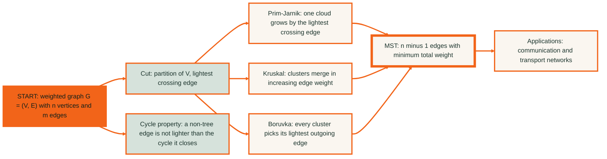
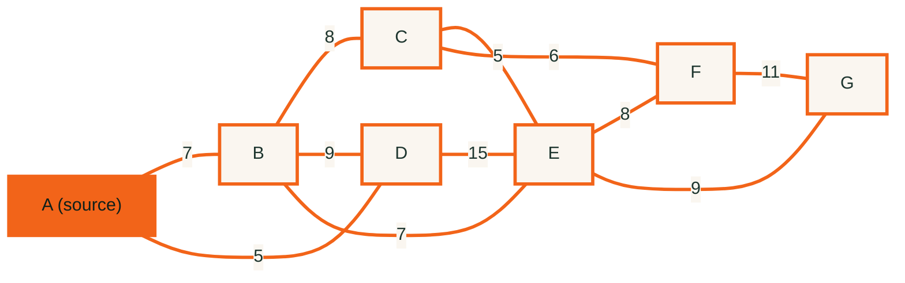
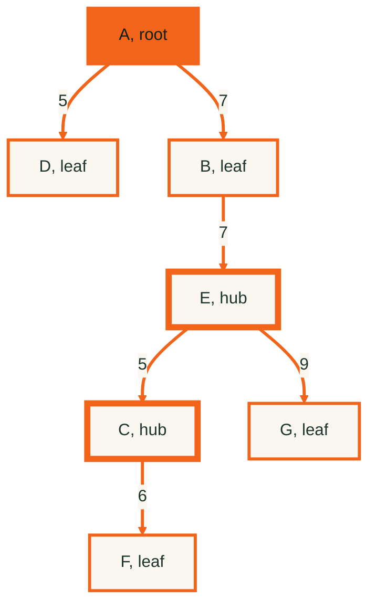

# 11 — Δέντρα Επικάλυψης Ελαχίστου Κόστους
*Minimum Spanning Trees*

Ένας σταθμισμένος μη κατευθυνόμενος γράφος μοντελοποιεί δίκτυα στα οποία κάθε σύνδεση έχει κόστος, και το ζητούμενο είναι η φθηνότερη επιλογή συνδέσεων που κρατά όλους τους κόμβους συνδεδεμένους. Το κεφάλαιο ορίζει το δέντρο επικάλυψης ελαχίστου κόστους (`Minimum Spanning Tree`, `MST`) και αποδεικνύει δύο ιδιότητες, την ιδιότητα του κύκλου και την ιδιότητα του διαμερισμού, που πιστοποιούν πότε μια ακμή ανήκει σε κάποιο `MST`. Πάνω στις ιδιότητες στηρίζονται τρεις άπληστοι αλγόριθμοι (`greedy algorithms`): ο `Prim-Jarnik`, που αναπτύσσει ένα σύννεφο, ο `Kruskal`, που ενώνει συστάδες (`clusters`) με ταξινομημένες ακμές, και ο `Borůvka`, που επιτρέπει σε κάθε συστάδα να επιλέγει ταυτόχρονα τη φθηνότερη εξερχόμενη ακμή της. Το κεφάλαιο χρησιμοποιεί τους σωρούς (`heaps`) της [02_priority_queues_heaps.md](02_priority_queues_heaps.md), τη δομή ένωσης-εύρεσης (`union-find`) της [04_union_find.md](04_union_find.md) και τις αναπαραστάσεις γράφων της [09_graphs_dfs_bfs.md](09_graphs_dfs_bfs.md). Διακρίνεται από τις συντομότερες διαδρομές της [10_shortest_paths.md](10_shortest_paths.md): το `MST` ελαχιστοποιεί το συνολικό βάρος όλων των ακμών, όχι την απόσταση από μία ρίζα.

> **Εξεταστική κάλυψη:** Μόνο Τελική
> **Κεφάλαιο βιβλίου:** `Κεφ. 15` | **Διαλέξεις:** `21_minimum_spanning_trees.pdf`
> **Πηγή:** `Resources/Meta/mindmap.md` (Ενότητα 11)
> **Εκτός ύλης:** Καμία

## Πίνακας Περιεχομένων

- [1. Εννοιολογικό Πλαίσιο και Συνολική Εικόνα](#1-εννοιολογικό-πλαίσιο-και-συνολική-εικόνα)
- [2. Θεωρητική Θεμελίωση και Τυπικοί Ορισμοί](#2-θεωρητική-θεμελίωση-και-τυπικοί-ορισμοί)
- [3. Αλγόριθμοι, Ιχνηλάτηση και Κώδικας](#3-αλγόριθμοι-ιχνηλάτηση-και-κώδικας)
- [4. Συγκριτική Ανάλυση και Πολυπλοκότητα](#4-συγκριτική-ανάλυση-και-πολυπλοκότητα)
- [5. Πλήρως Λυμένες Ασκήσεις Εξεταστικού Επιπέδου](#5-πλήρως-λυμένες-ασκήσεις-εξεταστικού-επιπέδου)
- [6. Οδηγός Επιβίωσης στις Εξετάσεις και Παγίδες](#6-οδηγός-επιβίωσης-στις-εξετάσεις-και-παγίδες)
- [7. Συνοπτικός Πίνακας Εννοιών](#7-συνοπτικός-πίνακας-εννοιών)

---

## 1. Εννοιολογικό Πλαίσιο και Συνολική Εικόνα

### Το Πρόβλημα

Ένα πανεπιστημιακό συγκρότημα έχει επτά κτίρια, $A$ έως $G$, και πρέπει να συνδεθεί με οπτικές ίνες. Για κάθε ζεύγος κτιρίων υπάρχει μία προτεινόμενη όδευση με γνωστό κόστος κατασκευής, και ζητείται το φθηνότερο σύνολο οδεύσεων που καθιστά δυνατή την επικοινωνία κάθε κτιρίου με κάθε άλλο. Οι κορυφές είναι τα κτίρια, οι ακμές είναι οι δυνατές οδεύσεις και το βάρος $w(e)$ είναι το κόστος κάθε όδευσης. Κάθε λύση πρέπει να είναι συνεκτική και να επικαλύπτει όλες τις κορυφές· αν περιέχει κύκλο, αφαιρώντας μία ακμή του κύκλου διατηρείται η συνεκτικότητα και το κόστος μειώνεται, άρα μια βέλτιστη λύση δεν περιέχει κύκλο. Η βέλτιστη λύση είναι επομένως δέντρο επικάλυψης με ελάχιστο συνολικό βάρος.

Το ίδιο πρόβλημα εμφανίζεται στον σχεδιασμό δικτύων επικοινωνιών, στην κατασκευή σιδηροδρομικών ή οδικών δικτύων, στη σύνδεση αισθητήρων και στη συσταδοποίηση σημείων με ελάχιστο συνολικό μήκος συνδέσεων. Η είσοδος περιγράφεται από το πλήθος κορυφών $n=|V|$ και το πλήθος ακμών $m=|E|$, και το κόστος της λύσης είναι το άθροισμα
$$w(T)=\sum_{e\in T} w(e).$$
Στο μάθημα ο γράφος είναι μη κατευθυνόμενος και συνεκτικός, τα βάρη είναι ακέραιοι και οι ισοπαλίες λύνονται με ρητό κανόνα. Αν ο γράφος δεν είναι συνεκτικός, το πρόβλημα λύνεται χωριστά σε κάθε συνεκτική συνιστώσα και το αποτέλεσμα είναι ελάχιστο δάσος επικάλυψης (`minimum spanning forest`).

Το κριτήριο δεν είναι η απόσταση μεταξύ δύο κορυφών. Ένα `MST` μπορεί να περιέχει μια πολύ μακριά ακμή, αν αυτή είναι ο φθηνότερος τρόπος να ενωθούν δύο μεγάλες ομάδες κορυφών· η ελαχιστοποίηση αφορά το σύνολο των ακμών, όπως εξηγεί η σύγκριση με το δέντρο συντομότερων διαδρομών στην Ενότητα 4.3.

### Χάρτης Εννοιών του Κεφαλαίου



Πορτοκαλί γέμισμα: η αφετηρία του κεφαλαίου, ο σταθμισμένος γράφος (`START`). Απαλό πράσινο: οι δύο θεωρητικές ιδιότητες που πιστοποιούν την ασφάλεια μιας ακμής. Κρεμ: οι τρεις αλγόριθμοι. Παχύ περίγραμμα: το ζητούμενο δέντρο. Κρεμ: η κοινή εφαρμογή.

| Ομάδα | Κόμβοι | Ρόλος |
|---|---|---|
| Αφετηρία | Σταθμισμένος γράφος $G=(V,E)$ | Ορίζει κορυφές, ακμές, βάρη και μέγεθος εισόδου |
| Θεωρία | Τομή και ελαφριά ακμή, ιδιότητα κύκλου | Πιστοποιούν ποιες ακμές ανήκουν σε κάποιο `MST` |
| Αλγόριθμοι | `Prim-Jarnik`, `Kruskal`, `Borůvka` | Παράγουν `MST` με διαφορετική σειρά αποφάσεων |
| Αποτέλεσμα | Δέντρο με $n-1$ ακμές | Ελάχιστο συνολικό βάρος, όχι ελάχιστες αποστάσεις |
| Εφαρμογές | Δίκτυα επικοινωνιών και μεταφορών | Καταναλώνουν το `MST` ως σχέδιο σύνδεσης |

### Πότε Χρησιμοποιείται Κάθε Αλγόριθμος

Ο `Prim-Jarnik` είναι φυσική επιλογή όταν ο γράφος είναι πυκνός και ζητείται ένα συνεκτικό δέντρο από μία αφετηρία· με πίνακα γειτνίασης και σάρωση κλειδιών εκτελεί $O(n^2)$ εργασίες χωρίς να απαιτεί ταξινόμηση ακμών. Ο `Kruskal` είναι φυσική επιλογή όταν οι ακμές δίνονται ως λίστα, όταν είναι ήδη ταξινομημένες ή όταν ο γράφος μπορεί να είναι μη συνεκτικός και ζητείται ελάχιστο δάσος· η δομή ένωσης-εύρεσης απαντά σε χρόνο σχεδόν γραμμικό ως προς τις ακμές. Ο `Borůvka` είναι φυσική επιλογή όταν η επεξεργασία γίνεται παράλληλα ή κατανεμημένα, επειδή κάθε συστάδα αποφασίζει ανεξάρτητα και όλες οι αποφάσεις μιας φάσης εφαρμόζονται ταυτόχρονα. Και οι τρεις αλγόριθμοι είναι ορθοί για κάθε συνεκτικό μη κατευθυνόμενο γράφημα με οποιαδήποτε βάρη· η επιλογή αφορά την αναπαράσταση, την πυκνότητα και το διαθέσιμο παράλληλο περιβάλλον, όχι την ορθότητα.

| Περίσταση | Επιλογή | Αιτιολόγηση |
|---|---|---|
| Πυκνός γράφος, πίνακας γειτνίασης, μία συνιστώσα | `Prim-Jarnik` με σάρωση | $O(n^2)$ χρόνος, χωρίς ταξινόμηση $m$ ακμών |
| Αραιός γράφος, λίστα ακμών, πιθανό δάσος | `Kruskal` | $O(m\log n)$ ή $O(m\,\alpha(n))$ με προ-ταξινομημένες ακμές |
| Παράλληλοι επεξεργαστές ή κατανεμημένο δίκτυο | `Borůvka` | Κάθε συστάδα αποφασίζει τοπικά, $O(\log n)$ φάσεις |
| Ανάγκη για ελάχιστο δάσος σε μη συνεκτικό γράφο | `Kruskal` ή `Borůvka` | Επεκτείνονται φυσικά ανά συνιστώσα |

---

## 2. Θεωρητική Θεμελίωση και Τυπικοί Ορισμοί

### 2.1 Γράφοι, Δέντρα Επικάλυψης και MST

**Ορισμός 2.1 (σταθμισμένος μη κατευθυνόμενος γράφος).** Σταθμισμένος γράφος είναι ζεύγος $(G,w)$, όπου $G=(V,E)$ είναι μη κατευθυνόμενος γράφος και $w:E\to\mathbb{R}$ είναι συνάρτηση βάρους (`weight function`). Κάθε ακμή $e=\{u,v\}$ έχει ένα βάρος $w(e)$ και η σειρά των άκρων δεν αλλάζει το βάρος. Συμβολίζουμε $n=|V|$ και $m=|E|$. Στο μάθημα τα βάρη είναι ακέραιοι, αλλά οι ορισμοί και οι αποδείξεις ισχύουν για πραγματικά βάρη.

**Ορισμός 2.2 (υπογράφος επικάλυψης).** Υπογράφος επικάλυψης (`spanning subgraph`) του $G=(V,E)$ είναι γράφος $H=(V,E')$ με $E'\subseteq E$. Ο $H$ περιέχει όλες τις κορυφές του $G$ και μερικές από τις ακμές του.

**Ορισμός 2.3 (δέντρο επικάλυψης).** Δέντρο επικάλυψης (`spanning tree`) είναι υπογράφος επικάλυψης που είναι δέντρο, δηλαδή συνεκτικός και ακυκλικός. Ένα δέντρο επικάλυψης έχει ακριβώς $n-1$ ακμές και ακριβώς μία απλή διαδρομή μεταξύ κάθε ζεύγους κορυφών.

**Λήμμα 2.1 (ύπαρξη και μέγεθος δέντρου επικάλυψης).** Ένας γράφος με $n\ge 1$ κορυφές είναι συνεκτικός αν και μόνο αν έχει δέντρο επικάλυψης. Κάθε δέντρο επικάλυψης έχει $n-1$ ακμές.

*Απόδειξη.* Αν ο $G$ είναι συνεκτικός, θεωρούμε συνεκτικό υπογράφο επικάλυψης με ελάχιστο πλήθος ακμών. Αν περιείχε κύκλο, η αφαίρεση μιας ακμής του κύκλου θα διατηρούσε τη συνεκτικότητα και θα μείωνε το πλήθος ακμών, αντίφαση στην ελαχιστότητα. Άρα ο ελάχιστος συνεκτικός υπογράφος είναι ακυκλικός, δηλαδή δέντρο. Αντίστροφα, ένα δέντρο επικάλυψης είναι εξ ορισμού συνεκτικό. Για το πλήθος ακμών, επαγωγή στο $n$: για $n=1$ το δέντρο έχει $0$ ακμές. Για $n>1$, αφαιρώντας ένα φύλλο και τη μοναδική ακμή του μένει δέντρο με $n-1$ κορυφές και, από την επαγωγική υπόθεση, $n-2$ ακμές· άρα το αρχικό δέντρο έχει $n-1$ ακμές. Η μοναδικότητα της διαδρομής έπεται επειδή δύο διαφορετικές απλές διαδρομές μεταξύ των ίδιων άκρων σχηματίζουν κύκλο. $\square$

**Ορισμός 2.4 (δέντρο επικάλυψης ελαχίστου κόστους).** Δέντρο επικάλυψης ελαχίστου κόστους (`minimum spanning tree`, `MST`) είναι δέντρο επικάλυψης $T$ με ελάχιστο συνολικό βάρος
$$w(T)=\sum_{e\in T} w(e).$$
Δηλαδή, για κάθε δέντρο επικάλυψης $T'$ ισχύει $w(T)\le w(T')$.

**Παρατήρηση (ύπαρξη και αρνητικά βάρη).** Επειδή ο αριθμός των δέντρων επικάλυψης είναι πεπερασμένος, το ελάχιστο υπάρχει όταν ο γράφος είναι συνεκτικός. Τα αρνητικά βάρη δεν δημιουργούν πρόβλημα: μια αρνητική ακμή είναι απλώς ελκυστική, αλλά ένα δέντρο δεν μπορεί να περιέχει κύκλο, άρα δεν μπορεί να περιέχει όλες τις αρνητικές ακμές ενός κύκλου. Αν ο γράφος δεν είναι συνεκτικός, εφαρμόζεται η ίδια ανάλυση σε κάθε συνεκτική συνιστώσα και το αποτέλεσμα είναι ελάχιστο δάσος επικάλυψης, με $n-c$ ακμές όπου $c$ το πλήθος των συνεκτικών συνιστωσών.

### 2.2 Τομές και Ελαφριές Ακμές

**Ορισμός 2.5 (τομή).** Τομή (`cut`) του $G=(V,E)$ είναι διαμέριση $(U,V\setminus U)$ με $\emptyset\ne U\ne V$. Μια ακμή $e=\{u,v\}$ διασχίζει (`crosses`) την τομή αν το ένα άκρο της ανήκει στο $U$ και το άλλο στο $V\setminus U$. Το σύνολο των ακμών που διασχίζουν την τομή συμβολίζεται $\delta(U)$.

**Ορισμός 2.6 (ελαφριά ακμή).** Ελαφριά ακμή (`light edge`) για την τομή $(U,V\setminus U)$ είναι ακμή $e\in\delta(U)$ με ελάχιστο βάρος,
$$w(e)=\min_{f\in\delta(U)} w(f).$$
Αν υπάρχουν ισοπαλίες, υπάρχουν περισσότερες από μία ελαφριές ακμές· γι' αυτό οι προτάσεις που ακολουθούν μιλούν για «μία ελαφριά ακμή» και όχι για «τη μοναδική».

**Παράδειγμα.** Στον γράφο της Ενότητας 3.1, έστω $U=\{A,B,C\}$. Οι ακμές που διασχίζουν την τομή είναι $AD$ με βάρος $5$, $BD$ με $9$, $BE$ με $7$, $CE$ με $5$ και $CF$ με $6$. Ελαφριές ακμές είναι οι $AD$ και $CE$, και οι δύο με βάρος $5$. Η τομή δεν αρκεί για να καθορίσει μοναδική ακμή· ο κανόνας ισοβαθμίας της ιχνηλάτησης καθορίζει ποια θα επιλεγεί.

### 2.3 Ιδιότητα του Κύκλου

**Θεώρημα 2.2 (ιδιότητα του κύκλου, `cycle property`).** Έστω $T$ ένα `MST` του $G$ και έστω ακμή $e\notin T$. Η $T+e$ περιέχει ακριβώς έναν κύκλο $C$. Για κάθε ακμή $f\in C$ ισχύει
$$w(f)\le w(e).$$
Δηλαδή, η μη δεντρική ακμή $e$ δεν είναι ελαφρύτερη από καμία ακμή του κύκλου που κλείνει.

*Απόδειξη.* Έστω, προς άτοπο, ότι υπάρχει $f\in C$ με $w(f)>w(e)$. Ορίζουμε
$$T'=(T\setminus\{f\})\cup\{e\}.$$
Επειδή το $T$ είναι δέντρο, η προσθήκη της $e$ δημιουργεί ακριβώς έναν κύκλο $C$· η αφαίρεση της $f$ από τον $C$ σπάει τον κύκλο και αφήνει γράφο με $n-1$ ακμές. Ο $T'$ είναι συνεκτικός: κάθε διαδρομή του $T$ που χρησιμοποιούσε την $f$ μπορεί να εκτραπεί από το υπόλοιπο του κύκλου $C$ και να περάσει από την $e$. Άρα ο $T'$ είναι δέντρο επικάλυψης και
$$w(T')=w(T)-w(f)+w(e)<w(T),$$
το οποίο αντιφάσκει στη βελτιστότητα του $T$. Επομένως $w(f)\le w(e)$ για κάθε $f\in C$. $\square$

**Πόρισμα 2.3 (μοναδικά βαρύτερη ακμή κύκλου).** Αν η $e$ είναι η μοναδικά βαρύτερη ακμή ενός κύκλου $C$ του $G$, τότε η $e$ δεν ανήκει σε κανένα `MST`.

*Απόδειξη.* Έστω, προς άτοπο, ότι κάποιο `MST` $T$ περιέχει την $e$. Η αφαίρεση της $e$ χωρίζει το $T$ σε δύο συνεκτικές συνιστώσες. Το υπόλοιπο του κύκλου $C$, δηλαδή το $C\setminus\{e\}$, είναι διαδρομή που συνδέει τα δύο άκρα της $e$· επομένως κάποια ακμή $f$ αυτής της διαδρομής διασχίζει την τομή των δύο συνιστωσών. Τότε $T'=(T\setminus\{e\})\cup\{f\}$ είναι δέντρο επικάλυψης και, επειδή $w(f)<w(e)$, ισχύει $w(T')<w(T)$, αντίφαση. $\square$

**Παράδειγμα.** Σε τρίγωνο με βάρη $1,2,3$, η ακμή βάρους $3$ είναι η μοναδικά βαρύτερη του κύκλου, άρα δεν ανήκει σε κανένα `MST`. Το `MST` αποτελείται από τις ακμές βαρών $1$ και $2$ και έχει συνολικό βάρος $3$.

### 2.4 Ιδιότητα του Διαμερισμού

**Θεώρημα 2.4 (ιδιότητα του διαμερισμού ή της τομής, `partition property` / `cut property`).** Για κάθε τομή $(U,V\setminus U)$ του $G$, κάθε ελαφριά ακμή $e$ της τομής ανήκει σε κάποιο `MST` του $G$.

*Απόδειξη.* Έστω $T$ ένα `MST`. Αν $e\in T$, η πρόταση ισχύει. Έστω $e\notin T$. Η $T+e$ περιέχει ακριβώς έναν κύκλο $C$. Επειδή η $e$ διασχίζει την τομή, καθώς διατρέχουμε τον κύκλο $C$ το πλήθος των διασχίσεων είναι άρτιο και τουλάχιστον $2$· άρα υπάρχει ακμή $f\in C$ με $f\ne e$ που διασχίζει την τομή. Επειδή η $e$ είναι ελαφριά, $w(e)\le w(f)$. Ορίζουμε $T'=(T\setminus\{f\})\cup\{e\}$. Όπως και στην απόδειξη του Θεωρήματος 2.2, ο $T'$ είναι δέντρο επικάλυψης, και
$$w(T')=w(T)-w(f)+w(e)\le w(T).$$
Επειδή το $T$ έχει ελάχιστο βάρος, η ανισότητα είναι ισότητα και ο $T'$ είναι επίσης `MST`. Ο $T'$ περιέχει την $e$. $\square$

**Παρατήρηση (γιατί «κάποιο» και όχι «κάθε»).** Η πρόταση δεν λέει ότι κάθε `MST` περιέχει την $e$. Σε τρίγωνο με τρεις ακμές βάρους $1$, η τομή $\{1\}$ έναντι $\{2,3\}$ έχει δύο ελαφριές ακμές, τις $12$ και $13$. Το `MST` $\{12,23\}$ περιέχει την $12$ αλλά όχι την $13$, ενώ το `MST` $\{12,13\}$ περιέχει και τις δύο. Κάθε ελαφριά ακμή ανήκει σε κάποιο `MST`, αλλά όχι κατ' ανάγκη σε όλα.

**Πόρισμα 2.5 (μοναδικά ελαφριά ακμή).** Αν η $e$ είναι η μοναδική ελαφριά ακμή της τομής, τότε η $e$ ανήκει σε κάθε `MST`.

*Απόδειξη.* Στην απόδειξη του Θεωρήματος 2.4, η ανισότητα $w(e)\le w(f)$ είναι αυστηρή για κάθε άλλη ακμή $f$ της τομής, άρα $w(T')<w(T)$, το οποίο αντιφάσκει με τη βελτιστότητα του $T$. Επομένως δεν υπάρχει `MST` που να μην περιέχει την $e$. $\square$

### 2.5 Μοναδικότητα του Βάρους και των Δέντρων

**Θεώρημα 2.6 (μοναδικότητα).** Ισχύουν τα εξής:
1. Όλα τα `MST` έχουν το ίδιο συνολικό βάρος.
2. Αν όλα τα βάρη των ακμών είναι ανά δύο διαφορετικά, το `MST` είναι μοναδικό.
3. Αν υπάρχουν ίσα βάρη, μπορεί να υπάρχουν περισσότερα από ένα `MST`, αλλά όλα έχουν το ίδιο συνολικό βάρος.

*Απόδειξη.*
1. Το ελάχιστο βάρος είναι ένας αριθμός, άρα μοναδικός· κάθε `MST` έχει εξ ορισμού αυτό το βάρος.
2. Έστω $T_1\ne T_2$ δύο `MST` και έστω $e$ η ακμή ελάχιστου βάρους στη συμμετρική διαφορά $T_1\triangle T_2$. Χωρίς βλάβη, $e\in T_1\setminus T_2$. Η $T_2+e$ περιέχει μοναδικό κύκλο $C$. Από την ιδιότητα του κύκλου, για κάθε $f\in C$ ισχύει $w(f)\le w(e)$. Επειδή τα βάρη είναι ανά δύο διαφορετικά και $f\ne e$, έπεται $w(f)<w(e)$. Επιπλέον, ο $T_1$ δεν μπορεί να περιέχει όλες τις ακμές του κύκλου $C$, αφού είναι δέντρο· άρα υπάρχει $f\in C\setminus T_1$. Τότε $f\in T_2\setminus T_1$, δηλαδή η $f$ ανήκει στη συμμετρική διαφορά και έχει μικρότερο βάρος από την $e$, το οποίο αντιφάσκει με την επιλογή της $e$. Άρα $T_1=T_2$.
3. Παράδειγμα δίνεται αμέσως μετά. $\square$

**Παράδειγμα μη μοναδικότητας.** Σε κύκλο τεσσάρων κορυφών $1,2,3,4$ με ακμές $12$ βάρους $1$, $23$ βάρους $2$, $34$ βάρους $1$ και $41$ βάρους $2$, κάθε `MST` έχει τρεις ακμές και προκύπτει αφαιρώντας μία από τις δύο ακμές βάρους $2$. Υπάρχουν δύο `MST`: $\{12,23,34\}$ και $\{12,34,41\}$, και τα δύο με συνολικό βάρος $1+2+1=4$. Το βάρος είναι μοναδικό, τα δέντρα όχι.

**Παρατήρηση (πρακτική συνέπεια).** Όταν οι ακμές έχουν ίσα βάρη, μια άσκηση που ζητά «το» `MST` πρέπει να δίνει κανόνα ισοβαθμίας ή να αρκείται στο συνολικό βάρος και σε ένα έγκυρο δέντρο. Η απάντηση «το `MST` είναι μοναδικό» χωρίς έλεγχο όλων των ακμών είναι ατεκμηρίωτη· η απάντηση «το συνολικό βάρος είναι μοναδικό» είναι πάντα αληθής.

### 2.6 Από τις Ιδιότητες στους Αλγορίθμους

Και οι τρεις αλγόριθμοι συντηρούν ένα δάσος $F$ που αποτελείται από ακμές οι οποίες ανήκουν από κοινού σε κάποιο `MST`. Αρχικά το $F$ είναι κενό. Σε κάθε βήμα επιλέγεται μια ακμή $e$ που είναι ελαφριά για κάποια τομή της οποίας η μία πλευρά είναι μια τρέχουσα συστάδα και η άλλη το υπόλοιπο του γράφου, και καμία ακμή του $F$ δεν διασχίζει αυτή την τομή. Από την ιδιότητα του διαμερισμού και το επιχείρημα ανταλλαγής (`exchange argument`) που διατηρεί τις προηγούμενες επιλογές (Άσκηση 4), υπάρχει `MST` που περιέχει το $F\cup\{e\}$. Η διαφορά των αλγορίθμων είναι ποια τομή χρησιμοποιείται και με ποια σειρά εξετάζονται οι ακμές.

| Αλγόριθμος | Τομή που πιστοποιεί την επιλογή | Σειρά αποφάσεων |
|---|---|---|
| `Prim-Jarnik` | $(C,V\setminus C)$, όπου $C$ το σύννεφο | Μία κορυφή τη φορά, ελάχιστο κλειδί |
| `Kruskal` | $(C_u,V\setminus C_u)$, όπου $C_u$ η συστάδα του $u$ | Ακμές κατά αύξον βάρος |
| `Borůvka` | $(C,V\setminus C)$ για κάθε συστάδα $C$ | Όλες οι συστάδες ταυτόχρονα, ανά φάσεις |

Η ιδιότητα του κύκλου δικαιολογεί τις απορρίψεις. Στον `Kruskal`, όταν τα δύο άκρα μιας ακμής $e$ ανήκουν ήδη στην ίδια συστάδα, υπάρχει μονοπάτι μεταξύ τους που αποτελείται από ακμές με βάρος το πολύ $w(e)$, αφού αυτές εξετάστηκαν νωρίτερα. Η $e$ κλείνει κύκλο στον οποίο κάθε άλλη ακμή έχει βάρος το πολύ ίσο με $w(e)$· αντικαθιστώντας την $e$ με μία από αυτές τις ακμές δεν αυξάνεται το συνολικό βάρος, άρα υπάρχει `MST` που δεν την περιέχει. Στον `Prim`, η ακμή που εισάγει τη νέα κορυφή είναι η ελαφριά ακμή της τομής μεταξύ σύννεφου και υπολοίπου, άρα είναι ασφαλής. Στον `Borůvka`, κάθε συστάδα εφαρμόζει την ίδια συλλογιστική στην τομή που ορίζει η ίδια.

---

## 3. Αλγόριθμοι, Ιχνηλάτηση και Κώδικας

### 3.1 Παράδειγμα Γράφου και Κανόνας Ισοβαθμίας

Όλες οι ιχνηλατήσεις του κεφαλαίου χρησιμοποιούν τον ίδιο μη κατευθυνόμενο σταθμισμένο γράφο $G$ με κορυφές $V=\{A,B,C,D,E,F,G\}$ και ακμές
$$E=\{AD(5),\,CE(5),\,CF(6),\,AB(7),\,BE(7),\,BC(8),\,EF(8),\,BD(9),\,EG(9),\,FG(11),\,DE(15)\}.$$
Ο γράφος έχει $n=7$ κορυφές και $m=11$ ακμές, είναι συνεκτικός και όλα τα βάρη είναι θετικά. Η αφετηρία του `Prim-Jarnik` είναι η κορυφή $A$.



Πορτοκαλί γέμισμα: η αφετηρία $A$ (`source`). Κρεμ: όλες οι υπόλοιπες κορυφές. Οι αριθμοί στις ακμές είναι τα βάρη $w(e)$· η ακμή $DE$ με βάρος $15$ θα αποδειχθεί η ακριβότερη και δεν θα επιλεγεί.

**Κανόνας ισοβαθμίας (`tie-breaking rule`).** Στον `Prim-Jarnik`, όταν δύο κορυφές εκτός σύννεφου έχουν το ίδιο ελάχιστο κλειδί, εξάγεται πρώτη η αλφαβητικά μικρότερη. Στον `Kruskal`, όταν δύο ακμές έχουν το ίδιο βάρος, εξετάζεται πρώτη η ακμή με το λεξικογραφικά μικρότερο ζεύγος άκρων, δηλαδή η $AB$ πριν από την $BE$. Στον `Borůvka`, ο ίδιος κανόνας λύνει τις ισοπαλίες μέσα σε κάθε συστάδα και εμποδίζει τη δημιουργία κύκλου από τις επιλεγμένες ακμές μιας φάσης. Ο κανόνας καθιστά την ιχνηλάτηση αναπαραγώγιμη· δεν επηρεάζει το συνολικό βάρος, το οποίο είναι μοναδικό.

### 3.2 Αλγόριθμος `Prim-Jarnik`

**Σκοπός.** Επέκταση ενός συνόλου κορυφών $C$ (του «σύννεφου», `cloud`) από μία αφετηρία $s$, ώστε σε κάθε βήμα να προστίθεται η κορυφή εκτός $C$ που συνδέεται με το σύννεφο μέσω της ελαφρύτερης ακμής. Το κλειδί $d[v]$ είναι το ελάχιστο βάρος ακμής από το σύννεφο προς την $v$, όχι το μήκος διαδρομής από την αφετηρία.

```text
Algorithm PrimJarnik(G, s):
Input: connected weighted undirected graph G, start vertex s
Output: the n - 1 edges of an MST

for each vertex v in G do
    d[v] <- +infinity
    pred[v] <- null
d[s] <- 0
C <- empty set
while C != V do
    u <- vertex in V - C with minimum d[u]
    add u to C
    if pred[u] != null then
        add edge (pred[u], u) to the tree
    for each edge e = (u, v) with v in V - C do
        if w(e) < d[v] then
            d[v] <- w(e)
            pred[v] <- u
return the chosen n - 1 edges
```

**Ιχνηλάτηση.** Η στήλη «Νέα ακμή» δείχνει την ακμή που προστίθεται στο δέντρο όταν εξάγεται η κορυφή· η αφετηρία δεν προσθέτει ακμή. Οι τιμές $d$ είναι μετά τις χαλαρώσεις του βήματος.

| Βήμα | Εξαγωγή (κλειδί) | $d[A]$ | $d[B]$ | $d[C]$ | $d[D]$ | $d[E]$ | $d[F]$ | $d[G]$ | Νέα ακμή |
|---|---|---|---|---|---|---|---|---|---|
| $0$ | αρχικοποίηση | $0$ | $\infty$ | $\infty$ | $\infty$ | $\infty$ | $\infty$ | $\infty$ | — |
| $1$ | $A\ (0)$ | $0$ | $7$ | $\infty$ | $5$ | $\infty$ | $\infty$ | $\infty$ | — |
| $2$ | $D\ (5)$ | $0$ | $7$ | $\infty$ | $5$ | $15$ | $\infty$ | $\infty$ | $AD\ (5)$ |
| $3$ | $B\ (7)$ | $0$ | $7$ | $8$ | $5$ | $7$ | $\infty$ | $\infty$ | $AB\ (7)$ |
| $4$ | $E\ (7)$ | $0$ | $7$ | $5$ | $5$ | $7$ | $8$ | $9$ | $BE\ (7)$ |
| $5$ | $C\ (5)$ | $0$ | $7$ | $5$ | $5$ | $7$ | $6$ | $9$ | $CE\ (5)$ |
| $6$ | $F\ (6)$ | $0$ | $7$ | $5$ | $5$ | $7$ | $6$ | $9$ | $CF\ (6)$ |
| $7$ | $G\ (9)$ | $0$ | $7$ | $5$ | $5$ | $7$ | $6$ | $9$ | $EG\ (9)$ |

**Αιτιολόγηση των χαλαρώσεων.**

| Εξαγωγή | Έλεγχος γειτόνων | Αποτέλεσμα |
|---|---|---|
| $A$ | $AB$: $7$· $AD$: $5$ | $d[B]=7$ με γονέα $A$, $d[D]=5$ με γονέα $A$ |
| $D$ | $DA$: $5$ αγνοείται, η $A$ είναι στο σύννεφο· $DB$: $9>7$· $DE$: $15$ | $d[E]=15$ με γονέα $D$ |
| $B$ | $BA$: $7$ αγνοείται· $BD$: $9$ αγνοείται· $BC$: $8$· $BE$: $7<15$ | $d[C]=8$ με γονέα $B$, $d[E]=7$ με γονέα $B$ |
| $E$ | $EB$: $7$ αγνοείται· $EC$: $5<8$· $ED$: $15$ αγνοείται· $EF$: $8$· $EG$: $9$ | $d[C]=5$ με γονέα $E$, $d[F]=8$ με γονέα $E$, $d[G]=9$ με γονέα $E$ |
| $C$ | $CB$: $8$ αγνοείται· $CE$: $5$ αγνοείται· $CF$: $6<8$ | $d[F]=6$ με γονέα $C$ |
| $F$ | $FC$: $6$ αγνοείται· $FE$: $8$ αγνοείται· $FG$: $11>9$ | καμία βελτίωση |
| $G$ | $GE$: $9$ αγνοείται· $GF$: $11$ αγνοείται | καμία βελτίωση |

**Αποτέλεσμα.** Οι ακμές του `MST` είναι $AD(5)$, $AB(7)$, $BE(7)$, $CE(5)$, $CF(6)$ και $EG(9)$, με συνολικό βάρος
$$5+7+7+5+6+9=39.$$
Το δέντρο έχει $7-1=6$ ακμές, όσες απαιτεί κάθε δέντρο επικάλυψης.



Πορτοκαλί γέμισμα: η ρίζα $A$. Παχύ περίγραμμα: οι εσωτερικοί κόμβοι $E$ και $C$, από τους οποίους κρέμονται τα φύλλα. Κρεμ: τα φύλλα $D$, $B$, $F$, $G$. Το δέντρο δεν περιέχει τις ακμές $BC(8)$, $EF(8)$, $BD(9)$, $FG(11)$ και $DE(15)$· καθεμία θα έκλεινε κύκλο με ελαφρύτερες ακμές.

**Υλοποίηση με δυαδικό σωρό (`binary heap`) και παρωχημένες εγγραφές (`stale entries`).** Η βιβλιοθήκη `heapq` δεν παρέχει `decrease-key`. Αντί να μειώνεται το κλειδί μιας υπάρχουσας εγγραφής, εισάγεται νέα εγγραφή με το βελτιωμένο κλειδί· όταν εξαχθεί παλιά εγγραφή κορυφής που έχει ήδη προστεθεί στο σύννεφο, παραλείπεται.

```python
import heapq


def prim(
    vertices: list[str], graph: dict[str, list[tuple[str, int]]], source: str
) -> tuple[int, list[tuple[int, str, str]]]:
    """Builds a minimum spanning tree with a binary heap and lazy deletion.

    Args:
        vertices (list[str]): All vertex labels of the connected graph.
        graph (dict[str, list[tuple[str, int]]]): Adjacency list mapping each
            vertex to (neighbor, weight) pairs.
        source (str): The vertex from which the cloud starts.

    Returns:
        tuple[int, list[tuple[int, str, str]]]: The total weight and the
            selected edges as (weight, parent, child) triples.
    """
    in_cloud = {source}
    heap = [(weight, source, neighbor) for neighbor, weight in graph[source]]
    heapq.heapify(heap)
    total_weight = 0
    chosen: list[tuple[int, str, str]] = []
    while heap and len(in_cloud) < len(vertices):
        weight, parent, vertex = heapq.heappop(heap)
        if vertex in in_cloud:
            # Stale entry: the vertex already joined through a lighter edge.
            continue
        in_cloud.add(vertex)
        chosen.append((weight, parent, vertex))
        total_weight += weight
        for neighbor, edge_weight in graph[vertex]:
            if neighbor not in in_cloud:
                heapq.heappush(heap, (edge_weight, vertex, neighbor))
    return total_weight, chosen


main_graph = {
    "A": [("B", 7), ("D", 5)],
    "B": [("A", 7), ("C", 8), ("D", 9), ("E", 7)],
    "C": [("B", 8), ("E", 5), ("F", 6)],
    "D": [("A", 5), ("B", 9), ("E", 15)],
    "E": [("B", 7), ("C", 5), ("D", 15), ("F", 8), ("G", 9)],
    "F": [("C", 6), ("E", 8), ("G", 11)],
    "G": [("E", 9), ("F", 11)],
}
assert prim(list(main_graph), main_graph, "A") == (
    39,
    [(5, "A", "D"), (7, "A", "B"), (7, "B", "E"), (5, "E", "C"), (6, "C", "F"), (9, "E", "G")],
)
```

**Πολυπλοκότητα.** Κάθε κορυφή εξάγεται μία φορά, άρα εκτελούνται $n$ εξαγωγές ελαχίστου. Κάθε μη κατευθυνόμενη ακμή εξετάζεται όταν προστίθεται στο σύννεφο το πρώτο από τα δύο άκρα της· άρα γίνονται το πολύ $m$ εισαγωγές στον σωρό. Κάθε πράξη σωρού κοστίζει $O(\log n)$ στη χειρότερη περίπτωση, επειδή ο σωρός περιέχει $O(m)$ εγγραφές και $\log m=O(\log n)$ για $m\le n(n-1)/2$. Οι παρωχημένες εγγραφές είναι το πολύ όσες οι εισαγωγές, άρα εξάγονται και απορρίπτονται με συνολικό κόστος $O(m\log n)$. Συνολικά
$$T_{\text{Prim}}(n,m)=O(n\log n)+O(m\log n)=O\bigl((n+m)\log n\bigr).$$
Ο χρόνος αυτός είναι η χειρότερη περίπτωση. Με πίνακα γειτνίασης και γραμμική σάρωση για το ελάχιστο κλειδί, ο χρόνος είναι $O(n^2+m)=O(n^2)$ και ο χώρος $O(n)$ επιπλέον του πίνακα.

> **Προσοχή (`heapq`).** Η `heapq` είναι σωρός ελαχίστου πάνω σε **0-indexed** λίστα, με παιδιά $2i+1$ και $2i+2$, ενώ ο σωρός του μαθήματος είναι **1-indexed** με παιδιά $2i$ και $2i+1$. Η `heapq` δεν έχει `decrease-key`, γι' αυτό η υλοποίηση χρησιμοποιεί παρωχημένες εγγραφές. Η ασυμπτωτική τάξη δεν αλλάζει· αλλάζει μόνο η σταθερά και ο χώρος του σωρού.

---

### 3.3 Αλγόριθμος `Kruskal`

**Σκοπός.** Επεξεργασία των ακμών κατά αύξον βάρος και αποδοχή μιας ακμής μόνο όταν ενώνει δύο διαφορετικές συστάδες του τρέχοντος δάσους. Το δάσος διατηρείται με τη δομή ένωσης-εύρεσης της [04_union_find.md](04_union_find.md).

```text
Algorithm Kruskal(G):
Input: weighted undirected graph G with n vertices and m edges
Output: a minimum spanning forest, hence an MST when G is connected

F <- empty forest
for each vertex v in G do
    makeSet(v)
sort the edges by nondecreasing weight
     (ties: lexicographically smaller edge label first)
for each edge e = (u, v) in sorted order do
    if find(u) != find(v) then
        add e to F
        union(u, v)
        if |F| = n - 1 then
            break
return F
```

**Ιχνηλάτηση.** Η ιχνηλάτηση συνεχίζει μετά την απόκτηση των $n-1=6$ ακμών, ώστε να φανεί η απόρριψη όλων των υπολοίπων. Η στήλη «Συστάδες μετά» δείχνει το δάσος αμέσως μετά την απόφαση.

| Σειρά | Ακμή (βάρος) | Ίδια συστάδα; | Απόφαση | Αιτιολόγηση | Συστάδες μετά |
|---|---|---|---|---|---|
| $1$ | $AD\ (5)$ | όχι | αποδοχή | ενώνει $\{A\}$ και $\{D\}$ | $\{A,D\}\{B\}\{C\}\{E\}\{F\}\{G\}$ |
| $2$ | $CE\ (5)$ | όχι | αποδοχή | ενώνει $\{C\}$ και $\{E\}$ | $\{A,D\}\{B\}\{C,E\}\{F\}\{G\}$ |
| $3$ | $CF\ (6)$ | όχι | αποδοχή | ενώνει $\{C,E\}$ και $\{F\}$ | $\{A,D\}\{B\}\{C,E,F\}\{G\}$ |
| $4$ | $AB\ (7)$ | όχι | αποδοχή | ενώνει $\{A,D\}$ και $\{B\}$ | $\{A,B,D\}\{C,E,F\}\{G\}$ |
| $5$ | $BE\ (7)$ | όχι | αποδοχή | ενώνει $\{A,B,D\}$ και $\{C,E,F\}$ | $\{A,B,C,D,E,F\}\{G\}$ |
| $6$ | $BC\ (8)$ | ναι | απόρριψη | κύκλος $B\to E\to C\to B$ | $\{A,B,C,D,E,F\}\{G\}$ |
| $7$ | $EF\ (8)$ | ναι | απόρριψη | κύκλος $E\to C\to F\to E$ | $\{A,B,C,D,E,F\}\{G\}$ |
| $8$ | $BD\ (9)$ | ναι | απόρριψη | κύκλος $B\to A\to D\to B$ | $\{A,B,C,D,E,F\}\{G\}$ |
| $9$ | $EG\ (9)$ | όχι | αποδοχή | ενώνει $\{A,\dots,F\}$ και $\{G\}$ | $\{A,B,C,D,E,F,G\}$ |
| $10$ | $FG\ (11)$ | ναι | απόρριψη | κύκλος $F\to C\to E\to G\to F$ | $\{A,B,C,D,E,F,G\}$ |
| $11$ | $DE\ (15)$ | ναι | απόρριψη | κύκλος $D\to A\to B\to E\to D$ | $\{A,B,C,D,E,F,G\}$ |

**Αποτέλεσμα.** Οι ακμές $AD(5)$, $CE(5)$, $CF(6)$, $AB(7)$, $BE(7)$ και $EG(9)$ σχηματίζουν `MST` με συνολικό βάρος
$$5+5+6+7+7+9=39.$$
Οι έξι ακμές είναι ακριβώς όσες απαιτεί ένα δέντρο επικάλυψης επτά κορυφών. Κάθε απορριφθείσα ακμή κλείνει κύκλο με ακμές που έχουν ήδη εξεταστεί, δηλαδή με βάρος το πολύ ίσο με το δικό της· η απόρριψη είναι ασφαλής από την ιδιότητα του κύκλου.

**Υλοποίηση με ένωση-εύρεση.** Η κλάση `UnionFind` υλοποιεί ένωση κατά μέγεθος (`union by size`) και συμπίεση διαδρομής (`path compression`), τις δύο τεχνικές της [04_union_find.md](04_union_find.md). Η ταξινόμηση των πλειάδων `(weight, u, v)` εφαρμόζει ταυτόχρονα τον κανόνα ισοβαθμίας, επειδή σε ίσο βάρος συγκρίνονται πρώτα τα άκρα.

```python
class UnionFind:
    """Maintains disjoint sets with union by size and path compression.

    Attributes:
        parent (dict[str, str]): Maps each element to its parent; a root maps to
            itself and serves as the set name.
        size (dict[str, int]): Maps each root to the number of elements in its
            tree.
    """

    def __init__(self, elements: list[str]) -> None:
        """Initializes one singleton set per element.

        Args:
            elements (list[str]): The elements to place in singleton sets.
        """
        self.parent = {element: element for element in elements}
        self.size = {element: 1 for element in elements}

    def find(self, element: str) -> str:
        """Returns the representative of the set containing an element.

        Args:
            element (str): The element whose set is requested.

        Returns:
            str: The root of the element's tree.
        """
        root = element
        while self.parent[root] != root:
            root = self.parent[root]
        # Path compression: attach every visited node directly to the root.
        while self.parent[element] != root:
            self.parent[element], element = root, self.parent[element]
        return root

    def union(self, first: str, second: str) -> bool:
        """Merges two sets, attaching the smaller tree under the larger one.

        Args:
            first (str): An element of the first set.
            second (str): An element of the second set.

        Returns:
            bool: True if the sets were distinct and merged, False otherwise.
        """
        root_first, root_second = self.find(first), self.find(second)
        if root_first == root_second:
            return False
        if self.size[root_first] < self.size[root_second]:
            root_first, root_second = root_second, root_first
        self.parent[root_second] = root_first
        self.size[root_first] += self.size[root_second]
        return True


def kruskal(
    vertices: list[str], edges: list[tuple[int, str, str]]
) -> tuple[int, list[tuple[int, str, str]]]:
    """Builds a minimum spanning forest by merging clusters in weight order.

    Args:
        vertices (list[str]): All vertex labels of the graph.
        edges (list[tuple[int, str, str]]): Edges as (weight, endpoint, endpoint)
            triples. Sorting the triples also applies the tie-break rule.

    Returns:
        tuple[int, list[tuple[int, str, str]]]: The total weight and the chosen
            edges. Fewer than n - 1 edges means the graph is disconnected.
    """
    forest = UnionFind(vertices)
    total_weight = 0
    chosen: list[tuple[int, str, str]] = []
    for weight, u, v in sorted(edges):
        if forest.union(u, v):
            chosen.append((weight, u, v))
            total_weight += weight
            if len(chosen) == len(vertices) - 1:
                break
    return total_weight, chosen


main_edges = [
    (7, "A", "B"), (5, "A", "D"), (8, "B", "C"), (9, "B", "D"),
    (7, "B", "E"), (5, "C", "E"), (15, "D", "E"), (8, "E", "F"),
    (9, "E", "G"), (11, "F", "G"), (6, "C", "F"),
]
assert kruskal(list("ABCDEFG"), main_edges) == (
    39,
    [(5, "A", "D"), (5, "C", "E"), (6, "C", "F"), (7, "A", "B"), (7, "B", "E"), (9, "E", "G")],
)
```

**Πολυπλοκότητα.** Η ταξινόμηση των $m$ ακμών κοστίζει $O(m\log m)$ στη χειρότερη περίπτωση. Ακολουθούν το πολύ $2m$ ευρέσεις και $n-1$ ενώσεις. Με ένωση κατά μέγεθος και συμπίεση διαδρομής, το σύνολο των πράξεων ένωσης-εύρεσης κοστίζει $O((n+m)\,\alpha(n))$, όπου $\alpha(n)\le 4$ για κάθε πρακτικό $n$. Άρα
$$T_{\text{Kruskal}}(n,m)=O(m\log m)+O\bigl((n+m)\,\alpha(n)\bigr)=O(m\log n),$$
επειδή $m\le n(n-1)/2$ δίνει $\log m\le 2\log n$. Με ακμές ήδη ταξινομημένες, η ταξινόμηση παραλείπεται και ο χρόνος γίνεται $O((n+m)\,\alpha(n))$, δηλαδή $O(m\,\alpha(n))$ για συνεκτικό γράφο· αυτό είναι το φράγμα του Θεωρήματος 15.5 του βιβλίου. Η έκδοση με ουρά προτεραιότητας (`priority queue`) αντί για ταξινόμηση εκτελεί $m$ εξαγωγές ελαχίστου σε $O(m\log m)$ και προσθέτει $O(n\log n)$ για τη δομή ένωσης-εύρεσης, με συνολικό χρόνο $O((n+m)\log n)$.

### 3.4 Αλγόριθμος `Borůvka`

**Σκοπός.** Παράλληλη ανάπτυξη πολλών συστάδων: σε κάθε φάση, κάθε συστάδα επιλέγει ανεξάρτητα τη φθηνότερη ακμή που τη συνδέει με άλλη συστάδα, και όλες οι επιλογές εφαρμόζονται ταυτόχρονα. Ο αλγόριθμος είναι κατάλληλος για κατανεμημένα συστήματα, επειδή δεν απαιτεί καθολική γνώση της σειράς όλων των ακμών.

```text
Algorithm Boruvka(G):
Input: connected weighted undirected graph G
Output: the n - 1 edges of an MST

F <- empty forest
for each vertex v in G do
    makeSet(v)
while the number of clusters is greater than 1 do
    for each cluster C do
        cheapest[C] <- lightest edge with exactly one endpoint in C
                       (ties: lexicographically smallest edge label)
    for each cluster C do
        add cheapest[C] to F
        union the two clusters joined by cheapest[C]
return F
```

**Ιχνηλάτηση, φάση 1.** Κάθε κορυφή είναι αρχικά δική της συστάδα. Η στήλη «Εξερχόμενες ακμές» περιέχει όλες τις ακμές που έχουν ακριβώς ένα άκρο στη συστάδα.

| Συστάδα | Εξερχόμενες ακμές (βάρος) | Ελάχιστη | Επιλογή |
|---|---|---|---|
| $\{A\}$ | $AB(7)$, $AD(5)$ | $5$ | $AD$ |
| $\{B\}$ | $AB(7)$, $BC(8)$, $BD(9)$, $BE(7)$ | $7$ | $AB$, λόγω λεξικογραφικής ισοβαθμίας έναντι της $BE$ |
| $\{C\}$ | $BC(8)$, $CE(5)$, $CF(6)$ | $5$ | $CE$ |
| $\{D\}$ | $AD(5)$, $BD(9)$, $DE(15)$ | $5$ | $AD$ |
| $\{E\}$ | $BE(7)$, $CE(5)$, $DE(15)$, $EF(8)$, $EG(9)$ | $5$ | $CE$ |
| $\{F\}$ | $CF(6)$, $EF(8)$, $FG(11)$ | $6$ | $CF$ |
| $\{G\}$ | $EG(9)$, $FG(11)$ | $9$ | $EG$ |

Οι επιλεγμένες ακμές της πρώτης φάσης είναι $AD$, $AB$, $CE$, $CF$ και $EG$. Οι συστάδες συγχωνεύονται σε δύο: $\{A,B,D\}$ και $\{C,E,F,G\}$, επειδή η $EG$ ενώνει την $G$ με τη συστάδα $\{C,E,F\}$. Η φάση πρόσθεσε πέντε ακμές.

**Ιχνηλάτηση, φάση 2.**

| Συστάδα | Εξερχόμενες ακμές (βάρος) | Ελάχιστη | Επιλογή |
|---|---|---|---|
| $\{A,B,D\}$ | $BC(8)$, $BE(7)$, $DE(15)$ | $7$ | $BE$ |
| $\{C,E,F,G\}$ | $BC(8)$, $BE(7)$, $DE(15)$ | $7$ | $BE$ |

Η ακμή $BE$ ενώνει τις δύο συστάδες σε μία. Το τελικό δάσος έχει $5+1=6=7-1$ ακμές, δηλαδή τις
$$AD(5),\; CE(5),\; CF(6),\; AB(7),\; BE(7),\; EG(9),$$
με συνολικό βάρος $39$. Οι φάσεις είναι δύο, ενώ το άνω φράγμα είναι $\lceil\log_2 7\rceil=3$.

**Γιατί οι συστάδες τουλάχιστον υποδιπλασιάζονται.** Σε κάθε φάση κάθε συστάδα επιλέγει μία εξερχόμενη ακμή. Στον βοηθητικό γράφο $H$ που έχει ως κόμβους τις συστάδες και ως ακμές τις επιλεγμένες ακμές, κάθε κόμβος έχει βαθμό τουλάχιστον $1$, άρα κάθε συνεκτική συνιστώσα του $H$ περιέχει τουλάχιστον δύο κόμβους. Με τη συγχώνευση όλων των επιλεγμένων ακμών, κάθε νέα συστάδα περιέχει τουλάχιστον δύο παλιές, δηλαδή $c_{i+1}\le c_i/2$. Μετά από $k$ φάσεις, $c_k\le n/2^k$, άρα για $k\ge\lceil\log_2 n\rceil$ μένει μία συστάδα. Ο λεξικογραφικός κανόνας ισοβαθμίας εξασφαλίζει ότι οι επιλεγμένες ακμές δεν σχηματίζουν προσανατολισμένο κύκλο· χωρίς σταθερή διάταξη, ίσα βάρη θα μπορούσαν να οδηγήσουν σε αμοιβαίες ή κυκλικές επιλογές.

**Υλοποίηση.** Δεν υπάρχει συνάρτηση `MST` στη βασική βιβλιοθήκη της Python. Το `networkx.minimum_spanning_tree` είναι εξωτερική βιβλιοθήκη και χρησιμοποιείται μόνο ως ανεξάρτητος έλεγχος, όχι ως απάντηση στην εξέταση. Η παρακάτω υλοποίηση χρησιμοποιεί την `UnionFind` που ορίστηκε στον `Kruskal`.

```python
def boruvka(
    vertices: list[str], edges: list[tuple[int, str, str]]
) -> tuple[int, list[tuple[int, str, str]]]:
    """Builds a minimum spanning tree by simultaneous cluster contractions.

    Args:
        vertices (list[str]): All vertex labels of the connected graph.
        edges (list[tuple[int, str, str]]): Edges as (weight, endpoint, endpoint)
            triples. Sorting the triples applies the lexicographic tie-break.

    Returns:
        tuple[int, list[tuple[int, str, str]]]: The total weight and the chosen
            edges.
    """
    forest = UnionFind(vertices)
    total_weight = 0
    chosen: list[tuple[int, str, str]] = []
    while len(chosen) < len(vertices) - 1:
        cheapest: dict[str, tuple[int, str, str]] = {}
        for weight, u, v in sorted(edges):
            root_u, root_v = forest.find(u), forest.find(v)
            if root_u == root_v:
                continue
            # The first edge seen for a root is its lightest thanks to sorting.
            if root_u not in cheapest:
                cheapest[root_u] = (weight, u, v)
            if root_v not in cheapest:
                cheapest[root_v] = (weight, u, v)
        for weight, u, v in cheapest.values():
            if forest.union(u, v):
                chosen.append((weight, u, v))
                total_weight += weight
    return total_weight, chosen


assert boruvka(list("ABCDEFG"), main_edges) == (
    39,
    [(5, "A", "D"), (5, "C", "E"), (6, "C", "F"), (7, "A", "B"), (9, "E", "G"), (7, "B", "E")],
)
```

**Πολυπλοκότητα.** Εκτελούνται το πολύ $\lceil\log_2 n\rceil$ φάσεις. Κάθε φάση σαρώνει τις $m$ ακμές και εκτελεί το πολύ $2m$ ευρέσεις και $n-1$ ενώσεις, δηλαδή $O(m\,\alpha(n))$ με τη δομή ένωσης-εύρεσης. Ο συνολικός χρόνος είναι
$$T_{\text{Borůvka}}(n,m)=O(m\,\alpha(n)\log n),$$
το οποίο αναφέρεται ως $O(m\log n)$ στη χειρότερη περίπτωση, αφού $\alpha(n)\le 4$ πρακτικά. Ο χώρος είναι $O(n+m)$. Το πλεονέκτημα δεν είναι ασυμπτωτικό· είναι η δυνατότητα εκτέλεσης όλων των επιλογών μιας φάσης παράλληλα.

### 3.5 Σύγκριση των Τριών Ιχνηλατήσεων

| Αλγόριθμος | Σειρά προσθήκης ακμών | Τελικό σύνολο ακμών | Συνολικό βάρος |
|---|---|---|---|
| `Prim-Jarnik` | $AD, AB, BE, CE, CF, EG$ | $\{AD,AB,BE,CE,CF,EG\}$ | $39$ |
| `Kruskal` | $AD, CE, CF, AB, BE, EG$ | $\{AD,AB,BE,CE,CF,EG\}$ | $39$ |
| `Borůvka` | $AD, CE, CF, AB, EG, BE$ | $\{AD,AB,BE,CE,CF,EG\}$ | $39$ |

Και οι τρεις αλγόριθμοι κατέληξαν στο ίδιο δέντρο, παρόλο που υπάρχουν ίσα βάρη στον γράφο. Το αποτέλεσμα δεν είναι σύμπτωση: στον συγκεκριμένο γράφο κάθε μη δεντρική ακμή είναι αυστηρά βαρύτερη από όλες τις ακμές του κύκλου που κλείνει, άρα καμία ανταλλαγή δεν παράγει δεύτερο `MST` με το ίδιο βάρος. Οι ισοπαλίες μεταξύ δεντρικών ακμών ($AD$ και $CE$ με $5$, $AB$ και $BE$ με $7$) δεν αρκούν για εναλλακτικό δέντρο. Η σειρά προσθήκης διαφέρει επειδή διαφέρει η τομή που πιστοποιεί κάθε επιλογή, όπως συνοψίζει ο πίνακας της Ενότητας 2.6.

---

## 4. Συγκριτική Ανάλυση και Πολυπλοκότητα

### 4.1 Πίνακας Σύγκρισης

| Αλγόριθμος | Στρατηγική | Κύρια δομή | Χρόνος (χειρότερη) | Χώρος | Παρατηρήσεις |
|---|---|---|---|---|---|
| `Prim-Jarnik` με σάρωση | Ανάπτυξη ενός σύννεφου | Πίνακας κλειδιών, πίνακας γειτνίασης | $O(n^2+m)=O(n^2)$ | $O(n)$ επιπλέον | Κατάλληλος για πυκνούς γράφους· δεν ταξινομεί ακμές |
| `Prim-Jarnik` με σωρό | Ανάπτυξη ενός σύννεφου | Δυαδικός σωρός, λίστα γειτνίασης | $O((n+m)\log n)$ | $O(n+m)$ | Κατάλληλος για αραιούς γράφους· παρωχημένες εγγραφές χωρίς `decrease-key` |
| `Kruskal` | Συγχώνευση συστάδων | Ταξινομημένες ακμές, ένωση-εύρεση | $O(m\log n)$ | $O(n+m)$ | Επεκτείνεται σε δάσος· με προ-ταξινομημένες ακμές $O(m\,\alpha(n))$ |
| `Borůvka` | Παράλληλη ανάπτυξη συστάδων | Ελάχιστη εξερχόμενη ακμή ανά συστάδα, ένωση-εύρεση | $O(m\log n)$ | $O(n+m)$ | $O(\log n)$ φάσεις· κατάλληλος για παράλληλη εκτέλεση |

**Σχόλιο για τις περιπτώσεις.** Όλοι οι χρόνοι του πίνακα είναι χειρότερης περίπτωσης. Οι πράξεις ένωσης-εύρεσης κοστίζουν $O((n+m)\,\alpha(n))$ σε επιμερισμένη (`amortized`) ανάλυση, όχι σε χειρότερη περίπτωση ανά μεμονωμένη πράξη· η $\alpha(n)$ είναι η αντίστροφη συνάρτηση Ackermann και ισούται πρακτικά με σταθερά μικρότερη του $4$. Οι πράξεις σωρού κοστίζουν $O(\log n)$ στη χειρότερη περίπτωση ανά πράξη. Σε κάθε απάντηση η περίπτωση πρέπει να ονομάζεται: «χειρότερη περίπτωση $O(m\log n)$» και «επιμερισμένος χρόνος $O(m\,\alpha(n))$».

### 4.2 Κριτήρια Επιλογής με Βάση την Πυκνότητα

| Μέγεθος και πυκνότητα | `Prim` σάρωση | `Prim` σωρός | `Kruskal` | `Borůvka` | Επικρατέστερη επιλογή |
|---|---|---|---|---|---|
| $n=1000$, $m\approx 500\,000$ (πυκνός) | $10^6$ συγκρίσεις κλειδιών | $\approx 9.5\cdot10^6$ πράξεις σωρού | $\approx 9.5\cdot10^6$ συγκρίσεις ταξινόμησης | $\approx 5\cdot10^6$ σαρώσεις | `Prim` με πίνακα |
| $n=1000$, $m=5000$ (αραιός) | $10^6$ συγκρίσεις, σπατάλη | $\approx 7.4\cdot10^4$ πράξεις | $\approx 6.2\cdot10^4$ συγκρίσεις | $\approx 5\cdot10^4$ σαρώσεις | `Prim` σωρός ή `Kruskal` |
| $n=1000$, $m=5000$, ακμές ταξινομημένες | — | — | $\approx 10^4$ πράξεις ένωσης-εύρεσης | — | `Kruskal` |
| Δεδομένα κατανεμημένα ανά συστάδα | ακατάλληλο | ακατάλληλο | απαιτεί καθολική ταξινόμηση | τοπικές αποφάσεις | `Borůvka` |

Οι αριθμοί είναι τάξεις μεγέθους πράξεων και όχι μετρήσεις χρόνου· χρησιμοποιούν $\log_2 1000\approx10$, $\log_2 5000\approx12.3$ και $\log_2 500\,000\approx18.9$. Για τον σωρό χρησιμοποιείται το $\log_2 m$, επειδή ο σωρός περιέχει έως $m$ εγγραφές. Στον πυκνό γράφο η ταξινόμηση $m$ ακμών και ο σωρός κινούνται στην ίδια τάξη μεγέθους, ενώ ο πίνακας του `Prim` αποφεύγει και τα δύο. Στον αραιό γράφο ο σωρός, ο `Kruskal` και ο `Borůvka` είναι συγκρίσιμοι και η απόφαση εξαρτάται από τη μορφή της εισόδου: λίστα ακμών ευνοεί `Kruskal`, λίστα γειτνίασης ευνοεί `Prim`, παράλληλο περιβάλλον ευνοεί `Borůvka`.

**Κανόνας επιλογής.** Για πυκνό γράφο με πίνακα γειτνίασης, `Prim` με σάρωση. Για αραιό γράφο με λίστα ακμών, `Kruskal`· αν οι ακμές είναι ήδη ταξινομημένες, `Kruskal` είναι σχεδόν γραμμικός ως προς τις ακμές. Για παράλληλη ή κατανεμημένη επεξεργασία, `Borůvka`. Για μη συνεκτικό γράφο, `Kruskal` ή `Borůvka`, επειδή παράγουν δάσος χωρίς πρόσθετη λογική.

### 4.3 `MST` και Δέντρο Συντομότερων Διαδρομών

| Χαρακτηριστικό | `MST` | Δέντρο συντομότερων διαδρομών |
|---|---|---|
| Ποσότητα που ελαχιστοποιείται | Συνολικό βάρος όλων των ακμών | Απόσταση κάθε κορυφής από την πηγή |
| Ρίζα | Καμία· το δέντρο είναι αδιάφορο ως προς τη ρίζα | Μία συγκεκριμένη πηγή $s$ |
| Κλειδί αλγορίθμου | Βάρος ακμής προς το σύννεφο | Μήκος διαδρομής από την $s$ |
| Τυπικός αλγόριθμος | `Prim-Jarnik` | `Dijkstra` |
| Αρνητικά βάρη | Επιτρεπτά· το `MST` ορίζεται κανονικά | Μη επιτρεπτά στον `Dijkstra` |
| Συνέπεια | Ελάχιστο συνολικό κόστος δικτύου | Ελάχιστες αποστάσεις από την πηγή |

**Αντιπαράδειγμα διαχωρισμού.** Έστω τρίγωνο με κορυφές $s,a,b$ και ακμές $sa$ βάρους $2$, $sb$ βάρους $2$ και $ab$ βάρους $1$. Τα `MST` είναι $\{ab,sa\}$ και $\{ab,sb\}$, και τα δύο με βάρος $3$· το δέντρο συντομότερων διαδρομών από την $s$ είναι $\{sa,sb\}$ με βάρος $4$ και αποστάσεις $d(s)=0$, $d(a)=2$, $d(b)=2$. Κανένα `MST` δεν είναι δέντρο συντομότερων διαδρομών, και το δέντρο συντομότερων διαδρομών δεν είναι `MST`. Η σύγχυση προκύπτει επειδή ο `Prim` και ο `Dijkstra` μοιράζονται την ίδια δομή σύννεφου και σωρού· αλλάζει μόνο το κλειδί. Η διάκριση αναπτύσσεται στην [10_shortest_paths.md](10_shortest_paths.md).

### 4.4 Ισοπαλίες και Μοναδικότητα στην Πράξη

Το συνολικό βάρος είναι πάντα μοναδικό· το δέντρο όχι κατ' ανάγκη. Για να ελεγχθεί αν ένα συγκεκριμένο `MST` $T$ είναι μοναδικό, εξετάζεται κάθε ακμή $e\notin T$ και το μονοπάτι $P_e$ που συνδέει τα άκρα της μέσα στο $T$. Αν η $e$ είναι αυστηρά βαρύτερη από κάθε ακμή του $P_e$, τότε η $e$ δεν μπορεί να αντικαταστήσει καμία ακμή χωρίς αύξηση του βάρους· αν σε κάποια ακμή $f\in P_e$ ισχύει $w(f)=w(e)$, τότε το $T-f+e$ είναι δεύτερο `MST` με το ίδιο βάρος. Επομένως το $T$ είναι μοναδικό αν και μόνο αν για κάθε μη δεντρική ακμή $e$ ισχύει
$$w(e)>\max_{f\in P_e} w(f).$$

Στον γράφο της Ενότητας 3.1, οι μη δεντρικές ακμές και τα μέγιστα των μονοπατιών τους είναι: $BC(8)$ με μέγιστο $7$, $EF(8)$ με μέγιστο $6$, $BD(9)$ με μέγιστο $7$, $FG(11)$ με μέγιστο $9$ και $DE(15)$ με μέγιστο $7$. Σε όλες τις περιπτώσεις η ανισότητα είναι αυστηρή, άρα το `MST` είναι μοναδικό παρόλο που υπάρχουν ίσα βάρη μεταξύ δεντρικών ακμών. Αντίθετα, στον κύκλο $1,2,3,4$ της Ενότητας 2.5 η μη δεντρική ακμή βάρους $2$ έχει ίσο μέγιστο στο μονοπάτι της, άρα υπάρχουν δύο `MST`.

### 4.5 Χώρος και Δομές Δεδομένων

| Συνιστώσα | `Prim` σάρωση | `Prim` σωρός | `Kruskal` | `Borůvka` |
|---|---|---|---|---|
| Αναπαράσταση γράφου | Πίνακας $O(n^2)$ | Λίστα γειτνίασης $O(n+m)$ | Λίστα ακμών $O(m)$ | Λίστα ακμών ή γειτνίασης $O(n+m)$ |
| Κλειδιά και γονείς | $O(n)$ | $O(n)$ | — | — |
| Ουρά προτεραιότητας | — | $O(m)$ με παρωχημένες εγγραφές | $O(m)$ αν χρησιμοποιηθεί σωρός | — |
| Ένωση-εύρεση | — | — | $O(n)$ | $O(n)$ |
| Συνολικός χώρος | $O(n^2)$ | $O(n+m)$ | $O(n+m)$ | $O(n+m)$ |

Η επιλογή δομής δεν αλλάζει την ορθότητα, αλλά αλλάζει την πολυπλοκότητα και τον χώρο. Η λίστα γειτνίασης είναι κατάλληλη για αραιούς γράφους, ο πίνακας γειτνίασης για πυκνούς, και η λίστα ακμών ταιριάζει με τον `Kruskal` επειδή η ταξινόμηση απαιτεί όλες τις ακμές μαζί. Η δομή ένωσης-εύρεσης αναλύεται στην [04_union_find.md](04_union_find.md) και ο σωρός στην [02_priority_queues_heaps.md](02_priority_queues_heaps.md).

---

## 5. Πλήρως Λυμένες Ασκήσεις Εξεταστικού Επιπέδου

### Άσκηση 1: Ιχνηλάτηση του `Kruskal` σε Έξι Κορυφές

**Εκφώνηση.** Δίνεται μη κατευθυνόμενος σταθμισμένος γράφος με κορυφές $V=\{1,2,3,4,5,6\}$ και ακμές
$$\{12(6),\,13(4),\,14(5),\,23(1),\,25(7),\,34(2),\,35(9),\,36(8),\,45(3),\,46(5),\,56(6)\}.$$
Εκτελέστε τον `Kruskal` με κανόνα ισοβαθμίας «λεξικογραφικά μικρότερο ζεύγος άκρων», δώστε τη σειρά εξέτασης, κάθε αποδοχή ή απόρριψη με τον κύκλο που τη δικαιολογεί, τις συστάδες μετά από κάθε αποδοχή και το συνολικό βάρος.

**Στρατηγική.** Ταξινομούνται οι $11$ ακμές κατά αύξον βάρος. Κάθε ακμή απορρίπτεται αν και μόνο αν τα δύο άκρα της ανήκουν στην ίδια συστάδα, οπότε κλείνει κύκλο στο τρέχον δάσος. Η δομή ένωσης-εύρεσης απαντά στο ερώτημα «ίδια συστάδα;» σε σχεδόν σταθερό επιμερισμένο χρόνο.

**Λύση.**

1. **Ταξινόμηση.** Με αύξον βάρος και λεξικογραφική σειρά σε ισοπαλία:
$$23(1),\;34(2),\;45(3),\;13(4),\;14(5),\;46(5),\;12(6),\;56(6),\;25(7),\;36(8),\;35(9).$$

2. **Πίνακας αποφάσεων.** Η ιχνηλάτηση συνεχίζει και μετά την απόκτηση των $6-1=5$ ακμών, ώστε να φανεί η απόρριψη όλων των υπολοίπων.

| Σειρά | Ακμή (βάρος) | Ίδια συστάδα; | Απόφαση | Αιτιολόγηση | Συστάδες μετά |
|---|---|---|---|---|---|
| $1$ | $23\ (1)$ | όχι | αποδοχή | ενώνει $\{2\}$ και $\{3\}$ | $\{2,3\}\{1\}\{4\}\{5\}\{6\}$ |
| $2$ | $34\ (2)$ | όχι | αποδοχή | ενώνει $\{2,3\}$ και $\{4\}$ | $\{2,3,4\}\{1\}\{5\}\{6\}$ |
| $3$ | $45\ (3)$ | όχι | αποδοχή | ενώνει $\{2,3,4\}$ και $\{5\}$ | $\{2,3,4,5\}\{1\}\{6\}$ |
| $4$ | $13\ (4)$ | όχι | αποδοχή | ενώνει $\{1\}$ και $\{2,3,4,5\}$ | $\{1,2,3,4,5\}\{6\}$ |
| $5$ | $14\ (5)$ | ναι | απόρριψη | κύκλος $1\to 3\to 4\to 1$ | $\{1,2,3,4,5\}\{6\}$ |
| $6$ | $46\ (5)$ | όχι | αποδοχή | ενώνει $\{1,\dots,5\}$ και $\{6\}$ | $\{1,2,3,4,5,6\}$ |
| $7$ | $12\ (6)$ | ναι | απόρριψη | κύκλος $1\to 3\to 2\to 1$ | $\{1,2,3,4,5,6\}$ |
| $8$ | $56\ (6)$ | ναι | απόρριψη | κύκλος $5\to 4\to 6\to 5$ | $\{1,2,3,4,5,6\}$ |
| $9$ | $25\ (7)$ | ναι | απόρριψη | κύκλος $2\to 3\to 4\to 5\to 2$ | $\{1,2,3,4,5,6\}$ |
| $10$ | $36\ (8)$ | ναι | απόρριψη | κύκλος $3\to 4\to 6\to 3$ | $\{1,2,3,4,5,6\}$ |
| $11$ | $35\ (9)$ | ναι | απόρριψη | κύκλος $3\to 4\to 5\to 3$ | $\{1,2,3,4,5,6\}$ |

3. **Δέντρο και βάρος.** Αποδεκτές είναι οι $23$, $34$, $45$, $13$ και $46$. Το δέντρο έχει $6-1=5$ ακμές και συνολικό βάρος
$$1+2+3+4+5=15.$$

**Έλεγχος.** Κάθε απορριφθείσα ακμή κλείνει κύκλο του οποίου όλες οι άλλες ακμές έχουν βάρος μικρότερο ή ίσο· για παράδειγμα, η $25(7)$ κλείνει τον κύκλο $2\to 3\to 4\to 5\to 2$ με βάρη $1,2,3$. Αφαιρώντας την $25$ από τον κύκλο μένει το μονοπάτι $2\to 3\to 4\to 5$ με βάρος $6<7$, άρα η $25$ δεν μπορεί να βελτιώσει το δέντρο. Το πλήθος $5=n-1$ επιβεβαιώνει ότι ο γράφος είναι συνεκτικός.

### Άσκηση 2: Ιχνηλάτηση του `Prim-Jarnik` στον Ίδιο Γράφο

**Εκφώνηση.** Στον γράφο της Άσκησης 1, εκτελέστε τον `Prim-Jarnik` με αφετηρία την κορυφή $1$ και κανόνα ισοβαθμίας «μικρότερη αριθμητικά κορυφή». Δώστε τον πίνακα κλειδιών, τις ακμές που προστίθενται, το συνολικό βάρος και συγκρίνετε με το αποτέλεσμα του `Kruskal`.

**Στρατηγική.** Το κλειδί $d[v]$ είναι το ελάχιστο βάρος ακμής από το σύννεφο προς την $v$, όχι η απόσταση από την κορυφή $1$. Σε κάθε βήμα εξάγεται η κορυφή εκτός σύννεφου με ελάχιστο κλειδί και χαλαρώνονται οι ακμές της προς κορυφές εκτός σύννεφου.

**Λύση.**

1. **Αρχικοποίηση.** $d=(0,\infty,\infty,\infty,\infty,\infty)$ για τις κορυφές $(1,2,3,4,5,6)$· σύννεφο $\{1\}$.

2. **Πίνακας κλειδιών.**

| Βήμα | Εξαγωγή (κλειδί) | $d[1]$ | $d[2]$ | $d[3]$ | $d[4]$ | $d[5]$ | $d[6]$ | Νέα ακμή |
|---|---|---|---|---|---|---|---|---|
| $0$ | αρχικοποίηση | $0$ | $\infty$ | $\infty$ | $\infty$ | $\infty$ | $\infty$ | — |
| $1$ | $1\ (0)$ | $0$ | $6$ | $4$ | $5$ | $\infty$ | $\infty$ | — |
| $2$ | $3\ (4)$ | $0$ | $1$ | $4$ | $2$ | $9$ | $8$ | $13\ (4)$ |
| $3$ | $2\ (1)$ | $0$ | $1$ | $4$ | $2$ | $7$ | $8$ | $23\ (1)$ |
| $4$ | $4\ (2)$ | $0$ | $1$ | $4$ | $2$ | $3$ | $5$ | $34\ (2)$ |
| $5$ | $5\ (3)$ | $0$ | $1$ | $4$ | $2$ | $3$ | $5$ | $45\ (3)$ |
| $6$ | $6\ (5)$ | $0$ | $1$ | $4$ | $2$ | $3$ | $5$ | $46\ (5)$ |

3. **Αιτιολόγηση των βελτιώσεων.** Από την $1$: $d[2]=6$, $d[3]=4$, $d[4]=5$. Από την $3$: $d[2]=1<6$, $d[4]=2<5$, $d[5]=9$, $d[6]=8$. Από την $2$: $d[5]=7<9$· οι $21$ και $23$ δεν βελτιώνουν. Από την $4$: $d[5]=3<7$, $d[6]=5<8$· οι $41$ και $43$ δεν βελτιώνουν. Από την $5$: καμία βελτίωση, αφού $56$ έχει $6>5$ και οι υπόλοιπες ακμές οδηγούν σε κορυφές του σύννεφου. Από την $6$: καμία βελτίωση.

4. **Αποτέλεσμα.** Ακμές $13(4)$, $23(1)$, $34(2)$, $45(3)$, $46(5)$· συνολικό βάρος
$$4+1+2+3+5=15.$$

**Έλεγχος.** Το σύνολο ακμών είναι ακριβώς το ίδιο με το `MST` της Άσκησης 1 και το βάρος είναι $15$. Η σειρά προσθήκης διαφέρει: ο `Kruskal` ξεκίνησε από την ελαφρύτερη ακμή $23$, ενώ ο `Prim` ξεκίνησε από την ακμή $13$ που συνδέει την αφετηρία $1$ με το σύννεφο. Η συμφωνία είναι αναμενόμενη, επειδή και οι δύο παράγουν `MST` και ο γράφος έχει μοναδικό `MST`: κάθε μη δεντρική ακμή είναι αυστηρά βαρύτερη από τις ακμές του μονοπατιού της, όπως ελέγχθηκε στην Άσκηση 1.

---

### Άσκηση 3: Παραγωγή των Πολυπλοκοτήτων

**Εκφώνηση.** Να παραχθούν με ρητά αθροίσματα και πλήθος πράξεων οι πολυπλοκότητες χειρότερης περίπτωσης: (α) `Prim-Jarnik` με σάρωση πίνακα, (β) `Prim-Jarnik` με δυαδικό σωρό και παρωχημένες εγγραφές, (γ) `Kruskal` με ταξινόμηση και ένωση-εύρεση, (δ) `Kruskal` με προ-ταξινομημένες ακμές, (ε) `Borůvka`. Στη συνέχεια να συγκριθούν για $n=1000$ με $m=500\,000$ (πυκνός) και $m=5000$ (αραιός). Να δηλώνεται κάθε φορά αν ο χρόνος είναι χειρότερης περίπτωσης ή επιμερισμένος.

**Στρατηγική.** Μετράται το πλήθος των εξαγωγών ελαχίστου, των χαλαρώσεων, των πράξεων σωρού, των πράξεων ένωσης-εύρεσης και των φάσεων. Χρησιμοποιείται το φράγμα $m\le n(n-1)/2$, άρα $\log m\le 2\log n$, και η πεπλεγμένη σταθερά $\alpha(n)\le 4$.

**Λύση.**

1. **`Prim` με σάρωση πίνακα.** Εκτελούνται $n$ εξαγωγές. Κάθε εξαγωγή σαρώνει τα $n$ κλειδιά για το ελάχιστο, άρα
$$\sum_{i=1}^{n} n=n^2=O(n^2).$$
Κάθε ακμή εξετάζεται μία φορά από το άκρο που βρίσκεται στο σύννεφο, με κόστος $O(1)$· στον πίνακα γειτνίασης η σάρωση της γραμμής κάθε νέας κορυφής κοστίζει $n$, σύνολο $n^2$. Άρα
$$T_{\text{array}}(n,m)=O(n^2+m)=O(n^2),$$
χειρότερη περίπτωση, με χώρο $O(n^2)$ για τον πίνακα και $O(n)$ επιπλέον.

2. **`Prim` με δυαδικό σωρό.** Οι $n$ εξαγωγές κοστίζουν $O(n\log n)$. Κάθε μη κατευθυνόμενη ακμή εισάγεται το πολύ μία φορά, όταν το πρώτο της άκρο προστεθεί στο σύννεφο, άρα γίνονται το πολύ $m$ εισαγωγές με $O(\log n)$ η καθεμία. Κάθε εγγραφή εξάγεται το πολύ μία φορά, άρα οι παρωχημένες εγγραφές προσθέτουν το πολύ $m$ εξαγωγές. Συνολικά
$$T_{\text{heap}}(n,m)=O(n\log n)+O(m\log n)+O(m\log n)=O\bigl((n+m)\log n\bigr),$$
χειρότερη περίπτωση, με χώρο $O(n+m)$.

3. **`Kruskal` με ταξινόμηση.** Η ταξινόμηση $m$ ακμών κοστίζει $O(m\log m)$. Εκτελούνται το πολύ $2m$ ευρέσεις και $n-1$ ενώσεις. Με ένωση κατά μέγεθος και συμπίεση διαδρομής, η ακολουθία κοστίζει $O((n+m)\,\alpha(n))$ σε επιμερισμένη ανάλυση. Άρα
$$T_{\text{Kruskal}}(n,m)=O(m\log m)+O\bigl((n+m)\,\alpha(n)\bigr)=O(m\log n),$$
χειρότερη περίπτωση, επειδή $\log m\le 2\log n$. Ο όρος $\alpha(n)$ είναι επιμερισμένος· η χειρότερη περίπτωση μίας μεμονωμένης εύρεσης χωρίς συμπίεση θα ήταν $O(\log n)$.

4. **`Kruskal` με προ-ταξινομημένες ακμές.** Η ταξινόμηση παραλείπεται, άρα
$$T_{\text{presorted}}(n,m)=O\bigl((n+m)\,\alpha(n)\bigr)=O(m\,\alpha(n))$$
για συνεκτικό γράφο, όπου $m\ge n-1$. Είναι επιμερισμένος χρόνος και αντιστοιχεί στο Θεώρημα 15.5 του βιβλίου.

5. **`Borůvka`.** Από τον υποδιπλασιασμό των συστάδων, το πλήθος φάσεων είναι το πολύ $\lceil\log_2 n\rceil$. Κάθε φάση σαρώνει $m$ ακμές και εκτελεί $O(m)$ ευρέσεις και $O(n)$ ενώσεις, δηλαδή $O(m\,\alpha(n))$ επιμερισμένα. Άρα
$$T_{\text{Borůvka}}(n,m)=O(m\,\alpha(n)\log n)=O(m\log n),$$
χειρότερη περίπτωση ως προς το πλήθος φάσεων, με χώρο $O(n+m)$.

6. **Αριθμητική σύγκριση.** Οι επόμενες τιμές είναι τάξεις πράξεων, με $\log_2 1000\approx9.97$, $\log_2 5000\approx12.29$ και $\log_2 500\,000\approx18.93$.

| Περίπτωση | `Prim` πίνακας | `Prim` σωρός | `Kruskal` | `Kruskal` προ-ταξινομημένο | `Borůvka` |
|---|---|---|---|---|---|
| $n=1000$, $m=500\,000$ | $10^6$ | $\approx9.5\cdot10^6$ | $\approx9.5\cdot10^6$ συγκρίσεις $+\,10^6$ DSU | $\approx10^6$ | $\approx5.0\cdot10^6$ |
| $n=1000$, $m=5000$ | $10^6$ | $\approx7.4\cdot10^4$ | $\approx6.1\cdot10^4$ συγκρίσεις $+\,10^4$ DSU | $\approx10^4$ | $\approx5.0\cdot10^4$ |

Στον πυκνό γράφο ο πίνακας του `Prim` είναι ο φθηνότερος, επειδή αποφεύγει την ταξινόμηση και τις πράξεις σωρού. Στον αραιό γράφο ο σωρός και ο `Kruskal` είναι συγκρίσιμοι· ο `Kruskal` υπερτερεί αν οι ακμές είναι ήδη ταξινομημένες, ενώ ο `Prim` υπερτερεί αν ο γράφος δίνεται ως λίστα γειτνίασης. Ο `Boruvka` είναι ανταγωνιστικός σε πλήθος πράξεων και υπερτερεί μόνο όταν οι φάσεις εκτελούνται παράλληλα.

**Έλεγχος.** Διπλασιασμός του $n$ στον πυκνό γράφο: ο πίνακας του `Prim` τετραπλασιάζεται ($n^2$), όπως και ο `Kruskal` κατά κύριο λόγο (ο όρος $m\log m$ τετραπλασιάζεται και αυξάνεται κατά μία λογαριθμική μονάδα). Στον αραιό γράφο με $m=5n$, τόσο ο σωρός όσο και ο `Kruskal` περίπου διπλασιάζονται, με μικρή επιβάρυνση από το $\log n$. Οι αναλογίες επιβεβαιώνονται από τους λόγους $10^6/(7.4\cdot10^4)\approx13.5$ του πίνακα έναντι του σωρού και $10^6/10^4=100$ του πίνακα έναντι του προ-ταξινομημένου `Kruskal`.

### Άσκηση 4: Απόδειξη της Ιδιότητας Διαμερισμού και Ορθότητα του `Prim`

**Εκφώνηση.** (α) Να αποδειχθεί η ιδιότητα του διαμερισμού: για κάθε τομή $(U,V\setminus U)$, κάθε ελαφριά ακμή της τομής ανήκει σε κάποιο `MST`. (β) Χρησιμοποιώντας την ιδιότητα, να αποδειχθεί ότι ο `Prim-Jarnik` επιστρέφει `MST`. Να διατυπωθεί και να αποδειχθεί αναλλοίωτη για τις επιλεγμένες ακμές και για τα κλειδιά $d[v]$.

**Στρατηγική.** Για το (α) γίνεται ανταλλαγή ακμής σε ένα `MST` που δεν περιέχει την ελαφριά ακμή. Για το (β) γίνεται επαγωγή στις επαναλήψεις· σε κάθε βήμα η νέα ακμή είναι ελαφριά για την τομή μεταξύ σύννεφου και υπολοίπου, και καμία προηγούμενη επιλεγμένη ακμή δεν διασχίζει αυτή την τομή, άρα η ανταλλαγή διατηρεί όλες τις προηγούμενες επιλογές.

**Λύση.**

**(α) Απόδειξη της ιδιότητας διαμερισμού.**

1. Έστω $T$ ένα `MST` και έστω $e$ ελαφριά ακμή της τομής $(U,V\setminus U)$. Αν $e\in T$, η πρόταση ισχύει.

2. Έστω $e\notin T$. Η $T+e$ περιέχει μοναδικό κύκλο $C$. Καθώς διατρέχουμε τον $C$, το πλήθος των ακμών που διασχίζουν την τομή είναι άρτιο και τουλάχιστον $2$· άρα υπάρχει $f\in C$ με $f\ne e$ που διασχίζει την τομή.

3. Επειδή η $e$ είναι ελαφριά, $w(e)\le w(f)$.

4. Ο $T'=(T\setminus\{f\})\cup\{e\}$ είναι δέντρο επικάλυψης: η αφαίρεση της $f$ σπάει τον μοναδικό κύκλο και αφήνει $n-1$ ακμές, ενώ η συνεκτικότητα διατηρείται μέσω του υπόλοιπου κύκλου.

5. Από το βήμα 3,
$$w(T')=w(T)-w(f)+w(e)\le w(T).$$
Επειδή το $T$ έχει ελάχιστο βάρος, ισχύει ισότητα· άρα ο $T'$ είναι `MST` και περιέχει την $e$.

**(β) Ορθότητα του `Prim-Jarnik`.**

Ορίζουμε $C$ το τρέχον σύννεφο και $A$ το σύνολο των ακμών που έχουν προστεθεί στο δέντρο. Η αναλλοίωτη πριν από κάθε επανάληψη είναι:
1. Το $A$ περιέχεται σε κάποιο `MST`.
2. Για κάθε $v\notin C$, η $d[v]$ είναι το ελάχιστο βάρος ακμής με ένα άκρο στο $C$ και ένα άκρο στην $v$, ή $+\infty$ αν δεν υπάρχει τέτοια ακμή· η $\text{pred}[v]$ είναι το άκρο στο $C$ που πραγματοποιεί το ελάχιστο.

*Βάση.* Αρχικά $A=\emptyset$, που περιέχεται σε κάθε `MST`. Μετά την εξαγωγή της αφετηρίας $s$, για κάθε γείτονα $v$ η χαλάρωση θέτει $d[v]=w(sv)$ και για κάθε μη γείτονα $d[v]=+\infty$· άρα η δεύτερη συνθήκη ισχύει.

*Επαγωγικό βήμα.* Έστω ότι η αναλλοίωτη ισχύει και έστω $u$ η κορυφή εκτός $C$ με ελάχιστο $d[u]$. Επειδή ο γράφος είναι συνεκτικός και $C\ne V$, ισχύει $d[u]<+\infty$. Η ακμή $e=(\text{pred}[u],u)$ είναι ελαφριά για την τομή $(C,V\setminus C)$: η $d[u]$ είναι το ελάχιστο βάρος ακμής από το $C$ προς οποιαδήποτε κορυφή εκτός $C$, άρα και το ελάχιστο βάρος ακμής που διασχίζει την τομή.

Καμία ακμή του $A$ δεν διασχίζει την τομή $(C,V\setminus C)$: κάθε ακμή του $A$ προστέθηκε όταν η μία άκρη της ήταν στο σύννεφο και η άλλη προστέθηκε σε αυτό, άρα και τα δύο άκρα της ανήκουν στο $C$. Από την αναλλοίωτη, υπάρχει `MST` $T$ με $A\subseteq T$.

Αν $e\in T$, τότε $A\cup\{e\}\subseteq T$ και η πρώτη συνθήκη αποκαθίσταται. Αν $e\notin T$, η $T+e$ έχει μοναδικό κύκλο $C'$. Επειδή η $e$ διασχίζει την τομή και καμία ακμή του $A$ δεν τη διασχίζει, ο κύκλος $C'$ περιέχει άλλη ακμή $f$ που διασχίζει την τομή, και $f\notin A$. Από την ελαφρότητα της $e$, $w(e)\le w(f)$. Ο $T'=(T\setminus\{f\})\cup\{e\}$ είναι δέντρο επικάλυψης και
$$w(T')=w(T)-w(f)+w(e)\le w(T).$$
Άρα ο $T'$ είναι `MST` που περιέχει το $A\cup\{e\}$. Η πρώτη συνθήκη αποκαθίσταται.

Για τη δεύτερη συνθήκη, μετά την προσθήκη της $u$ στο σύννεφο, για κάθε $v\notin C\cup\{u\}$ το νέο ελάχιστο είναι
$$d_{\text{new}}[v]=\min\{d_{\text{old}}[v],\,w(uv)\},$$
επειδή οι μόνες νέες ακμές από το διευρυμένο σύννεφο προς την $v$ είναι όσες συνδέουν την $u$ με την $v$, και η $d_{\text{old}}[v]$ κάλυπτε όλες τις ακμές από το παλιό $C$. Η χαλάρωση της γραμμής `if w(e) < d[v]` υπολογίζει ακριβώς αυτό το ελάχιστο, άρα η δεύτερη συνθήκη αποκαθίσταται.

*Τερματισμός.* Όταν $C=V$, το $A$ έχει $n-1$ ακμές, μία για κάθε κορυφή εκτός της αφετηρίας. Κάθε νέα ακμή συνδέει μια νέα κορυφή με το σύννεφο, άρα το $A$ είναι συνεκτικό και ακυκλικό, δηλαδή δέντρο επικάλυψης. Από την πρώτη συνθήκη, το $A$ περιέχεται σε κάποιο `MST` $T$. Επειδή $|A|=n-1=|T|$, έπεται $A=T$, άρα το $A$ είναι `MST`. $\square$

**Έλεγχος.** Στην ιχνηλάτηση της Ενότητας 3.2, όταν εξάγεται η $E$ με $d[E]=7$, το σύννεφο είναι $C=\{A,D,B\}$ και οι ακμές της τομής είναι $BC(8)$, $CE(5)$, $DE(15)$, $BE(7)$, $EF(8)$ και $EG(9)$. Ελαφριά είναι η $BE(7)$, που επιλέγεται. Οι προηγούμενες ακμές $AD$ και $AB$ έχουν και τα δύο άκρα στο $C$ και δεν διασχίζουν την τομή· η ανταλλαγή μπορεί να διατηρήσει και τις δύο και να προσθέσει την $BE$. Το αποτέλεσμα συμφωνεί με τον ισχυρισμό της αναλλοίωτης.

### Άσκηση 5: Επιλογή Αλγορίθμου, Αντιπαραδείγματα και Μοναδικότητα

**Εκφώνηση.** (α) Να επιλεγεί αλγόριθμος `MST` και να αιτιολογηθεί για τις περιπτώσεις: (i) πυκνός συνεκτικός γράφος $1000$ κορυφών με πίνακα γειτνίασης· (ii) αραιός γράφος $10^5$ κορυφών και $3\cdot10^5$ ακμών, δοσμένος ως λίστα ακμών σε τυχαία σειρά· (iii) $64$ επεξεργαστές, όπου κάθε επεξεργαστής κατέχει μία συστάδα και γνωρίζει μόνο τις εξερχόμενες ακμές της· (iv) μη συνεκτικός γράφος με πέντε συνιστώσες, όπου ζητείται ελάχιστο δάσος. (β) Να δοθεί παράδειγμα όπου το `MST` δεν είναι δέντρο συντομότερων διαδρομών και το δέντρο συντομότερων διαδρομών δεν είναι `MST`. (γ) Να εξεταστεί αν το `MST` κύκλου τεσσάρων κορυφών με βάρη $1,2,1,2$ είναι μοναδικό.

**Στρατηγική.** Για το (α) ελέγχονται η πυκνότητα, η μορφή εισόδου, η δυνατότητα παραλληλισμού και η συνεκτικότητα. Για το (β) κατασκευάζεται μικρό τρίγωνο με δύο ισοβαρείς ακμές από την πηγή. Για το (γ) απαριθμούνται όλα τα δέντρα επικάλυψης του κύκλου.

**Λύση.**

**(α) Επιλογή αλγορίθμου.**

1. **Πυκνός γράφος $1000$ κορυφών, πίνακας γειτνίασης.** Επιλέγεται `Prim-Jarnik` με σάρωση πίνακα. Ο χρόνος είναι $O(n^2)=10^6$ συγκρίσεις κλειδιών, χωρίς ταξινόμηση ακμών. Ο `Kruskal` θα ταξινομούσε περίπου $m\approx500\,000$ ακμές, δηλαδή περίπου $9.5\cdot10^6$ συγκρίσεις, και θα απαιτούσε λίστα ακμών που δεν είναι η δοσμένη αναπαράσταση.

2. **Αραιός γράφος $10^5$ κορυφών, $3\cdot10^5$ ακμών, λίστα ακμών.** Επιλέγεται `Kruskal`. Η ταξινόμηση κοστίζει περίπου $3\cdot10^5\log_2(3\cdot10^5)\approx3\cdot10^5\cdot18.2\approx5.5\cdot10^6$ συγκρίσεις και η ένωση-εύρεση είναι σχεδόν γραμμική· η λίστα ακμών είναι ήδη η κατάλληλη αναπαράσταση. Ο `Prim` με σωρό θα απαιτούσε πρώτα μετατροπή σε λίστα γειτνίασης και θα είχε περίπου $(n+m)\log_2 m\approx4\cdot10^5\cdot18.2\approx7.3\cdot10^6$ πράξεις σωρού, χωρίς πλεονέκτημα ακρίβειας.

3. **$64$ επεξεργαστές, τοπική γνώση ανά συστάδα.** Επιλέγεται `Borůvka`. Κάθε συστάδα επιλέγει τη δική της ελαφριά εξερχόμενη ακμή χωρίς καθολική ταξινόμηση ή καθολικό ελάχιστο· όλες οι επιλογές μιας φάσης εφαρμόζονται παράλληλα και το πλήθος φάσεων είναι το πολύ $\lceil\log_2 n\rceil$. Ο `Kruskal` απαιτεί καθολική ταξινόμηση και ο `Prim` απαιτεί καθολικό ελάχιστο κλειδί, δηλαδή συγχρονισμό σε κάθε βήμα.

4. **Μη συνεκτικός γράφος, πέντε συνιστώσες.** Επιλέγεται `Kruskal` (ή `Borůvka`). Ο `Kruskal` παράγει φυσικά δάσος με $n-5$ ακμές και δεν απαιτεί επανεκκίνηση· ο `Prim` θα έπρεπε να εκτελεστεί πέντε φορές, μία από κάθε συνιστώσα, και θα απαιτούσε πρώτα τον εντοπισμό των συνιστωσών. Το ελάχιστο δάσος είναι η ένωση των `MST` των πέντε συνιστωσών.

**(β) Διαχωρισμός `MST` και δέντρου συντομότερων διαδρομών.**

Έστω τρίγωνο με κορυφές $s,a,b$ και βάρη $w(sa)=2$, $w(sb)=2$, $w(ab)=1$.

1. Τα `MST` είναι δύο: $\{ab,sa\}$ και $\{ab,sb\}$, αφού το δέντρο έχει δύο ακμές και πρέπει να περιέχει την ελαφρύτερη $ab$ και μία από τις δύο ακμές βάρους $2$. Κάθε ένα έχει βάρος $1+2=3$.

2. Το δέντρο συντομότερων διαδρομών από την $s$ είναι το $\{sa,sb\}$: $d(s)=0$, $d(a)=2$ και $d(b)=2$, αφού η διαδρομή $s\to a\to b$ έχει μήκος $2+1=3>2$. Το βάρος του δέντρου είναι $2+2=4$.

3. Το `MST` $\{ab,sa\}$ δίνει διαδρομή $s\to a\to b$ μήκους $3$, όχι τη συντομότερη διαδρομή προς την $b$. Άρα το `MST` δεν είναι δέντρο συντομότερων διαδρομών. Το δέντρο $\{sa,sb\}$ έχει βάρος $4>3$, άρα δεν είναι `MST`. Κανένα από τα δύο δεν συνεπάγεται το άλλο.

**(γ) Μοναδικότητα σε κύκλο με βάρη $1,2,1,2$.**

Έστω κύκλος $1\to 2\to 3\to 4\to 1$ με $w(12)=1$, $w(23)=2$, $w(34)=1$, $w(41)=2$. Κάθε δέντρο επικάλυψης του κύκλου προκύπτει αφαιρώντας μία από τις τέσσερις ακμές.

1. Αν αφαιρεθεί ακμή βάρους $1$, το δέντρο έχει βάρος $1+2+2=5$.
2. Αν αφαιρεθεί ακμή βάρους $2$, το δέντρο έχει βάρος $1+1+2=4$.
3. Υπάρχουν δύο ακμές βάρους $2$, άρα δύο `MST`: $\{12,23,34\}$ και $\{12,34,41\}$, και τα δύο με βάρος $4$.

Το συνολικό βάρος είναι μοναδικό, το δέντρο δεν είναι. Η απάντηση «το `MST` είναι μοναδικό» θα ήταν λάθος· η απάντηση «το ελάχιστο βάρος είναι $4$ και υπάρχουν δύο `MST`» είναι πλήρης.

**Έλεγχος.** Στο (β), το `MST` έχει βάρος $3$ και το δέντρο συντομότερων διαδρομών βάρος $4$· η διαφορά επιβεβαιώνει ότι τα δύο προβλήματα έχουν διαφορετική αντικειμενική συνάρτηση. Στο (γ), ο έλεγχος με το κριτήριο της Ενότητας 4.4: για το `MST` $\{12,23,34\}$, η μη δεντρική ακμή $41$ έχει βάρος $2$ και το μονοπάτι της $4\to 3\to 2\to 1$ έχει μέγιστο $2$· η ισότητα παράγει το δεύτερο `MST` με ανταλλαγή. Στο (α), οι επιλογές δικαιολογούνται από τις πολυπλοκότητες της Άσκησης 3 και όχι από προτιμήσεις υλοποίησης.

---

## 6. Οδηγός Επιβίωσης στις Εξετάσεις και Παγίδες

### Παγίδες

| Παγίδα | Λάθος πεποίθηση | Γιατί είναι λάθος | Σωστός κανόνας |
|---|---|---|---|
| Μοναδικότητα με ίσα βάρη | «Αφού υπάρχουν ίσα βάρη, υπάρχουν πολλά `MST`» | Οι ισοπαλίες μεταξύ δεντρικών ακμών δεν αρκούν· χρειάζεται μη δεντρική ακμή με βάρος ίσο με το μέγιστο του μονοπατιού της | Το βάρος είναι πάντα μοναδικό· το δέντρο ελέγχεται με το κριτήριο $w(e)>\max_{f\in P_e}w(f)$ |
| Κριτήριο απόρριψης `Kruskal` | «Απορρίπτω ακμή επειδή τα άκρα της ανήκουν ήδη στο δέντρο» | Όλες οι κορυφές ανήκουν στο δάσος από την αρχή· το δέντρο δεν είναι ενιαίο | Απορρίπτω αν και μόνο αν $\text{find}(u)=\text{find}(v)$, δηλαδή ίδια συστάδα |
| Σύγχυση ιδιοτήτων | «Η ιδιότητα κύκλου και η ιδιότητα διαμερισμού λένε το ίδιο» | Η πρώτη αφορά μη δεντρική ακμή και τον κύκλο της· η δεύτερη αφορά ελαφριά ακμή τομής | Κύκλος: $w(f)\le w(e)$ στο μονοπάτι· διαμερισμός: ελαφριά ακμή ανήκει σε κάποιο `MST` |
| `Prim` με αρνητικά βάρη | «Ο `Prim` αποτυγχάνει όπως ο `Dijkstra`» | Ο `Prim` συγκρίνει μόνο βάρη ακμών, όχι αθροίσματα διαδρομών· μια αρνητική ακμή είναι απλώς ελκυστική | Ο `Prim` είναι ορθός για οποιαδήποτε πραγματικά βάρη |
| `MST` ως συντομότερες διαδρομές | «Το `MST` ελαχιστοποιεί την απόσταση μεταξύ δύο κορυφών» | Ελαχιστοποιεί το άθροισμα όλων των ακμών, όχι το μήκος ενός μονοπατιού | Για αποστάσεις χρησιμοποιείται δέντρο συντομότερων διαδρομών, όχι `MST` |
| Λάθος τάξη `Kruskal` | «Ο `Kruskal` είναι $O(n\log n)$» | Το κόστος εξαρτάται από τις $m$ ακμές· σε πυκνό γράφο $m=\Theta(n^2)$ | $O(m\log n)$ χειρότερη· $O(m\,\alpha(n))$ με προ-ταξινομημένες ακμές |
| `Kruskal` σε μη συνεκτικό γράφο | «Ο `Kruskal` απαιτεί συνεκτικό γράφο» | Το δάσος επεκτείνεται φυσικά· απλώς μένουν λιγότερες από $n-1$ ακμές | Παράγει ελάχιστο δάσος· το πλήθος ακμών αποκαλύπτει τις συνιστώσες |
| Ακριβές πλήθος φάσεων `Borůvka` | «Ο `Borůvka` εκτελεί ακριβώς $\log_2 n$ φάσεις» | Οι συστάδες τουλάχιστον υποδιπλασιάζονται, άρα το $\lceil\log_2 n\rceil$ είναι άνω φράγμα | Το πλήθος φάσεων είναι το πολύ $\lceil\log_2 n\rceil$, συχνά μικρότερο |
| Λάθος επιλογή `Borůvka` | «Κάθε φάση επιλέγει τη συνολικά ελαφρύτερη ακμή» | Κάθε συστάδα επιλέγει τη δική της ελαφρύτερη εξερχόμενη ακμή, όχι την καθολική | Μία τοπική επιλογή ανά συστάδα, όλες ταυτόχρονα |
| Λάθος τάξη `Prim` με σωρό | «Ο `Prim` με σωρό είναι $O(m\log n)$» | Χρειάζονται και οι $n$ εξαγωγές· σε αραιό γράφο ο όρος $n$ μετράει | $O((n+m)\log n)$ χειρότερη· $O(n^2)$ με σάρωση πίνακα |
| Πλήθος ακμών | «Το `MST` έχει $m-n+1$ ακμές» | Το $m-n+1$ είναι το πλήθος των απορριφθέντων ακμών, όχι των επιλεγμένων | Το `MST` έχει $n-1$ ακμές· απορρίπτονται $m-(n-1)$ σε συνεκτικό γράφο |
| Ίδιο βάρος, ίδιο δέντρο | «Δύο `MST` με ίδιο βάρος ταυτίζονται» | Το ελάχιστο βάρος είναι αριθμός, αλλά πολλά δέντρα μπορούν να το πετύχουν | Σύγκριση συνόλων ακμών, όχι μόνο βαρών |

### Σημεία SOS

1. **Ορισμός `MST`.** Δέντρο επικάλυψης με ελάχιστο άθροισμα βαρών· έχει $n-1$ ακμές, είναι συνεκτικό και ακυκλικό, και ορίζεται σε μη κατευθυνόμενο γράφο. Αν ο γράφος δεν είναι συνεκτικός, το αποτέλεσμα είναι ελάχιστο δάσος.
2. **Ιδιότητα κύκλου.** Για `MST` $T$ και $e\notin T$, κάθε ακμή $f$ του μοναδικού κύκλου $T+e$ έχει $w(f)\le w(e)$. Η απόδειξη γίνεται εις άτοπον με ανταλλαγή $T-f+e$· πόρισμα: η μοναδικά βαρύτερη ακμή κύκλου δεν ανήκει σε κανένα `MST`.
3. **Ιδιότητα διαμερισμού.** Κάθε ελαφριά ακμή τομής ανήκει σε κάποιο `MST`, όχι κατ' ανάγκη σε όλα. Αν είναι η μοναδική ελαφριά, ανήκει σε κάθε `MST`. Η απόδειξη είναι ανταλλαγή με άλλη ακμή της τομής.
4. **`Prim-Jarnik`.** Κλειδί $d[v]$ = ελάχιστο βάρος ακμής από το σύννεφο στην $v$, όχι απόσταση από την πηγή. Χρόνος $O((n+m)\log n)$ με σωρό και $O(n^2)$ με σάρωση πίνακα· χειρότερη περίπτωση.
5. **`Kruskal`.** Ταξινόμηση κατά βάρος, αποδοχή αν και μόνο αν $\text{find}(u)\ne\text{find}(v)$. Χρόνος $O(m\log n)$ χειρότερη, $O(m\,\alpha(n))$ επιμερισμένα με προ-ταξινομημένες ακμές (Θεώρημα 15.5).
6. **`Borůvka`.** Κάθε συστάδα επιλέγει την ελαφρύτερη εξερχόμενη ακμή της· οι συστάδες τουλάχιστον υποδιπλασιάζονται· το πλήθος φάσεων είναι το πολύ $\lceil\log_2 n\rceil$ και ο χρόνος $O(m\log n)$.
7. **Διάκριση από συντομότερες διαδρομές.** Το `MST` ελαχιστοποιεί το συνολικό βάρος· το δέντρο συντομότερων διαδρομών ελαχιστοποιεί τις αποστάσεις από μία πηγή. Το ένα δεν συνεπάγεται το άλλο, όπως δείχνει το τρίγωνο με βάρη $2,2,1$.

### Γρήγορη Επανάληψη

$$
w(T)=\sum_{e\in T}w(e),\qquad |E(T)|=n-1
$$

$$
\text{Κύκλος: } e\notin T,\ C_e=T+e \ \Longrightarrow\ \forall f\in C_e:\ w(f)\le w(e)
$$

$$
\text{Διαμερισμός: } w(e)=\min_{f\in\delta(U)}w(f)\ \Longrightarrow\ e\in\text{κάποιο MST}
$$

$$
\text{Prim: } d[v]=\min\{w(uv):u\in C\},\qquad T=O\bigl((n+m)\log n\bigr)
$$

$$
\text{Kruskal: αποδοχή } e=(u,v)\iff \text{find}(u)\ne\text{find}(v),\qquad T=O(m\log n)
$$

$$
\text{Borůvka: } c_{i+1}\le\frac{c_i}{2},\qquad \text{φάσεις}\le\lceil\log_2 n\rceil,\qquad T=O(m\log n)
$$

$$
T \text{ μοναδικό}\iff \forall e\notin T:\ w(e)>\max_{f\in P_e}w(f)
$$

---

## 7. Συνοπτικός Πίνακας Εννοιών

| Έννοια / Αλγόριθμος | Ορισμός ή τύπος | Πολυπλοκότητα ή κύρια ιδιότητα | Τι ζητά η εξέταση |
|---|---|---|---|
| Σταθμισμένος γράφος | $G=(V,E)$ με $w:E\to\mathbb{R}$ | Βάρος σε κάθε ακμή· $n=|V|$, $m=|E|$ | Ορισμός και μέγεθος εισόδου |
| Δέντρο επικάλυψης | Συνεκτικός και ακυκλικός υπογράφος με όλες τις κορυφές | Έχει $n-1$ ακμές και μοναδικό μονοπάτι ανά ζεύγος | Αναγνώριση και πλήθος ακμών |
| `MST` | Δέντρο επικάλυψης ελάχιστου $w(T)=\sum_{e\in T}w(e)$ | Υπάρχει σε συνεκτικό γράφο· βάρος μοναδικό | Ορισμός και σύγκριση λύσεων |
| Τομή | Διαμέριση $(U,V\setminus U)$ με $\emptyset\ne U\ne V$ | Ακμές του $\delta(U)$ διασχίζουν την τομή | Κατασκευή τομής σε απόδειξη |
| Ελαφριά ακμή | $w(e)=\min_{f\in\delta(U)}w(f)$ | Μπορεί να υπάρχουν πολλές σε ισοπαλία | Επιλογή με κανόνα ισοβαθμίας |
| Ιδιότητα κύκλου | Για $e\notin T$, κάθε $f$ στον κύκλο $T+e$ έχει $w(f)\le w(e)$ | Απόδειξη εις άτοπον με ανταλλαγή | Απόδειξη και απόρριψη ακμής |
| Πόρισμα βαρύτερης ακμής | Μοναδικά βαρύτερη ακμή κύκλου | Δεν ανήκει σε κανένα `MST` | Απόδειξη αποκλεισμού |
| Ιδιότητα διαμερισμού | Ελαφριά ακμή τομής | Ανήκει σε **κάποιο** `MST`· μοναδική ελαφριά σε κάθε `MST` | Απόδειξη και ορθότητα αλγορίθμων |
| Μοναδικότητα | Ίδιο βάρος πάντα· ίδιο δέντρο μόνο με έλεγχο | Διαφορετικά βάρη $\Rightarrow$ μοναδικό `MST` | Έλεγχος με $w(e)>\max_{f\in P_e}w(f)$ |
| `Prim-Jarnik` | Ανάπτυξη σύννεφου με κλειδί $d[v]$ | $O((n+m)\log n)$ με σωρό· $O(n^2)$ με πίνακα | Ιχνηλάτηση πίνακα κλειδιών |
| `Kruskal` | Ταξινομημένες ακμές και ένωση-εύρεση | $O(m\log n)$· $O(m\,\alpha(n))$ με προ-ταξινομημένες | Ιχνηλάτηση και απόρριψη κύκλων |
| `Borůvka` | Μία ελαφριά εξερχόμενη ακμή ανά συστάδα | $O(m\log n)$· $\lceil\log_2 n\rceil$ φάσεις | Ιχνηλάτηση φάσεων και παραλληλισμός |
| Ένωση-εύρεση | `find`, `union` με ένωση κατά μέγεθος και συμπίεση | Επιμερισμένος $O((n+m)\,\alpha(n))$ | Επιλογή δομής στον `Kruskal` |
| Σωρός | Ουρά προτεραιότητας ελαχίστου | $O(\log n)$ ανά πράξη· χωρίς `decrease-key` στον `heapq` | Επιλογή δομής στον `Prim` |
| `Kruskal` με προ-ταξινομημένες ακμές | Παράλειψη ταξινόμησης | $O(m\,\alpha(n))$ επιμερισμένα, Θεώρημα 15.5 | Αναγνώριση ειδικής περίπτωσης |
| `MST` και συντομότερες διαδρομές | Διαφορετικές αντικειμενικές συναρτήσεις | Κανένα δεν συνεπάγεται το άλλο | Αντιπαράδειγμα και διάκριση |
| Κριτήριο επιλογής | Πυκνότητα, μορφή εισόδου, παραλληλισμός, συνεκτικότητα | Καθορίζει την πρακτικά αποδοτικότερη μέθοδο | Αιτιολόγηση επιλογής σε σενάριο |

