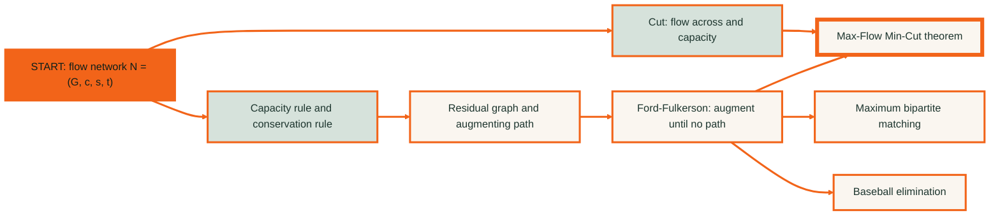
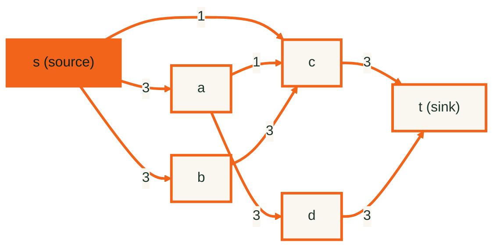
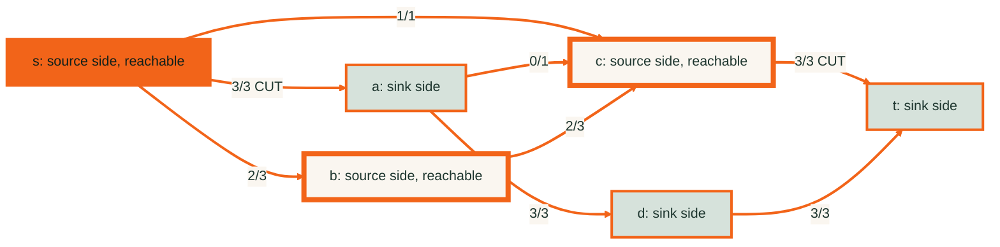
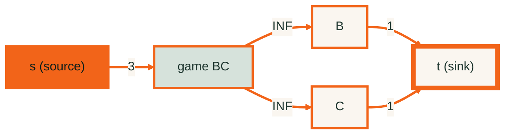

# 12 — Μέγιστη Ροή
*Maximum Flow*

Ένα δίκτυο ροής μοντελοποιεί τη μεταφορά ενός αγαθού μέσα από κατευθυνόμενες ακμές που έχουν χωρητικότητα. Το κεφάλαιο λύνει το πρόβλημα της μέγιστης ποσότητας που μπορεί να σταλεί από μία πηγή $s$ προς μία καταβόθρα $t$, χωρίς να παραβιαστεί καμία χωρητικότητα και χωρίς απώλεια ή συσσώρευση στους ενδιάμεσους κόμβους. Η κεντρική πράξη είναι η επαύξηση κατά μήκος μιας διαδρομής του υπολειπόμενου γράφου και το κεντρικό θεώρημα ταυτίζει τη μέγιστη ροή με τη χωρητικότητα της ελάχιστης τομής. Το κεφάλαιο στηρίζεται στη διάσχιση γράφων της [09_graphs_dfs_bfs.md](09_graphs_dfs_bfs.md), ενώ οι αναγωγές του σε μέγιστο διμερές ταίριασμα (`maximum bipartite matching`) και σε αποκλεισμό ομάδας στο `baseball` δείχνουν ότι πολλά προβλήματα ανάθεσης είναι ειδικές περιπτώσεις μέγιστης ροής. Ο αλγόριθμος `Ford-Fulkerson` είναι ο μόνος αλγόριθμος μέγιστης ροής του μαθήματος· η πολυπλοκότητά του είναι ψευδο-πολυωνυμική ως προς την τιμή της μέγιστης ροής, γι' αυτό η ανάλυση οφείλει να δηλώνει ρητά την παράμετρο $|f^*|$.

> **Εξεταστική κάλυψη:** Μόνο Τελική
> **Κεφάλαιο βιβλίου:** `Κεφ. 16` | **Διαλέξεις:** `22_maximum_flow.pdf`
> **Πηγή:** `Resources/Meta/mindmap.md` (Ενότητα 12)
> **Εκτός ύλης:** Ενότητες `16.2.2`, `16.3`, `16.4`, `16.5`

## Πίνακας Περιεχομένων

- [1. Εννοιολογικό Πλαίσιο και Συνολική Εικόνα](#1-εννοιολογικό-πλαίσιο-και-συνολική-εικόνα)
- [2. Θεωρητική Θεμελίωση και Τυπικοί Ορισμοί](#2-θεωρητική-θεμελίωση-και-τυπικοί-ορισμοί)
- [3. Αλγόριθμοι, Ιχνηλάτηση και Κώδικας](#3-αλγόριθμοι-ιχνηλάτηση-και-κώδικας)
- [4. Συγκριτική Ανάλυση και Πολυπλοκότητα](#4-συγκριτική-ανάλυση-και-πολυπλοκότητα)
- [5. Πλήρως Λυμένες Ασκήσεις Εξεταστικού Επιπέδου](#5-πλήρως-λυμένες-ασκήσεις-εξεταστικού-επιπέδου)
- [6. Οδηγός Επιβίωσης στις Εξετάσεις και Παγίδες](#6-οδηγός-επιβίωσης-στις-εξετάσεις-και-παγίδες)
- [7. Συνοπτικός Πίνακας Εννοιών](#7-συνοπτικός-πίνακας-εννοιών)

---

## 1. Εννοιολογικό Πλαίσιο και Συνολική Εικόνα

### Το Πρόβλημα

Ένα δίκτυο αγωγών μεταφέρει πετρέλαιο από ένα διυλιστήριο $s$ σε ένα λιμάνι $t$. Κάθε αγωγός είναι κατευθυνόμενος και έχει μέγιστη παροχή, για παράδειγμα βαρέλια ανά ώρα. Στους ενδιάμεσους σταθμούς δεν παράγεται ούτε καταναλώνεται πετρέλαιο: όσο εισέρχεται σε έναν σταθμό τόσο εξέρχεται. Το ερώτημα είναι ποια είναι η μέγιστη συνολική παροχή που μπορεί να φτάσει στο λιμάνι. Το ίδιο μοντέλο περιγράφει τη δρομολόγηση δεδομένων σε δίκτυο υπολογιστών, την ανάθεση εργαζομένων σε θέσεις, την κατανομή αγώνων σε ένα πρωτάθλημα και την κατανομή φορτίου σε γραμμές παραγωγής.

Η δυσκολία δεν βρίσκεται σε μία μεμονωμένη ακμή αλλά στη συνολική διάταξη. Μια ακμή με μεγάλη χωρητικότητα μπορεί να οδηγεί σε κόμβο που στη συνέχεια στενεύει, και μια φαινομενικά καλή διαδρομή μπορεί να εμποδίσει μια καλύτερη. Γι' αυτό η λύση δεν είναι απλώς μια άπληστη επιλογή τοπικά μέγιστης ακμής· απαιτείται επαναληπτική διόρθωση των ροών μέσω του υπολειπόμενου γράφου.

### Χάρτης Εννοιών του Κεφαλαίου



Πορτοκαλί γέμισμα: το δίκτυο ροής (`START`). Απαλό πράσινο: οι δύο θεμελιώδεις έννοιες, οι κανόνες ροής και η τομή. Παχύ περίγραμμα: το θεώρημα μέγιστης ροής και ελάχιστης τομής. Κρεμ: ο αλγόριθμος και οι δύο αναγωγές.

| Ομάδα | Κόμβοι | Ρόλος |
|---|---|---|
| Αφετηρία | Δίκτυο $N=(G,c,s,t)$ | Ορίζει κορυφές, ακμές, χωρητικότητες, πηγή και καταβόθρα |
| Θεωρία | Κανόνες ροής, τομή | Περιορίζουν τις εφικτές ροές και ορίζουν το φράγμα |
| Μηχανισμός | Υπολειπόμενος γράφος, επαυξητική διαδρομή | Επιτρέπει τη βελτίωση της ροής με τοπικές πράξεις |
| Αλγόριθμος | `Ford-Fulkerson` | Επαναλαμβάνει επαυξήσεις μέχρι να μην υπάρχει διαδρομή |
| Θεώρημα | Μέγιστη ροή ίση με ελάχιστη τομή | Πιστοποιεί τη βελτιστοποίηση και δίνει φράγμα |
| Εφαρμογές | Διμερές ταίριασμα, baseball elimination | Ανάγουν προβλήματα ανάθεσης σε μέγιστη ροή |

### Πότε Χρησιμοποιείται Κάθε Στρατηγική

| Ζητούμενο | Σήμα στην εκφώνηση | Τεχνική | Αιτιολόγηση |
|---|---|---|---|
| Μέγιστη μεταφορική ικανότητα | Χωρητικότητες, πηγή, καταβόθρα, διατήρηση | `Ford-Fulkerson` | Κάθε επαύξηση αυξάνει τη ροή κατά το στενό σημείο |
| Ελάχιστη τομή ή bottleneck | «Ποια ακμές περιορίζουν», «ελάχιστη χωρητικότητα τομής» | Τελικός υπολειπόμενος γράφος | Οι κορυφές που είναι προσβάσιμες από την $s$ ορίζουν ελάχιστη τομή |
| Ανάθεση δύο συνόλων | Διμερής γράφος, ταίριασμα, θέσεις και υποψήφιοι | Αναγωγή σε ροή με μοναδιαίες χωρητικότητες | Η ακεραιότητα δίνει ροή $0$ ή $1$ ανά ακμή |
| Πρωτάθλημα με υπόλοιπους αγώνες | Ομάδες, νίκες, αποκλεισμός | Δίκτυο αγώνων και ομάδων | Η μέγιστη ροή ελέγχει αν όλοι οι αγώνες χωρούν χωρίς υπέρβαση νικών |
| Ελάχιστο κόστος ή συντομότερη διαδρομή | Βάρη απόστασης, όχι χωρητικότητες | `Dijkstra`, `Bellman-Ford`, `MST` | Διαφορετική αντικειμενική συνάρτηση· δεν είναι μέγιστη ροή |

> Εκτός ύλης: Ενότητες `16.2.2`, `16.3`, `16.4`, `16.5`.

---

## 2. Θεωρητική Θεμελίωση και Τυπικοί Ορισμοί

### 2.1 Δίκτυα Ροής, Ροές και Τομές

**Ορισμός 2.1 (δίκτυο ροής, `flow network`).** Δίκτυο ροής είναι μια πεντάδα $N=(G,c,s,t)$, όπου $G=(V,E)$ είναι κατευθυνόμενος γράφος με $n=|V|$ κορυφές και $m=|E|$ ακμές, $c:E\to\mathbb{N}_{\ge0}$ είναι συνάρτηση χωρητικότητας με ακέραιες μη αρνητικές τιμές, $s\in V$ είναι η πηγή (`source`) χωρίς εισερχόμενες ακμές και $t\in V$ είναι η καταβόθρα (`sink`) χωρίς εξερχόμενες ακμές. Κάθε κορυφή βρίσκεται σε κάποια διαδρομή από την $s$ στην $t$. Υποθέτουμε ότι δεν υπάρχουν αντίρροπες ακμές· αν υπάρχουν, υποδιαιρούμε τη μία με μία νέα κορυφή, πράξη που δεν αλλάζει τη μέγιστη ροή. Η νέα κορυφή έχει μία εισερχόμενη και μία εξερχόμενη ακμή με την ίδια χωρητικότητα, άρα η αντιστοιχία ροών είναι αμφίδρομη.

**Ορισμός 2.2 (ροή, `flow`).** Ροή στο $N$ είναι συνάρτηση $f:E\to\mathbb{R}_{\ge0}$ που ικανοποιεί δύο κανόνες.

1. **Κανόνας χωρητικότητας (`capacity rule`):** για κάθε ακμή $e\in E$,
$$0\le f(e)\le c(e).$$
2. **Κανόνας διατήρησης (`conservation rule`):** για κάθε κορυφή $v\in V\setminus\{s,t\}$,
$$\sum_{e\in E^-(v)} f(e)=\sum_{e\in E^+(v)} f(e),$$
όπου $E^-(v)$ είναι οι ακμές που εισέρχονται στην $v$ και $E^+(v)$ είναι οι ακμές που εξέρχονται από την $v$.

Η **τιμή** (`value`) της ροής ορίζεται ως η καθαρή εκροή από την πηγή,
$$|f|=\sum_{e\in E^+(s)} f(e)-\sum_{e\in E^-(s)} f(e).$$
Επειδή η $s$ δεν έχει εισερχόμενες ακμές στο πρότυπο δίκτυο, ο δεύτερος όρος είναι μηδέν· η αφαίρεση διατηρείται για πληρότητα του ορισμού. Αθροίζοντας τις καθαρές εκροές $out(v)-in(v)$ σε όλες τις κορυφές, το άθροισμα είναι μηδέν, επειδή κάθε ακμή συνεισφέρει μία φορά θετικά στο άκρο εξόδου και μία φορά αρνητικά στο άκρο εισόδου. Οι ενδιάμεσες κορυφές έχουν μηδενική καθαρή εκροή από τον κανόνα διατήρησης, άρα η καθαρή εκροή της $s$ ισούται με την καθαρή εισροή της $t$. Επειδή η $t$ δεν έχει εξερχόμενες ακμές,
$$|f|=\sum_{e\in E^-(t)} f(e).$$

**Ορισμός 2.3 (τομή, `cut`).** Τομή $\chi=(V_s,V_t)$ είναι μια διαμέριση $V=V_s\cup V_t$ με $V_s\cap V_t=\emptyset$, $s\in V_s$ και $t\in V_t$. Η **ροή της τομής** (`flow across the cut`) είναι
$$f(\chi)=\sum_{e\in E^+(V_s)} f(e)-\sum_{e\in E^-(V_s)} f(e),$$
όπου $E^+(V_s)$ είναι οι ακμές από το $V_s$ προς το $V_t$ και $E^-(V_s)$ είναι οι ακμές από το $V_t$ προς το $V_s$. Η **χωρητικότητα της τομής** (`capacity of the cut`) είναι
$$c(\chi)=\sum_{e\in E^+(V_s)} c(e).$$
Η χωρητικότητα μετρά μόνο τις ακμές που εξέρχονται από το $V_s$· οι ακμές που εισέρχονται στο $V_s$ από το $V_t$ δεν προστίθενται.

**Λήμμα 2.4 (η ροή κάθε τομής ισούται με την τιμή της ροής).** Για κάθε ροή $f$ και κάθε τομή $\chi=(V_s,V_t)$,
$$f(\chi)=|f|.$$

*Απόδειξη.* Για κάθε κορυφή $v\in V_s$, ο ορισμός της τιμής για $v=s$ και ο κανόνας διατήρησης για $v\ne s$ δίνουν
$$\sum_{e\in E^+(v)} f(e)-\sum_{e\in E^-(v)} f(e)=
\begin{cases}
|f|, & v=s,\\
0, & v\ne s.
\end{cases}$$
Αθροίζοντας τις σχέσεις για όλες τις $v\in V_s$,
$$\sum_{v\in V_s}\left(\sum_{e\in E^+(v)} f(e)-\sum_{e\in E^-(v)} f(e)\right)=|f|.$$
Κάθε ακμή με και τα δύο άκρα στο $V_s$ εμφανίζεται μία φορά θετικά, ως εξερχόμενη από το άκρο της, και μία φορά αρνητικά, ως εισερχόμενη στο άλλο άκρο· οι δύο όροι αλληλοαναιρούνται. Απομένουν μόνο οι ακμές που διασχίζουν την τομή. Οι ακμές από το $V_s$ προς το $V_t$ συνεισφέρουν $+f(e)$ και οι ακμές από το $V_t$ προς το $V_s$ συνεισφέρουν $-f(e)$. Άρα
$$\sum_{e\in E^+(V_s)} f(e)-\sum_{e\in E^-(V_s)} f(e)=|f|,$$
δηλαδή $f(\chi)=|f|$. $\square$

**Λήμμα 2.5 (ασθενής δυαδικότητα).** Για κάθε ροή $f$ και κάθε τομή $\chi$,
$$|f|\le c(\chi).$$

*Απόδειξη.* Από το Λήμμα 2.4, $|f|=f(\chi)$. Επειδή $f(e)\ge0$ για κάθε ακμή, η αφαίρεση της εισερχόμενης ροής στην $f(\chi)$ δεν αυξάνει το αποτέλεσμα:
$$|f|=\sum_{e\in E^+(V_s)} f(e)-\sum_{e\in E^-(V_s)} f(e)\le \sum_{e\in E^+(V_s)} f(e).$$
Από τον κανόνα χωρητικότητας, $f(e)\le c(e)$ για κάθε ακμή, άρα
$$\sum_{e\in E^+(V_s)} f(e)\le \sum_{e\in E^+(V_s)} c(e)=c(\chi).$$
Συνδυάζοντας τις δύο ανισότητες, $|f|\le c(\chi)$. $\square$

**Πόρισμα 2.6 (φράγμα μέγιστης ροής).** Για κάθε ροή $f$ και κάθε τομή $\chi$,
$$|f|\le c(\chi),$$
άρα η μέγιστη ροή δεν υπερβαίνει τη χωρητικότητα της ελάχιστης τομής. Το φράγμα ισχύει για κάθε ζεύγος ροής και τομής· δεν απαιτείται η ροή να είναι μέγιστη ούτε η τομή ελάχιστη.

**Παράδειγμα 2.7 (υπολογισμός τομής).** Στο δίκτυο της Ενότητας 3.1 θεωρούμε την τομή $V_s=\{s,b,c\}$ και $V_t=\{a,d,t\}$. Οι ακμές από το $V_s$ προς το $V_t$ είναι οι $s\to a$ με χωρητικότητα $3$ και $c\to t$ με χωρητικότητα $3$, άρα $c(\chi)=6$. Η ακμή $a\to c$ κατευθύνεται από το $V_t$ προς το $V_s$ και δεν μετρά στη χωρητικότητα. Στο τέλος του κεφαλαίου η μέγιστη ροή θα είναι επίσης $6$, οπότε η τομή είναι ελάχιστη.

### 2.2 Υπολειπόμενος Γράφος και Επαυξητικές Διαδρομές

**Ορισμός 2.8 (υπολειπόμενη χωρητικότητα, `residual capacity`).** Έστω ακμή $e=(u,v)$ με χωρητικότητα $c(e)$ και ροή $f(e)$. Η υπολειπόμενη χωρητικότητα ορίζεται σε δύο κατευθύνσεις:
$$\Delta_f(u,v)=c(e)-f(e), \qquad \Delta_f(v,u)=f(e).$$
Το τόξο $(u,v)$ ονομάζεται **εμπρόσθιο** (`forward`) και παριστά τη δυνατότητα αύξησης της ροής. Το τόξο $(v,u)$ ονομάζεται **πίσω** (`backward`) και παριστά τη δυνατότητα μείωσης της ροής. Και τα δύο μπορούν να είναι θετικά ταυτόχρονα, όταν $0<f(e)<c(e)$.

**Ορισμός 2.9 (υπολειπόμενος γράφος, `residual graph`).** Ο υπολειπόμενος γράφος $G_f$ έχει τις ίδιες κορυφές με το $G$ και περιέχει κάθε εμπρόσθιο ή πίσω τόξο με θετική υπολειπόμενη χωρητικότητα. Αν και οι δύο κατευθύνσεις είναι θετικές, ο $G_f$ περιέχει και τα δύο τόξα· είναι διακριτά και δεν ταυτίζονται. Ο $G_f$ έχει το πολύ $2m$ τόξα, άρα $O(n+m)$ μέγεθος.

**Ορισμός 2.10 (επαυξητική διαδρομή, `augmenting path`).** Επαυξητική διαδρομή είναι μια απλή διαδρομή $\pi$ από την $s$ στην $t$ στον $G_f$. Το **στενό σημείο** (`bottleneck`) της $\pi$ είναι
$$\Delta_f(\pi)=\min_{(u,v)\in\pi}\Delta_f(u,v).$$
Επειδή η διαδρομή είναι απλή και κάθε τόξο της έχει θετική χωρητικότητα, $\Delta_f(\pi)>0$.

**Λήμμα 2.11 (η επαύξηση παράγει έγκυρη ροή).** Έστω ροή $f$ και επαυξητική διαδρομή $\pi$ με στενό σημείο $\Delta=\Delta_f(\pi)$. Ορίζουμε νέα ροή $f'$ ως εξής. Για κάθε αρχική ακμή $e=(u,v)$:
- αν η $\pi$ χρησιμοποιεί το εμπρόσθιο τόξο $(u,v)$, τότε $f'(e)=f(e)+\Delta$·
- αν η $\pi$ χρησιμοποιεί το πίσω τόξο $(v,u)$, τότε $f'(e)=f(e)-\Delta$·
- αν η $\pi$ δεν χρησιμοποιεί κανένα από τα δύο, τότε $f'(e)=f(e)$.

Τότε η $f'$ είναι ροή και $|f'|=|f|+\Delta$.

*Απόδειξη.* Κάθε απλή διαδρομή χρησιμοποιεί το πολύ ένα από τα δύο τόξα μιας αρχικής ακμής· αν χρησιμοποιούσε και τα δύο, θα επισκεπτόταν δύο φορές τις ίδιες κορυφές. Για τον κανόνα χωρητικότητας, στο εμπρόσθιο τόξο ισχύει $\Delta\le c(e)-f(e)$, άρα $f(e)+\Delta\le c(e)$· στο πίσω τόξο ισχύει $\Delta\le f(e)$, άρα $f(e)-\Delta\ge0$.

Για τη διατήρηση, έστω $w$ εσωτερική κορυφή της $\pi$. Η διαδρομή εισέρχεται στην $w$ από ένα τόξο και εξέρχεται από ένα άλλο. Διακρίνονται τέσσερις περιπτώσεις.
1. Είσοδος εμπρόσθια και έξοδος εμπρόσθια: η εισερχόμενη και η εξερχόμενη ροή αυξάνονται κατά $\Delta$, άρα η ισότητα διατηρείται.
2. Είσοδος εμπρόσθια και έξοδος πίσω: η εισερχόμενη ροή αυξάνεται κατά $\Delta$ από το εμπρόσθιο τόξο, ενώ μειώνεται κατά $\Delta$ η ροή μιας εισερχόμενης αρχικής ακμής που αντιστοιχεί στο πίσω τόξο εξόδου· η καθαρή εισερχόμενη ροή δεν αλλάζει.
3. Είσοδος πίσω και έξοδος εμπρόσθια: μειώνεται κατά $\Delta$ η ροή μιας εξερχόμενης αρχικής ακμής που αντιστοιχεί στο πίσω τόξο εισόδου, ενώ η εξερχόμενη ροή αυξάνεται κατά $\Delta$ από το εμπρόσθιο τόξο εξόδου· η καθαρή εξερχόμενη ροή δεν αλλάζει.
4. Είσοδος πίσω και έξοδος πίσω: η εισερχόμενη και η εξερχόμενη ροή μειώνονται κατά $\Delta$, άρα η ισότητα διατηρείται.

Στην πηγή $s$, η διαδρομή ξεκινά με ένα τόξο εξόδου. Αν είναι εμπρόσθιο, η εκροή αυξάνεται κατά $\Delta$· αν είναι πίσω, η εισροή μειώνεται κατά $\Delta$, άρα η καθαρή εκροή αυξάνεται κατά $\Delta$. Στην καταβόθρα $t$, η διαδρομή τελειώνει με ένα τόξο εισόδου. Αν είναι εμπρόσθιο, η εισροή αυξάνεται κατά $\Delta$· αν είναι πίσω, η εκροή μειώνεται κατά $\Delta$, άρα η καθαρή εισροή αυξάνεται κατά $\Delta$. Επομένως $|f'|=|f|+\Delta$. $\square$

**Λήμμα 2.12 (έλλειψη επαυξητικής διαδρομής συνεπάγεται βελτιστότητα).** Αν η ροή $f$ δεν έχει επαυξητική διαδρομή στον $G_f$, τότε η $f$ είναι μέγιστη και η τομή που ορίζεται από τις κορυφές προσβάσιμες από την $s$ είναι ελάχιστη.

*Απόδειξη.* Έστω $S$ το σύνολο των κορυφών που είναι προσβάσιμες από την $s$ στον $G_f$ και $T=V\setminus S$. Επειδή δεν υπάρχει επαυξητική διαδρομή, $t\notin S$, άρα το $\chi=(S,T)$ είναι έγκυρη τομή.

Για κάθε αρχική ακμή $(u,v)$ με $u\in S$ και $v\in T$, αν ίσχυε $f(u,v)<c(u,v)$, το εμπρόσθιο τόξο $(u,v)$ θα είχε θετική υπολειπόμενη χωρητικότητα και η $v$ θα ήταν προσβάσιμη, άτοπο. Άρα $f(u,v)=c(u,v)$. Για κάθε αρχική ακμή $(v,u)$ με $v\in T$ και $u\in S$, αν ίσχυε $f(v,u)>0$, το πίσω τόξο $(u,v)$ θα είχε θετική υπολειπόμενη χωρητικότητα και η $v$ θα ήταν προσβάσιμη, άτοπο. Άρα $f(v,u)=0$.

Υπολογίζουμε τη ροή της τομής:
$$f(\chi)=\sum_{u\in S,\,v\in T} f(u,v)-\sum_{v\in T,\,u\in S} f(v,u)=\sum_{u\in S,\,v\in T} c(u,v)-0=c(\chi).$$
Από το Λήμμα 2.4, $|f|=f(\chi)=c(\chi)$. Για οποιαδήποτε ροή $f'$ και οποιαδήποτε τομή $\chi'$ ισχύει $|f'|\le c(\chi')$ από το Λήμμα 2.5. Ειδικότερα, $|f'|\le c(\chi)=|f|$, άρα η $f$ είναι μέγιστη, και $c(\chi')\ge|f|=c(\chi)$, άρα η $\chi$ είναι ελάχιστη. $\square$

**Θεώρημα 2.13 (Μέγιστης Ροής – Ελάχιστης Τομής, `Max-Flow Min-Cut`).** Σε κάθε δίκτυο ροής,
$$\max_f |f|=\min_\chi c(\chi).$$
Ισοδύναμα, για μια ροή $f$ οι επόμενες προτάσεις είναι ισοδύναμες: (i) η $f$ είναι μέγιστη· (ii) δεν υπάρχει επαυξητική διαδρομή στον $G_f$· (iii) υπάρχει τομή $\chi$ με $|f|=c(\chi)$.

*Απόδειξη.* Έστω $f^*$ μέγιστη ροή. Αν υπήρχε επαυξητική διαδρομή, το Λήμμα 2.11 θα παρήγαγε ροή μεγαλύτερης τιμής, άτοπο· άρα δεν υπάρχει. Από το Λήμμα 2.12, η τομή $\chi^*$ που παράγεται από τις κορυφές προσβάσιμες από την $s$ ικανοποιεί $|f^*|=c(\chi^*)$. Από το Λήμμα 2.5, για κάθε ροή $f$ και κάθε τομή $\chi$ ισχύει $|f|\le c(\chi)$, άρα
$$\max_f |f|=|f^*|=c(\chi^*)\ge\min_\chi c(\chi)\ge\max_f |f|.$$
Οι δύο ανισότητες είναι αντίστροφες, άρα όλες οι ποσότητες είναι ίσες. $\square$

**Θεώρημα 2.14 (ακεραιότητα, `integrality`).** Αν όλες οι χωρητικότητες είναι ακέραιες, τότε κάθε ροή που παράγεται από τον `Ford-Fulkerson` με ακέραιες επαυξήσεις είναι ακέραια. Ειδικότερα, υπάρχει μέγιστη ροή με ακέραιες τιμές σε κάθε ακμή.

*Απόδειξη.* Επαγωγή στον αριθμό των επαυξήσεων. Αρχικά $f(e)=0$ για κάθε ακμή, άρα όλες οι τιμές είναι ακέραιες. Έστω ότι πριν από μια επαύξηση όλες οι ροές και όλες οι υπολειπόμενες χωρητικότητες είναι ακέραιες. Το στενό σημείο είναι ελάχιστο ακεραίων, άρα ακέραιο. Οι ενημερώσεις $f(e)+\Delta$ και $f(e)-\Delta$ διατηρούν την ακεραιότητα. Επομένως η ροή παραμένει ακέραιη σε κάθε βήμα. $\square$

### 2.3 Τερματισμός, Πολυπλοκότητα και Ψευδο-Πολυωνυμική Συμπεριφορά

**Τερματισμός.** Με ακέραιες χωρητικότητες, κάθε επαύξηση αυξάνει τη ροή κατά ακέραιο $\Delta\ge1$. Η τιμή φράσσεται από το άθροισμα των χωρητικοτήτων των ακμών που εξέρχονται από την $s$,
$$|f|\le\sum_{e\in E^+(s)} c(e),$$
άρα ο αλγόριθμος εκτελεί πεπερασμένο πλήθος επαυξήσεων. Με πραγματικές χωρητικότητες ο τερματισμός δεν είναι εγγυημένος· το μάθημα υποθέτει ακέραιες χωρητικότητες.

**Πολυπλοκότητα.** Κάθε αναζήτηση επαυξητικής διαδρομής διατρέχει τον υπολειπόμενο γράφο, που έχει $O(n+m)$ τόξα, με `BFS` ή `DFS` σε χρόνο $O(n+m)$. Εκτελούνται το πολύ $|f^*|$ επαυξήσεις, όπου $|f^*|$ είναι η τιμή της μέγιστης ροής. Ο συνολικός χρόνος είναι
$$O(|f^*|\,(n+m))$$
στη χειρότερη περίπτωση. Ο χώρος είναι $O(n+m)$ για τον υπολειπόμενο γράφο και $O(n)$ για τους δείκτες γονέων και τις δομές αναζήτησης.

**Παράδειγμα 2.15 (ψευδο-πολυωνυμική συμπεριφορά).** Έστω δίκτυο με κορυφές $s,a,b,t$ και ακμές
$$s\to a\ (M),\quad s\to b\ (M),\quad a\to b\ (1),\quad a\to t\ (M),\quad b\to t\ (M).$$
Η μέγιστη ροή είναι $2M$, καθώς οι διαδρομές $s\to a\to t$ και $s\to b\to t$ μεταφέρουν από $M$ μονάδες. Στη χειρότερη ακολουθία επαυξήσεων, η ακμή $a\to b$ με χωρητικότητα $1$ είναι το στενό σημείο κάθε επαυξητικής διαδρομής. Αν ο αλγόριθμος επιλέγει εναλλάξ τις επαυξητικές διαδρομές
$$s\to a\to b\to t \quad\text{και}\quad s\to b\to a\to t,$$
κάθε επαύξηση έχει στενό σημείο $1$ και απαιτούνται $2M$ επαυξήσεις. Το μέγεθος της εισόδου είναι $O(\log M)$ bits, αφού οι χωρητικότητες γράφονται σε δυαδική μορφή, ενώ ο χρόνος είναι $O(M(n+m))$. Ο `Ford-Fulkerson` είναι επομένως **ψευδο-πολυωνυμικός** ως προς την τιμή της ροής και όχι πολυωνυμικός ως προς το μέγεθος της δυαδικής εισόδου. Η επιλογή της διαδρομής καθορίζει το πλήθος των επαυξήσεων· η ανάλυση $O(|f^*|(n+m))$ είναι φράγμα χειρότερης περίπτωσης ως προς την τιμή $|f^*|$.

### 2.4 Αναγωγή σε Μέγιστο Διμερές Ταίριασμα

**Ορισμός 2.16 (διμερής γράφος και ταίριασμα).** Ένας γράφος είναι **διμερής** (`bipartite`) όταν οι κορυφές του χωρίζονται σε δύο ξένα σύνολα $X$ και $Y$ και κάθε ακμή έχει ένα άκρο στο $X$ και ένα στο $Y$. **Ταίριασμα** (`matching`) είναι σύνολο ακμών χωρίς κοινά άκρα. **Μέγιστο ταίριασμα** είναι ταίριασμα μέγιστου πλήθους ακμών.

**Κατασκευή δικτύου.** Δίνεται διμερής γράφος με διαμερίσεις $X,Y$ και ακμές $E$. Κατασκευάζουμε δίκτυο $H$ ως εξής.
1. Προσθέτουμε πηγή $s$ και καταβόθρα $t$.
2. Για κάθε $x\in X$, προσθέτουμε ακμή $s\to x$ με χωρητικότητα $1$.
3. Για κάθε $y\in Y$, προσθέτουμε ακμή $y\to t$ με χωρητικότητα $1$.
4. Για κάθε ακμή $\{x,y\}\in E$, προσθέτουμε ακμή $x\to y$ με χωρητικότητα $1$.

**Θεώρημα 2.17 (αναγωγή ταιριάσματος σε ροή).** Το μέγιστο μέγεθος ταιριάσματος στον διμερή γράφο ισούται με τη μέγιστη τιμή ροής στο δίκτυο $H$. Επιπλέον, μια ακμή $\{x,y\}$ ανήκει στο μέγιστο ταίριασμα αν και μόνο αν η ροή της $x\to y$ είναι $1$.

*Απόδειξη.* Από το Θεώρημα 2.14, υπάρχει μέγιστη ροή με ακέραιες τιμές. Επειδή όλες οι χωρητικότητες είναι $1$, κάθε ροή είναι $0$ ή $1$. Η διατήρηση σε κάθε $x\in X$ επιτρέπει το πολύ μία μονάδα εξόδου, άρα το πολύ μία ακμή $x\to y$ με ροή $1$· αντίστοιχα, κάθε $y\in Y$ δέχεται το πολύ μία μονάδα, άρα το πολύ μία ακμή $x\to y$ με ροή $1$. Επομένως οι ακμές με ροή $1$ σχηματίζουν ταίριασμα και η τιμή της ροής ισούται με το μέγεθός του.

Αντίστροφα, δοθέντος ταιριάσματος $M$, στέλνουμε μία μονάδα σε κάθε διαδρομή $s\to x\to y\to t$ για $\{x,y\}\in M$. Κάθε $x$ και κάθε $y$ εμφανίζεται το πολύ μία φορά, άρα τηρούνται οι χωρητικότητες και η διατήρηση· η ροή έχει τιμή $|M|$. Επομένως οι δύο μέγιστες τιμές ταυτίζονται. $\square$

**Πολυπλοκότητα.** Η μέγιστη ροή αυξάνεται κατά $1$ σε κάθε επαύξηση, άρα εκτελούνται το πολύ $\min(|X|,|Y|)\le n/2$ επαυξήσεις. Κάθε αναζήτηση κοστίζει $O(n+m)$ στο δίκτυο $H$, που έχει $O(n+m)$ κορυφές και ακμές. Ο συνολικός χρόνος είναι
$$O(n(n+m)).$$
Όταν $m=\Omega(n)$, αυτό γράφεται $O(nm)$, η τιμή που δίνει το μάθημα. Ο χώρος είναι $O(n+m)$.

### 2.5 Αναγωγή σε Αποκλεισμό Ομάδας στο Baseball

**Διατύπωση.** Έχουμε $n$ ομάδες. Για κάθε ομάδα $i$ είναι γνωστές οι νίκες $w_i$ και οι υπόλοιποι αγώνες $g_i$. Για κάθε ζεύγος $i,j$ είναι γνωστό το πλήθος $g_{ij}$ των μεταξύ τους αγώνων που απομένουν. Θέλουμε να αποφασίσουμε αν η ομάδα $k$ μπορεί να τερματίσει στην πρώτη θέση, επιτρέποντας ισοπαλία στην κορυφή.

**Μέγιστες δυνατές νίκες.** Αν η $k$ κερδίσει όλους τους υπόλοιπους αγώνες της, φτάνει στις
$$W=w_k+g_k$$
νίκες. Καμία άλλη ομάδα δεν επιτρέπεται να ξεπεράσει τις $W$ νίκες· ισοπαλία στις $W$ επιτρέπεται. Αν για κάποια $i\ne k$ ισχύει $w_i>W$, η $k$ αποκλείεται άμεσα· στο εξής υποθέτουμε $w_i\le W$ για όλες τις $i\ne k$, ώστε οι χωρητικότητες $W-w_i$ να είναι μη αρνητικές.

**Κατασκευή δικτύου.** Αγνοούμε τους αγώνες που περιλαμβάνουν την $k$, διότι υποθέτουμε ότι τους κερδίζει όλους. Για κάθε ζεύγος αντιπάλων $i,j\ne k$ δημιουργούμε έναν κόμβο αγώνα (`game node`) $v_{ij}$. Για κάθε ομάδα $i\ne k$ δημιουργούμε έναν κόμβο ομάδας. Το δίκτυο έχει πηγή $s$ και καταβόθρα $t$.
1. Ακμή $s\to v_{ij}$ με χωρητικότητα $g_{ij}$ για κάθε ζεύγος $i,j\ne k$.
2. Ακμές $v_{ij}\to i$ και $v_{ij}\to j$ με πολύ μεγάλη χωρητικότητα (άπειρη· στην υλοποίηση αρκεί το συνολικό πλήθος αγώνων).
3. Ακμή $i\to t$ με χωρητικότητα $W-w_i$ για κάθε ομάδα $i\ne k$.

**Κριτήριο.** Κάθε μονάδα ροής από την $s$ προς έναν κόμβο αγώνα αντιστοιχεί σε έναν αγώνα που κάποια από τις δύο ομάδες κερδίζει. Η χωρητικότητα $W-w_i$ είναι το μέγιστο πλήθος επιπλέον νικών που μπορεί να δεχθεί η ομάδα $i$ χωρίς να ξεπεράσει τις $W$. Η ομάδα $k$ αποκλείεται αν και μόνο αν η μέγιστη ροή είναι μικρότερη από το συνολικό πλήθος αγώνων μεταξύ των άλλων ομάδων,
$$\sum_{i<j,\,i,j\ne k} g_{ij}.$$
Στην περίπτωση αυτή, όλοι οι αγώνες δεν μπορούν να ανατεθούν χωρίς κάποια ομάδα να φτάσει τις $W+1$ νίκες. Η χωρητικότητα «άπειρο» μπορεί να αντικατασταθεί από το συνολικό πλήθος αγώνων, επειδή κανένας κόμβος αγώνα δεν μπορεί να στείλει περισσότερες μονάδες από τη χωρητικότητα της ακμής εισόδου του.

**Μέγεθος.** Υπάρχουν $O(n^2)$ κόμβοι αγώνα και $n-1$ κόμβοι ομάδων, άρα το δίκτυο έχει $O(n^2)$ κορυφές και $O(n^2)$ ακμές. Η επίλυση γίνεται με `Ford-Fulkerson` σε αυτό το δίκτυο· η πολυπλοκότητα κληρονομείται από τον αλγόριθμο και την τιμή της μέγιστης ροής.

---

## 3. Αλγόριθμοι, Ιχνηλάτηση και Κώδικας

### 3.1 Παράδειγμα Δικτύου και Κανόνας Ισοβαθμίας

Όλες οι ιχνηλατήσεις του `Ford-Fulkerson` χρησιμοποιούν το δίκτυο $N$ με κορυφές $V=\{s,a,b,c,d,t\}$ και ακμές
$$E=\{s\to a(3),\ s\to b(3),\ s\to c(1),\ a\to c(1),\ a\to d(3),\ b\to c(3),\ c\to t(3),\ d\to t(3)\}.$$
Το δίκτυο έχει $n=6$ κορυφές και $m=8$ ακμές, όλες οι χωρητικότητες είναι θετικές ακέραιες τιμές και δεν υπάρχουν αντίρροπες ακμές. Κάθε κορυφή βρίσκεται σε κάποια διαδρομή από την $s$ στην $t$: η $a$ μέσω $a\to d\to t$, η $b$ μέσω $b\to c\to t$, η $c$ μέσω $c\to t$ και η $d$ μέσω $d\to t$.



Πορτοκαλί γέμισμα: η πηγή $s$. Κρεμ: όλες οι υπόλοιπες κορυφές. Οι αριθμοί στις ακμές είναι οι χωρητικότητες $c(e)$.

| Ακμή | Χωρητικότητα |
|---|---|
| $s\to a$ | 3 |
| $s\to b$ | 3 |
| $s\to c$ | 1 |
| $a\to c$ | 1 |
| $a\to d$ | 3 |
| $b\to c$ | 3 |
| $c\to t$ | 3 |
| $d\to t$ | 3 |

**Κανόνας ισοβαθμίας.** Η αναζήτηση επαυξητικής διαδρομής γίνεται με `BFS` και οι γείτονες εξετάζονται με τη σειρά των ακμών του παραπάνω πίνακα. Όταν δύο κορυφές βρίσκονται στο ίδιο επίπεδο, εξετάζεται πρώτη αυτή που ανακαλύφθηκε πρώτη από την ουρά. Με τον κανόνα αυτό η σειρά των επαυξήσεων είναι μοναδική και αναπαράγεται από τον κώδικα της Ενότητας 3.4.

### 3.2 Αλγόριθμος `Ford-Fulkerson`

**Σκοπός.** Εύρεση μέγιστης ροής από την πηγή $s$ στην καταβόθρα $t$ με επαναλαμβανόμενη επαύξηση κατά μήκος μιας επαυξητικής διαδρομής του υπολειπόμενου γράφου.

```text
Algorithm FordFulkerson(N):
Input: flow network N = (G, c, s, t) with integer capacities
Output: a maximum flow f

for each edge e in E do
    f(e) <- 0
while there is an augmenting path pi from s to t in the residual graph G_f do
    Delta <- min { Delta_f(u, v) : (u, v) is an arc of pi }
    for each arc (u, v) of pi do
        if (u, v) is the forward arc of an original edge e = (u, v) then
            f(e) <- f(e) + Delta
        else
            let e = (v, u) be the original edge of the backward arc
            f(e) <- f(e) - Delta
return f
```

**Ιχνηλάτηση.** Η αρχική ροή είναι μηδενική σε όλες τις ακμές. Ο δεύτερος πίνακας δείχνει τις εμπρόσθιες υπολειπόμενες χωρητικότητες $c(e)-f(e)$ μετά από κάθε επαύξηση, με τη σειρά των ακμών του πίνακα.

| Γύρος | Επαυξητική διαδρομή | Στενό σημείο | Τιμή ροής μετά | Παρατήρηση |
|---|---|---|---|---|
| $0$ | καμία | — | $0$ | αρχικοποίηση $f(e)=0$ |
| $1$ | $s\to c\to t$ | $1$ | $1$ | Η $s\to c$ έχει χωρητικότητα $1$ και είναι το στενό σημείο. |
| $2$ | $s\to a\to c\to t$ | $1$ | $2$ | Η $a\to c$ έχει χωρητικότητα $1$· η $c\to t$ έχει απομείνει $2$. |
| $3$ | $s\to a\to d\to t$ | $2$ | $4$ | Η $s\to a$ έχει απομείνει $2$· η $a\to d$ και η $d\to t$ έχουν από $3$. |
| $4$ | $s\to b\to c\to t$ | $1$ | $5$ | Η $c\to t$ έχει απομείνει $1$· η $b\to c$ έχει $3$. |
| $5$ | $s\to b\to c\to a\to d\to t$ | $1$ | $6$ | Η πίσω ακμή $c\to a$ αναδρομολογεί μία μονάδα από την $a\to c$ στην $a\to d$. |

| Κατάσταση | $s\to a$ | $s\to b$ | $s\to c$ | $a\to c$ | $a\to d$ | $b\to c$ | $c\to t$ | $d\to t$ |
|---|---|---|---|---|---|---|---|---|
| αρχική | 3 | 3 | 1 | 1 | 3 | 3 | 3 | 3 |
| μετά $1$ | 3 | 3 | 0 | 1 | 3 | 3 | 2 | 3 |
| μετά $2$ | 2 | 3 | 0 | 0 | 3 | 3 | 1 | 3 |
| μετά $3$ | 0 | 3 | 0 | 0 | 1 | 3 | 1 | 1 |
| μετά $4$ | 0 | 2 | 0 | 0 | 1 | 2 | 0 | 1 |
| μετά $5$ | 0 | 1 | 0 | 1 | 0 | 1 | 0 | 0 |

**Αιτιολόγηση της πέμπτης επαύξησης.** Μετά τον τέταρτο γύρο, η $c\to t$ είναι κορεσμένη και η $a\to c$ έχει ροή $1$. Η διαδρομή $s\to b\to c\to a\to d\to t$ χρησιμοποιεί την πίσω ακμή $c\to a$, οπότε μειώνει τη ροή της $a\to c$ από $1$ σε $0$ και αυξάνει τη ροή της $a\to d$ από $2$ σε $3$. Η μονάδα που είχε σταλεί μέσω $a\to c$ μεταφέρεται τώρα μέσω $a\to d\to t$, ελευθερώνοντας χωρητικότητα στην $c\to t$ για τη ροή από την $b$. Χωρίς την πίσω ακμή, η ροή θα έμενε στο $5$ και η λύση θα ήταν λανθασμένη.

**Τελική ροή.** Η μέγιστη ροή έχει τιμή $|f^*|=6$.

| Ακμή | Ροή | Χωρητικότητα | Κορεσμένη |
|---|---|---|---|
| $s\to a$ | 3 | 3 | ναι |
| $s\to b$ | 2 | 3 | όχι |
| $s\to c$ | 1 | 1 | ναι |
| $a\to c$ | 0 | 1 | όχι |
| $a\to d$ | 3 | 3 | ναι |
| $b\to c$ | 2 | 3 | όχι |
| $c\to t$ | 3 | 3 | ναι |
| $d\to t$ | 3 | 3 | ναι |

| Κορυφή | Εισερχόμενη ροή | Εξερχόμενη ροή | Έλεγχος |
|---|---|---|---|
| $s$ | 0 | 6 | πηγή· η καθαρή εκροή είναι $6$ |
| $a$ | 3 | $0+3=3$ | ισότητα |
| $b$ | 2 | 2 | ισότητα |
| $c$ | $1+0+2=3$ | 3 | ισότητα |
| $d$ | 3 | 3 | ισότητα |
| $t$ | 6 | 0 | καταβόθρα· η καθαρή εισροή είναι $6$ |

### 3.3 Τελικός Υπολειπόμενος Γράφος και Ελάχιστη Τομή

Το γεγονός ότι μια ροή έχει κάποια τιμή δεν αρκεί για να αποδειχθεί η βελτιστότητά της· χρειάζεται πιστοποιητικό. Το πιστοποιητικό είναι η ελάχιστη τομή που προκύπτει από τις κορυφές προσβάσιμες από την $s$ στον τελικό υπολειπόμενο γράφο.



Πορτοκαλί γέμισμα: η πηγή $s$. Παχύ περίγραμμα: οι κορυφές $b,c$ της πλευράς της πηγής που είναι προσβάσιμες στον τελικό υπολειπόμενο γράφο. Απαλό πράσινο: η πλευρά της καταβόθρας. Οι ετικέτες είναι ροή/χωρητικότητα· η ένδειξη `CUT` δηλώνει τις ακμές που διασχίζουν την ελάχιστη τομή.

| Τόξο | Υπολειπόμενη χωρητικότητα | Είδος |
|---|---|---|
| $s\to b$ | 1 | εμπρόσθιο |
| $a\to c$ | 1 | εμπρόσθιο |
| $b\to c$ | 1 | εμπρόσθιο |
| $a\to s$ | 3 | πίσω, από τη ροή $s\to a$ |
| $b\to s$ | 2 | πίσω, από τη ροή $s\to b$ |
| $c\to s$ | 1 | πίσω, από τη ροή $s\to c$ |
| $c\to b$ | 2 | πίσω, από τη ροή $b\to c$ |
| $d\to a$ | 3 | πίσω, από τη ροή $a\to d$ |
| $t\to c$ | 3 | πίσω, από τη ροή $c\to t$ |
| $t\to d$ | 3 | πίσω, από τη ροή $d\to t$ |

Από την $s$ το μόνο θετικό εξερχόμενο τόξο είναι το $s\to b$ με χωρητικότητα $1$. Από το $b$ φτάνουμε στο $c$ μέσω του $b\to c$. Από το $c$ δεν υπάρχει θετικό τόξο προς την $t$: το $c\to t$ έχει υπολειπόμενη χωρητικότητα $0$ και τα υπόλοιπα εξερχόμενα τόξα οδηγούν πίσω στο $b$ ή στο $s$. Άρα
$$S=\{s,b,c\}, \qquad T=\{a,d,t\}.$$
Οι ακμές της τομής είναι μόνο εκείνες που εξέρχονται από το $S$: $s\to a$ με χωρητικότητα $3$ και $c\to t$ με χωρητικότητα $3$. Η ακμή $a\to c$ εισέρχεται στο $S$ και δεν μετρά. Επομένως
$$c(\chi)=3+3=6=|f^*|,$$
οπότε η τομή είναι ελάχιστη και η ροή μέγιστη, όπως ορίζει το Θεώρημα 2.13.

### 3.4 Κώδικας: Ρητός `Ford-Fulkerson` και Έλεγχος Ελάχιστης Τομής

**Ρητή υλοποίηση.** Ο υπολειπόμενος γράφος παριστάνεται με λεξικό χωρητικοτήτων. Τα εμπρόσθια και τα πίσω τόξα είναι σταθερά και κατασκευάζονται μία φορά, ώστε κάθε αναζήτηση `BFS` να μένει γραμμική.

```python
from collections import deque


def fordFulkerson(
    capacities: dict[tuple[str, str], int], source: str, sink: str
) -> tuple[int, dict[tuple[str, str], int]]:
    """Computes a maximum flow with augmenting paths found by BFS.

    Args:
        capacities (dict[tuple[str, str], int]): Directed edges mapped to
            non-negative integer capacities. Antiparallel edges are not allowed.
        source (str): The source vertex.
        sink (str): The sink vertex.

    Returns:
        tuple[int, dict[tuple[str, str], int]]: The maximum flow value and the
            final residual-capacity dictionary.
    """
    residual = dict(capacities)
    # Forward and backward arcs are fixed once, so BFS stays linear.
    arcs = list(capacities) + [(v, u) for (u, v) in capacities]
    adjacency: dict[str, list[tuple[str, str]]] = {}
    for a, b in arcs:
        adjacency.setdefault(a, []).append((a, b))

    def findAugmentingPath() -> dict[str, str | None] | None:
        """Finds a shortest augmenting path in the current residual graph.

        Returns:
            dict[str, str | None] | None: Parent pointers of the path, or
                None when the sink is unreachable.
        """
        parent: dict[str, str | None] = {source: None}
        queue = deque([source])
        while queue:
            u = queue.popleft()
            for a, b in adjacency.get(u, []):
                remaining = residual.get((a, b), 0)
                if remaining > 0 and b not in parent:
                    parent[b] = u
                    if b == sink:
                        return parent
                    queue.append(b)
        return None

    flow_value = 0
    while True:
        parent = findAugmentingPath()
        if parent is None:
            return flow_value, residual
        path: list[tuple[str, str]] = []
        v = sink
        while v != source:
            u = parent[v]
            # The sink is reachable, so every parent on the path exists.
            assert u is not None
            path.append((u, v))
            v = u
        path.reverse()
        bottleneck = min(residual[edge] for edge in path)
        # A backward arc cancels flow on its original edge.
        for u, v in path:
            residual[(u, v)] -= bottleneck
            residual[(v, u)] = residual.get((v, u), 0) + bottleneck
        flow_value += bottleneck


def reachableVertices(
    residual: dict[tuple[str, str], int], source: str
) -> set[str]:
    """Finds the vertices reachable from the source in the residual graph.

    Args:
        residual (dict[tuple[str, str], int]): Residual capacities.
        source (str): The source vertex.

    Returns:
        set[str]: All vertices reachable through positive residual arcs.
    """
    adjacency: dict[str, list[str]] = {}
    for (a, b), remaining in residual.items():
        if remaining > 0:
            adjacency.setdefault(a, []).append(b)
    reached = {source}
    queue = deque([source])
    while queue:
        u = queue.popleft()
        for v in adjacency.get(u, []):
            if v not in reached:
                reached.add(v)
                queue.append(v)
    return reached


def minCutCapacity(
    capacities: dict[tuple[str, str], int], source_side: set[str]
) -> int:
    """Computes the capacity of the cut induced by a vertex subset.

    Args:
        capacities (dict[tuple[str, str], int]): Original directed capacities.
        source_side (set[str]): Vertices on the source side of the cut.

    Returns:
        int: The sum of capacities of edges leaving the source side.
    """
    return sum(
        capacity
        for (u, v), capacity in capacities.items()
        if u in source_side and v not in source_side
    )


example_capacities = {
    ("s", "a"): 3,
    ("s", "b"): 3,
    ("s", "c"): 1,
    ("a", "c"): 1,
    ("a", "d"): 3,
    ("b", "c"): 3,
    ("c", "t"): 3,
    ("d", "t"): 3,
}

flow_value, residual = fordFulkerson(example_capacities, "s", "t")
assert flow_value == 6
source_side = reachableVertices(residual, "s")
assert source_side == {"s", "b", "c"}
assert minCutCapacity(example_capacities, source_side) == 6
final_flow = {
    edge: capacity - residual.get(edge, 0)
    for edge, capacity in example_capacities.items()
}
assert final_flow == {
    ("s", "a"): 3,
    ("s", "b"): 2,
    ("s", "c"): 1,
    ("a", "c"): 0,
    ("a", "d"): 3,
    ("b", "c"): 2,
    ("c", "t"): 3,
    ("d", "t"): 3,
}
```

**Ανάλυση γραμμή προς γράμμη.** Η αρχικοποίηση του λεξικού και η κατασκευή της λίστας γειτνίασης κοστίζουν $O(m)$. Κάθε κλήση της `findAugmentingPath` διατρέχει κάθε κορυφή και κάθε δυνατό τόξο μία φορά, άρα $O(n+m)$. Η ανακατασκευή της διαδρομής και η ενημέρωση των υπολειπόμενων χωρητικοτήτων κοστίζουν $O(n)$, που κυριαρχείται από την αναζήτηση. Εκτελούνται το πολύ $|f^*|$ επαυξήσεις, άρα ο συνολικός χρόνος είναι
$$O(m+|f^*|(n+m))=O(|f^*|(n+m))$$
για $|f^*|\ge1$, στη χειρότερη περίπτωση. Ο χώρος είναι $O(n+m)$ για τα λεξικά και την ουρά. Η συνάρτηση `reachableVertices` κοστίζει $O(n+m)$ και η `minCutCapacity` $O(m)$.

**Σχόλιο για τη βιβλιοθήκη.** Δεν υπάρχει συνάρτηση μέγιστης ροής στη βασική βιβλιοθήκη της Python. Η `networkx.maximum_flow_value` μπορεί να χρησιμοποιηθεί μόνο ως ανεξάρτητος έλεγχος σε περιβάλλον ανάπτυξης· στην εξέταση γράφεται ο ρητός αλγόριθμος και η ιχνηλάτηση. Η υλοποίηση χρησιμοποιεί `BFS` μόνο για την εύρεση μιας επαυξητικής διαδρομής· η ανάλυση παραμένει αυτή του μαθήματος, $O(|f^*|(n+m))$.

### 3.5 Αναγωγή σε Μέγιστο Διμερές Ταίριασμα: Ιχνηλάτηση και Κώδικας

**Σκοπός.** Εύρεση μέγιστου ταιριάσματος σε διμερή γράφο με αναγωγή σε μέγιστη ροή μοναδιαίων χωρητικοτήτων.

```text
Algorithm MaxBipartiteMatching(X, Y, E):
Input: bipartite graph with partitions X, Y and edge set E
Output: a maximum matching M

create source s and sink t
for each x in X do
    add edge (s, x) with capacity 1
for each y in Y do
    add edge (y, t) with capacity 1
for each edge {x, y} in E do
    add edge (x, y) with capacity 1
f <- FordFulkerson(H, s, t)
M <- { {x, y} in E : f(x, y) = 1 }
return M
```

**Ιχνηλάτηση.** Ο διμερής γράφος έχει $X=\{x_1,x_2,x_3,x_4\}$, $Y=\{y_1,y_2,y_3,y_4\}$ και ακμές
$$\{x_1y_1,\ x_1y_2,\ x_2y_1,\ x_3y_2,\ x_3y_3,\ x_4y_3\}.$$
Όλες οι χωρητικότητες του δικτύου είναι $1$. Η σειρά των ακμών είναι η σειρά εισαγωγής στον κώδικα: πρώτα οι $s\to x_i$, μετά οι $y_j\to t$ και τέλος οι $x_i\to y_j$ με τη σειρά της λίστας.

| Γύρος | Επαυξητική διαδρομή | Στενό σημείο | Μέγεθος | Ταίριασμα μετά |
|---|---|---|---|---|
| $1$ | $s\to x_1\to y_1\to t$ | $1$ | $1$ | $\{(x_1,y_1)\}$ |
| $2$ | $s\to x_3\to y_2\to t$ | $1$ | $2$ | $\{(x_1,y_1),(x_3,y_2)\}$ |
| $3$ | $s\to x_4\to y_3\to t$ | $1$ | $3$ | $\{(x_1,y_1),(x_3,y_2),(x_4,y_3)\}$ |

Μετά τον τρίτο γύρο δεν υπάρχει επαυξητική διαδρομή. Η $x_2$ έχει μόνο γείτονα την $y_1$, η οποία είναι ταιριασμένη με την $x_1$· μια εναλλαγή θα απαιτούσε ελεύθερη $y_2$, αλλά η $y_2$ είναι ταιριασμένη με την $x_3$ και η $x_3$ δεν έχει άλλη ελεύθερη επιλογή. Το μέγιστο ταίριασμα έχει μέγεθος $3$. Το σύνολο $\{x_1,x_2,x_3,x_4\}$ έχει γειτονιά $\{y_1,y_2,y_3\}$ με $3<4$ στοιχεία, άρα κανένα ταίριασμα δεν μπορεί να έχει μέγεθος $4$.

**Κώδικας.** Η συνάρτηση χρησιμοποιεί την `fordFulkerson` της Ενότητας 3.4· τα δύο τμήματα αποτελούν ένα εκτελέσιμο αρχείο.

```python
def maxBipartiteMatching(
    left: list[str], right: list[str], edges: list[tuple[str, str]]
) -> list[tuple[str, str]]:
    """Reduces bipartite matching to a unit-capacity maximum flow.

    Args:
        left (list[str]): Labels of the left partition.
        right (list[str]): Labels of the right partition.
        edges (list[tuple[str, str]]): Allowed left-to-right pairs.

    Returns:
        list[tuple[str, str]]: A maximum matching as selected pairs.
    """
    source, sink = "__source__", "__sink__"
    capacities: dict[tuple[str, str], int] = {}
    for x in left:
        capacities[(source, x)] = 1
    for y in right:
        capacities[(y, sink)] = 1
    for x, y in edges:
        capacities[(x, y)] = 1
    _, residual = fordFulkerson(capacities, source, sink)
    # Unit capacities and integrality make every used edge carry exactly 1.
    return [
        (x, y)
        for x, y in edges
        if capacities[(x, y)] - residual.get((x, y), 0) == 1
    ]


left_partition = ["x1", "x2", "x3", "x4"]
right_partition = ["y1", "y2", "y3", "y4"]
bipartite_edges = [
    ("x1", "y1"),
    ("x1", "y2"),
    ("x2", "y1"),
    ("x3", "y2"),
    ("x3", "y3"),
    ("x4", "y3"),
]
matching = maxBipartiteMatching(left_partition, right_partition, bipartite_edges)
assert matching == [("x1", "y1"), ("x3", "y2"), ("x4", "y3")]
```

**Ανάλυση.** Η κατασκευή του δικτύου κοστίζει $O(n+m)$. Το δίκτυο έχει $|X|+|Y|+2=O(n)$ κορυφές και $|X|+|Y|+|E|=O(n+m)$ ακμές. Κάθε επαύξηση αυξάνει το ταίριασμα κατά $1$, άρα εκτελούνται το πολύ $\min(|X|,|Y|)\le n/2$ επαυξήσεις. Κάθε αναζήτηση κοστίζει $O(n+m)$, άρα ο συνολικός χρόνος είναι
$$O(n(n+m)).$$
Όταν $m=\Omega(n)$, αυτό γράφεται $O(nm)$, όπως στο μάθημα. Ο χώρος είναι $O(n+m)$. Δεν υπάρχει απλός ιδιωματισμός στη βασική βιβλιοθήκη που να αντικαθιστά την αναγωγή· η ίδια η αναγωγή είναι η ζητούμενη απάντηση.

### 3.6 Αναγωγή σε Αποκλεισμό Ομάδας στο Baseball

**Σκοπός.** Απόφαση αν μια ομάδα $k$ μπορεί να τερματίσει πρώτη, με έλεγχο αν οι υπόλοιποι αγώνες μπορούν να κατανεμηθούν χωρίς καμία άλλη ομάδα να ξεπεράσει τις μέγιστες νίκες $W=w_k+g_k$ της $k$.

```text
Algorithm BaseballElimination(teams, k):
Input: wins w_i, remaining games g_ij, distinguished team k
Output: true if team k is eliminated

W <- w_k + g_k
create source s and sink t
for each pair i < j with i, j != k do
    create game node v_ij
    add edge (s, v_ij) with capacity g_ij
    add edge (v_ij, i) with capacity infinity
    add edge (v_ij, j) with capacity infinity
for each team i != k do
    add edge (i, t) with capacity W - w_i
f <- FordFulkerson(H, s, t)
total <- sum of g_ij over i < j, i, j != k
if f = total then return false
else return true
```

**Παράδειγμα μικρής κλίμακας.** Τρεις ομάδες $A,B,C$ με νίκες $w_A=9$, $w_B=8$, $w_C=8$. Η $A$ δεν έχει υπόλοιπους αγώνες, άρα $W=9$. Απομένουν $g_{BC}=3$ αγώνες μεταξύ $B$ και $C$. Το δίκτυο έχει πηγή $s$, κόμβο αγώνα $BC$, κόμβους ομάδων $B,C$ και καταβόθρα $t$:
$$s\to BC\ (3),\quad BC\to B\ (\infty),\quad BC\to C\ (\infty),\quad B\to t\ (1),\quad C\to t\ (1).$$



Πορτοκαλί γέμισμα: η πηγή. Απαλό πράσινο: ο κόμβος αγώνα. Κρεμ: οι κόμβοι ομάδων. Παχύ περίγραμμα: η καταβόθρα. Οι ετικέτες είναι χωρητικότητες· `INF` σημαίνει πολύ μεγάλη χωρητικότητα.

| Γύρος | Επαυξητική διαδρομή | Στενό σημείο | Ροή μετά |
|---|---|---|---|
| $1$ | $s\to BC\to B\to t$ | $1$ | $1$ |
| $2$ | $s\to BC\to C\to t$ | $1$ | $2$ |

Η μέγιστη ροή είναι $2$, ενώ οι αγώνες είναι $3$. Η ακμή $s\to BC$ έχει υπόλοιπο $1$, αλλά οι $B\to t$ και $C\to t$ είναι κορεσμένες· δεν υπάρχει άλλη έξοδος από τον κόμβο αγώνα. Άρα η $A$ αποκλείεται: οι τρεις αγώνες $B$-$C$ δίνουν τουλάχιστον δύο νίκες σε μία από τις $B,C$, που ξεπερνά τη χωρητικότητα $1$ της συγκεκριμένης ομάδας και την ανεβάζει στις $10>W=9$ νίκες.

**Γενική εικόνα.** Για $n$ ομάδες, το δίκτυο έχει έναν κόμβο για κάθε ζεύγος αντιπάλων της $k$ και έναν κόμβο για κάθε αντίπαλη ομάδα. Οι ακμές $s\to v_{ij}$ έχουν χωρητικότητα $g_{ij}$, οι ακμές $v_{ij}\to i$ και $v_{ij}\to j$ έχουν πολύ μεγάλη χωρητικότητα, και οι ακμές $i\to t$ έχουν χωρητικότητα $W-w_i$. Το δίκτυο έχει $O(n^2)$ κορυφές και ακμές. Η ομάδα $k$ μπορεί να τερματίσει πρώτη αν και μόνο αν η μέγιστη ροή ισούται με το συνολικό πλήθος αγώνων μεταξύ των άλλων ομάδων.

---

## 4. Συγκριτική Ανάλυση και Πολυπλοκότητα

### 4.1 Πίνακας Πολυπλοκοτήτων και Περιπτώσεων

| Μέθοδος | Πρόβλημα | Χρόνος (χειρότερη περίπτωση) | Χώρος | Παράμετρος και σχόλιο |
|---|---|---|---|---|
| `Ford-Fulkerson` με `DFS` ή `BFS` | Μέγιστη ροή | $O(|f^*|(n+m))$ | $O(n+m)$ | Πολυωνυμικός ως προς $|f^*|$, όχι ως προς το μήκος bits· ακέραιες χωρητικότητες |
| Αναζήτηση στον τελικό υπολειπόμενο γράφο | Ελάχιστη τομή | $O(n+m)$ μετά τη ροή | $O(n+m)$ | Οι προσβάσιμες κορυφές από την $s$ ορίζουν την τομή |
| Αναγωγή διμερούς ταιριάσματος | Μέγιστο ταίριασμα | $O(n(n+m))$ | $O(n+m)$ | Το πολύ $n/2$ επαυξήσεις· για $m=\Omega(n)$ δίνει $O(nm)$ |
| Δίκτυο baseball elimination | Αποκλεισμός ομάδας | Κληρονομεί το $O(|f^*|(V'+E'))$ στο κατασκευασμένο δίκτυο | $O(n^2)$ | $V',E'=O(n^2)$· η ροή φράσσεται από τους υπόλοιπους αγώνες |
| `Dijkstra` (για σύγκριση) | Συντομότερες διαδρομές | $O((n+m)\log n)$ | $O(n+m)$ | Διαφορετικό πρόβλημα· απαιτεί μη αρνητικά βάρη |
| `Prim-Jarnik` ή `Kruskal` (για σύγκριση) | `MST` | $O((n+m)\log n)$ | $O(n+m)$ | Διαφορετική αντικειμενική συνάρτηση· δεν είναι ροή |

Η περίπτωση όλων των γραμμών είναι η **χειρότερη**· ο `Ford-Fulkerson` είναι ντετερμινιστικός για σταθερό κανόνα επιλογής διαδρομής και δεν έχει αναμενόμενη ή επιμερισμένη πολυπλοκότητα. Η επιλογή `BFS` ή `DFS` για την επαυξητική διαδρομή δεν αλλάζει το φράγμα του μαθήματος· αλλάζει μόνο ποια διαδρομή βρίσκεται και επομένως πόσες επαυξήσεις εκτελούνται σε συγκεκριμένες εισόδους. Η `BFS` εγγυάται επαυξητική διαδρομή με ελάχιστο πλήθος ακμών, αλλά η ανάλυση παραμένει $O(|f^*|(n+m))$ και δεν εξετάζεται βελτιωμένο φράγμα στο μάθημα.

### 4.2 Επιλογή Μεθόδου κατά Περίπτωση

| Απαίτηση | Μέθοδος | Αιτιολόγηση | Τυπική πολυπλοκότητα ή μέγεθος |
|---|---|---|---|
| Μεγιστοποίηση μεταφερόμενης ποσότητας | `Ford-Fulkerson` | Κάθε επαύξηση αυξάνει τη ροή κατά το ελάχιστο υπόλοιπο της διαδρομής | $O(|f^*|(n+m))$ |
| Εύρεση περιοριστικών ακμών | Μέγιστη ροή, μετά υπολειπόμενος γράφος | Η ελάχιστη τομή πιστοποιεί το μέγιστο | $O(|f^*|(n+m))$ |
| Ανάθεση δύο συνόλων | Διμερές ταίριασμα | Μοναδιαίες χωρητικότητες και ακεραιότητα δίνουν ροή $0/1$ | $O(n(n+m))$ |
| Έλεγχος αν μια ομάδα αποκλείεται | Δίκτυο αγώνων και ομάδων | Η ροή ελέγχει αν όλοι οι αγώνες χωρούν στις χωρητικότητες νικών | $O(n^2)$ μέγεθος δικτύου |
| Συντομότερη διαδρομή με βάρη | `Dijkstra` ή `Bellman-Ford` | Ελαχιστοποίηση αθροίσματος βαρών, όχι μεγιστοποίηση ροής | $O((n+m)\log n)$ ή $O(nm)$ |
| Δέντρο ελάχιστου συνολικού βάρους | `Prim`, `Kruskal`, `Borůvka` | Συνδεσιμότητα με ελάχιστο άθροισμα, όχι ροή | $O((n+m)\log n)$ |

Η επιλογή δεν γίνεται μόνο με βάση τον χρόνο. Ο `Ford-Fulkerson` απαιτεί ακέραιες χωρητικότητες για τον φραγμό τερματισμού και την ακεραιότητα· ο `Dijkstra` απαιτεί μη αρνητικά βάρη· το `MST` ελαχιστοποιεί άθροισμα βαρών σε ακμές και δεν έχει πηγή και καταβόθρα. Μια εκφώνηση με χωρητικότητες, διατήρηση ροής και ερώτημα «πόσο μέγιστο μπορεί να σταλεί» είναι μέγιστη ροή· μια εκφώνηση με αποστάσεις και «ελάχιστο κόστος διαδρομής» είναι συντομότερες διαδρομές.

### 4.3 Η Τομή ως Πιστοποιητικό

Η μέγιστη ροή και η ελάχιστη τομή είναι δύο όψεις του ίδιου αποτελέσματος. Η ροή δίνει ένα κάτω φράγμα, επειδή κάθε εφικτή ροή στέλνει $|f|$ μονάδες. Η τομή δίνει ένα άνω φράγμα, επειδή κάθε ροή περνά από κάθε τομή και δεν μπορεί να υπερβεί τη χωρητικότητά της. Το Θεώρημα 2.13 δείχνει ότι τα δύο φράγματα συναντιούνται.

| Έννοια | Σωστός υπολογισμός | Συχνό λάθος |
|---|---|---|
| Ροή της τομής $f(\chi)$ | Άθροισμα ροών από $V_s$ προς $V_t$ μείον άθροισμα ροών από $V_t$ προς $V_s$ | Αγνόηση της αφαίρεσης ή πρόσθεση και των δύο κατευθύνσεων |
| Χωρητικότητα $c(\chi)$ | Άθροισμα χωρητικοτήτων μόνο από $V_s$ προς $V_t$ | Πρόσθεση ακμών από $V_t$ προς $V_s$ |
| Ελάχιστη τομή | Προσβάσιμες κορυφές από την $s$ στον τελικό $G_f$ | Κορυφές που αγγίζουν κορεσμένες ακμές |
| Έλεγχος βελτιστότητας | $|f|=c(\chi)$ | Συμπέρασμα από το αν κάποιες ακμές της $s$ είναι κορεσμένες· μια μη κορεσμένη ακμή δεν αποκλείει βελτιστότητα |

Η ελάχιστη τομή δεν είναι κατ' ανάγκη μοναδική. Στο δίκτυο της Ενότητας 3.1, η τομή $(\{s,b,c\},\{a,d,t\})$ έχει χωρητικότητα $6$ και η τομή $(\{s,a,b,c\},\{d,t\})$ έχει επίσης χωρητικότητα $6$· και οι δύο είναι ελάχιστες. Η μέθοδος του υπολειπόμενου γράφου παράγει μία από αυτές, ανάλογα με τη μέγιστη ροή που υπολογίστηκε. Το γεγονός ότι η μέγιστη τιμή είναι μοναδική δεν συνεπάγεται ότι η ροή κάθε ακμής ή η ελάχιστη τομή είναι μοναδικές.

### 4.4 Δομές Δεδομένων και Υλοποιητικές Επιλογές

| Ανάγκη | Κατάλληλη δομή | Αιτιολόγηση |
|---|---|---|
| Αποθήκευση υπολειπόμενων χωρητικοτήτων | Λεξικό με κλειδί $(u,v)$ | Προσπέλαση και ενημέρωση σε $O(1)$ κατά μέσο όρο |
| Διάσχιση του $G_f$ | Λίστα γειτνίασης με σταθερά τόξα | $O(n+m)$ ανά αναζήτηση· η μήτρα θα κόστιζε $O(n^2)$ χώρο |
| Ουρά `BFS` | `collections.deque` | `popleft` σε $O(1)$· η λίστα με `pop(0)` είναι $O(n)$ |
| Στοίβα `DFS` | Λίστα με `append` και `pop` | $O(1)$ ανά πράξη |
| Επιλογή ελάχιστου | Καμία ουρά προτεραιότητας | Η μέγιστη ροή δεν εξάγει ελάχιστο κλειδί· αρκεί οποιαδήποτε επαυξητική διαδρομή |
| Αποθήκευση διαδρομής | Λεξικό γονέων | Ανακατασκευή της διαδρομής από την $t$ προς την $s$ σε $O(n)$ |

Η απουσία ουράς προτεραιότητας είναι σημαντική διαφορά από τον `Dijkstra` και τον `Prim-Jarnik`. Εκεί η επόμενη κορυφή επιλέγεται με ελάχιστο κλειδί και απαιτείται σωρός· εδώ η σειρά των επαυξήσεων δεν επηρεάζει την ορθότητα, μόνο το πλήθος τους. Η χρήση άπειρων χωρητικοτήτων σε κώδικα αποφεύγεται· αρκεί ένα πεπερασμένο άνω φράγμα, όπως το συνολικό πλήθος αγώνων στο baseball, ώστε να παραμένουν οι τιμές ακέραιες.

---

## 5. Πλήρως Λυμένες Ασκήσεις Εξεταστικού Επιπέδου

### Άσκηση 1: Ιχνηλάτηση με Πίσω Ακμή και Ελάχιστη Τομή

**Εκφώνηση.** Δίνεται δίκτυο $N$ με κορυφές $V=\{s,a,b,c,t\}$ και ακμές
$$s\to a(2),\quad s\to b(2),\quad a\to b(1),\quad a\to t(2),\quad b\to c(2),\quad c\to t(2).$$
(α) Εκτελέστε τον `Ford-Fulkerson` ξεκινώντας με την επαυξητική διαδρομή $s\to a\to b\to c\to t$. Στη συνέχεια, σε κάθε βήμα επιλέξτε την πρώτη επαυξητική διαδρομή που βρίσκει `BFS` με αλφαβητική σειρά γειτόνων. (β) Βρείτε τη μέγιστη ροή, τον τελικό υπολειπόμενο γράφο και μια ελάχιστη τομή. (γ) Επαληθεύστε την ισότητα $|f|=c(\chi)$ και εξηγήστε τον ρόλο της πίσω ακμής.

**Στρατηγική.** Η πρώτη διαδρομή είναι δεδομένη και όχι η συντομότερη· αυτό αναγκάζει τον αλγόριθμο να χρησιμοποιήσει πίσω ακμή αργότερα. Μετά την πρώτη επαύξηση, η $a\to b$ είναι κορεσμένη και η μόνη δίοδος της $a$ προς την $t$ είναι η $a\to t$. Η ροή από την $b$ μπορεί να φτάσει στην $t$ είτε μέσω $b\to c\to t$ είτε μέσω της πίσω ακμής $b\to a$ και της $a\to t$.

**Λύση.**

1. **Αρχικοποίηση.** $f(e)=0$ για όλες τις ακμές. Οι εμπρόσθιες υπολειπόμενες χωρητικότητες είναι οι αρχικές.

2. **Πρώτη επαύξηση (δεδομένη).** Η διαδρομή $s\to a\to b\to c\to t$ έχει στενό σημείο
$$\min\{2,1,2,2\}=1.$$
Η ροή γίνεται $1$ στις $s\to a$, $a\to b$, $b\to c$, $c\to t$.

3. **Δεύτερη επαύξηση.** Η `BFS` βρίσκει τη διαδρομή $s\to a\to t$. Το στενό σημείο είναι
$$\min\{c(s,a)-f(s,a),\,c(a,t)-f(a,t)\}=\min\{2-1,\,2-0\}=1.$$
Η ροή γίνεται $2$ στις $s\to a$ και $a\to t$.

4. **Τρίτη επαύξηση.** Η `BFS` βρίσκει τη διαδρομή $s\to b\to a\to t$. Η ακμή $b\to a$ είναι πίσω ακμή της αρχικής $a\to b$, άρα η ροή της $a\to b$ μειώνεται. Το στενό σημείο είναι
$$\min\{2,\,1,\,1\}=1,$$
όπου οι όροι είναι οι υπολειπόμενες χωρητικότητες των $s\to b$, $b\to a$ και $a\to t$. Η ροή της $a\to b$ γίνεται $0$ και η ροή της $s\to b$ γίνεται $1$.

5. **Τέταρτη επαύξηση.** Η `BFS` βρίσκει τη διαδρομή $s\to b\to c\to t$. Το στενό σημείο είναι
$$\min\{2-1,\,2,\,2\}=1.$$
Η ροή της $s\to b$ γίνεται $2$, της $b\to c$ γίνεται $2$ και της $c\to t$ γίνεται $2$.

6. **Τερματισμός.** Μετά την τέταρτη επαύξηση, η $s\to a$ και η $s\to b$ είναι κορεσμένες. Δεν υπάρχει επαυξητική διαδρομή, άρα η ροή είναι μέγιστη.

| Γύρος | Επαυξητική διαδρομή | Στενό σημείο | Τιμή ροής μετά |
|---|---|---|---|
| $0$ | — | — | $0$ |
| $1$ | $s\to a\to b\to c\to t$ | $1$ | $1$ |
| $2$ | $s\to a\to t$ | $1$ | $2$ |
| $3$ | $s\to b\to a\to t$ | $1$ | $3$ |
| $4$ | $s\to b\to c\to t$ | $1$ | $4$ |

| Κατάσταση | $s\to a$ | $s\to b$ | $a\to b$ | $a\to t$ | $b\to c$ | $c\to t$ |
|---|---|---|---|---|---|---|
| αρχική | 2 | 2 | 1 | 2 | 2 | 2 |
| μετά $1$ | 1 | 2 | 0 | 2 | 1 | 1 |
| μετά $2$ | 0 | 2 | 0 | 1 | 1 | 1 |
| μετά $3$ | 0 | 1 | 1 | 0 | 1 | 1 |
| μετά $4$ | 0 | 0 | 1 | 0 | 0 | 0 |

| Ακμή | Τελική ροή | Χωρητικότητα |
|---|---|---|
| $s\to a$ | 2 | 2 |
| $s\to b$ | 2 | 2 |
| $a\to b$ | 0 | 1 |
| $a\to t$ | 2 | 2 |
| $b\to c$ | 2 | 2 |
| $c\to t$ | 2 | 2 |

Η μέγιστη ροή είναι $|f^*|=4$. Ο τελικός υπολειπόμενος γράφος έχει θετικά μόνο τα τόξα $a\to b$ (1), $a\to s$ (2), $b\to s$ (2), $c\to b$ (2), $t\to a$ (2) και $t\to c$ (2). Από την $s$ δεν εξέρχεται κανένα θετικό τόξο, άρα το σύνολο των προσβάσιμων κορυφών είναι $S=\{s\}$ και η τομή είναι $\chi=(\{s\},\{a,b,c,t\})$. Η χωρητικότητά της είναι
$$c(\chi)=c(s,a)+c(s,b)=2+2=4=|f^*|.$$
Μια δεύτερη ελάχιστη τομή είναι η $(\{s,a,b,c\},\{t\})$ με χωρητικότητα $c(a,t)+c(c,t)=2+2=4$.

**Έλεγχος.** Η πρώτη διαδρομή χρησιμοποίησε την $a\to b$, η οποία είναι στενό σημείο χωρητικότητας $1$. Χωρίς την πίσω ακμή $b\to a$, η ροή θα σταματούσε στο $3$: μετά τις $s\to a\to b\to c\to t$ και $s\to a\to t$, η $a\to b$ θα έμενε κορεσμένη και η $s\to b$ δεν θα είχε διέξοδο προς την $t$. Η τρίτη επαύξηση μειώνει τη ροή της $a\to b$ σε $0$ και αναδιανέμει τη μονάδα μέσω $a\to t$, ελευθερώνοντας χωρητικότητα για την τέταρτη επαύξηση. Η ισότητα $|f|=c(\chi)=4$ επιβεβαιώνει το Θεώρημα 2.13.

### Άσκηση 2: Ψευδο-Πολυωνυμική Πολυπλοκότητα

**Εκφώνηση.** Δίνεται δίκτυο με κορυφές $s,a,b,t$ και ακμές
$$s\to a(4),\quad s\to b(4),\quad a\to b(1),\quad a\to t(4),\quad b\to t(4).$$
(α) Υπολογίστε τη μέγιστη ροή. (β) Θεωρήστε την ακολουθία επαυξητικών διαδρομών που εναλλάσσει τις $s\to a\to b\to t$ και $s\to b\to a\to t$. Δείξτε ότι απαιτούνται $8$ επαυξήσεις και βρείτε την τελική ροή. (γ) Εξηγήστε γιατί το αποτέλεσμα δείχνει ότι ο `Ford-Fulkerson` είναι ψευδο-πολυωνυμικός και όχι πολυωνυμικός ως προς το μέγεθος της δυαδικής εισόδου.

**Στρατηγική.** Η μέγιστη ροή είναι το άθροισμα των χωρητικοτήτων εξόδου της πηγής, δηλαδή $8$. Κάθε ζεύγος επαυξήσεων χρησιμοποιεί την $a\to b$ προς τη μία κατεύθυνση και την ακυρώνει προς την άλλη· το καθαρό κέρδος είναι $2$ μονάδες ανά ζεύγος. Άρα χρειάζονται $4$ ζεύγη, δηλαδή $8$ επαυξήσεις.

**Λύση.**

1. **Μέγιστη ροή.** Η τομή $(\{s\},\{a,b,t\})$ έχει χωρητικότητα $c(s,a)+c(s,b)=4+4=8$. Η ροή $s\to a\to t$ με $4$ μονάδες και $s\to b\to t$ με $4$ μονάδες είναι εφικτή και έχει τιμή $8$. Άρα $|f^*|=8$.

2. **Ακολουθία επαυξήσεων.** Στην πρώτη διαδρομή $s\to a\to b\to t$ το στενό σημείο είναι $\min\{4,1,4\}=1$. Στη δεύτερη $s\to b\to a\to t$ το στενό σημείο είναι $\min\{4,1,4\}=1$, όπου η $b\to a$ είναι πίσω ακμή της $a\to b$ και μειώνει τη ροή της σε $0$. Μετά από κάθε ζεύγος, οι ροές $s\to a$ και $a\to t$ αυξάνονται κατά $1$, ομοίως οι $s\to b$ και $b\to t$, ενώ η $a\to b$ επιστρέφει στο $0$.

| Ζεύγος | Πρώτη διαδρομή | Στενό | Ροή | Δεύτερη διαδρομή | Στενό | Ροή |
|---|---|---|---|---|---|---|
| $1$ | $s\to a\to b\to t$ | $1$ | $1$ | $s\to b\to a\to t$ | $1$ | $2$ |
| $2$ | $s\to a\to b\to t$ | $1$ | $3$ | $s\to b\to a\to t$ | $1$ | $4$ |
| $3$ | $s\to a\to b\to t$ | $1$ | $5$ | $s\to b\to a\to t$ | $1$ | $6$ |
| $4$ | $s\to a\to b\to t$ | $1$ | $7$ | $s\to b\to a\to t$ | $1$ | $8$ |

3. **Τελική ροή.** Μετά από $8$ επαυξήσεις, $f(s,a)=4$, $f(a,t)=4$, $f(s,b)=4$, $f(b,t)=4$ και $f(a,b)=0$. Κάθε ακμή εξόδου της $s$ και κάθε ακμή εισόδου της $t$ είναι κορεσμένη· η ροή είναι μέγιστη.

4. **Μέγεθος εισόδου.** Οι χωρητικότητες είναι $4$, που γράφεται με $3$ bits. Για γενικό $M$, η είσοδος έχει $O(\log M)$ bits, αλλά ο αλγόριθμος εκτελεί $2M$ επαυξήσεις. Ο χρόνος $O(M(n+m))$ είναι εκθετικός ως προς το μήκος $\log M$ της εισόδου, άρα ο `Ford-Fulkerson` είναι ψευδο-πολυωνυμικός. Το φράγμα $O(|f^*|(n+m))$ είναι πολυωνυμικό ως προς την τιμή $|f^*|$, όχι ως προς το δυαδικό μέγεθος των χωρητικοτήτων.

**Έλεγχος.** Η μέγιστη ροή $8$ ισούται με τη χωρητικότητα της τομής $\{s\}$, άρα είναι βέλτιστη. Σε κάθε ζεύγος, το καθαρό κέρδος είναι $1+1=2$ και η $a\to b$ επιστρέφει στο $0$· μετά από $4$ ζεύγη η ροή είναι $8$. Η ακολουθία είναι μια νόμιμη εκτέλεση του `Ford-Fulkerson`, επειδή κάθε βήμα χρησιμοποιεί μια έγκυρη επαυξητική διαδρομή· το παράδειγμα δείχνει ότι η επιλογή της διαδρομής μπορεί να οδηγήσει σε πλήθος επαυξήσεων ανάλογο της τιμής των χωρητικοτήτων.

### Άσκηση 3: Απόδειξη του Κριτηρίου Βελτιστότητας

**Εκφώνηση.** Έστω $f$ μια εφικτή ροή σε δίκτυο $N=(G,c,s,t)$. Αποδείξτε ότι αν δεν υπάρχει επαυξητική διαδρομή από την $s$ στην $t$ στον υπολειπόμενο γράφο $G_f$, τότε η $f$ είναι μέγιστη και η τομή που ορίζουν οι κορυφές που είναι προσβάσιμες από την $s$ είναι ελάχιστη.

**Στρατηγική.** Ορίζουμε το σύνολο $S$ των προσβάσιμων κορυφών και το συμπλήρωμά του $T$. Αποδεικνύουμε ότι κάθε ακμή από το $S$ προς το $T$ είναι κορεσμένη και κάθε ακμή από το $T$ προς το $S$ έχει μηδενική ροή. Τότε η ροή της τομής ισούται με τη χωρητικότητά της, οπότε η ασθενής δυαδικότητα δίνει τη βελτιστότητα.

**Λύση.**

1. **Ορισμός της τομής.** Έστω
$$S=\{v\in V:\text{η }v\text{ είναι προσβάσιμη από την }s\text{ στον }G_f\}$$
και $T=V\setminus S$. Επειδή δεν υπάρχει επαυξητική διαδρομή, η $t$ δεν είναι προσβάσιμη, άρα $t\notin S$. Επίσης $s\in S$ από ορισμό. Επομένως το $\chi=(S,T)$ είναι έγκυρη τομή.

2. **Οι ακμές $S\to T$ είναι κορεσμένες.** Έστω αρχική ακμή $e=(u,v)$ με $u\in S$ και $v\in T$. Αν ίσχυε $f(e)<c(e)$, τότε η εμπρόσθια υπολειπόμενη χωρητικότητα $c(e)-f(e)$ θα ήταν θετική, το τόξο $(u,v)$ θα ανήκε στον $G_f$ και η $v$ θα ήταν προσβάσιμη από την $s$, άτοπο. Άρα $f(e)=c(e)$ για κάθε τέτοια ακμή.

3. **Οι ακμές $T\to S$ έχουν μηδενική ροή.** Έστω αρχική ακμή $e=(v,u)$ με $v\in T$ και $u\in S$. Αν ίσχυε $f(e)>0$, τότε η πίσω υπολειπόμενη χωρητικότητα $\Delta_f(u,v)=f(e)$ θα ήταν θετική, το πίσω τόξο $(u,v)$ θα ανήκε στον $G_f$ και η $v$ θα ήταν προσβάσιμη, άτοπο. Άρα $f(e)=0$ για κάθε τέτοια ακμή.

4. **Υπολογισμός της ροής της τομής.** Από τον ορισμό,
$$f(\chi)=\sum_{u\in S,\,v\in T} f(u,v)-\sum_{v\in T,\,u\in S} f(v,u).$$
Ο δεύτερος όρος είναι μηδέν από το βήμα 3. Ο πρώτος όρος ισούται με $\sum_{u\in S,\,v\in T} c(u,v)$ από το βήμα 2. Άρα
$$f(\chi)=\sum_{u\in S,\,v\in T} c(u,v)=c(\chi).$$

5. **Βελτιστότητα.** Από το Λήμμα 2.4, $|f|=f(\chi)=c(\chi)$. Για οποιαδήποτε ροή $f'$ και οποιαδήποτε τομή $\chi'$ ισχύει $|f'|\le c(\chi')$ από το Λήμμα 2.5. Ειδικότερα, $|f'|\le c(\chi)=|f|$ για κάθε $f'$, άρα η $f$ είναι μέγιστη· και $c(\chi')\ge|f|=c(\chi)$ για κάθε $\chi'$, άρα η $\chi$ είναι ελάχιστη.

6. **Αντίστροφη κατεύθυνση.** Αν η $f$ είναι μέγιστη και υπήρχε επαυξητική διαδρομή, το Λήμμα 2.11 θα παρήγαγε ροή μεγαλύτερης τιμής, άτοπο. Άρα η έλλειψη επαυξητικής διαδρομής είναι και αναγκαία και ικανή συνθήκη για βελτιστότητα.

**Έλεγχος.** Η απόδειξη δεν χρησιμοποιεί ακεραιότητα· ισχύει για κάθε εφικτή ροή με πραγματικές τιμές. Το μόνο που χρησιμοποιείται είναι η τοπική συνθήκη του υπολειπόμενου γράφου και οι δύο κανόνες ροής. Η κατασκευή του $S$ γίνεται με μία διάσχιση $O(n+m)$, άρα το πιστοποιητικό ελάχιστης τομής εξάγεται σε γραμμικό χρόνο μετά τη μέγιστη ροή.

### Άσκηση 4: Αποκλεισμός Ομάδας στο Baseball

**Εκφώνηση.** Τέσσερις ομάδες $A,B,C,D$ έχουν νίκες $w_A=9$, $w_B=8$, $w_C=8$, $w_D=5$. Απομένουν οι αγώνες $g_{BC}=3$, $g_{BD}=1$, $g_{CD}=1$· η $A$ δεν έχει υπόλοιπους αγώνες. Μπορεί η $A$ να τερματίσει πρώτη, επιτρέποντας ισοπαλία στην κορυφή; Κατασκευάστε το δίκτυο baseball elimination, υπολογίστε τη μέγιστη ροή και αιτιολογήστε την απάντηση.

**Στρατηγική.** Η $A$ έχει $g_A=0$, άρα $W=w_A+g_A=9$. Αγνοούμε τους αγώνες της $A$ και θεωρούμε ότι τους κερδίζει όλους. Για κάθε αγώνα μεταξύ των $B,C,D$ δημιουργούμε κόμβο αγώνα και για κάθε ομάδα κόμβο ομάδας. Η χωρητικότητα $W-w_i$ είναι το πόσες ακόμη νίκες μπορεί να δεχθεί η ομάδα $i$ χωρίς να ξεπεράσει τις $9$. Αν η μέγιστη ροή ισούται με το σύνολο των $5$ αγώνων, η $A$ μπορεί να τερματίσει πρώτη· αλλιώς αποκλείεται.

**Λύση.**

1. **Δίκτυο.** Πηγή $s$, καταβόθρα $t$, κόμβοι αγώνα $BC,BD,CD$ και κόμβοι ομάδων $B,C,D$. Οι ακμές και οι χωρητικότητες είναι:

| Ακμή | Χωρητικότητα | Σημασία |
|---|---|---|
| $s\to BC$ | 3 | Απομένουν $3$ αγώνες $B$-$C$ |
| $s\to BD$ | 1 | Απομένει $1$ αγώνας $B$-$D$ |
| $s\to CD$ | 1 | Απομένει $1$ αγώνας $C$-$D$ |
| $BC\to B,\ BC\to C$ | $\infty$ | Ο νικητής κάθε αγώνα $B$-$C$ είναι $B$ ή $C$ |
| $BD\to B,\ BD\to D$ | $\infty$ | Ο νικητής κάθε αγώνα $B$-$D$ είναι $B$ ή $D$ |
| $CD\to C,\ CD\to D$ | $\infty$ | Ο νικητής κάθε αγώνα $C$-$D$ είναι $C$ ή $D$ |
| $B\to t$ | $9-8=1$ | Η $B$ μπορεί να δεχθεί το πολύ $1$ ακόμη νίκη |
| $C\to t$ | $9-8=1$ | Η $C$ μπορεί να δεχθεί το πολύ $1$ ακόμη νίκη |
| $D\to t$ | $9-5=4$ | Η $D$ μπορεί να δεχθεί έως $4$ ακόμη νίκες |

2. **Ιχνηλάτηση `Ford-Fulkerson`.** Η `BFS` βρίσκει τις επόμενες επαυξητικές διαδρομές. Κάθε στενό σημείο ισούται με $1$, επειδή κάθε διαδρομή περνά είτε από ακμή $s\to$ κόμβο αγώνα χωρητικότητας $1$ είτε από ακμή $B\to t$ ή $C\to t$ χωρητικότητας $1$.

| Γύρος | Επαυξητική διαδρομή | Στενό σημείο | Ροή μετά |
|---|---|---|---|
| $1$ | $s\to BC\to B\to t$ | $1$ | $1$ |
| $2$ | $s\to BC\to C\to t$ | $1$ | $2$ |
| $3$ | $s\to BD\to D\to t$ | $1$ | $3$ |
| $4$ | $s\to CD\to D\to t$ | $1$ | $4$ |

3. **Τερματισμός.** Μετά τον τέταρτο γύρο, οι $B\to t$ και $C\to t$ είναι κορεσμένες, ενώ η $s\to BC$ έχει υπόλοιπο $1$. Δεν υπάρχει διαδρομή από τον κόμβο $BC$ προς την $t$: οι μόνες έξοδοί του οδηγούν στις $B$ και $C$, που είναι κορεσμένες, και δεν υπάρχει ακμή $BC\to D$. Άρα η μέγιστη ροή είναι $4$, μικρότερη από τους $5$ αγώνες.

4. **Συμπέρασμα.** Η $A$ αποκλείεται. Οι τρεις αγώνες $B$-$C$ πρέπει να μοιραστούν νίκες μεταξύ $B$ και $C$. Κάθε μία από τις $B,C$ μπορεί να δεχθεί μόνο μία ακόμη νίκη χωρίς να ξεπεράσει τις $9$. Άρα σε τρεις αγώνες, μία από τις δύο θα πάρει τουλάχιστον δύο νίκες και θα φτάσει τις $10>9$. Η $A$ δεν έχει άλλους αγώνες, άρα μένει στις $9$ και δεν μπορεί να είναι πρώτη.

5. **Πιστοποιητικό τομής.** Η τομή με $S=\{s,BC,B,C\}$ και $T=\{BD,CD,D,t\}$ έχει χωρητικότητα
$$c(s,BD)+c(s,CD)+c(B,t)+c(C,t)=1+1+1+1=4.$$
Άρα καμία ροή δεν μπορεί να υπερβεί το $4$, που επιβεβαιώνει την τιμή της μέγιστης ροής.

**Έλεγχος.** Αν οι αγώνες $B$-$C$ ήταν $2$ αντί για $3$, η μέγιστη ροή θα ήταν $4$, όσοι και οι συνολικοί αγώνες: $BC$ στέλνει από $1$ στις $B,C$, και οι $BD,CD$ στέλνουν από $1$ στην $D$. Τότε οι $B,C$ θα έφταναν στις $9$ και η $A$ θα ήταν ισόπαλη πρώτη. Η διαφορά μεταξύ $2$ και $3$ αγώνων αλλάζει την απάντηση, γι' αυτό η άθροιση μόνο των νικών χωρίς τους κοινούς κόμβους αγώνα δεν αρκεί.

### Άσκηση 5: Μέγιστο Διμερές Ταίριασμα

**Εκφώνηση.** Δίνεται διμερής γράφος με $X=\{x_1,x_2,x_3,x_4\}$, $Y=\{y_1,y_2,y_3,y_4\}$ και ακμές
$$\{x_1y_1,\ x_1y_2,\ x_2y_1,\ x_3y_2,\ x_3y_3,\ x_4y_3\}.$$
Κατασκευάστε το δίκτυο ροής της αναγωγής, εκτελέστε `Ford-Fulkerson` και βρείτε μέγιστο ταίριασμα. Αιτιολογήστε γιατί το ταίριασμα είναι μέγιστο.

**Στρατηγική.** Κάθε ακμή του διμερούς γράφου γίνεται ακμή χωρητικότητας $1$ στο δίκτυο, με πηγή που συνδέεται στις κορυφές του $X$ και καταβόθρα που συνδέεται στις κορυφές του $Y$. Κάθε επαύξηση προσθέτει μία ακμή στο ταίριασμα, άρα το μέγεθος της μέγιστης ροής ισούται με το μέγεθος του μέγιστου ταιριάσματος. Η κορυφή $y_4$ είναι απομονωμένη, γεγονός που δίνει άμεσο άνω φράγμα $3$.

**Λύση.**

1. **Δίκτυο.** Προσθέτουμε πηγή $s$ και καταβόθρα $t$. Οι ακμές είναι:
- $s\to x_i$ με χωρητικότητα $1$ για $i=1,2,3,4$·
- $x_i\to y_j$ με χωρητικότητα $1$ για τις έξι ακμές του διμερούς γράφου·
- $y_j\to t$ με χωρητικότητα $1$ για $j=1,2,3,4$.

2. **Ιχνηλάτηση.** Η σειρά των ακμών είναι αυτή της Ενότητας 3.5· η `BFS` βρίσκει τις εξής επαυξητικές διαδρομές.

| Γύρος | Επαυξητική διαδρομή | Στενό σημείο | Μέγεθος | Ταίριασμα |
|---|---|---|---|---|
| $1$ | $s\to x_1\to y_1\to t$ | $1$ | $1$ | $\{(x_1,y_1)\}$ |
| $2$ | $s\to x_3\to y_2\to t$ | $1$ | $2$ | $\{(x_1,y_1),(x_3,y_2)\}$ |
| $3$ | $s\to x_4\to y_3\to t$ | $1$ | $3$ | $\{(x_1,y_1),(x_3,y_2),(x_4,y_3)\}$ |

3. **Τερματισμός.** Μετά τον τρίτο γύρο, η $x_2$ έχει μόνο γείτονα την $y_1$, η οποία είναι ταιριασμένη με την $x_1$. Η $x_1$ έχει και την $y_2$, αλλά η $y_2$ είναι ταιριασμένη με την $x_3$· η $x_3$ έχει και την $y_3$, αλλά η $y_3$ είναι ταιριασμένη με την $x_4$· η $x_4$ έχει μόνο την $y_3$. Δεν υπάρχει εναλλασσόμενη διαδρομή που να τελειώνει σε ελεύθερη κορυφή του $Y$, άρα δεν υπάρχει επαυξητική διαδρομή.

4. **Μέγιστο ταίριασμα.** Το ταίριασμα
$$M=\{(x_1,y_1),\,(x_3,y_2),\,(x_4,y_3)\}$$
έχει μέγεθος $3$. Η κορυφή $y_4$ δεν έχει καμία προσπίπτουσα ακμή, άρα κανένα ταίριασμα δεν μπορεί να χρησιμοποιήσει και τις τέσσερις κορυφές του $Y$· το μέγεθος φράσσεται από το $3$. Επομένως το $M$ είναι μέγιστο.

**Έλεγχος.** Η μέγιστη ροή είναι $3$, όσο το πλήθος των ακμών με ροή $1$. Η ακεραιότητα εξασφαλίζει ότι κάθε ακμή $x_i\to y_j$ έχει ροή $0$ ή $1$, άρα οι ακμές με ροή $1$ είναι έγκυρο ταίριασμα. Ο κώδικας της Ενότητας 3.5 επιστρέφει ακριβώς το $M$ και η δήλωση `assert` ελέγχει την ισότητα. Η $x_2$ μένει αταίριαστη και η $y_4$ αχρησιμοποίητη· επειδή η $y_4$ είναι απομονωμένη, κανένα ταίριασμα δεν μπορεί να έχει μέγεθος $4$, άρα το μέγιστο μέγεθος είναι $3$.

---

## 6. Οδηγός Επιβίωσης στις Εξετάσεις και Παγίδες

### Παγίδες

| Λανθασμένη πεποίθηση | Γιατί είναι λάθος | Σωστός κανόνας |
|---|---|---|
| «Ο `Ford-Fulkerson` είναι πολυωνυμικός ως προς το μέγεθος εισόδου.» | Εκτελεί έως $|f^*|$ επαυξήσεις και η $|f^*|$ μπορεί να είναι εκθετική ως προς τα bits των χωρητικοτήτων. | Δηλώνεται πάντα $O(|f^*|(n+m))$ και χαρακτηρίζεται ψευδο-πολυωνυμικός. |
| «Η μέγιστη ροή είναι μοναδική.» | Η τιμή είναι μοναδική, αλλά οι ροές ανά ακμή και οι ελάχιστες τομές μπορεί να διαφέρουν. | Ελέγχεται η τιμή $|f^*|$· τα υπόλοιπα είναι πιστοποιητικά, όχι μοναδικά. |
| «Αρκούν οι εμπρόσθιες ακμές· οι πίσω είναι τεχνική λεπτομέρεια.» | Χωρίς πίσω ακμές δεν ακυρώνεται λανθασμένη προηγούμενη ροή. | Κάθε αρχική ακμή δίνει εμπρόσθιο $c(e)-f(e)$ και πίσω $f(e)$ τόξο. |
| «Η χωρητικότητα τομής αθροίζει όλες τις ακμές που διασχίζουν την τομή.» | Οι ακμές από το $V_t$ προς το $V_s$ δεν εξέρχονται από την πηγή και δεν περιορίζουν τη ροή. | $c(\chi)$ αθροίζει μόνο τις ακμές $V_s\to V_t$. |
| «Η ελάχιστη τομή βρίσκεται από τις κορεσμένες ακμές.» | Μια κορεσμένη ακμή μπορεί να μην ανήκει σε ελάχιστη τομή και μια μη κορεσμένη να ανήκει. | Ελάχιστη τομή = σύνολο των κορυφών προσβάσιμων από την $s$ στον τελικό $G_f$. |
| «Κάθε επαύξηση προσθέτει μία μονάδα.» | Το στενό σημείο μπορεί να είναι μεγαλύτερο του $1$. | Η αύξηση είναι $\Delta_f(\pi)=\min$ των υπολειπόμενων χωρητικοτήτων της διαδρομής. |
| «Το `BFS` δίνει καλύτερη ασυμπτωτική πολυπλοκότητα από το `DFS`.» | Η επιλογή επηρεάζει ποια διαδρομή βρίσκεται, όχι το φράγμα του μαθήματος. | Και τα δύο κοστίζουν $O(n+m)$ ανά αναζήτηση· το συνολικό φράγμα είναι $O(|f^*|(n+m))$. |
| «Στο διμερές ταίριασμα αρκεί χωρητικότητα $1$ στις $x\to y$.» | Χωρίς $s\to x$ και $y\to t$ με χωρητικότητα $1$, μια κορυφή μπορεί να χρησιμοποιηθεί πολλές φορές. | Όλες οι ακμές του δικτύου έχουν χωρητικότητα $1$. |
| «Στο baseball αρκεί η σύγκριση τρεχουσών νικών.» | Οι υπόλοιποι αγώνες μεταξύ των αντιπάλων κατανέμονται μέσω κοινών κόμβων αγώνα. | Χρησιμοποιείται $W=w_k+g_k$, χωρητικότητες $W-w_i$ και κόμβοι αγώνων $g_{ij}$. |
| «Οι αντίρροπες ακμές δεν δημιουργούν πρόβλημα.» | Το ίδιο κλειδί $(u,v)$ μπορεί να παριστά εμπρόσθια ροή της μίας και πίσω της άλλης. | Η μία ακμή υποδιαιρείται με νέα κορυφή ή μοντελοποιείται χωριστά. |
| «Αν μια ακμή εξόδου της $s$ δεν είναι κορεσμένη, η ροή δεν είναι μέγιστη.» | Το στενό σημείο μπορεί να βρίσκεται αλλού· στο παράδειγμα η $s\to b$ μένει $2/3$ στη μέγιστη ροή. | Η βελτιστότητα ελέγχεται από την έλλειψη επαυξητικής διαδρομής ή από τομή με $c(\chi)=|f|$. |
| «Το μέγιστο ταίριασμα έχει πάντα μέγεθος $\min(|X|,|Y|)$.» | Απομονωμένες κορυφές ή ανισότητες γειτονιάς εμποδίζουν το τέλειο ταίριασμα. | Το μέγεθος είναι η μέγιστη ροή· φράσσεται από τη δομή του γράφου. |

### Σημεία SOS

1. **Κανόνες ροής:** $0\le f(e)\le c(e)$ και διατήρηση για κάθε $v\ne s,t$· η τιμή είναι η καθαρή εκροή της $s$.
2. **Τομή:** $f(\chi)=|f|$ για κάθε ροή και τομή, και $|f|\le c(\chi)$· η χωρητικότητα μετρά μόνο $V_s\to V_t$.
3. **Υπολειπόμενες χωρητικότητες:** εμπρόσθιο $c(e)-f(e)$, πίσω $f(e)$· το στενό σημείο είναι το ελάχιστο κατά μήκος της διαδρομής.
4. **Max-Flow Min-Cut:** η μέγιστη ροή ισούται με την ελάχιστη τομή· οι προσβάσιμες κορυφές από την $s$ στον $G_f$ δίνουν την τομή.
5. **Πολυπλοκότητα:** $O(|f^*|(n+m))$ χειρότερη περίπτωση· ψευδο-πολυωνυμική ως προς την τιμή· ακέραιες χωρητικότητες δίνουν ακέραια μέγιστη ροή.
6. **Διμερές ταίριασμα:** μοναδιαίες χωρητικότητες, μέγιστη ροή = μέγιστο ταίριασμα, χρόνος $O(n(n+m))$.
7. **Baseball elimination:** δίκτυο $O(n^2)$, κριτήριο μέγιστη ροή = σύνολο υπολοίπων αγώνων των αντιπάλων.

### Γρήγορη Επανάληψη

$$
\begin{aligned}
&0\le f(e)\le c(e), && \sum_{e\in E^-(v)}f(e)=\sum_{e\in E^+(v)}f(e)\ \text{για }v\ne s,t,\\
&|f|=\sum_{e\in E^+(s)}f(e)-\sum_{e\in E^-(s)}f(e), && f(\chi)=\sum_{V_s\to V_t}f(e)-\sum_{V_t\to V_s}f(e),\\
&c(\chi)=\sum_{V_s\to V_t}c(e), && |f|=f(\chi)\le c(\chi),\\
&\Delta_f(u,v)=c(e)-f(e), && \Delta_f(v,u)=f(e),\\
&\Delta_f(\pi)=\min_{(u,v)\in\pi}\Delta_f(u,v), && \max_f|f|=\min_\chi c(\chi),\\
&T_{\text{FF}}=O(|f^*|(n+m)), && T_{\text{matching}}=O(n(n+m)).
\end{aligned}
$$

---

## 7. Συνοπτικός Πίνακας Εννοιών

| Έννοια / Αλγόριθμος | Ορισμός ή τύπος | Πολυπλοκότητα ή κύρια ιδιότητα | Τι ζητά η εξέταση |
|---|---|---|---|
| Δίκτυο ροής | $N=(G,c,s,t)$ με ακέραιες $c(e)\ge0$ | Πηγή χωρίς εισερχόμενες, καταβόθρα χωρίς εξερχόμενες | Αναγνώριση και κατασκευή δικτύου |
| Ροή | $0\le f(e)\le c(e)$ και διατήρηση στους ενδιάμεσους | Εφικτή κατανομή χωρίς απώλειες | Έλεγχος αν μια συνάρτηση είναι ροή |
| Τιμή ροής | $|f|=\sum_{E^+(s)}f-\sum_{E^-(s)}f$ | Ίση με την καθαρή εισροή της $t$ | Υπολογισμός και σύγκριση |
| Τομή | $\chi=(V_s,V_t)$, $s\in V_s$, $t\in V_t$ | Χωρίζει την πηγή από την καταβόθρα | Κατασκευή τομής και αναγνώριση πλευρών |
| Ροή τομής | $f(\chi)=\sum_{V_s\to V_t}f-\sum_{V_t\to V_s}f$ | Ισούται με $|f|$ για κάθε ροή | Απόδειξη $f(\chi)=|f|$ |
| Χωρητικότητα τομής | $c(\chi)=\sum_{V_s\to V_t}c(e)$ | Άνω φράγμα κάθε ροής | Υπολογισμός χωρίς τις αντίστροφες ακμές |
| Υπολειπόμενη χωρητικότητα | $c(e)-f(e)$ εμπρός, $f(e)$ πίσω | Ορίζει τον $G_f$ | Κατασκευή υπολειπόμενου γράφου |
| Επαυξητική διαδρομή | Απλή $s\to t$ διαδρομή στον $G_f$ | Στενό σημείο $\Delta_f(\pi)>0$ | Εύρεση με `BFS` ή `DFS` και υπολογισμός $\Delta$ |
| `Ford-Fulkerson` | Επανάληψη επαυξήσεων μέχρι να μην υπάρχει διαδρομή | $O(|f^*|(n+m))$ χειρότερη | Ιχνηλάτηση και τελική ροή |
| Max-Flow Min-Cut | $\max_f|f|=\min_\chi c(\chi)$ | Ισχυρή δυαδικότητα ροής και τομής | Απόδειξη και πιστοποιητικό |
| Ακεραιότητα | Ακέραιες χωρητικότητες δίνουν ακέραια μέγιστη ροή | Επιτρέπει ροή $0/1$ στο ταίριασμα | Εξήγηση γιατί το ταίριασμα είναι ακέραιο |
| Ελάχιστη τομή από residual | $S$ = προσβάσιμες από την $s$ στον τελικό $G_f$ | $c(S,V\setminus S)=|f^*|$ | Εξαγωγή τομής σε $O(n+m)$ |
| Διμερές ταίριασμα | Αναγωγή με $s\to X$, $X\to Y$, $Y\to t$, χωρητικότητες $1$ | Μέγιστη ροή = μέγιστο ταίριασμα, $O(n(n+m))$ | Κατασκευή δικτύου και εύρεση ταιριάσματος |
| Baseball elimination | Κόμβοι αγώνων $g_{ij}$, κόμβοι ομάδων, $W-w_i$ | Δίκτυο $O(n^2)$· μέγιστη ροή = σύνολο αγώνων | Κατασκευή και απόφαση αποκλεισμού |
| Ψευδο-πολυωνυμικότητα | $O(|f^*|(n+m))$· η $|f^*|$ μπορεί να είναι εκθετική ως προς το μήκος bits | Η είσοδος είναι $O(\log M)$ bits, οι επαυξήσεις $2M$ | Εξήγηση γιατί δεν είναι πολυωνυμικός |
