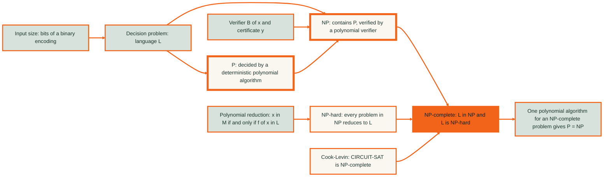
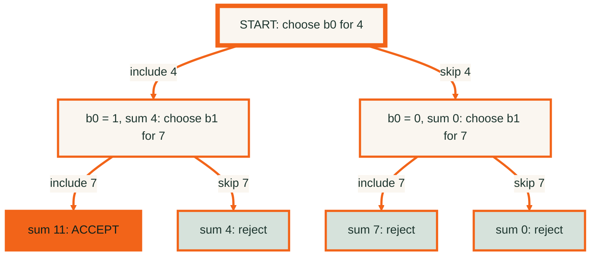
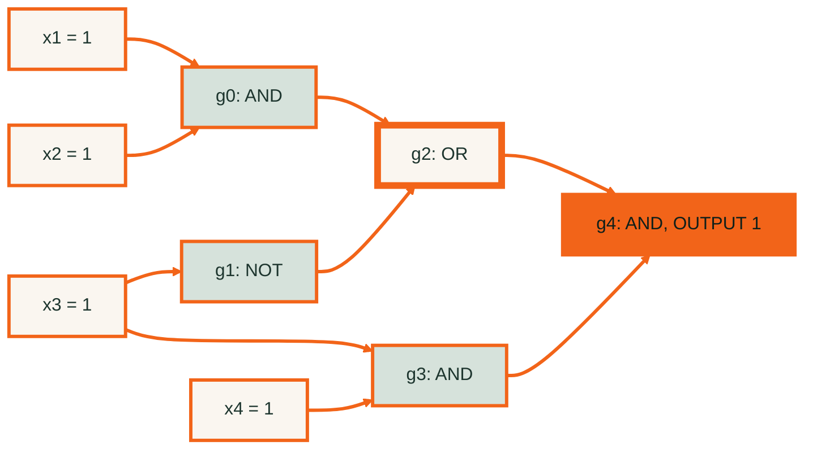

# 13 — NP-Πληρότητα
*NP-Completeness*

Όλα τα προηγούμενα κεφάλαια κατασκευάζουν αλγορίθμους και αποδεικνύουν φράγματα χρόνου για συγκεκριμένα προβλήματα. Το κεφάλαιο αυτό αντιστρέφει την οπτική: ταξινομεί τα προβλήματα απόφασης σε κλάσεις πολυπλοκότητας και δείχνει ότι ορισμένα από αυτά είναι, υπό την επικρατούσα εικασία $P\ne NP$, εκτός της κλάσης $P$. Η κεντρική διάκριση είναι μεταξύ εύρεσης λύσης και επαλήθευσης λύσης: ένα πιστοποιητικό επαληθεύεται γρήγορα ακόμη και όταν η αναζήτησή του είναι εκθετική. Το τυπικό πλαίσιο των κλάσεων `P` και `NP`, των πολυωνυμικών αναγωγών και της `NP`-πληρότητας κορυφώνεται στο θεώρημα `Cook-Levin`, που παρέχει το πρώτο `NP`-πλήρες πρόβλημα, το `CIRCUIT-SAT`. Το κεφάλαιο στηρίζεται στην ασυμπτωτική ανάλυση του [01_analysis_of_algorithms.md](01_analysis_of_algorithms.md), στη ψεύδο-πολυωνυμική ανάλυση του σακιδίου `0-1` στο [08_dynamic_programming.md](08_dynamic_programming.md) και στους γράφους του [09_graphs_dfs_bfs.md](09_graphs_dfs_bfs.md).

> **Εξεταστική κάλυψη:** Μόνο Τελική
> **Κεφάλαιο βιβλίου:** `Κεφ. 17` | **Διαλέξεις:** `23_np_completeness.pdf`
> **Πηγή:** `Resources/Meta/mindmap.md` (Ενότητα 13)
> **Εκτός ύλης:** Ενότητες `17.3`, `17.4`, `17.5`

## Πίνακας Περιεχομένων

- [1. Εννοιολογικό Πλαίσιο και Συνολική Εικόνα](#1-εννοιολογικό-πλαίσιο-και-συνολική-εικόνα)
- [2. Θεωρητική Θεμελίωση και Τυπικοί Ορισμοί](#2-θεωρητική-θεμελίωση-και-τυπικοί-ορισμοί)
- [3. Αλγόριθμοι, Ιχνηλάτηση και Κώδικας](#3-αλγόριθμοι-ιχνηλάτηση-και-κώδικας)
- [4. Συγκριτική Ανάλυση και Πολυπλοκότητα](#4-συγκριτική-ανάλυση-και-πολυπλοκότητα)
- [5. Πλήρως Λυμένες Ασκήσεις Εξεταστικού Επιπέδου](#5-πλήρως-λυμένες-ασκήσεις-εξεταστικού-επιπέδου)
- [6. Οδηγός Επιβίωσης στις Εξετάσεις και Παγίδες](#6-οδηγός-επιβίωσης-στις-εξετάσεις-και-παγίδες)
- [7. Συνοπτικός Πίνακας Εννοιών](#7-συνοπτικός-πίνακας-εννοιών)

---

## 1. Εννοιολογικό Πλαίσιο και Συνολική Εικόνα

### Το Πρόβλημα

Μια εταιρεία διανομών πρέπει να στείλει ένα όχημα σε $25$ σταθμούς και να επιστρέψει στο κέντρο διανομής. Κάθε διαδρομή μεταξύ δύο σταθμών έχει γνωστό μήκος και ζητείται η σειρά επίσκεψης με το ελάχιστο συνολικό μήκος. Ο αριθμός των δυνατών σειρών είναι $25!\approx 1.55\cdot 10^{25}$, μέγεθος απαγορευτικό για εξαντλητική απαρίθμηση. Αντίθετα, αν κάποιος προτείνει μία σειρά, ο έλεγχός της απαιτεί μόνο $26$ αναζητήσεις ακμών, $26$ προσθέσεις και μία σύγκριση με το όριο· η επαλήθευση είναι γραμμική, ενώ η αναζήτηση είναι υπερπολυωνυμική.

Η ασυμμετρία αυτή είναι το αντικείμενο του κεφαλαίου. Η ερώτηση «υπάρχει διαδρομή μήκους το πολύ $L$;» είναι πρόβλημα απόφασης (`decision problem`) και ανήκει στην κλάση `NP`: μια υποψήφια διαδρομή είναι πιστοποιητικό (`certificate`) που ελέγχεται σε πολυωνυμικό χρόνο. Η ερώτηση «ποια είναι η ελάχιστη διαδρομή;» είναι πρόβλημα βελτιστοποίησης (`optimization problem`) και μετατρέπεται σε πρόβλημα απόφασης με δυαδική αναζήτηση στο $L$. Το κεφάλαιο δεν λύνει το πρόβλημα του πλανόδιου πωλητή· ορίζει με ακρίβεια τι σημαίνει «δεν υπάρχει γνωστός πολυωνυμικός αλγόριθμος» και πώς αποδεικνύεται ότι ένα πρόβλημα είναι τουλάχιστον τόσο δύσκολο όσο όλα τα προβλήματα του `NP`.

Η έννοια του μεγέθους εισόδου είναι κρίσιμη. Ως μέγεθος νοείται το πλήθος των bits της δυαδικής κωδικοποίησης, όχι η αριθμητική τιμή των δεδομένων. Η διάκριση εξηγεί γιατί ο αλγόριθμος $O(nW)$ του σακιδίου `0-1` δεν είναι πολυωνυμικός: το $W$ μπορεί να καταλαμβάνει εκατοντάδες bits και η τιμή του να είναι εκθετική ως προς αυτά.

### Χάρτης Εννοιών του Κεφαλαίου



Πορτοκαλί γέμισμα: η έννοια-στόχος, δηλαδή η `NP`-πληρότητα (`NP-complete`). Παχύ περίγραμμα: οι δύο κλάσεις που ορίζονται μέσω του μεγέθους εισόδου και της επαλήθευσης· το βέλος από το `P` στο `NP` δηλώνει με λέξεις τον εγκλεισμό $P\subseteq NP$. Απαλό πράσινο: τα εργαλεία ορισμού (μέγεθος, πρόβλημα απόφασης, επικυρωτής, αναγωγή) και η συνέπεια. Κρεμ: το θεώρημα `Cook-Levin` και η έννοια του `NP-hard`. Ο κόμβος της συνέπειας εκφράζει θεώρημα, όχι την εικασία $P=NP$· η ισότητα δεν σχεδιάζεται ως γεγονός.

| Ομάδα | Κόμβοι | Ρόλος |
|---|---|---|
| Θεμέλιο | Μέγεθος εισόδου, πρόβλημα απόφασης, γλώσσα | Καθορίζουν τι μετρά ο χρόνος και τι είναι «λύση» |
| Κλάσεις | `P`, `NP` | Διαχωρίζουν την αποφασισιμότητα από την επαληθευσιμότητα |
| Εργαλεία | Επικυρωτής, πολυωνυμική αναγωγή | Αποδεικνύουν ιδιότητες χωρίς νέους αλγορίθμους |
| Στόχος | `NP-hard`, `NP-complete` | Εκφράζουν τη σχετική δυσκολία ως προς το `NP` |
| Αγκύρωση | `Cook-Levin`, `CIRCUIT-SAT` | Παρέχει το πρώτο `NP`-πλήρες πρόβλημα |
| Συνέπεια | Μία πολυωνυμική λύση δίνει $P=NP$ | Εξηγεί γιατί η `NP`-πληρότητα είναι αρνητικό αποτέλεσμα |

### Πότε Χρησιμοποιείται Κάθε Έννοια

Η κλάση `P` απαντά στο ερώτημα αν ένα πρόβλημα είναι πρακτικά επιλύσιμο για μεγάλες εισόδους. Ο επικυρωτής απαντά στο ερώτημα αν μια προτεινόμενη λύση ελέγχεται γρήγορα, ανεξάρτητα από το πόσο δύσκολο είναι να βρεθεί. Η πολυωνυμική αναγωγή απαντά στο ερώτημα αν ένα νέο πρόβλημα είναι τουλάχιστον τόσο δύσκολο όσο ένα γνωστό. Η `NP`-πληρότητα απαντά στο ερώτημα αν το πρόβλημα είναι από τα δυσκολότερα του `NP`· αν ναι, μια πολυωνυμική λύση του θα απέληγε σε $P=NP$. Στην πράξη, η αναγνώριση ενός προβλήματος ως `NP`-πλήρους οδηγεί σε αναζήτηση ακριβών εκθετικών αλγορίθμων για μικρές εισόδους, σε κλάδεμα του χώρου αναζήτησης ή σε προσεγγιστικές μεθόδους, και όχι σε άσκοπη αναζήτηση πολυωνυμικού αλγορίθμου.

| Ερώτημα | Εργαλείο | Απάντηση που δίνει |
|---|---|---|
| Επιλύεται σε πολυωνυμικό χρόνο; | Ορισμός `P` | Ναι ή όχι για τη συγκεκριμένη κλάση |
| Ελέγχεται γρήγορα μια λύση; | Επικυρωτής `B(x,y)` | Ναι, με πιστοποιητικό πολυωνυμικού μήκους |
| Είναι το $L$ τουλάχιστον τόσο δύσκολο όσο το $M$; | Αναγωγή $M\le_p L$ | Ναι, αν η $f$ είναι πολυωνυμική και διατηρεί το ναι/όχι |
| Είναι το $L$ από τα δυσκολότερα του `NP`; | `NP`-πληρότητα | Ναι, αν $L\in NP$ και κάθε πρόβλημα του `NP` ανάγεται σε αυτό |
| Τι συνεπάγεται μια πολυωνυμική λύση; | Θεώρημα συνέπειας | $P=NP$, άρα κατάρρευση της διάκρισης |

---

## 2. Θεωρητική Θεμελίωση και Τυπικοί Ορισμοί

### 2.1 Μέγεθος Εισόδου, Κωδικοποίηση και Ψεύδο-Πολυωνυμικός Χρόνος

**Ορισμός 2.1 (μέγεθος εισόδου).** Μέγεθος εισόδου (`input size`) $n$ μιας περίπτωσης είναι το πλήθος των bits της δυαδικής κωδικοποίησης της περίπτωσης, δηλαδή το μήκος της συμβολοσειράς που παράγει ένας κωδικοποιητής (`encoder`). Το μέγεθος δεν είναι το πλήθος των αντικειμένων ούτε η αριθμητική τιμή τους. Ένας θετικός ακέραιος $W$ καταλαμβάνει $\lfloor\log_2 W\rfloor+1$ bits σε δυαδική κωδικοποίηση και $W$ σύμβολα σε μοναδιαία κωδικοποίηση (`unary encoding`).

**Παράδειγμα.** Ο αριθμός $W=1000$ γράφεται σε $10$ bits, επειδή $2^9=512\le 1000<1024=2^{10}$. Ο αριθμός $W=2^{100}$ γράφεται σε $101$ bits. Η τιμή του δεύτερου είναι $2^{100}\approx1.27\cdot10^{30}$, δηλαδή περίπου $1.27\cdot10^{27}$ φορές μεγαλύτερη, αλλά το μέγεθος της κωδικοποίησής του είναι μόλις δέκα φορές μεγαλύτερο.

**Ορισμός 2.2 (ψεύδο-πολυωνυμικός αλγόριθμος).** Ένας αλγόριθμος είναι ψεύδο-πολυωνυμικός (`pseudo-polynomial`) όταν ο χρόνος του φράσσεται από πολυώνυμο στο πλήθος των αριθμών και στην αριθμητική τους τιμή, αλλά όχι στο πλήθος των bits της δυαδικής κωδικοποίησης. Ισοδύναμα, γίνεται πολυωνυμικός όταν οι αριθμοί κωδικοποιούνται μοναδιαία και παραμένει εκθετικός στη δυαδική κωδικοποίηση.

**Πόρισμα 2.1 (σακίδιο `0-1`, `0-1 Knapsack`).** Ο αλγόριθμος δυναμικού προγραμματισμού (`ΔΠ`) του σακιδίου `0-1` έχει χρόνο $O(nW)$ και χώρο $O(W)$ με τη βελτιστοποίηση δύο πινάκων, όπου $n$ το πλήθος αντικειμένων και $W$ η χωρητικότητα. Στη χειρότερη περίπτωση τα $n$ βάρη είναι της τάξης του $W$, άρα το μέγεθος της εισόδου είναι $N=\Omega(n\log W)$ bits. Επειδή $W<2^{N}$ για $N$ bits εισόδου, ισχύει
$$nW=O(N\,2^{N}),$$
δηλαδή ο χρόνος είναι εκθετικός ως προς το πλήθος των bits και ο αλγόριθμος είναι ψεύδο-πολυωνυμικός, όχι πολυωνυμικός.

**Αριθμητική εικόνα.** Στη χειρότερη περίπτωση, όπου και τα $50$ βάρη είναι της τάξης του $W$, η είσοδος για $W=2^{100}$ έχει περίπου $50\cdot 100=5000$ bits, ενώ ο πίνακας ΔΠ απαιτεί
$$nW=50\cdot 2^{100}\approx 6.34\cdot 10^{31}$$
πράξεις. Το $5000^3$ είναι μόλις $1.25\cdot 10^{11}$, δηλαδή ο χρόνος της ΔΠ είναι περίπου $5.07\cdot 10^{20}$ φορές μεγαλύτερος από τον κύβο του μεγέθους εισόδου. Ο χρόνος δεν φράσσεται από $N^{c}$ για καμία σταθερά $c$· η αριθμητική σύγκριση δείχνει το μέγεθος της απόκλισης, ενώ η ασυμπτωτική απόδειξη βρίσκεται στο Πόρισμα 2.1.

### 2.2 Προβλήματα Απόφασης και Γλώσσες

**Ορισμός 2.3 (πρόβλημα απόφασης).** Πρόβλημα απόφασης (`decision problem`) είναι ένα πρόβλημα του οποίου κάθε περίπτωση έχει απάντηση ναι ή όχι. Παραδείγματα: «έχει ο πίνακας $A$ υποσύνολο με άθροισμα $T$;», «έχει το κύκλωμα $C$ εκχώρηση εισόδων που παράγει έξοδο $1$;», «υπάρχει διαδρομή από την $s$ στην $t$ με μήκος το πολύ $L$;».

**Ορισμός 2.4 (γλώσσα).** Έστω αλφάβητο $\Sigma=\{0,1\}$. Γλώσσα (`language`) είναι σύνολο $L\subseteq\Sigma^{*}$. Κάθε πρόβλημα απόφασης αντιστοιχεί στη γλώσσα
$$L=\{x\in\Sigma^{*}:\text{ η απάντηση στην περίπτωση }x\text{ είναι ναι}\}.$$
Η κωδικοποίηση των περιπτώσεων ως συμβολοσειρών είναι μέρος του προβλήματος. Λογικές κωδικοποιήσεις, όπως η δυαδική και η δεκαδική, διαφέρουν κατά πολυωνυμικό παράγοντα και δεν αλλάζουν την κλάση πολυπλοκότητας· η μοναδιαία κωδικοποίηση μπορεί να αλλάξει το μέγεθος εκθετικά και γι' αυτό εξετάζεται χωριστά.

**Ορισμός 2.5 (αποφασισιμότητα).** Ένας αλγόριθμος $A$ αποφασίζει (`decides`) τη γλώσσα $L$ αν για κάθε $x\in\Sigma^{*}$ τερματίζει και επιστρέφει ναι αν και μόνο αν $x\in L$. Ένας αλγόριθμος $A$ δέχεται (`accepts`) τη γλώσσα $L$ αν για κάθε $x\in L$ υπάρχει εκτέλεση που επιστρέφει ναι· δεν απαιτείται τερματισμός για $x\notin L$. Η διάκριση είναι ουσιαστική: η κλάση `P` απαιτεί απόφαση, ενώ η `NP` ορίζεται μέσω αποδοχής από μη ντετερμινιστικό αλγόριθμο.

**Παρατήρηση (γιατί αρκούν τα προβλήματα απόφασης).** Ένα πρόβλημα βελτιστοποίησης με ακέραια αντικειμενική συνάρτηση μετατρέπεται σε πρόβλημα απόφασης με δυαδική αναζήτηση στην τιμή-στόχο. Για παράδειγμα, η μέγιστη συνολική αξία $B^{*}$ του σακιδίου `0-1` βρίσκεται με $\lceil\log_2 B_{\max}\rceil$ ερωτήματα της μορφής «υπάρχει λύση με όφελος τουλάχιστον $B$;». Το πλήθος των ερωτημάτων είναι γραμμικό ως προς το πλήθος bits της τιμής-στόχου, άρα η αναγωγή είναι πολυωνυμική.

### 2.3 Η Κλάση `P`

**Ορισμός 2.6 (κλάση `P`).** Η κλάση `P` (`polynomial time`) είναι το σύνολο των γλωσσών για τις οποίες υπάρχει ντετερμινιστικός αλγόριθμος $A$ που τις αποφασίζει σε πολυωνυμικό χρόνο:
$$P=\left\{L\subseteq\Sigma^{*}:\ \exists A\ \text{ντετερμινιστικός},\ \exists c>0,\ \exists k\ge 1,\ \forall x:\ T_A(x)\le c\,|x|^{k}\right\}.$$
Ο χρόνος μετράται σε σχέση με το μέγεθος εισόδου $|x|$ και η σταθερά $k$ δεν εξαρτάται από την είσοδο.

**Παραδείγματα προβλημάτων στο `P`.**

| Πρόβλημα | Αλγόριθμος | Χρόνος (χειρότερη περίπτωση) | Γιατί είναι πολυωνυμικός |
|---|---|---|---|
| Ταξινόμηση $n$ στοιχείων | `Merge-Sort` | $O(n\log n)$ | Το $n$ είναι το μέγεθος εισόδου |
| Συντομότερες διαδρομές μίας πηγής | `Bellman-Ford` | $O(nm)$ | $m\le n^{2}$, άρα $O(n^{3})$ |
| Ελάχιστο δέντρο επικάλυψης | `Kruskal` | $O(m\log n)$ | $m\le n(n-1)/2$ |
| Μέγιστη κοινή υποακολουθία | Δυναμικός προγραμματισμός | $O(nm)$ | $n,m$ είναι μήκη συμβολοσειρών, δηλαδή μέγεθος εισόδου |
| Γινόμενα αλυσίδας πινάκων | Δυναμικός προγραμματισμός | $O(n^{3})$ | $n$ πίνακες, $\Theta(n)$ δεδομένα |
| Σακίδιο `0-1` με μοναδιαία κωδικοποίηση | Δυναμικός προγραμματισμός | $O(nW)$ | Η μοναδιαία είσοδος έχει μέγεθος $\Theta(nW)$ |

**Παρατήρηση (η κωδικοποίηση αλλάζει την κλάση).** Το σακίδιο `0-1` εμφανίζεται στον πίνακα μόνο στη μοναδιαία κωδικοποίηση. Στη δυαδική κωδικοποίηση ο χρόνος $O(nW)$ δεν είναι πολυωνυμικός ως προς το μέγεθος εισόδου, όπως έδειξε το Πόρισμα 2.1. Ο ίδιος αλγόριθμος χαρακτηρίζεται πολυωνυμικός ή ψεύδο-πολυωνυμικός ανάλογα με την κωδικοποίηση· γι' αυτό το μέγεθος εισόδου ορίζεται πάντα ως πλήθος bits.

### 2.4 Η Κλάση `NP`: Μη Ντετερμινισμός και Πιστοποιητικά

**Ορισμός 2.7 (μη ντετερμινιστικός αλγόριθμος).** Μη ντετερμινιστικός αλγόριθμος (`nondeterministic algorithm`) είναι αλγόριθμος του οποίου οι εντολές περιλαμβάνουν, εκτός από τις συνήθεις ντετερμινιστικές πράξεις, την εντολή
$$\texttt{choose(true, false)}.$$
Κάθε εκτέλεση της εντολής δημιουργεί δύο διακλαδώσεις, μία για κάθε τιμή. Μια εκτέλεση (`computation`) του αλγορίθμου σε είσοδο $x$ είναι μία ακολουθία επιλογών· το σύνολο των εκτελέσεων σχηματίζει δέντρο εκτελέσεων. Ο αλγόριθμος δέχεται (`accepts`) την $x$ αν τουλάχιστον μία εκτέλεση τερματίζει με ναι. Τρέχει σε πολυωνυμικό χρόνο $p$ αν κάθε εκτέλεση σε κάθε $x$ τερματίζει εντός $p(|x|)$ βημάτων· η απαίτηση αφορά όλες τις διαδρομές, ενώ η αποδοχή αφορά μία.

**Ορισμός 2.8 (κλάση `NP`, πρώτος ορισμός).** Η κλάση `NP` (`nondeterministic polynomial time`) είναι το σύνολο των γλωσσών που δέχεται κάποιος μη ντετερμινιστικός αλγόριθμος σε πολυωνυμικό χρόνο:
$$NP=\left\{L:\ \exists A\ \text{μη ντετερμινιστικός},\ \exists k\ge 1:\ A\ \text{δέχεται την }L\ \text{και }\forall x\ \text{κάθε εκτέλεση τερματίζει σε }O(|x|^{k})\right\}.$$

**Ορισμός 2.9 (επικυρωτής).** Έστω γλώσσα $L$ και πολυώνυμο $q$. Επικυρωτής (`verifier`) για την $L$ είναι ντετερμινιστικός αλγόριθμος $B(x,y)$ τέτοιος ώστε:
1. Το $y$ είναι συμβολοσειρά πιστοποιητικού (`certificate`) με $|y|\le q(|x|)$.
2. Ο χρόνος του $B$ είναι πολυωνυμικός ως προς $|x|$.
3. Για κάθε $x$: αν $x\in L$, υπάρχει $y$ με $B(x,y)=$ ναι· αν $x\notin L$, για κάθε $y$ ισχύει $B(x,y)=$ όχι.

Η τρίτη συνθήκη εκφράζει πληρότητα (`completeness`) και ορθότητα (`soundness`): καμία ψευδής περίπτωση δεν περνά, και κάθε αληθής περίπτωση έχει μάρτυρα. Ο επικυρωτής δεν επιτρέπεται να είναι μη ντετερμινιστικός ούτε να δέχεται πιστοποιητικά αυθαίρετου μήκους.

**Ορισμός 2.10 (κλάση `NP`, δεύτερος ορισμός).** Η `NP` είναι το σύνολο των γλωσσών για τις οποίες υπάρχει επικυρωτής πολυωνυμικού χρόνου:
$$NP=\left\{L:\ \exists B\ \text{ντετερμινιστικός πολυωνυμικού χρόνου},\ \exists q\ \text{πολυώνυμο},\ \forall x:\ x\in L\iff \exists y,\ |y|\le q(|x|),\ B(x,y)=\text{ναι}\right\}.$$

**Θεώρημα 2.1 (ισοδυναμία των δύο ορισμών της `NP`).** Μια γλώσσα $L$ ανήκει στην `NP` κατά τον Ορισμό 2.8 αν και μόνο αν ανήκει κατά τον Ορισμό 2.10.

*Απόδειξη.*

**(α) Μη ντετερμινισμός συνεπάγεται επικυρωτή.** Έστω ότι ο μη ντετερμινιστικός αλγόριθμος $A$ δέχεται την $L$ σε χρόνο $p(n)$. Ορίζουμε $q(n)=p(n)$ και επικυρωτή $B(x,y)$ ως εξής. Ο $B$ προσομοιώνει τον $A$ ντετερμινιστικά· όταν ο $A$ εκτελεί την $j$-οστή εντολή `choose`, ο $B$ διαβάζει το $j$-οστό bit του $y$ και χρησιμοποιεί αυτό ως επιλογή. Αν η προσομοίωση ζητήσει περισσότερα bits από το μήκος του $y$, ο $B$ επιστρέφει όχι. Αν ο $A$ τερματίσει, ο $B$ επιστρέφει την ίδια απάντηση.

Ο $B$ είναι ντετερμινιστικός, επειδή οι επιλογές δίνονται από το $y$ και δεν λαμβάνονται από τον ίδιο. Κάθε εκτέλεση του $A$ σε είσοδο $x$ περιέχει το πολύ $p(|x|)$ εντολές `choose`, αφού τερματίζει εντός $p(|x|)$ βημάτων. Αν $x\in L$, υπάρχει αποδεκτή εκτέλεση· η ακολουθία επιλογών της έχει μήκος $\ell\le p(|x|)$ και συμπληρώνεται με μηδενικά σε μήκος $p(|x|)$, άρα υπάρχει $y$ με $|y|\le q(|x|)$ και $B(x,y)=$ ναι. Αν $x\notin L$, καμία εκτέλεση δεν επιστρέφει ναι, άρα για κάθε $y$ ο $B$ επιστρέφει όχι. Ο χρόνος του $B$ είναι $O(p(|x|)+|y|)=O(p(|x|))$, πολυωνυμικός.

**(β) Επικυρωτής συνεπάγεται μη ντετερμινισμό.** Έστω επικυρωτής $B$ με όριο πιστοποιητικού $q(n)$. Ορίζουμε μη ντετερμινιστικό αλγόριθμο $A$ που σε είσοδο $x$ εκτελεί $q(|x|)$ φορές την εντολή `choose(true,false)` και σχηματίζει το $y=b_1b_2\cdots b_{q(|x|)}$· στη συνέχεια εκτελεί τον $B(x,y)$ και επιστρέφει την απάντησή του. Κάθε εκτέλεση κάνει $q(|x|)$ επιλογές και καλεί μία ντετερμινιστική διαδικασία πολυωνυμικού χρόνου, άρα τερματίζει σε χρόνο $O(q(|x|)+T_B(|x|))$, πολυωνυμικό. Ο $A$ δέχεται την $x$ αν και μόνο αν υπάρχει $y$ με $B(x,y)=$ ναι, δηλαδή αν και μόνο αν $x\in L$. $\square$

**Παρατήρηση (το μέγεθος του πιστοποιητικού).** Το όριο $q(|x|)$ δεν είναι τεχνική λεπτομέρεια. Ο επικυρωτής τρέχει σε πολυωνυμικό χρόνο ως προς $|x|$· αν το πιστοποιητικό ήταν αυθαίρετα μεγάλο, ο επικυρωτής δεν θα προλάβαινε να το διαβάσει. Το φράγμα εξασφαλίζει ότι η επαλήθευση είναι πολυωνυμική τόσο ως προς την είσοδο όσο και ως προς το πιστοποιητικό, και κάνει την `NP` μια κλάση με ουσιαστικό περιεχόμενο.

### 2.5 `P` ως Υποσύνολο του `NP` και το Ανοιχτό Ερώτημα

**Θεώρημα 2.2 (`P` $\subseteq$ `NP`).** Κάθε γλώσσα της `P` ανήκει στην `NP`.

*Απόδειξη.* Έστω $L\in P$ με ντετερμινιστικό αλγόριθμο $A$ χρόνου $p(n)$. Ορίζουμε επικυρωτή $B(x,y)$ που αγνοεί το $y$ και επιστρέφει την απάντηση του $A(x)$. Το πιστοποιητικό είναι η κενή συμβολοσειρά, άρα $q(n)=0$. Ο $B$ είναι ντετερμινιστικός, τρέχει σε $O(p(|x|))$ και ισχύει $x\in L\iff B(x,\varepsilon)=$ ναι. Από το Θεώρημα 2.1, $L\in NP$. Ισοδύναμα, ο μη ντετερμινιστικός αλγόριθμος που εκτελεί τον $A$ χωρίς καμία εντολή `choose` δέχεται την $L$ στον ίδιο χρόνο. $\square$

**Παρατήρηση (το ανοιχτό ερώτημα).** Από το Θεώρημα 2.2 ισχύει $P\subseteq NP$. Το ερώτημα αν $P=NP$ παραμένει ανοιχτό· η επικρατούσα εκτίμηση είναι $P\ne NP$, αλλά δεν υπάρχει απόδειξη. Η ισότητα θα σήμαινε ότι κάθε πρόβλημα του οποίου μια λύση επαληθεύεται γρήγορα επιλύεται και γρήγορα. Η ανισότητα θα σήμαινε ότι υπάρχουν προβλήματα στο `NP` χωρίς πολυωνυμικό αλγόριθμο· η `NP`-πληρότητα είναι ο μηχανισμός που πιστοποιεί τέτοια προβλήματα υπό την εικασία $P\ne NP$.

### 2.6 Πολυωνυμικές Αναγωγές

**Ορισμός 2.11 (πολυωνυμική αναγωγή).** Έστω γλώσσες $M,L\subseteq\Sigma^{*}$. Η $M$ ανάγεται πολυωνυμικά (`polynomial-time reduction`) στην $L$, συμβολικά $M\le_p L$, αν υπάρχει συνάρτηση $f:\Sigma^{*}\to\Sigma^{*}$ τέτοια ώστε:
1. Η $f$ υπολογίζεται σε πολυωνυμικό χρόνο ως προς $|x|$.
2. Για κάθε $x\in\Sigma^{*}$ ισχύει $x\in M\iff f(x)\in L$.

Η $f$ ονομάζεται συνάρτηση αναγωγής (`reduction function`). Η κατεύθυνση είναι σταθερή: μετασχηματίζονται περιπτώσεις του $M$ σε περιπτώσεις του $L$. Ένας αλγόριθμος για την $L$ δίνει αλγόριθμο για την $M$ συνθέτοντας την $f$ με τον αλγόριθμο του $L$. Η αναγωγή δεν χρειάζεται να διατηρεί τη δομή της λύσης· αρκεί να διατηρεί την απάντηση ναι ή όχι.

**Θεώρημα 2.3 (μεταβατικότητα).** Αν $M\le_p L$ και $L\le_p N$, τότε $M\le_p N$.

*Απόδειξη.* Έστω $f$ η αναγωγή από το $M$ στο $L$ με χρόνο $p(n)$ και $g$ η αναγωγή από το $L$ στο $N$ με χρόνο $q(n)$. Ορίζουμε $h(x)=g(f(x))$. Η $h$ υπολογίζεται σε χρόνο $p(|x|)+q(|f(x)|)$. Επειδή ο χρόνος υπολογισμού της $f$ φράσσει και το μήκος της εξόδου, ισχύει $|f(x)|\le p(|x|)$, άρα ο χρόνος είναι $p(|x|)+q(p(|x|))$, πολυωνυμικός. Για την ορθότητα,
$$x\in M\iff f(x)\in L\iff g(f(x))\in N\iff h(x)\in N.$$
Άρα $M\le_p N$. $\square$

**Θεώρημα 2.4 (μετάδοση επιλυσιμότητας).** Αν $M\le_p L$ και $L\in P$, τότε $M\in P$.

*Απόδειξη.* Έστω $f$ η αναγωγή με χρόνο $p(n)$ και $A$ ντετερμινιστικός αλγόριθμος που αποφασίζει την $L$ σε χρόνο $q(n)$. Ο αλγόριθμος για την $M$ υπολογίζει το $f(x)$ και εκτελεί $A(f(x))$. Ο χρόνος είναι $p(|x|)+q(|f(x)|)\le p(|x|)+q(p(|x|))$, πολυωνυμικός. Η ορθότητα έπεται από το $x\in M\iff f(x)\in L$ και από την ορθότητα του $A$. $\square$

**Παρατήρηση (η χρήσιμη αντιθετοαντίστροφη).** Από το Θεώρημα 2.4, αν το $M$ δεν ανήκει στο `P` και $M\le_p L$, τότε ούτε το $L$ ανήκει στο `P`. Αυτή η μορφή χρησιμοποιείται για την απόδειξη δυσκολίας: η δυσκολία μεταφέρεται από το γνωστό $M$ στο νέο $L$, όχι αντίστροφα.

### 2.7 `NP-hard` και `NP-complete`

**Ορισμός 2.12 (`NP-hard`).** Μια γλώσσα $L$ είναι `NP-hard` αν κάθε γλώσσα $M\in NP$ ανάγεται πολυωνυμικά στην $L$:
$$\forall M\in NP:\ M\le_p L.$$
Η $L$ δεν χρειάζεται να ανήκει στην `NP`. Μια `NP-hard` γλώσσα μπορεί να είναι αυστηρά δυσκολότερη από κάθε πρόβλημα του `NP`.

**Ορισμός 2.13 (`NP-complete`).** Μια γλώσσα $L$ είναι `NP-complete` (`NP-πλήρης`) αν ισχύουν και τα δύο:
1. $L\in NP$.
2. Η $L$ είναι `NP-hard`.

Η πρώτη συνθήκη δεν παραλείπεται. Μια `NP-hard` γλώσσα εκτός `NP` δεν είναι `NP-complete`, ακόμη και αν είναι δυσκολότερη.

**Θεώρημα 2.5 (συνέπεια της `NP`-πληρότητας).** Αν μια `NP-complete` γλώσσα $L$ ανήκει στην `P`, τότε $P=NP$.

*Απόδειξη.* Έστω $L$ `NP-complete` με $L\in P$. Έστω $M\in NP$ οποιαδήποτε. Επειδή η $L$ είναι `NP-hard`, ισχύει $M\le_p L$. Από το Θεώρημα 2.4 και $L\in P$, έπεται $M\in P$. Άρα $NP\subseteq P$. Από το Θεώρημα 2.2 ισχύει $P\subseteq NP$. Επομένως $P=NP$. $\square$

**Πόρισμα 2.6.** Ένας πολυωνυμικός αλγόριθμος για οποιοδήποτε `NP-complete` πρόβλημα συνεπάγεται πολυωνυμικό αλγόριθμο για κάθε πρόβλημα του `NP` και άρα $P=NP$.

**Παρατήρηση (`NP-hard` εκτός `NP`).** Η βελτιστοποίηση του πλανόδιου πωλητή (`Traveling Salesman Problem`, «ελάχιστη διαδρομή») είναι `NP-hard`, αλλά δεν είναι γλώσσα απόφασης και δεν ανήκει στην `NP`· η αντίστοιχη μορφή απόφασης («υπάρχει διαδρομή μήκους το πολύ $L$;») ανήκει στην `NP`. Η διάκριση εξηγεί γιατί η φράση «είναι `NP-complete`» απαιτεί πρώτα τη διατύπωση ως προβλήματος απόφασης.

> **Εκτός ύλης:** Οι Ενότητες `17.3`, `17.4` και `17.5` δεν εξετάζονται. Δεν διδάσκονται αλυσίδες αναγωγών `NP`-πληρότητας (για παράδειγμα από τη `3-SAT` στη `Clique`) ούτε κατάλογος κλασικών `NP`-πλήρων προβλημάτων πέραν του `CIRCUIT-SAT`.

### 2.8 Θεώρημα `Cook-Levin`

**Ορισμός 2.14 (κύκλωμα και `CIRCUIT-SAT`).** Ένα Boolean κύκλωμα (`Boolean circuit`) αποτελείται από εισόδους, πύλες `AND`, `OR`, `NOT` και μία έξοδο. Κάθε πύλη έχει σταθερό αριθμό εισόδων· η έξοδος μιας πύλης μπορεί να τροφοδοτεί πολλές επόμενες πύλες. Το κύκλωμα είναι κατευθυνόμενο ακυκλικό γράφημα και περιγράφεται από το πλήθος των πυλών $m$ και των εισόδων $k$. Το πρόβλημα `CIRCUIT-SAT` δέχεται ως είσοδο ένα κύκλωμα και ρωτά:
$$\text{υπάρχει εκχώρηση }0/1\text{ στις }k\text{ εισόδους ώστε η έξοδος να είναι }1;$$
Η κωδικοποίηση ενός κυκλώματος απαιτεί $O((k+m)\log(k+m))$ bits, επειδή κάθε πύλη γράφει τον τύπο της και τους δείκτες των τελεστών της.

**Θεώρημα 2.6 (`Cook-Levin`).** Το `CIRCUIT-SAT` είναι `NP-complete`.

*Απόδειξη.*

**(α) `CIRCUIT-SAT` $\in NP$.** Το πιστοποιητικό είναι η εκχώρηση τιμών σε όλες τις εισόδους και σε όλες τις εξόδους των πυλών, δηλαδή $k+m$ bits. Ο επικυρωτής διατρέχει τις πύλες σε τοπολογική σειρά και για κάθε πύλη ελέγχει ότι η δηλωμένη έξοδος ισούται με το αποτέλεσμα της πράξης στις δηλωμένες εισόδους· στο τέλος ελέγχει ότι η έξοδος είναι $1$. Κάθε πύλη ελέγχεται μία φορά σε χρόνο $O(1)$, άρα ο επικυρωτής τρέχει σε $O(k+m)$, πολυωνυμικό ως προς το μέγεθος του κυκλώματος. Αν το κύκλωμα είναι ικανοποιήσιμο, η ικανοποιούσα εκχώρηση επεκτείνεται με τις εξόδους των πυλών και ο επικυρωτής δέχεται· αν ο επικυρωτής δεχτεί, το τμήμα της εκχώρησης που αφορά τις εισόδους ικανοποιεί το κύκλωμα.

**(β) Το `CIRCUIT-SAT` είναι `NP-hard`.** Έστω $L\in NP$ με επικυρωτή $D$ που τρέχει σε χρόνο $p(n)$ και χρησιμοποιεί χώρο εργασίας $W=O(p(n))$. Χωρίς βλάβη, το πιστοποιητικό έχει μήκος το πολύ $p(n)$· αλλιώς αντικαθιστούμε το $p$ με πολυώνυμο που φράσσει και τα δύο. Για είσοδο $x$ μήκους $n$ κατασκευάζουμε κύκλωμα $S_x$ ως εξής.

1. **Είσοδοι.** Το κύκλωμα έχει $p(n)$ ελεύθερες εισόδους, μία για κάθε bit του πιστοποιητικού $y$, και σταθερές εισόδους για τα bits του $x$.
2. **Κωδικοποίηση κατάστασης.** Η κατάσταση του $D$ μετά από $t$ βήματα αποτελείται από την τρέχουσα κατάσταση του προγράμματος, τη θέση της κεφαλής και τα περιεχόμενα των $W$ κελιών μνήμης. Κωδικοποιείται με $O(W)=O(p(n))$ bits.
3. **Βήμα μετάβασης.** Για κάθε $t=0,1,\dots,p(n)-1$ κατασκευάζεται υποκύκλωμα που υπολογίζει την κατάσταση $t+1$ από την κατάσταση $t$. Στο σχήμα του βιβλίου το υποκύκλωμα μιας μετάβασης έχει μέγεθος $O(W^{2})=O(p(n)^{2})$: για καθένα από τα $W$ κελιά απαιτούνται $O(W)$ πύλες, ώστε να ληφθούν υπόψη η θέση της κεφαλής, η κατάσταση και τα γειτονικά κελιά.
4. **Έξοδος.** Η τελική έξοδος είναι $1$ αν και μόνο αν ο $D$ τερματίζει με ναι μετά από το πολύ $p(n)$ βήματα.

Το συνολικό μέγεθος είναι
$$p(n)\cdot O(p(n)^{2})=O(p(n)^{3}),$$
πολυωνυμικό ως προς $n$. Η κατασκευή είναι ομοιόμορφη (`uniform`): εξαρτάται μόνο από το $x$ και τη σταθερή μηχανή $D$, και υπολογίζεται σε πολυωνυμικό χρόνο ως προς $n$. Επιπλέον,
$$x\in L\iff \exists y,\ |y|\le p(n),\ D(x,y)=\text{ναι}\iff S_x\text{ είναι ικανοποιήσιμο},$$
επειδή μια ικανοποιούσα εκχώρηση στις ελεύθερες εισόδους είναι ακριβώς ένα πιστοποιητικό που κάνει τον $D$ να δεχτεί. Άρα $L\le_p \text{CIRCUIT-SAT}$. Επειδή η $L$ ήταν τυχούσα γλώσσα της `NP`, το `CIRCUIT-SAT` είναι `NP-hard`.

Από τα (α) και (β), το `CIRCUIT-SAT` είναι `NP-complete`. $\square$

**Παρατήρηση (τι προσφέρει το θεώρημα).** Το `Cook-Levin` είναι η μόνη απόδειξη `NP`-πληρότητας που απαιτείται στο μάθημα. Κάθε επόμενη απόδειξη θα μπορούσε να γίνει με μία αναγωγή από το `CIRCUIT-SAT` και χρήση της μεταβατικότητας του Θεωρήματος 2.3, αλλά οι αλυσίδες αυτές ανήκουν στις Ενότητες `17.3`–`17.5` και είναι εκτός ύλης.

---

## 3. Αλγόριθμοι, Ιχνηλάτηση και Κώδικας

### 3.1 Ο Επικυρωτής του Αθροίσματος Υποσυνόλου

**Σκοπός.** Δεδομένης μιας περίπτωσης αθροίσματος υποσυνόλου και ενός πιστοποιητικού, ο επικυρωτής αποφαίνεται σε γραμμικό χρόνο αν το πιστοποιητικό περιγράφει έγκυρο υποσύνολο με το ζητούμενο άθροισμα. Ο επικυρωτής δεν αναζητά πιστοποιητικό· ελέγχει ένα δοσμένο.

```text
Algorithm VerifySubsetSum(A, C, T):
Input: array A of n integers, certificate C = (c_1, ..., c_l) of indices, target T
Output: yes if C is a valid certificate and the selected values sum to T, no otherwise

for i <- 0 to n - 1 do
    used[i] <- false
S <- 0
for j <- 1 to l do
    i <- c_j
    if i < 0 or i >= n then
        return no
    if used[i] = true then
        return no
    used[i] <- true
    S <- S + A[i]
if S = T then
    return yes
else
    return no
```

**Ιχνηλάτηση.** Έστω $A=[4,7,2,9,3]$ και $T=14$. Το πιστοποιητικό $C=[0,1,4]$ επιλέγει τους δείκτες $0$, $1$ και $4$, δηλαδή τις τιμές $4$, $7$ και $3$.

| Βήμα | Δείκτης | $A[i]$ | Μερικό άθροισμα $S$ | Έλεγχος | Απόφαση |
|---|---|---|---|---|---|
| $0$ | — | — | $0$ | όλοι οι δείκτες ανενεργοί | συνέχεια |
| $1$ | $0$ | $4$ | $4$ | $0\le 0<5$, ανενεργός | συνέχεια |
| $2$ | $1$ | $7$ | $11$ | $0\le 1<5$, ανενεργός | συνέχεια |
| $3$ | $4$ | $3$ | $14$ | $0\le 4<5$, ανενεργός | συνέχεια |
| τέλος | — | — | $14$ | $S=T$ | ναι |

**Απορρίψεις.** Ο ίδιος αλγόριθμος απορρίπτει τρεις διαφορετικές κατηγορίες ελαττωματικού πιστοποιητικού.

| Πιστοποιητικό $C$ | Μερικό άθροισμα | Έλεγχος εγκυρότητας | Αιτία απόρριψης | Απόφαση |
|---|---|---|---|---|
| $[2,3]$ | $2+9=11$ | έγκυροι δείκτες | $11\ne 14$ | όχι |
| $[1,1]$ | $7$, έπειτα διπλός δείκτης | ο δείκτης $1$ επαναλαμβάνεται | μη έγκυρο πιστοποιητικό | όχι |
| $[0,5]$ | — | ο δείκτης $5$ είναι εκτός $[0,4]$ | μη έγκυρο πιστοποιητικό | όχι |

**Υλοποίηση.**

```python
def verifySubsetSum(numbers: list[int], certificate: list[int], target: int) -> bool:
    """Verifies in linear time that a certificate selects a subset with the target sum.

    Args:
        numbers (list[int]): The candidate numbers of the instance.
        certificate (list[int]): Zero-based indices of the numbers claimed to form
            the subset. The same index must not appear twice.
        target (int): The requested sum.

    Returns:
        bool: True if the certificate is well formed and its numbers sum to target.
    """
    used: set[int] = set()
    partial_sum = 0
    for index in certificate:
        if index < 0 or index >= len(numbers):
            return False  # An out-of-range index labels no number of the instance.
        if index in used:
            return False  # A repeated index would count one number twice.
        used.add(index)
        partial_sum += numbers[index]
    return partial_sum == target


numbers = [4, 7, 2, 9, 3]
assert verifySubsetSum(numbers, [0, 1, 4], 14) is True
assert verifySubsetSum(numbers, [2, 3], 14) is False
assert verifySubsetSum(numbers, [1, 2, 4], 14) is False
assert verifySubsetSum(numbers, [0, 0, 1, 4], 14) is False
assert verifySubsetSum(numbers, [0, 5], 14) is False
```

**Πολυπλοκότητα.** Ο βρόχος εκτελείται $|C|\le n$ φορές. Κάθε επανάληψη εκτελεί δύο ελέγχους και μία πρόσθεση· η εισαγωγή και η αναζήτηση στο σύνολο `used` κοστίζουν αναμενόμενο $O(1)$ με κατακερματισμό ή $O(\log n)$ με ισορροπημένο δέντρο, άρα συνολικά $O(n)$ ή $O(n\log n)$ στη χειρότερη περίπτωση. Στο μοντέλο `RAM` (Μηχανή Τυχαίας Προσπέλασης) του μαθήματος το σύνολο υλοποιείται με πίνακα $n$ bits, οπότε ο χρόνος είναι $O(n)$ και ο χώρος $O(n)$ bits. Το πιστοποιητικό έχει $n$ bits αν είναι μάσκα ή $n\lceil\log_2 n\rceil$ bits αν είναι λίστα δεικτών· και τα δύο είναι πολυωνυμικά στο $n$.

**Δυαδική μορφή.** Η πιο σύντομη έκφραση του ίδιου ελέγχου στη βιβλιοθήκη της Python είναι συνδυασμός συνόλου και αθροίσματος.

```python
assert len(set([0, 1, 4])) == 3 and sum(numbers[i] for i in [0, 1, 4]) == 14
```

| Μορφή | Χρόνος | Έλεγχοι που κρύβει | Ρόλος |
|---|---|---|---|
| `verifySubsetSum` | $O(n)$ | εύρος, διπλοεγγραφή, άθροισμα | η απάντηση που ζητά η εξέταση |
| `set` και `sum` | $O(n)$ | δεν ελέγχει εύρος· διπλοεγγραφή ανιχνεύεται μόνο από το μήκος | σύντομος διασταυρωτικός έλεγχος |

### 3.2 Ο Μη Ντετερμινιστικός Αλγόριθμος με `choose`

**Σκοπός.** Ο μη ντετερμινιστικός αλγόριθμος εξερευνά όλα τα υποσύνολα ταυτόχρονα μέσω $n$ δυαδικών διακλαδώσεων και δέχεται αν τουλάχιστον μία διακλάδωση πετύχει το άθροισμα. Κάθε διαδρομή εκτελεί γραμμικό αριθμό βημάτων· η εκθετικότητα βρίσκεται στο πλήθος των διαδρομών, όχι στο μήκος καθεμιάς.

```text
Algorithm NonDeterministicSubsetSum(A, T):
Input: array A of n integers, target T
Output: yes if and only if some subset of A sums to T

for i <- 0 to n - 1 do
    b[i] <- choose(true, false)
S <- 0
for i <- 0 to n - 1 do
    if b[i] = true then
        S <- S + A[i]
if S = T then
    return yes
else
    return no
```

**Ιχνηλάτηση.** Έστω $A=[4,7]$ και $T=11$. Το δέντρο εκτελέσεων έχει $n=2$ επίπεδα επιλογών και $2^{2}=4$ φύλλα.



Πορτοκαλί γέμισμα: το μοναδικό αποδεκτό φύλλο (`ACCEPT`). Παχύ περίγραμμα: η ρίζα των επιλογών. Απαλό πράσινο: τα απορριπτόμενα φύλλα. Κρεμ: οι ενδιάμεσοι κόμβοι επιλογής. Κάθε μονοπάτι από τη ρίζα σε φύλλο αντιστοιχεί σε μία ακολουθία επιλογών $b_0b_1$, δηλαδή σε ένα πιστοποιητικό.

| Επιλογές $(b_0,b_1)$ | Υποσύνολο | Άθροισμα | Απόφαση διαδρομής |
|---|---|---|---|
| $(1,1)$ | $\{4,7\}$ | $11$ | ναι, αποδοχή |
| $(1,0)$ | $\{4\}$ | $4$ | όχι |
| $(0,1)$ | $\{7\}$ | $7$ | όχι |
| $(0,0)$ | $\emptyset$ | $0$ | όχι |

**Πολυπλοκότητα.** Κάθε διαδρομή εκτελεί $n$ εντολές `choose`, $n$ ελέγχους και μία σύγκριση, δηλαδή $2n+O(1)=O(n)$ βήματα. Ο μη ντετερμινιστικός χρόνος είναι $O(n)$, επειδή μετράται ανά διαδρομή. Το δέντρο έχει $2^{n}$ φύλλα, άρα μια ντετερμινιστική προσομοίωση όλων των διαδρομών κοστίζει $O(n2^{n})$ στη χειρότερη περίπτωση. Η διάκριση αυτή είναι ο ορισμός της `NP`: η ύπαρξη μίας αποδεκτής διαδρομής αρκεί, και η διαδρομή αυτή είναι το πιστοποιητικό.

**Υλοποίηση και προσομοίωση.** Η Python δεν έχει εντολή `choose`. Η πλησιέστερη ντετερμινιστική προσομοίωση είναι το γινόμενο όλων των ακολουθιών επιλογών.

```python
from itertools import product


def simulateNonDeterministicSubsetSum(
    numbers: list[int], target: int
) -> tuple[int, ...] | None:
    """Simulates every branch of the nondeterministic subset-sum machine.

    Args:
        numbers (list[int]): The candidate numbers of the instance.
        target (int): The requested sum.

    Returns:
        tuple[int, ...] | None: The first accepting choice sequence, or None if
            no branch accepts.
    """
    for choices in product((0, 1), repeat=len(numbers)):
        chosen_sum = sum(number for number, bit in zip(numbers, choices) if bit)
        if chosen_sum == target:
            return choices  # This branch is the certificate the machine guesses.
    return None


choices = simulateNonDeterministicSubsetSum([4, 7], 11)
assert choices == (1, 1)
assert verifySubsetSum([4, 7], [0, 1], 11) is True
```

**Δυαδική μορφή.** Δεν υπάρχει βιβλιοθήκη που να εκτελεί μη ντετερμινιστικές επιλογές· το `itertools.product` είναι η απλούστερη πλήρης προσομοίωση και κοστίζει όσο το μέγεθος του δέντρου. Η απάντηση στην εξέταση είναι ο ψευδοκώδικας με το `choose` και η εξήγηση ότι η μη ντετερμινιστική εκτέλεση δεν κοστίζει $2^n$· η προσομοίωσή της κοστίζει.

| Μορφή | Χρόνος | Τι παράγει | Ρόλος |
|---|---|---|---|
| `NonDeterministicSubsetSum` | $O(n)$ ανά διαδρομή | μία αποδεκτή διαδρομή, αν υπάρχει | ορισμός της `NP` |
| `simulateNonDeterministicSubsetSum` | $O(n2^{n})$ | πρώτη αποδεκτή ακολουθία | ντετερμινιστική προσομοίωση |
| `verifySubsetSum` | $O(n)$ | ναι ή όχι για δοσμένο πιστοποιητικό | επικυρωτής |

### 3.3 Αξιολόγηση Κυκλώματος και `CIRCUIT-SAT`

**Σκοπός.** Η αξιολόγηση ενός Boolean κυκλώματος υπολογίζει την τιμή κάθε πύλης μία φορά, σε τοπολογική σειρά, και επιστρέφει την τιμή της εξόδου. Η αξιολόγηση είναι ο επικυρωτής του `CIRCUIT-SAT`· η αναζήτηση ικανοποιούσας εκχώρησης είναι διαφορετικό πρόβλημα.

```text
Algorithm EvaluateCircuit(C, x):
Input: circuit C with gates g_0, ..., g_{m-1} in topological order,
       input values x for the k input wires
Output: the value of the output gate g_{m-1}

for each input wire w do
    value[w] <- x[w]
for j <- 0 to m - 1 do
    (op, left, right) <- gate g_j
    if op = NOT then
        value[g_j] <- 1 - value[left]
    else if op = AND then
        value[g_j] <- value[left] AND value[right]
    else
        value[g_j] <- value[left] OR value[right]
return value[g_{m-1}]
```

**Παράδειγμα κυκλώματος.** Το κύκλωμα έχει τέσσερις εισόδους $x_1,x_2,x_3,x_4$ και πέντε πύλες.

| Πύλη | Πράξη | Αριστερός τελεστής | Δεξιός τελεστής |
|---|---|---|---|
| $g_0$ | `AND` | $x_1$ | $x_2$ |
| $g_1$ | `NOT` | $x_3$ | — |
| $g_2$ | `OR` | $g_0$ | $g_1$ |
| $g_3$ | `AND` | $x_3$ | $x_4$ |
| $g_4$ | `AND` | $g_2$ | $g_3$ |



Πορτοκαλί γέμισμα: η έξοδος (`OUTPUT 1`). Παχύ περίγραμμα: η πύλη `OR` που συνδυάζει τις δύο διαδρομές. Απαλό πράσινο: οι υπόλοιπες πύλες. Κρεμ: οι είσοδοι με την ικανοποιούσα εκχώρηση $x=(1,1,1,1)$.

**Ιχνηλάτηση.** Για $x=(1,1,1,1)$ κάθε πύλη υπολογίζεται μία φορά.

| Πύλη | Πράξη | Τιμές εισόδων | Έξοδος | Αιτιολόγηση |
|---|---|---|---|---|
| $g_0$ | `AND` | $x_1=1$, $x_2=1$ | $1$ | $1\land 1=1$ |
| $g_1$ | `NOT` | $x_3=1$ | $0$ | $\lnot 1=0$ |
| $g_2$ | `OR` | $g_0=1$, $g_1=0$ | $1$ | $1\lor 0=1$ |
| $g_3$ | `AND` | $x_3=1$, $x_4=1$ | $1$ | $1\land 1=1$ |
| $g_4$ | `AND` | $g_2=1$, $g_3=1$ | $1$ | $1\land 1=1$ |

Η έξοδος είναι $1$, άρα η εκχώρηση είναι ικανοποιούσα. Για $x=(0,1,0,1)$ προκύπτει $g_0=0$, $g_1=1$, $g_2=1$, $g_3=0$ και $g_4=0$· η εκχώρηση απορρίπτεται.

**Αναζήτηση.** Το `CircuitSat` δοκιμάζει όλες τις $2^{k}$ εκχωρήσεις. Για $k=4$ υπάρχουν $16$ εκχωρήσεις και, όπως επιβεβαιώνει ο κώδικας, μόνο η $(1,1,1,1)$ ικανοποιεί το κύκλωμα.

```text
Algorithm CircuitSat(C, k):
Input: circuit C with k inputs and m gates
Output: a satisfying assignment, or no if none exists

for each assignment x in {0, 1}^k do
    if EvaluateCircuit(C, x) = 1 then
        return x
return no
```

| Εκχώρηση $(x_1,x_2,x_3,x_4)$ | $g_0$ | $g_1$ | $g_2$ | $g_3$ | $g_4$ | Απόφαση |
|---|---|---|---|---|---|---|
| $(0,0,0,0)$ | $0$ | $1$ | $1$ | $0$ | $0$ | όχι |
| $(0,1,1,0)$ | $0$ | $0$ | $0$ | $0$ | $0$ | όχι |
| $(1,0,0,1)$ | $0$ | $1$ | $1$ | $0$ | $0$ | όχι |
| $(1,1,1,1)$ | $1$ | $0$ | $1$ | $1$ | $1$ | ναι |

**Υλοποίηση.**

```python
Gate = tuple[str, str | int, str | int]


def wireValue(values: dict[str, int], operand: str | int) -> int:
    """Resolves an operand to a 0 or 1 value.

    Args:
        values (dict[str, int]): Values already computed for named wires.
        operand (str | int): A wire name or a constant 0 or 1.

    Returns:
        int: The resolved value.
    """
    if isinstance(operand, int):
        return operand
    return values[operand]


def evaluateCircuit(inputs: dict[str, int], gates: list[Gate]) -> int:
    """Evaluates a Boolean circuit given in topological order.

    Args:
        inputs (dict[str, int]): Values 0 or 1 for the input wires.
        gates (list[Gate]): Gates as (operation, left_operand, right_operand)
            triples; "NOT" uses only the left operand.

    Returns:
        int: The value 0 or 1 of the last gate, which is the circuit output.

    Raises:
        ValueError: If the operation is unknown.
    """
    values = dict(inputs)
    for position, (operation, left, right) in enumerate(gates):
        left_value = wireValue(values, left)
        if operation == "NOT":
            result = 1 - left_value
        elif operation == "AND":
            result = left_value & wireValue(values, right)
        elif operation == "OR":
            result = left_value | wireValue(values, right)
        elif operation == "XOR":
            result = left_value ^ wireValue(values, right)
        else:
            raise ValueError(f"unknown operation {operation}")
        values[f"g{position}"] = result  # Later gates refer to earlier wires by name.
    return values[f"g{len(gates) - 1}"]


circuit_gates: list[Gate] = [
    ("AND", "x1", "x2"),
    ("NOT", "x3", 0),
    ("OR", "g0", "g1"),
    ("AND", "x3", "x4"),
    ("AND", "g2", "g3"),
]
assert evaluateCircuit({"x1": 1, "x2": 1, "x3": 1, "x4": 1}, circuit_gates) == 1
assert evaluateCircuit({"x1": 0, "x2": 1, "x3": 0, "x4": 1}, circuit_gates) == 0
```

**Πολυπλοκότητα αξιολόγησης.** Κάθε πύλη επισκέπτεται μία φορά και κάθε πύλη έχει σταθερό αριθμό τελεστών, άρα ο χρόνος είναι $O(k+m)$ στη χειρότερη περίπτωση και ο χώρος $O(k+m)$ για τις τιμές των συρμάτων. Η αξιολόγηση είναι γραμμική επειδή το κύκλωμα είναι ακυκλικό και δίνεται σε τοπολογική σειρά· αν δεν δινόταν, θα απαιτούνταν τοπολογική ταξινόμηση $O(k+m)$.

**Πολυπλοκότητα αναζήτησης.** Το `CircuitSat` εκτελεί $2^{k}$ αξιολογήσεις, καθεμιά $O(k+m)$, άρα χρόνο $O(2^{k}(k+m))$ στη χειρότερη περίπτωση και χώρο $O(k+m)$. Δεν υπάρχει πρόωρο κλάδεμα στον παραπάνω ψευδοκώδικα· η εκθετικότητα είναι στο πλήθος των εκχωρήσεων. Το `CircuitSat` δεν είναι πολυωνυμικός αλγόριθμος για το `CIRCUIT-SAT`· είναι η ωμή δύναμη που ορίζει το άνω όριο της αναζήτησης.

**Δυαδική μορφή.** Η Python δεν έχει ενσωματωμένο αξιολογητή κυκλώματος. Οι συναρτήσεις `all` και `any` υλοποιούν μία μόνο πύλη `AND` ή `OR` πάνω σε επαναλήψιμο, όχι ένα γενικό κύκλωμα με τοπολογία. Για την αναζήτηση, το `itertools.product` παράγει τις $2^{k}$ εκχωρήσεις.

```python
from itertools import product


def circuitSat(input_names: list[str], gates: list[Gate]) -> dict[str, int] | None:
    """Searches all input assignments for one that makes the circuit output 1.

    Args:
        input_names (list[str]): Names of the circuit inputs.
        gates (list[Gate]): The circuit in topological order.

    Returns:
        dict[str, int] | None: A satisfying assignment, or None if none exists.
    """
    for bits in product((0, 1), repeat=len(input_names)):
        assignment = dict(zip(input_names, bits))
        if evaluateCircuit(assignment, gates) == 1:
            return assignment
    return None


assert circuitSat(["x1", "x2", "x3", "x4"], circuit_gates) == {
    "x1": 1,
    "x2": 1,
    "x3": 1,
    "x4": 1,
}
```

### 3.4 Επαλήθευση έναντι Αναζήτησης: το Πείραμα

**Σκοπός.** Η σύγκριση δύο προγραμμάτων για το ίδιο πρόβλημα ποσοτικοποιεί το χάσμα που ορίζει την `NP`: ο επικυρωτής ελέγχει ένα πιστοποιητικό σε γραμμικό χρόνο, ενώ η αναζήτηση εξετάζει όλα τα υποσύνολα σε εκθετικό χρόνο.

**Σκοπός της αναζήτησης.** Η συνάρτηση `FindSubsetSum` επιστρέφει το πρώτο υποσύνολο με το ζητούμενο άθροισμα, εξετάζοντας όλα τα υποσύνολα κατά αύξον μέγεθος. Είναι το αντίπαλο μέγεθος του επικυρωτή: ίδια περίπτωση, ίδια απάντηση, αλλά χωρίς δοσμένο πιστοποιητικό.

```text
Algorithm FindSubsetSum(A, T):
Input: array A of n integers, target T
Output: the indices of a subset with sum T, or no if none exists

for k <- 0 to n do
    for each subset S of {0, ..., n - 1} with |S| = k do
        if sum of A[i] over i in S equals T then
            return S
return no
```

**Ιχνηλάτηση.** Για $A=[1,2,3]$ και $T=6$ η αναζήτηση εξετάζει $8$ υποσύνολα και βρίσκει το πλήρες σύνολο τελευταίο.

| $k$ | Υποσύνολα μεγέθους $k$ | Αθροίσματα | Αποτέλεσμα |
|---|---|---|---|
| $0$ | $\emptyset$ | $0$ | όχι |
| $1$ | $\{1\}$, $\{2\}$, $\{3\}$ | $1,2,3$ | όχι |
| $2$ | $\{1,2\}$, $\{1,3\}$, $\{2,3\}$ | $3,4,5$ | όχι |
| $3$ | $\{1,2,3\}$ | $6$ | ναι |

Η σειρά εξέτασης ακολουθεί τη σειρά του `itertools.combinations`, δηλαδή τη λεξικογραφική σειρά των δεικτών.

```python
from itertools import combinations
from time import perf_counter


def findSubsetSum(numbers: list[int], target: int) -> list[int] | None:
    """Searches all subsets for one that sums to the target.

    Args:
        numbers (list[int]): The candidate numbers of the instance.
        target (int): The requested sum.

    Returns:
        list[int] | None: The indices of a subset with the target sum, or None.
    """
    for size in range(len(numbers) + 1):
        for candidate in combinations(range(len(numbers)), size):
            if sum(numbers[index] for index in candidate) == target:
                return list(candidate)
    return None


for size in (10, 15, 20):
    instance = list(range(1, size + 1))
    target = size * (size + 1) // 2
    start = perf_counter()
    answer = findSubsetSum(instance, target)
    elapsed = perf_counter() - start
    print(
        f"n={size:2d} candidates={2 ** size:>9d} "
        f"verifier_steps={size + 1:>3d} seconds={elapsed:.4f}"
    )
    assert answer is not None
```

**Έξοδος.** Οι χρόνοι είναι ενδεικτικοί και εξαρτώνται από το μηχάνημα· τα πλήθη υποψηφίων είναι ντετερμινιστικά.

```text
n=10 candidates=     1024 verifier_steps= 11 seconds=0.0004
n=15 candidates=    32768 verifier_steps= 16 seconds=0.0157
n=20 candidates=  1048576 verifier_steps= 21 seconds=0.5839
```

| $n$ | Υποψήφια υποσύνολα $2^{n}$ | Βήματα επαλήθευσης $n+1$ | Λόγος αναζήτησης προς επαλήθευση |
|---|---|---|---|
| $10$ | $1\,024$ | $11$ | $93.1$ |
| $15$ | $32\,768$ | $16$ | $2\,048$ |
| $20$ | $1\,048\,576$ | $21$ | $49\,932$ |

**Ανάλυση.** Το πλήθος των υποσυνόλων είναι
$$\sum_{k=0}^{n}\binom{n}{k}=2^{n},$$
και το άθροισμα κάθε υποσυνόλου κοστίζει έως $n$ προσθέσεις, άρα η αναζήτηση είναι $O(n2^{n})$ στη χειρότερη περίπτωση. Ο επικυρωτής εκτελεί $n+1$ βήματα, άρα $O(n)$. Αύξηση του $n$ κατά $5$ πολλαπλασιάζει τα υποψήφια κατά $2^{5}=32$, ενώ αυξάνει την επαλήθευση μόνο κατά $5$ βήματα. Η αναλογία $2^{n}/(n+1)$ αυξάνεται εκθετικά· αυτό είναι το χάσμα επαλήθευσης-αναζήτησης και η πρακτική σημασία της κλάσης `NP`.

---

## 4. Συγκριτική Ανάλυση και Πολυπλοκότητα

### 4.1 Πίνακας των Κλάσεων

| Κλάση | Ορισμός | Τι επιτρέπει | Γνωστή κατάσταση | Παράδειγμα |
|---|---|---|---|---|
| `P` | Απόφαση από ντετερμινιστικό αλγόριθμο σε χρόνο $O(n^{k})$ | Γρήγορη επίλυση | $P\subseteq NP$ | Ταξινόμηση, συντομότερες διαδρομές, `MST` |
| `NP` | Αποδοχή από μη ντετερμινιστικό αλγόριθμο ή επαλήθευση με πιστοποιητικό | Γρήγορη επαλήθευση | Περιέχει την `P`· το $P=NP$ είναι ανοιχτό | `CIRCUIT-SAT`, άθροισμα υποσυνόλου |
| `NP-hard` | Κάθε γλώσσα του `NP` ανάγεται σε αυτήν | Απόδειξη δυσκολίας | Δεν απαιτείται να ανήκει στην `NP` | Βελτιστοποίηση πλανόδιου πωλητή |
| `NP-complete` | Ανήκει στην `NP` και είναι `NP-hard` | Πληρότητα μέσα στην `NP` | Μία πολυωνυμική λύση δίνει $P=NP$ | `CIRCUIT-SAT` (Θεώρημα `Cook-Levin`) |

**Σχόλιο για τις περιπτώσεις.** Οι χαρακτηρισμοί `P`, `NP`, `NP-hard`, `NP-complete` αφορούν προβλήματα απόφασης και τη χειρότερη περίπτωση ως προς το πλήθος bits της εισόδου. Μια κλάση δεν είναι ταχύτητα συγκεκριμένης υλοποίησης· είναι ιδιότητα του προβλήματος. Η ένταξη στην `P` αποδεικνύεται με έναν αλγόριθμο και ένα φράγμα, ενώ η ένταξη στην `NP` με έναν επικυρωτή. Η ένταξη στην `NP-hard` αποδεικνύεται μόνο με αναγωγή.

### 4.2 Επαλήθευση έναντι Αναζήτησης

Το `CNF-SAT` αφορά τύπωμα σε συζευκτική κανονική μορφή (`Conjunctive Normal Form`): σύζευξη όρων, όπου κάθε όρος είναι διάζευξη `literals` (μεταβλητών ή αρνήσεών τους).

| Πρόβλημα | Πιστοποιητικό | Μέγεθος | Χρόνος επαλήθευσης | Χρόνος ωμής αναζήτησης | Θέση |
|---|---|---|---|---|---|
| Άθροισμα υποσυνόλου | Μάσκα $n$ bits ή λίστα δεικτών | $O(n\log n)$ | $O(n)$ | $O(n2^{n})$ | Στην `NP` |
| `CIRCUIT-SAT` | Τιμές εισόδων και πυλών | $O(k+m)$ | $O(k+m)$ | $O(2^{k}(k+m))$ | `NP-complete` |
| Διαδρομή `Hamilton` | Διάταξη κορυφών | $O(n\log n)$ | $O(n)$ με πίνακα γειτνίασης | $O(n!)$ | Στην `NP` |
| `CNF-SAT` | Εκχώρηση μεταβλητών | $O(n)$ | $O(n+m)$ | $O(2^{n}(n+m))$ | Στην `NP` |
| Σακίδιο `0-1`, μορφή απόφασης | Δείκτες επιλεγμένων αντικειμένων | $O(n\log n)$ | $O(n)$ | $O(n2^{n})$ | Στην `NP` |

**Ανάγνωση του πίνακα.** Όλοι οι χρόνοι είναι χειρότερης περίπτωσης. Η στήλη της επαλήθευσης είναι πάντα πολυωνυμική· η στήλη της αναζήτησης είναι υπερπολυωνυμική σε όλες τις περιπτώσεις. Η διαφορά δεν είναι τεχνική λεπτομέρεια υλοποίησης: είναι η ίδια η διάκριση μεταξύ `NP` και `P`. Ο επικυρωτής απαντά «το πιστοποιητικό είναι σωστό;» και η αναζήτηση απαντά «υπάρχει πιστοποιητικό;». Η πρώτη ερώτηση είναι εύκολη, η δεύτερη είναι το ανοιχτό πρόβλημα.

**Έλεγχος της διάταξης κορυφών.** Για μια υποψήφια διαδρομή `Hamilton`, ο επικυρωτής ελέγχει ότι η διάταξη περιέχει κάθε κορυφή ακριβώς μία φορά και ότι κάθε διαδοχικό ζεύγος είναι ακμή. Με πίνακα γειτνίασης κάθε έλεγχος ακμής είναι $O(1)$ και υπάρχουν $n-1$ ζεύγη, άρα $O(n)$· η διάταξη έχει $n\lceil\log_2 n\rceil$ bits, πολυωνυμικό μέγεθος.

### 4.3 Αναγωγές: Κατεύθυνση, Σχήμα και Πίνακας

**Κανόνας κατεύθυνσης.** Για να αποδειχθεί ότι το νέο πρόβλημα $L$ είναι `NP-hard`, ανάγεται ένα γνωστό `NP-hard` πρόβλημα $M$ στο $L$:
$$M\le_p L.$$
Η αντίστροφη κατεύθυνση, δηλαδή $L\le_p M$, δεν αποδεικνύει τίποτα για τη δυσκολία του $L$· δείχνει μόνο ότι το $L$ δεν είναι δυσκολότερο από το $M$. Η μνημονική φράση είναι «η δυσκολία ρέει από το γνωστό στο άγνωστο».

| Στόχος | Δεδομένο | Απαιτούμενη αναγωγή | Συμπέρασμα |
|---|---|---|---|
| $L$ είναι `NP-hard` | $M$ γνωστό `NP-hard` | $M\le_p L$ | $L$ είναι `NP-hard` |
| $L$ είναι `NP-complete` | $M$ γνωστό `NP-complete` | $M\le_p L$ και $L\in NP$ | $L$ είναι `NP-complete` |
| $M\in P$ | $L\in P$ | $M\le_p L$ | $M\in P$ (Θεώρημα 2.4) |
| $L\notin P$ | $M\notin P$ | $M\le_p L$ | $L\notin P$ (αντιθετοαντίστροφη) |

**Σχήμα αναγωγής $x\to f(x)\to$ ναι/όχι.** Κάθε αναγωγή ακολουθεί το ίδιο σχήμα: μετασχηματίζεται η περίπτωση $x$ του $M$ σε περίπτωση $f(x)$ του $L$, και η απάντηση διατηρείται. Ο παρακάτω πίνακας αντιπαραβάλλει το γενικό σχήμα με δύο συγκεκριμένες περιπτώσεις που είναι εντός ύλης.

| Στάδιο | Γενικό σχήμα | Επικυρωτής $\to$ κύκλωμα (`Cook-Levin`) | Άθροισμα υποσυνόλου με συμπλήρωση μηδενικών |
|---|---|---|---|
| Είσοδος $x$ | Περίπτωση του $M$ | $(D,x)$ με $\lvert x\rvert=n$ | $(A,T)$ με $\lvert A\rvert=n$ |
| Μετασχηματισμός $f$ | Πολυωνυμικός αλγόριθμος | Κατασκευή $S_x$ με ελεύθερες εισόδους πιστοποιητικού | Προσάρτηση $n$ μηδενικών στο $A$ |
| Έξοδος $f(x)$ | Περίπτωση του $L$ | Κύκλωμα $S_x$ | $(A',T)$ με $2n$ αριθμούς |
| $x\in M$ | ναι | Υπάρχει $y$ με $D(x,y)=$ ναι | Υπάρχει υποσύνολο του $A$ με άθροισμα $T$ |
| $f(x)\in L$ | ναι | Το $S_x$ είναι ικανοποιήσιμο | Υπάρχει υποσύνολο του $A'$ με άθροισμα $T$ |
| Διατήρηση | $x\in M\iff f(x)\in L$ | Η ίδια εκχώρηση $y$ μαρτυρεί και τις δύο πλευρές | Τα μηδενικά δεν αλλάζουν κανένα δυνατό άθροισμα |
| Χρόνος $f$ | Πολυωνυμικός | $O(p(n)^{3})$ | $O(n)$ |

**Παράδειγμα συμπλήρωσης.** Για $A=[4,7,2]$ και $T=11$, το $A'=[4,7,2,0,0,0]$ έχει υποσύνολο με άθροισμα $11$ (το $\{4,7\}$) αν και μόνο αν το $A$ έχει. Κανένα μηδενικό δεν προσθέτει νέο άθροισμα, άρα η απάντηση διατηρείται και η $f$ είναι γραμμική. Το παράδειγμα δείχνει το σχήμα της αναγωγής· δεν αποδεικνύει `NP`-πληρότητα κανενός από τα δύο προβλήματα.

### 4.4 Κωδικοποίηση και Ψεύδο-Πολυωνυμικότητα

| Πρόβλημα | Παράμετρος που μετρά ο χρόνος | Μέγεθος εισόδου | Χρόνος (χειρότερη περίπτωση) | Χαρακτηρισμός |
|---|---|---|---|---|
| Σακίδιο `0-1` | $n$, τιμή $W$ | $\Omega(n\log W)$ bits (χειρότερη περίπτωση) | $O(nW)$ | Ψεύδο-πολυωνυμικός |
| Σακίδιο `0-1`, μοναδιαίο $W$ | $n$, σύμβολα $W$ | $\Theta(nW)$ | $O(nW)$ | Πολυωνυμικός στην κωδικοποίηση |
| Άθροισμα υποσυνόλου | $n$, τιμή $T$ | $\Omega(n\log T)$ bits (χειρότερη περίπτωση) | $O(nT)$ | Ψεύδο-πολυωνυμικός |
| `LCS` | μήκη $n,m$ συμβολοσειρών | $\Theta(n+m)$ χαρακτήρες | $O(nm)$ | Πολυωνυμικός |
| Γινόμενα αλυσίδας πινάκων | πλήθος $n$ | $\Theta(n)$ διαστάσεις | $O(n^{3})$ | Πολυωνυμικός |
| Διαδρομή `Hamilton` | πλήθος $n$ | $\Theta(n^{2})$ bits | $O(n!)$ | Εκθετικός, όχι ψεύδο-πολυωνυμικός |

**Η κρίσιμη διάκριση.** Στο `LCS` τα $n$ και $m$ είναι μήκη συμβολοσειρών που δίνονται αυτούσια στην είσοδο· η είσοδος περιέχει $\Theta(n+m)$ χαρακτήρες, άρα το γινόμενο $nm$ είναι πολυώνυμο του μεγέθους εισόδου. Στο σακίδιο το $W$ είναι αριθμός που δίνεται σε δυαδική μορφή· η είσοδος περιέχει $\Theta(\log W)$ bits γι' αυτόν, άρα το γινόμενο $nW$ μπορεί να είναι εκθετικό ως προς την είσοδο. Η ίδια μορφή χρόνου, $O(\text{πλήθος}\times\text{τιμή})$, είναι πολυωνυμική στη μία περίπτωση και ψεύδο-πολυωνυμική στην άλλη, επειδή αλλάζει η κωδικοποίηση.

**Κανόνας ελέγχου.** Πριν χαρακτηριστεί ένας αλγόριθμος πολυωνυμικός, γράφεται το μέγεθος εισόδου $N$ σε bits και εκφράζεται ο χρόνος ως συνάρτηση του $N$. Αν ο χρόνος περιέχει αριθμητική τιμή που μπορεί να είναι εκθετική στο $N$, ο αλγόριθμος είναι ψεύδο-πολυωνυμικός. Για το σακίδιο, $W<2^{N}$ και άρα $nW=O(N2^{N})$.

### 4.5 Πιστοποιητικά, Μέγεθος και Όρια

| Ζήτημα | Λανθασμένη εκδοχή | Ορθή εκδοχή | Συνέπεια |
|---|---|---|---|
| Μέγεθος πιστοποιητικού | Αυθαίρετο | Φράσσεται από πολυώνυμο $q(\lvert x\rvert)$ | Χωρίς το φράγμα, ο επικυρωτής δεν προλαβαίνει να διαβάσει το πιστοποιητικό σε πολυωνυμικό χρόνο |
| Είδος επικυρωτή | Μη ντετερμινιστικός | Ντετερμινιστικός | Ο ορισμός θα ήταν κυκλικός |
| Χρόνος επικυρωτή | Εκθετικός στο $\lvert y\rvert$ | Πολυωνυμικός στο $\lvert x\rvert$ (και άρα στο $\lvert x\rvert+\lvert y\rvert$) | Η επαλήθευση μένει πρακτική |
| Απάντηση επικυρωτή | Ναι για κάποιες ψευδείς περιπτώσεις | Πληρότητα και ορθότητα | Χωρίς ορθότητα, η `NP` θα περιείχε ψευδείς μάρτυρες |
| Κενό πιστοποιητικό | Απαγορεύεται | Επιτρέπεται ($q=0$) | Εξηγεί γιατί $P\subseteq NP$ |

**Παρατήρηση (πιστοποιητικό και μάρτυρας).** Το πιστοποιητικό δεν ταυτίζεται με τη λύση βελτιστοποίησης· είναι μάρτυρας της απάντησης ναι. Στο άθροισμα υποσυνόλου είναι η επιλογή των αριθμών, όχι η βέλτιστη επιλογή· στο `CIRCUIT-SAT` είναι η εκχώρηση όλων των συρμάτων, όχι η ελάχιστη εκχώρηση. Η επαλήθευση ελέγχει συνέπεια, όχι βελτιστότητα.

### 4.6 Κριτήρια Επιλογής Στρατηγικής

| Κατάσταση | Στρατηγική | Αιτιολόγηση |
|---|---|---|
| Το πρόβλημα είναι στην `P` | Πολυωνυμικός αλγόριθμος | Το φράγμα είναι αποδεδειγμένο |
| Υπάρχει επικυρωτής αλλά όχι γνωστός πολυωνυμικός αλγόριθμος | Επαλήθευση υποψήφιων λύσεων· ακριβής αναζήτηση για μικρό $n$ | Η επαλήθευση είναι φθηνή, η αναζήτηση όχι |
| Το πρόβλημα είναι `NP-hard` | Ακριβής εκθετικός αλγόριθμος με κλάδεμα ή προσεγγιστική μέθοδος | Η πολυωνυμική ακρίβεια στη μορφή απόφασης θα έδινε $P=NP$ |
| Πρέπει να αποδειχθεί δυσκολία νέου προβλήματος | Αναγωγή από γνωστό `NP-hard` στο νέο | Η δυσκολία μεταφέρεται προς τη σωστή κατεύθυνση |
| Τα δεδομένα περιέχουν μεγάλους ακεραίους | Έλεγχος bits πριν τον χαρακτηρισμό πολυωνυμικού | Ο ψεύδο-πολυωνυμικός χρόνος είναι εκθετικός στα bits |

**Σύνδεση με τα προηγούμενα κεφάλαια.** Η ταξινόμηση, οι συντομότερες διαδρομές, το `MST` και το `LCS` έχουν πολυωνυμικούς αλγορίθμους και ανήκουν στην `P`. Το σακίδιο `0-1` έχει ψεύδο-πολυωνυμικό αλγόριθμο· η μορφή απόφασής του ανήκει στην `NP` και αναφέρεται ως κλασικό `NP`-πλήρες πρόβλημα, αλλά η απόδειξη της πληρότητάς του είναι εκτός ύλης και δεν απαιτείται. Στο πλαίσιο του μαθήματος, το `CIRCUIT-SAT` είναι το μόνο πρόβλημα του οποίου η `NP`-πληρότητα αποδεικνύεται, μέσω `Cook-Levin`.

---

## 5. Πλήρως Λυμένες Ασκήσεις Εξεταστικού Επιπέδου

### Άσκηση 1: Ιχνηλάτηση Επικυρωτών για Πιστοποιητικά

**Εκφώνηση.** (α) Δίνεται $A=[6,3,8,5,2,7]$ και $T=16$. Εκτελέστε τον επικυρωτή `VerifySubsetSum` για τα πιστοποιητικά $C_1=[0,3,4]$, $C_2=[0,2,4]$, $C_3=[1,1,3]$ και $C_4=[2,6]$. Για κάθε πιστοποιητικό δώστε το μερικό άθροισμα, τον έλεγχο εγκυρότητας και την απόφαση. (β) Δίνεται το `CNF` τύπωμα
$$\varphi=(x_1\lor\neg x_2)\land(\neg x_1\lor x_3)\land(x_2\lor x_3).$$
Επαληθεύστε τις εκχωρήσεις $(x_1,x_2,x_3)=(1,1,1)$ και $(0,0,0)$ και υπολογίστε πόσες από τις $8$ εκχωρήσεις ικανοποιούν το $\varphi$.

**Στρατηγική.** Ο επικυρωτής του αθροίσματος ελέγχει πρώτα τη δομή του πιστοποιητικού (εύρος δεικτών, διπλοεγγραφές) και μετά το άθροισμα. Ο επικυρωτής του `CNF` αξιολογεί κάθε όρο με τους κανόνες του `NOT`, του `OR` και του `AND` και απαιτεί όλοι οι όροι να είναι $1$. Και οι δύο έλεγχοι είναι γραμμικοί στο μέγεθος της περίπτωσης.

**Λύση.**

**(α) Άθροισμα υποσυνόλου.**

1. **Πιστοποιητικό $C_1=[0,3,4]$.**

| Βήμα | Δείκτης | $A[i]$ | Μερικό άθροισμα | Έλεγχος | Απόφαση |
|---|---|---|---|---|---|
| $1$ | $0$ | $6$ | $6$ | έγκυρος, ανενεργός | συνέχεια |
| $2$ | $3$ | $5$ | $11$ | έγκυρος, ανενεργός | συνέχεια |
| $3$ | $4$ | $2$ | $13$ | έγκυρος, ανενεργός | συνέχεια |
| τέλος | — | — | $13$ | $13\ne 16$ | όχι |

2. **Πιστοποιητικό $C_2=[0,2,4]$.** Τα βήματα δίνουν $6$, έπειτα $6+8=14$, έπειτα $14+2=16$. Όλοι οι δείκτες είναι έγκυροι και ανενεργοί, άρα η τελική σύγκριση $16=16$ επιστρέφει ναι.

3. **Πιστοποιητικό $C_3=[1,1,3]$.** Ο πρώτος δείκτης $1$ είναι έγκυρος και ενεργοποιείται. Ο δεύτερος δείκτης $1$ βρίσκεται ήδη ενεργός· ο επικυρωτής επιστρέφει όχι πριν προστεθεί οποιοδήποτε ποσό για δεύτερη φορά. Το πιστοποιητικό απορρίπτεται ως μη έγκυρο, ανεξάρτητα από το άθροισμα.

4. **Πιστοποιητικό $C_4=[2,6]$.** Ο δείκτης $6$ είναι εκτός του εύρους $0,\dots,5$, άρα ο επικυρωτής επιστρέφει όχι στο δεύτερο βήμα. Το πιστοποιητικό απορρίπτεται ως μη έγκυρο.

| Πιστοποιητικό | Άθροισμα | Έλεγχος δομής | Τελική σύγκριση | Απόφαση |
|---|---|---|---|---|
| $[0,3,4]$ | $13$ | έγκυρο | $13\ne 16$ | όχι |
| $[0,2,4]$ | $16$ | έγκυρο | $16=16$ | ναι |
| $[1,1,3]$ | — | διπλός δείκτης $1$ | δεν εκτελείται | όχι |
| $[2,6]$ | — | δείκτης $6$ εκτός εύρους | δεν εκτελείται | όχι |

**(β) Επαλήθευση `CNF`.**

5. **Εκχώρηση $(1,1,1)$.**

| Όρος | Τιμές Literals | Αξιολόγηση | Αποτέλεσμα |
|---|---|---|---|
| $x_1\lor\neg x_2$ | $1$, $\neg 1=0$ | $1\lor 0$ | $1$ |
| $\neg x_1\lor x_3$ | $0$, $1$ | $0\lor 1$ | $1$ |
| $x_2\lor x_3$ | $1$, $1$ | $1\lor 1$ | $1$ |

Όλοι οι όροι είναι $1$, άρα η εκχώρηση ικανοποιεί το $\varphi$ και ο επικυρωτής δέχεται.

6. **Εκχώρηση $(0,0,0)$.**

| Όρος | Τιμές Literals | Αξιολόγηση | Αποτέλεσμα |
|---|---|---|---|
| $x_1\lor\neg x_2$ | $0$, $\neg 0=1$ | $0\lor 1$ | $1$ |
| $\neg x_1\lor x_3$ | $1$, $0$ | $1\lor 0$ | $1$ |
| $x_2\lor x_3$ | $0$, $0$ | $0\lor 0$ | $0$ |

Ο τρίτος όρος είναι $0$, άρα η εκχώρηση απορρίπτεται.

7. **Πλήρης απαρίθμηση.** Δοκιμάζονται και οι $8$ εκχωρήσεις· ικανοποιούν το $\varphi$ οι $(0,0,1)$, $(1,0,1)$ και $(1,1,1)$, δηλαδή $3$ από τις $8$.

**Έλεγχος.** Κάθε πιστοποιητικό ελέγχθηκε σε χρόνο γραμμικό ως προς το μήκος του· το $C_2$ είναι το μόνο έγκυρο με το σωστό άθροισμα. Στο `CNF`, ο επικυρωτής εκτελεί $3$ όρους με $2$ literals, δηλαδή $6$ αξιολογήσεις literals ανά εκχώρηση· η πλήρης απαρίθμηση απαιτεί $8$ εκχωρήσεις, δηλαδή $48$ αξιολογήσεις. Η αναλογία $8/1$ σε πλήθος εκχωρήσεων μεταξύ αναζήτησης και επαλήθευσης αντιστοιχεί στη διαφορά $2^{n}$ έναντι $O(n+m)$.

### Άσκηση 2: Παραγωγή των Φραγμάτων και Ψεύδο-Πολυωνυμικότητα

**Εκφώνηση.** (α) Να παραχθούν με ρητά αθροίσματα ο χρόνος του επικυρωτή και ο χρόνος της ωμής αναζήτησης για το άθροισμα υποσυνόλου. (β) Να αποδειχθεί ότι ο χρόνος $O(nW)$ του σακιδίου `0-1` είναι ψεύδο-πολυωνυμικός και όχι πολυωνυμικός ως προς το πλήθος bits. (γ) Να υπολογιστούν τα μεγέθη για $n=50$ και $W=2^{100}$ και να συγκριθούν με τον κύβο του μεγέθους εισόδου. (δ) Να σχολιαστεί η μετρημένη αύξηση για $n=10,15,20$.

**Στρατηγική.** Για το (α) μετράται το πλήθος των υποσυνόλων και το κόστος αθροίσματος κάθε υποσυνόλου. Για το (β) εκφράζεται το μέγεθος εισόδου $N$ σε bits και το $W$ ως προς το $N$. Για το (γ) χρησιμοποιούνται δυνάμεις του $2$ και λόγοι. Για το (δ) συγκρίνονται τα πλήθη υποψηφίων, που είναι ντετερμινιστικά, και όχι μόνο οι χρόνοι.

**Λύση.**

1. **Επικυρωτής.** Για πιστοποιητικό μήκους $\ell\le n$ εκτελούνται $\ell$ επαναλήψεις, καθεμιά με σταθερό αριθμό πράξεων, άρα
$$T_{\text{verify}}(n)=O(\ell)=O(n).$$

2. **Ωμή αναζήτηση.** Το πλήθος των υποσυνόλων είναι
$$\sum_{k=0}^{n}\binom{n}{k}=2^{n}.$$
Το άθροισμα υποσυνόλου με $k$ στοιχεία κοστίζει $k$ προσθέσεις. Το συνολικό κόστος είναι
$$\sum_{k=0}^{n}\binom{n}{k}k=n\sum_{k=1}^{n}\binom{n-1}{k-1}=n2^{n-1}=O(n2^{n}).$$

3. **Μέγεθος εισόδου σακιδίου.** Η είσοδος περιέχει $n$ βάρη, $n$ οφέλη και τη χωρητικότητα $W$. Στη χειρότερη περίπτωση τα βάρη είναι της τάξης του $W$, άρα κάθε ένα γράφεται με $\Theta(\log W)$ bits και
$$N=\Omega(n\log W).$$
Από τη σχέση $N\ge c_0\,n\log_2 W$ για μια σταθερά $c_0>0$ προκύπτει $\log_2 W\le N/(c_0 n)$, δηλαδή
$$W\le 2^{N/(c_0 n)}\le 2^{N}.$$

4. **Φράγμα χρόνου.** Από το βήμα 3,
$$T_{\text{DP}}(n,W)=O(nW)=O(N2^{N}).$$
Η συνάρτηση $N2^{N}$ δεν φράσσεται από κανένα πολυώνυμο $N^{c}$: αν υποτεθεί $N2^{N}\le N^{c}$ για όλα τα $N$, τότε για $n=1$ και $W=2^{N}$ θα έπρεπε $2^{N}\le N^{c-1}$, το οποίο είναι ψευδές για αρκετά μεγάλο $N$, επειδή η εκθετική συνάρτηση υπερτερεί τελικά κάθε πολυωνύμου. Άρα ο αλγόριθμος δεν είναι πολυωνυμικός ως προς τα bits· είναι πολυωνυμικός ως προς την τιμή $W$ και γι' αυτό ονομάζεται ψεύδο-πολυωνυμικός.

5. **Αριθμητική εφαρμογή.** Στη χειρότερη περίπτωση, για $n=50$ και $W=2^{100}$, το μέγεθος εισόδου είναι
$$N=\Omega(50\cdot 100)=\Omega(5000)\text{ bits}.$$
Ο χρόνος της ΔΠ είναι
$$nW=50\cdot 2^{100}\approx 6.34\cdot 10^{31}$$
πράξεις, ενώ
$$N^{3}=\Omega(5000^{3})=\Omega(1.25\cdot 10^{11}).$$
Ο λόγος είναι
$$\frac{50\cdot 2^{100}}{5000^{3}}\approx 5.07\cdot 10^{20},$$
δηλαδή ο χρόνος της ΔΠ είναι περίπου $5\cdot 10^{20}$ φορές μεγαλύτερος από τον κύβο του μεγέθους εισόδου. Ένας πολυωνυμικός αλγόριθμος δεν θα είχε τέτοια συμπεριφορά για καμία σταθερά $c$.

6. **Μετρημένη αύξηση.** Για $n=10,15,20$ τα υποψήφια υποσύνολα είναι $2^{10}=1024$, $2^{15}=32768$ και $2^{20}=1048576$· κάθε αύξηση του $n$ κατά $5$ πολλαπλασιάζει τα υποψήφια επί $32$. Οι μετρημένοι χρόνοι ήταν περίπου $0.0004$, $0.0157$ και $0.5839$ δευτερόλεπτα, δηλαδή αυξήθηκαν κατά παράγοντα $39$ και $37$, ελαφρώς μεγαλύτερο από το $32$ επειδή το κόστος αθροίσματος κάθε υποσυνόλου αυξάνεται επίσης με το $n$. Ο επικυρωτής θα εκτελούσε $11$, $16$ και $21$ βήματα αντίστοιχα.

**Έλεγχος.** Το άθροισμα $\sum_k\binom{n}{k}k=n2^{n-1}$ επιβεβαιώνεται για $n=3$: $\binom{3}{1}\cdot1+\binom{3}{2}\cdot2+\binom{3}{3}\cdot3=3+6+3=12=3\cdot2^{2}$. Το φράγμα $N2^{N}$ είναι ασυμπτωτικά χαλαρό αλλά αρκεί για να δείξει ότι ο χρόνος δεν είναι πολυωνυμικός· η ακριβής μορφή $N$ δεν αλλάζει το συμπέρασμα. Οι αριθμοί $2^{100}\approx1.2677\cdot10^{30}$ και $50\cdot2^{100}\approx6.338\cdot10^{31}$ είναι ακριβείς ως προς τα δύο πρώτα ψηφία.

### Άσκηση 3: Αποδείξεις για την `NP` και τις Αναγωγές

**Εκφώνηση.** (α) Να αποδειχθεί ότι οι δύο ορισμοί της `NP` είναι ισοδύναμοι. (β) Να αποδειχθεί η μεταβατικότητα της πολυωνυμικής αναγωγής. (γ) Να αποδειχθεί ότι αν μια `NP-complete` γλώσσα ανήκει στην `P`, τότε $P=NP$.

**Στρατηγική.** Για το (α) κατασκευάζεται επικυρωτής από μη ντετερμινιστικό αλγόριθμο και αντίστροφα. Για το (β) συντίθενται οι συναρτήσεις αναγωγής και ελέγχεται το μήκος της ενδιάμεσης εξόδου. Για το (γ) χρησιμοποιείται η μεταβατικότητα και το Θεώρημα 2.4.

**Λύση.**

**(α) Ισοδυναμία των ορισμών.**

1. **Από τον μη ντετερμινισμό στον επικυρωτή.** Έστω $A$ μη ντετερμινιστικός αλγόριθμος που δέχεται την $L$ σε χρόνο $p(n)$. Ο επικυρωτής $B(x,y)$ προσομοιώνει τον $A$ και, στην $j$-οστή εντολή `choose`, χρησιμοποιεί το $j$-οστό bit του $y$. Αν τα bits τελειώσουν πριν τερματίσει η προσομοίωση, ο $B$ επιστρέφει όχι· αλλιώς επιστρέφει την απάντηση του $A$.

2. **Ορθότητα και χρόνος.** Αν $x\in L$, υπάρχει αποδεκτή εκτέλεση με ακολουθία επιλογών μήκους $\ell\le p(|x|)$· το $y$ είναι αυτή η ακολουθία συμπληρωμένη με μηδενικά, άρα $|y|\le p(|x|)$ και $B(x,y)=$ ναι. Αν $x\notin L$, καμία εκτέλεση δεν δέχεται, άρα κάθε $y$ δίνει όχι. Ο $B$ είναι ντετερμινιστικός και τρέχει σε $O(p(|x|)+|y|)=O(p(|x|))$.

3. **Από τον επικυρωτή στον μη ντετερμινισμό.** Έστω $B$ επικυρωτής με όριο $q(n)$. Ο αλγόριθμος $A$ εκτελεί $q(|x|)$ φορές `choose`, σχηματίζει το $y$ και εκτελεί $B(x,y)$. Κάθε εκτέλεση κάνει $q(|x|)$ επιλογές και μία κλήση πολυωνυμικού χρόνου, άρα τερματίζει σε πολυωνυμικό χρόνο. Δέχεται την $x$ αν και μόνο αν υπάρχει $y$ με $B(x,y)=$ ναι, δηλαδή αν και μόνο αν $x\in L$. Οι δύο κατευθύνσεις αποδεικνύουν την ισοδυναμία. $\square$

**(β) Μεταβατικότητα.**

4. Έστω $M\le_p L$ μέσω $f$ με χρόνο $p(n)$ και $L\le_p N$ μέσω $g$ με χρόνο $q(n)$. Ορίζεται $h(x)=g(f(x))$.

5. Η $h$ υπολογίζεται σε χρόνο $p(|x|)+q(|f(x)|)$. Επειδή η $f$ εκτελείται σε $p(|x|)$ βήματα, η έξοδός της έχει μήκος $|f(x)|\le p(|x|)$, άρα ο χρόνος είναι $p(|x|)+q(p(|x|))$, πολυωνυμικός.

6. Για κάθε $x$,
$$x\in M\iff f(x)\in L\iff g(f(x))\in N\iff h(x)\in N.$$
Άρα $M\le_p N$. $\square$

**(γ) Συνέπεια της `NP`-πληρότητας.**

7. Έστω $L$ `NP-complete` με $L\in P$. Έστω $M\in NP$ τυχούσα.

8. Επειδή η $L$ είναι `NP-hard`, ισχύει $M\le_p L$.

9. Από το Θεώρημα 2.4 και $L\in P$, έπεται $M\in P$. Επειδή η $M$ ήταν τυχούσα, $NP\subseteq P$.

10. Από το Θεώρημα 2.2, $P\subseteq NP$. Άρα $P=NP$. $\square$

**Έλεγχος.** Στο (α), το μήκος του πιστοποιητικού φράσσεται από τον χρόνο $p(n)$, επειδή κάθε επιλογή καταναλώνει ένα βήμα· αν η εκτέλεση είχε περισσότερες από $p(n)$ επιλογές, θα παραβίαζε το φράγμα χρόνου. Στο (β), η χρήση του $|f(x)|\le p(|x|)$ είναι το μόνο σημείο όπου χρειάζεται ο πολυωνυμικός χρόνος της $f$· χωρίς αυτό, η σύνθεση θα μπορούσε να είναι υπερπολυωνυμική. Στο (γ), η πρώτη συνθήκη του ορισμού της `NP`-πληρότητας, δηλαδή $L\in NP$, δεν χρησιμοποιείται στην απόδειξη της συνέπειας· χρησιμοποιείται μόνο η `NP-hard` ιδιότητα. Η παρατήρηση εξηγεί γιατί το θεώρημα διατυπώνεται με οποιαδήποτε `NP-hard` γλώσσα· η συνθήκη $L\in NP$ χρησιμεύει μόνο για τον χαρακτηρισμό `NP-complete`.

### Άσκηση 4: Επιλογή Στρατηγικής και Αιτιολόγηση

**Εκφώνηση.** Να επιλεγεί στρατηγική και να αιτιολογηθεί για τις παρακάτω περιπτώσεις. (α) Σακίδιο `0-1` με $n=100$ αντικείμενα και $W=500$. (β) Σακίδιο `0-1` με $n=100$ και $W=10^{12}$. (γ) Διανομή σε $25$ σταθμούς με προτεινόμενη διαδρομή προς έλεγχο. (δ) Μια ομάδα ισχυρίζεται ότι βρήκε αλγόριθμο $O(m^{2})$ για το `CIRCUIT-SAT` με $m$ πύλες. (ε) Ένας αλγόριθμος εκτελεί $O(nW)$ πράξεις και η εξέταση ρωτά αν είναι πολυωνυμικός.

**Στρατηγική.** Ελέγχονται το μέγεθος εισόδου σε bits, η ύπαρξη πιστοποιητικού, η δυνατότητα επαλήθευσης αντί αναζήτησης και οι συνέπειες μιας πολυωνυμικής λύσης για `NP-complete` πρόβλημα.

**Λύση.**

**(α) Μικρή χωρητικότητα.** Επιλέγεται δυναμικός προγραμματισμός $O(nW)$. Ο πίνακας έχει $100\cdot 501=50\,100$ κελιά, μέγεθος πρακτικά αμελητέο. Η χωρητικότητα $500$ γράφεται σε $9$ bits, άρα η τιμή είναι μικρή και ο ψεύδο-πολυωνυμικός αλγόριθμος συμπεριφέρεται ως πολυωνυμικός για αυτή την κλίμακα. Η απάντηση στην εξέταση πρέπει να αναφέρει ότι ο αλγόριθμος παραμένει ψεύδο-πολυωνυμικός ασυμπτωτικά, αλλά είναι κατάλληλος για τη συγκεκριμένη είσοδο.

**(β) Τεράστια χωρητικότητα.** Ο πίνακας θα είχε $100\cdot 10^{12}=10^{14}$ κελιά, δηλαδή εκατό τρισεκατομμύρια καταχωρήσεις· η ΔΠ δεν είναι πρακτική. Επιλέγεται ακριβής αναζήτηση με κλάδεμα για μικρό πλήθος αντικειμένων ή προσεγγιστική μέθοδος. Η μορφή απόφασης του σακιδίου `0-1` είναι κλασικό `NP`-πλήρες πρόβλημα (αναφέρεται χωρίς απόδειξη εδώ), άρα δεν αναμένεται πολυωνυμικός αλγόριθμος ακρίβειας· η $O(nW)$ λύση δεν είναι πολυωνυμική ως προς τα bits του $W$.

**(γ) Έλεγχος προτεινόμενης διαδρομής.** Επιλέγεται επαλήθευση αντί αναζήτησης. Ο έλεγχος μιας διαδρομής απαιτεί $26$ αναζητήσεις ακμών και $26$ προσθέσεις, δηλαδή $O(n)$ χρόνο, ενώ η απαρίθμηση όλων των διαδρομών απαιτεί $25!\approx1.55\cdot10^{25}$ υποψήφια. Για τον έλεγχο μιας προτεινόμενης διαδρομής η επαλήθευση είναι η πρακτική επιλογή· η βέλτιστη διαδρομή απαιτεί ακριβή αναζήτηση ή προσεγγιστική μέθοδο, ανάλογα με το μέγεθος και τις απαιτήσεις ακρίβειας.

**(δ) Ισχυρισμός πολυωνυμικής λύσης `CIRCUIT-SAT`.** Το `CIRCUIT-SAT` είναι `NP-complete` από το `Cook-Levin`. Ένας ορθός αλγόριθμος $O(m^{2})$ θα έδινε πολυωνυμική λύση σε `NP-complete` πρόβλημα, άρα από το Θεώρημα 2.5 θα ίσχυε $P=NP$. Επειδή το $P=NP$ είναι ανοιχτό και η επικρατούσα εκτίμηση είναι $P\ne NP$, ο ισχυρισμός απαιτεί πλήρη απόδειξη ορθότητας και φράγματος· η ύπαρξη επικυρωτή δεν αρκεί, επειδή ο επικυρωτής ελέγχει πιστοποιητικό και δεν το παράγει.

**(ε) Χαρακτηρισμός $O(nW)$.** Ο αλγόριθμος δεν είναι πολυωνυμικός ως προς το πλήθος bits, εκτός αν το $W$ κωδικοποιείται μοναδιαία ή είναι φραγμένο από πολυώνυμο στο $n$. Η σωστή απάντηση είναι «ψεύδο-πολυωνυμικός» και συνοδεύεται από το μέγεθος εισόδου $N=\Omega(n\log W)$ στη χειρότερη περίπτωση και το φράγμα $O(N2^{N})$. Η απάντηση «πολυωνυμικός επειδή είναι γινόμενο δύο μεταβλητών» είναι λάθος: οι μεταβλητές δεν είναι και οι δύο μέρη του μεγέθους εισόδου.

**Έλεγχος.** Στο (α), ο πίνακας $50\,100$ κελιών είναι ασήμαντος για είσοδο μερικών χιλιάδων bits, ενώ για $W=2^{100}$ ο ίδιος αλγόριθμος θα απαιτούσε περίπου $6.34\cdot10^{31}$ κελιά· η σύγκριση δείχνει ότι το ίδιο ασυμπτωτικό μέγεθος δεν σημαίνει ίδια πρακτική συμπεριφορά. Στο (β), ο αριθμός $10^{14}$ προκύπτει από $nW=100\cdot10^{12}$ και είναι ανώτερος από κάθε λογικό όριο μνήμης. Στο (γ), η αναλογία $25!/25=24!\approx6.2\cdot10^{23}$ δείχνει το μέγεθος του χάσματος. Στο (δ), η συνέπεια $P=NP$ είναι ακριβώς το Θεώρημα 2.5 και δεν αποτελεί εικασία· εικασία είναι μόνο η άρνηση $P\ne NP$.

### Άσκηση 5: Μέγεθος της Κατασκευής `Cook-Levin`

**Εκφώνηση.** Έστω επικυρωτής χρόνου $p(n)=n^{2}$. (α) Υπολογίστε το μέγεθος του κυκλώματος μιας μετάβασης και το συνολικό μέγεθος για $n=100$. (β) Εκφράστε τους δύο χρόνους ως δυνάμεις του $n$ και δώστε τον εκθέτη της αναγωγής. (γ) Επαναλάβετε για $p(n)=n$ και $p(n)=n^{3}$ και σχολιάστε την πρακτική σημασία.

**Στρατηγική.** Χρησιμοποιούνται τα μεγέθη του σχήματος `Cook-Levin`: κύκλωμα μετάβασης $O(p(n)^{2})$, συνολικό κύκλωμα $p(n)\cdot O(p(n)^{2})=O(p(n)^{3})$. Αντικαθίσταται η $p(n)$ και υπολογίζονται οι δυνάμεις.

**Λύση.**

1. **Μία μετάβαση.** Για $p(n)=n^{2}$,
$$p(100)=100^{2}=10^{4}.$$
Το κύκλωμα μιας μετάβασης έχει μέγεθος
$$p(n)^{2}=n^{4}=10^{8}\ \text{για}\ n=100.$$

2. **Συνολικό κύκλωμα.** Εκτελούνται $p(n)=10^{4}$ μεταβάσεις, άρα
$$p(n)^{3}=n^{6}=10^{12}\ \text{για}\ n=100.$$
Η αναγωγή έχει πολυωνυμικό χρόνο $O(n^{6})$, ο οποίος είναι πολυωνυμικός αλλά πρακτικά τεράστιος για $n=100$.

3. **Πίνακας εκθετών.**

| Επικυρωτής $p(n)$ | $p(100)$ | Κύκλωμα μετάβασης $p(n)^{2}$ | Συνολικό κύκλωμα $p(n)^{3}$ | Εκθέτης ως προς $n$ |
|---|---|---|---|---|
| $n$ | $10^{2}$ | $10^{4}$ | $10^{6}$ | $3$ |
| $n^{2}$ | $10^{4}$ | $10^{8}$ | $10^{12}$ | $6$ |
| $n^{3}$ | $10^{6}$ | $10^{12}$ | $10^{18}$ | $9$ |

4. **Ερμηνεία.** Σε όλες τις περιπτώσεις το μέγεθος είναι πολυωνυμικό, άρα η αναγωγή ικανοποιεί τον ορισμό και το `CIRCUIT-SAT` είναι `NP-hard`. Η πρακτική εκτέλεση της αναγωγής δεν είναι εφικτή για μεγάλα $n$· το `Cook-Levin` είναι απόδειξη ύπαρξης πολυωνυμικής αναγωγής, όχι συνταγή υλοποίησης.

5. **Πιστοποιητικό.** Το πιστοποιητικό έχει μήκος το πολύ $p(n)$ bits, δηλαδή $10^{4}$ bits για $n=100$ και $p(n)=n^{2}$. Το μέγεθος αυτό είναι πολυωνυμικό και συμβατό με τον Ορισμό 2.9.

**Έλεγχος.** Ο εκθέτης $6$ προκύπτει ως $3\cdot2$: το $p(n)=n^{2}$ υψώνεται στην τρίτη δύναμη. Γενικά, αν $p(n)=n^{d}$, το συνολικό κύκλωμα είναι $O(n^{3d})$. Για $d=1,2,3$ οι εκθέτες $3,6,9$ συμφωνούν με τον πίνακα. Ο υπολογισμός $10^{4}\cdot10^{8}=10^{12}$ επιβεβαιώνει το γινόμενο μεγέθους μετάβασης επί πλήθος μεταβάσεων.

---

## 6. Οδηγός Επιβίωσης στις Εξετάσεις και Παγίδες

### Παγίδες

| Παγίδα | Λάθος πεποίθηση | Γιατί είναι λάθος | Σωστός κανόνας |
|---|---|---|---|
| Σημασία του `NP` | «Το `NP` σημαίνει μη πολυωνυμικό» | Το `NP` σημαίνει μη ντετερμινιστικό πολυωνυμικό· περιέχει την `P` | $P\subseteq NP$· το `NP` είναι κλάση επαλήθευσης, όχι συνώνυμο του «μη πολυωνυμικού» |
| Επαλήθευση και εύρεση | «Αφού ελέγχεται γρήγορα, βρίσκεται γρήγορα» | Ο επικυρωτής δέχεται πιστοποιητικό· δεν το παράγει | Το χάσμα επαλήθευσης-αναζήτησης είναι το αντικείμενο του $P=NP$ |
| Κατεύθυνση αναγωγής | «Για να δείξω ότι το $L$ είναι δύσκολο, ανάγω το $L$ στο γνωστό $M$» | Η δυσκολία μεταφέρεται από το γνωστό στο νέο, όχι αντίστροφα | Για `NP-hard` του $L$: γνωστό `NP-hard` $M\le_p L$ |
| `NP-hard` και `NP-complete` | «Είναι το ίδιο» | Η `NP`-πληρότητα απαιτεί και $L\in NP$ | `NP-complete` = `NP-hard` + μέλος της `NP` |
| Κατάσταση $P=NP$ | «Έχει αποδειχθεί ότι $P\ne NP$» | Παραμένει ανοιχτό· υπάρχει μόνο ισχυρή εκτίμηση | Η σωστή διατύπωση είναι «ανοιχτό, εκτιμάται $P\ne NP$» |
| Ψεύδο-πολυωνυμικός χρόνος | «Το $O(nW)$ είναι πολυωνυμικό» | Το $W$ μπορεί να είναι εκθετικό στα bits της εισόδου | Είναι πολυωνυμικό στην τιμή, εκθετικό στα bits· ψεύδο-πολυωνυμικό |
| Κάθε πρόβλημα του `NP` | «Κάθε πρόβλημα στο `NP` είναι `NP-complete`» | Μόνο τα δυσκολότερα· τα προβλήματα της `P` δεν είναι `NP-complete` εκτός αν $P=NP$ | Η `NP`-πληρότητα είναι ιδιότητα των δυσκολότερων μελών |
| Μέγεθος πιστοποιητικού | «Το πιστοποιητικό μπορεί να είναι οτιδήποτε» | Ο επικυρωτής έχει πολυωνυμικό χρόνο ως προς $\lvert x\rvert$ και δεν μπορεί να διαβάσει αυθαίρετα μεγάλο $y$ | Απαιτείται $\lvert y\rvert\le q(\lvert x\rvert)$ με $q$ πολυώνυμο |
| Είδος επικυρωτή | «Ο επικυρωτής μπορεί να μαντεύει» | Ο ορισμός απαιτεί ο επικυρωτής να είναι ντετερμινιστικός | Η μαντεψιά ανήκει στον μη ντετερμινιστικό αλγόριθμο, όχι στον επικυρωτή |
| Δομή λύσης στην αναγωγή | «Η αναγωγή πρέπει να διατηρεί τη βέλτιστη λύση» | Αρκεί η διατήρηση ναι/όχι | Η αναγωγή απόφασης διατηρεί την απάντηση, όχι κατ' ανάγκη τον μάρτυρα |
| Σημασία του `Cook-Levin` | «Αποδεικνύει $P\ne NP$» | Δίνει ένα `NP-complete` πρόβλημα, όχι διαχωρισμό κλάσεων | Το `Cook-Levin` είναι εργαλείο αναγωγών, όχι απόδειξη ανισότητας |
| Κενό πιστοποιητικό | «Πρόβλημα χωρίς πιστοποιητικό δεν είναι στην `NP`» | Η `P` είναι υποσύνολο της `NP` και δέχεται κενό πιστοποιητικό | $q(n)=0$ επιτρέπεται· εξηγεί την $P\subseteq NP$ |
| Κωδικοποίηση | «Η κωδικοποίηση δεν επηρεάζει την κλάση» | Μοναδιαία και δυαδική κωδικοποίηση διαφέρουν εκθετικά στο μέγεθος | Το μέγεθος εισόδου ορίζεται πάντα σε bits |

### Σημεία SOS

1. **Ορισμοί `P` και `NP`.** Η `P` απαιτεί ντετερμινιστικό αλγόριθμο που αποφασίζει σε πολυωνυμικό χρόνο. Η `NP` έχει δύο ισοδύναμους ορισμούς: μη ντετερμινιστική αποδοχή σε πολυωνυμικό χρόνο και ντετερμινιστική επαλήθευση με πιστοποιητικό πολυωνυμικού μήκους.
2. **Μέγεθος εισόδου.** Είναι το πλήθος bits, όχι η τιμή. Το $O(nW)$ είναι ψεύδο-πολυωνυμικό· το $O(nm)$ στο `LCS` είναι πολυωνυμικό επειδή τα $n,m$ είναι μήκη δοσμένων συμβολοσειρών.
3. **Αναγωγή.** $M\le_p L$ σημαίνει πολυωνυμική $f$ με $x\in M\iff f(x)\in L$. Είναι μεταβατική και μεταδίδει την επιλυσιμότητα από το $L$ στο $M$.
4. **Κατεύθυνση δυσκολίας.** Για `NP-hard` του $L$ ανάγεται γνωστό `NP-hard` $M$ στο $L$, ποτέ το αντίστροφο. Για `NP-complete` απαιτείται επιπλέον $L\in NP$.
5. **Συνέπεια.** Μία πολυωνυμική λύση για οποιοδήποτε `NP-complete` πρόβλημα δίνει $P=NP$. Αυτό είναι θεώρημα, όχι εικασία.
6. **`Cook-Levin`.** Το `CIRCUIT-SAT` είναι `NP-complete`. Η απόδειξη έχει δύο σκέλη: επικυρωτής $O(k+m)$ και προσομοίωση επικυρωτή με κύκλωμα μεγέθους $O(p(n)^{3})$.
7. **Επαλήθευση έναντι αναζήτησης.** Το πιστοποιητικό ελέγχεται γραμμικά· η αναζήτηση όλων των πιστοποιητικών είναι εκθετική. Το χάσμα είναι η πρακτική σημασία της `NP`.

### Γρήγορη Επανάληψη

$$
P\subseteq NP,\qquad P=NP\ \text{ανοιχτό}
$$

$$
L\in P\iff \exists A\ \text{ντετερμινιστικός},\ \exists k:\ \forall x,\ A\ \text{αποφασίζει την }L\ \text{σε}\ O(|x|^{k})
$$

$$
L\in NP\iff \exists B\ \exists q:\ \forall x,\ x\in L\iff \exists y,\ |y|\le q(|x|),\ B(x,y)=1
$$

$$
M\le_p L\iff \exists f\ \text{πολυωνυμική}:\ \forall x,\ x\in M\iff f(x)\in L
$$

$$
L\ \text{είναι NP-hard}\iff \forall M\in NP:\ M\le_p L
$$

$$
L\ \text{είναι NP-complete}\iff L\in NP\ \text{και}\ L\ \text{είναι NP-hard}
$$

$$
L\ \text{είναι NP-complete}\ \text{και}\ L\in P\ \Longrightarrow\ P=NP
$$

$$
T_{\text{Knapsack}}(n,W)=O(nW),\qquad W<2^{N}\ \Longrightarrow\ nW=O(N2^{N})
$$

$$
\text{Cook-Levin: κύκλωμα μετάβασης }O(p(n)^{2}),\quad \text{σύνολο }O(p(n)^{3})
$$

---

## 7. Συνοπτικός Πίνακας Εννοιών

Στον πίνακα, κάθε $O(\cdot)$ που δεν φέρει άλλη ένδειξη αναφέρεται στη χειρότερη περίπτωση.

| Έννοια / Αλγόριθμος | Ορισμός ή τύπος | Πολυπλοκότητα ή κύρια ιδιότητα | Τι ζητά η εξέταση |
|---|---|---|---|
| Μέγεθος εισόδου | Πλήθος bits δυαδικής κωδικοποίησης | Καθορίζει αν ο χρόνος είναι πολυωνυμικός | Διάκριση από την αριθμητική τιμή |
| Πρόβλημα απόφασης | Απάντηση ναι ή όχι | Αντιστοιχεί σε γλώσσα $L\subseteq\Sigma^{*}$ | Διατύπωση προβλήματος βελτιστοποίησης ως απόφασης |
| Γλώσσα | Σύνολο συμβολοσειρών που δέχεται αλγόριθμος | Η ιδιότητα μέλους εξαρτάται από την κωδικοποίηση | Ορισμός και αντιστοίχιση |
| Κλάση `P` | Ντετερμινιστική απόφαση σε $O(n^{k})$ | Περιέχει ταξινόμηση, διαδρομές, `MST`, `LCS` | Απόδειξη μέλους με αλγόριθμο |
| Κλάση `NP` | Μη ντετερμινιστική αποδοχή ή επικυρωτής | $P\subseteq NP$· ισοδυναμία ορισμών | Απόδειξη μέλους με πιστοποιητικό |
| Πιστοποιητικό | $y$ με $\lvert y\rvert\le q(\lvert x\rvert)$ | Ελέγχεται σε πολυωνυμικό χρόνο | Κατασκευή και έλεγχος μάρτυρα |
| Επικυρωτής | Ντετερμινιστικός $B(x,y)$ | Πληρότητα και ορθότητα | Διάκριση από αλγόριθμο αναζήτησης |
| `P` και `NP` | $P\subseteq NP$ | $P=NP$ ανοιχτό | Διατύπωση της γνωστής κατάστασης |
| Πολυωνυμική αναγωγή | $x\in M\iff f(x)\in L$ | Μεταβατική· μεταδίδει επιλυσιμότητα | Κατασκευή $f$ και απόδειξη διατήρησης |
| `NP-hard` | Κάθε $M\in NP$ ανάγεται στο $L$ | Δεν απαιτεί $L\in NP$ | Απόδειξη με αναγωγή προς το $L$ |
| `NP-complete` | $L\in NP$ και `NP-hard` | Μία πολυωνυμική λύση δίνει $P=NP$ | Έλεγχος και των δύο συνθηκών |
| `CIRCUIT-SAT` | Ικανοποιησιμότητα Boolean κυκλώματος | `NP-complete` κατά `Cook-Levin` | Ορισμός και απόδειξη |
| `Cook-Levin` | Προσομοίωση επικυρωτή με κύκλωμα | Μετάβαση $O(p(n)^{2})$, σύνολο $O(p(n)^{3})$ | Σκίτσο απόδειξης και μεγέθη |
| Ψεύδο-πολυωνυμικός | Πολυώνυμος στην τιμή, όχι στα bits | $O(nW)$ για σακίδιο `0-1` | Διάκριση από πολυωνυμικό |
| Σακίδιο `0-1` | $O(nW)$ ΔΠ | Ψεύδο-πολυωνυμικό· μορφή απόφασης στην `NP` | Επιλογή μεθόδου ανάλογα με το $W$ |
| Άθροισμα υποσυνόλου | Επιλογή υποσυνόλου με άθροισμα $T$ | Επαλήθευση $O(n)$, αναζήτηση $O(n2^{n})$ | Ιχνηλάτηση επικυρωτή |
| Διαδρομή `Hamilton` | Διάταξη κορυφών με διαδοχικές ακμές | Επαλήθευση $O(n)$, αναζήτηση $O(n!)$ | Παράδειγμα χάσματος |
| `CNF-SAT` | Ικανοποίηση όρων με literals | Επαλήθευση $O(n+m)$, αναζήτηση $O(2^{n}(n+m))$ | Ιχνηλάτηση εκχώρησης |
| Συνέπεια της `NP`-πληρότητας | $L$ `NP-complete` και $L\in P$ | $P=NP$ | Απόδειξη με μεταβατικότητα |

