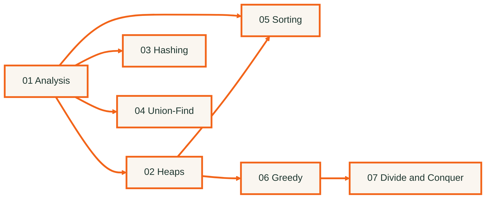

# 00 — Χάρτης Μαθήματος και Εξεταστέα Ύλη Προόδου
*Midterm Course Map, Exam Scope, Strategy Chooser and Complexity Reference*

Η παρούσα ενότητα ορίζει το πλήρες εξεταστικό πλαίσιο της Προόδου (`Midterm`) του μαθήματος Αλγόριθμοι και Πολυπλοκότητα (504), καλύπτοντας τα 7 εξεταζόμενα κεφάλαια (`Κεφ. 1, 5, 6, 7, 8, 10, 11`) και καταγράφοντας ρητά όλες τις εξαιρέσεις από το σύγγραμμα αναφοράς. Αποτελεί τη μετα-ενότητα αναφοράς από την οποία εξαρτάται η οργάνωση μελέτης των σημειώσεων Προόδου `01` έως `07`. Παρέχει τον χάρτη εξαρτήσεων των 7 κεφαλαίων, τον οδηγό επιλογής στρατηγικής και δομών δεδομένων, τις επτά βασικές συναρτήσεις αύξησης και τον συγκεντρωτικό πίνακα πολυπλοκοτήτων Προόδου με ρητή αναφορά της εκάστοτε περίπτωσης ανάλυσης.

> **Εξεταστική κάλυψη:** Πρόοδος
> **Κεφάλαιο βιβλίου:** Σύνολο ύλης Προόδου (`Κεφ. 1, 5, 6, 7, 8, 10, 11`) | **Διαλέξεις:** Καμία (μετα-ενότητα αναφοράς)
> **Πηγή:** `Resources/Meta/mindmap.md` (Ενότητα 00) και `Resources/Meta/exam_syllabus.md`
> **Εκτός ύλης:** `1.4.1`, `5.5`, ανάλυση γραμμικής αναζήτησης με φράγμα Chernoff (σελ. 202–203), ανάλυση κατακερματισμού κούκου (σελ. 208–211, Λήμμα 6.1), `6.5`, `7.3.1`, τυπική ανάλυση κωδικοποίησης Huffman (σελ. 294–297)

## Πίνακας Περιεχομένων

- [1. Εννοιολογικό Πλαίσιο και Συνολική Εικόνα](#1-εννοιολογικό-πλαίσιο-και-συνολική-εικόνα)
- [2. Θεωρητική Θεμελίωση και Τυπικοί Ορισμοί](#2-θεωρητική-θεμελίωση-και-τυπικοί-ορισμοί)
- [3. Αλγόριθμοι, Ιχνηλάτηση και Κώδικας](#3-αλγόριθμοι-ιχνηλάτηση-και-κώδικας)
- [4. Συγκριτική Ανάλυση και Πολυπλοκότητα](#4-συγκριτική-ανάλυση-και-πολυπλοκότητα)
- [5. Πλήρως Λυμένες Ασκήσεις Εξεταστικού Επιπέδου](#5-πλήρως-λυμένες-ασκήσεις-εξεταστικού-επιπέδου)
- [6. Οδηγός Επιβίωσης στις Εξετάσεις και Παγίδες](#6-οδηγός-επιβίωσης-στις-εξετάσεις-και-παγίδες)
- [7. Συνοπτικός Πίνακας Εννοιών](#7-συνοπτικός-πίνακας-εννοιών)

---

## 1. Εννοιολογικό Πλαίσιο και Συνολική Εικόνα

### Ταυτότητα Μαθήματος και Σύγγραμμα Αναφοράς

- **Μάθημα:** Αλγόριθμοι και Πολυπλοκότητα (κωδικός 504), 5ο εξάμηνο, Τμήμα Πληροφορικής και Τηλεπικοινωνιών, Πανεπιστήμιο Ιωαννίνων. Υποχρεωτικό μάθημα, 5 ECTS.
- **Σύγγραμμα αναφοράς (μοναδική εξεταστική πηγή):** M. T. Goodrich και R. Tamassia, *Αλγόριθμοι: Σχεδίαση και Εφαρμογές* (ελληνική έκδοση, εκδόσεις Μ. Γκιούρδας). Η ονοματολογία των αλγορίθμων (`arrayMax`, `MaxsubFastest`, `inPlaceQuickSort`, `UFConnectedComponents`) ακολουθεί το σύγγραμμα.
- **Δομή Προόδου:** Γραπτή εξέταση σε 7 κεφάλαια (`Κεφ. 1, 5, 6, 7, 8, 10, 11`), η οποία καλύπτει ασυμπτωτική και επιμερισμένη ανάλυση (`amortized analysis`), θεμελιώδεις δομές δεδομένων (ουρές προτεραιότητας, δυαδικοί σωροί, πίνακες κατακερματισμού, κατακερματισμός κούκου, `Union-Find`), ταξινόμηση και κάτω όριο συγκρίσεων, άπληστη μέθοδο (`Greedy Method`) και διαίρει και βασίλευε (`Divide and Conquer`) με το `Master Theorem`.

### Χάρτης Εξαρτήσεων Προόδου (Ενότητες `01`–`07`)



Κρεμ κόμβοι (`01`–`07`): οι επτά ενότητες της Προόδου. Τα βέλη δηλώνουν εξάρτηση εννοιών και δομών δεδομένων μεταξύ ενοτήτων.

Η Ενότητα `01` θεμελιώνει την ασυμπτωτική σημειογραφία, τη μέτρηση πρωτογενών λειτουργιών και την επιμερισμένη ανάλυση για όλες τις επόμενες ενότητες. Οι δυαδικοί σωροί (`02`) τροφοδοτούν την ταξινόμηση σωρού (`05`), τον χρονοπρογραμματισμό εργασιών και την κωδικοποίηση Huffman (`06`). Η ταξινόμηση (`05`) αξιοποιεί τις τεχνικές `Divide & Conquer` που τυποποιούνται γενικά με το `Master Theorem` στην Ενότητα `07`.

- Εφαρμογή στην Τελική: Οι δυαδικοί σωροί (`02`) χρησιμοποιούνται στους αλγορίθμους `Dijkstra` και `Prim-Jarnik`.
- Εφαρμογή στην Τελική: Οι δομές `Union-Find` (`04`) χρησιμοποιούνται για ανίχνευση κύκλων στον αλγόριθμο `Kruskal`.
- Εφαρμογή στην Τελική: Οι τεχνικές βελτιστοποίησης της Ενότητας `06` και η αναδρομική διάσπαση της Ενότητας `07` προετοιμάζουν τον Δυναμικό Προγραμματισμό (`Κεφ. 12`).

### Αντιστοίχιση Ενοτήτων, Κεφαλαίων, Διαλέξεων και Σημειώσεων Προόδου

Ο αριθμός ενότητας (`00`–`07`) ακολουθεί τη δομή του `mindmap.md` και διαφέρει από την αρίθμηση κεφαλαίων του βιβλίου.

| Ενότητα | Κεφάλαιο Βιβλίου | Διαλέξεις (`Lectures/`) | Αρχείο Σημειώσεων (`Resources/Notes/MidTerm/`) | Εξεταστική Κάλυψη |
|---|---|---|---|---|
| `00` | Σύνολο ύλης Προόδου και δομή εξετάσεων | Καμία | `00_course_map_and_exam_scope.md` | Πρόοδος |
| `01` | `Κεφ. 1` Ανάλυση Αλγορίθμων | `01_analysis_of_algorithms.pdf` | [01_analysis_of_algorithms.md](01_analysis_of_algorithms.md) | Πρόοδος |
| `02` | `Κεφ. 5` Ουρές Προτεραιότητας και Σωροί | `02_priority_queues.pdf`, `03_heaps.pdf` | [02_priority_queues_heaps.md](02_priority_queues_heaps.md) | Πρόοδος |
| `03` | `Κεφ. 6` Πίνακες Αντιστοίχισης, Κατακερματισμός, Κούκος | `04_maps.pdf`, `05_hash_tables.pdf`, `06_cuckoo_hashing.pdf` | [03_maps_hash_tables_cuckoo.md](03_maps_hash_tables_cuckoo.md) | Πρόοδος |
| `04` | `Κεφ. 7` Δομές Ένωσης-Εύρεσης (`Union-Find`) | `07_union_find.pdf` | [04_union_find.md](04_union_find.md) | Πρόοδος |
| `05` | `Κεφ. 8` Ταξινόμηση και Κάτω Όριο Συγκρίσεων | `08_merge_sort.pdf`, `09_quick_sort.pdf`, `10_sorting_lower_bound.pdf` | [05_sorting_and_lower_bound.md](05_sorting_and_lower_bound.md) | Πρόοδος |
| `06` | `Κεφ. 10` Η Άπληστη Μέθοδος (`Greedy Method`) | `11_greedy_method.pdf` | [06_greedy_method.md](06_greedy_method.md) | Πρόοδος |
| `07` | `Κεφ. 11` Διαίρει και Βασίλευε (`Divide & Conquer`) | `12_divide_and_conquer.pdf` | [07_divide_and_conquer.md](07_divide_and_conquer.md) | Πρόοδος |

---

## 2. Θεωρητική Θεμελίωση και Τυπικοί Ορισμοί

### 2.1 Πλήρης Εξεταστέα Ύλη Προόδου (7 Κεφάλαια)

1. **`Κεφ. 1` — Ανάλυση Αλγορίθμων** (Διάλεξη `01`): εντός ύλης εκτός από την Ενότητα `1.4.1`.
2. **`Κεφ. 5` — Ουρές Προτεραιότητας και Σωροί** (Διαλέξεις `02`–`03`): εντός ύλης εκτός από την Ενότητα `5.5`.
3. **`Κεφ. 6` — Πίνακες Κατακερματισμού και Κατακερματισμός Κούκου** (Διαλέξεις `04`–`06`): εντός ύλης εκτός από την Ανάλυση Γραμμικής Αναζήτησης (σελ. 202–203), την Ανάλυση Κατακερματισμού Κούκου (σελ. 208–211) και την Ενότητα `6.5`.
4. **`Κεφ. 7` — Δομές Ένωσης-Εύρεσης** (Διάλεξη `07`): εντός ύλης εκτός από την Ενότητα `7.3.1`.
5. **`Κεφ. 8` — Ταξινόμηση και Κάτω Όριο** (Διαλέξεις `08`–`10`): ολόκληρο το κεφάλαιο εντός ύλης.
6. **`Κεφ. 10` — Η Άπληστη Μέθοδος** (Διάλεξη `11`): εντός ύλης εκτός από την Ανάλυση του Αλγορίθμου Κωδικοποίησης Huffman (σελ. 294–297). Ο ίδιος ο αλγόριθμος Huffman είναι εντός ύλης.
7. **`Κεφ. 11` — Διαίρει και Βασίλευε** (Διάλεξη `12`): ολόκληρο το κεφάλαιο εντός ύλης.

### 2.2 Πίνακας Εξαιρέσεων Ύλης Προόδου

| Κεφάλαιο Βιβλίου | Κατάσταση | Εκτός Ύλης (δεν διδάσκεται, δεν εξετάζεται) |
|---|---|---|
| `Κεφ. 1` | Μερική εξαίρεση | Ενότητα `1.4.1` |
| `Κεφ. 5` | Μερική εξαίρεση | Ενότητα `5.5` |
| `Κεφ. 6` | Μερική εξαίρεση | Ανάλυση γραμμικής αναζήτησης με φράγμα Chernoff (σελ. 202–203), ανάλυση κατακερματισμού κούκου (σελ. 208–211, Λήμμα 6.1), Ενότητα `6.5` |
| `Κεφ. 7` | Μερική εξαίρεση | Ενότητα `7.3.1` (επιμερισμένη ανάλυση με συνάρτηση Ackermann) |
| `Κεφ. 8` | Πλήρες | Καμία εξαίρεση |
| `Κεφ. 10` | Μερική εξαίρεση | Τυπική ανάλυση κωδικοποίησης Huffman (σελ. 294–297)· ο αλγόριθμος Huffman εξετάζεται κανονικά |
| `Κεφ. 11` | Πλήρες | Καμία εξαίρεση |

> Εκτός ύλης: Ενότητα `1.4.1`, Ενότητα `5.5`, ανάλυση γραμμικής αναζήτησης με φράγμα Chernoff (σελ. 202–203), ανάλυση κατακερματισμού κούκου (σελ. 208–211, Λήμμα 6.1), Ενότητα `6.5`, Ενότητα `7.3.1` (Ackermann) και τυπική ανάλυση κωδικοποίησης Huffman (σελ. 294–297).

### 2.3 Εκτός Προόδου (μόνο Τελική)

Τα ακόλουθα 6 κεφάλαια δεν εξετάζονται στην Πρόοδο και ανήκουν αποκλειστικά στη σωρευτική Τελική Εξέταση:

- `Κεφ. 12` — Δυναμικός Προγραμματισμός (όχι `12.4`) — Διαλέξεις `13`–`16`
- `Κεφ. 13` — Γράφοι, `DFS` και `BFS` (όχι `13.4.3`, `13.5`) — Διαλέξεις `17`–`19`
- `Κεφ. 14` — Συντομότερες Διαδρομές (όχι `14.5.2`) — Διάλεξη `20`
- `Κεφ. 15` — Δέντρα Επικάλυψης Ελαχίστου Κόστους (ολόκληρο) — Διάλεξη `21`
- `Κεφ. 16` — Μέγιστη Ροή (όχι `16.2.2`, `16.3`, `16.4`, `16.5`) — Διάλεξη `22`
- `Κεφ. 17` — `NP`-Πληρότητα (όχι `17.3`, `17.4`, `17.5`) — Διάλεξη `23`

### 2.4 Οι Επτά Σημαντικές Συναρτήσεις Αύξησης (`Seven Functions`)

Οι επτά θεμελιώδεις συναρτήσεις ρυθμού αύξησης του μαθήματος διατάσσονται αυστηρά από τη βραδύτερη προς την ταχύτερη αύξηση:

$$1 \prec \log n \prec n \prec n \log n \prec n^2 \prec n^3 \prec 2^n$$

Ο λογάριθμος σε όλο το μάθημα έχει βάση $2$ ($\log n = \log_2 n$), εκτός αν δηλώνεται ρητά διαφορετική βάση.

| Σειρά | Ονομασία | Συνάρτηση $f(n)$ | Επίδραση Διπλασιασμού ($n \to 2n$) | $n = 8$ | $n = 16$ | $n = 64$ | $n = 1024$ | Χαρακτηριστικός Αλγόριθμος Προόδου |
|---|---|---|---|---|---|---|---|---|
| 1 | Σταθερή (`Constant`) | $1$ | Αμετάβλητη ($1$) | $1$ | $1$ | $1$ | $1$ | `min()` σε σωρό, `get()` σε Cuckoo Hashing |
| 2 | Λογαριθμική (`Logarithmic`) | $\log n$ | Προσθετική αύξηση κατά $+1$ ($\log(2n) = \log n + 1$) | $3$ | $4$ | $6$ | $10$ | Δυαδική αναζήτηση, `insert`/`removeMin` σε σωρό |
| 3 | Γραμμική (`Linear`) | $n$ | Διπλασιασμός ($2n$) | $8$ | $16$ | $64$ | $1024$ | `arrayMax`, `MaxsubFastest`, Bottom-Up κατασκευή σωρού |
| 4 | Γραμμικο-λογαριθμική (`n-log-n`) | $n \log n$ | Υπερδιπλασιασμός ($2n \log n + 2n$) | $24$ | $64$ | $384$ | $10240$ | `Merge-Sort`, `Heap-Sort`, `Quick-Sort` (αναμενόμενη), `Maxima Set` |
| 5 | Τετραγωνική (`Quadratic`) | $n^2$ | Τετραπλασιασμός ($4n^2$) | $64$ | $256$ | $4096$ | $1048576$ | `Selection-Sort`, `Insertion-Sort`, `MaxsubFaster`, `Quick-Sort` (χειρότερη) |
| 6 | Κυβική (`Cubic`) | $n^3$ | Οκταπλασιασμός ($8n^3$) | $512$ | $4096$ | $262144$ | $1073741824$ | `MaxsubSlow` |
| 7 | Εκθετική (`Exponential`) | $2^n$ | Τετραγωνισμός ($(2^n)^2 = 2^{2n}$) | $256$ | $65536$ | $\approx 1.84 \times 10^{19}$ | $\approx 1.80 \times 10^{308}$ | Εξαντλητική απαρίθμηση υποσυνόλων (π.χ. $2^n$ συνδυασμοί) |

### 2.5 Τυπικοί Ορισμοί Κατηγοριών Πολυπλοκότητας

Κάθε ασυμπτωτικό φράγμα στις εξετάσεις απαιτεί ρητό χαρακτηρισμό της περίπτωσης ανάλυσης:

- **Χειρότερη περίπτωση (`worst-case`):** Το μέγιστο πλήθος πρωτογενών λειτουργιών επί όλων των δυνατών εισόδων μεγέθους $n$. Παρέχει εγγύηση απόδοσης ανεξάρτητα από την είσοδο.
- **Καλύτερη περίπτωση (`best-case`):** Το ελάχιστο πλήθος πρωτογενών λειτουργιών επί όλων των εισόδων μεγέθους $n$. Δεν επαρκεί για εγγύηση χρόνου εκτέλεσης.
- **Αναμενόμενη περίπτωση (`expected-case`):** Η αναμενόμενη τιμή του χρόνου εκτέλεσης ως προς τις εσωτερικές τυχαίες επιλογές του αλγορίθμου (π.χ. τυχαίο `pivot` στον `Quick-Sort`, τυχαίες συναρτήσεις κατακερματισμού), για οποιαδήποτε σταθερή είσοδο.
- **Επιμερισμένη πολυπλοκότητα (`amortized complexity`):** Ο μέσος χρόνος ανά λειτουργία $T(n)/n$ σε μια ακολουθία $n$ λειτουργιών στη **χειρότερη περίπτωση**, χωρίς καμία υπόθεση πιθανοτήτων (π.χ. διπλασιασμός επεκτάσιμου πίνακα, `Union-Find` με συμπίεση διαδρομής, `put` σε `Cuckoo Hashing`).

---

## 3. Αλγόριθμοι, Ιχνηλάτηση και Κώδικας

Η παρούσα μετα-ενότητα δεν περιέχει μεμονωμένους αλγορίθμους υλοποίησης, αλλά τον **οδηγό επιλογής αλγοριθμικής στρατηγικής** και τον **οδηγό επιλογής δομής δεδομένων** που συνδέουν τα ερωτήματα της Προόδου με την κατάλληλη μέθοδο των ενοτήτων `01`–`07`.

### 3.1 Οδηγός Επιλογής Αλγοριθμικής Στρατηγικής (`Strategy Chooser` Προόδου)

| Τύπος Προβλήματος | Λέξεις-Κλειδιά Εκφώνησης (`Signal Words`) | Τεχνική | Κριτήριο Ορθότητας | Κλασικά Παραδείγματα Προόδου |
|---|---|---|---|---|
| Βελτιστοποίηση με τοπικά ασφαλή επιλογή | «κλασματικό (`fractional`)», «ελάχιστος αριθμός μηχανών», «προθεματικός κώδικας (`prefix-free`)», «μέγιστη πυκνότητα αξίας» | **Άπληστη Μέθοδος (`Greedy`)** | Ιδιότητα άπληστης επιλογής με **επιχείρημα ανταλλαγής (`exchange argument`)** και βέλτιστη υποδομή | `Fractional Knapsack`, `Task Scheduling`, `Huffman Coding` |
| Διάσπαση σε ανεξάρτητα υποπροβλήματα | «διάσπαση στο μέσο», «αναδρομική σχέση $T(n) = aT(n/b) + f(n)$», «πολλαπλασιασμός μεγάλων ακεραίων», «σύνολο μεγίστων (`Pareto`)» | **Διαίρει και Βασίλευε (`Divide & Conquer`)** | Ανεξάρτητα υποπροβλήματα, ορθή συνένωση (`combine`), ανάλυση με **`Master Theorem`**, `Plug-and-Chug`, `Guess-and-Test` ή δέντρο αναδρομής | `Merge-Sort`, `Quick-Sort`, `Karatsuba`, `Maxima Set`, Δυαδική Αναζήτηση |
| Ταξινόμηση δεδομένων ή όριο συγκρίσεων | «μικρά/μεγάλα/τεράστια σύνολα», «επί-τόπου (`in-place`)», «σειριακή προσπέλαση», «δέντρο αποφάσεων», «κάτω όριο» | **Ταξινόμηση και Κάτω Όριο Συγκρίσεων** | Σύγκριση χειρότερης/αναμενόμενης περίπτωσης, μνήμης και δέντρου αποφάσεων με $\ge n!$ φύλλα | `Selection-Sort`, `Insertion-Sort`, `Heap-Sort`, `Merge-Sort`, `Quick-Sort`, $\Omega(n \log n)$ |
| Κόστος ακολουθίας λειτουργιών | «επεκτάσιμος πίνακας», «διπλασιασμός», «cyber-δολάρια», «ακολουθία $n$ πράξεων» | **Επιμερισμένη Ανάλυση (`Amortized`)** | Άθροισμα συνολικού κόστους $T(n)/n$ ή μέθοδος λογιστή (χωρίς πιθανότητες) | Διπλασιασμός πίνακα ($O(1)$ επιμερισμένη), `Union-Find` ($O((n+m)\alpha(n))$) |

### 3.2 Οδηγός Επιλογής Δομής Δεδομένων (Ύλη Προόδου)

| Απαίτηση Εργασίας | Βέλτιστη Δομή Δεδομένων | Κύριες Πολυπλοκότητες | Ενότητα |
|---|---|---|---|
| Συνεχής εξαγωγή ελαχίστου και εισαγωγές (`order book`, δημοπρασίες, `Huffman`) | Δυαδικός Σωρός (`Binary Heap`, 1-indexed πίνακας) | `insert`/`removeMin`: $O(\log n)$ χειρότερη, `min`: $O(1)$, `Bottom-Up`: $O(n)$ | [02_priority_queues_heaps.md](02_priority_queues_heaps.md) |
| Γρήγορη αναζήτηση/εισαγωγή `(κλειδί, τιμή)` με μικρό φορτίο | Πίνακας Κατακερματισμού (`Hash Table`: `Chaining`, `Linear Probing`, `Double Hashing`) | `get`/`put`/`remove`: $O(1)$ αναμενόμενη, $O(n)$ χειρότερη | [03_maps_hash_tables_cuckoo.md](03_maps_hash_tables_cuckoo.md) |
| Εγγυημένο $O(1)$ χειρότερης περίπτωσης στην αναζήτηση (`routers`) | Κατακερματισμός Κούκου (`Cuckoo Hashing`) | `get`/`remove`: $O(1)$ χειρότερη, `put`: $O(1)$ επιμερισμένη | [03_maps_hash_tables_cuckoo.md](03_maps_hash_tables_cuckoo.md) |
| Δυναμική συνένωση ξένων συνόλων (`connected components`, λαβύρινθος, διήθηση) | Δομή Ένωσης-Εύρεσης (`Union-Find`, δέντρα + ένωση κατά μέγεθος + συμπίεση διαδρομής) | $n$ `union` + $m$ `find`: $O((n+m)\alpha(n))$ επιμερισμένη ($\alpha(n) \le 4$) | [04_union_find.md](04_union_find.md) |
| Πίνακας αντιστοίχισης πολύ μικρού μεγέθους ή σπάνιων αναζητήσεων | Αταξινόμητη Διπλά Συνδεδεμένη Λίστα (`Map ADT`) | `put`: $O(1)$, `get`/`remove`: $O(n)$ χειρότερη | [03_maps_hash_tables_cuckoo.md](03_maps_hash_tables_cuckoo.md) |

### 3.3 Διαδικασία Επιλογής Στρατηγικής στην Πρόοδο (Ψευδοκώδικας Απόφασης)

```text
Algorithm chooseMidtermStrategy(problem):
Input: Εκφώνηση προβλήματος Προόδου
Output: Κατάλληλη τεχνική ή δομή δεδομένων και αιτιολόγηση

if ζητά δυναμική διαχείριση συνόλων ή εγγραφών (κλειδί, τιμή) then
    if ζητά επαναλαμβανόμενη εξαγωγή ελαχίστου then
        return Δυαδικός Σωρός (insert/removeMin O(log n) χειρότερη, Bottom-Up O(n))
    else if ζητά αναζήτηση κατά κλειδί then
        if απαιτεί εγγυημένο O(1) στη χειρότερη περίπτωση για get/remove then
            return Cuckoo Hashing (T1, T2 με N >= 2n)
        else
            return Hash Table (Chaining, Linear Probing με α <= 1/2 ή Double Hashing)
    else if ζητά συνένωση ξένων συνόλων και ερωτήματα ισοδυναμίας then
        return Union-Find (ένωση κατά μέγεθος + συμπίεση διαδρομής)
else if ζητά ταξινόμηση ακολουθίας n στοιχείων then
    if n < 1000 (πολύ μικρό σύνολο) then
        return Insertion-Sort ή Selection-Sort (O(n^2) χειρότερη, επί-τόπου)
    else if n > 1000000 σε εξωτερική μνήμη / δίσκο (σειριακή προσπέλαση) then
        return Merge-Sort (O(n log n) χειρότερη)
    else if ζητά ταχύτερη εκτέλεση στην πράξη επί-τόπου then
        return Τυχαιοποιημένος inPlaceQuickSort (O(n log n) αναμενόμενη)
    else
        return Heap-Sort (O(n log n) χειρότερη, επί-τόπου)
else if ζητά βελτιστοποίηση (μέγιστο ή ελάχιστο) then
    if η τοπική επιλογή αποδεικνύεται ασφαλής με επιχείρημα ανταλλαγής then
        return Άπληστη Μέθοδος (Fractional Knapsack, Task Scheduling, Huffman)
    else
        return Έλεγχος αντιπαραδείγματος (η άπληστη αποτυγχάνει, π.χ. 0-1 Knapsack)
else if το πρόβλημα διασπάται σε ανεξάρτητα υποπροβλήματα μεγέθους n/b then
    return Διαίρει και Βασίλευε (Master Theorem, Karatsuba, Maxima Set)
```

### 3.4 Σύμβαση Κώδικα στις Σημειώσεις Προόδου `01`–`07`

Στις ενότητες `01` έως `07`, κάθε αλγόριθμος παρουσιάζεται πρώτα σε ψευδοκώδικα τύπου συγγράμματος, έπειτα με πίνακα ιχνηλάτησης και τέλος σε Python 3.10+ με τη δυαδική μορφή: ρητός αλγόριθμος (αυτό που ζητά η γραπτή εξέταση) και, όπου υπάρχει, ο ιδιωματισμός της τυπικής βιβλιοθήκης (`Pythonic idiom`) αποκλειστικά ως επαλήθευση. Οι σημειώσεις επισημαίνουν ρητά διαφορές συμβάσεων, όπως ότι το `heapq` είναι 0-indexed min-heap, το `dict` χρησιμοποιεί ανοιχτή διευθυνσιοδότηση και η `sorted()` υλοποιεί `Timsort` (σταθερό $O(n \log n)$ χειρότερης περίπτωσης).

---

## 4. Συγκριτική Ανάλυση και Πολυπλοκότητα

Ο ακόλουθος πίνακας συγκεντρώνει όλους τους αλγορίθμους και τις δομές δεδομένων της εξεταστέας ύλης της Προόδου (`01`–`07`) με ρητό χαρακτηρισμό της περίπτωσης πολυπλοκότητας.

| Ενότητα | Αλγόριθμος / Δομή | Χρόνος (με ρητή περίπτωση) | Επιπλέον Χώρος | Κρίσιμη Προϋπόθεση / Ιδιότητα |
|---|---|---|---|---|
| `01` | `arrayMax` / `recursiveMax` | $\Theta(n)$ χειρότερη ($7n-2$), $\Theta(n)$ καλύτερη ($5n$) | $O(1)$ επαναληπτικός / $O(n)$ αναδρομικός | $T(n) = T(n-1) + 7$, $T(1) = 3$ |
| `01` | `MaxsubSlow` / `MaxsubFaster` / `MaxsubFastest` | $O(n^3)$ / $O(n^2)$ / $O(n)$ χειρότερη | $O(1)$ / $O(n)$ / $O(1)$ | `MaxsubFastest`: $M_t = \max\{0, M_{t-1} + A[t]\}$ |
| `01` | Επεκτάσιμος πίνακας: βηματική αύξηση ($+c$) | $O(n)$ επιμερισμένη ανά `add` ($O(n^2)$ σύνολο) | $O(n)$ | $k = n/c$ αντικαταστάσεις |
| `01` | Επεκτάσιμος πίνακας: διπλασιασμός ($\times 2$) | $O(1)$ επιμερισμένη ανά `add` ($3n-1$ σύνολο) | $O(n)$ | Μέθοδος λογιστή: $3$ cyber-δολάρια ανά `add` |
| `02` | `Selection-Sort` (μη ταξινομημένη λίστα PQ) | $O(n^2)$ χειρότερη και καλύτερη | $O(1)$ επί-τόπου | `insert` $O(1)$, `removeMin` $O(n)$ |
| `02` | `Insertion-Sort` (ταξινομημένη λίστα PQ) | $O(n^2)$ χειρότερη, $O(n)$ καλύτερη | $O(1)$ επί-τόπου | `insert` $O(n)$, `removeMin` $O(1)$ |
| `02` | Δυαδικός Σωρός (`insert`, `removeMin`, `min`) | `insert`/`removeMin` $O(\log n)$ χειρότερη, `min` $O(1)$ | $O(n)$ (1-indexed πίνακας) | Ύψος $h \le \log n$, παιδιά $2i, 2i+1$, γονέας $\lfloor i/2 \rfloor$ |
| `02` | Κατασκευή Σωρού `Bottom-Up` | $O(n)$ χειρότερη | $O(1)$ επιπλέον | Διαδρομές δεξιά-μετά-αριστερά, $\le 2$ ανά κόμβο |
| `02` | `Heap-Sort` | $O(n \log n)$ χειρότερη | $O(1)$ επί-τόπου | Η `Bottom-Up` επιταχύνει μόνο τη φάση 1 σε $O(n)$ |
| `03` | Πίνακας Αντιστοίχισης (αταξινόμητη λίστα) | `put` $O(1)$, `get`/`remove` $O(n)$ χειρότερη | $O(n)$ | Κατάλληλη μόνο για μικρούς πίνακες |
| `03` | Κατακερματισμός (`Chaining`, `Linear`, `Double`) | $O(1)$ αναμενόμενη, $O(n)$ χειρότερη | $O(N + n)$ / $O(N)$ | `Linear Probing`: $\alpha \le 1/2$, `DEFUNCT`, $\frac{1}{1-\alpha}$ ανιχνεύσεις |
| `03` | Κατακερματισμός Κούκου (`Cuckoo Hashing`) | `get`/`remove` $O(1)$ χειρότερη, `put` $O(1)$ επιμερισμένη | $O(N)$ με $N \ge 2n$ | Κλειδί μόνο σε $T_1[h_1(k)]$ ή $T_2[h_2(k)]$, `rehash` σε κύκλο |
| `04` | `Union-Find` (βάσει λίστας, μικρότερο στο μεγαλύτερο) | `find` $O(1)$ χειρότερη, σύνολο $O(n \log n + m)$ επιμερισμένη | $O(n)$ | $\le \log n$ μετακινήσεις ανά στοιχείο |
| `04` | `Union-Find` (δέντρα, ένωση κατά μέγεθος) | `find`/`union` $O(\log n)$ χειρότερη | $O(n)$ | Ύψος $O(\log n)$ λόγω διπλασιασμού υποδέντρου |
| `04` | `Union-Find` (κατά μέγεθος + συμπίεση διαδρομής) | $O((n + m)\alpha(n))$ επιμερισμένη | $O(n)$ | $\alpha(n) \le 4$ για πρακτικά $n$ |
| `05` | `Merge-Sort` | $O(n \log n)$ χειρότερη | $O(n)$ | Σειριακή προσπέλαση, ιδανικό για $> 1\text{M}$ σε δίσκο |
| `05` | `Quick-Sort` (τυχαιοποιημένος / `inPlaceQuickSort`) | $O(n \log n)$ αναμενόμενη, $O(n^2)$ χειρότερη | $O(\log n)$ αναμενόμενη στοίβα | Τριμερής διαμερισμός $L, E, G$· ταχύτερος στην πράξη |
| `05` | Κάτω Όριο Ταξινόμησης Συγκρίσεων | $\Omega(n \log n)$ χειρότερη | — | Δέντρο αποφάσεων με $\ge n!$ φύλλα |
| `06` | `Fractional Knapsack` | $O(n \log n)$ χειρότερη | $O(n)$ | Φθίνουσα πυκνότητα $v_i = b_i / w_i$, αποτυγχάνει στο `0-1` |
| `06` | `Task Scheduling` (ελάχιστες μηχανές) | $O(n \log n)$ χειρότερη | $O(n)$ | Ταξινόμηση κατά ώρα έναρξης $s_i$ |
| `06` | `Huffman Coding` | $O(n + d \log d)$ χειρότερη | $O(d)$ | $n = |X|$, $d$ διακριτοί χαρακτήρες, προθεματικός κώδικας |
| `07` | Δυαδική Αναζήτηση (`Binary Search`) | $O(\log n)$ χειρότερη | $O(1)$ επαναληπτική | $T(n) = T(n/2) + 1$ (Περίπτωση 2 `Master Theorem`) |
| `07` | Πολλαπλασιασμός `Karatsuba` | $O(n^{\log_2 3}) \approx O(n^{1.585})$ χειρότερη | $O(n)$ | $T(n) = 3T(n/2) + n$ (3 αντί 4 πολλαπλασιασμοί) |
| `07` | Πρόβλημα Συνόλου Μεγίστων (`Maxima Set`) | $O(n \log n)$ χειρότερη | $O(n)$ | $T(n) = 2T(n/2) + bn$, διάσπαση στη διάμεσο |

---

## 5. Πλήρως Λυμένες Ασκήσεις Εξεταστικού Επιπέδου

Για τη μετα-ενότητα `00` δεν απαιτούνται ασκήσεις ιχνηλάτησης. Ακολουθεί αυτοέλεγχος 10 εξεταστικών σεναρίων επιλογής τεχνικής και αιτιολόγησης αποκλειστικά από την ύλη της Προόδου (`01`–`07`).

### Αυτοέλεγχος Προόδου: «Ποια Τεχνική και Γιατί»

| # | Σενάριο Εκφώνησης | Σωστή Τεχνική / Αλγόριθμος | Πολυπλοκότητα (με περίπτωση) | Αιτιολόγηση και Απόρριψη Εναλλακτικών |
|---|---|---|---|---|
| 1 | Δίνεται πίνακας $n$ ακεραίων (θετικών και αρνητικών) και ζητείται το μέγιστο άθροισμα συνεχόμενου υπο-πίνακα στον ταχύτερο δυνατό χρόνο. | `MaxsubFastest` (Ενότητα `01`) | $O(n)$ χειρότερη | Διατηρεί το μέγιστο επιθεματικό άθροισμα $M_t = \max\{0, M_{t-1} + A[t]\}$, αποφεύγοντας το $O(n^3)$ του `MaxsubSlow` και το $O(n^2)$ του `MaxsubFaster`. |
| 2 | Δυναμικός πίνακας δέχεται $n$ διαδοχικές εισαγωγές `add` και ζητείται εγγυημένος επιμερισμένος χρόνος $O(1)$ ανά εισαγωγή. | Στρατηγική διπλασιασμού (Ενότητα `01`) | $O(1)$ επιμερισμένη ($3n - 1$ σύνολο) | Η βηματική αύξηση κατά σταθερά $c$ κοστίζει $O(n^2)$ συνολικά ($O(n)$ επιμερισμένη)· ο διπλασιασμός πληρώνεται με 3 cyber-δολάρια ανά `add`. |
| 3 | Δίνονται $n$ κλειδιά εκ των προτέρων σε πίνακα και ζητείται η κατασκευή δυαδικού ελάχιστου σωρού στον ελάχιστο ασυμπτωτικό χρόνο. | Κατασκευή Σωρού `Bottom-Up` (Ενότητα `02`) | $O(n)$ χειρότερη | $n$ διαδοχικές κλήσεις `insert` κοστίζουν $O(n \log n)$· η `Bottom-Up` συγχώνευση διασχίζει κάθε κόμβο το πολύ $2$ φορές σε διαδρομές δεξιά-μετά-αριστερά. |
| 4 | Δρομολογητής δικτύου απαιτεί εγγυημένο $O(1)$ χρόνο στη **χειρότερη** περίπτωση για αναζήτηση (`get`) και διαγραφή (`remove`) διευθύνσεων. | Κατακερματισμός Κούκου (`Cuckoo Hashing`, Ενότητα `03`) | `get`/`remove` $O(1)$ χειρότερη, `put` $O(1)$ επιμερισμένη | Οι κλασικοί πίνακες κατακερματισμού (`Chaining`, `Linear Probing`, `Double Hashing`) έχουν $O(n)$ χειρότερη περίπτωση· το `Cuckoo Hashing` ελέγχει αποκλειστικά δύο θέσεις $T_1[h_1(k)], T_2[h_2(k)]$. |
| 5 | Κοινωνικό δίκτυο $n$ χρηστών δέχεται $m$ δυναμικές προσθήκες φιλίας και ερωτήματα αν δύο χρήστες ανήκουν στην ίδια συνδεδεμένη συνιστώσα. | `Union-Find` με ένωση κατά μέγεθος και συμπίεση διαδρομής (`UFConnectedComponents`, Ενότητα `04`) | $O((n + m)\alpha(n))$ επιμερισμένη | Υπερέχει της υλοποίησης βάσει λίστας ($O(n \log n + m)$) και της απλής ένωσης κατά μέγεθος ($O(\log n)$ ανά πράξη), με $\alpha(n) \le 4$ για πρακτικά $n$. |
| 6 | Πρέπει να ταξινομηθεί αρχείο $5 \times 10^7$ εγγραφών αποθηκευμένο σε δίσκο με εγγύηση χειρότερης περίπτωσης και σειριακή προσπέλαση. | `Merge-Sort` (Ενότητα `05`) | $O(n \log n)$ χειρότερη | Διαθέτει σειριακή προσπέλαση δεδομένων και εγγύηση $O(n \log n)$ χειρότερης περίπτωσης, αντίθετα από τον `Quick-Sort` ($O(n^2)$ χειρότερη) και τον `Heap-Sort` (μη σειριακές προσπελάσεις). |
| 7 | Ζητείται απόδειξη ότι κανένας αλγόριθμος ταξινόμησης βασισμένος αποκλειστικά σε συγκρίσεις ζευγών δεν μπορεί να τρέχει σε $O(n)$ στη χειρότερη περίπτωση. | Μοντέλο Δέντρου Αποφάσεων (Ενότητα `05`) | $\Omega(n \log n)$ χειρότερη | Υπάρχουν $n!$ δυνατές μεταθέσεις, άρα το δυαδικό δέντρο αποφάσεων έχει $\ge n!$ φύλλα και ύψος $h \ge \log(n!) \ge (n/2)\log(n/2) = \Omega(n \log n)$. |
| 8 | Δίνονται $n$ διαιρετά προϊόντα με βάρος $w_i$ και κέρδος $b_i$ και χωρητικότητα $W$. Ζητείται μέγιστο συνολικό κέρδος. | Άπληστη Μέθοδος (`Fractional Knapsack`, Ενότητα `06`) | $O(n \log n)$ χειρότερη | Επειδή τα αντικείμενα είναι διαιρετά, η επιλογή κατά φθίνουσα πυκνότητα $v_i = b_i / w_i$ αποδεικνύεται καθολικά βέλτιστη με επιχείρημα ανταλλαγής. |
| 9 | Δίνονται $n$ εργασίες με χρονικά διαστήματα $[s_i, f_i]$ και ζητείται ο ελάχιστος αριθμός μηχανών ώστε να εκτελεστούν όλες χωρίς συγκρούσεις. | Άπληστη Μέθοδος (`Task Scheduling`, Ενότητα `06`) | $O(n \log n)$ χειρότερη | Ταξινόμηση κατά ώρα έναρξης $s_i$ (όχι λήξης)· αν ανοιχθούν $k$ μηχανές, η πρώτη εργασία της $k$-οστής μηχανής συγκρούεται ταυτόχρονα με $k - 1$ άλλες. |
| 10 | Ζητείται ο πολλαπλασιασμός δύο ακεραίων των $n$ bits ταχύτερα από τον κλασικό αλγόριθμο $O(n^2)$. | Αλγόριθμος `Karatsuba` (`Divide & Conquer`, Ενότητα `07`) | $O(n^{\log_2 3}) \approx O(n^{1.585})$ χειρότερη | Μειώνει τις αναδρομικές κλήσεις από $4$ σε $3$ μέσω αλγεβρικής ταυτότητας, δίνοντας $T(n) = 3T(n/2) + n$, που λύνεται με την Περίπτωση 1 του `Master Theorem`. |

---

## 6. Οδηγός Επιβίωσης στις Εξετάσεις και Παγίδες

### Παγίδες

1. **Ασυμπτωτικό όριο χωρίς χαρακτηρισμό περίπτωσης.**
   - *Λανθασμένη πρακτική:* «Ο `Quick-Sort` είναι $O(n \log n)$» ή «Ο πίνακας κατακερματισμού είναι $O(1)$».
   - *Γιατί είναι λάθος:* Στη χειρότερη περίπτωση ο `Quick-Sort` είναι $O(n^2)$ και η αναζήτηση σε κλασικό πίνακα κατακερματισμού είναι $O(n)$.
   - *Σωστός κανόνας:* Αναφέρετε πάντα ρητά `χειρότερη`, `αναμενόμενη`, `καλύτερη` ή `επιμερισμένη` περίπτωση.

2. **Σύγχυση επιμερισμένης (`amortized`) και μέσης (`average`) ανάλυσης.**
   - *Λανθασμένη πρακτική:* «Ο διπλασιασμός πίνακα έχει μέσο χρόνο $O(1)$ επειδή οι υπερχειλίσεις είναι απίθανες».
   - *Γιατί είναι λάθος:* Η επιμερισμένη ανάλυση δεν χρησιμοποιεί πιθανότητες· εξετάζει το συνολικό κόστος $T(n)/n$ στη χειρότερη περίπτωση.
   - *Σωστός κανόνας:* Διαχωρίστε ρητά την `επιμερισμένη` ανάλυση (ντετερμινιστικό φράγμα ακολουθίας) από την `αναμενόμενη` (τυχαιοποίηση).

3. **Μελέτη εξαιρούμενων ενοτήτων ή κεφαλαίων Τελικής για την Πρόοδο.**
   - *Λανθασμένη πρακτική:* Προετοιμασία στη συνάρτηση Ackermann (`7.3.1`), στο φράγμα Chernoff (σελ. 202–203), στο Λήμμα 6.1 (σελ. 208–211) ή σε κεφάλαια `12`–`17`.
   - *Γιατί είναι λάθος:* Δεν ανήκουν στην εξεταστέα ύλη της Προόδου (`exam_syllabus.md`).
   - *Σωστός κανόνας:* Ελέγχετε πάντα τον Πίνακα 2.2 και τη λίστα `Εκτός Προόδου (μόνο Τελική)` της Ενότητας 2.3.

4. **Σύγχυση αρίθμησης ενοτήτων `mindmap` με κεφάλαια βιβλίου.**
   - *Λανθασμένη πρακτική:* Υπόθεση ότι η Ενότητα `03` αντιστοιχεί στο Κεφάλαιο 3 ή η Ενότητα `06` στο Κεφάλαιο 6.
   - *Γιατί είναι λάθος:* Το μάθημα παραλείπει τα Κεφάλαια 2, 3, 4 και 9 του συγγράμματος.
   - *Σωστός κανόνας:* Χρησιμοποιήστε τον πίνακα αντιστοίχισης της Ενότητας 1 (`02` $\to$ `Κεφ. 5`, `03` $\to$ `Κεφ. 6`, `06` $\to$ `Κεφ. 10`, `07` $\to$ `Κεφ. 11`).

5. **Παράλειψη συνθήκης κανονικότητας στο `Master Theorem` και λάθος ταξινόμηση στο `Task Scheduling`.**
   - *Λανθασμένη πρακτική:* Εφαρμογή Περίπτωσης 3 χωρίς έλεγχο $af(n/b) \le \delta f(n)$ ($\delta < 1$) ή ταξινόμηση κατά ώρα λήξης $f_i$ στην ελαχιστοποίηση μηχανών.
   - *Γιατί είναι λάθος:* Χωρίς τη συνθήκη κανονικότητας η Περίπτωση 3 δεν εφαρμόζεται· στο `Task Scheduling` ελαχιστοποίησης μηχανών απαιτείται ταξινόμηση κατά ώρα έναρξης $s_i$.
   - *Σωστός κανόνας:* Ελέγχετε πάντα όλες τις προϋποθέσεις της Περίπτωσης 3 και δηλώνετε ρητά το κριτήριο ταξινόμησης.

6. **Παράλειψη κανόνα ισοβαθμίας (`tie-breaking`) στις ιχνηλατήσεις.**
   - *Λανθασμένη πρακτική:* Εκτέλεση `downheap` ή `Huffman` χωρίς δήλωση προτεραιότητας σε ίσα κλειδιά ή συχνότητες.
   - *Γιατί είναι λάθος:* Παράγει μη μοναδική ιχνηλάτηση και δυσκολεύει την επαλήθευση.
   - *Σωστός κανόνας:* Δηλώστε ρητά τον κανόνα ισοβαθμίας στην αρχή κάθε ιχνηλάτησης (π.χ. αριστερό παιδί πρώτα ή αλφαβητική σειρά συμβόλων).

### Σημεία SOS

1. **Ενότητα `01`:** Εύρεση σταθερών $c, n_0$ για $O, \Omega, \Theta$, απόδειξη ότι $n^2 \ne O(n)$, μέτρηση βημάτων `arrayMax` ($7n-2$ / $5n$), `MaxsubFastest`, επιμερισμένη ανάλυση διπλασιασμού ($3n - 1$ και 3 cyber-δολάρια).
2. **Ενότητα `02`:** Απόδειξη ύψους σωρού $h \le \log n$, 1-indexed δεικτοδότηση ($2i, 2i+1$), ιχνηλάτηση `upheap`/`downheap` (πάντα το μικρότερο παιδί), `Bottom-Up` κατασκευή σε $O(n)$ και γιατί το `Heap-Sort` μένει $O(n \log n)$.
3. **Ενότητα `03`:** Πολυωνυμικός κατακερματισμός με κανόνα Horner ($z = 33$), `Linear Probing` με `DEFUNCT` και αναμενόμενες ανιχνεύσεις $\frac{1}{1-\alpha}$, `Double Hashing`, ιχνηλάτηση `Cuckoo Hashing` με αλυσίδα απομακρύνσεων και `rehash`.
4. **Ενότητα `04`:** Λίστα μικρότερο-στο-μεγαλύτερο ($O(n \log n + m)$), δέντρα με ένωση κατά μέγεθος ($O(\log n)$ ύψος) και συμπίεση διαδρομής ($O((n+m)\alpha(n))$).
5. **Ενότητα `05`:** Δέντρο `Merge-Sort`, τριμερής διαμερισμός $L, E, G$ και `inPlacePartition` στον `Quick-Sort`, επιχείρημα αναμενόμενου ύψους $2\log_{4/3} n$, απόδειξη κάτω ορίου συγκρίσεων $\Omega(n \log n)$ μέσω $n!$ φύλλων.
6. **Ενότητα `06`:** Επιχείρημα ανταλλαγής στο `Fractional Knapsack` και αντιπαράδειγμα αποτυχίας στο `0-1 Knapsack`, απόδειξη ορθότητας `Task Scheduling` ($k$ μηχανές), κατασκευή δέντρου `Huffman`.
7. **Ενότητα `07`:** Οι τέσσερις μέθοδοι επίλυσης αναδρομικών (`Plug-and-Chug`, δέντρο αναδρομής, `Guess-and-Test`, `Master Theorem` και οι 3 περιπτώσεις του), `Karatsuba` ($O(n^{\log_2 3})$), `Maxima Set` ($O(n \log n)$).

### Γρήγορη Επανάληψη (Κεντρικοί Τύποι Προόδου)

- **Επτά συναρτήσεις:** $1 \prec \log n \prec n \prec n \log n \prec n^2 \prec n^3 \prec 2^n$.
- **Ασυμπτωτική σημειογραφία:** $f(n) = O(g(n)) \iff \exists c > 0, n_0 \ge 1 : f(n) \le c g(n)\ \forall n \ge n_0$.
- **Σωρός:** $n \ge 2^h \implies h \le \log n$, παιδιά του $i$: $2i, 2i+1$, γονέας: $\lfloor i/2 \rfloor$.
- **Συντελεστής φόρτωσης:** $\alpha = n / N$ (`Linear Probing`: αναμενόμενες ανιχνεύσεις $\frac{1}{1-\alpha}$, απαιτείται $\alpha \le 1/2$).
- **Κάτω όριο συγκρίσεων:** $h \ge \log(n!) \ge \frac{n}{2} \log \frac{n}{2} = \Omega(n \log n)$.
- **Master Theorem** για $T(n) = aT(n/b) + f(n)$:
  1. $f(n) = O(n^{\log_b a - \varepsilon}) \implies T(n) = \Theta(n^{\log_b a})$.
  2. $f(n) = \Theta(n^{\log_b a} \log^k n) \implies T(n) = \Theta(n^{\log_b a} \log^{k+1} n)$.
  3. $f(n) = \Omega(n^{\log_b a + \varepsilon})$ και $af(n/b) \le \delta f(n)$ ($\delta < 1$) $\implies T(n) = \Theta(f(n))$.

---

## 7. Συνοπτικός Πίνακας Εννοιών

| Έννοια / Αλγόριθμος | Ορισμός ή τύπος | Πολυπλοκότητα ή κύρια ιδιότητα | Τι ζητά η εξέταση |
|---|---|---|---|
| Εξεταστέα ύλη Προόδου | `Κεφ. 1, 5, 6, 7, 8, 10, 11` (Ενότητες `01`–`07`) | 7 κεφάλαια με ρητές εξαιρέσεις (Πίνακας 2.2) | Ασυμπτωτική ανάλυση, δομές δεδομένων, ταξινόμηση, άπληστοι, αναδρομικές |
| Επτά συναρτήσεις αύξησης | $1, \log n, n, n\log n, n^2, n^3, 2^n$ | Διπλασιασμός: $n^2 \to 4\times$, $n^3 \to 8\times$, $2^n \to$ τετράγωνο | Διάταξη συναρτήσεων, επίδραση διπλασιασμού, απόδειξη $O, \Omega, \Theta$ |
| Περιπτώσεις πολυπλοκότητας | Χειρότερη, καλύτερη, αναμενόμενη, επιμερισμένη | Δεν είναι εναλλάξιμες· επιμερισμένη $\ne$ μέση | Ρητός χαρακτηρισμός σε κάθε απάντηση πολυπλοκότητας |
| Δυαδικοί Σωροί (`02`) | Πλήρες δυαδικό δέντρο με $\text{key}(v) \ge \text{key}(\text{parent}(v))$ | `insert`/`removeMin` $O(\log n)$, `Bottom-Up` $O(n)$ | Απόδειξη ύψους, ιχνηλάτηση `upheap`/`downheap`, `Bottom-Up` |
| Κατακερματισμός και Κούκος (`03`) | $h(x) = h_2(h_1(x))$, $\alpha = n/N$, $T_1[h_1(k)]$ ή $T_2[h_2(k)]$ | Κλασικός $O(1)$ αναμ. / $O(n)$ χειρ.· Κούκος `get` $O(1)$ χειρ. | Ιχνηλάτηση `Linear Probing` (`DEFUNCT`), `Double Hashing`, `Cuckoo` |
| Δομές `Union-Find` (`04`) | `makeSet`, `find`, `union` σε ξένα σύνολα | $O((n+m)\alpha(n))$ με ένωση κατά μέγεθος + συμπίεση | Πίνακες γονέων/μεγεθών, ιχνηλάτηση συμπίεσης διαδρομής |
| Ταξινόμηση και Κάτω Όριο (`05`) | `Merge-Sort`, `Quick-Sort`, `Heap-Sort`, δέντρο αποφάσεων | $\Omega(n \log n)$ για κάθε αλγόριθμο συγκρίσεων | Ιχνηλάτηση διαμερισμού/συγχώνευσης, απόδειξη $\log(n!)$ |
| Άπληστη Μέθοδος (`06`) | Τοπικά βέλτιστη επιλογή με επιχείρημα ανταλλαγής | `Fractional Knapsack`, `Task Scheduling`, `Huffman` | Απόδειξη ορθότητας, αντιπαράδειγμα `0-1 Knapsack`, δέντρο `Huffman` |
| Διαίρει και Βασίλευε (`07`) | Διάσπαση σε ανεξάρτητα υποπροβλήματα + συνένωση | $T(n) = aT(n/b) + f(n)$ με `Master Theorem` | Επίλυση αναδρομικών, `Karatsuba`, `Maxima Set` |
