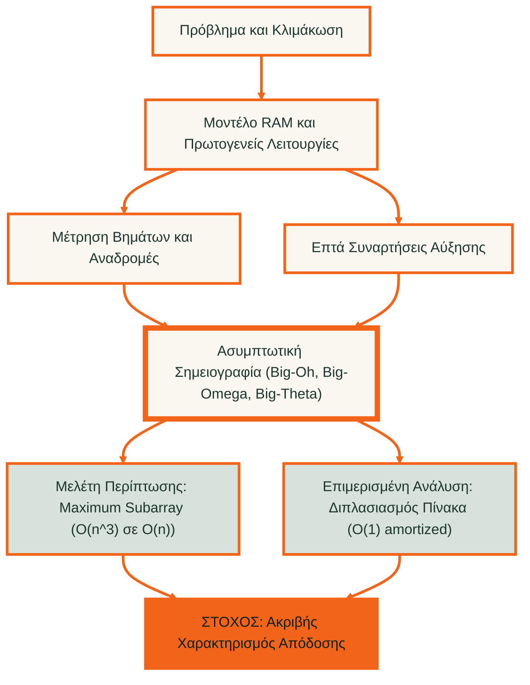

# 01 — Ανάλυση Αλγορίθμων
*Analysis of Algorithms, RAM Model, Asymptotic Notation and Amortized Analysis*

Η παρούσα ενότητα θεμελιώνει τα μαθηματικά και αλγοριθμικά εργαλεία αξιολόγησης της αποδοτικότητας αλγορίθμων ανεξάρτητα από υλικό και γλώσσα προγραμματισμού, μέσω του μοντέλου μηχανής τυχαίας προσπέλασης (`RAM`), της ασυμπτωτικής σημειογραφίας (`Big-Oh`, `Big-Omega`, `Big-Theta`) και της επιμερισμένης ανάλυσης (`Amortized Analysis`). Αποτελεί τη βάση πάνω στην οποία στηρίζονται όλες οι υπόλοιπες ενότητες της Προόδου ([02_priority_queues_heaps.md](02_priority_queues_heaps.md), [03_maps_hash_tables_cuckoo.md](03_maps_hash_tables_cuckoo.md), [04_union_find.md](04_union_find.md), [05_sorting_and_lower_bound.md](05_sorting_and_lower_bound.md), [06_greedy_method.md](06_greedy_method.md) και [07_divide_and_conquer.md](07_divide_and_conquer.md)). Η ενότητα συνδέει τη θεωρητική ανάλυση με δύο κεντρικές μελέτες περίπτωσης: τη σταδιακή επιτάχυνση του προβλήματος μέγιστου υπο-πίνακα (`Maximum Subarray`) από $O(n^3)$ σε $O(n)$ και τον διπλασιασμό επεκτάσιμου πίνακα με επιμερισμένο χρόνο $O(1)$.

> **Εξεταστική κάλυψη:** Πρόοδος
> **Κεφάλαιο βιβλίου:** Κεφ. 1 | **Διαλέξεις:** `01_analysis_of_algorithms.pdf`
> **Πηγή:** `Resources/Meta/mindmap.md` (Ενότητα 01)
> **Εκτός ύλης:** Ενότητα `1.4.1`

## Πίνακας Περιεχομένων

- [1. Εννοιολογικό Πλαίσιο και Συνολική Εικόνα](#1-εννοιολογικό-πλαίσιο-και-συνολική-εικόνα)
- [2. Θεωρητική Θεμελίωση και Τυπικοί Ορισμοί](#2-θεωρητική-θεμελίωση-και-τυπικοί-ορισμοί)
- [3. Αλγόριθμοι, Ιχνηλάτηση και Κώδικας](#3-αλγόριθμοι-ιχνηλάτηση-και-κώδικας)
- [4. Συγκριτική Ανάλυση και Πολυπλοκότητα](#4-συγκριτική-ανάλυση-και-πολυπλοκότητα)
- [5. Πλήρως Λυμένες Ασκήσεις Εξεταστικού Επιπέδου](#5-πλήρως-λυμένες-ασκήσεις-εξεταστικού-επιπέδου)
- [6. Οδηγός Επιβίωσης στις Εξετάσεις και Παγίδες](#6-οδηγός-επιβίωσης-στις-εξετάσεις-και-παγίδες)
- [7. Συνοπτικός Πίνακας Εννοιών](#7-συνοπτικός-πίνακας-εννοιών)

---

## 1. Εννοιολογικό Πλαίσιο και Συνολική Εικόνα

### Το Πρόβλημα της Κλιμάκωσης (`Scalability`)

Στην πληροφορική τα συστήματα διαχειρίζονται όγκους δεδομένων που εκτείνονται από μερικές δεκάδες εγγραφές έως δισεκατομμύρια στοιχεία. Η **κλιμάκωση (`scalability`)** ορίζει την ικανότητα ενός αλγορίθμου ή συστήματος να ανταποκρίνεται αποδοτικά καθώς αυξάνεται το μέγεθος εισόδου $n$ ή ο φόρτος εργασίας. Ένας αλγόριθμος $O(n^3)$ και ένας αλγόριθμος $O(n)$ δίνουν παρόμοιο χρόνο για $n = 10$, αλλά για $n = 10^4$ ο πρώτος εκτελεί τάξης $10^{12}$ βήματα ενώ ο δεύτερος $10^4$.

Χαρακτηριστικά πραγματικά σενάρια όπου η χειρότερη περίπτωση (`worst-case`) είναι κρίσιμη αποτελούν οι μηχανές παιχνιδιών πραγματικού χρόνου (σταθερός ρυθμός καρέ), τα συστήματα οικονομικών συναλλαγών (εγγυημένος χρόνος απόκρισης εντολών), η ρομποτική (έλεγχος κίνησης χωρίς καθυστερήσεις) και η ανάλυση μοτίβων σε ψηφιακές εικόνες (όπου εφαρμόζεται το πρόβλημα `Maximum Subarray`).

- **Αλγόριθμος (`Algorithm`):** Πεπερασμένη διαδικασία βήμα προς βήμα που δέχεται μια είσοδο, εκτελεί σαφώς ορισμένες ενέργειες σε πεπερασμένο χρόνο και παράγει μια έξοδο.
- **Δομή δεδομένων (`Data Structure`):** Συστηματικός τρόπος οργάνωσης, αποθήκευσης και πρόσβασης της πληροφορίας στη μνήμη, ώστε οι απαιτούμενες λειτουργίες να εκτελούνται αποδοτικά.

### Συνολική Εικόνα της Ενότητας



Πορτοκαλί γέμισμα: κόμβος εστίασης (τελικός στόχος ανάλυσης). Παχύ περίγραμμα: κεντρικός θεωρητικός κόμβος (ασυμπτωτική σημειογραφία). Απαλό πράσινο: εφαρμογές της ενότητας (`Maximum Subarray` και επεκτάσιμος πίνακας). Κρεμ κόμβοι: θεμελιώδη δομικά στοιχεία.

Η ροή ανάλυσης ξεκινά από την περιγραφή ενός αλγορίθμου σε ψευδοκώδικα πάνω στο μοντέλο `RAM`, μεταφράζει τις εντολές σε πρωτογενείς λειτουργίες ή αναδρομική σχέση, ταξινομεί τη συνάρτηση χρόνου σε μία από τις επτά βασικές κλάσεις με `Big-Oh`/`Big-Omega`/`Big-Theta` και, όταν το κόστος κατανέμεται ανομοιόμορφα σε μια ακολουθία λειτουργιών, εφαρμόζει επιμερισμένη ανάλυση.

### Πότε Χρησιμοποιούμε Τι

- **Θεωρητική ανάλυση (`Theoretical Analysis`):** Χρησιμοποιείται για σύγκριση αλγορίθμων ανεξάρτητα από επεξεργαστή, μεταγλωττιστή και δείγμα εισόδων, πριν από οποιαδήποτε υλοποίηση.
- **Χειρότερη περίπτωση (`Worst-Case`):** Προεπιλεγμένο κριτήριο στις εξετάσεις και σε συστήματα πραγματικού χρόνου, καθώς παρέχει απόλυτη εγγύηση άνω ορίου.
- **Επιμερισμένη ανάλυση (`Amortized Analysis`):** Επιλέγεται όταν μεμονωμένες λειτουργίες είναι ακριβές (π.χ. αντιγραφή πίνακα σε $O(n)$), αλλά συμβαίνουν τόσο αραιά ώστε το συνολικό κόστος $n$ λειτουργιών να παραμένει μικρό (π.χ. $O(n)$ συνολικά, άρα $O(1)$ επιμερισμένα ανά λειτουργία).
- Εφαρμογή στην Τελική: Η ασυμπτωτική ανάλυση και η μέτρηση πρωτογενών λειτουργιών χρησιμοποιούνται απευθείας στην ανάλυση των αλγορίθμων Δυναμικού Προγραμματισμού (`Κεφ. 12`), Γράφων (`Κεφ. 13`–`16`) και της κλάσης `P` (`Κεφ. 17`).

---

## 2. Θεωρητική Θεμελίωση και Τυπικοί Ορισμοί

### 2.1 Πειραματικές Μελέτες έναντι Θεωρητικής Ανάλυσης

Μια πειραματική μελέτη (`experimental study`) υλοποιεί τον αλγόριθμο, τον εκτελεί σε επιλεγμένες εισόδους διαφόρων μεγεθών και σχεδιάζει τη γραφική παράσταση του μετρούμενου χρόνου (π.χ. σε $\text{ms}$). Οι περιορισμοί των πειραμάτων είναι τρεις:

1. Απαιτείται πλήρης υλοποίηση του αλγορίθμου, η οποία μπορεί να είναι δύσκολη ή χρονοβόρα.
2. Τα αποτελέσματα ισχύουν μόνο για το πεπερασμένο σύνολο εισόδων που δοκιμάστηκαν και ενδέχεται να μην αποκαλύπτουν τη χειρότερη περίπτωση.
3. Η σύγκριση δύο αλγορίθμων απαιτεί πανομοιότυπο περιβάλλον υλικού και λογισμικού.

Η **θεωρητική ανάλυση (`theoretical analysis`)** υπερβαίνει αυτούς τους περιορισμούς: βασίζεται σε περιγραφή υψηλού επιπέδου (**ψευδοκώδικας / `pseudocode`**), χαρακτηρίζει τον χρόνο εκτέλεσης ως συνάρτηση του μεγέθους εισόδου $n$, λαμβάνει υπόψη όλες τις δυνατές εισόδους και είναι ανεξάρτητη από το υλικό/λογισμικό.

### 2.2 Περιπτώσεις Χρόνου Εκτέλεσης

Για κάθε μέγεθος εισόδου $n$, ο χρόνος εκτέλεσης διακρίνεται σε:

- **Καλύτερη περίπτωση (`Best-Case`):** Το ελάχιστο κόστος επί όλων των εισόδων μεγέθους $n$. Δεν εγγυάται την απόδοση του αλγορίθμου.
- **Μέση περίπτωση (`Average-Case`):** Ο αναμενόμενος χρόνος βάσει μιας κατανομής πιθανότητας επί των εισόδων. Συχνά είναι δύσκολο να οριστεί ρεαλιστική κατανομή εισόδων.
- **Χειρότερη περίπτωση (`Worst-Case`):** Το μέγιστο κόστος επί όλων των εισόδων μεγέθους $n$. Είναι ευκολότερη στην ανάλυση και αποτελεί την κύρια εγγύηση του μαθήματος.

### 2.3 Ψευδοκώδικας, Μοντέλο `RAM` και Πρωτογενείς Λειτουργίες

Ο **ψευδοκώδικας** είναι δομημένη περιγραφή υψηλού επιπέδου, πιο αυστηρή από πεζό κείμενο και λιγότερο λεπτομερής από πηγαίο κώδικα. Χρησιμοποιεί τις συμβάσεις του συγγράμματος: `Algorithm method(arg, ...)`, `Input:`, `Output:`, δομές ελέγχου `if ... then ... [else ...]`, `while ... do ...`, `repeat ... until ...`, `for ... do ...`, εσοχές αντί αγκίστρων, $\leftarrow$ για ανάθεση και `=` για σύγκριση ισότητας.

Το **μοντέλο `RAM` (`Random Access Machine`)** είναι ένα αφηρημένο μοντέλο υπολογιστή που αποτελείται από:

1. Μία κεντρική μονάδα επεξεργασίας (`CPU`).
2. Μια εν δυνάμει άπειρη συλλογή αριθμημένων κελιών μνήμης ($0, 1, 2, \dots$), όπου κάθε κελί αποθηκεύει έναν αριθμό ή χαρακτήρα.
3. Προσπέλαση οποιουδήποτε κελιού μνήμης σε $1$ μονάδα χρόνου ($O(1)$).

**Πρωτογενείς λειτουργίες (`Primitive Operations`)** είναι οι βασικοί υπολογισμοί στον ψευδοκώδικα που θεωρούνται ότι εκτελούνται σε σταθερό χρόνο $O(1)$ στο μοντέλο `RAM`:

- Υπολογισμός μιας αριθμητικής ή λογικής έκφρασης (π.χ. $a + b$, $x < y$).
- Ανάθεση τιμής σε μεταβλητή ($x \leftarrow v$).
- Δεικτοδότηση πίνακα (`A[i]`).
- Κλήση μιας μεθόδου ή συνάρτησης.
- Επιστροφή τιμής από μέθοδο (`return`).

Αν $a$ είναι ο πραγματικός χρόνος της ταχύτερης πρωτογενούς λειτουργίας και $b$ ο χρόνος της αργότερης, τότε για έναν αλγόριθμο με $f_{\min}(n)$ λειτουργίες στην καλύτερη και $f_{\max}(n)$ στη χειρότερη περίπτωση, ο πραγματικός χρόνος εκτέλεσης $T(n)$ ικανοποιεί:

$$a \cdot f_{\min}(n) \le T(n) \le b \cdot f_{\max}(n)$$

Αλλαγή υλικού ή λογισμικού τροποποιεί μόνο τις σταθερές $a, b$ και όχι τον ασυμπτωτικό ρυθμό αύξησης της $T(n)$.

### 2.4 Οι Επτά Σημαντικές Συναρτήσεις και Διάγραμμα `log-log`

Οι επτά συναρτήσεις που εμφανίζονται συστηματικά στην ανάλυση αλγορίθμων διατάσσονται κατά αυστηρά αύξοντα ρυθμό αύξησης (όπου $\log n = \log_2 n$):

$$1 \prec \log n \prec n \prec n \log n \prec n^2 \prec n^3 \prec 2^n$$

**Κλίση σε διάγραμμα `log-log`:** Για μια πολυωνυμική συνάρτηση $T(n) = c \cdot n^k$, η λογαρίθμηση και των δύο αξόνων δίνει:

$$\log T(n) = k \cdot \log n + \log c$$

Η γραφική παράσταση στο διάγραμμα `log-log` είναι ευθεία γραμμή με κλίση $k$: κλίση $1$ για γραμμική ($n$), κλίση $2$ για τετραγωνική ($n^2$), κλίση $3$ για κυβική ($n^3$). Ο σταθερός παράγοντας $c$ μετατοπίζει μόνο κατακόρυφα την ευθεία κατά $\log c$ χωρίς να αλλάζει την κλίση της. Ομοίως, οι όροι χαμηλότερης τάξης (π.χ. το $10^8 n$ στην $10^5 n^2 + 10^8 n$) καθίστανται αμελητέοι για μεγάλα $n$.

| Συνάρτηση $T(n)$ | Χρόνος για $n + 1$ | Χρόνος για $2n$ (Διπλασιασμός) | Χρόνος για $4n$ | Πολλαπλασιαστική Επίδραση Διπλασιασμού |
|---|---|---|---|---|
| $c$ (σταθερή) | $c$ | $c$ | $c$ | $\times 1$ (αμετάβλητη) |
| $c \log n$ | $c \log(n+1)$ | $c(\log n + 1)$ | $c(\log n + 2)$ | Προσθήκη $+c$ |
| $c n$ | $c(n+1)$ | $2c n$ | $4c n$ | $\times 2$ (διπλασιάζεται) |
| $c n \log n$ | $\approx c n \log n + c n$ | $2c n \log n + 2c n$ | $4c n \log n + 4c n$ | Ελαφρώς πάνω από $\times 2$ |
| $c n^2$ | $c n^2 + 2c n + c$ | $4c n^2$ | $16c n^2$ | $\times 4$ (τετραπλασιάζεται) |
| $c n^3$ | $c n^3 + 3c n^2 + 3c n + c$ | $8c n^3$ | $64c n^3$ | $\times 8$ (οκταπλασιάζεται) |
| $c 2^n$ | $c 2^{n+1} = 2 \cdot c 2^n$ | $c 2^{2n} = c (2^n)^2$ | $c 2^{4n}$ | Τετραγωνίζεται το $2^n$ |

Αριθμητικό παράδειγμα ρυθμού αύξησης (για $c = 1$):

| $n$ | $\log n$ | $n$ | $n \log n$ | $n^2$ | $n^3$ | $2^n$ |
|---|---|---|---|---|---|---|
| $8$ | $3$ | $8$ | $24$ | $64$ | $512$ | $256$ |
| $16$ | $4$ | $16$ | $64$ | $256$ | $4096$ | $65536$ |
| $32$ | $5$ | $32$ | $160$ | $1024$ | $32768$ | $4.29 \times 10^9$ |
| $64$ | $6$ | $64$ | $384$ | $4096$ | $262144$ | $1.84 \times 10^{19}$ |

### 2.5 Ασυμπτωτική Σημειογραφία (`Big-Oh`, `Big-Omega`, `Big-Theta`)

Έστω $f(n)$ και $g(n)$ συναρτήσεις που απεικονίζουν θετικούς ακεραίους σε μη αρνητικούς πραγματικούς αριθμούς.

**Ορισμός 1 (`Big-Oh` — Ασυμπτωτικό Άνω Όριο):** Λέμε ότι η $f(n)$ είναι $O(g(n))$ εάν υπάρχουν πραγματική σταθερά $c > 0$ και ακέραια σταθερά $n_0 \ge 1$ τέτοιες ώστε:

$$f(n) \le c \cdot g(n) \quad \text{για κάθε } n \ge n_0$$

**Ορισμός 2 (`Big-Omega` — Ασυμπτωτικό Κάτω Όριο):** Λέμε ότι η $f(n)$ είναι $\Omega(g(n))$ εάν υπάρχουν πραγματική σταθερά $c > 0$ και ακέραια σταθερά $n_0 \ge 1$ τέτοιες ώστε:

$$f(n) \ge c \cdot g(n) \quad \text{για κάθε } n \ge n_0$$

**Ορισμός 3 (`Big-Theta` — Ασυμπτωτικά Σφιχτό Όριο):** Λέμε ότι η $f(n)$ είναι $\Theta(g(n))$ εάν υπάρχουν πραγματικές σταθερές $c' > 0$, $c'' > 0$ και ακέραια σταθερά $n_0 \ge 1$ τέτοιες ώστε:

$$c' \cdot g(n) \le f(n) \le c'' \cdot g(n) \quad \text{για κάθε } n \ge n_0$$

Ισοδύναμα, $f(n) = \Theta(g(n))$ αν και μόνο αν $f(n) = O(g(n))$ και $f(n) = \Omega(g(n))$.

#### Σχέση `Big-Oh` και Ρυθμού Αύξησης

| Σχέση Ρυθμού Αύξησης | $f(n)$ είναι $O(g(n))$ | $g(n)$ είναι $O(f(n))$ |
|---|---|---|
| Η $g(n)$ αυξάνεται αυστηρά ταχύτερα | Ναι | Όχι |
| Η $f(n)$ αυξάνεται αυστηρά ταχύτερα | Όχι | Ναι |
| Ίδιος ρυθμός αύξησης ($\Theta$) | Ναι | Ναι |

#### Κανόνες `Big-Oh`

Εάν $f(n) = a_d n^d + a_{d-1} n^{d-1} + \dots + a_1 n + a_0$ είναι πολυώνυμο βαθμού $d$ (με $a_d > 0$), τότε $f(n) = O(n^d)$:

1. **Αφαίρεση όρων χαμηλότερου βαθμού:** κρατάμε μόνο τον κυρίαρχο όρο.
2. **Αφαίρεση σταθερών συντελεστών:** γράφουμε $O(n)$ αντί $O(3n)$.
3. **Χρήση της χαμηλότερης δυνατής κλάσης:** γράφουμε «η $2n$ είναι $O(n)$» αντί «η $2n$ είναι $O(n^2)$».
4. **Χρήση της απλούστερης έκφρασης:** γράφουμε «η $3n + 5$ είναι $O(n)$» αντί «η $3n + 5$ είναι $O(3n)$».

#### Συστηματική Μέθοδος Εύρεσης των Σταθερών $c$ και $n_0$

Για να αποδείξετε $f(n) = O(g(n))$ με τον ορισμό:

1. Θέστε την ανισότητα $f(n) \le c \cdot g(n)$.
2. **Τρόπος Α (Άμεση υπερεκτίμηση όρων για $n \ge 1$):** Αντικαταστήστε κάθε θετικό όρο χαμηλότερης τάξης με το αντίστοιχο πολλαπλάσιο του $g(n)$ (αφού $1 \le n \le n^2 \le \dots$ για $n \ge 1$), και παραλείψτε αρνητικούς όρους. Το άθροισμα των συντελεστών δίνει άμεσα ένα έγκυρο $c$ με $n_0 = 1$.
3. **Τρόπος Β (Επιλογή μικρότερου $c$ και επίλυση ως προς $n_0$):** Επιλέξτε $c$ αυστηρά μεγαλύτερο από τον κυρίαρχο συντελεστή και λύστε την ανισότητα ως προς $n$ για να βρείτε το ελάχιστο ακέραιο $n_0 \ge 1$.
4. Επαληθεύστε την ανισότητα για $n = n_0$ και δείξτε ότι διατηρείται για κάθε $n \ge n_0$.

**Πίνακας Ιχνηλάτησης Εύρεσης $c$ και $n_0$ (Κλασικές Περιπτώσεις):**

| Ισχυρισμός | Ανισότητα Ορισμού | Αλγεβρικός Μετασχηματισμός | Επιλογή Σταθερών | Επαλήθευση στο $n_0$ |
|---|---|---|---|---|
| $7n - 2 = O(n)$ | $7n - 2 \le c n$ | $-2 \le (c - 7) n$ (ισχύει για $c = 7$ αφού $-2 \le 0$) | $c = 7$, $n_0 = 1$ | $7(1) - 2 = 5 \le 7(1) = 7$ |
| $2n + 10 = O(n)$ | $2n + 10 \le c n$ | $(c - 2) n \ge 10 \Rightarrow n \ge \frac{10}{c - 2}$ | $c = 3$, $n_0 = 10$ | $2(10) + 10 = 30 \le 3(10) = 30$ |
| $3n^3 + 20n^2 + 5 = O(n^3)$ | $3n^3 + 20n^2 + 5 \le c n^3$ | Με $c = 4$: $20n^2 + 5 \le n^3$ (για $n=21$: $8825 \le 9261$) | $c = 4$, $n_0 = 21$ (ή $c = 28$, $n_0 = 1$) | $3(21)^3 + 20(21)^2 + 5 = 36608 \le 4(21)^3 = 37044$ |
| $3 \log n + 5 = O(\log n)$ | $3 \log n + 5 \le c \log n$ | Για $n \ge 2$ ισχύει $\log n \ge 1 \Rightarrow 5 \le 5 \log n$ | $c = 8$, $n_0 = 2$ | $3(1) + 5 = 8 \le 8(1) = 8$ |
| $3n^2 + 5n + 2 = \Theta(n^2)$ (Κάτω) | $3n^2 + 5n + 2 \ge c' n^2$ | Αφού $5n + 2 > 0$ για $n \ge 1$, ισχύει $3n^2 + 5n + 2 \ge 3n^2$ | $c' = 3$, $n_0 = 1$ | $3(1) + 5(1) + 2 = 10 \ge 3(1) = 3$ |
| $3n^2 + 5n + 2 = \Theta(n^2)$ (Άνω) | $3n^2 + 5n + 2 \le c'' n^2$ | Για $n \ge 1$: $5n \le 5n^2$ και $2 \le 2n^2 \Rightarrow 3n^2 + 5n + 2 \le 10n^2$ | $c'' = 10$, $n_0 = 1$ (ή $c'' = 4$, $n_0 = 6$) | $10 \le 10(1) = 10$ (για $n_0 = 1$) |

**Θεώρημα (Αντιπαράδειγμα — Η $n^2$ ΔΕΝ είναι $O(n)$):** Δεν υπάρχουν σταθερές $c > 0$ και $n_0 \ge 1$ ώστε $n^2 \le c n$ για κάθε $n \ge n_0$.
*Απόδειξη εις άτοπον:* Έστω ότι υπάρχουν τέτοιες σταθερές $c > 0$ και $n_0 \ge 1$. Διαιρώντας την $n^2 \le c n$ με $n > 0$ προκύπτει $n \le c$ για κάθε $n \ge n_0$. Ωστόσο, επιλέγοντας $n = \max\{n_0, \lfloor c \rfloor + 1\}$, έχουμε $n \ge n_0$ και ταυτόχρονα $n > c$, άτοπο. Άρα $n^2 \ne O(n)$.

> Εκτός ύλης: Ενότητα `1.4.1`

### 2.6 Θεωρητική Θεμελίωση του `Maximum Subarray` ($M_t$)

Δίνεται πίνακας $A[1 \dots n]$ ακεραίων. Ζητείται το μέγιστο άθροισμα $s_{j,k} = \sum_{i=j}^{k} A[i]$ (με τη σύμβαση του συγγράμματος ότι ο κενός υπο-πίνακας έχει άθροισμα $0$, άρα η απάντηση είναι πάντα $\ge 0$).

Ορίζουμε για κάθε $t \in \{1, \dots, n\}$ το **μέγιστο επιθεματικό άθροισμα (`maximum suffix sum`)** που τελειώνει στη θέση $t$:

$$M_t = \max\left\{0, \max_{j=1, \dots, t} s_{j,t}\right\}, \quad \text{με } M_0 = 0$$

**Θεώρημα (Αναδρομική Σχέση του `MaxsubFastest`):** Για κάθε $t \ge 1$, ισχύει:

$$M_t = \max\{0, M_{t-1} + A[t]\}$$

*Απόδειξη:* Αν $M_t = 0$, δεν υπάρχει υπο-πίνακας που τελειώνει στο $t$ με θετικό άθροισμα, συνεπώς $M_{t-1} + A[t] \le 0$ και ο τύπος δίνει $0$. Αν $M_t > 0$, ο βέλτιστος υπο-πίνακας $A[j \dots t]$ που τελειώνει στο $t$ έχει δύο περιπτώσεις:
- Είτε $j = t$, δηλαδή αποτελείται μόνο από το $A[t]$, οπότε $M_{t-1} = 0$ (αν $M_{t-1} > 0$, η προσθήκη του θετικού επιθέματος στο $t-1$ θα έδινε αυστηρά μεγαλύτερο άθροισμα), άρα $M_t = 0 + A[t] = M_{t-1} + A[t]$.
- Είτε $j < t$, οπότε το τμήμα $A[j \dots t-1]$ πρέπει να είναι μέγιστος υπο-πίνακας που τελειώνει στο $t-1$ με άθροισμα $M_{t-1}$· αν υπήρχε άλλος υπο-πίνακας στο $t-1$ με μεγαλύτερο άθροισμα, η αντικατάστασή του θα παρήγαγε υπο-πίνακα στο $t$ με άθροισμα μεγαλύτερο από $M_t$, άτοπο.

Συνεπώς, η τελική λύση του προβλήματος είναι $\max_{1 \le t \le n} M_t$.

### 2.7 Θεωρητική Θεμελίωση Επιμερισμένης Ανάλυσης (`Amortized Analysis`)

**Ορισμός:** Ο **επιμερισμένος χρόνος εκτέλεσης (`amortized running time`)** μιας λειτουργίας επί μιας ακολουθίας $n$ λειτουργιών είναι το πηλίκο $T(n) / n$, όπου $T(n)$ είναι ο συνολικός χρόνος εκτέλεσης της ακολουθίας στη **χειρότερη περίπτωση**. Δεν υπεισέρχονται πιθανότητες.

Έστω επεκτάσιμος πίνακας $A$ αρχικής χωρητικότητας $1$ που δέχεται $n$ διαδοχικές λειτουργίες `add(e)`. Όταν γεμίσει, δεσμεύεται νέος πίνακας $B$, αντιγράφονται όλα τα υπάρχοντα στοιχεία και τίθεται $A \leftarrow B$.

**Θεώρημα 1 (Στρατηγική Βηματικής Αύξησης — Κατά Σταθερά $c$):** Αν κάθε υπερχείλιση αυξάνει τη χωρητικότητα κατά σταθερά $c \ge 1$, τότε $n$ λειτουργίες `add` εκτελούνται σε συνολικό χρόνο $T(n) = O(n^2)$ και επιμερισμένο χρόνο $O(n)$ ανά `add`.
*Απόδειξη:* Γίνονται $k = \lfloor n / c \rfloor$ αντικαταστάσεις, με αντιγραφή $c, 2c, 3c, \dots, kc$ στοιχείων αντίστοιχα. Προσθέτοντας το κόστος $n$ των ίδιων των εισαγωγών:

$$T(n) = n + c + 2c + 3c + \dots + kc = n + c \sum_{i=1}^{k} i = n + \frac{c k(k+1)}{2} = O(n + k^2) = O(n^2)$$

Άρα ο επιμερισμένος χρόνος ανά `add` είναι $T(n) / n = O(n)$.

**Θεώρημα 2 (Στρατηγική Διπλασιασμού — Μέθοδος Αθροίσματος):** Αν κάθε υπερχείλιση διπλασιάζει τη χωρητικότητα του πίνακα, τότε $n$ λειτουργίες `add` (ξεκινώντας από χωρητικότητα $1$) εκτελούνται σε συνολικό χρόνο $T(n) \le 3n - 1 = O(n)$ και επιμερισμένο χρόνο $O(1)$ ανά `add`.
*Απόδειξη:* Για $n = 2^k$ στοιχεία, γίνονται $k = \log_2 n$ διπλασιασμοί, με αντιγραφές $1, 2, 4, \dots, 2^k$ (γεωμετρική σειρά):

$$T(n) = n + 1 + 2 + 4 + \dots + 2^k = n + \left(2^{k+1} - 1\right) = n + 2n - 1 = 3n - 1 = O(n)$$

Άρα ο επιμερισμένος χρόνος ανά `add` είναι $T(n) / n = O(1)$.

**Θεώρημα 3 (Μέθοδος Λογιστή — `Cyber-δολάρια`):** Θεωρούμε ότι $1$ cyber-δολάριο πληρώνει σταθερή ποσότητα υπολογιστικού χρόνου ($1$ εισαγωγή ή $1$ αντιγραφή). Χρεώνουμε **3 cyber-δολάρια** σε κάθε λειτουργία `add`:
- $1$ cyber-δολάριο πληρώνει άμεσα την εισαγωγή του νέου στοιχείου.
- $2$ cyber-δολάρια αποθηκεύονται ως πιστωτικό υπόλοιπο πάνω στο ίδιο το νέο στοιχείο.

Όταν ο πίνακας φτάσει σε $2^i$ στοιχεία και προκληθεί υπερχείλιση, απαιτούνται $2^i$ αντιγραφές ($2^i$ cyber-δολάρια). Από την προηγούμενη υπερχείλιση (στα $2^{i-1}$ στοιχεία), εισήχθησαν $2^{i-1}$ νέα στοιχεία στις θέσεις $2^{i-1}, \dots, 2^i - 1$, καθένα από τα οποία διαθέτει $2$ αποθηκευμένα cyber-δολάρια. Το διαθέσιμο απόθεμα είναι ακριβώς:

$$2^{i-1} \times 2 = 2^i \text{ cyber-δολάρια}$$

Το υπόλοιπο δεν γίνεται ποτέ αρνητικό, επομένως το πραγματικό συνολικό κόστος $n$ λειτουργιών δεν υπερβαίνει τη συνολική χρέωση $3n = O(n)$, άρα ο επιμερισμένος χρόνος είναι $O(1)$ ανά `add`.

---

## 3. Αλγόριθμοι, Ιχνηλάτηση και Κώδικας

### 3.1 Εύρεση Μεγίστου Πίνακα: `arrayMax` και `recursiveMax`

#### Α. Επαναληπτικός Αλγόριθμος `arrayMax`

**Σκοπός:** Εντοπίζει το μέγιστο στοιχείο ενός μη κενού πίνακα $n \ge 1$ ακεραίων σε γραμμικό χρόνο $\Theta(n)$.

```text
Algorithm arrayMax(A, n):
    Input: An array A storing n >= 1 integers.
    Output: The maximum element in A.
    currentMax ← A[0]
    for i ← 1 to n - 1 do
        if currentMax < A[i] then
            currentMax ← A[i]
    return currentMax
```

**Αναλυτική Μέτρηση Πρωτογενών Λειτουργιών (Μοντέλο `RAM`):**

| Γραμμή Ψευδοκώδικα | Πρωτογενείς Λειτουργίες ανά Εκτέλεση | Καλύτερη Περίπτωση | Χειρότερη Περίπτωση |
|---|---|---|---|
| `currentMax` $\leftarrow$ `A[0]` | $1$ δεικτοδότηση + $1$ ανάθεση $= 2$ | $2$ | $2$ |
| Αρχικοποίηση $i \leftarrow 1$ | $1$ ανάθεση $= 1$ | $1$ | $1$ |
| Έλεγχος συνθήκης `i < n` | $1$ σύγκριση ($n$ φορές: $i = 1, \dots, n$) | $n$ | $n$ |
| `if currentMax < A[i]` | $1$ δεικτοδότηση + $1$ σύγκριση $= 2$ ($n-1$ φορές) | $2(n - 1)$ | $2(n - 1)$ |
| `currentMax` $\leftarrow$ `A[i]` | $1$ δεικτοδότηση + $1$ ανάθεση $= 2$ ($0$ έως $n-1$ φορές) | $0$ | $2(n - 1)$ |
| Αύξηση $i \leftarrow i + 1$ | $1$ πρόσθεση + $1$ ανάθεση $= 2$ ($n-1$ φορές) | $2(n - 1)$ | $2(n - 1)$ |
| `return currentMax` | $1$ επιστροφή $= 1$ | $1$ | $1$ |
| **Σύνολο** | — | **$5n$** | **$7n - 2$** |

**Πίνακας Ιχνηλάτησης `arrayMax` σε Πίνακα 5 Στοιχείων ($n = 5$):**
Συγκρίνουμε τη χειρότερη περίπτωση $A_{\text{worst}} = [2, 5, 9, 14, 21]$ (αυστηρά αύξουσα, η `if` αληθεύει σε κάθε βήμα) με την καλύτερη $A_{\text{best}} = [21, 14, 9, 5, 2]$ (αυστηρά φθίνουσα, η `if` ψευδής σε κάθε βήμα).

| Βήμα / Δείκτης $i$ | `A_worst[i]` | `currentMax` (Χειρότερη) | Πράξεις Βήματος (Χειρότερη) | `A_best[i]` | `currentMax` (Καλύτερη) | Πράξεις Βήματος (Καλύτερη) |
|---|---|---|---|---|---|---|
| Αρχικοποίηση (`A[0]`, $i \leftarrow 1$) | $2$ | $2$ | $2 + 1 = 3$ | $21$ | $21$ | $2 + 1 = 3$ |
| $i = 1$ | $5$ | $5$ (ενημέρωση) | $1 + 2 + 2 + 2 = 7$ | $14$ | $21$ (καμία) | $1 + 2 + 0 + 2 = 5$ |
| $i = 2$ | $9$ | $9$ (ενημέρωση) | $1 + 2 + 2 + 2 = 7$ | $9$ | $21$ (καμία) | $1 + 2 + 0 + 2 = 5$ |
| $i = 3$ | $14$ | $14$ (ενημέρωση) | $1 + 2 + 2 + 2 = 7$ | $5$ | $21$ (καμία) | $1 + 2 + 0 + 2 = 5$ |
| $i = 4$ | $21$ | $21$ (ενημέρωση) | $1 + 2 + 2 + 2 = 7$ | $2$ | $21$ (καμία) | $1 + 2 + 0 + 2 = 5$ |
| Τερματισμός (`i=5`, `return`) | — | $21$ | $1 + 1 = 2$ | — | $21$ | $1 + 1 = 2$ |
| **Σύνολο Πράξεων** | — | — | **$33 = 7(5) - 2$** | — | — | **$25 = 5(5)$** |

#### Β. Αναδρομικός Αλγόριθμος `recursiveMax`

**Σκοπός:** Υπολογίζει αναδρομικά το μέγιστο των $n$ πρώτων στοιχείων του πίνακα $A$, εισάγοντας τη χρήση αναδρομικών εξισώσεων.

```text
Algorithm recursiveMax(A, n):
    Input: An array A storing n >= 1 integers.
    Output: The maximum element in A.
    if n = 1 then
        return A[0]
    return max{recursiveMax(A, n - 1), A[n - 1]}
```

**Εξαγωγή και Επίλυση Αναδρομικής Εξίσωσης:**
- Βασική περίπτωση ($n = 1$): $1$ σύγκριση (`n = 1`), $1$ δεικτοδότηση (`A[0]`), $1$ επιστροφή $\Rightarrow T(1) = 3$.
- Αναδρομικό βήμα ($n > 1$): $1$ σύγκριση (`n = 1`), $1$ αφαίρεση (`n - 1`), $1$ κλήση `recursiveMax` (+ κόστος $T(n-1)$), $1$ αφαίρεση (`n - 1`), $1$ δεικτοδότηση (`A[n-1]`), $1$ υπολογισμός `max`, $1$ επιστροφή $\Rightarrow T(n) = T(n - 1) + 7$.

$$T(n) = \begin{cases} 3 & \text{αν } n = 1 \\ T(n - 1) + 7 & \text{αν } n > 1 \end{cases}$$

Με διαδοχική αντικατάσταση:

$$T(n) = T(n - 1) + 7 = T(n - 2) + 2 \cdot 7 = \dots = T(1) + 7(n - 1) = 3 + 7n - 7 = 7n - 4 = \Theta(n)$$

#### Υλοποίηση Python (Δυαδική Μορφή)

**Ρητοί αλγόριθμοι (αυτό που ζητά η εξέταση):**

```python
def arrayMax(arr: list[int]) -> int:
    """Finds the maximum integer in a non-empty list iteratively.

    Args:
        arr (list[int]): Non-empty list of integers.

    Returns:
        int: The maximum value in arr.

    Raises:
        ValueError: If arr is empty.
    """
    if not arr:
        raise ValueError("Input array must not be empty.")
    current_max = arr[0]
    for i in range(1, len(arr)):
        # Updating current_max only on strict increase matches textbook step count.
        if current_max < arr[i]:
            current_max = arr[i]
    return current_max


def recursiveMax(arr: list[int], length: int) -> int:
    """Finds the maximum integer in the first length elements recursively.

    Args:
        arr (list[int]): List of integers.
        length (int): Number of leading elements to inspect (length >= 1).

    Returns:
        int: The maximum value among arr[0..length-1].
    """
    if length == 1:
        return arr[0]
    # Reduces problem size by 1 per call, yielding T(n) = T(n - 1) + 7.
    previous_max = recursiveMax(arr, length - 1)
    return previous_max if previous_max >= arr[length - 1] else arr[length - 1]


worst_case_arr = [2, 5, 9, 14, 21]
best_case_arr = [21, 14, 9, 5, 2]
assert arrayMax(worst_case_arr) == 21
assert arrayMax(best_case_arr) == 21
assert recursiveMax(worst_case_arr, len(worst_case_arr)) == 21
```

**Pythonic ιδιωματισμός (επαλήθευση):**

```python
worst_case_arr = [2, 5, 9, 14, 21]
result = max(worst_case_arr)
assert result == 21
```

| Μορφή | Χρόνος (Χειρότερη) | Επιπλέον Χώρος | Σημείωση |
|---|---|---|---|
| `arrayMax(arr)` | $\Theta(n)$ ($7n-2$ πράξεις) | $O(1)$ | Ρητός αλγόριθμος εξέτασης |
| `recursiveMax(arr, n)` | $\Theta(n)$ ($7n-4$ πράξεις) | $O(n)$ (στοίβα κλήσεων) | Κίνδυνος `RecursionError` στην Python για $n \ge 1000$ |
| `max(arr)` | $\Theta(n)$ | $O(1)$ | Ενσωματωμένος βρόχος σε C· ίδιο ασυμπτωτικό κόστος, μικρότερη σταθερά |

Και οι τρεις μορφές είναι $\Theta(n)$ στον χρόνο· ο ιδιωματισμός `max(arr)` είναι συντομότερος, όχι ασυμπτωτικά ταχύτερος. Στις εξετάσεις γράφετε τον ρητό αλγόριθμο και τη μέτρηση βημάτων του.

---

### 3.2 Προθεματικά Αθροίσματα (`Prefix Sums`)

**Σκοπός:** Προϋπολογίζει όλα τα αθροίσματα $S_t = \sum_{i=1}^{t} A[i]$ σε χρόνο $\Theta(n)$, ώστε κάθε άθροισμα υπο-πίνακα $s_{j,k} = S_k - S_{j-1}$ να απαντάται σε $O(1)$.

```text
Algorithm computePrefixSums(A, n):
    Input: An n-element array A indexed from 1 to n.
    Output: Array S[0..n] where S[t] = A[1] + ... + A[t] and S[0] = 0.
    S[0] ← 0
    for i ← 1 to n do
        S[i] ← S[i - 1] + A[i]
    return S
```

**Ρητός αλγόριθμος:**

```python
def computePrefixSums(arr: list[int]) -> list[int]:
    """Computes 1-indexed prefix sums S[0..n] with S[0] = 0.

    Args:
        arr (list[int]): Input sequence of integers.

    Returns:
        list[int]: Prefix sums list of length len(arr) + 1.
    """
    prefix_sums = [0] * (len(arr) + 1)
    for i, value in enumerate(arr, start=1):
        # Reuses S[i - 1] so each prefix sum takes O(1) time instead of O(i).
        prefix_sums[i] = prefix_sums[i - 1] + value
    return prefix_sums


sample_arr = [-2, 4, -1, 5, -9, 3, 4, -2]
assert computePrefixSums(sample_arr) == [0, -2, 2, 1, 6, -3, 0, 4, 2]
```

**Pythonic ιδιωματισμός:**

```python
import itertools

sample_arr = [-2, 4, -1, 5, -9, 3, 4, -2]
prefix_no_zero = list(itertools.accumulate(sample_arr))
prefix_with_zero = list(itertools.accumulate(sample_arr, initial=0))
assert prefix_no_zero == [-2, 2, 1, 6, -3, 0, 4, 2]
assert prefix_with_zero == [0, -2, 2, 1, 6, -3, 0, 4, 2]
```

| Μορφή | Χρόνος (Χειρότερη) | Επιπλέον Χώρος | Σημείωση |
|---|---|---|---|
| `computePrefixSums(arr)` | $\Theta(n)$ | $\Theta(n)$ | Περιλαμβάνει ρητά το $S_0 = 0$ για τον τύπο $S_k - S_{j-1}$ |
| `itertools.accumulate(arr)` | $\Theta(n)$ κατά την εξάντληση | $O(1)$ ως iterator / $\Theta(n)$ ως `list` | Χωρίς `initial=0` παραλείπει το $S_0 = 0$ |

Στις εξετάσεις γράφετε τον ρητό βρόχο με $S_0 = 0$· η `itertools.accumulate` χρησιμεύει μόνο για επαλήθευση.

---

### 3.3 Πρόβλημα Μέγιστου Υπο-Πίνακα (`Maximum Subarray`): `MaxsubSlow`, `MaxsubFaster`, `MaxsubFastest`

#### Α. `MaxsubSlow` — Ωμή Δύναμη $O(n^3)$

**Σκοπός:** Υπολογίζει το άθροισμα κάθε δυνατού υπο-πίνακα $A[j \dots k]$ από την αρχή μέσω τριών εμφωλευμένων βρόχων.

```text
Algorithm MaxsubSlow(A):
    Input: An n-element array A of numbers, indexed from 1 to n.
    Output: The maximum subarray sum of array A.
    m ← 0
    for j ← 1 to n do
        for k ← j to n do
            s ← 0
            for i ← j to k do
                s ← s + A[i]
            if s > m then
                m ← s
    return m
```

**Ανάλυση Πολυπλοκότητας:** Ο εξωτερικός βρόχος ($j$) εκτελείται $n$ φορές, ο μεσαίος ($k$) το πολύ $n$ φορές και ο εσωτερικός ($i$) το πολύ $n$ φορές. Το ακριβές πλήθος προσθέσεων είναι:

$$\sum_{j=1}^{n} \sum_{k=j}^{n} (k - j + 1) = \frac{n(n+1)(n+2)}{6} = \Theta(n^3)$$

Συνεπώς ο χρόνος εκτέλεσης στη χειρότερη (και κάθε) περίπτωση είναι $O(n^3)$ και ο επιπλέον χώρος $O(1)$.

#### Β. `MaxsubFaster` — Προθεματικά Αθροίσματα $O(n^2)$

**Σκοπός:** Εξαλείφει τον εσωτερικό βρόχο υπολογίζοντας εκ των προτέρων τα προθεματικά αθροίσματα $S_t$ και χρησιμοποιώντας τη σχέση $s_{j,k} = S_k - S_{j-1}$ σε $O(1)$.

```text
Algorithm MaxsubFaster(A):
    Input: An n-element array A of numbers, indexed from 1 to n.
    Output: The maximum subarray sum of array A.
    S[0] ← 0
    for i ← 1 to n do
        S[i] ← S[i - 1] + A[i]
    m ← 0
    for j ← 1 to n do
        for k ← j to n do
            s ← S[k] - S[j - 1]
            if s > m then
                m ← s
    return m
```

**Ανάλυση Πολυπλοκότητας:** Ο πρώτος βρόχος κοστίζει $O(n)$ χρόνο και $O(n)$ χώρο. Ο διπλός βρόχος εξετάζει κάθε ζεύγος $(j, k)$ με $1 \le j \le k \le n$, εκτελώντας $O(1)$ εργασία ανά ζεύγος. Το συνολικό πλήθος επαναλήψεων ισούται με την αριθμητική πρόοδο:

$$\sum_{j=1}^{n} (n - j + 1) = n + (n - 1) + \dots + 1 = \frac{n(n + 1)}{2} = \Theta(n^2)$$

Ο συνολικός χρόνος στη χειρότερη (και κάθε) περίπτωση είναι $O(n^2)$ και ο επιπλέον χώρος $O(n)$.

#### Γ. `MaxsubFastest` — Μέγιστο Επιθεματικό Άθροισμα $O(n)$

**Σκοπός:** Υπολογίζει για κάθε θέση $t$ το μέγιστο επιθεματικό άθροισμα $M_t = \max\{0, M_{t-1} + A[t]\}$ και επιστρέφει το μέγιστο των $M_t$ σε γραμμικό χρόνο $O(n)$.

```text
Algorithm MaxsubFastest(A):
    Input: An n-element array A of numbers, indexed from 1 to n.
    Output: The maximum subarray sum of array A.
    M[0] ← 0
    for t ← 1 to n do
        M[t] ← max{0, M[t - 1] + A[t]}
    m ← 0
    for t ← 1 to n do
        m ← max{m, M[t]}
    return m
```

**Πίνακας Ιχνηλάτησης `MaxsubFastest` σε Πίνακα 8 Στοιχείων (με Αρνητικούς):**
Είσοδος: $A = [-2, 4, -1, 5, -9, 3, 4, -2]$ ($1$-indexed: $A[1] = -2, \dots, A[8] = -2$).

| Θέση $t$ | $A[t]$ | $M_{t-1} + A[t]$ | $M_t = \max\{0, M_{t-1} + A[t]\}$ | Καλύτερο έως $t$ ($m$) | Ενεργός Υπο-Πίνακας Επιθέματος |
|---|---|---|---|---|---|
| $0$ | — | — | $0$ | $0$ | Κενός |
| $1$ | $-2$ | $0 + (-2) = -2$ | $0$ | $0$ | Επαναφορά (αρνητικό) |
| $2$ | $4$ | $0 + 4 = 4$ | $4$ | $4$ | $A[2 \dots 2] = [4]$ |
| $3$ | $-1$ | $4 + (-1) = 3$ | $3$ | $4$ | $A[2 \dots 3] = [4, -1]$ |
| $4$ | $5$ | $3 + 5 = 8$ | $8$ | **$8$** | $A[2 \dots 4] = [4, -1, 5]$ |
| $5$ | $-9$ | $8 + (-9) = -1$ | $0$ | $8$ | Επαναφορά (αρνητικό) |
| $6$ | $3$ | $0 + 3 = 3$ | $3$ | $8$ | $A[6 \dots 6] = [3]$ |
| $7$ | $4$ | $3 + 4 = 7$ | $7$ | $8$ | $A[6 \dots 7] = [3, 4]$ |
| $8$ | $-2$ | $7 + (-2) = 5$ | $5$ | **$8$** | $A[6 \dots 8] = [3, 4, -2]$ |

Εξαγόμενη απάντηση: $m = 8$ (αντιστοιχεί στον υπο-πίνακα $A[2 \dots 4] = [4, -1, 5]$).

**Ανάλυση Πολυπλοκότητας:** Ο αλγόριθμος αποτελείται από δύο διαδοχικούς απλούς βρόχους των $n$ επαναλήψεων με $O(1)$ χρόνο ανά επανάληψη, συνεπώς ο χρόνος εκτέλεσης στη χειρότερη (και κάθε) περίπτωση είναι $\Theta(n)$. Στην εκδοχή του συγγράμματος με πίνακα $M[0 \dots n]$ ο επιπλέον χώρος είναι $O(n)$ (μπορεί να μειωθεί σε $O(1)$ διατηρώντας μόνο την προηγούμενη τιμή $M_{t-1}$).

#### Υλοποίηση Python (Και οι Τρεις Αλγόριθμοι)

```python
def maxsubSlow(arr: list[int]) -> int:
    """Computes the maximum subarray sum using three nested loops in O(n^3).

    Args:
        arr (list[int]): Input list of integers.

    Returns:
        int: Maximum subarray sum (at least 0 for the empty subarray).
    """
    n = len(arr)
    max_sum = 0
    for start in range(n):
        for end in range(start, n):
            current_sum = 0
            # Recomputes the sum of arr[start..end] from scratch on every pair.
            for idx in range(start, end + 1):
                current_sum += arr[idx]
            if current_sum > max_sum:
                max_sum = current_sum
    return max_sum


def maxsubFaster(arr: list[int]) -> int:
    """Computes the maximum subarray sum using prefix sums in O(n^2).

    Args:
        arr (list[int]): Input list of integers.

    Returns:
        int: Maximum subarray sum (at least 0 for the empty subarray).
    """
    n = len(arr)
    prefix_sums = computePrefixSums(arr)
    max_sum = 0
    for start in range(1, n + 1):
        for end in range(start, n + 1):
            # Prefix difference yields s_{start,end} in O(1) time.
            sub_sum = prefix_sums[end] - prefix_sums[start - 1]
            if sub_sum > max_sum:
                max_sum = sub_sum
    return max_sum


def maxsubFastest(arr: list[int]) -> int:
    """Computes the maximum subarray sum via maximum suffix sums in O(n).

    Args:
        arr (list[int]): Input list of integers.

    Returns:
        int: Maximum subarray sum (at least 0 for the empty subarray).
    """
    n = len(arr)
    max_suffix = [0] * (n + 1)
    for t in range(1, n + 1):
        # Negative suffix sums are clamped to 0 because they decrease future sums.
        max_suffix[t] = max(0, max_suffix[t - 1] + arr[t - 1])
    max_sum = 0
    for t in range(1, n + 1):
        if max_suffix[t] > max_sum:
            max_sum = max_suffix[t]
    return max_sum


sample_arr = [-2, 4, -1, 5, -9, 3, 4, -2]
assert maxsubSlow(sample_arr) == 8
assert maxsubFaster(sample_arr) == 8
assert maxsubFastest(sample_arr) == 8
```

**Pythonic ιδιωματισμός:** Δεν υπάρχει συνάρτηση της τυπικής βιβλιοθήκης της Python για το πρόβλημα `Maximum Subarray`· ο ρητός αλγόριθμος `maxsubFastest` είναι η μοναδική καθαρή υλοποίηση.

---

### 3.4 Επεκτάσιμος Πίνακας (`Extendable Array`) με Στρατηγική Διπλασιασμού

**Σκοπός:** Προσθέτει στοιχεία στο τέλος δυναμικού πίνακα διπλασιάζοντας τη χωρητικότητά του σε κάθε υπερχείλιση, επιτυγχάνοντας επιμερισμένο χρόνο $O(1)$ ανά `add`.

```text
Algorithm add(e):
    Input: Element e to append to extendable array A of current size n.
    Output: Updated array A with e stored at index n.
    if n = A.length then
        B ← new array of size 2 * A.length
        for i ← 0 to n - 1 do
            B[i] ← A[i]
        A ← B
    A[n] ← e
    n ← n + 1
```

**Πίνακας Ιχνηλάτησης Διπλασιασμού και Cyber-Δολαρίων ($n = 1$ έως $9$, αρχική χωρητικότητα $1$):**
Σε κάθε `add` χρεώνουμε $3$ cyber-δολάρια· το πραγματικό κόστος βήματος είναι $1$ (εισαγωγή) + πλήθος αντιγραφών.

| Εισαγωγή $n$ | Χωρητικότητα Πριν | Υπερχείλιση; | Χωρητικότητα Μετά | Αντιγραφές | Κόστος Βήματος | Σωρευτικό Κόστος $T(n)$ | Υπόλοιπο Cyber-Δολαρίων ($3n - T(n)$) |
|---|---|---|---|---|---|---|---|
| $1$ | $1$ | Όχι | $1$ | $0$ | $1$ | $1$ | $2$ |
| $2$ | $1$ | Ναι ($1 \to 2$) | $2$ | $1$ | $2$ | $3$ | $3$ |
| $3$ | $2$ | Ναι ($2 \to 4$) | $4$ | $2$ | $3$ | $6$ | $3$ |
| $4$ | $4$ | Όχι | $4$ | $0$ | $1$ | $7$ | $5$ |
| $5$ | $4$ | Ναι ($4 \to 8$) | $8$ | $4$ | $5$ | $12$ | $3$ |
| $6$ | $8$ | Όχι | $8$ | $0$ | $1$ | $13$ | $5$ |
| $7$ | $8$ | Όχι | $8$ | $0$ | $1$ | $14$ | $7$ |
| $8$ | $8$ | Όχι | $8$ | $0$ | $1$ | $15$ | $9$ |
| $9$ | $8$ | Ναι ($8 \to 16$) | $16$ | $8$ | $9$ | $24$ | $3$ |

Παρατήρηση: Στις $n = 9$ εισαγωγές έγιναν $1 + 2 + 4 + 8 = 15$ αντιγραφές, το συνολικό κόστος είναι $24 \le 3(9) - 1 = 26$, και το υπόλοιπο cyber-δολαρίων παραμένει αυστηρά θετικό ($\ge 2$) σε κάθε βήμα.

#### Υλοποίηση Python (Δυαδική Μορφή)

**Ρητός αλγόριθμος (διπλασιασμός):**

```python
class ExtendableArray:
    """Dynamic array supporting append via the doubling growth strategy.

    Methods:
        __init__: Initializes storage with a starting capacity.
        add: Appends an element, doubling capacity on overflow.
    """

    def __init__(self, initial_capacity: int = 1) -> None:
        """Initializes an empty extendable array with a given starting capacity.

        Args:
            initial_capacity (int): Initial backing storage size (>= 1).
        """
        self.capacity = initial_capacity
        self.size = 0
        self.storage: list[int | None] = [None] * self.capacity
        self.total_copies = 0

    def add(self, element: int) -> int:
        """Appends element to the end, doubling capacity on overflow.

        Args:
            element (int): Value to append.

        Returns:
            int: Number of copy operations performed during this call.
        """
        copies_made = 0
        if self.size == self.capacity:
            # Doubling capacity bounds total copies by geometric series < 2n.
            new_capacity = self.capacity * 2
            new_storage: list[int | None] = [None] * new_capacity
            for i in range(self.size):
                new_storage[i] = self.storage[i]
                copies_made += 1
            self.storage = new_storage
            self.capacity = new_capacity
            self.total_copies += copies_made
        self.storage[self.size] = element
        self.size += 1
        return copies_made


dyn_arr = ExtendableArray(1)
for step in range(1, 10):
    dyn_arr.add(step * 10)
assert dyn_arr.size == 9
assert dyn_arr.capacity == 16
assert dyn_arr.total_copies == 15
```

**Pythonic ιδιωματισμός (`list.append`):**

```python
py_list: list[int] = []
for step in range(1, 10):
    py_list.append(step * 10)
assert len(py_list) == 9
```

> **Προσοχή στις συμβάσεις της Python (`list`):** Η `list.append(x)` στην CPython έχει **επιμερισμένο χρόνο $O(1)$** (και χειρότερη περίπτωση $O(n)$ σε επέκταση), αλλά ο συντελεστής αύξησης χωρητικότητας **δεν είναι ακριβώς $2$** (υπερεκχωρεί περίπου κατά $1/8$ συν μικρή σταθερά, ώστε να εξοικονομεί μνήμη διατηρώντας γεωμετρική αύξηση). Επιπλέον, οι λειτουργίες `list.insert(0, x)` και `x in list` έχουν κόστος $O(n)$ στη χειρότερη περίπτωση. Στις εξετάσεις αναλύετε πάντα τον διπλασιασμό ($\times 2$) με $T(n) = 3n - 1$ και 3 cyber-δολάρια.

---

## 4. Συγκριτική Ανάλυση και Πολυπλοκότητα

### 4.1 Σύγκριση Αλγορίθμων Ενότητας `01`

| Αλγόριθμος / Δομή | Καλύτερη Περίπτωση | Χειρότερη Περίπτωση | Επιμερισμένη / Άλλη | Επιπλέον Χώρος | Κανόνας Επιλογής |
|---|---|---|---|---|---|
| `arrayMax` | $\Theta(n)$ ($5n$) | $\Theta(n)$ ($7n-2$) | — | $O(1)$ | Προτιμάται πάντα από το `recursiveMax` λόγω $O(1)$ χώρου |
| `recursiveMax` | $\Theta(n)$ ($7n-4$) | $\Theta(n)$ ($7n-4$) | — | $O(n)$ (στοίβα) | Παιδαγωγικό παράδειγμα σχέσης αναδρομής $T(n) = T(n-1) + 7$ |
| `MaxsubSlow` | $\Theta(n^3)$ | $\Theta(n^3)$ | — | $O(1)$ | Μόνο ως βάση σύγκρισης ή επαλήθευση για πολύ μικρό $n$ |
| `MaxsubFaster` | $\Theta(n^2)$ | $\Theta(n^2)$ | — | $O(n)$ (πίνακας $S$) | Χρήσιμος όταν ζητούνται πολλά ερωτήματα $s_{j,k}$ σε $O(1)$ |
| `MaxsubFastest` | $\Theta(n)$ | $\Theta(n)$ | — | $O(n)$ (ή $O(1)$) | Βέλτιστη λύση για το πρόβλημα `Maximum Subarray` |
| Επεκτάσιμος πίνακας ($+c$) | $O(1)$ (χωρίς resize) | $O(n)$ (με resize) | **$O(n)$ επιμερισμένη** ($O(n^2)$ σύνολο) | $O(n)$ | Ακατάλληλος για συχνές προσθήκες |
| Επεκτάσιμος πίνακας ($\times 2$) | $O(1)$ (χωρίς resize) | $O(n)$ (με resize) | **$O(1)$ επιμερισμένη** ($3n-1$ σύνολο) | $O(n)$ | Τυπική επιλογή για δυναμικούς πίνακες |

### 4.2 Σύγκριση Εννοιών Πολυπλοκότητας

| Είδος Ανάλυσης | Τι Μετρά | Χρησιμοποιεί Πιθανότητες; | Παράδειγμα Προόδου |
|---|---|---|---|
| Χειρότερη περίπτωση (`Worst-Case`) | Μέγιστο κόστος μίας εκτέλεσης επί όλων των εισόδων μεγέθους $n$ | Όχι | `arrayMax`: $7n - 2 = O(n)$ |
| Καλύτερη περίπτωση (`Best-Case`) | Ελάχιστο κόστος μίας εκτέλεσης επί όλων των εισόδων μεγέθους $n$ | Όχι | `arrayMax`: $5n = \Omega(n)$ |
| Μέση / Αναμενόμενη (`Average / Expected`) | Αναμενόμενη τιμή ως προς κατανομή εισόδων ή τυχαίες επιλογές | Ναι | Τυχαιοποιημένος `Quick-Sort` ([05_sorting_and_lower_bound.md](05_sorting_and_lower_bound.md)) |
| Επιμερισμένη (`Amortized`) | $T(n)/n$ για τη χειρότερη ακολουθία $n$ λειτουργιών | **Όχι** | Διπλασιασμός πίνακα: $O(1)$ επιμερισμένη |

---

## 5. Πλήρως Λυμένες Ασκήσεις Εξεταστικού Επιπέδου

### Άσκηση 1 (Ιχνηλάτηση): `MaxsubFaster` και `MaxsubFastest` σε Πίνακα 7 Στοιχείων

**Εκφώνηση:** Δίνεται ο $1$-indexed πίνακας $A = [3, -5, 4, -1, 6, -8, 5]$.
(α) Υπολογίστε τον πίνακα προθεματικών αθροισμάτων $S[0 \dots 7]$ και χρησιμοποιήστε τον για να βρείτε τα αθροίσματα $s_{3,5}$ και $s_{2,7}$ σε $O(1)$.
(β) Εκτελέστε πλήρη ιχνηλάτηση του `MaxsubFastest(A)` παρουσιάζοντας σε πίνακα τα $t$, $A[t]$, $M_t$ και το τρέχον μέγιστο $m$.

**Στρατηγική:** Εφαρμόζουμε τον ορισμό $S_0 = 0$, $S_i = S_{i-1} + A[i]$, τον τύπο $s_{j,k} = S_k - S_{j-1}$ και την αναδρομική σχέση $M_t = \max\{0, M_{t-1} + A[t]\}$ με $M_0 = 0$.

**Λύση:**

1. Υπολογισμός προθεματικών αθροισμάτων $S$:
   - $S[0] = 0$
   - $S[1] = S[0] + A[1] = 0 + 3 = 3$
   - $S[2] = S[1] + A[2] = 3 + (-5) = -2$
   - $S[3] = S[2] + A[3] = -2 + 4 = 2$
   - $S[4] = S[3] + A[4] = 2 + (-1) = 1$
   - $S[5] = S[4] + A[5] = 1 + 6 = 7$
   - $S[6] = S[5] + A[6] = 7 + (-8) = -1$
   - $S[7] = S[6] + A[7] = -1 + 5 = 4$
2. Υπολογισμός των $s_{3,5}$ και $s_{2,7}$ σε $O(1)$:
   - $s_{3,5} = S[5] - S[3 - 1] = S[5] - S[2] = 7 - (-2) = 9$.
   - $s_{2,7} = S[7] - S[2 - 1] = S[7] - S[1] = 4 - 3 = 1$.
3. Ιχνηλάτηση `MaxsubFastest(A)`:

| $t$ | $A[t]$ | $M_{t-1} + A[t]$ | $M_t = \max\{0, M_{t-1} + A[t]\}$ | $m = \max\{m, M_t\}$ |
|---|---|---|---|---|
| $0$ | — | — | $0$ | $0$ |
| $1$ | $3$ | $0 + 3 = 3$ | $3$ | $3$ |
| $2$ | $-5$ | $3 + (-5) = -2$ | $0$ | $3$ |
| $3$ | $4$ | $0 + 4 = 4$ | $4$ | $4$ |
| $4$ | $-1$ | $4 + (-1) = 3$ | $3$ | $4$ |
| $5$ | $6$ | $3 + 6 = 9$ | $9$ | **$9$** |
| $6$ | $-8$ | $9 + (-8) = 1$ | $1$ | $9$ |
| $7$ | $5$ | $1 + 5 = 6$ | $6$ | **$9$** |

4. Ο αλγόριθμος επιστρέφει $m = 9$ (υπο-πίνακας $A[3 \dots 5] = [4, -1, 6]$).

**Έλεγχος:** Απευθείας άθροιση: $A[3] + A[4] + A[5] = 4 - 1 + 6 = 9 = s_{3,5}$, και $A[2] + \dots + A[7] = -5 + 4 - 1 + 6 - 8 + 5 = 1 = s_{2,7}$. Κανένας άλλος υπο-πίνακας δεν υπερβαίνει το $9$ (επιβεβαιώθηκε και με εκτέλεση Python: `maxsubSlow == maxsubFaster == maxsubFastest == 9`).

---

### Άσκηση 2 (Εξαγωγή Πολυπλοκότητας και Αναδρομής): Μέτρηση Βημάτων και Επίδραση Διπλασιασμού

**Εκφώνηση:** Δίνεται ο ακόλουθος ψευδοκώδικας για πίνακα $A[0 \dots n-1]$:

```text
Algorithm pairSum(A, n):
    total ← 0
    for i ← 0 to n - 1 do
        for j ← i to n - 1 do
            total ← total + A[i] + A[j]
    return total
```

(α) Υπολογίστε το ακριβές πλήθος εκτελέσεων της γραμμής `total` $\leftarrow$ `total + A[i] + A[j]` ως συνάρτηση του $n$ και χαρακτηρίστε τον χρόνο εκτέλεσης στη χειρότερη περίπτωση με σημειογραφία $\Theta$.
(β) Αν για $n = 2000$ ο αλγόριθμος χρειάζεται $12\text{ ms}$, εκτιμήστε τον χρόνο εκτέλεσης για $n = 4000$ και $n = 8000$.
(γ) Έστω αναδρομικός αλγόριθμος με σχέση $T(1) = 4$ και $T(n) = T(n - 1) + 5$ για $n > 1$. Βρείτε την κλειστή μορφή της $T(n)$ και την ασυμπτωτική της κλάση.

**Στρατηγική:** Αθροίζουμε τις επαναλήψεις του εσωτερικού βρόχου με τον τύπο της αριθμητικής προόδου, εφαρμόζουμε τον κανόνα διπλασιασμού για $c n^2$ και λύνουμε τη γραμμική αναδρομή με διαδοχική αντικατάσταση.

**Λύση:**

1. Για κάθε σταθερό $i \in \{0, 1, \dots, n - 1\}$, ο δείκτης $j$ παίρνει τιμές από $i$ έως $n - 1$, άρα εκτελεί $(n - 1) - i + 1 = n - i$ επαναλήψεις.
2. Το συνολικό πλήθος εκτελέσεων της εσωτερικής εντολής είναι:

$$\sum_{i=0}^{n-1} (n - i) = n + (n - 1) + (n - 2) + \dots + 1 = \frac{n(n + 1)}{2} = \frac{1}{2} n^2 + \frac{1}{2} n$$

3. Κάθε εκτέλεση της εσωτερικής εντολής απαιτεί σταθερό αριθμό πρωτογενών λειτουργιών ($O(1)$), άρα $T(n) = \Theta(n^2)$ στη χειρότερη (και σε κάθε) περίπτωση.
4. Για τετραγωνικό χρόνο $T(n) \approx c n^2$:
   - Διπλασιασμός εισόδου ($n = 2000 \to 4000$): ο χρόνος τετραπλασιάζεται $\Rightarrow 4 \times 12\text{ ms} = 48\text{ ms}$.
   - Τετραπλασιασμός εισόδου ($n = 2000 \to 8000$): ο χρόνος πολλαπλασιάζεται επί $4^2 = 16 \Rightarrow 16 \times 12\text{ ms} = 192\text{ ms}$.
5. Επίλυση της $T(n) = T(n - 1) + 5$ με $T(1) = 4$:
   - $T(n) = T(n - 1) + 5$
   - $T(n) = (T(n - 2) + 5) + 5 = T(n - 2) + 2 \cdot 5$
   - Μετά από $k$ βήματα: $T(n) = T(n - k) + 5k$.
   - Θέτουμε $n - k = 1 \Rightarrow k = n - 1$:
   - $T(n) = T(1) + 5(n - 1) = 4 + 5n - 5 = 5n - 1 = \Theta(n)$.

**Έλεγχος:** Για $n = 4$ το άθροισμα δίνει $4 + 3 + 2 + 1 = 10$ και $\frac{4 \cdot 5}{2} = 10$. Για την αναδρομή: $T(1) = 4$, $T(2) = 9$, $T(3) = 14$ και ο τύπος $5n - 1$ δίνει $4, 9, 14$.

---

### Άσκηση 3 (Απόδειξη): Τυπικές Αποδείξεις `Big-Theta`, Μη-Ύπαρξης `Big-Oh` και Επιμερισμένης Ανάλυσης

**Εκφώνηση:**
(α) Αποδείξτε με τον τυπικό ορισμό (βρίσκοντας ρητά $c', c'', n_0$) ότι $f(n) = 4n^2 + 6n + 3$ είναι $\Theta(n^2)$.
(β) Αποδείξτε εις άτοπον ότι η $n^3$ ΔΕΝ είναι $O(n^2)$.
(γ) Ένας επεκτάσιμος πίνακας ξεκινά με χωρητικότητα $1$ και σε κάθε υπερχείλιση **τριπλασιάζει** το μέγεθός του ($\times 3$). Αποδείξτε με τη μέθοδο του λογιστή (`cyber-δολάρια`) ότι ο επιμερισμένος χρόνος κάθε `add` είναι $O(1)$.

**Στρατηγική:** Για το (α) αποδεικνύουμε ξεχωριστά $\Omega(n^2)$ και $O(n^2)$ για $n \ge 1$. Για το (β) διαιρούμε με $n^2 > 0$. Για το (γ) υπολογίζουμε πόσα νέα στοιχεία εισάγονται μεταξύ δύο τριπλασιασμών ($3^{i-1}$ έως $3^i - 1$) ώστε να επιλέξουμε τη χρέωση ανά `add`.

**Λύση:**

1. **Μέρος (α) — Κάτω όριο $\Omega(n^2)$:**
   Για κάθε $n \ge 1$ ισχύει $6n + 3 > 0$, άρα:
   $$4n^2 + 6n + 3 \ge 4n^2$$
   Επιλέγουμε $c' = 4$ και $n_0 = 1$. Άρα $f(n) = \Omega(n^2)$.
2. **Μέρος (α) — Άνω όριο $O(n^2)$:**
   Για κάθε $n \ge 1$ ισχύουν $6n \le 6n^2$ και $3 \le 3n^2$, άρα:
   $$4n^2 + 6n + 3 \le 4n^2 + 6n^2 + 3n^2 = 13n^2$$
   Επιλέγουμε $c'' = 13$ και $n_0 = 1$. Άρα $f(n) = O(n^2)$.
   Συνδυάζοντας τα δύο: $4n^2 \le 4n^2 + 6n + 3 \le 13n^2$ για κάθε $n \ge 1$, άρα $f(n) = \Theta(n^2)$.
3. **Μέρος (β) — Απόδειξη ότι $n^3 \ne O(n^2)$:**
   Υποθέτουμε εις άτοπον ότι υπάρχουν σταθερές $c > 0$ και $n_0 \ge 1$ ώστε $n^3 \le c n^2$ για κάθε $n \ge n_0$. Διαιρώντας με $n^2 > 0$ λαμβάνουμε $n \le c$ για κάθε $n \ge n_0$. Για $n = \max\{n_0, \lfloor c \rfloor + 1\}$ ισχύει $n \ge n_0$ αλλά $n > c$, άτοπο. Άρα $n^3 \ne O(n^2)$.
4. **Μέρος (γ) — Μέθοδος λογιστή για τριπλασιασμό:**
   - Υπερχείλιση συμβαίνει όταν ο πίνακας έχει $3^i$ στοιχεία ($i \ge 0$), οπότε απαιτούνται $3^i$ αντιγραφές ($3^i$ cyber-δολάρια).
   - Για $i \ge 1$, από την προηγούμενη υπερχείλιση (στα $3^{i-1}$ στοιχεία) εισήχθησαν $3^i - 3^{i-1} = 2 \cdot 3^{i-1}$ νέα στοιχεία.
   - Αν χρεώνουμε **$3$ cyber-δολάρια** ανά `add` ($1$ για την εισαγωγή και $2$ αποθηκευμένα στο στοιχείο), τότε τα $2 \cdot 3^{i-1}$ νέα στοιχεία διαθέτουν απόθεμα:
     $$(2 \cdot 3^{i-1}) \times 2 = 4 \cdot 3^{i-1} > 3 \cdot 3^{i-1} = 3^i \text{ cyber-δολάρια}$$
   - (Ακόμη και χρέωση $2.5$ cyber-δολαρίων αρκεί, αφού $(2 \cdot 3^{i-1}) \times 1.5 = 3^i$· με ακέραια χρέωση $3$ καλύπτεται με πλεόνασμα και η πρώτη υπερχείλιση στο $i = 0$ όπου απαιτείται $1$ αντιγραφή και υπάρχουν $2$ αποθηκευμένα cyber-δολάρια.)
   - Άρα το συνολικό κόστος $n$ λειτουργιών είναι το πολύ $3n = O(n)$ και ο επιμερισμένος χρόνος είναι $O(1)$ ανά `add`.

**Έλεγχος:** Στο (α) για $n = 1$: $4 \le 13 \le 13$ (ισχύει). Στο (γ) για $i = 2$ ($3^2 = 9$ στοιχεία): από το $3$ έως το $9$ μπήκαν $6$ νέα στοιχεία, με $2$ αποθηκευμένα cyber-δολάρια το καθένα έχουμε $12 \ge 9$ cyber-δολάρια για τις $9$ αντιγραφές.

---

### Άσκηση 4 (Επιλογή Μεθόδου και Αιτιολόγηση): Κλιμάκωση και Αρχιτεκτονική Απόφαση

**Εκφώνηση:** Σύστημα επεξεργασίας ροής δεδομένων εκτελεί δύο ανεξάρτητες εργασίες:
- **Εργασία Α:** Υπολογισμός μέγιστου συνεχόμενου υπο-πίνακα σε $n = 50000$ μετρήσεις (θετικές και αρνητικές). Διαθέσιμοι αλγόριθμοι: `MaxsubSlow`, `MaxsubFaster`, `MaxsubFastest`.
- **Εργασία Β:** Διαδοχική εισαγωγή $n = 10^6$ καταγραφών στο τέλος ενός επεκτάσιμου πίνακα. Διαθέσιμες στρατηγικές: βηματική αύξηση κατά $c = 100$ έναντι στρατηγικής διπλασιασμού.

Επιλέξτε τον κατάλληλο αλγόριθμο/στρατηγική για κάθε εργασία, εκτιμήστε την τάξη μεγέθους των πράξεων των απορριφθέντων επιλογών και αιτιολογήστε πλήρως.

**Στρατηγική:** Συγκρίνουμε τις ασυμπτωτικές τάξεις μεγέθους (με ρητή αναφορά περίπτωσης) για τις συγκεκριμένες τιμές $n$.

**Λύση:**

1. **Εργασία Α (`Maximum Subarray`, $n = 5 \times 10^4$):**
   - `MaxsubSlow` ($O(n^3)$ χειρότερη): $\frac{n^3}{6} \approx 2.08 \times 10^{13}$ πράξεις — πρακτικά ανέφικτο.
   - `MaxsubFaster` ($O(n^2)$ χειρότερη): $\frac{n^2}{2} \approx 1.25 \times 10^9$ πράξεις — υπερβολικά αργό για ροή δεδομένων.
   - **`MaxsubFastest` ($O(n)$ χειρότερη):** $\approx 5 \times 10^4$ πράξεις — **επιλέγεται**, καθώς μειώνει το κόστος κατά $25000$ φορές έναντι του `MaxsubFaster` με απλή σάρωση και $O(1)$ χώρο (διατηρώντας μόνο το $M_{t-1}$).
2. **Εργασία Β (Επεκτάσιμος πίνακας, $n = 10^6$ εισαγωγές):**
   - Βηματική αύξηση ($c = 100$): $k = n / c = 10^4$ αντικαταστάσεις, συνολικές αντιγραφές $\approx \frac{c k^2}{2} = \frac{100 \cdot 10^8}{2} = 5 \times 10^9$ ($O(n^2)$ συνολικά, $O(n)$ επιμερισμένα).
   - **Στρατηγική διπλασιασμού:** $k = \lfloor \log_2(10^6) \rfloor = 19$ (έως $20$) αντικαταστάσεις, συνολικό κόστος $T(n) \le 3n - 1 \approx 3 \times 10^6$ πράξεις ($O(n)$ συνολικά, **$O(1)$ επιμερισμένα**). **Επιλέγεται** ο διπλασιασμός, που είναι πάνω από $1500$ φορές ταχύτερος σε συνολικές αντιγραφές.

**Έλεγχος:** Για $n = 10^6$, $2^{19} = 524288 < 10^6 < 1048576 = 2^{20}$, άρα οι συνολικές αντιγραφές στον διπλασιασμό είναι $1 + 2 + \dots + 2^{19} = 2^{20} - 1 = 1048575$, και το συνολικό κόστος $10^6 + 1048575 = 2048575 < 3 \times 10^6 - 1$.

---

## 6. Οδηγός Επιβίωσης στις Εξετάσεις και Παγίδες

### Παγίδες

1. **Χρήση χαλαρών ή μη απλοποιημένων ορίων `Big-Oh`.**
   - *Λανθασμένη πεποίθηση:* «Αφού $2n \le n^2$ για $n \ge 2$, αρκεί να γράψω $2n = O(n^2)$» ή «$3n + 5 = O(3n)$».
   - *Γιατί είναι λάθος:* Παρότι τυπικά αληθές ως άνω όριο, παραβιάζει τους κανόνες `Big-Oh` του μαθήματος (χαμηλότερη δυνατή κλάση και απλούστερη έκφραση).
   - *Σωστός κανόνας:* Γράφετε πάντα τη σφιχτότερη απλή κλάση: $2n = O(n)$ και $3n + 5 = O(n)$.

2. **Ισχυρισμός ότι $n^2 = O(n)$ (ή $n^3 = O(n^2)$).**
   - *Λανθασμένη πεποίθηση:* «Για κάποιο πολύ μεγάλο $c$ (π.χ. $c = 10^9$) το $n^2 \le c n$».
   - *Γιατί είναι λάθος:* Η $n^2 \le c n$ απλοποιείται σε $n \le c$, η οποία αποτυγχάνει για κάθε $n > c$, όποια σταθερά $c$ και αν επιλεγεί.
   - *Σωστός κανόνας:* Το $c$ πρέπει να είναι σταθερά ανεξάρτητη από το $n$· αν η ανισότητα οδηγεί σε $n \le c$, η σχέση `Big-Oh` δεν ισχύει.

3. **Σύγχυση επιμερισμένης (`amortized`) και μέσης (`average`) πολυπλοκότητας.**
   - *Λανθασμένη πεποίθηση:* «Ο διπλασιασμός πίνακα έχει μέσο χρόνο $O(1)$ γιατί οι υπερχειλίσεις έχουν μικρή πιθανότητα».
   - *Γιατί είναι λάθος:* Η επιμερισμένη ανάλυση δεν περιέχει πιθανότητες· εγγυάται ντετερμινιστικά το $T(n)/n$ στη χειρότερη περίπτωση μιας ακολουθίας $n$ πράξεων.
   - *Σωστός κανόνας:* Χρησιμοποιείτε πάντα τον όρο **επιμερισμένος χρόνος** για $T(n)/n$ χωρίς πιθανότητες.

4. **Παράλειψη του γεγονότος ότι το `Big-Oh` είναι μόνο άνω όριο (και παράλειψη περίπτωσης).**
   - *Λανθασμένη πεποίθηση:* «$f(n) = O(g(n))$ σημαίνει ότι η $f$ έχει ακριβώς τον ίδιο ρυθμό αύξησης με τη $g$».
   - *Γιατί είναι λάθος:* Αυτό το δηλώνει το $\Theta(g(n))$, όχι το $O(g(n))$. Επίσης, ένα ασυμπτωτικό όριο χωρίς χαρακτηρισμό (`χειρότερη`, `καλύτερη`, `επιμερισμένη`) είναι ελλιπές.
   - *Σωστός κανόνας:* Χρησιμοποιείτε $\Theta$ για σφιχτό όριο, $\Omega$ για κάτω όριο, $O$ για άνω όριο και αναφέρετε πάντα την περίπτωση ανάλυσης.

5. **Σφάλμα δείκτη στα προθεματικά αθροίσματα (`MaxsubFaster`).**
   - *Λανθασμένη πεποίθηση:* Υπολογισμός $s_{j,k} = S_k - S_j$.
   - *Γιατί είναι λάθος:* Αφαιρεί και το στοιχείο $A[j]$ από το άθροισμα.
   - *Σωστός κανόνας:* Με $S_0 = 0$ ισχύει πάντα $s_{j,k} = S_k - S_{j-1}$.

### Σημεία SOS

1. Ακριβής μέτρηση πρωτογενών λειτουργιών του `arrayMax`: $7n - 2$ στη χειρότερη, $5n$ στην καλύτερη, οριοθέτηση $a(5n) \le T(n) \le b(7n - 2)$.
2. Αναδρομική εξίσωση `recursiveMax`: $T(1) = 3$, $T(n) = T(n - 1) + 7 \Rightarrow T(n) = 7n - 4 = \Theta(n)$.
3. Τυπικοί ορισμοί $O, \Omega, \Theta$ και ρητή εύρεση σταθερών $c, n_0$ (καθώς και απόδειξη ότι $n^2 \ne O(n)$).
4. Επίδραση διπλασιασμού εισόδου στις 7 βασικές συναρτήσεις ($n^2 \to \times 4$, $n^3 \to \times 8$, $2^n \to$ τετραγωνισμός) και κλίση σε διάγραμμα `log-log`.
5. Οι τρεις αλγόριθμοι `Maximum Subarray`: `MaxsubSlow` $O(n^3)$, `MaxsubFaster` $O(n^2)$ με $s_{j,k} = S_k - S_{j-1}$, `MaxsubFastest` $O(n)$ με $M_t = \max\{0, M_{t-1} + A[t]\}$.
6. Επιμερισμένη ανάλυση επεκτάσιμου πίνακα: βηματική αύξηση ($O(n^2)$ σύνολο, $O(n)$ επιμερισμένα) έναντι διπλασιασμού ($T(n) = 3n - 1$, $O(1)$ επιμερισμένα) και απόδειξη με 3 cyber-δολάρια.

### Γρήγορη Επανάληψη (Μνημονικοί Κανόνες και Τύποι)

- **Μνημονικός κανόνας:** «Η `Amortized` είναι λογιστική (χωρίς ζάρια), η `Expected` είναι πιθανότητες (με ζάρια)».
- **Μνημονικός κανόνας:** «`MaxsubFastest`: αν το άθροισμα γίνει αρνητικό, μηδένισε ($M_t = 0$) — το χρέος δεν βοηθά το επόμενο στοιχείο».

$$a(5n) \le T_{\text{arrayMax}}(n) \le b(7n - 2), \qquad T_{\text{recursiveMax}}(n) = T(n-1) + 7,\; T(1) = 3$$

$$f(n) = O(g(n)) \iff \exists c > 0, n_0 \ge 1 : f(n) \le c g(n)\; \forall n \ge n_0$$

$$s_{j,k} = S_k - S_{j-1}\; (S_0 = 0), \qquad M_t = \max\{0, M_{t-1} + A[t]\}\; (M_0 = 0)$$

$$T_{\text{inc}}(n) = n + \frac{c k(k+1)}{2} = O(n^2), \qquad T_{\text{double}}(n) = n + 2^{k+1} - 1 = 3n - 1 = O(n)$$

---

## 7. Συνοπτικός Πίνακας Εννοιών

| Έννοια / Αλγόριθμος | Ορισμός ή Τύπος | Πολυπλοκότητα ή Κύρια Ιδιότητα | Τι Ζητά η Εξέταση |
|---|---|---|---|
| Μοντέλο `RAM` και πρωτογενείς λειτουργίες | $1$ CPU, άπειρα αριθμημένα κελιά, πρόσβαση $1$ μονάδα χρόνου | Κάθε πρωτογενής λειτουργία $O(1)$ | Απαρίθμηση λειτουργιών, αιτιολόγηση ανεξαρτησίας από υλικό |
| `arrayMax` | Επαναληπτική εύρεση μεγίστου πίνακα $n$ ακεραίων | $7n - 2$ χειρότερη, $5n$ καλύτερη, $\Theta(n)$ | Μέτρηση βημάτων, ανισότητα $a(5n) \le T(n) \le b(7n-2)$ |
| `recursiveMax` | Αναδρομική εύρεση μεγίστου | $T(1) = 3$, $T(n) = T(n-1) + 7$, $\Theta(n)$ | Σύνταξη και επίλυση σχέσης αναδρομής |
| Επτά συναρτήσεις αύξησης | $1 \prec \log n \prec n \prec n\log n \prec n^2 \prec n^3 \prec 2^n$ | Κλίση $k$ σε `log-log`, διπλασιασμός $n \to 2n$ | Διάταξη συναρτήσεων, υπολογισμός χρόνου σε διπλασιασμό |
| `Big-Oh` ($O$) | $f(n) \le c g(n)$ για $n \ge n_0$ ($c > 0, n_0 \ge 1$) | Ασυμπτωτικό άνω όριο | Εύρεση $c, n_0$, απλοποίηση, απόδειξη $n^2 \ne O(n)$ |
| `Big-Omega` ($\Omega$) και `Big-Theta` ($\Theta$) | $f(n) \ge c g(n)$ και $c' g(n) \le f(n) \le c'' g(n)$ | Κάτω όριο ($\Omega$) και σφιχτό όριο ($\Theta$) | Ταυτόχρονη εύρεση $c', c'', n_0$ για πολυώνυμα |
| `MaxsubSlow` | Τριπλός βρόχος για όλα τα $A[j \dots k]$ | $O(n^3)$ χειρότερη, $O(1)$ χώρος | Ανάλυση τριπλού βρόχου |
| `MaxsubFaster` | Προθεματικά αθροίσματα $s_{j,k} = S_k - S_{j-1}$ | $O(n^2)$ χειρότερη ($\frac{n(n+1)}{2}$), $O(n)$ χώρος | Υπολογισμός πίνακα $S$, άθροισμα αριθμητικής προόδου |
| `MaxsubFastest` | Μέγιστο επιθεματικό άθροισμα $M_t = \max\{0, M_{t-1} + A[t]\}$ | $O(n)$ χειρότερη, $O(n)$ (ή $O(1)$) χώρος | Πίνακας ιχνηλάτησης $M_t$, αιτιολόγηση ορθότητας |
| Επεκτάσιμος πίνακας (βηματική αύξηση $+c$) | $k = n/c$ αντικαταστάσεις | $T(n) = O(n^2)$, επιμερισμένη $O(n)$ ανά `add` | Άθροισμα αντιγραφών και εξαγωγή $T(n)/n$ |
| Επεκτάσιμος πίνακας (διπλασιασμός $\times 2$) | $k = \log_2 n$ αντικαταστάσεις, $T(n) = 3n - 1$ | $T(n) = O(n)$, επιμερισμένη $O(1)$ ανά `add` | Γεωμετρική σειρά, πίνακας διπλασιασμού, 3 cyber-δολάρια |
| Μέθοδος λογιστή (`Cyber-δολάρια`) | Χρέωση $3$ ανά `add` ($1$ χρήση, $2$ αποθήκευση) | Απόθεμα $2^{i-1} \cdot 2 = 2^i$ καλύπτει υπερχείλιση | Εξήγηση πού αποθηκεύονται τα cyber-δολάρια και γιατί αρκούν |
