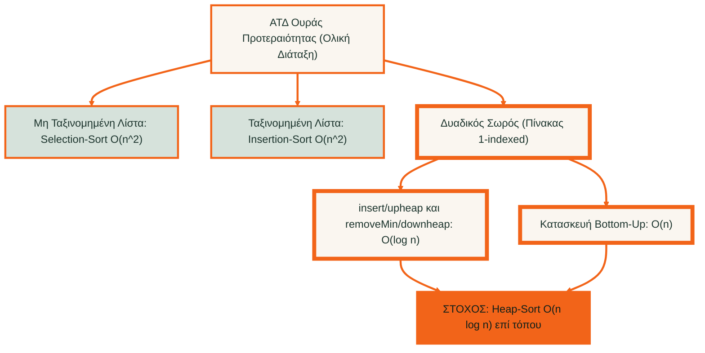
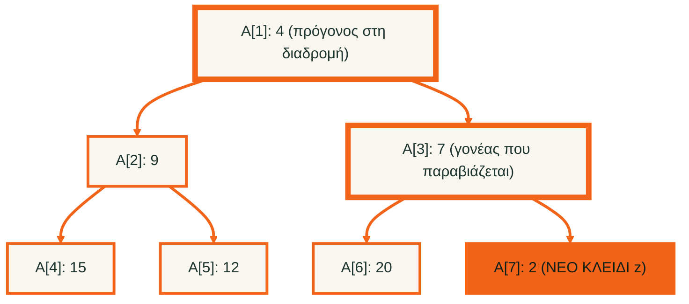
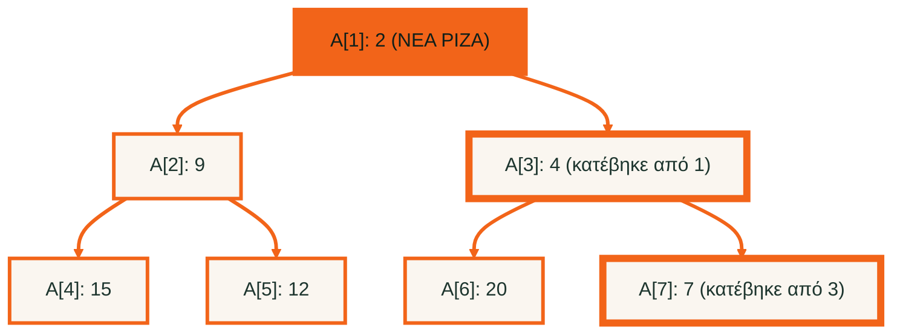

# 02 — Ουρές Προτεραιότητας και Σωροί
*Priority Queues, Binary Heaps, Heap-Sort and Bottom-Up Construction*

Η παρούσα ενότητα εισάγει τον Αφηρημένο Τύπο Δεδομένων της **ουράς προτεραιότητας (`Priority Queue ADT`)** και την αποδοτική υλοποίησή της μέσω **δυαδικού σωρού (`Binary Heap`)**, ώστε η εισαγωγή στοιχείου και η εξαγωγή του ελάχιστου κλειδιού να εκτελούνται σε χρόνο $O(\log n)$ στη χειρότερη περίπτωση. Η ανάλυση βασίζεται στα εργαλεία ασυμπτωτικής πολυπλοκότητας και μέτρησης βημάτων της ενότητας [01_analysis_of_algorithms.md](01_analysis_of_algorithms.md). Στην ύλη της Προόδου, οι σωροί αποτελούν τη βάση για την επί-τόπου ταξινόμηση `Heap-Sort` ([05_sorting_and_lower_bound.md](05_sorting_and_lower_bound.md)) και για άπληστους αλγορίθμους όπως ο χρονοπρογραμματισμός εργασιών και η κωδικοποίηση `Huffman` ([06_greedy_method.md](06_greedy_method.md)), ενώ η κατασκευή σωρού από κάτω προς τα πάνω συνδέεται με τις αναδρομές του `Master Theorem` ([07_divide_and_conquer.md](07_divide_and_conquer.md)). Εφαρμογή στην Τελική: οι σωροί υλοποιούν την ουρά προτεραιότητας στους αλγορίθμους `Dijkstra`, `Prim-Jarnik` και `Kruskal`.

> **Εξεταστική κάλυψη:** Πρόοδος
> **Κεφάλαιο βιβλίου:** Κεφ. 5 | **Διαλέξεις:** `02_priority_queues.pdf`, `03_heaps.pdf`
> **Πηγή:** `Resources/Meta/mindmap.md` (Ενότητα 02)
> **Εκτός ύλης:** Ενότητα `5.5`

## Πίνακας Περιεχομένων

- [1. Εννοιολογικό Πλαίσιο και Συνολική Εικόνα](#1-εννοιολογικό-πλαίσιο-και-συνολική-εικόνα)
- [2. Θεωρητική Θεμελίωση και Τυπικοί Ορισμοί](#2-θεωρητική-θεμελίωση-και-τυπικοί-ορισμοί)
- [3. Αλγόριθμοι, Ιχνηλάτηση και Κώδικας](#3-αλγόριθμοι-ιχνηλάτηση-και-κώδικας)
- [4. Συγκριτική Ανάλυση και Πολυπλοκότητα](#4-συγκριτική-ανάλυση-και-πολυπλοκότητα)
- [5. Πλήρως Λυμένες Ασκήσεις Εξεταστικού Επιπέδου](#5-πλήρως-λυμένες-ασκήσεις-εξεταστικού-επιπέδου)
- [6. Οδηγός Επιβίωσης στις Εξετάσεις και Παγίδες](#6-οδηγός-επιβίωσης-στις-εξετάσεις-και-παγίδες)
- [7. Συνοπτικός Πίνακας Εννοιών](#7-συνοπτικός-πίνακας-εννοιών)

---

## 1. Εννοιολογικό Πλαίσιο και Συνολική Εικόνα

### Το Πρόβλημα της Προτεραιοποιημένης Εξυπηρέτησης

Σε πλήθος πραγματικών συστημάτων, τα στοιχεία δεν εξυπηρετούνται με σειρά άφιξης (`FIFO`) αλλά με βάση ένα **κλειδί προτεραιότητας (`priority key`)**. Το σύστημα πρέπει να δέχεται δυναμικά νέες εγγραφές και να εντοπίζει ή να αφαιρεί άμεσα την εγγραφή με τη μέγιστη προτεραιότητα (κατά σύμβαση του μαθήματος, το **μικρότερο κλειδί**).

Κλασικές εφαρμογές που καλύπτει το μάθημα:

- **Μηχανές αντιστοίχισης μετοχών (`matching machines`):** Στα χρηματιστήρια, ένα **βιβλίο συνεχόμενου ορίου εντολών (`continuous limit order book`)** αντιστοιχεί εντολές αγοράς (αγοραστές που ζητούν μετοχές σε κάποια ή χαμηλότερη τιμή) με εντολές πώλησης (πωλητές που προσφέρουν μετοχές σε κάποια ή υψηλότερη τιμή). Οι εντολές διατάσσονται ιεραρχικά πρώτα κατά **τιμή** και, σε ισοπαλία τιμής, κατά **χρόνο** παραμονής στο βιβλίο (η παλαιότερη προηγείται). Το σύστημα διατηρεί δύο στιγμιότυπα ουράς προτεραιότητας: μία για εντολές αγοράς και μία για εντολές πώλησης.
- **Δημοπρασίες (`auctions`):** Ιεράρχηση προσφορών ανάλογα με το ύψος προσφοράς και τον χρόνο υποβολής.
- **Πελάτες πτήσεων σε αναμονή (`standby passengers`):** Επιλογή επιβατών για κενές θέσεις με βάση κριτήρια προτεραιότητας (κατηγορία εισιτηρίου, πρόγραμμα επιβράβευσης, χρόνος αναμονής).

### Συνολική Εικόνα της Ενότητας



Πορτοκαλί γέμισμα: κόμβος εστίασης (`Heap-Sort` σε $O(n \log n)$ επί τόπου). Παχύ περίγραμμα: ο δυαδικός σωρός και οι κρίσιμες λειτουργίες του. Απαλό πράσινο: απλές υλοποιήσεις βάσει λίστας που οδηγούν σε τετραγωνική ταξινόμηση. Κρεμ κόμβος: ο αφηρημένος τύπος δεδομένων που ενοποιεί τις υλοποιήσεις.

### Πότε Χρησιμοποιούμε Τι

- Όταν το σύνολο δεδομένων είναι πολύ μικρό (ενδεικτικά $n < 10^3$) ή σχεδόν ταξινομημένο, οι απλές επί-τόπου υλοποιήσεις βάσει ακολουθίας (`Selection-Sort`, `Insertion-Sort`) έχουν μικρό σταθερό συντελεστή.
- Όταν απαιτούνται επαναλαμβανόμενες δυναμικές εισαγωγές και εξαγωγές του ελαχίστου στοιχείου (π.χ. βιβλίο εντολών, χρονοπρογραμματισμός, κωδικοποίηση `Huffman`), ο **δυαδικός σωρός** εξισορροπεί και τις δύο λειτουργίες σε $O(\log n)$ στη χειρότερη περίπτωση.
- Όταν όλα τα $n$ κλειδιά είναι γνωστά εκ των προτέρων, η **κατασκευή σωρού από κάτω προς τα πάνω (`Bottom-Up`)** μειώνει τον χρόνο δημιουργίας του σωρού από $O(n \log n)$ σε $O(n)$.

---

## 2. Θεωρητική Θεμελίωση και Τυπικοί Ορισμοί

### 2.1 ΑΤΔ Ουράς Προτεραιότητας (`Priority Queue ADT`)

Μια **ουρά προτεραιότητας** αποθηκεύει μια συλλογή εγγραφών. Κάθε **εγγραφή (`entry`)** είναι ένα ζεύγος $(k, v)$, όπου $k$ είναι το **κλειδί (`key`)** και $v$ είναι η **τιμή (`value`)**. Το ίδιο κλειδί μπορεί να εμφανίζεται σε περισσότερες από μία εγγραφές.

| Μέθοδος | Κατηγορία | Περιγραφή |
|---|---|---|
| `insert(k, v)` | Κύρια | Εισάγει μια νέα εγγραφή με κλειδί $k$ και τιμή $v$ στην ουρά προτεραιότητας. |
| `removeMin()` | Κύρια | Αφαιρεί και επιστρέφει την εγγραφή με το μικρότερο κλειδί, ή `null` αν η ουρά είναι κενή. |
| `min()` | Επιπλέον | Επιστρέφει χωρίς να αφαιρεί την εγγραφή με το μικρότερο κλειδί, ή `null` αν η ουρά είναι κενή. |
| `size()` | Επιπλέον | Επιστρέφει το πλήθος $n$ των αποθηκευμένων εγγραφών. |
| `isEmpty()` | Επιπλέον | Επιστρέφει `true` αν η ουρά δεν περιέχει εγγραφές, αλλιώς `false`. |

### 2.2 Σχέσεις Ολικής Διάταξης (`Total Order Relations`)

Τα κλειδιά σε μια ουρά προτεραιότητας μπορούν να είναι οποιαδήποτε αντικείμενα, αρκεί να συγκρίνονται μέσω μιας **σχέσης ολικής διάταξης** $\le$. Μια δυαδική σχέση $\le$ σε ένα σύνολο κλειδιών $K$ είναι σχέση ολικής διάταξης αν και μόνο αν ικανοποιεί τα εξής τέσσερα αξιώματα για κάθε $x, y, z \in K$:

1. **Ιδιότητα Σύγκρισης (`Comparability`):** $x \le y$ ή $y \le x$ (κάθε ζεύγος κλειδιών είναι συγκρίσιμο).
2. **Ανακλαστική Ιδιότητα (`Reflexivity`):** $x \le x$.
3. **Αντισυμμετρική Ιδιότητα (`Antisymmetry`):** αν $x \le y$ και $y \le x$, τότε $x = y$.
4. **Μεταβατική Ιδιότητα (`Transitivity`):** αν $x \le y$ και $y \le z$, τότε $x \le z$.

**Κανόνας, λόγος, παράδειγμα:** Η σχέση ολικής διάταξης εξασφαλίζει ότι το ελάχιστο κλειδί είναι καλά ορισμένο και συνεπές σε διαδοχικές συγκρίσεις. Για παράδειγμα, στο βιβλίο εντολών πώλησης, η λεξικογραφική σύγκριση ζευγών $(\text{τιμή}, \text{χρόνος\_εισαγωγής})$ ικανοποιεί και τα τέσσερα αξιώματα, οπότε ορίζει έγκυρη ολική διάταξη.

### 2.3 Δυαδικοί Σωροί (`Binary Heaps`)

Ένας **δυαδικός σωρός ελαχίστων (`min-heap`)** είναι ένα δυαδικό δέντρο $T$ που αποθηκεύει εγγραφές $(k, v)$ στους εσωτερικούς του κόμβους και ικανοποιεί ταυτόχρονα δύο δομικές ιδιότητες:

1. **Ιδιότητα Σειράς Σωρού (`Heap-Order Property`):** Για κάθε εσωτερικό κόμβο $v$ πέραν της ρίζας, ισχύει:
   $$\text{key}(v) \ge \text{key}(\text{parent}(v))$$
   Συνέπεια: το ελάχιστο κλειδί βρίσκεται πάντα στη ρίζα του σωρού, και κάθε μονοπάτι από τη ρίζα προς ένα φύλλο περιέχει κλειδιά σε μη φθίνουσα διάταξη.

2. **Ιδιότητα Πλήρους Δυαδικού Δέντρου (`Complete Binary Tree Property`):** Αν $h$ είναι το ύψος του σωρού $T$, τότε:
   - Για κάθε βάθος $i \in \{0, 1, \dots, h - 1\}$, υπάρχουν ακριβώς $2^i$ εσωτερικοί κόμβοι στο βάθος $i$.
   - Στο βάθος $h - 1$, όλοι οι εσωτερικοί κόμβοι βρίσκονται αριστερά των εξωτερικών κόμβων (ισοδύναμα, το τελευταίο επίπεδο βάθους $h$ γεμίζει αυστηρά από αριστερά προς τα δεξιά χωρίς κενά).

**Τελευταίος κόμβος (`last node`):** Ο δεξιότερος εσωτερικός κόμβος στο μέγιστο βάθος $h$ του σωρού.

### 2.4 Θεώρημα Ύψους Σωρού

**Θεώρημα:** Ένας δυαδικός σωρός με $n \ge 1$ αποθηκευμένα κλειδιά έχει ύψος $h \le \lfloor \log_2 n \rfloor = O(\log n)$.

**Απόδειξη:**
Έστω $h$ το ύψος ενός σωρού $T$ με $n$ κλειδιά (η ρίζα έχει βάθος $0$). Λόγω της ιδιότητας πλήρους δυαδικού δέντρου:
- Σε κάθε βάθος $i = 0, 1, \dots, h - 1$, το δέντρο περιέχει ακριβώς $2^i$ κλειδιά.
- Στο μέγιστο βάθος $h$, το δέντρο περιέχει τουλάχιστον $1$ κλειδί (αλλιώς το ύψος θα ήταν μικρότερο από $h$).

Αθροίζοντας τα κλειδιά όλων των επιπέδων προκύπτει το κάτω φράγμα για το $n$:
$$n \ge \left(\sum_{i=0}^{h-1} 2^i\right) + 1 = (1 + 2 + 4 + \dots + 2^{h-1}) + 1 = (2^h - 1) + 1 = 2^h$$
Λαμβάνοντας δυαδικό λογάριθμο και στα δύο μέλη (η $\log_2$ είναι γνησίως αύξουσα):
$$\log_2 n \ge h \implies h \le \log_2 n$$
Επειδή το $h$ είναι ακέραιος, ισχύει $h \le \lfloor \log_2 n \rfloor$. (Αντίστοιχα, το μέγιστο πλήθος κόμβων σε ύψος $h$ είναι $\sum_{i=0}^{h} 2^i = 2^{h+1} - 1$, άρα $2^h \le n \le 2^{h+1} - 1$, που δίνει ακριβώς $h = \lfloor \log_2 n \rfloor = \Theta(\log n)$.)

**Αριθμητικό παράδειγμα:** Για $n = 15$ κλειδιά, $2^3 = 8 \le 15 \le 15 = 2^4 - 1$, άρα $h = \lfloor \log_2 15 \rfloor = 3$. Για $n = 16$ κλειδιά, ανοίγει νέο επίπεδο και $h = \lfloor \log_2 16 \rfloor = 4$.

### 2.5 Αναπαράσταση Σωρού με Πίνακα ($1$-indexed)

Επειδή ο σωρός είναι πλήρες δυαδικό δέντρο, αναπαρίσταται χωρίς δείκτες γονέα/παιδιών με έναν πίνακα $A[1 \dots n]$ μεγέθους $n$ (με δεικτοδότηση από το $1$, αφήνοντας τη θέση $A[0]$ αχρησιμοποίητη). Για κάθε κόμβο στη θέση (`rank`) $i \in \{1, \dots, n\}$:

- **Ρίζα:** θέση $1$.
- **Αριστερό παιδί του $i$:** θέση $2i$ (υπάρχει αν $2i \le n$).
- **Δεξιό παιδί του $i$:** θέση $2i + 1$ (υπάρχει αν $2i + 1 \le n$).
- **Γονέας του $i$ (για $i > 1$):** θέση $\lfloor i / 2 \rfloor$.
- **Τελευταίος κόμβος:** θέση $n$.
- **Εισαγωγή (`add`):** τοποθέτηση του νέου τελευταίου κόμβου στη θέση $n + 1$ σε $O(1)$.
- **Αφαίρεση τελευταίου κόμβου:** ανάγνωση και αφαίρεση από τη θέση $n$ σε $O(1)$.

**Σημαντικό πλεονέκτημα:** Δεν αποθηκεύονται δείκτες (εξοικονόμηση μνήμης), η εύρεση του τελευταίου κόμβου είναι $O(1)$, και ο σωρός επιτρέπει **επί-τόπου (`in-place`)** `Heap-Sort`.

### 2.6 Θεώρημα Κατασκευής Σωρού από Κάτω προς τα Πάνω (`Bottom-Up`)

**Θεώρημα:** Η κατασκευή δυαδικού σωρού από κάτω προς τα πάνω για $n$ κλειδιά εκτελείται σε χρόνο $O(n)$ στη χειρότερη περίπτωση.

**Απόδειξη (Επιχείρημα Φάσεων και Διαδρομών του Μαθήματος):**
Υποθέτουμε για απλότητα ότι $n = 2^{h+1} - 1$ (πλήρες δέντρο ύψους $h = \log_2(n+1) - 1$, άρα $O(\log n)$ φάσεις).

1. **Δομή φάσεων:** Στη φάση $i$ ($i = 1, 2, \dots, h$), κάθε ζεύγος ήδη έγκυρων σωρών μεγέθους $2^i - 1$ συγχωνεύεται με ένα νέο κλειδί ρίζας $k$ σε έναν σωρό μεγέθους $2^{i+1} - 1$, εκτελώντας ένα `downheap` από αυτή τη ρίζα.
2. **Αντιστοίχιση διαδρομών (`proxy paths`):** Για κάθε εσωτερικό κόμβο $v$ από τον οποίο ξεκινά ένα `downheap`, το κόστος του `downheap` στη χειρότερη περίπτωση είναι ανάλογο του ύψους του υποδέντρου του $v$. Αντιστοιχίζουμε σε κάθε τέτοιο κόμβο $v$ μια αντιπροσωπευτική διαδρομή $P(v)$ που έχει το ίδιο μέγιστο μήκος με το χειρότερο δυνατό `downheap` από τον $v$: η $P(v)$ ξεκινά από τον $v$, κάνει **ένα βήμα δεξιά** (στο δεξιό παιδί του $v$) και στη συνέχεια πηγαίνει **επαναλαμβανόμενα αριστερά** μέχρι να φτάσει σε φύλλο. (Η $P(v)$ μπορεί να διαφέρει από την πραγματική διαδρομή του `downheap`, αλλά έχει ακριβώς το ίδιο μήκος με το χειρότερο `downheap` από τον $v$.)
3. **Καταμέτρηση επικαλύψεων:** Παρατηρούμε ότι κάθε κόμβος $u$ του δέντρου μπορεί να διασχισθεί το πολύ από **δύο** τέτοιες διαδρομές:
   - Τη διαδρομή $P(u)$ που ξεκινά από τον ίδιο τον $u$ (αν ο $u$ είναι εσωτερικός κόμβος).
   - Το πολύ μία διαδρομή $P(w)$ κάποιου προγόνου $w$ του $u$ (δεδομένου ότι η $P(w)$ πηγαίνει πρώτα δεξιά και μετά μόνο αριστερά, αν φτάσει στον $u$, τότε ο $w$ είναι μοναδικά ο πρώτος πρόγονος του $u$ στον οποίο φτάνουμε ανεβαίνοντας αριστερές ακμές και κάνοντας ένα τελευταίο βήμα προς τα αριστερά-πάνω).
   - Κάθε ακμή του δέντρου διασχίζεται το πολύ από **μία** διαδρομή $P(v)$.
4. **Συμπέρασμα:** Επειδή κάθε ένας από τους $n$ κόμβους ανήκει το πολύ σε $2$ διαδρομές, το άθροισμα των μηκών όλων των διαδρομών $P(v)$ είναι το πολύ $2n = O(n)$. Άρα ο συνολικός χρόνος όλων των `downheap` είναι $O(n)$ στη χειρότερη περίπτωση.

> Εκτός ύλης: Ενότητα `5.5` (Goodrich και Tamassia).

---

## 3. Αλγόριθμοι, Ιχνηλάτηση και Κώδικας

### 3.1 `PQ-Sort`, `Selection-Sort` και `Insertion-Sort`

**Σκοπός:** Ταξινόμηση πίνακα $C$ μεγέθους $n$ εισάγοντας όλα τα στοιχεία σε μια ουρά προτεραιότητας $P$ (Φάση 1) και εξάγοντάς τα κατά αύξουσα σειρά μέσω `removeMin` (Φάση 2).

#### Ψευδοκώδικας (`PQ-Sort`, `SelectionSort` επί τόπου, `InsertionSort` επί τόπου)

```text
Algorithm PQ-Sort(C, P):
  Input: An n-element array, C, indexed from 1 to n, and a priority queue P that
         compares keys, which are elements of C, using a total order relation
  Output: The array C sorted by the total order relation
  for i ← 1 to n do
    e ← C[i]
    P.insert(e, e)        // the key is the element itself
  for i ← 1 to n do
    e ← P.removeMin()     // remove a smallest element from P
    C[i] ← e
```

```text
Algorithm SelectionSort(A):
  Input: An array A of n comparable elements, indexed from 1 to n
  Output: An ordering of A so that its elements are in nondecreasing order
  for i ← 1 to n - 1 do
    // Find the index, s, of the smallest element in A[i..n]
    s ← i
    for j ← i + 1 to n do
      if A[j] < A[s] then
        s ← j
    if i != s then
      // Swap A[i] and A[s]
      t ← A[s]; A[s] ← A[i]; A[i] ← t
  return A
```

```text
Algorithm InsertionSort(A):
  Input: An array A of n comparable elements, indexed from 1 to n
  Output: An ordering of A so that its elements are in nondecreasing order
  for i ← 2 to n do
    x ← A[i]
    // Put x in the right place in A[1..i], moving larger elements up as needed
    j ← i
    while j > 1 and x < A[j - 1] do
      A[j] ← A[j - 1]     // move A[j - 1] up one cell
      j ← j - 1
    A[j] ← x
  return A
```

#### Ιχνηλάτηση (`SelectionSort` και `InsertionSort` στον πίνακα $[7, 4, 8, 2, 5, 3, 9]$)

Κανόνας επίλυσης ισοπαλιών: τα στοιχεία είναι διακριτά· σε γενικές εισόδους η αυστηρή ανισότητα `<` διατηρεί τη σχετική σειρά ίσων στοιχείων στο `InsertionSort`.

| Βήμα ($i$) | `SelectionSort`: ελάχιστο στο $A[i..7]$ και ανταλλαγή | Πίνακας μετά το βήμα | `InsertionSort`: εισαγόμενο $x = A[i]$ και μετατοπίσεις | Πίνακας μετά το βήμα |
|---|---|---|---|---|
| Αρχικό | — | `[7, 4, 8, 2, 5, 3, 9]` | — | `[7, 4, 8, 2, 5, 3, 9]` |
| 1 (`i=1` / `i=2`) | $s = 4$ ($A[4]=2$), ανταλλαγή $A[1] \leftrightarrow A[4]$ | `[2, 4, 8, 7, 5, 3, 9]` | $x = 4$, μετατόπιση `7` δεξιά | `[4, 7, 8, 2, 5, 3, 9]` |
| 2 (`i=2` / `i=3`) | $s = 6$ ($A[6]=3$), ανταλλαγή $A[2] \leftrightarrow A[6]$ | `[2, 3, 8, 7, 5, 4, 9]` | $x = 8$, καμία μετατόπιση ($8 \ge 7$) | `[4, 7, 8, 2, 5, 3, 9]` |
| 3 (`i=3` / `i=4`) | $s = 6$ ($A[6]=4$), ανταλλαγή $A[3] \leftrightarrow A[6]$ | `[2, 3, 4, 7, 5, 8, 9]` | $x = 2$, μετατοπίσεις `8, 7, 4` | `[2, 4, 7, 8, 5, 3, 9]` |
| 4 (`i=4` / `i=5`) | $s = 5$ ($A[5]=5$), ανταλλαγή $A[4] \leftrightarrow A[5]$ | `[2, 3, 4, 5, 7, 8, 9]` | $x = 5$, μετατοπίσεις `8, 7` | `[2, 4, 5, 7, 8, 3, 9]` |
| 5 (`i=5` / `i=6`) | $s = 5$ ($A[5]=7$), καμία ανταλλαγή | `[2, 3, 4, 5, 7, 8, 9]` | $x = 3$, μετατοπίσεις `8, 7, 5, 4` | `[2, 3, 4, 5, 7, 8, 9]` |
| 6 (`i=6` / `i=7`) | $s = 6$ ($A[6]=8$), καμία ανταλλαγή | `[2, 3, 4, 5, 7, 8, 9]` | $x = 9$, καμία μετατόπιση ($9 \ge 8$) | `[2, 3, 4, 5, 7, 8, 9]` |

#### Κώδικας Python (Διπλή Μορφή)

**Ρητοί αλγόριθμοι (επί τόπου, όπως ζητά η εξέταση):**

```python
def selectionSort(items: list[int]) -> list[int]:
    """Sorts a list in place using in-place Selection-Sort.

    Args:
        items (list[int]): Comparable integers to sort in place.

    Returns:
        list[int]: The same list sorted in nondecreasing order.
    """
    n = len(items)
    for i in range(n - 1):
        min_index = i
        for j in range(i + 1, n):
            if items[j] < items[min_index]:
                min_index = j
        if i != min_index:
            # Swap places the smallest remaining element at its final position i.
            items[i], items[min_index] = items[min_index], items[i]
    return items


def insertionSort(items: list[int]) -> list[int]:
    """Sorts a list in place using in-place Insertion-Sort.

    Args:
        items (list[int]): Comparable integers to sort in place.

    Returns:
        list[int]: The same list sorted in nondecreasing order.
    """
    for i in range(1, len(items)):
        current_key = items[i]
        j = i
        # Shift larger elements right to open the exact slot for current_key.
        while j > 0 and current_key < items[j - 1]:
            items[j] = items[j - 1]
            j -= 1
        items[j] = current_key
    return items


assert selectionSort([7, 4, 8, 2, 5, 3, 9]) == [2, 3, 4, 5, 7, 8, 9]
assert insertionSort([7, 4, 8, 2, 5, 3, 9]) == [2, 3, 4, 5, 7, 8, 9]
```

**Pythonic ιδιωματισμός (μόνο για επαλήθευση):**

```python
data = [7, 4, 8, 2, 5, 3, 9]
sorted_copy = sorted(data)  # returns a new sorted list using Timsort
data.sort()                 # sorts in place using Timsort
assert sorted_copy == data == [2, 3, 4, 5, 7, 8, 9]
```

| Μορφή | Χρόνος (χειρότερη) | Χρόνος (καλύτερη) | Επιπλέον χώρος | Σημείωση |
|---|---|---|---|---|
| `selectionSort(items)` | $\Theta(n^2)$ | $\Theta(n^2)$ | $O(1)$ | Πάντα $\sum_{i=1}^{n-1} i = n(n-1)/2$ συγκρίσεις. |
| `insertionSort(items)` | $\Theta(n^2)$ | $\Theta(n)$ | $O(1)$ | Γραμμικό σε ήδη ταξινομημένη είσοδο. |
| `sorted(data)` / `data.sort()` | $O(n \log n)$ | $O(n)$ | $O(n)$ | Υλοποιεί `Timsort` (σταθερό), όχι `Selection-Sort`/`Insertion-Sort`. |

Στην εξέταση γράφεται ο ρητός αλγόριθμος και η ιχνηλάτησή του· ο ιδιωματισμός χρησιμεύει μόνο για έλεγχο αποτελέσματος.

#### Ανάλυση Πολυπλοκότητας (`PQ-Sort` βάσει Λίστας)

- **Μη ταξινομημένη λίστα (`Selection-Sort`):**
  1. Φάση 1: $n$ κλήσεις `insert` σε $O(1)$ η καθεμία $\Rightarrow O(n)$.
  2. Φάση 2: $n$ κλήσεις `removeMin` όπου η $i$-οστή σαρώνει $n - i + 1$ στοιχεία $\Rightarrow \sum_{k=1}^{n} k = \frac{n(n+1)}{2} = \Theta(n^2)$.
  3. Σύνολο: $\Theta(n^2)$ σε όλες τις περιπτώσεις (χειρότερη και καλύτερη).
- **Ταξινομημένη λίστα (`Insertion-Sort`):**
  1. Φάση 1: $n$ κλήσεις `insert`, όπου στη χειρότερη περίπτωση (αντίστροφα ταξινομημένη είσοδος) η $i$-οστή σαρώνει $i$ στοιχεία $\Rightarrow \sum_{i=1}^{n} i = \frac{n(n+1)}{2} = O(n^2)$.
  2. Φάση 2: $n$ κλήσεις `removeMin` από την αρχή της λίστας σε $O(1)$ η καθεμία $\Rightarrow O(n)$.
  3. Σύνολο: $O(n^2)$ στη χειρότερη περίπτωση, $\Omega(n)$ στην καλύτερη (ήδη ταξινομημένη είσοδος).

---

### 3.2 Εισαγωγή σε Σωρό (`HeapInsert` + `upheap`)

**Σκοπός:** Προσθήκη νέας εγγραφής $(k, e)$ στον σωρό διατηρώντας τόσο την ιδιότητα πλήρους δυαδικού δέντρου όσο και την ιδιότητα σειράς σωρού.

#### Ψευδοκώδικας (`HeapInsert` σε πίνακα $1$-indexed)

```text
Algorithm HeapInsert(k, e):
  Input: A key-element pair
  Output: An update of the array, A, of n elements, for a heap, to add (k, e)
  n ← n + 1
  A[n] ← (k, e)
  i ← n
  while i > 1 and A[floor(i / 2)] > A[i] do
    Swap A[floor(i / 2)] and A[i]
    i ← floor(i / 2)
```

*(Η σύγκριση $A[\lfloor i/2 \rfloor] > A[i]$ αναφέρεται στα κλειδιά των δύο εγγραφών.)*

#### Ιχνηλάτηση: 7 Διαδοχικές Εισαγωγές (`[15, 9, 20, 4, 12, 7, 2]`)

Κανόνας επίλυσης ισοπαλιών: η `upheap` σταματά μόλις $\text{key}(\text{parent}) \le \text{key}(i)$ (σε ίσα κλειδιά δεν γίνεται ανταλλαγή).

| Βήμα | Ενέργεια | Νέος τελευταίος κόμβος $z$ | Ανταλλαγές `upheap` (θέσεις $1$-indexed) | Πίνακας σωρού $A[1 \dots n]$ μετά το βήμα |
|---|---|---|---|---|
| 1 | `insert(15)` | $A[1] = 15$ | καμία (είναι η ρίζα) | `[15]` |
| 2 | `insert(9)` | $A[2] = 9$ | $A[2] \leftrightarrow A[1]$ ($9 < 15$) | `[9, 15]` |
| 3 | `insert(20)` | $A[3] = 20$ | καμία ($20 \ge 9$) | `[9, 15, 20]` |
| 4 | `insert(4)` | $A[4] = 4$ | $A[4] \leftrightarrow A[2]$ ($4 < 15$), έπειτα $A[2] \leftrightarrow A[1]$ ($4 < 9$) | `[4, 9, 20, 15]` |
| 5 | `insert(12)` | $A[5] = 12$ | καμία ($12 \ge 9$) | `[4, 9, 20, 15, 12]` |
| 6 | `insert(7)` | $A[6] = 7$ | $A[6] \leftrightarrow A[3]$ ($7 < 20$), σταματά ($7 \ge 4$) | `[4, 9, 7, 15, 12, 20]` |
| 7 | `insert(2)` | $A[7] = 2$ | $A[7] \leftrightarrow A[3]$ ($2 < 7$), έπειτα $A[3] \leftrightarrow A[1]$ ($2 < 4$) | `[2, 9, 4, 15, 12, 20, 7]` |

#### Διάγραμμα Σωρού Πριν και Μετά το `upheap` (Βήμα 7: εισαγωγή του `2`)

**Πριν το `upheap` (αμέσως μετά την τοποθέτηση του `2` στον νέο τελευταίο κόμβο $A[7]$):**



Πορτοκαλί γέμισμα: ο νέος τελευταίος κόμβος $z$ στη θέση $A[7]$ με κλειδί $2$. Παχύ περίγραμμα: οι κόμβοι $A[3]$ και $A[1]$ κατά μήκος της ανοδικής διαδρομής όπου παραβιάζεται η ιδιότητα σωρού. Κρεμ κόμβοι: ανεπηρέαστοι κόμβοι.

**Μετά το `upheap` (έπειτα από τις ανταλλαγές $A[7] \leftrightarrow A[3]$ και $A[3] \leftrightarrow A[1]$):**



Πορτοκαλί γέμισμα: το κλειδί $2$ που έφτασε στη ρίζα $A[1]$. Παχύ περίγραμμα: τα κλειδιά $4$ και $7$ που μετακινήθηκαν μία θέση χαμηλότερα κατά το `upheap`. Κρεμ κόμβοι: ανεπηρέαστοι κόμβοι.

**Αντίστοιχη αναπαράσταση πίνακα ($1$-indexed) μετά το Βήμα 7:**

| Θέση `i` ($1$-indexed) | 1 | 2 | 3 | 4 | 5 | 6 | 7 |
|---|---|---|---|---|---|---|---|
| Κλειδί `A[i]` | **2** | 9 | 4 | 15 | 12 | 20 | 7 |
| Γονέας `floor(i/2)` | — | 1 | 1 | 2 | 2 | 3 | 3 |
| Παιδιά `2i, 2i+1` | 2, 3 | 4, 5 | 6, 7 | — | — | — | — |

#### Ανάλυση Πολυπλοκότητας (`HeapInsert`)

- Η τοποθέτηση στη θέση $n + 1$ είναι $O(1)$.
- Σε κάθε επανάληψη του βρόχου `while`, ο δείκτης $i$ διαιρείται με το $2$ (ανεβαίνει ένα επίπεδο), εκτελώντας $O(1)$ πράξεις (σύγκριση και ανταλλαγή).
- Επειδή το ύψος του σωρού είναι $h = \lfloor \log_2 n \rfloor$ (Θεώρημα 2.4), εκτελούνται το πολύ $h$ ανταλλαγές.
- **Πολυπλοκότητα:** $O(\log n)$ στη χειρότερη περίπτωση, $\Omega(1)$ στην καλύτερη περίπτωση (όταν το νέο κλειδί είναι μεγαλύτερο ή ίσο του γονέα του).

---

### 3.3 Αφαίρεση Ελαχίστου (`HeapRemoveMin` + `downheap`)

**Σκοπός:** Εξαγωγή και επιστροφή της εγγραφής με το ελάχιστο κλειδί (ρίζα $A[1]$), διατηρώντας την ιδιότητα πλήρους δυαδικού δέντρου και την ιδιότητα σειράς σωρού.

#### Ψευδοκώδικας (`HeapRemoveMin` σε πίνακα $1$-indexed)

```text
Algorithm HeapRemoveMin():
  Input: None
  Output: An update of the array, A, of n elements, for a heap, to remove and
          return an item with smallest key
  temp ← A[1]
  A[1] ← A[n]
  n ← n - 1
  i ← 1
  while i < n do
    if 2i + 1 <= n then     // this node has two internal children
      if A[i] <= A[2i] and A[i] <= A[2i + 1] then
        return temp         // we have restored the heap-order property
      else
        Let j be the index of the smaller of A[2i] and A[2i + 1]
        Swap A[i] and A[j]
        i ← j
    else                    // this node has zero or one internal child
      if 2i <= n then       // this node has one internal child (the last node)
        if A[i] > A[2i] then
          Swap A[i] and A[2i]
      return temp           // we have restored the heap-order property
  return temp               // we reached the last node or an external node
```

**Κανόνας μνήμης:** Το `downheap` ανταλλάσσει **πάντα με το ΜΙΚΡΟΤΕΡΟ παιδί**. Αν αντάλλασσε με το μεγαλύτερο παιδί, τότε το μεγαλύτερο παιδί θα γινόταν γονέας του μικρότερου, παραβιάζοντας αμέσως την ιδιότητα σωρού.

#### Ιχνηλάτηση: `removeMin` στον σωρό $A = [2, 9, 4, 15, 12, 20, 7]$

Κανόνας επίλυσης ισοπαλιών: αν τα δύο παιδιά έχουν ίσα κλειδιά, επιλέγεται το αριστερό παιδί (`2i`).

| Βήμα | Κατάσταση / Έλεγχος | Δείκτης `i` | Παιδιά του `i` | Ενέργεια | Πίνακας σωρού $A[1 \dots n]$ |
|---|---|---|---|---|---|
| 0 | Αρχικός σωρός ($n=7$) | — | — | `temp = A[1] = 2` | `[2, 9, 4, 15, 12, 20, 7]` |
| 1 | Αντικατάσταση ρίζας με $w = A[7] = 7$, $n \leftarrow 6$ | $i = 1$ | $A[2]=9$, $A[3]=4$ | Δύο παιδιά: μικρότερο το $A[3]=4$. Επειδή $7 > 4$, ανταλλαγή $A[1] \leftrightarrow A[3]$, $i \leftarrow 3$. | `[4, 9, 7, 15, 12, 20]` |
| 2 | Επόμενος έλεγχος ($2\cdot 3 + 1 = 7 > 6$, αλλά $2\cdot 3 = 6 \le 6$) | $i = 3$ | Μόνο αριστερό: $A[6]=20$ | Ένα παιδί: επειδή $7 \le 20$, δεν γίνεται ανταλλαγή. Επιστροφή `temp = 2`. | `[4, 9, 7, 15, 12, 20]` |

#### Ανάλυση Πολυπλοκότητας (`HeapRemoveMin`)

- Αποθήκευση ρίζας, μεταφορά του $A[n]$ στη θέση $A[1]$ και μείωση του $n$: $O(1)$.
- Σε κάθε επανάληψη του `while`, ο δείκτης $i$ κατεβαίνει ένα επίπεδο ($i \leftarrow 2i$ ή $i \leftarrow 2i+1$) εκτελώντας το πολύ $2$ συγκρίσεις κλειδιών και $1$ ανταλλαγή ($O(1)$).
- Το μήκος του καθοδικού μονοπατιού φράσσεται από το ύψος $h = \lfloor \log_2 n \rfloor$.
- **Πολυπλοκότητα:** $O(\log n)$ στη χειρότερη περίπτωση, $\Omega(1)$ στην καλύτερη (όταν το μεταφερθέν κλειδί είναι μικρότερο ή ίσο και των δύο παιδιών της ρίζας).

---

### 3.4 Κατασκευή Σωρού από Κάτω προς τα Πάνω (`Bottom-Up Heap Construction`)

**Σκοπός:** Μετατροπή ενός αυθαίρετου πίνακα $n$ κλειδιών σε έγκυρο δυαδικό σωρό σε χρόνο $O(n)$, εκτελώντας `downheap` από τον τελευταίο εσωτερικό κόμβο $\lfloor n/2 \rfloor$ αντίστροφα προς τη ρίζα $1$.

#### Ψευδοκώδικας (`BottomUpHeap`)

```text
Algorithm BottomUpHeap(A, n):
  Input: An array A of n keys, indexed from 1 to n
  Output: The array A rearranged to satisfy the min-heap-order property
  for i ← floor(n / 2) down to 1 do
    downheap(A, n, i)
  return A
```

*(Οι κόμβοι με δείκτη $i > \lfloor n/2 \rfloor$ είναι φύλλα, οπότε αποτελούν ήδη έγκυρους μονοκόμβους σωρούς μεγέθους $2^1 - 1 = 1$.)*

#### Ιχνηλάτηση: Κατασκευή Σωρού 15 Κλειδιών Φάση προς Φάση (Παράδειγμα Διάλεξης `03_heaps.pdf`)

Είσοδος ($1$-indexed): $A = [14, 9, 8, 25, 5, 11, 27, 16, 15, 4, 12, 6, 7, 23, 20]$ ($n = 15$, $\lfloor n/2 \rfloor = 7$).

- **Φάση 0 (φύλλα $i = 8 \dots 15$):** Κάθε ένα από τα $8$ φύλλα ($16, 15, 4, 12, 6, 7, 23, 20$) είναι ήδη σωρός μεγέθους $2^1 - 1 = 1$.

| Φάση | Δείκτης `i` (κλειδί) | Παιδιά & ανταλλαγές `downheap(i)` | Πίνακας $A[1 \dots 15]$ μετά το βήμα |
|---|---|---|---|
| Φάση 1 (σωροί μεγέθους $3$) | `i=7` (`27`) | Παιδιά $A[14]=23, A[15]=20 \Rightarrow$ ανταλλαγή $A[7] \leftrightarrow A[15]$ ($27 \leftrightarrow 20$) | `[14, 9, 8, 25, 5, 11, 20, 16, 15, 4, 12, 6, 7, 23, 27]` |
| Φάση 1 | `i=6` (`11`) | Παιδιά $A[12]=6, A[13]=7 \Rightarrow$ ανταλλαγή $A[6] \leftrightarrow A[12]$ ($11 \leftrightarrow 6$) | `[14, 9, 8, 25, 5, 6, 20, 16, 15, 4, 12, 11, 7, 23, 27]` |
| Φάση 1 | `i=5` (`5`) | Παιδιά $A[10]=4, A[11]=12 \Rightarrow$ ανταλλαγή $A[5] \leftrightarrow A[10]$ ($5 \leftrightarrow 4$) | `[14, 9, 8, 25, 4, 6, 20, 16, 15, 5, 12, 11, 7, 23, 27]` |
| Φάση 1 | `i=4` (`25`) | Παιδιά $A[8]=16, A[9]=15 \Rightarrow$ ανταλλαγή $A[4] \leftrightarrow A[9]$ ($25 \leftrightarrow 15$) | `[14, 9, 8, 15, 4, 6, 20, 16, 25, 5, 12, 11, 7, 23, 27]` |
| Φάση 2 (σωροί μεγέθους $7$) | `i=3` (`8`) | $A[3] \leftrightarrow A[6]$ ($8 \leftrightarrow 6$), έπειτα $A[6] \leftrightarrow A[13]$ ($8 \leftrightarrow 7$) | `[14, 9, 6, 15, 4, 7, 20, 16, 25, 5, 12, 11, 8, 23, 27]` |
| Φάση 2 | `i=2` (`9`) | $A[2] \leftrightarrow A[5]$ ($9 \leftrightarrow 4$), έπειτα $A[5] \leftrightarrow A[10]$ ($9 \leftrightarrow 5$) | `[14, 4, 6, 15, 5, 7, 20, 16, 25, 9, 12, 11, 8, 23, 27]` |
| Φάση 3 (σωρός μεγέθους $15$) | `i=1` (`14`) | $A[1] \leftrightarrow A[2]$ ($14 \leftrightarrow 4$), έπειτα $A[2] \leftrightarrow A[5]$ ($14 \leftrightarrow 5$), έπειτα $A[5] \leftrightarrow A[10]$ ($14 \leftrightarrow 9$) | `[4, 5, 6, 15, 9, 7, 20, 16, 25, 14, 12, 11, 8, 23, 27]` |

**Επαλήθευση τελικού σωρού:** $A[1]=4 \le 5, 6$· $A[2]=5 \le 15, 9$· $A[3]=6 \le 7, 20$· $A[4]=15 \le 16, 25$· $A[5]=9 \le 14, 12$· $A[6]=7 \le 11, 8$· $A[7]=20 \le 23, 27$. Όλες οι σχέσεις γονέα-παιδιού ικανοποιούνται.

#### Ανάλυση Πολυπλοκότητας (`BottomUpHeap`)

- **Χειρότερη περίπτωση:** $O(n)$ (βλ. απόδειξη με διαδρομές «πρώτα δεξιά, μετά πάντα αριστερά» στην Ενότητα 2.6, καθώς και την αλγεβρική επαλήθευση στην Άσκηση 2).
- **Χώρος:** $O(1)$ επιπλέον χώρος (λειτουργεί επί τόπου στον πίνακα $A$).

---

### 3.5 Ταξινόμηση Σωρού (`Heap-Sort`)

**Σκοπός:** Ταξινόμηση ακολουθίας $n$ στοιχείων σε χρόνο $O(n \log n)$ στη χειρότερη περίπτωση, χρησιμοποιώντας δυαδικό σωρό.

#### Ψευδοκώδικας (`HeapSort` με `BottomUpHeap`)

```text
Algorithm HeapSort(A, n):
  Input: An array A of n comparable elements, indexed from 1 to n
  Output: An array containing the elements of A in nondecreasing order
  // Phase 1: Build a min-heap (O(n) bottom-up, or O(n log n) via n inserts)
  BottomUpHeap(A, n)
  // Phase 2: Extract the minimum element n times (O(n log n))
  for i ← 1 to n do
    S[i] ← HeapRemoveMin(A)
  return S
```

*(Για αυστηρά επί-τόπου `Heap-Sort` χωρίς βοηθητικό πίνακα $S$, χρησιμοποιείται σωρός μεγίστων `max-heap`: σε κάθε βήμα $k = n, n-1, \dots, 2$, το μέγιστο $A[1]$ ανταλλάσσεται με το $A[k]$, το ενεργό μέγεθος του σωρού μειώνεται κατά $1$, και εκτελείται `downheap` στη ρίζα. Έτσι το ταξινομημένο επίθημα σχηματίζεται από το τέλος προς την αρχή με $O(1)$ επιπλέον μνήμη.)*

#### Ιχνηλάτηση: `Heap-Sort` στον πίνακα $[7, 4, 8, 2, 5, 3, 9]$ (με τις πρώτες δύο εξαγωγές αναλυτικά)

1. **Φάση 1 (`BottomUpHeap` στο $[7, 4, 8, 2, 5, 3, 9]$):**
   - `downheap(3)`: $A[3]=8$, παιδιά $A[6]=3, A[7]=9 \Rightarrow$ ανταλλαγή $A[3] \leftrightarrow A[6]$: `[7, 4, 3, 2, 5, 8, 9]`.
   - `downheap(2)`: $A[2]=4$, παιδιά $A[4]=2, A[5]=5 \Rightarrow$ ανταλλαγή $A[2] \leftrightarrow A[4]$: `[7, 2, 3, 4, 5, 8, 9]`.
   - `downheap(1)`: $A[1]=7$, παιδιά $A[2]=2, A[3]=3 \Rightarrow$ ανταλλαγή $A[1] \leftrightarrow A[2]$ (`[2, 7, 3, 4, 5, 8, 9]`), έπειτα παιδιά του $2$ είναι $A[4]=4, A[5]=5 \Rightarrow$ ανταλλαγή $A[2] \leftrightarrow A[4]$: **`[2, 4, 3, 7, 5, 8, 9]`**.

2. **Φάση 2 (Διαδοχικές εξαγωγές `removeMin`):**

| Εξαγωγή | Εξαγόμενο ελάχιστο | Μεταφορά τελευταίου στη ρίζα | Ανταλλαγές `downheap` | Εναπομείναντας σωρός | Ταξινομημένη έξοδος |
|---|---|---|---|---|---|
| **1η** | `2` | $A[7]=9 \to A[1]$, $n=6$: `[9, 4, 3, 7, 5, 8]` | $A[1] \leftrightarrow A[3]$ ($9 \leftrightarrow 3$), έπειτα $A[3] \leftrightarrow A[6]$ ($9 \leftrightarrow 8$) | `[3, 4, 8, 7, 5, 9]` | `[2]` |
| **2η** | `3` | $A[6]=9 \to A[1]$, $n=5$: `[9, 4, 8, 7, 5]` | $A[1] \leftrightarrow A[2]$ ($9 \leftrightarrow 4$), έπειτα $A[2] \leftrightarrow A[5]$ ($9 \leftrightarrow 5$) | `[4, 5, 8, 7, 9]` | `[2, 3]` |
| 3η | `4` | $A[5]=9 \to A[1]$, $n=4$: `[9, 5, 8, 7]` | $A[1] \leftrightarrow A[2]$ ($9 \leftrightarrow 5$), έπειτα $A[2] \leftrightarrow A[4]$ ($9 \leftrightarrow 7$) | `[5, 7, 8, 9]` | `[2, 3, 4]` |
| 4η | `5` | $A[4]=9 \to A[1]$, $n=3$: `[9, 7, 8]` | $A[1] \leftrightarrow A[2]$ ($9 \leftrightarrow 7$) | `[7, 9, 8]` | `[2, 3, 4, 5]` |
| 5η | `7` | $A[3]=8 \to A[1]$, $n=2$: `[8, 9]` | καμία ($8 \le 9$) | `[8, 9]` | `[2, 3, 4, 5, 7]` |
| 6η | `8` | $A[2]=9 \to A[1]$, $n=1$: `[9]` | καμία (φύλλο) | `[9]` | `[2, 3, 4, 5, 7, 8]` |
| 7η | `9` | κενός σωρός ($n=0$) | — | `[]` | `[2, 3, 4, 5, 7, 8, 9]` |

#### Ανάλυση Πολυπλοκότητας (`Heap-Sort`)

- **Φάση 1 (Κατασκευή σωρού):**
  - Με $n$ διαδοχικά `insert`: $\sum_{i=1}^{n} O(\log i) = O(n \log n)$ στη χειρότερη περίπτωση.
  - Με `BottomUpHeap`: $O(n)$ στη χειρότερη περίπτωση.
- **Φάση 2 ($n$ κλήσεις `removeMin`):**
  - Η $k$-οστή αφαίρεση (όταν ο σωρός έχει $n - k + 1$ στοιχεία) κοστίζει $O(\log(n - k + 1))$.
  - Συνολικά: $\sum_{j=1}^{n} O(\log j) = O(\log(n!)) = O(n \log n)$ στη χειρότερη περίπτωση.
- **Συνολικός χρόνος `Heap-Sort`:**
  - Με `BottomUpHeap`: $O(n) + O(n \log n) = O(n \log n)$ στη χειρότερη περίπτωση. Η κατασκευή από κάτω προς τα πάνω επιταχύνει **μόνο την 1η φάση**· η 2η φάση κυριαρχεί ασυμπτωτικά.
- **Χώρος:** $O(n)$ συνολικά, ή $O(1)$ επιπλέον χώρος στην επί-τόπου παραλλαγή με `max-heap`.

---

### 3.6 Κώδικας Python για Σωρό και `Heap-Sort` (Διπλή Μορφή)

**Ρητή υλοποίηση (`ArrayHeap`, $1$-indexed, σύμφωνα με τη σύμβαση του μαθήματος):**

```python
from typing import Any


class ArrayHeap:
    """One-indexed binary min-heap implementing the Priority Queue ADT.

    Methods:
        size: Returns the number of stored entries.
        isEmpty: Checks whether the heap is empty.
        min: Returns the minimum (key, value) entry without removing it.
        insert: Inserts a (key, value) entry and restores heap order via upheap.
        removeMin: Removes and returns the minimum entry via downheap.
        keys: Returns the stored keys in 1-indexed level order.
        buildBottomUp: Builds a heap in O(n) worst-case time from a list of entries.
    """

    def __init__(self) -> None:
        """Initializes an empty 1-indexed array heap."""
        # Index 0 is a dummy slot so that children of i are 2*i and 2*i + 1.
        self._data: list[tuple[int, Any] | None] = [None]

    def size(self) -> int:
        """Returns the number of entries in the heap.

        Returns:
            int: Current number of stored entries.
        """
        return len(self._data) - 1

    def isEmpty(self) -> bool:
        """Checks whether the heap contains no entries.

        Returns:
            bool: True if empty, False otherwise.
        """
        return self.size() == 0

    def min(self) -> tuple[int, Any] | None:
        """Returns the entry with the smallest key without removing it.

        Returns:
            tuple[int, Any] | None: The minimum (key, value) pair, or None if empty.
        """
        if self.isEmpty():
            return None
        return self._data[1]

    def insert(self, key: int, value: Any = None) -> None:
        """Inserts a new entry and restores heap order using upheap.

        Args:
            key (int): Comparable priority key.
            value (Any): Associated payload value.
        """
        self._data.append((key, value))
        self._upheap(self.size())

    def _upheap(self, index: int) -> None:
        """Restores min-heap order upward starting from index.

        Args:
            index (int): 1-indexed starting position of the newly added key.
        """
        while index > 1:
            parent_index = index // 2
            if self._data[parent_index][0] > self._data[index][0]:
                self._data[parent_index], self._data[index] = (
                    self._data[index],
                    self._data[parent_index],
                )
                index = parent_index
            else:
                break

    def removeMin(self) -> tuple[int, Any] | None:
        """Removes and returns the minimum entry, restoring order via downheap.

        Returns:
            tuple[int, Any] | None: The removed minimum entry, or None if empty.
        """
        if self.isEmpty():
            return None
        min_entry = self._data[1]
        last_entry = self._data.pop()
        if not self.isEmpty():
            # Moving the last node to the root preserves complete-tree shape.
            self._data[1] = last_entry
            self._downheap(1)
        return min_entry

    def _downheap(self, index: int) -> None:
        """Restores min-heap order downward by swapping with the smaller child.

        Args:
            index (int): 1-indexed root position of the subtree to fix.
        """
        n = self.size()
        while 2 * index <= n:
            left_index = 2 * index
            right_index = left_index + 1
            smaller_index = left_index
            # Always compare with the smaller child to avoid violating heap order.
            if (
                right_index <= n
                and self._data[right_index][0] < self._data[left_index][0]
            ):
                smaller_index = right_index
            if self._data[index][0] <= self._data[smaller_index][0]:
                break
            self._data[index], self._data[smaller_index] = (
                self._data[smaller_index],
                self._data[index],
            )
            index = smaller_index

    def keys(self) -> list[int]:
        """Returns all stored keys in level order (indices 1..n).

        Returns:
            list[int]: List of keys currently in the heap.
        """
        return [entry[0] for entry in self._data[1:]]

    @classmethod
    def buildBottomUp(cls, entries: list[tuple[int, Any]]) -> "ArrayHeap":
        """Constructs a binary min-heap bottom-up in O(n) worst-case time.

        Args:
            entries (list[tuple[int, Any]]): Unordered (key, value) pairs.

        Returns:
            ArrayHeap: A valid min-heap containing all entries.
        """
        heap = cls()
        heap._data = [None] + list(entries)
        # Leaves (indices > n // 2) are already valid 1-node heaps.
        for index in range(heap.size() // 2, 0, -1):
            heap._downheap(index)
        return heap


def heapSort(items: list[int]) -> list[int]:
    """Sorts a list of integers using bottom-up heap construction and removeMin.

    Args:
        items (list[int]): Input list of integers.

    Returns:
        list[int]: New list containing the elements in nondecreasing order.
    """
    heap = ArrayHeap.buildBottomUp([(x, x) for x in items])
    return [heap.removeMin()[0] for _ in range(heap.size())]


# Verification matching Section 3.2, 3.3, 3.4, and 3.5 traces
demo_heap = ArrayHeap()
for k in [15, 9, 20, 4, 12, 7, 2]:
    demo_heap.insert(k, f"v{k}")
assert demo_heap.keys() == [2, 9, 4, 15, 12, 20, 7]
assert demo_heap.removeMin()[0] == 2
assert demo_heap.keys() == [4, 9, 7, 15, 12, 20]

lecture_keys = [14, 9, 8, 25, 5, 11, 27, 16, 15, 4, 12, 6, 7, 23, 20]
bu_heap = ArrayHeap.buildBottomUp([(k, k) for k in lecture_keys])
assert bu_heap.keys() == [4, 5, 6, 15, 9, 7, 20, 16, 25, 14, 12, 11, 8, 23, 27]
assert heapSort([7, 4, 8, 2, 5, 3, 9]) == [2, 3, 4, 5, 7, 8, 9]
```

**Pythonic ιδιωματισμός (`heapq` από την τυπική βιβλιοθήκη):**

```python
import heapq

# 1. Consecutive inserts and removeMin
hq: list[int] = []
for k in [15, 9, 20, 4, 12, 7, 2]:
    heapq.heappush(hq, k)
assert hq == [2, 9, 4, 15, 12, 20, 7]
assert heapq.heappop(hq) == 2

# 2. Bottom-up O(n) construction via heapify
bu_list = [14, 9, 8, 25, 5, 11, 27, 16, 15, 4, 12, 6, 7, 23, 20]
heapq.heapify(bu_list)
assert bu_list == [4, 5, 6, 15, 9, 7, 20, 16, 25, 14, 12, 11, 8, 23, 27]

# 3. Heap-Sort idiom
sort_heap = [7, 4, 8, 2, 5, 3, 9]
heapq.heapify(sort_heap)
sorted_result = [heapq.heappop(sort_heap) for _ in range(len(sort_heap))]
assert sorted_result == [2, 3, 4, 5, 7, 8, 9]
```

> **Προειδοποίηση (`heapq` έναντι σύμβασης μαθήματος):** Η βιβλιοθήκη `heapq` της Python υλοποιεί **0-indexed σωρό ελαχίστων**, όπου για κόμβο στη θέση $i$ τα παιδιά βρίσκονται στις θέσεις $2i + 1$ και $2i + 2$ και ο γονέας στη θέση $\lfloor (i - 1)/2 \rfloor$, ενώ το μάθημα και το βιβλίο χρησιμοποιούν **1-indexed πίνακα** (παιδιά $2i$ και $2i + 1$, γονέας $\lfloor i/2 \rfloor$). Επιπλέον, η `heapq` **δεν παρέχει λειτουργία `decrease-key`** (τροποποίηση κλειδιού υπάρχουσας εγγραφής), οπότε αλγόριθμοι που τη χρειάζονται χρησιμοποιούν τεμπέλικη διαγραφή (`lazy deletion`).

| Μορφή | `insert` / `removeMin` | Κατασκευή από $n$ στοιχεία | Δεικτοδότηση | Χρήση στην εξέταση |
|---|---|---|---|---|
| `ArrayHeap` (ρητή) | $O(\log n)$ χειρότερη | $O(n)$ (`buildBottomUp`) | $1$-indexed ($2i$, $2i+1$) | Αυτό που ζητά η εξέταση (ψευδοκώδικας + ιχνηλάτηση). |
| `heapq` (`heappush`/`heappop`/`heapify`) | $O(\log n)$ χειρότερη | $O(n)$ (`heapify`) | $0$-indexed ($2i+1$, $2i+2$) | Μόνο ως γρήγορος έλεγχος· κρύβει τις ανταλλαγές `upheap`/`downheap`. |

---

## 4. Συγκριτική Ανάλυση και Πολυπλοκότητα

### 4.1 Σύγκριση Υλοποιήσεων της ΑΤΔ Ουράς Προτεραιότητας

| Υλοποίηση | `insert` | `removeMin` | `min` | `size` / `isEmpty` | Κατασκευή από $n$ κλειδιά | Χώρος |
|---|---|---|---|---|---|---|
| Μη ταξινομημένη λίστα | $O(1)$ χειρότερη | $O(n)$ χειρότερη | $O(n)$ χειρότερη | $O(1)$ χειρότερη | $O(n)$ χειρότερη | $O(n)$ |
| Ταξινομημένη λίστα | $O(n)$ χειρότερη | $O(1)$ χειρότερη | $O(1)$ χειρότερη | $O(1)$ χειρότερη | $O(n^2)$ χειρότερη | $O(n)$ |
| Δυαδικός σωρός (πίνακας $1$-indexed) | $O(\log n)$ χειρότερη | $O(\log n)$ χειρότερη | $O(1)$ χειρότερη | $O(1)$ χειρότερη | $O(n)$ (`Bottom-Up`) ή $O(n \log n)$ ($n$ inserts) | $O(n)$ |

### 4.2 Σύγκριση Αλγορίθμων `PQ-Sort` (Ύλη Ενότητας 02)

| Αλγόριθμος | Υλοποίηση ουράς | Χρόνος (χειρότερη) | Χρόνος (καλύτερη) | Επί τόπου (`in-place`) | Σταθερός (`stable`) | Πότε προτιμάται |
|---|---|---|---|---|---|---|
| `Selection-Sort` | Μη ταξινομημένη λίστα | $\Theta(n^2)$ | $\Theta(n^2)$ | Ναι ($O(1)$ επιπλέον) | Όχι (στην επί-τόπου μορφή) | Πολύ μικρά σύνολα ($n < 1\text{K}$), ελάχιστες εγγραφές μνήμης ($O(n)$ swaps). |
| `Insertion-Sort` | Ταξινομημένη λίστα | $O(n^2)$ | $\Omega(n)$ | Ναι ($O(1)$ επιπλέον) | Ναι | Μικρά ή σχεδόν ταξινομημένα σύνολα. |
| `Heap-Sort` | Δυαδικός σωρός | $O(n \log n)$ | $\Omega(n \log n)$ (διακριτά κλειδιά) | Ναι (με `max-heap`) | Όχι | Μεγάλα σύνολα ($1\text{K}\text{–}1\text{M}$) με εγγυημένη χειρότερη περίπτωση $O(n \log n)$ και $O(1)$ επιπλέον μνήμη. |

### 4.3 Κανόνας Επιλογής Δομής

- **Πολλές εισαγωγές, σπάνιες εξαγωγές ελαχίστου:** Μη ταξινομημένη λίστα ($O(1)$ `insert`).
- **Ελάχιστες εισαγωγές, συνεχείς αναγνώσεις/εξαγωγές ελαχίστου:** Ταξινομημένη λίστα ($O(1)$ `min` και `removeMin`).
- **Ισορροπημένο ή άγνωστο μείγμα εισαγωγών και εξαγωγών (γενική περίπτωση):** Δυαδικός σωρός ($O(\log n)$ και στις δύο).
- **Δεδομένα γνωστά εκ των προτέρων + ανάγκη για τα $k$ μικρότερα στοιχεία:** `BottomUpHeap` σε $O(n)$ και έπειτα $k$ κλήσεις `removeMin` σε $O(k \log n)$, σύνολο $O(n + k \log n)$ στη χειρότερη περίπτωση.

---

## 5. Πλήρως Λυμένες Ασκήσεις Εξεταστικού Επιπέδου

### Άσκηση 1 (Ιχνηλάτηση): Εισαγωγές και Διαγραφές σε Δυαδικό Σωρό

**Εκφώνηση:**
Δίνεται ένας αρχικά κενός δυαδικός σωρός ελαχίστων υλοποιημένος σε πίνακα $1$-indexed.
1. Εκτελέστε διαδοχικά τις εισαγωγές των κλειδιών `18, 11, 25, 6, 14, 9, 3, 20`, δείχνοντας τις ανταλλαγές `upheap` και τον πίνακα μετά από κάθε εισαγωγή.
2. Στον σωρό που προέκυψε, εκτελέστε δύο διαδοχικές λειτουργίες `removeMin()`, δείχνοντας αναλυτικά κάθε ανταλλαγή `downheap` και την τελική κατάσταση του πίνακα.

**Στρατηγική:**
Εφαρμόζουμε τον αλγόριθμο `HeapInsert` (τοποθέτηση στο $A[n+1]$ και ανταλλαγές με τον γονέα $\lfloor i/2 \rfloor$ όσο $A[\lfloor i/2 \rfloor] > A[i]$). Έπειτα εφαρμόζουμε δύο φορές τον `HeapRemoveMin` (μεταφορά $A[n]$ στο $A[1]$, μείωση $n$, και `downheap` με το μικρότερο παιδί).

**Λύση:**
1. **Ακολουθία 8 εισαγωγών:**
   - **Βήμα 1 (`insert(18)`):** $A[1]=18$. Καμία ανταλλαγή. Πίνακας: `[18]`.
   - **Βήμα 2 (`insert(11)`):** $A[2]=11$. Γονέας $A[1]=18 > 11 \Rightarrow$ ανταλλαγή $A[2] \leftrightarrow A[1]$. Πίνακας: `[11, 18]`.
   - **Βήμα 3 (`insert(25)`):** $A[3]=25$. Γονέας $A[1]=11 \le 25 \Rightarrow$ καμία ανταλλαγή. Πίνακας: `[11, 18, 25]`.
   - **Βήμα 4 (`insert(6)`):** $A[4]=6$. Γονέας $A[2]=18 > 6 \Rightarrow$ ανταλλαγή $A[4] \leftrightarrow A[2]$ (`[11, 6, 25, 18]`). Νέος γονέας $A[1]=11 > 6 \Rightarrow$ ανταλλαγή $A[2] \leftrightarrow A[1]$. Πίνακας: `[6, 11, 25, 18]`.
   - **Βήμα 5 (`insert(14)`):** $A[5]=14$. Γονέας $A[2]=11 \le 14 \Rightarrow$ καμία ανταλλαγή. Πίνακας: `[6, 11, 25, 18, 14]`.
   - **Βήμα 6 (`insert(9)`):** $A[6]=9$. Γονέας $A[3]=25 > 9 \Rightarrow$ ανταλλαγή $A[6] \leftrightarrow A[3]$ (`[6, 11, 9, 18, 14, 25]`). Νέος γονέας $A[1]=6 \le 9 \Rightarrow$ τερματισμός. Πίνακας: `[6, 11, 9, 18, 14, 25]`.
   - **Βήμα 7 (`insert(3)`):** $A[7]=3$. Γονέας $A[3]=9 > 3 \Rightarrow$ ανταλλαγή $A[7] \leftrightarrow A[3]$ (`[6, 11, 3, 18, 14, 25, 9]`). Νέος γονέας $A[1]=6 > 3 \Rightarrow$ ανταλλαγή $A[3] \leftrightarrow A[1]$. Πίνακας: `[3, 11, 6, 18, 14, 25, 9]`.
   - **Βήμα 8 (`insert(20)`):** $A[8]=20$. Γονέας $A[4]=18 \le 20 \Rightarrow$ καμία ανταλλαγή. Πίνακας: `[3, 11, 6, 18, 14, 25, 9, 20]`.

2. **Δύο διαδοχικές `removeMin()`:**
   - **1η `removeMin()`:**
     - Επιστρέφεται η ρίζα $A[1]=3$. Μεταφέρεται ο τελευταίος κόμβος $A[8]=20$ στη ρίζα $A[1]$, και $n \leftarrow 7$: `[20, 11, 6, 18, 14, 25, 9]`.
     - `downheap` από $i=1$: παιδιά $A[2]=11$ και $A[3]=6$. Μικρότερο το $A[3]=6$. Επειδή $20 > 6$, ανταλλαγή $A[1] \leftrightarrow A[3]$, $i \leftarrow 3$: `[6, 11, 20, 18, 14, 25, 9]`.
     - Συνέχεια από $i=3$: παιδιά $A[6]=25$ και $A[7]=9$. Μικρότερο το $A[7]=9$. Επειδή $20 > 9$, ανταλλαγή $A[3] \leftrightarrow A[7]$, $i \leftarrow 7$: `[6, 11, 9, 18, 14, 25, 20]`.
     - Ο $i=7$ είναι φύλλο ($2\cdot 7 = 14 > 7$), τερματισμός. Τελικός πίνακας: `[6, 11, 9, 18, 14, 25, 20]`.
   - **2η `removeMin()`:**
     - Επιστρέφεται η ρίζα $A[1]=6$. Μεταφέρεται ο τελευταίος κόμβος $A[7]=20$ στη ρίζα $A[1]$, και $n \leftarrow 6$: `[20, 11, 9, 18, 14, 25]`.
     - `downheap` από $i=1$: παιδιά $A[2]=11$ και $A[3]=9$. Μικρότερο το $A[3]=9$. Επειδή $20 > 9$, ανταλλαγή $A[1] \leftrightarrow A[3]$, $i \leftarrow 3$: `[9, 11, 20, 18, 14, 25]`.
     - Συνέχεια από $i=3$: μόνο αριστερό παιδί $A[6]=25$ ($2\cdot 3 + 1 = 7 > 6$). Επειδή $20 \le 25$, τερματισμός. Τελικός πίνακας: `[9, 11, 20, 18, 14, 25]`.

**Έλεγχος:** Στον τελικό πίνακα `[9, 11, 20, 18, 14, 25]`: $A[1]=9 \le 11, 20$· $A[2]=11 \le 18, 14$· $A[3]=20 \le 25$. Τα 6 εναπομείναντα κλειδιά είναι ακριβώς τα αρχικά χωρίς τα δύο ελάχιστα (`3` και `6`).

---

### Άσκηση 2 (Πολυπλοκότητα και Αναδρομή): Αναδρομική Εξίσωση της `Bottom-Up` Κατασκευής έναντι $n$ Εισαγωγών

**Εκφώνηση:**
Θεωρήστε ένα πλήρες δυαδικό δέντρο με $n = 2^{h+1} - 1$ κόμβους.
1. Εκφράστε τον χρόνο χειρότερης περίπτωσης της κατασκευής σωρού από κάτω προς τα πάνω με αναδρομική εξίσωση της μορφής $T(n) = 2T(n/2) + c \log_2 n$ (αγνοώντας τον όρο $-1$ στη διάσπαση) και λύστε την με το `Master Theorem` ([07_divide_and_conquer.md](07_divide_and_conquer.md)).
2. Επαληθεύστε το ίδιο ασυμπτωτικό αποτέλεσμα αθροίζοντας απευθείας το μέγιστο κόστος όλων των `downheap` ανά ύψος υποδέντρου, και συγκρίνετε με $n$ διαδοχικές κλήσεις `insert`.

**Στρατηγική:**
Για το (1) εντοπίζουμε $a, b, f(n)$, υπολογίζουμε το $n^{\log_b a}$ και εφαρμόζουμε την Περίπτωση 1 του `Master Theorem`. Για το (2) χρησιμοποιούμε το άθροισμα $\sum_{k=1}^{h} k \cdot 2^{h-k}$ και τη γνωστή γεωμετρική-αριθμητική σειρά $\sum_{k=1}^{\infty} k / 2^k = 2$.

**Λύση:**
1. **Αναδρομική εξίσωση και `Master Theorem`:**
   - Για να κατασκευαστεί ένας σωρός μεγέθους $n$, κατασκευάζονται αναδρομικά δύο υποσωροί μεγέθους $(n-1)/2 \approx n/2$ και έπειτα εκτελείται ένα `downheap` στη ρίζα, το οποίο στη χειρότερη περίπτωση διασχίζει το ύψος $\log_2 n$:
     $$T(n) = 2T(n/2) + c \log_2 n$$
   - Εδώ $a = 2$, $b = 2$, $f(n) = c \log_2 n$.
   - Υπολογίζουμε τον κρίσιμο εκθέτη: $\log_b a = \log_2 2 = 1$, άρα $n^{\log_b a} = n^1 = n$.
   - Συγκρίνουμε το $f(n) = c \log_2 n$ με το $n^1$: για $\varepsilon = 1/2 > 0$, ισχύει $\log_2 n = O(n^{1/2}) = O(n^{1 - \varepsilon})$, διότι $\lim_{n \to \infty} \frac{\log_2 n}{n^{1/2}} = 0$.
   - Άρα ισχύει η **Περίπτωση 1** του `Master Theorem` (κυριαρχούν τα φύλλα) και:
     $$T(n) = \Theta(n^{\log_2 2}) = \Theta(n)$$

2. **Άμεση άθροιση ανά ύψος υποδέντρου και σύγκριση:**
   - Ένας κόμβος σε ύψος $k$ από τα φύλλα ($k = 0, 1, \dots, h$) βρίσκεται σε βάθος $h - k$, άρα υπάρχουν ακριβώς $2^{h-k}$ κόμβοι ύψους $k$.
   - Κάθε κόμβος ύψους $k$ εκτελεί το πολύ $k$ ανταλλαγές κατά το `downheap` (τα φύλλα έχουν $k = 0$ και κάνουν $0$ ανταλλαγές).
   - Το συνολικό πλήθος ανταλλαγών στη χειρότερη περίπτωση είναι:
     $$S(n) = \sum_{k=1}^{h} k \cdot 2^{h-k} = 2^h \sum_{k=1}^{h} \frac{k}{2^k}$$
   - Γνωρίζουμε ότι για $S_{\infty} = \sum_{k=1}^{\infty} \frac{k}{2^k}$ ισχύει:
     $$S_{\infty} - \frac{1}{2} S_{\infty} = \sum_{k=1}^{\infty} \frac{k}{2^k} - \sum_{k=2}^{\infty} \frac{k-1}{2^k} = \frac{1}{2} + \sum_{k=2}^{\infty} \frac{1}{2^k} = \sum_{k=1}^{\infty} \frac{1}{2^k} = 1 \implies S_{\infty} = 2$$
   - Επομένως $S(n) < 2^h \cdot 2 = 2^{h+1} = n + 1 = O(n)$ στη χειρότερη περίπτωση.
   - Αντίθετα, $n$ διαδοχικές κλήσεις `insert` σε φθίνουσα είσοδο (π.χ. $n, n-1, \dots, 1$) μετακινούν κάθε νέο κλειδί από το βάθος του μέχρι τη ρίζα. Τα τελευταία $n/2$ στοιχεία βρίσκονται σε βάθος $\lfloor \log_2 n \rfloor$ (ή $\lfloor \log_2 n \rfloor - 1$), άρα απαιτούν τουλάχιστον $\frac{n}{2} \cdot (\lfloor \log_2 n \rfloor - 1) = \Omega(n \log n)$ ανταλλαγές, συνεπώς $\Theta(n \log n)$ στη χειρότερη περίπτωση.

**Έλεγχος:** Για $n = 15$ ($h = 3$), το ακριβές άνω φράγμα ανταλλαγών του `BottomUpHeap` είναι $S(15) = 1\cdot 4 + 2\cdot 2 + 3\cdot 1 = 4 + 4 + 3 = 11 < 15 + 1 = 16$. Στην ιχνηλάτηση της Ενότητας 3.4 εκτελέστηκαν πράγματι $1+1+1+1+2+2+3 = 11$ ανταλλαγές, επιβεβαιώνοντας ότι το φράγμα είναι απολύτως σφιχτό.

---

### Άσκηση 3 (Απόδειξη και Αιτιολόγηση): Θέση του Μεγίστου Κλειδιού και Ιδιότητες Σωρού

**Εκφώνηση:**
Δίνεται ένας δυαδικός σωρός ελαχίστων $T$ με $n \ge 2$ διακριτά κλειδιά, αποθηκευμένος σε πίνακα $A[1 \dots n]$.
1. Αποδείξτε σε ποιες θέσεις του πίνακα $A$ μπορεί να βρίσκεται το **μέγιστο** κλειδί του σωρού.
2. Εξετάστε αν ο πίνακας $B = [3, 8, 5, 12, 10, 9, 4]$ είναι έγκυρος σωρός ελαχίστων και αιτιολογήστε.
3. Ποια είναι η ασυμπτωτική πολυπλοκότητα εύρεσης του μεγίστου κλειδιού σε έναν σωρό ελαχίστων στη χειρότερη περίπτωση;

**Στρατηγική:**
Χρησιμοποιούμε την ιδιότητα σειράς σωρού $\text{key}(v) \ge \text{key}(\text{parent}(v))$ για να αποκλείσουμε όλους τους εσωτερικούς κόμβους που έχουν τουλάχιστον ένα παιδί, και εντοπίζουμε τα όρια δεικτών των φύλλων σε $1$-indexed πίνακα.

**Λύση:**
1. **Θέση του μεγίστου κλειδιού:**
   - Υποθέτουμε προς άτοπον ότι το μέγιστο κλειδί $M$ βρίσκεται σε κόμβο $u$ που έχει τουλάχιστον ένα παιδί $w$.
   - Από την ιδιότητα σειράς σωρού ελαχίστων ισχύει $\text{key}(w) \ge \text{key}(u) = M$.
   - Επειδή τα κλειδιά είναι διακριτά, ισχύει αυστηρά $\text{key}(w) > M$, άτοπο διότι το $M$ είναι το μέγιστο κλειδί.
   - Συνεπώς, το μέγιστο κλειδί μπορεί να βρίσκεται **αποκλειστικά σε φύλλο** του σωρού.
   - Στον $1$-indexed πίνακα $A[1 \dots n]$, ένας κόμβος στη θέση $i$ έχει αριστερό παιδί αν και μόνο αν $2i \le n \iff i \le \lfloor n/2 \rfloor$. Άρα τα φύλλα βρίσκονται ακριβώς στις θέσεις:
     $$i \in \left\{\lfloor n/2 \rfloor + 1, \lfloor n/2 \rfloor + 2, \dots, n\right\}$$

2. **Έλεγχος του πίνακα $B = [3, 8, 5, 12, 10, 9, 4]$ ($n = 7$):**
   - Ελέγχουμε τους εσωτερικούς κόμβους $i \in \{1, 2, 3\}$:
     - $i = 1$: $B[1] = 3 \le B[2] = 8$ και $B[1] = 3 \le B[3] = 5$ (ισχύει).
     - $i = 2$: $B[2] = 8 \le B[4] = 12$ και $B[2] = 8 \le B[5] = 10$ (ισχύει).
     - $i = 3$: $B[3] = 5 \le B[6] = 9$ (ισχύει), **αλλά** $B[3] = 5 > B[7] = 4$ (**παραβίαση**).
   - Επομένως, ο $B$ **δεν** είναι έγκυρος σωρός ελαχίστων (παραβιάζεται η ιδιότητα σειράς σωρού μεταξύ του κόμβου $3$ και του δεξιού του παιδιού $7$).

3. **Πολυπλοκότητα εύρεσης μεγίστου κλειδιού:**
   - Δεν υπάρχει καμία σχέση διάταξης μεταξύ των φύλλων (ένα φύλλο στο αριστερό υποδέντρο μπορεί να είναι μικρότερο ή μεγαλύτερο από ένα φύλλο στο δεξιό υποδέντρο).
   - Το πλήθος των φύλλων είναι $n - \lfloor n/2 \rfloor = \lceil n/2 \rceil$.
   - Στη χειρότερη περίπτωση πρέπει να εξεταστούν όλα τα $\lceil n/2 \rceil$ φύλλα, άρα η πολυπλοκότητα είναι $\Theta(n)$.

**Έλεγχος:** Για τον έγκυρο σωρό 7 στοιχείων `[2, 9, 4, 15, 12, 20, 7]`, $\lfloor 7/2 \rfloor + 1 = 4$, άρα τα φύλλα είναι στις θέσεις $4, 5, 6, 7$ (`15, 12, 20, 7`) και το μέγιστο `20` βρίσκεται πράγματι στη θέση $6 \in \{4, 5, 6, 7\}$.

---

### Άσκηση 4 (Επιλογή Μεθόδου και Αιτιολόγηση): Επιλογή Δομής για $k$ Μικρότερα Στοιχεία και Βιβλίο Εντολών

**Εκφώνηση:**
Επιλέξτε και αιτιολογήστε την καταλληλότερη δομή δεδομένων και αλγόριθμο (από την ύλη της Προόδου) για καθένα από τα παρακάτω σενάρια, αναφέροντας ρητά την πολυπλοκότητα (και την περίπτωση):
1. Δίνεται αταξινόμητος πίνακας $A$ με $n = 10^6$ εγγραφές, γνωστός εξαρχής, και ζητούνται τα $k = 10$ μικρότερα στοιχεία του σε αύξουσα σειρά.
2. Ένα σύστημα αντιστοίχισης μετοχών δέχεται συνεχώς νέες εντολές πώλησης (ζεύγη τιμής και χρόνου) και εκτελεί συνεχώς την εντολή με τη χαμηλότερη τιμή (και παλαιότερο χρόνο σε ισοπαλία).
3. Πρέπει να ταξινομηθούν $n = 15$ στοιχεία που είναι ήδη σχεδόν ταξινομημένα (μόνο $2$ γειτονικά στοιχεία είναι ανεστραμμένα).

**Στρατηγική:**
Συγκρίνουμε το κόστος κατασκευής και το κόστος λειτουργιών ανάμεσα σε μη ταξινομημένη λίστα, ταξινομημένη λίστα, δυαδικό σωρό (με $n$ εισαγωγές ή `Bottom-Up`), `Selection-Sort`, `Insertion-Sort` και `Heap-Sort`.

**Λύση:**
1. **Εύρεση των $k = 10$ μικρότερων από $n = 10^6$ γνωστά στοιχεία:**
   - **Επιλογή:** Κατασκευή δυαδικού σωρού ελαχίστων από κάτω προς τα πάνω (`BottomUpHeap`) και έπειτα $k$ διαδοχικές κλήσεις `removeMin()`.
   - **Αιτιολόγηση και πολυπλοκότητα:**
     - Η `BottomUpHeap` κοστίζει $O(n)$ στη χειρότερη περίπτωση.
     - Οι $k$ κλήσεις `removeMin()` κοστίζουν $O(k \log n)$ στη χειρότερη περίπτωση.
     - Συνολικός χρόνος: $O(n + k \log n)$ στη χειρότερη περίπτωση. Για $k = 10$ (ή γενικά $k = O(n / \log n)$), ο όρος $O(n)$ κυριαρχεί και ο αλγόριθμος είναι **γραμμικός** $O(n)$, αυστηρά ταχύτερος από πλήρη `Heap-Sort` ($O(n \log n)$) και από $n$ διαδοχικές εισαγωγές σε σωρό ($O(n \log n)$).

2. **Βιβλίο εντολών πώλησης σε μηχανή αντιστοίχισης μετοχών:**
   - **Επιλογή:** Δυαδικός σωρός ελαχίστων (`min-heap`) με σύνθετο κλειδί ολικής διάταξης $(\text{τιμή}, \text{χρόνος\_εισαγωγής})$.
   - **Αιτιολόγηση και πολυπλοκότητα:**
     - Οι λειτουργίες `insert` (νέα εντολή) και `removeMin` (εκτέλεση καλύτερης εντολής) εναλλάσσονται δυναμικά και έχουν και οι δύο εγγυημένη χειρότερη περίπτωση $O(\log n)$, ενώ η επισκόπηση της καλύτερης τιμής `min()` είναι $O(1)$ στη χειρότερη περίπτωση.
     - Τόσο η μη ταξινομημένη λίστα ($O(n)$ `removeMin`) όσο και η ταξινομημένη λίστα ($O(n)$ `insert`) καταρρέουν σε $O(n)$ ανά λειτουργία υπό υψηλό φόρτο συναλλαγών.

3. **Ταξινόμηση $n = 15$ σχεδόν ταξινομημένων στοιχείων:**
   - **Επιλογή:** Επί-τόπου `Insertion-Sort`.
   - **Αιτιολόγηση και πολυπλοκότητα:**
     - Σχεδόν ταξινομημένη είσοδος πλησιάζει την καλύτερη περίπτωση του `Insertion-Sort`, που είναι $O(n)$ (με ελάχιστες μετατοπίσεις και μηδενική επιπλέον μνήμη $O(1)$).
     - Το `Selection-Sort` εκτελεί πάντα $\Theta(n^2)$ συγκρίσεις ανεξαρτήτως αρχικής διάταξης, ενώ το `Heap-Sort` έχει μεγαλύτερο σταθερό συντελεστή και παραμένει $\Omega(n \log n)$ ακόμη και σε ήδη ταξινομημένο πίνακα.

**Έλεγχος:** Για το σενάριο 1 με $n = 10^6$ και $k = 10$, $n + k \log_2 n \approx 10^6 + 10 \cdot 20 = 1.000.200$ πράξεις, έναντι $n \log_2 n \approx 2 \cdot 10^7$ πράξεων για πλήρη ταξινόμηση (περίπου $20$ φορές λιγότερες πράξεις).

---

## 6. Οδηγός Επιβίωσης στις Εξετάσεις και Παγίδες

### Παγίδες (`Traps`)

1. **Ανταλλαγή με το μεγαλύτερο παιδί στο `downheap`**
   - *Λανθασμένη πεποίθηση:* «Στο `downheap` ανταλλάσσω τη ρίζα με όποιο παιδί είναι μικρότερο από αυτήν (π.χ. πάντα με το αριστερό αν είναι μικρότερο).»
   - *Γιατί είναι λάθος:* Αν το αριστερό παιδί είναι $6$, το δεξιό είναι $4$ και ο γονέας είναι $9$, η ανταλλαγή $9 \leftrightarrow 6$ φέρνει το $6$ πάνω από το $4$, παραβιάζοντας την ιδιότητα σωρού ($6 > 4$).
   - *Σωστός κανόνας:* Σε σωρό ελαχίστων, το `downheap` επιλέγει **πάντα το μικρότερο από τα δύο παιδιά** και ανταλλάσσει μόνο αν αυτό είναι μικρότερο από τον τρέχοντα κόμβο.

2. **Παράλειψη μεταφοράς του τελευταίου κόμβου στη ρίζα στο `removeMin`**
   - *Λανθασμένη πεποίθηση:* «Όταν αφαιρώ τη ρίζα, ανεβάζω απευθείας το μικρότερο παιδί της ρίζας και συνεχίζω.»
   - *Γιατί είναι λάθος:* Δημιουργεί «τρύπα» στο εσωτερικό του δέντρου, καταστρέφοντας την ιδιότητα του πλήρους δυαδικού δέντρου (και ακυρώνοντας τη $1$-indexed αναπαράσταση πίνακα).
   - *Σωστός κανόνας:* Πρώτα μεταφέρεται ο τελευταίος κόμβος $A[n]$ στη θέση $A[1]$, μειώνεται το $n$ κατά $1$, και έπειτα εκτελείται `downheap(1)`.

3. **Ισχυρισμός ότι η κατασκευή `Bottom-Up` κάνει το `Heap-Sort` $O(n)$ συνολικά**
   - *Λανθασμένη πεποίθηση:* «Επειδή ο σωρός κατασκευάζεται σε $O(n)$, το `Heap-Sort` γίνεται $O(n)$.»
   - *Γιατί είναι λάθος:* Η 1η φάση γίνεται $O(n)$, αλλά η 2η φάση εκτελεί $n$ κλήσεις `removeMin`, που κοστίζουν $\Theta(n \log n)$ (άλλωστε κάθε ταξινόμηση βάσει συγκρίσεων έχει κάτω όριο $\Omega(n \log n)$, βλ. [05_sorting_and_lower_bound.md](05_sorting_and_lower_bound.md)).
   - *Σωστός κανόνας:* Η `BottomUpHeap` επιταχύνει μόνο την 1η φάση σε $O(n)$· το συνολικό `Heap-Sort` παραμένει $O(n \log n)$ στη χειρότερη περίπτωση.

4. **Σύγχυση δυαδικού σωρού με Δυαδικό Δέντρο Αναζήτησης (`BST`)**
   - *Λανθασμένη πεποίθηση:* «Στον σωρό το αριστερό παιδί είναι μικρότερο από το δεξιό παιδί, και η αναζήτηση αυθαίρετου κλειδιού γίνεται σε $O(\log n)$.»
   - *Γιατί είναι λάθος:* Ο σωρός επιβάλλει μόνο $\text{key}(\text{child}) \ge \text{key}(\text{parent})$· δεν υπάρχει διάταξη μεταξύ αριστερού και δεξιού υποδέντρου.
   - *Σωστός κανόνας:* Το ελάχιστο βρίσκεται σε $O(1)$ στη ρίζα, αλλά η αναζήτηση αυθαίρετου κλειδιού (ή του μεγίστου) απαιτεί $O(n)$ στη χειρότερη περίπτωση.

5. **Σύγχυση $1$-indexed και $0$-indexed τύπων θέσεων**
   - *Λανθασμένη πεποίθηση:* Χρήση των τύπων $2i+1, 2i+2$ σε $1$-indexed πίνακα (ή $2i, 2i+1$ σε $0$-indexed πίνακα Python).
   - *Σωστός κανόνας:* Στις εξετάσεις (σύμβαση μαθήματος, $1$-indexed): αριστερό παιδί $2i$, δεξιό παιδί $2i+1$, γονέας $\lfloor i/2 \rfloor$, τελευταίος εσωτερικός κόμβος $\lfloor n/2 \rfloor$.

### Σημεία SOS

1. **Τέσσερα αξιώματα ολικής διάταξης:** σύγκριση, ανακλαστική, αντισυμμετρική, μεταβατική.
2. **Απόδειξη ύψους σωρού:** $n \ge (1 + 2 + \dots + 2^{h-1}) + 1 = 2^h \Rightarrow h \le \log_2 n = O(\log n)$.
3. **Τύποι $1$-indexed πίνακα:** αριστερό παιδί $2i$, δεξιό $2i+1$, γονέας $\lfloor i/2 \rfloor$, φύλλα στις θέσεις $\lfloor n/2 \rfloor + 1 \dots n$.
4. **Πλήρης ιχνηλάτηση `insert` (`upheap`), `removeMin` (`downheap`) και `BottomUpHeap`:** ανταλλαγή πάντα με το μικρότερο παιδί στο `downheap`.
5. **Επιχείρημα $O(n)$ της `Bottom-Up` κατασκευής:** διαδρομές «πρώτα δεξιά, μετά πάντα αριστερά», κάθε κόμβος διασχίζεται το πολύ από $2$ διαδρομές.
6. **Σχέση `PQ-Sort` με αλγορίθμους ταξινόμησης:** μη ταξινομημένη λίστα $\to$ `Selection-Sort` $O(n^2)$, ταξινομημένη λίστα $\to$ `Insertion-Sort` $O(n^2)$, σωρός $\to$ `Heap-Sort` $O(n \log n)$.

### Γρήγορη Επανάληψη (Τύποι)

- Ιδιότητα σειράς σωρού ελαχίστων: $\text{key}(v) \ge \text{key}(\text{parent}(v))$ για κάθε $v \ne \text{root}$.
- Ύψος σωρού με $n$ κλειδιά: $2^h \le n \le 2^{h+1} - 1 \implies h = \lfloor \log_2 n \rfloor = O(\log n)$.
- Θέσεις σε $1$-indexed πίνακα: $\text{left}(i) = 2i$, $\text{right}(i) = 2i + 1$, $\text{parent}(i) = \lfloor i/2 \rfloor$.
- Λειτουργίες σωρού: `insert` $O(\log n)$, `removeMin` $O(\log n)$, `min`/`size`/`isEmpty` $O(1)$, `BottomUpHeap` $O(n)$, `Heap-Sort` $O(n \log n)$ (όλες στη χειρότερη περίπτωση).

---

## 7. Συνοπτικός Πίνακας Εννοιών

| Έννοια / Αλγόριθμος | Ορισμός ή τύπος | Πολυπλοκότητα ή κύρια ιδιότητα | Τι ζητά η εξέταση |
|---|---|---|---|
| Ολική Διάταξη (`Total Order`) | Σύγκριση, ανακλαστική, αντισυμμετρική, μεταβατική | Εξασφαλίζει καλά ορισμένο ελάχιστο κλειδί | Διατύπωση των 4 αξιωμάτων ή έλεγχος αν σχέση είναι ολική διάταξη |
| ΑΤΔ Ουράς Προτεραιότητας | Εγγραφές $(k, v)$· `insert`, `removeMin`, `min`, `size`, `isEmpty` | Εξυπηρέτηση βάσει μικρότερου κλειδιού | Ιχνηλάτηση ακολουθίας κλήσεων, εφαρμογή σε βιβλίο εντολών |
| `Selection-Sort` (από `PQ-Sort`) | Μη ταξινομημένη λίστα: `insert` $O(1)$, `removeMin` $O(n)$ | $\Theta(n^2)$ όλες οι περιπτώσεις, επί τόπου | Σύνδεση με `PQ-Sort`, άθροισμα $1 + 2 + \dots + n$ |
| `Insertion-Sort` (από `PQ-Sort`) | Ταξινομημένη λίστα: `insert` $O(n)$, `removeMin` $O(1)$ | $O(n^2)$ χειρότερη, $\Omega(n)$ καλύτερη, επί τόπου | Σύνδεση με `PQ-Sort`, πότε υπερέχει σε σχεδόν ταξινομημένα δεδομένα |
| Δυαδικός Σωρός (`Binary Heap`) | Πλήρες δυαδικό δέντρο με $\text{key}(v) \ge \text{key}(\text{parent}(v))$ | Ύψος $h = \lfloor \log_2 n \rfloor$, χώρος $O(n)$ | Απόδειξη $n \ge 2^h \Rightarrow h \le \log_2 n$, έλεγχος εγκυρότητας πίνακα |
| Αναπαράσταση Πίνακα ($1$-indexed) | $\text{left}(i)=2i$, $\text{right}(i)=2i+1$, $\text{parent}(i)=\lfloor i/2 \rfloor$ | Χωρίς δείκτες, τελευταίος κόμβος στο $A[n]$ σε $O(1)$ | Μετατροπή δέντρου σε πίνακα και αντίστροφα |
| `HeapInsert` + `upheap` | Τοποθέτηση στο $A[n+1]$, ανταλλαγή προς τα πάνω | $O(\log n)$ χειρότερη, $\Omega(1)$ καλύτερη | Ιχνηλάτηση ακολουθίας εισαγωγών με όλες τις ανταλλαγές |
| `HeapRemoveMin` + `downheap` | $A[1] \leftarrow A[n]$, $n \leftarrow n-1$, ανταλλαγή με μικρότερο παιδί | $O(\log n)$ χειρότερη, $\Omega(1)$ καλύτερη | Ιχνηλάτηση διαδοχικών διαγραφών (παγίδα: μικρότερο παιδί) |
| `BottomUpHeap` | `downheap` από $\lfloor n/2 \rfloor$ έως $1$ ($\log n$ φάσεις) | $O(n)$ χειρότερη, $O(1)$ επιπλέον χώρος | Ιχνηλάτηση φάση προς φάση και απόδειξη $O(n)$ με διαδρομές |
| `Heap-Sort` | Φάση 1 κατασκευή σωρού + Φάση 2 $n$ εξαγωγές `removeMin` | $O(n \log n)$ χειρότερη, επί τόπου (με `max-heap`) | Ιχνηλάτηση εξαγωγών, επίδραση `BottomUpHeap` (μόνο 1η φάση) |
