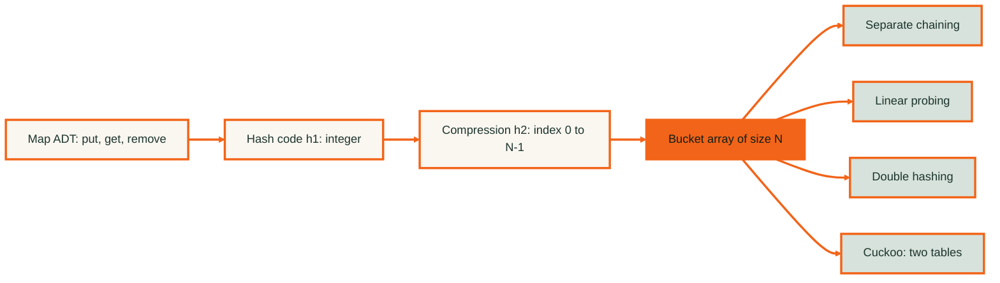

# 03 — Πίνακες Αντιστοίχισης, Κατακερματισμός και Κατακερματισμός Κούκου
*Maps, Hash Tables and Cuckoo Hashing*

Το κεφάλαιο πραγματεύεται την αποθήκευση και ανάκτηση εγγραφών `(κλειδί, τιμή)` με χρόνο που δεν αυξάνεται γραμμικά με το πλήθος των εγγραφών. Ο Πίνακας Αντιστοίχισης (`Map ADT`) ορίζει το πρόβλημα και μια πρώτη υλοποίηση με αταξινόμητη διπλά συνδεδεμένη λίστα. Ο πίνακας κατακερματισμού (`hash table`) το επιλύει σε δύο στάδια, με έναν κώδικα κατακερματισμού $h_1$ και μια συνάρτηση συμπίεσης $h_2$, και τρεις στρατηγικές επίλυσης συγκρούσεων: ξεχωριστή αλυσίδωση, ανοιχτή διευθυνσιοδότηση και κατακερματισμό κούκου. Η ανάλυση στηρίζεται στις ασυμπτωτικές έννοιες, στις πιθανοτικές εκτιμήσεις και στην επιμερισμένη ανάλυση της [01_analysis_of_algorithms.md](01_analysis_of_algorithms.md). Στην ύλη της Προόδου, ο πίνακας κατακερματισμού απαντάται ως δομή υποστήριξης για την καταμέτρηση των συχνοτήτων της κωδικοποίησης `Huffman` ([06_greedy_method.md](06_greedy_method.md)), ενώ το ενσωματωμένο `dict` της Python είναι η καθημερινή υλοποίηση του `Map ADT`. Εφαρμογή στην Τελική: οι πίνακες κατακερματισμού χρησιμεύουν ως πίνακες επισήμανσης στα `DFS`/`BFS`, ως αποθήκες ετικετών στους `Dijkstra`/`Prim` και ως πίνακες απομνημόνευσης στον `Dynamic Programming`.

> **Εξεταστική κάλυψη:** Πρόοδος
> **Κεφάλαιο βιβλίου:** Κεφ. 6 | **Διαλέξεις:** `04_maps.pdf`, `05_hash_tables.pdf`, `06_cuckoo_hashing.pdf`
> **Πηγή:** `Resources/Meta/mindmap.md` (Ενότητα 03)
> **Εκτός ύλης:** Ανάλυση γραμμικής αναζήτησης με φράγμα Chernoff (σελ. 202–203), ανάλυση κατακερματισμού κούκου (σελ. 208–211, Λήμμα 6.1), Ενότητα `6.5`

## Πίνακας Περιεχομένων

- [1. Εννοιολογικό Πλαίσιο και Συνολική Εικόνα](#1-εννοιολογικό-πλαίσιο-και-συνολική-εικόνα)
- [2. Θεωρητική Θεμελίωση και Τυπικοί Ορισμοί](#2-θεωρητική-θεμελίωση-και-τυπικοί-ορισμοί)
- [3. Αλγόριθμοι, Ιχνηλάτηση και Κώδικας](#3-αλγόριθμοι-ιχνηλάτηση-και-κώδικας)
- [4. Συγκριτική Ανάλυση και Πολυπλοκότητα](#4-συγκριτική-ανάλυση-και-πολυπλοκότητα)
- [5. Πλήρως Λυμένες Ασκήσεις Εξεταστικού Επιπέδου](#5-πλήρως-λυμένες-ασκήσεις-εξεταστικού-επιπέδου)
- [6. Οδηγός Επιβίωσης στις Εξετάσεις και Παγίδες](#6-οδηγός-επιβίωσης-στις-εξετάσεις-και-παγίδες)
- [7. Συνοπτικός Πίνακας Εννοιών](#7-συνοπτικός-πίνακας-εννοιών)

---

## 1. Εννοιολογικό Πλαίσιο και Συνολική Εικόνα

### Το Πρόβλημα

Ένας δρομολογητής δικτύου διατηρεί πίνακα προώθησης με εκατοντάδες χιλιάδες εγγραφές της μορφής `(διεύθυνση προορισμού, θύρα εξόδου)`. Κάθε εισερχόμενο πακέτο απαιτεί μία αναζήτηση στον πίνακα. Με αταξινόμητη λίστα, η αναζήτηση κοστίζει έναν αριθμό συγκρίσεων γραμμικό ως προς το πλήθος των εγγραφών, άρα ο χρόνος ανά πακέτο μεγαλώνει με το μέγεθος του πίνακα. Με πίνακα κατακερματισμού, η ίδια αναζήτηση κοστίζει κατά προσέγγιση σταθερό αριθμό ανιχνεύσεων, ανεξάρτητα από το πλήθος των εγγραφών. Το ίδιο πρόβλημα εμφανίζεται στον πίνακα διευθύνσεων, στις βάσεις εγγραφών, στους μεταγλωττιστές (πίνακας συμβόλων) και στη λανθάνουσα μνήμη των φυλλομετρητών.

### Χάρτης Εννοιών του Κεφαλαίου



Πορτοκαλί γέμισμα: το κοινό σημείο όλων των υλοποιήσεων (ο πίνακας κάδων). Απαλό πράσινο: οι εναλλακτικές στρατηγικές επίλυσης συγκρούσεων. Κρεμ: το στάδιο προεπεξεργασίας του κλειδιού.

Η ροή είναι πάντα η ίδια: το κλειδί περνά πρώτα από τον κώδικα κατακερματισμού $h_1$, που το μετατρέπει σε ακέραιο, και έπειτα από τη συνάρτηση συμπίεσης $h_2$, που τον περιορίζει στο διάστημα $[0, N-1]$. Το αποτέλεσμα είναι ο δείκτης του κάδου. Δύο διαφορετικά κλειδιά μπορούν να δώσουν τον ίδιο δείκτη· η στρατηγική επίλυσης συγκρούσεων καθορίζει τι συμβαίνει τότε και ελέγχει την πολυπλοκότητα.

### Πότε Χρησιμοποιείται Κάθε Υλοποίηση

Η αταξινόμητη λίστα αρκεί για μικρούς πίνακες ή σπάνιες αναζητήσεις. Η ξεχωριστή αλυσίδωση προτιμάται όταν το πλήθος των εγγραφών είναι άγνωστο και ο συντελεστής φόρτωσης μπορεί να ξεπεράσει τη μονάδα. Η γραμμική ανίχνευση προτιμάται όταν απαιτείται συμπαγής μνήμη χωρίς δευτερεύουσες δομές και ο συντελεστής φόρτωσης κρατείται κάτω από $1/2$. Ο διπλός κατακερματισμός προτιμάται όταν η συσσώρευση της γραμμικής ανίχνευσης είναι μετρήσιμα επιζήμια. Ο κατακερματισμός κούκου προτιμάται όταν η αναζήτηση απαιτεί εγγύηση $O(1)$ στη χειρότερη περίπτωση και το διπλάσιο κόστος μνήμης είναι αποδεκτό.

---

## 2. Θεωρητική Θεμελίωση και Τυπικοί Ορισμοί

### 2.1 ΑΤΔ Πίνακας Αντιστοίχισης (`Map ADT`)

**Ορισμός.** Ένας πίνακας αντιστοίχισης είναι συλλογή εγγραφών `(κλειδί, τιμή)` στην οποία κάθε κλειδί εμφανίζεται το πολύ μία φορά. Η ανάκτηση γίνεται αποκλειστικά μέσω του κλειδιού· η σειρά αποθήκευσης δεν έχει σημασία.

| Μέθοδος | Σημασιολογία | Επιστροφή |
|---|---|---|
| `get(k)` | Αναζήτηση της εγγραφής με κλειδί $k$ | Την τιμή της εγγραφής ή `null` αν το $k$ απουσιάζει |
| `put(k, v)` | Εισαγωγή νέας εγγραφής ή αντικατάσταση της τιμής υπάρχοντος κλειδιού | Την παλιά τιμή ή `null` |
| `remove(k)` | Διαγραφή της εγγραφής με κλειδί $k$ | Την τιμή που αφαιρέθηκε ή `null` |
| `size()` | Πλήθος εγγραφών | Ακέραιος |
| `isEmpty()` | Έλεγχος κενού πίνακα | Λογική τιμή |

**Υλοποίηση με αταξινόμητη διπλά συνδεδεμένη λίστα.** Κάθε κόμβος αποθηκεύει μία εγγραφή `(k, v)` με δείκτες προς τον προηγούμενο και τον επόμενο κόμβο. Η εισαγωγή νέας εγγραφής γίνεται στην κεφαλή σε χρόνο $O(1)$. Η αναζήτηση και η διαγραφή απαιτούν σειριακή σάρωση, άρα χρόνο $O(n)$ στη χειρότερη περίπτωση· η ίδια η αποσύνδεση κόμβου είναι $O(1)$, αλλά η εύρεσή του είναι το κυρίαρχο κόστος.

| Λειτουργία | Χρόνος | Αιτιολόγηση |
|---|---|---|
| `put(k, v)` | $O(1)$ χειρότερη | Εισαγωγή στην κεφαλή χωρίς αναζήτηση |
| `get(k)` | $O(n)$ χειρότερη | Σειριακή σάρωση έως την εύρεση ή το τέλος |
| `remove(k)` | $O(n)$ χειρότερη | Σάρωση $O(n)$ και αποσύνδεση $O(1)$ |
| `size()`, `isEmpty()` | $O(1)$ χειρότερη | Μετρητής |

> Σύμβαση του συγγράμματος: το `put` καταγράφεται ως $O(1)$ επειδή εισάγει χωρίς έλεγχο ύπαρξης του κλειδιού. Αν απαιτείται ενημέρωση υπάρχοντος κλειδιού, προηγείται αναζήτηση $O(n)$ και η συνολική πολυπλοκότητα γίνεται $O(n)$.

Μικρή ιχνηλάτηση σε λίστα με εγγραφές `(A, 1), (B, 2), (C, 3)`:

| Λειτουργία | Συγκρίσεις | Αποτέλεσμα |
|---|---|---|
| `get("C")` | 3 (`A`, `B`, `C`) | Επιστρέφει `3` |
| `remove("B")` | 2 (`A`, `B`), μετά αποσύνδεση $O(1)$ | Επιστρέφει `2` |
| `put("D", 4)` | 0 | Νέα κεφαλή η `(D, 4)` |

### 2.2 Δομή Πίνακα Κατακερματισμού

**Ορισμός.** Πίνακας κατακερματισμού είναι πίνακας $T$ με $N$ κελιά (κάδους) και συνάρτηση κατακερματισμού $h$ που απεικονίζει κλειδιά σε δείκτες. Η $h$ ορίζεται ως σύνθεση δύο σταδίων:

$$h(x) = h_2(h_1(x)) \in [0, N-1]$$

όπου $h_1$ είναι ο **κώδικας κατακερματισμού** (`hash code`), που απεικονίζει το κλειδί σε ακέραιο, και $h_2$ είναι η **συνάρτηση συμπίεσης** (`compression function`), που περιορίζει τον ακέραιο στο εύρος του πίνακα.

| Στάδιο | Συνάρτηση | Πεδίο τιμών | Ρόλος |
|---|---|---|---|
| 1 | $h_1$ | Ακέραιοι (όσο το δυνατόν πιο διάσπαρτοι) | Κωδικοποίηση του κλειδιού |
| 2 | $h_2$ | $[0, N-1]$ | Προσαρμογή στο μέγεθος του πίνακα |

Ιδιότητες καλού κώδικα κατακερματισμού: ίσα κλειδιά παράγουν πάντα ίσους κώδικες, και διαφορετικά κλειδιά παράγουν κατά κανόνα διαφορετικούς κώδικες. Η δεύτερη ιδιότητα δεν μπορεί να εγγυηθεί· οι συγκρούσεις (`collisions`) είναι αναπόφευκτες όταν το σύνολο των δυνατών κλειδιών υπερβαίνει το $N$.

### 2.3 Κώδικες Κατακερματισμού ($h_1$)

| Μέθοδος | Πώς παράγεται ο κώδικας | Αδυναμία ή ισχύς |
|---|---|---|
| Διεύθυνση μνήμης | Η διεύθυνση του αντικειμένου στη μνήμη | Δύο ίσα αντικείμενα σε διαφορετικές διευθύνσεις παράγουν διαφορετικούς κώδικες· μη αναπαραγώγιμο αποτέλεσμα |
| Ακέραια μετατροπή (`integer cast`) | Τα δυαδικά ψηφία του κλειδιού ερμηνεύονται ως ακέραιος | Επαρκής μόνο για κλειδιά που χωρούν σε μία λέξη μηχανής |
| Άθροισμα συνιστωσών (`component sum`) | Άθροισμα των αριθμητικών τιμών των συνιστωσών | Οι αναγραμματισμοί συγκρούονται: `"ab"` και `"ba"` δίνουν $97 + 98 = 195$ |
| Πολυωνυμική συσσώρευση (`polynomial accumulation`) | $p(z) = \sum_{i=0}^{n-1} a_i\, z^{\,n-1-i}$ με ψηφία $a_i$ τους κωδικούς χαρακτήρων | Καλή διάχυση για συμβολοσειρές· υπολογισμός σε $O(n)$ με κανόνα Horner |
| Κατακερματισμός βάσει πίνακα (`tabulation hashing`) | $h(x) = T_1[x_1] \oplus T_2[x_2] \oplus \cdots \oplus T_d[x_d]$ με τυχαίους πίνακες | Πιθανότητα σύγκρουσης $1/N$ για δύο σταθερά κλειδιά (Θεώρημα 2.1) |

**Πολυωνυμική συσσώρευση.** Η συμβολοσειρά ερμηνεύεται ως αριθμός σε βάση $z$: κάθε χαρακτήρας είναι ένα ψηφίο ίσο με τον κωδικό του. Για $z = 33$, η πράξη $p \leftarrow z \cdot p + a_i$ είναι μία ολίσθηση και μία πρόσθεση ($33 = 32 + 1$), γι' αυτό η τιμή αυτή χρησιμοποιείται για λέξεις. Η αξιολόγηση γίνεται με τον κανόνα Horner από αριστερά προς δεξιά σε χρόνο $O(n)$ και όχι $O(n^2)$· η υπερχείλιση αγνοείται, δηλαδή η αριθμητική είναι σταθερού πλάτους (ισοδύναμα, υπολογισμός modulo $2^w$).

**Κατακερματισμός βάσει πίνακα.** Το κλειδί χωρίζεται σε $d$ συνιστώσες (π.χ. χαρακτήρες). Για κάθε θέση $i$ υπάρχει πίνακας $T_i$ με μία τυχαία τιμή για κάθε δυνατή συνιστώσα. Ο κώδικας είναι το κατά bit αποκλειστικό ή (`XOR`) των τιμών. Η ιδιότητα που τον κάνει χρήσιμο είναι το Θεώρημα 2.1: δύο σταθερά και διαφορετικά κλειδιά συγκρούονται με πιθανότητα ακριβώς $1/N$, ανεξάρτητα από την κατανομή των κλειδιών.

### 2.4 Συναρτήσεις Συμπίεσης ($h_2$)

**Μέθοδος διαίρεσης.** $h_2(y) = y \bmod N$ με $N$ πρώτο. Ο πρώτος $N$ εμποδίζει τα μοτίβα των κλειδιών να διατηρηθούν μετά τη συμπίεση· αν $N$ είναι σύνθετος και τα κλειδιά είναι όλα πολλαπλάσια κοινού διαιρέτη του $N$, χρησιμοποιείται μόνο μικρό μέρος του πίνακα (Πρόταση 2.4).

Παράδειγμα μοτίβου: για κλειδιά $0, 6, 12, 18, 24$ και $N = 12$ οι δείκτες είναι $0, 6, 0, 6, 0$ (χρησιμοποιούνται $2$ κελιά), ενώ για $N = 13$ είναι $0, 6, 12, 5, 11$ (χρησιμοποιούνται $5$ κελιά).

**Τυχαία γραμμική μέθοδος / MAD.** $h_2(y) = (a\,y + b) \bmod N$ με $a \bmod N \ne 0$. Η συνθήκη $a \bmod N \ne 0$ είναι αναγκαία: αν $a \equiv 0 \pmod N$, τότε όλα τα κλειδιά απεικονίζονται στην ίδια τιμή $b \bmod N$. Με τυχαία επιλογή των $a, b$ η μέθοδος διασκορπίζει ακόμη και κλειδιά με έντονο μοτίβο.

Παράδειγμα με κώδικα $y = 111128$, $N = 13$, $a = 5$, $b = 7$:

$$h_2(111128) = (5 \cdot 111128 + 7) \bmod 13 = 555647 \bmod 13 = 1$$

ενώ η μέθοδος διαίρεσης δίνει $111128 \bmod 13 = 4$.

| Μέθοδος | Τύπος | Προϋπόθεση | Κόστος |
|---|---|---|---|
| Διαίρεση | $y \bmod N$ | $N$ πρώτος | $O(1)$ |
| MAD | $(a y + b) \bmod N$ | $N$ πρώτος, $a \bmod N \ne 0$ | $O(1)$ |

### 2.5 Διαχείριση Συγκρούσεων

**Συντελεστής φόρτωσης.** Ορίζεται ως $\alpha = n/N$, όπου $n$ το πλήθος των αποθηκευμένων εγγραφών και $N$ το πλήθος των κάδων. Είναι το κρίσιμο μέγεθος για κάθε στρατηγική: όσο μεγαλώνει, τόσο αυξάνονται οι συγκρούσεις.

**Ξεχωριστή αλυσίδωση (`separate chaining`).** Κάθε κάδος δείχνει σε συνδεδεμένη λίστα με τις εγγραφές που αντιστοιχούν σε αυτόν. Η `put` εισάγει στη λίστα του κάδου σε $O(1)$, η `get` και η `remove` σαρώνουν τη λίστα. Το αναμενόμενο μήκος κάθε λίστας είναι $\alpha$, άρα κάθε λειτουργία κοστίζει αναμενόμενα $O(1+\alpha) = O(1)$ όταν το $N$ είναι ανάλογο του $n$. Στη χειρότερη περίπτωση όλα τα κλειδιά καταλήγουν στην ίδια λίστα και το κόστος γίνεται $O(n)$. Η αλυσίδωση ανέχεται $\alpha > 1$, σε αντίθεση με την ανοιχτή διευθυνσιοδότηση, με κόστος επιπλέον μνήμη $O(N+n)$ για τους κόμβους.

**Γραμμική ανίχνευση (`linear probing`).** Ανοιχτή διευθυνσιοδότηση: όλες οι εγγραφές αποθηκεύονται στον ίδιο πίνακα. Αν η θέση $h(k)$ είναι κατειλημμένη, δοκιμάζονται διαδοχικές θέσεις:

$$(h(k) + j) \bmod N,\quad j = 0, 1, 2, \dots$$

Οι κατειλημμένες θέσεις σχηματίζουν συνεχόμενες ομάδες (`primary clustering`): κάθε νέο κλειδί που πέφτει σε ομάδα διασχίζει ολόκληρη την ομάδα, άρα οι ομάδες μεγαλώνουν και επιβραδύνουν τις επόμενες εισαγωγές. Το αναμενόμενο πλήθος ανιχνεύσεων είναι κατά προσέγγιση $1/(1-\alpha)$, οπότε για $\alpha \le 1/2$ προκύπτει αναμενόμενο $O(1)$ και στη χειρότερη περίπτωση $O(n)$ (όλα τα κλειδιά με τον ίδιο δείκτη). Η διαγραφή δεν επιτρέπεται να αδειάσει το κελί, γιατί θα έκοβε την αλυσίδα ανίχνευσης των επόμενων κλειδιών· χρησιμοποιείται ειδικό αντικείμενο `DEFUNCT` (ή η εναλλακτική `Shift(i)` του συγγράμματος).

**Διπλός κατακερματισμός (`double hashing`).** Η ανίχνευση χρησιμοποιεί βήμα που εξαρτάται από το κλειδί:

$$(h(k) + j \cdot d(k)) \bmod N,\quad d(k) = q - (k \bmod q)$$

με $q$ πρώτο μικρότερο του $N$ και $N$ πρώτο. Το βήμα $d(k)$ ανήκει στο $[1, q]$, άρα είναι πάντα μη μηδενικό· αν ήταν μηδέν, η ανίχνευση θα κολλούσε για πάντα στο $h(k)$. Επειδή $N$ είναι πρώτος, η ακολουθία περνά από όλα τα κελιά (Πρόταση 2.3), και διαφορετικά κλειδιά ακολουθούν διαφορετικά βήματα, οπότε η πρωτογενής συσσώρευση της γραμμικής ανίχνευσης δεν εμφανίζεται. Η διαγραφή χρησιμοποιεί επίσης `DEFUNCT`.

**Κατακερματισμός κούκου (`cuckoo hashing`).** Δύο πίνακες $T_1, T_2$ μεγέθους $N \ge 2n$ ο καθένας και δύο ανεξάρτητες συναρτήσεις $h_1, h_2$. Η αναλλοίωτη τοποθέτησης ορίζει ότι κάθε κλειδί $k$ βρίσκεται αποκλειστικά σε μία από δύο θέσεις:

$$k \in \{T_1[h_1(k)],\; T_2[h_2(k)]\}$$

Η `get` και η `remove` εξετάζουν ακριβώς αυτά τα δύο κελιά, άρα κοστίζουν $O(1)$ στη χειρότερη περίπτωση (Θεώρημα 2.2). Η `put` τοποθετεί το νέο κλειδί στην πρώτη θέση του· αν αυτή είναι κατειλημμένη, εκδιώκει τον κάτοχο και τον μεταφέρει στην εναλλακτική του θέση, επαναλαμβάνοντας εναλλάξ μεταξύ των δύο πινάκων. Αν η αλυσίδα εκδιώξεων δεν βρει κενό κελί εντός ορίου επαναλήψεων ($n$ ή $\log n$ κατά το σύγγραμμα· εδώ χρησιμοποιείται όριο $n+1$ τοποθετήσεων), έχει σχηματιστεί κύκλος: αν και οι $n+1$ τοποθετήσεις εκδιώξουν κλειδί, οι εκδιώξεις ξεπερνούν το $n$ και καμία νόμιμη τοποθέτηση δεν υπάρχει με τις τρέχουσες συναρτήσεις, οπότε εκτελείται επανακατακερματισμός (`rehashing`) με νέες συναρτήσεις και μεγαλύτερο $N$. Η `put` είναι επιμερισμένα $O(1)$· μία μεμονωμένη κλήση μπορεί να προκαλέσει `rehash` κόστους $O(n)$.

> Εκτός ύλης: Ανάλυση γραμμικής αναζήτησης με φράγμα Chernoff (σελ. 202–203).
> Εκτός ύλης: Ανάλυση κατακερματισμού κούκου (σελ. 208–211, Λήμμα 6.1).
> Εκτός ύλης: Ενότητα `6.5`.

### 2.6 Θεωρήματα και Αποδείξεις

**Θεώρημα 2.1 (πιθανότητα σύγκρουσης κατακερματισμού βάσει πίνακα).** Έστω δύο διαφορετικά κλειδιά $x \ne y$ με $d$ συνιστώσες και πίνακες $T_1, \dots, T_d$ γεμισμένους με ομοιόμορφα τυχαίες τιμές στο $[0, N-1]$. Τότε $\Pr[h(x) = h(y)] = 1/N$.

*Απόδειξη.* Επειδή $x \ne y$, υπάρχει θέση $j$ με $x_j \ne y_j$. Δεσμεύουμε όλες τις τιμές των πινάκων εκτός από την $T_j[x_j]$. Η εξίσωση $h(x) = h(y)$ γράφεται

$$T_j[x_j] = T_j[y_j] \oplus \bigoplus_{i \ne j} \bigl(T_i[x_i] \oplus T_i[y_i]\bigr)$$

δηλαδή απαιτεί η $T_j[x_j]$ να πάρει μία συγκεκριμένη τιμή, που καθορίζεται από τις δεσμευμένες καταχωρήσεις. Επειδή η $T_j[x_j]$ είναι ομοιόμορφη στο $[0, N-1]$ και ανεξάρτητη από αυτές, η πιθανότητα είναι $1/N$. $\square$

**Θεώρημα 2.2 (κούκος: $O(1)$ χειρότερης περίπτωσης για `get` και `remove`).** Με την αναλλοίωτη τοποθέτησης, κάθε `get(k)` και κάθε `remove(k)` εξετάζει ακριβώς δύο κελιά, άρα εκτελείται σε $\Theta(1)$ χρόνο στη χειρότερη περίπτωση.

*Απόδειξη.* Από την αναλλοίωτη, αν το $k$ υπάρχει, βρίσκεται στο $T_1[h_1(k)]$ ή στο $T_2[h_2(k)]$ και πουθενά αλλού. Ο αλγόριθμος υπολογίζει τους δύο δείκτες (σταθερός αριθμός αριθμητικών πράξεων στο μοντέλο `RAM`) και ελέγχει τα δύο κελιά (δύο προσπελάσεις πίνακα). Το πλήθος των εργασιών είναι φραγμένο από σταθερά, ανεξάρτητο του $n$. $\square$

**Πρόταση 2.3 (η ακολουθία διπλού κατακερματισμού καλύπτει όλα τα κελιά).** Αν $N$ είναι πρώτος και $0 < d(k) < N$, τότε οι τιμές $(h(k) + j\,d(k)) \bmod N$ για $j = 0, \dots, N-1$ είναι μετάθεση των $0, \dots, N-1$.

*Απόδειξη.* Έστω $(h + j_1 d) \equiv (h + j_2 d) \pmod N$ με $0 \le j_1, j_2 \le N-1$. Τότε $(j_1 - j_2)\, d \equiv 0 \pmod N$. Επειδή $N$ είναι πρώτος και $d \not\equiv 0 \pmod N$, έπεται $j_1 \equiv j_2 \pmod N$, άρα $j_1 = j_2$. Οι $N$ τιμές είναι επομένως ανά δύο διαφορετικές και, όντας $N$ το πλήθος εντός διαστήματος $N$ θέσεων, καλύπτουν όλο το $[0, N-1]$. $\square$

**Πρόταση 2.4 (γιατί πρώτος $N$ στη μέθοδο διαίρεσης).** Αν $d \mid N$ και όλα τα κλειδιά είναι πολλαπλάσια του $d$, τότε η $h(k) = k \bmod N$ λαμβάνει μόνο τιμές πολλαπλάσια του $d$, δηλαδή χρησιμοποιούνται το πολύ $N/d$ κελιά.

*Απόδειξη.* Γράφουμε $k = d m$ και $N = d M$. Τότε $k \bmod N = d\,(m \bmod M)$, που είναι πολλαπλάσιο του $d$ και ανήκει στο $\{0, d, 2d, \dots, N-d\}$, σύνολο με $N/d$ στοιχεία. $\square$

**Δεδομένο (αναμενόμενες ανιχνεύσεις γραμμικής ανίχνευσης).** Το αναμενόμενο πλήθος ανιχνεύσεων για αποτυχημένη αναζήτηση είναι κατά προσέγγιση $1/(1-\alpha)$. Το μέγεθος αυτό διπλασιάζεται όταν ο συντελεστής φόρτωσης περάσει από το $1/2$ στο $3/4$ και απειρίζεται καθώς $\alpha \to 1$. Η παραγωγή του φράγματος με ανισότητα Chernoff είναι εκτός ύλης· η τιμή χρησιμοποιείται ως δεδομένο του συγγράμματος.

---

## 3. Αλγόριθμοι, Ιχνηλάτηση και Κώδικας

### 3.1 Πίνακας Αντιστοίχισης με Αταξινόμητη Λίστα

Σκοπός: υλοποίηση του `Map ADT` χωρίς κατακερματισμό, με εγγραφές σε αταξινόμητη διπλά συνδεδεμένη λίστα.

```text
Algorithm get(k):
Input: Κλειδί k
Output: Η τιμή που αντιστοιχεί στο k ή null

for each entry e in the list do
    if e.key = k then
        return e.value
return null
```

```text
Algorithm put(k, v):
Input: Κλειδί k και τιμή v
Output: Νέα εγγραφή (k, v) στην κεφαλή της λίστας

addFirst(new entry (k, v))
n ← n + 1
```

```text
Algorithm remove(k):
Input: Κλειδί k
Output: Η τιμή που αφαιρέθηκε ή null

for each entry e in the list do
    if e.key = k then
        value ← e.value
        remove e
        n ← n - 1
        return value
return null
```

Ιχνηλάτηση `get("C")` στη λίστα `[(A,1), (B,2), (C,3)]`:

| Βήμα | Τρέχουσα εγγραφή | Σύγκριση | Απόφαση |
|---|---|---|---|
| 1 | `(A, 1)` | `A = C`; όχι | Συνέχεια |
| 2 | `(B, 2)` | `B = C`; όχι | Συνέχεια |
| 3 | `(C, 3)` | `C = C`; ναι | Επιστροφή `3` |

**Ρητή υλοποίηση:**

```python
class UnsortedListMap:
    """Map ADT backed by an unordered list of (key, value) pairs.

    Attributes:
        _items (list[tuple[object, object]]): The stored entries in no order.
    """

    def __init__(self) -> None:
        """Creates an empty map."""
        self._items: list[tuple[object, object]] = []

    def put(self, key: object, value: object) -> None:
        """Appends a new entry in O(1) time, per the textbook convention.

        Args:
            key (object): The entry key; the caller guarantees it is new.
            value (object): The value to store.
        """
        self._items.append((key, value))

    def get(self, key: object) -> object | None:
        """Scans the list for the key, in O(n) worst-case time.

        Args:
            key (object): The key to search for.

        Returns:
            object | None: The stored value, or None if the key is absent.
        """
        for stored_key, stored_value in self._items:
            if stored_key == key:
                return stored_value
        return None

    def remove(self, key: object) -> object | None:
        """Scans for and deletes the entry, in O(n) worst-case time.

        Args:
            key (object): The key to delete.

        Returns:
            object | None: The removed value, or None if the key is absent.
        """
        for index, (stored_key, stored_value) in enumerate(self._items):
            if stored_key == key:
                del self._items[index]  # Deletion shifts elements, still O(n).
                return stored_value
        return None

    def size(self) -> int:
        """Returns the number of stored entries.

        Returns:
            int: The current size.
        """
        return len(self._items)


unsorted_map = UnsortedListMap()
unsorted_map.put("A", 1)
unsorted_map.put("B", 2)
unsorted_map.put("C", 3)
assert unsorted_map.get("C") == 3   # Three comparisons, as in the trace.
assert unsorted_map.remove("B") == 2
assert unsorted_map.get("B") is None
assert unsorted_map.size() == 2
```

**Ιδιωματισμός.** Ο πραγματικός ιδιωματισμός για πίνακα αντιστοίχισης είναι το `dict` της Python, το οποίο όμως είναι πίνακας κατακερματισμού, όχι λίστα· η σύγκρισή του με ρητή υλοποίηση γίνεται στην Ενότητα 3.3, μαζί με την προειδοποίηση για τις εσωτερικές του συμβάσεις. Η προσάρτηση στο τέλος (`append`) είναι ισοδύναμη με εισαγωγή στην κεφαλή της αταξινόμητης λίστας: η σειρά δεν έχει σημασία και το κόστος παραμένει $O(1)$.

| Μορφή | `put` | `get` | `remove` | Χώρος |
|---|---|---|---|---|
| `UnsortedListMap` | $O(1)$ χειρότερη | $O(n)$ χειρότερη | $O(n)$ χειρότερη | $O(n)$ |
| `dict` | $O(1)$ αναμενόμενη | $O(1)$ αναμενόμενη | $O(1)$ αναμενόμενη | $O(n)$ |

Η εξέταση ζητά τον ρητό κώδικα και την ιχνηλάτηση· ο ιδιωματισμός χρησιμεύει μόνο ως επαλήθευση.

**Ανάλυση γραμμή προς γραμμή.** Η `get` εκτελεί το πολύ $n$ επαναλήψεις, καθεμία με μία σύγκριση και σταθερό αριθμό πρωτογενών πράξεων, άρα $T(n) \le c\,n = O(n)$· στην καλύτερη περίπτωση το ζητούμενο κλειδί είναι στην κεφαλή και το κόστος είναι $O(1)$. Η `put` εκτελεί μία προσάρτηση, δηλαδή σταθερό πλήθος πράξεων. Η `remove` προσθέτει στη σάρωση μία διαγραφή στοιχείου, γραμμική στην πράξη αλλά με ίδια ασυμπτωτική κλάση.

### 3.2 Κανόνας Horner για τον Κώδικα Κατακερματισμού

Σκοπός: υπολογισμός του πολυωνυμικού κώδικα μιας συμβολοσειράς σε γραμμικό χρόνο.

```text
Algorithm polynomialHashCode(word, z):
Input: Συμβολοσειρά word και βάση z
Output: Ο κώδικας p(z)

p ← 0
for each character c in word do
    p ← z * p + code(c)
return p
```

Ιχνηλάτηση για τη λέξη `"cat"` με $z = 33$ (`ord('c') = 99`, `ord('a') = 97`, `ord('t') = 116`):

| Βήμα | Χαρακτήρας | `ord` | Υπολογισμός | $p$ |
|---|---|---|---|---|
| 0 | — | — | Αρχικοποίηση | $0$ |
| 1 | `c` | $99$ | $33 \cdot 0 + 99$ | $99$ |
| 2 | `a` | $97$ | $33 \cdot 99 + 97$ | $3364$ |
| 3 | `t` | $116$ | $33 \cdot 3364 + 116$ | $111128$ |

Συμπίεση με $N = 13$: $111128 \bmod 13 = 4$, άρα ο δείκτης είναι $4$. Με MAD $(a,b) = (5,7)$: $(5 \cdot 111128 + 7) \bmod 13 = 1$.

**Ρητή υλοποίηση:**

```python
def polynomialHashCode(word: str, base: int = 33) -> int:
    """Computes the polynomial accumulation hash code of a string.

    Args:
        word (str): The string whose hash code is computed.
        base (int): The base z of the polynomial, 33 by default.

    Returns:
        int: The hash code p(z), accumulated left to right with Horner's rule.
    """
    code = 0
    for ch in word:
        # Horner's rule turns the polynomial into n shift-and-add steps.
        code = base * code + ord(ch)
    return code


assert polynomialHashCode("cat") == 111128
```

**Ιδιωματισμός:**

```python
import functools

code_cat = functools.reduce(lambda acc, ch: acc * 33 + ord(ch), "cat", 0)
assert code_cat == 111128
```

| Μορφή | Χρόνος | Τι κρύβει |
|---|---|---|
| `polynomialHashCode(word)` | $\Theta(n)$ χειρότερη | Τίποτα· είναι ο αλγόριθμος που ζητά η εξέταση |
| `functools.reduce(...)` | $\Theta(n)$ χειρότερη | Την ίδια αναγωγή χωρίς βρόχο· ίδιο κόστος, μικρότερη έκφραση |
| `hash(word)` (ενσωματωμένο) | $\Theta(n)$ χειρότερη | Τυχαιοποιημένο ανά διεργασία· ακατάλληλο για σταθερή ιχνηλάτηση |

**Ανάλυση γραμμή προς γραμμή.** Ο βρόχος εκτελείται $n$ φορές· κάθε επανάληψη περιλαμβάνει έναν πολλαπλασιασμό, μία πρόσθεση, μία ανάγνωση χαρακτήρα και μία `ord`, δηλαδή σταθερό πλήθος πρωτογενών πράξεων στο μοντέλο `RAM`. Άρα $T(n) = c\,n = \Theta(n)$ και στις δύο περιπτώσεις. Η αφελής αξιολόγηση κάθε όρου $a_i z^{n-1-i}$ χωριστά θα απαιτούσε $\sum_i (n-1-i) = \Theta(n^2)$ πολλαπλασιασμούς· ο κανόνας Horner τους μειώνει σε $n$.

### 3.3 Πίνακας Κατακερματισμού με Γραμμική Ανίχνευση

Σκοπός: αποθήκευση εγγραφών σε έναν πίνακα $N$ κελιών με διαδοχική ανίχνευση σε συγκρούσεις και διαγραφή με δείκτη `DEFUNCT`.

```text
Algorithm put(k, v):
Input: Κλειδί k, τιμή v
Output: Εισαγωγή ή ενημέρωση της εγγραφής

start ← h(k)
firstDefunct ← null
for j ← 0 to N - 1 do
    c ← (start + j) mod N
    if T[c] is empty then
        target ← firstDefunct if firstDefunct ≠ null else c
        T[target] ← (k, v)
        return
    else if T[c] is DEFUNCT then
        if firstDefunct = null then
            firstDefunct ← c
    else if T[c].key = k then
        T[c].value ← v
        return
```

```text
Algorithm get(k):
Input: Κλειδί k
Output: Η τιμή του k ή null

start ← h(k)
for j ← 0 to N - 1 do
    c ← (start + j) mod N
    if T[c] is empty then
        return null
    else if T[c] is not DEFUNCT and T[c].key = k then
        return T[c].value
return null
```

```text
Algorithm remove(k):
Input: Κλειδί k
Output: Η τιμή που αφαιρέθηκε ή null

start ← h(k)
for j ← 0 to N - 1 do
    c ← (start + j) mod N
    if T[c] is empty then
        return null
    else if T[c] is not DEFUNCT and T[c].key = k then
        value ← T[c].value
        T[c] ← DEFUNCT
        return value
return null
```

**Ιχνηλάτηση εισαγωγών.** Πίνακας $N = 13$, $h(k) = k \bmod 13$, κλειδιά $2, 15, 28, 41, 54, 67$ (όλα με $h(k) = 2$). Κανόνας ισοβαθμίας: καμία σύγκρουση δεν λύνεται με τυχαιότητα· η σειρά των γραμμών του πίνακα είναι η σειρά εισαγωγής.

| # | Κλειδί $k$ | $h(k)$ | Ακολουθία ανιχνεύσεων | Τελική θέση | Ανιχνεύσεις |
|---|---|---|---|---|---|
| 1 | $2$ | $2$ | $2$ | $2$ | $1$ |
| 2 | $15$ | $2$ | $2, 3$ | $3$ | $2$ |
| 3 | $28$ | $2$ | $2, 3, 4$ | $4$ | $3$ |
| 4 | $41$ | $2$ | $2, 3, 4, 5$ | $5$ | $4$ |
| 5 | $54$ | $2$ | $2, 3, 4, 5, 6$ | $6$ | $5$ |
| 6 | $67$ | $2$ | $2, 3, 4, 5, 6, 7$ | $7$ | $6$ |

Σύνολο ανιχνεύσεων: $1 + 2 + 3 + 4 + 5 + 6 = 21$. Η συστάδα $2$–$7$ είναι η πρωτογενής συσσώρευση: κάθε νέο κλειδί με $h(k) = 2$ διασχίζει ολόκληρη τη συστάδα.

Κατάσταση πίνακα μετά τις έξι εισαγωγές:

| Θέση | 0 | 1 | 2 | 3 | 4 | 5 | 6 | 7 | 8 | 9 | 10 | 11 | 12 |
|---|---|---|---|---|---|---|---|---|---|---|---|---|---|
| Περιεχόμενο | — | — | $2$ | $15$ | $28$ | $41$ | $54$ | $67$ | — | — | — | — | — |

**Ιχνηλάτηση διαγραφής και επαναχρήσης.** `remove(15)`: η ανίχνευση φτάνει στη θέση $3$ σε δύο βήματα και θέτει `DEFUNCT`. Ακολουθεί `get(54)`, `get(15)` και `put(80)`:

| Λειτουργία | Ακολουθία ανιχνεύσεων | Αποτέλεσμα |
|---|---|---|
| `remove(15)` | $2, 3$ | Η θέση $3$ γίνεται `DEFUNCT` |
| `get(54)` | $2, 3, 4, 5, 6$ | Βρίσκεται στη θέση $6$· η θέση $3$ προσπερνιέται χωρίς τερματισμό |
| `get(15)` | $2, 3, 4, 5, 6, 7, 8$ | Επιστρέφει `null`· η θέση $8$ είναι κενή |
| `put(80)` | $2, 3, 4, 5, 6, 7, 8$ | Η σάρωση φτάνει στο κενό $8$, αλλά η εγγραφή τοποθετείται στην πρώτη `DEFUNCT`, τη θέση $3$ |

Κατάσταση πίνακα μετά τη διαγραφή και την επαναχρησιμοποίηση:

| Θέση | 0 | 1 | 2 | 3 | 4 | 5 | 6 | 7 | 8 | 9 | 10 | 11 | 12 |
|---|---|---|---|---|---|---|---|---|---|---|---|---|---|
| Περιεχόμενο | — | — | $2$ | $80$ | $28$ | $41$ | $54$ | $67$ | — | — | — | — | — |

**Ρητή υλοποίηση:**

```python
_DEFUNCT = object()  # Sentinel: get skips it, put may reuse it.


class LinearProbingMap:
    """Map ADT with linear probing over an integer-keyed bucket array.

    Attributes:
        _capacity (int): The table size N, kept prime.
        _slots (list): Cells holding None, _DEFUNCT, or a (key, value) tuple.
        _size (int): The number of stored entries.
    """

    def __init__(self, capacity: int = 13) -> None:
        """Creates an empty table with the given prime capacity.

        Args:
            capacity (int): The table size N.
        """
        self._capacity = capacity
        self._slots: list = [None] * capacity
        self._size = 0

    def _compress(self, key: int) -> int:
        """Compresses an integer key with the division method.

        Args:
            key (int): The integer key.

        Returns:
            int: The index key mod N, in [0, N - 1].
        """
        return key % self._capacity

    def size(self) -> int:
        """Returns the number of stored entries.

        Returns:
            int: The current size.
        """
        return self._size

    def put(self, key: int, value: object) -> None:
        """Inserts (key, value) or updates the value of an existing key.

        Args:
            key (int): The integer key.
            value (object): The value to store.

        Raises:
            RuntimeError: If the table has no empty cell.
        """
        if (self._size + 1) * 2 > self._capacity:
            # Expected O(1) requires alpha <= 1/2, so grow before it is crossed.
            self._rehash()
        start = self._compress(key)
        first_defunct = -1
        for step in range(self._capacity):
            index = (start + step) % self._capacity
            cell = self._slots[index]
            if cell is None:
                target = first_defunct if first_defunct != -1 else index
                self._slots[target] = (key, value)
                self._size += 1
                return
            if cell is _DEFUNCT:
                if first_defunct == -1:
                    first_defunct = index  # Kept for reuse; the scan must continue.
                continue
            if cell[0] == key:
                self._slots[index] = (key, value)
                return
        raise RuntimeError("Hash table is full")

    def get(self, key: int) -> object | None:
        """Returns the value stored under key, or None if key is absent.

        Args:
            key (int): The key to search for.

        Returns:
            object | None: The stored value or None.

        Raises:
            RuntimeError: If the probe sequence never meets an empty cell.
        """
        start = self._compress(key)
        for step in range(self._capacity):
            index = (start + step) % self._capacity
            cell = self._slots[index]
            if cell is None:
                return None  # An empty cell terminates every probe chain.
            if cell is not _DEFUNCT and cell[0] == key:
                return cell[1]
        raise RuntimeError("Hash table is full")

    def remove(self, key: int) -> object | None:
        """Deletes the entry with the given key.

        Args:
            key (int): The key to delete.

        Returns:
            object | None: The removed value, or None if the key is absent.
        """
        start = self._compress(key)
        for step in range(self._capacity):
            index = (start + step) % self._capacity
            cell = self._slots[index]
            if cell is None:
                return None
            if cell is not _DEFUNCT and cell[0] == key:
                self._slots[index] = _DEFUNCT  # The chain must stay traversable.
                self._size -= 1
                return cell[1]
        return None

    def _rehash(self) -> None:
        """Grows the table to the next prime and reinserts every entry."""
        old_items = [cell for cell in self._slots if isinstance(cell, tuple)]
        self._capacity = self._nextPrime(2 * self._capacity + 1)
        self._slots = [None] * self._capacity
        self._size = 0
        for stored_key, stored_value in old_items:
            self.put(stored_key, stored_value)

    @staticmethod
    def _nextPrime(candidate: int) -> int:
        """Returns the first prime greater than or equal to candidate.

        Args:
            candidate (int): The starting value.

        Returns:
            int: The first prime at least candidate.
        """
        while True:
            if all(candidate % divisor != 0 for divisor in range(2, int(candidate ** 0.5) + 1)):
                return candidate
            candidate += 1


table = LinearProbingMap(13)
for key in (2, 15, 28, 41, 54, 67):
    table.put(key, f"v{key}")

# The layout matches the insertion trace table of the note.
assert [table._slots[i] for i in range(2, 8)] == [
    (2, "v2"), (15, "v15"), (28, "v28"), (41, "v41"), (54, "v54"), (67, "v67")
]
assert table.size() == 6

assert table.remove(15) == "v15"
assert table._slots[3] is _DEFUNCT  # Deletion leaves a DEFUNCT marker.
assert table.get(54) == "v54"       # get crosses the DEFUNCT cell at index 3.
assert table.get(15) is None
table.put(80, "v80")                # 80 probes [2, 3, 4, 5, 6, 7, 8], reuses 3.
assert table._slots[3] == (80, "v80")
assert table.get(2) == "v2"
```

**Ιδιωματισμός και σύγκριση με το `dict`:**

```python
builtin_map = {}
for key in (2, 15, 28, 41, 54, 67):
    builtin_map[key] = f"v{key}"
builtin_map[80] = "v80"
del builtin_map[15]
assert builtin_map[54] == "v54"
assert 15 not in builtin_map and builtin_map[2] == "v2"
```

| Μορφή | `put` | `get` | `remove` | Χώρος | Σημείωση |
|---|---|---|---|---|---|
| `LinearProbingMap` | $O(1)$ αναμενόμενη, $O(n)$ χειρότερη | $O(1)$ αναμενόμενη, $O(n)$ χειρότερη | $O(1)$ αναμενόμενη, $O(n)$ χειρότερη | $O(N)$ | Η ρητή μορφή που ζητά η εξέταση |
| `dict` | $O(1)$ αναμενόμενη | $O(1)$ αναμενόμενη | $O(1)$ αναμενόμενη | $O(n)$ | Κρύβει την ανίχνευση, το `DEFUNCT` και το `rehash` |

> **Προσοχή στις συμβάσεις.** Το `dict` της CPython είναι πίνακας κατακερματισμού με ανοιχτή διευθυνσιοδότηση και τεχνική διαταραχής (`perturbation`), όχι αλυσίδωση· διατηρεί τη σειρά εισαγωγής από την έκδοση 3.7· το `hash()` συμβολοσειρών τυχαιοποιείται ανά διεργασία, άρα δεν παράγει σταθερά αποτελέσματα για ιχνηλάτηση.

**Ανάλυση γραμμή προς γραμμή.** Η `put` εκτελεί έως $N$ επαναλήψεις, καθεμία με σταθερό πλήθος πράξεων· το πλήθος των επαναλήψεων μέχρι το πρώτο κενό κελί είναι το πλήθος των ανιχνεύσεων, με αναμενόμενη τιμή $1/(1-\alpha)$. Άρα ο αναμενόμενος χρόνος είναι $O(1/(1-\alpha)) = O(1)$ για $\alpha \le 1/2$, ενώ η χειρότερη περίπτωση είναι $O(n)$. Η `get` και η `remove` έχουν την ίδια δομή βρόχου και το ίδιο φράγμα. Το `rehash` κοστίζει $O(n)$ και ενεργοποιείται μόνο όταν το $\alpha$ περάσει το $1/2$· επειδή το μέγεθος του πίνακα διπλασιάζεται, το κόστος επιμερίζεται και η `put` παραμένει επιμερισμένα $O(1)$ (ίδιο επιχείρημα με τον επεκτάσιμο πίνακα της [01_analysis_of_algorithms.md](01_analysis_of_algorithms.md)).

### 3.4 Διπλός Κατακερματισμός

Σκοπός: αποφυγή της πρωτογενούς συσσώρευσης με βήμα ανίχνευσης που εξαρτάται από το κλειδί.

```text
Algorithm probeSequence(k):
Input: Κλειδί k, μέγεθος N, πρώτος q < N
Output: Ακολουθία θέσεων για διαδοχικές ανιχνεύσεις

d ← q - (k mod q)
for j ← 0 to N - 1 do
    yield (h(k) + j * d) mod N
```

**Ιχνηλάτηση εισαγωγών.** Ίδιος πίνακας $N = 13$, $h(k) = k \bmod 13$, $q = 5$, ίδια κλειδιά. Το βήμα είναι $d(k) = 5 - (k \bmod 5)$.

| # | Κλειδί $k$ | $h(k)$ | $d(k)$ | Ακολουθία $(h + j\,d) \bmod 13$ | Τελική θέση | Ανιχνεύσεις |
|---|---|---|---|---|---|---|
| 1 | $2$ | $2$ | $3$ | $2$ | $2$ | $1$ |
| 2 | $15$ | $2$ | $5$ | $2, 7$ | $7$ | $2$ |
| 3 | $28$ | $2$ | $2$ | $2, 4$ | $4$ | $2$ |
| 4 | $41$ | $2$ | $4$ | $2, 6$ | $6$ | $2$ |
| 5 | $54$ | $2$ | $1$ | $2, 3$ | $3$ | $2$ |
| 6 | $67$ | $2$ | $3$ | $2, 5$ | $5$ | $2$ |

Σύνολο ανιχνεύσεων: $1 + 2 + 2 + 2 + 2 + 2 = 11$, έναντι $21$ της γραμμικής ανίχνευσης για τα ίδια κλειδιά. Κάθε κλειδί μετά το πρώτο χρειάστηκε ακριβώς δύο ανιχνεύσεις, επειδή τα διαφορετικά βήματα $d(k) \in \{1,2,3,4,5\}$ οδηγούν σε διαφορετικές θέσεις αντί για τη διαδοχική συστάδα της γραμμικής ανίχνευσης.

Κατάσταση πίνακα:

| Θέση | 0 | 1 | 2 | 3 | 4 | 5 | 6 | 7 | 8 | 9 | 10 | 11 | 12 |
|---|---|---|---|---|---|---|---|---|---|---|---|---|---|
| Περιεχόμενο | — | — | $2$ | $54$ | $28$ | $67$ | $41$ | $15$ | — | — | — | — | — |

**Ρητή υλοποίηση (ακολουθία ανιχνεύσεων):**

```python
def doubleHashSequence(key: int, capacity: int, q: int, probes: int) -> list[int]:
    """Returns the first probe cells of double hashing for an integer key.

    Args:
        key (int): The integer key.
        capacity (int): The table size N, prime.
        q (int): The secondary prime, q < N.
        probes (int): How many probes to enumerate.

    Returns:
        list[int]: The cells (h(k) + j * d(k)) mod N for j = 0..probes-1.
    """
    step = q - (key % q)  # Lies in [1, q], hence never zero.
    return [(key % capacity + j * step) % capacity for j in range(probes)]


assert doubleHashSequence(15, 13, 5, 2) == [2, 7]
assert doubleHashSequence(28, 13, 5, 2) == [2, 4]
assert doubleHashSequence(54, 13, 5, 2) == [2, 3]
```

**Ιδιωματισμός.** Δεν υπάρχει συνάρτηση της τυπικής βιβλιοθήκης για ακολουθίες διπλού κατακερματισμού· η παραπάνω συνάρτηση είναι η ελάχιστη ρητή μορφή. Η υλοποίηση του πίνακα είναι η ίδια με την `LinearProbingMap` της Ενότητας 3.3, με μόνη αλλαγή το βήμα: `index = (start + step * (q - key % q)) % capacity` αντί για `(start + step) % capacity`. Η εξέταση ζητά την ακολουθία ανιχνεύσεων, όχι κλάση.

**Ανάλυση γραμμή προς γραμμή.** Ο υπολογισμός του $d(k)$ είναι σταθερός αριθμός πράξεων. Κάθε ανίχνευση είναι μία πρόσθεση, ένας πολλαπλασιασμός και ένα modulo, δηλαδή $O(1)$. Το αναμενόμενο πλήθος ανιχνεύσεων είναι $O(1/(1-\alpha))$ και η χειρότερη περίπτωση $O(n)$, όπως στη γραμμική ανίχνευση· η διαφορά είναι η σταθερά και η απουσία συστάδων. Η εγγύηση πλήρους κάλυψης των θέσεων απαιτεί πρώτο $N$ και μη μηδενικό βήμα (Πρόταση 2.3).

### 3.5 Κατακερματισμός Κούκου

Σκοπός: εγγυημένος χρόνος $O(1)$ στη χειρότερη περίπτωση για `get` και `remove`, με κόστος διπλάσιο χώρο και επιμερισμένη `put`.

```text
Algorithm get(k):
Input: Κλειδί k
Output: Η τιμή του k ή null

if T1[h1(k)].key = k then
    return T1[h1(k)].value
if T2[h2(k)].key = k then
    return T2[h2(k)].value
return null
```

```text
Algorithm put(k, v):
Input: Κλειδί k και τιμή v
Output: Αποθήκευση ή rehash

if T1[h1(k)].key = k then update T1[h1(k)] and return
if T2[h2(k)].key = k then update T2[h2(k)] and return
current ← (k, v)
inFirst ← true
for i ← 1 to n + 1 do
    if inFirst then
        evicted ← T1[h1(current.key)]
        T1[h1(current.key)] ← current
    else
        evicted ← T2[h2(current.key)]
        T2[h2(current.key)] ← current
    inFirst ← not inFirst
    if evicted is empty then
        return
    current ← evicted
rehash with new functions and larger N; reinsert all entries including current
```

```text
Algorithm remove(k):
Input: Κλειδί k
Output: Η τιμή που αφαιρέθηκε ή null

if T1[h1(k)].key = k then
    value ← T1[h1(k)].value
    T1[h1(k)] ← empty
    return value
if T2[h2(k)].key = k then
    value ← T2[h2(k)].value
    T2[h2(k)] ← empty
    return value
return null
```

**Ιχνηλάτηση.** Δύο πίνακες $T_1, T_2$ με $N = 17$ και συναρτήσεις $h_1(k) = k \bmod 17$, $h_2(k) = \lfloor k/17 \rfloor \bmod 17$. Οι δύο συναρτήσεις είναι ανεξάρτητες με την έννοια ότι η πρώτη χρησιμοποιεί το υπόλοιπο και η δεύτερη το πηλίκο της διαίρεσης με το $N$.

| # | `put(k)` | $h_1(k)$ | $h_2(k)$ | Εκδιώξεις κατά την αλυσίδα | Θέση νέου κλειδιού |
|---|---|---|---|---|---|
| 1 | $20$ | $3$ | $1$ | καμία (κενό κελί) | $T_1[3]$ |
| 2 | $37$ | $3$ | $2$ | $20$ στη $T_2[1]$ | $T_1[3]$ |
| 3 | $54$ | $3$ | $3$ | $37$ στη $T_2[2]$ | $T_1[3]$ |
| 4 | $71$ | $3$ | $4$ | $54$ στη $T_2[3]$ | $T_1[3]$ |
| 5 | $55$ | $4$ | $3$ | καμία (κενό κελί) | $T_1[4]$ |
| 6 | $72$ | $4$ | $4$ | $55, 54, 71$ | $T_1[4]$ |
| 7 | $343$ | $3$ | $3$ | κύκλος· εκδίωξη $54, 55, 72, 71, 343, 54, 71$ | `rehash` |

Η έκτη εισαγωγή είναι η αλυσίδα των τριών εκδιώξεων:

| Βήμα | Κλειδί που τοποθετείται | Θέση | Περιεχόμενο πριν | Έκβαση |
|---|---|---|---|---|
| 1 | $72$ | $T_1[4]$ | $55$ | Εξώθηση του $55$ |
| 2 | $55$ | $T_2[3]$ | $54$ | Εξώθηση του $54$ |
| 3 | $54$ | $T_1[3]$ | $71$ | Εξώθηση του $71$ |
| 4 | $71$ | $T_2[4]$ | κενό | Τέλος αλυσίδας |

Η έβδομη εισαγωγή δεν τερματίζει. Το κλειδί $343 = 17 \cdot 20 + 3$ έχει $h_1 = 3$ και $h_2 = 20 \bmod 17 = 3$, δηλαδή διεκδικεί τα ίδια δύο κελιά με το κλειδί $54$. Η αλυσίδα επαναλαμβάνεται:

| Βήμα | Κλειδί που τοποθετείται | Θέση | Περιεχόμενο πριν | Έκβαση |
|---|---|---|---|---|
| 1 | $343$ | $T_1[3]$ | $54$ | Εξώθηση του $54$ |
| 2 | $54$ | $T_2[3]$ | $55$ | Εξώθηση του $55$ |
| 3 | $55$ | $T_1[4]$ | $72$ | Εξώθηση του $72$ |
| 4 | $72$ | $T_2[4]$ | $71$ | Εξώθηση του $71$ |
| 5 | $71$ | $T_1[3]$ | $343$ | Επανεμφάνιση του $343$: κύκλος |
| 6 | $343$ | $T_2[3]$ | $54$ | Η αλυσίδα δεν βρίσκει κενό κελί |
| 7 | $54$ | $T_1[3]$ | $71$ | Το όριο $n+1$ τοποθετήσεων εξαντλείται· `rehash` |

Μετά τον επανακατακερματισμό, οι πίνακες μεγαλώνουν στην επόμενη πρώτη τιμή, $N' = 19$, και όλα τα κλειδιά επανεισάγονται. Η τελική διάταξη:

| Πίνακας | Θέσεις και κλειδιά |
|---|---|
| $T_1$ ($N' = 19$) | $T_1[1] = 343$, $T_1[14] = 71$, $T_1[15] = 72$, $T_1[16] = 54$, $T_1[17] = 55$, $T_1[18] = 37$ |
| $T_2$ ($N' = 19$) | $T_2[1] = 20$ |

Η αναζήτηση `get(20)` ελέγχει $T_1[20 \bmod 19] = T_1[1] = 343$ και $T_2[\lfloor 20/19 \rfloor \bmod 19] = T_2[1] = 20$· δύο προσπελάσεις, εγγυημένα.

**Αλυσίδα εκδιώξεων ως διάγραμμα:**

```mermaid
%%{init: {"theme": "base", "themeVariables": {"primaryColor": "#FAF6F0", "primaryTextColor": "#1D352E", "primaryBorderColor": "#F26419", "lineColor": "#F26419", "textColor": "#1D352E", "edgeLabelBackground": "#FAF6F0", "fontFamily": "sans-serif"}}}%%
flowchart LR
    p["put 72: h1 index 4"] --> e1["T1 cell 4 holds 55: evict 55"]
    e1 --> e2["55 goes to T2 cell 3: evict 54"]
    e2 --> e3["54 goes to T1 cell 3: evict 71"]
    e3 --> done["71 goes to T2 cell 4: free, chain ends"]
    class p,e1,e2,e3 base
    class done focus
    classDef default fill:#FAF6F0,stroke:#F26419,stroke-width:3px,color:#1D352E
    classDef base fill:#FAF6F0,stroke:#F26419,stroke-width:3px,color:#1D352E
    classDef soft fill:#D6E2DB,stroke:#F26419,stroke-width:3px,color:#1D352E
    classDef mark fill:#FAF6F0,stroke:#F26419,stroke-width:6px,color:#1D352E
    classDef focus fill:#F26419,stroke:#F26419,stroke-width:3px,color:#0F1F1A
    linkStyle default stroke:#F26419,stroke-width:3px
```



Πορτοκαλί γέμισμα: το κελί που τερματίζει την αλυσίδα. Κρεμ: κάθε βήμα εκδίωξης. Κάθε βήμα εκδιώκει τον κάτοχο του κελιού και τον μεταφέρει στην εναλλακτική του θέση· η αλυσίδα τερματίζει μόλις βρεθεί κενό κελί.

**Ρητή υλοποίηση:**

```python
class CuckooHashMap:
    """Cuckoo hash map: worst-case O(1) get/remove, amortized O(1) put.

    Attributes:
        _capacity (int): The size N of each of the two tables.
        _t1 (list): First table; cells hold None or a (key, value) tuple.
        _t2 (list): Second table; cells hold None or a (key, value) tuple.
        _size (int): The number of stored entries.
    """

    def __init__(self, capacity: int = 17) -> None:
        """Creates two empty tables of the given capacity.

        Args:
            capacity (int): The size N of each table.
        """
        self._capacity = capacity
        self._t1: list = [None] * capacity
        self._t2: list = [None] * capacity
        self._size = 0

    def _h1(self, key: int) -> int:
        """First hash function, a remainder modulo N.

        Args:
            key (int): The integer key.

        Returns:
            int: A cell index in [0, N - 1].
        """
        return key % self._capacity

    def _h2(self, key: int) -> int:
        """Second hash function, a quotient digit modulo N.

        Args:
            key (int): The integer key.

        Returns:
            int: A cell index in [0, N - 1], independent of the remainder.
        """
        return (key // self._capacity) % self._capacity

    def get(self, key: int) -> object | None:
        """Returns the value for key after inspecting exactly two cells.

        Args:
            key (int): The key to search for.

        Returns:
            object | None: The stored value, or None if the key is absent.
        """
        cell = self._t1[self._h1(key)]
        if cell is not None and cell[0] == key:
            return cell[1]
        cell = self._t2[self._h2(key)]
        if cell is not None and cell[0] == key:
            return cell[1]
        return None

    def put(self, key: int, value: object) -> None:
        """Stores (key, value), evicting occupants along an alternating chain.

        Args:
            key (int): The integer key.
            value (object): The value to store.
        """
        if self._replaceExisting(key, value):
            return
        current_key, current_value = key, value
        in_first_table = True
        for _ in range(self._size + 1):
            # Alternate tables; the evicted entry moves to its own other cell.
            if in_first_table:
                index = self._h1(current_key)
                evicted = self._t1[index]
                self._t1[index] = (current_key, current_value)
            else:
                index = self._h2(current_key)
                evicted = self._t2[index]
                self._t2[index] = (current_key, current_value)
            in_first_table = not in_first_table
            if evicted is None:
                self._size += 1
                return
            current_key, current_value = evicted
        # More than n evictions without a free cell: no placement exists under
        # the current functions, so grow both tables and reinsert everything.
        self._rehash(current_key, current_value)

    def remove(self, key: int) -> object | None:
        """Deletes key from one of its two allowed cells.

        Args:
            key (int): The key to delete.

        Returns:
            object | None: The removed value, or None if the key is absent.
        """
        for table, index in ((self._t1, self._h1(key)), (self._t2, self._h2(key))):
            cell = table[index]
            if cell is not None and cell[0] == key:
                table[index] = None
                self._size -= 1
                return cell[1]
        return None

    def _replaceExisting(self, key: int, value: object) -> bool:
        """Updates an existing key in place.

        Args:
            key (int): The key to update.
            value (object): The new value.

        Returns:
            bool: True if the key was present and updated.
        """
        for table, index in ((self._t1, self._h1(key)), (self._t2, self._h2(key))):
            cell = table[index]
            if cell is not None and cell[0] == key:
                table[index] = (key, value)
                return True
        return False

    def _collectItems(self) -> list[tuple[int, object]]:
        """Returns all stored entries in scan order, first table then second.

        Returns:
            list[tuple[int, object]]: The stored entries.
        """
        items = [cell for cell in self._t1 if cell is not None]
        items += [cell for cell in self._t2 if cell is not None]
        return items

    def _rehash(self, pending_key: int, pending_value: object) -> None:
        """Grows both tables to the next prime and reinserts every entry.

        Args:
            pending_key (int): The key left in hand when the chain was aborted.
            pending_value (object): The matching value.
        """
        items = self._collectItems()
        items.append((pending_key, pending_value))
        self._capacity = self._nextPrimeAfter(self._capacity)
        while self._capacity < 2 * len(items):
            self._capacity = self._nextPrimeAfter(self._capacity)
        self._t1 = [None] * self._capacity
        self._t2 = [None] * self._capacity
        self._size = 0
        for stored_key, stored_value in items:
            self.put(stored_key, stored_value)

    @staticmethod
    def _nextPrimeAfter(number: int) -> int:
        """Returns the first prime strictly greater than number.

        Args:
            number (int): The lower bound.

        Returns:
            int: The first prime greater than number.
        """
        candidate = number + 1
        while True:
            if all(candidate % divisor != 0 for divisor in range(2, int(candidate ** 0.5) + 1)):
                return candidate
            candidate += 1


cuckoo = CuckooHashMap(17)
for key in (20, 37, 54, 71, 55, 72):
    cuckoo.put(key, f"v{key}")

assert cuckoo._t1[3] == (54, "v54")
assert cuckoo._t1[4] == (72, "v72")
assert cuckoo._t2[1] == (20, "v20")
assert cuckoo._t2[2] == (37, "v37")
assert cuckoo._t2[3] == (55, "v55")
assert cuckoo._t2[4] == (71, "v71")
assert cuckoo.get(37) == "v37"
assert cuckoo.get(999) is None

cuckoo.put(343, "v343")  # Eviction cycle: rehashes to capacity 19.
assert cuckoo._capacity == 19
assert cuckoo._t1[1] == (343, "v343")
assert cuckoo._t1[14] == (71, "v71")
assert cuckoo._t1[15] == (72, "v72")
assert cuckoo._t1[16] == (54, "v54")
assert cuckoo._t1[17] == (55, "v55")
assert cuckoo._t1[18] == (37, "v37")
assert cuckoo._t2[1] == (20, "v20")
assert cuckoo.get(343) == "v343"
assert cuckoo.get(20) == "v20"
assert cuckoo.remove(37) == "v37"
assert cuckoo.get(37) is None
```

**Ιδιωματισμός.** Δεν υπάρχει δομή της τυπικής βιβλιοθήκης που να υλοποιεί κατακερματισμό κούκου· το `dict` δεν παρέχει εγγύηση $O(1)$ χειρότερης περίπτωσης, άρα δεν μπορεί να χρησιμοποιηθεί ούτε ως επαλήθευση.

**Ανάλυση γραμμή προς γραμμή.** Η `get` εκτελεί δύο υπολογισμούς δεικτών και δύο ελέγχους κελιών, δηλαδή σταθερό πλήθος πράξεων, $T(n) = c = \Theta(1)$ χειρότερη. Η `remove` προσθέτει μία ανάθεση κενού κελιού, επίσης $\Theta(1)$ χειρότερη. Η `put` εκτελεί έως $n+1$ τοποθετήσεις, καθεμία με σταθερό πλήθος πράξεων· όταν η αλυσίδα τερματίσει σε κενό κελί, το κόστος της κλήσης είναι $O(n)$ στη χειρότερη περίπτωση και $O(1)$ αναμενόμενη. Το `rehash` κοστίζει $O(n)$ και ενεργοποιείται μόνο σε κύκλο· η επιμερισμένη πολυπλοκότητα της `put` είναι $O(1)$ (δεδομένο του συγγράμματος· η απόδειξη είναι εκτός ύλης). Η αναλογία χώρου: δύο πίνακες μεγέθους $N \ge 2n$, δηλαδή τουλάχιστον $4n$ κελιά συνολικά.

---

## 4. Συγκριτική Ανάλυση και Πολυπλοκότητα

### 4.1 Πλήρης Σύγκριση Υλοποιήσεων του `Map ADT`

Οι πολυπλοκότητες αναφέρονται πάντα με ρητό χαρακτηρισμό περίπτωσης· η εξέταση αφαιρεί μονάδες για ασαφές $O(\cdot)$.

| Υλοποίηση | `put` | `get` | `remove` | Χώρος | Κύρια Ιδιότητα |
|---|---|---|---|---|---|
| Αταξινόμητη διπλά συνδεδεμένη λίστα | $O(1)$ χειρότερη | $O(n)$ χειρότερη | $O(n)$ χειρότερη | $O(n)$ | Απλή, χωρίς κατακερματισμό |
| Ξεχωριστή αλυσίδωση | $O(1)$ αναμενόμενη, $O(n)$ χειρότερη | $O(1)$ αναμενόμενη, $O(n)$ χειρότερη | $O(1)$ αναμενόμενη, $O(n)$ χειρότερη | $O(N+n)$ | Ανέχεται $\alpha > 1$ |
| Γραμμική ανίχνευση | $O(1)$ αναμενόμενη ($\alpha \le 1/2$), $O(n)$ χειρότερη | ίδιο | ίδιο | $O(N)$ | `DEFUNCT` στη διαγραφή, πρωτογενής συσσώρευση |
| Διπλός κατακερματισμός | $O(1)$ αναμενόμενη ($\alpha \le 1/2$), $O(n)$ χειρότερη | ίδιο | ίδιο | $O(N)$ | Χωρίς πρωτογενή συσσώρευση, απαιτεί $d(k) \ne 0$ |
| Κατακερματισμός κούκου | $O(1)$ επιμερισμένη, $O(n)$ χειρότερη (λόγω `rehash`) | $O(1)$ **χειρότερη** | $O(1)$ **χειρότερη** | $O(N)$ με $N \ge 2n$ ανά πίνακα (συνολικά $\ge 4n$ κελιά) | Εγγύηση δύο κελιών |

### 4.2 Σύγκριση Κωδίκων Κατακερματισμού

| Μέθοδος $h_1$ | Κόστος | Ποιότητα διάχυσης | Κατάλληλη για |
|---|---|---|---|
| Διεύθυνση μνήμης | $O(1)$ | Κακή για δομική ισότητα | Προσωρινή ταυτοποίηση αντικειμένου |
| Ακέραια μετατροπή | $O(1)$ | Εξαρτάται από την κατανομή | Μικρά ακέραια κλειδιά |
| Άθροισμα συνιστωσών | $O(n)$ | Κακή: αναγραμματισμοί συγκρούονται | Σπάνια, μόνο ως αρχικό βήμα |
| Πολυωνυμική συσσώρευση (Horner, $z = 33$) | $O(n)$ | Καλή | Συμβολοσειρές |
| Κατακερματισμός βάσει πίνακα | $O(d)$ | Εγγυημένη: πιθανότητα σύγκρουσης $1/N$ | Κλειδιά με γνωστές συνιστώσες |

### 4.3 Σύγκριση Στρατηγικών Επίλυσης Συγκρούσεων

| Κριτήριο | Αλυσίδωση | Γραμμική ανίχνευση | Διπλός κατακερματισμός | Κούκος |
|---|---|---|---|---|
| Ανώτατο $\alpha$ | Χωρίς όριο | $\alpha \le 1/2$ για αναμενόμενο $O(1)$ | $\alpha \le 1/2$ για αναμενόμενο $O(1)$ | $N \ge 2n$ ανά πίνακα |
| Αναμενόμενο κόστος αναζήτησης | $O(1+\alpha)$ | $\approx 1/(1-\alpha)$ ανιχνεύσεις | $\approx 1/(1-\alpha)$ ανιχνεύσεις | $O(1)$ με δύο ελέγχους |
| Χειρότερο κόστος αναζήτησης | $O(n)$ | $O(n)$ | $O(n)$ | $O(1)$ |
| Διαγραφή | Αφαίρεση κόμβου $O(1)$ | `DEFUNCT` υποχρεωτικό | `DEFUNCT` υποχρεωτικό | Κενό κελί, $O(1)$ |
| Επιπλέον μνήμη | Κόμβοι λιστών | Καμία | Καμία | Δεύτερος πίνακας |
| Κύρια αδυναμία | Έμμεση προσπέλαση | Πρωτογενής συσσώρευση | Απαιτεί πρώτους $N, q$ | Πιθανός κύκλος και `rehash` |

### 4.4 Κανόνας Επιλογής

| Απαίτηση | Επιλογή | Αιτιολόγηση |
|---|---|---|
| Εγγυημένο $O(1)$ στη χειρότερη αναζήτηση | Κατακερματισμός κούκου | Μόνο δύο κελιά ελέγχονται πάντα |
| Άγνωστο πλήθος εγγραφών, απλότητα | Ξεχωριστή αλυσίδωση | Ανέχεται $\alpha > 1$ χωρίς `rehash` |
| Περιορισμένη μνήμη, χωρίς δείκτες | Γραμμική ανίχνευση | Ένας πίνακας, τοπικότητα κρυφής μνήμης |
| Μετρημένη συσσώρευση στη γραμμική ανίχνευση | Διπλός κατακερματισμός | Διαφορετικά βήματα ανά κλειδί |
| Ελάχιστες εγγραφές ή σπάνιες αναζητήσεις | Αταξινόμητη λίστα | Καμία δομή κατακερματισμού |

### 4.5 Παραγωγή των Φραγμάτων

- **Γραμμική ανίχνευση, `put`:** έως $N$ επαναλήψεις βρόχου, καθεμία $O(1)$· αναμενόμενο πλήθος επαναλήψεων $1/(1-\alpha)$, άρα αναμενόμενο $O(1/(1-\alpha))$ και $O(1)$ για $\alpha \le 1/2$. Χειρότερη περίπτωση: όλα τα κλειδιά με τον ίδιο δείκτη, οπότε η σάρωση φτάνει τα $n$ βήματα, $O(n)$. Το `rehash` διπλασιάζει το $N$ και επιμερίζεται, άρα επιμερισμένα $O(1)$ ανά `put` (πρβλ. επεκτάσιμο πίνακα, Ενότητα 01).
- **Διπλός κατακερματισμός:** ίδιο φράγμα με τη γραμμική ανίχνευση, με μικρότερη σταθερά λόγω απουσίας συστάδων· η κάλυψη όλων των θέσεων αποδεικνύεται από την Πρόταση 2.3.
- **Ξεχωριστή αλυσίδωση:** αναμενόμενο μήκος λίστας $\alpha = n/N$· με $N = \Theta(n)$ το αναμενόμενο κόστος είναι $O(1)$· χειρότερη περίπτωση όλα τα κλειδιά σε μία λίστα, $O(n)$.
- **Κούκος, `get`/`remove`:** δύο προσπελάσεις κελιών, $\Theta(1)$ χειρότερη (Θεώρημα 2.2).
- **Κούκος, `put`:** έως $n+1$ τοποθετήσεις με σταθερό κόστος, άρα $O(n)$ χειρότερη· το `rehash` είναι $O(n)$ και σπάνιο, άρα επιμερισμένα $O(1)$.
- **Horner:** ένας βρόχος $n$ επαναλήψεων με σταθερό πλήθος πράξεων, $\Theta(n)$.
- **Αταξινόμητη λίστα:** `put` σταθερό πλήθος πράξεων $O(1)$· `get`/`remove` σάρωση έως $n$ στοιχεία, $O(n)$.

---

## 5. Πλήρως Λυμένες Ασκήσεις Εξεταστικού Επιπέδου

### Άσκηση 1: Γραμμική Ανίχνευση και Διπλός Κατακερματισμός με Κοινό Δείκτη

**Εκφώνηση.** Δίνεται πίνακας κατακερματισμού μεγέθους $N = 11$ και συνάρτηση $h(k) = k \bmod 11$. Εισάγονται με τη σειρά τα κλειδιά $3, 14, 25, 36, 47$. (α) Να συμπληρωθεί ο πίνακας με γραμμική ανίχνευση και να μετρηθούν οι ανιχνεύσεις. (β) Να επαναληφθεί με διπλό κατακερματισμό, $q = 7$, $d(k) = 7 - (k \bmod 7)$. (γ) Στον πίνακα της γραμμικής ανίχνευσης να εκτελεστεί `remove(14)` και στη συνέχεια `get(47)`, αιτιολογώντας το πλήθος των ανιχνεύσεων.

**Στρατηγική.** Όλα τα κλειδιά είναι της μορφής $11t + 3$, άρα έχουν $h(k) = 3$· η άσκηση συγκρίνει τη συμπεριφορά συστάδας με τη συμπεριφορά διασποράς. Στη γραμμική ανίχνευση το πλήθος των ανιχνεύσεων αυξάνεται κατά ένα ανά κλειδί· στον διπλό κατακερματισμό κάθε κλειδί προσπαθεί πρώτα στη θέση $3$ και έπειτα σε θέση που ορίζει το δικό του βήμα.

**Λύση.**

(α) Γραμμική ανίχνευση:

| # | Κλειδί $k$ | $h(k)$ | Ακολουθία ανιχνεύσεων | Θέση | Ανιχνεύσεις |
|---|---|---|---|---|---|
| 1 | $3$ | $3$ | $3$ | $3$ | $1$ |
| 2 | $14$ | $3$ | $3, 4$ | $4$ | $2$ |
| 3 | $25$ | $3$ | $3, 4, 5$ | $5$ | $3$ |
| 4 | $36$ | $3$ | $3, 4, 5, 6$ | $6$ | $4$ |
| 5 | $47$ | $3$ | $3, 4, 5, 6, 7$ | $7$ | $5$ |

Σύνολο: $1 + 2 + 3 + 4 + 5 = 15$ ανιχνεύσεις. Η συστάδα $3$–$7$ είναι πρωτογενής συσσώρευση.

(β) Διπλός κατακερματισμός:

| # | Κλειδί $k$ | $d(k) = 7 - (k \bmod 7)$ | Ακολουθία $(3 + j\,d) \bmod 11$ | Θέση | Ανιχνεύσεις |
|---|---|---|---|---|---|
| 1 | $3$ | $7 - 3 = 4$ | $3$ | $3$ | $1$ |
| 2 | $14$ | $7 - 0 = 7$ | $3, 10$ | $10$ | $2$ |
| 3 | $25$ | $7 - 4 = 3$ | $3, 6$ | $6$ | $2$ |
| 4 | $36$ | $7 - 1 = 6$ | $3, 9$ | $9$ | $2$ |
| 5 | $47$ | $7 - 5 = 2$ | $3, 5$ | $5$ | $2$ |

Σύνολο: $1 + 2 + 2 + 2 + 2 = 9$ ανιχνεύσεις, έναντι $15$ της γραμμικής ανίχνευσης.

(γ) Μετά τη διαγραφή, η θέση $4$ γίνεται `DEFUNCT`. Η `get(47)` ξεκινά από τη θέση $3$ και διασχίζει τις θέσεις $3$ (κλειδί $3$), $4$ (`DEFUNCT`, προσπερνιέται), $5$ (κλειδί $25$), $6$ (κλειδί $36$) και $7$ (κλειδί $47$): πέντε ανιχνεύσεις. Αν η θέση $4$ είχε αδειάσει πλήρως, η αναζήτηση θα είχε τερματίσει εκεί και το κλειδί $47$ θα ήταν μη προσπελάσιμο.

**Έλεγχος.** $1+2+3+4+5 = 15$ και $1+2+2+2+2 = 9$· ο συντελεστής φόρτωσης είναι $\alpha = 5/11 \approx 0{,}45 \le 1/2$, άρα η αναμενόμενη $O(1)$ συμπεριφορά ισχύει και για τις δύο μεθόδους. Όλα τα βήματα $d(k) \in \{2,3,4,6,7\}$ είναι μη μηδενικά και μικρότερα του πρώτου $11$, άρα οι ακολουθίες καλύπτουν όλες τις θέσεις (Πρόταση 2.3). Η `get(47)` επιστρέφει το κλειδί μετά από πέντε ανιχνεύσεις, όσες προβλέπει η διαδρομή της συστάδας.

### Άσκηση 2: Αδύνατη Τοποθέτηση στον Κατακερματισμό Κούκου

**Εκφώνηση.** Δύο πίνακες $T_1, T_2$ μεγέθους $N = 7$, $h_1(k) = k \bmod 7$ και $h_2(k) = \lfloor k/7 \rfloor \bmod 7$. Εισάγονται τα κλειδιά $9, 58, 107$. Να εκτελεστεί η `put(107)` βήμα προς βήμα, να ελεγχθεί αν τερματίζει και να αιτιολογηθεί το αποτέλεσμα.

**Στρατηγική.** Υπολογίζονται πρώτα τα δύο ζεύγη θέσεων κάθε κλειδιού· αν δύο κλειδιά διεκδικούν τα ίδια κελιά, η σύγκρουση είναι αναπόφευκτη και η αλυσίδα εκδιώξεων θα κάνει κύκλο. Το όριο $n+1$ τοποθετήσεων, όπου $n$ το πλήθος των ήδη αποθηκευμένων κλειδιών, χρησιμοποιείται για την ανίχνευση του κύκλου.

**Λύση.**

Τα ζεύγη θέσεων:

| Κλειδί $k$ | $k = 7t + r$ | $h_1(k) = r$ | $t = \lfloor k/7 \rfloor$ | $h_2(k) = t \bmod 7$ |
|---|---|---|---|---|
| $9$ | $7 \cdot 1 + 2$ | $2$ | $1$ | $1$ |
| $58$ | $7 \cdot 8 + 2$ | $2$ | $8$ | $1$ |
| $107$ | $7 \cdot 15 + 2$ | $2$ | $15$ | $1$ |

Και τα τρία κλειδιά έχουν ζεύγος $(2, 1)$: μπορούν να καταλάβουν μόνο τα κελιά $T_1[2]$ και $T_2[1]$, δηλαδή δύο κελιά για τρία κλειδιά.

Μετά τις `put(9)` και `put(58)`: $T_1[2] = 58$, $T_2[1] = 9$. Ακολουθεί η `put(107)`:

| Βήμα | Κλειδί που τοποθετείται | Θέση | Περιεχόμενο πριν | Έκβαση |
|---|---|---|---|---|
| 1 | $107$ | $T_1[2]$ | $58$ | Εξώθηση του $58$ |
| 2 | $58$ | $T_2[1]$ | $9$ | Εξώθηση του $9$ |
| 3 | $9$ | $T_1[2]$ | $107$ | Εξώθηση του $107$· το νέο κλειδί επιστρέφει στο χέρι |
| 4 | $107$ | $T_2[1]$ | $58$ | Εξώθηση του $58$ |
| 5 | $58$ | $T_1[2]$ | $9$ | Εξώθηση του $9$ |
| 6 | $9$ | $T_2[1]$ | $107$ | Εξώθηση του $107$· η κατάσταση επανέρχεται στην αρχική |

Μετά το βήμα $6$ ισχύουν $T_1[2] = 58$, $T_2[1] = 9$ και το κλειδί $107$ βρίσκεται πάλι στο χέρι, δηλαδή ακριβώς η κατάσταση πριν από το βήμα $1$. Η αλυσίδα έχει περίοδο $6$ και δεν τερματίζει. Ο αλγόριθμος διακόπτει όταν εξαντληθεί το όριο των $n+1 = 3$ τοποθετήσεων (με $n = 2$ τα ήδη αποθηκευμένα κλειδιά): ήδη μετά το βήμα $3$ το κλειδί $107$ έχει επιστρέψει στο χέρι χωρίς να βρεθεί κενό κελί, και κανένα συνεχόμενο βήμα δεν αλλάζει αυτό το γεγονός. Εκτελείται `rehash` με νέες συναρτήσεις και μεγαλύτερο $N$.

**Έλεγχος.** $9 = 7 \cdot 1 + 2$, $58 = 7 \cdot 8 + 2$, $107 = 7 \cdot 15 + 2$· τα πηλίκα $1, 8, 15$ είναι όλα ίσα με $1$ modulo $7$. Το μέγεθος ικανοποιεί τη συνθήκη $N \ge 2n$ με $n = 3$ τα συνολικά κλειδιά: $7 \ge 2 \cdot 3 = 6$, άρα η αποτυχία οφείλεται αποκλειστικά στις συναρτήσεις και όχι στη χωρητικότητα. Για τρία κλειδιά και δύο διαθέσιμα κελιά, καμία τοποθέτηση δεν υπάρχει από την αρχή (αρχή περιστερώνας), επομένως το `rehash` είναι η μόνη ορθή έξοδος.

### Άσκηση 3: Αναμενόμενες Ανιχνεύσεις και Δικαιολόγηση του Ορίου $\alpha \le 1/2$

**Εκφώνηση.** Δίνεται ότι η γραμμική ανίχνευση απαιτεί κατά προσέγγιση $1/(1-\alpha)$ ανιχνεύσεις για αποτυχημένη αναζήτηση. (α) Να υπολογιστούν οι αναμενόμενες ανιχνεύσεις για $\alpha = 1/2$, $2/3$, $3/4$ και $9/10$. (β) Να αιτιολογηθεί γιατί το σύγγραμμα επιβάλλει `rehash` όταν το $\alpha$ ξεπεράσει το $1/2$. (γ) Να χαρακτηριστούν οι πολυπλοκότητες `put`, `get` και `remove` της γραμμικής ανίχνευσης ως προς τη χειρότερη και την αναμενόμενη περίπτωση και να δοθεί παράδειγμα εισόδου που πραγματοποιεί τη χειρότερη περίπτωση.

**Στρατηγική.** Αντικατάσταση στον τύπο, σύγκριση των τιμών και σύνδεση με το κόστος του `rehash`. Η χειρότερη περίπτωση κατασκευάζεται με πλήρη σύγκρουση όλων των κλειδιών.

**Λύση.**

(α) Αντικαθιστούμε στον τύπο $1/(1-\alpha)$:

| $\alpha$ | $1-\alpha$ | Αναμενόμενες ανιχνεύσεις $1/(1-\alpha)$ |
|---|---|---|
| $1/2$ | $1/2$ | $2$ |
| $2/3$ | $1/3$ | $3$ |
| $3/4$ | $1/4$ | $4$ |
| $9/10$ | $1/10$ | $10$ |

(β) Από το $1/2$ στο $3/4$ οι ανιχνεύσεις διπλασιάζονται ($2 \to 4$) και από το $3/4$ στο $9/10$ υπερδιπλασιάζονται ($4 \to 10$). Καθώς $\alpha \to 1$, το $1/(1-\alpha)$ απειρίζεται, δηλαδή η αναμενόμενη $O(1)$ εξαφανίζεται. Το `rehash` όταν $\alpha > 1/2$ διατηρεί τις αναμενόμενες ανιχνεύσεις φραγμένες από $2$· επειδή το μέγεθος του πίνακα διπλασιάζεται, το κόστος $O(n)$ του `rehash` επιμερίζεται σε $\Omega(n)$ εισαγωγές, άρα η `put` παραμένει επιμερισμένα $O(1)$.

(γ) `put`, `get`, `remove`: χειρότερη περίπτωση $O(n)$· αναμενόμενη περίπτωση $O(1)$ για $\alpha \le 1/2$. Παράδειγμα χειρότερης περίπτωσης: $n$ κλειδιά όλα ίσα με $2$ modulo $N$ εισάγονται διαδοχικά· το $j$-οστό κλειδί διασχίζει $j-1$ κατειλημμένες θέσεις, άρα το συνολικό κόστος είναι $1 + 2 + \dots + n = \Theta(n^2)$, δηλαδή κατά μέσο όρο $\Theta(n)$ ανά εισαγωγή και $O(n)$ για μία αναζήτηση.

**Έλεγχος.** $1/(1-1/2) = 2$, $1/(1-2/3) = 3$, $1/(1-3/4) = 4$, $1/(1-9/10) = 10$· οι τιμές είναι ακέραιες και αύξουσες, όπως απαιτεί ο τύπος. Το άθροισμα $1+2+\dots+n = n(n+1)/2 = \Theta(n^2)$ επιβεβαιώνει τον χαρακτηρισμό της χειρότερης περίπτωσης.

### Άσκηση 4: Απόδειξη Πιθανότητας Σύγκρουσης και Δικαιολόγηση Πρώτου Μεγέθους

**Εκφώνηση.** (α) Να αποδειχθεί ότι στον κατακερματισμό βάσει πίνακα δύο σταθερά και διαφορετικά κλειδιά $x \ne y$ συγκρούονται με πιθανότητα $1/N$. (β) Να δικαιολογηθεί γιατί η μέθοδος διαίρεσης απαιτεί πρώτο $N$, χρησιμοποιώντας τα κλειδιά $0, 6, 12, 18, 24$ με $N = 12$ και $N = 13$.

**Στρατηγική.** Η απόδειξη δεσμεύει όλες τις τυχαίες επιλογές εκτός από μία και δείχνει ότι η σύγκρουση απαιτεί μία ακριβώς τιμή. Η δικαιολόγηση δείχνει ότι κοινός διαιρέτης των κλειδιών και του $N$ περιορίζει το σύνολο των δεικτών.

**Λύση.**

(α) Έστω $x = (x_1, \dots, x_d)$ και $y = (y_1, \dots, y_d)$ με $x \ne y$. Τότε υπάρχει θέση $j$ με $x_j \ne y_j$, άρα οι καταχωρήσεις $T_j[x_j]$ και $T_j[y_j]$ είναι ανεξάρτητες. Δεσμεύουμε όλες τις τυχαίες τιμές των πινάκων εκτός από την $T_j[x_j]$. Η συνθήκη $h(x) = h(y)$ ισοδυναμεί με

$$T_j[x_j] = T_j[y_j] \oplus \bigoplus_{i \ne j} \bigl(T_i[x_i] \oplus T_i[y_i]\bigr)$$

δηλαδή με μία εξίσωση που καθορίζει μοναδική απαιτούμενη τιμή για την $T_j[x_j]$. Επειδή η $T_j[x_j]$ είναι ομοιόμορφη στο $[0, N-1]$, η πιθανότητα να ισούται με τη συγκεκριμένη τιμή είναι $1/N$. Το αποτέλεσμα δεν εξαρτάται από την κατανομή των κλειδιών, μόνο από την τυχαιότητα των πινάκων.

(β) Για $N = 12$, τα κλειδιά είναι όλα πολλαπλάσια του $6$ και $6 \mid 12$, άρα από την Πρόταση 2.4 οι δείκτες είναι πολλαπλάσια του $6$:

$$0 \bmod 12 = 0,\quad 6 \bmod 12 = 6,\quad 12 \bmod 12 = 0,\quad 18 \bmod 12 = 6,\quad 24 \bmod 12 = 0$$

Χρησιμοποιούνται μόνο τα κελιά $0$ και $6$, δηλαδή $2$ από τα $12$. Για $N = 13$ (πρώτος), οι δείκτες είναι $0, 6, 12, 5, 11$· χρησιμοποιούνται $5$ διαφορετικά κελιά. Επειδή ο πρώτος $13$ δεν έχει γνήσιους διαιρέτες, κανένας κοινός διαιρέτης των κλειδιών δεν μπορεί να περιορίσει το εύρος των δεικτών με τον ίδιο τρόπο.

**Έλεγχος.** Στο (α) η εξίσωση είναι γραμμική ως προς τη μία άγνωστη καταχώρηση και το πεδίο τιμών έχει $N$ στοιχεία, άρα η πιθανότητα είναι ακριβώς $1/N$. Στο (β) οι δείκτες $0, 6, 0, 6, 0$ είναι όλοι πολλαπλάσια του $\gcd(6, 12) = 6$, ενώ για $N = 13$ εμφανίζονται πέντε διακριτές τιμές, όσες και τα κλειδιά.

### Άσκηση 5: Επιλογή Δομής και Αιτιολόγηση

**Εκφώνηση.** Να επιλεγεί η κατάλληλη υλοποίηση του `Map ADT` για καθεμία από τις ακόλουθες απαιτήσεις και να αιτιολογηθεί με ρητό χαρακτηρισμό πολυπλοκότητας. (α) Δρομολογητής που φορτώνει τον πίνακα προώθησης μία φορά και εκτελεί μόνο `get` και `remove` ανά πακέτο, με σκληρή εγγύηση χρόνου στη χειρότερη περίπτωση. (β) Μεταγλωττιστής με συνεχείς εισαγωγές και αναζητήσεις, άγνωστο τελικό πλήθος συμβόλων, προτεραιότητα στην απλότητα. (γ) Ενσωματωμένο σύστημα με γνωστό μέγιστο πλήθος εγγραφών, αυστηρό όριο μνήμης, χωρίς δείκτες, με περιθώριο να κρατηθεί $\alpha \le 1/2$.

**Στρατηγική.** Κάθε σενάριο αντιστοιχεί σε διαφορετικό συνδυασμό απαιτήσεων: χειρότερη εγγύηση, ανεκτικός συντελεστής φόρτωσης, περιορισμός μνήμης. Η επιλογή πρέπει να αναφέρει την ακριβή περίπτωση πολυπλοκότητας που καλύπτει την απαίτηση.

**Λύση.**

| Σενάριο | Επιλογή | Πολυπλοκότητα με περίπτωση | Αιτιολόγηση |
|---|---|---|---|
| (α) Δρομολογητής | Κατακερματισμός κούκου | `get`/`remove` $O(1)$ χειρότερη· `put` $O(1)$ επιμερισμένη | Μόνο η κούκου εγγυάται $O(1)$ χειρότερη στην αναζήτηση· το κόστος `rehash` πληρώνεται κατά τη φόρτωση, όχι ανά πακέτο |
| (β) Μεταγλωττιστής | Ξεχωριστή αλυσίδωση | `put`/`get`/`remove` $O(1)$ αναμενόμενη, $O(n)$ χειρότερη | Απλή, ανέχεται $\alpha > 1$ χωρίς `rehash`· η χειρότερη περίπτωση γίνεται αποδεκτή |
| (γ) Ενσωματωμένο | Γραμμική ανίχνευση (εναλλακτικά διπλός κατακερματισμός) | $O(1)$ αναμενόμενη με $\alpha \le 1/2$, $O(n)$ χειρότερη | Ένας πίνακας $O(N)$ χωρίς δείκτες· ο διπλός κατακερματισμός προτιμάται αν μετρηθεί συσσώρευση |

**Έλεγχος.** Στο (α) η επιλογή είναι έγκυρη μόνο επειδή οι `put` γίνονται μαζικά πριν από την εξυπηρέτηση· αν απαιτούνταν $O(1)$ χειρότερη και για `put`, καμία από τις τέσσερις δομές του κεφαλαίου δεν θα αρκούσε, αφού το `rehash` κοστίζει $O(n)$. Στο (β) η αλυσίδωση δεν εγγυάται $O(1)$ χειρότερη, άρα θα ήταν λάθος αν η απαίτηση ήταν σκληρή. Στο (γ) η γραμμική ανίχνευση απαιτεί χειρισμό `DEFUNCT` στη διαγραφή, που πρέπει να δηλωθεί στην απάντηση.

---

## 6. Οδηγός Επιβίωσης στις Εξετάσεις και Παγίδες

### Παγίδες

1. **Ασυμπτωτικό όριο χωρίς χαρακτηρισμό περίπτωσης.**
   - *Λανθασμένη πρακτική:* «Ο πίνακας κατακερματισμού είναι $O(1)$».
   - *Γιατί είναι λάθος:* Η αναμενόμενη $O(1)$ προϋποθέτει τυχαίες συναρτήσεις και φραγμένο $\alpha$· η χειρότερη περίπτωση είναι $O(n)$ για αλυσίδωση και ανίχνευση.
   - *Σωστός κανόνας:* Γράφετε πάντα `αναμενόμενη`, `χειρότερη` ή `επιμερισμένη`, μαζί με την προϋπόθεση ($\alpha \le 1/2$, $N \ge 2n$).

2. **Διαγραφή από γραμμική ανίχνευση με άδειασμα του κελιού.**
   - *Λανθασμένη πρακτική:* `remove` θέτει το κελί κενό.
   - *Γιατί είναι λάθος:* Η κενή θέση τερματίζει την αναζήτηση, άρα τα κλειδιά που βρίσκονται μετά τη θέση γίνονται μη προσπελάσιμα.
   - *Σωστός κανόνας:* Χρήση `DEFUNCT`: η `get` το προσπερνά, η `put` το επαναχρησιμοποιεί.

3. **Το `put` του κούκου ως $O(1)$ χειρότερης περίπτωσης.**
   - *Λανθασμένη πρακτική:* «Και οι τρεις λειτουργίες του κούκου είναι $O(1)$ χειρότερη».
   - *Γιατί είναι λάθος:* Μία `put` μπορεί να προκαλέσει κύκλο και `rehash` κόστους $O(n)$.
   - *Σωστός κανόνας:* `get`/`remove` $O(1)$ χειρότερη· `put` $O(1)$ επιμερισμένη και $O(n)$ χειρότερη.

4. **Σύνθετο μέγεθος $N$ στη μέθοδο διαίρεσης.**
   - *Λανθασμένη πρακτική:* Επιλογή $N = 12$ ή οποιουδήποτε σύνθετου μεγέθους.
   - *Γιατί είναι λάθος:* Κλειδιά με κοινό διαιρέτη του $N$ απεικονίζονται σε λίγα κελιά· για $0, 6, 12, 18, 24$ και $N = 12$ χρησιμοποιούνται μόνο τα κελιά $0$ και $6$.
   - *Σωστός κανόνας:* Πάντα πρώτος $N$ στη διαίρεση· για διπλό κατακερματισμό, πρώτοι και οι $N$ και $q$, με $q < N$.

5. **Μηδενικό βήμα στον διπλό κατακερματισμό.**
   - *Λανθασμένη πρακτική:* Χρήση $d(k) = k \bmod q$ ή άλλης μορφής που μπορεί να δώσει $0$.
   - *Γιατί είναι λάθος:* Αν $d(k) = 0$, η ακολουθία $(h(k) + j\,d(k)) \bmod N$ μένει για πάντα στο $h(k)$· η ανίχνευση δεν προχωρά.
   - *Σωστός κανόνας:* $d(k) = q - (k \bmod q) \in [1, q]$, με $q$ πρώτο και $q < N$.

6. **Σύγχυση κώδικα κατακερματισμού με δείκτη κάδου.**
   - *Λανθασμένη πρακτική:* «Ο κώδικας $h_1(x)$ είναι η θέση στον πίνακα».
   - *Γιατί είναι λάθος:* Ο $h_1$ μπορεί να υπερβαίνει το $N$· η θέση προκύπτει μόνο μετά τη συμπίεση $h_2$.
   - *Σωστός κανόνας:* $h(x) = h_2(h_1(x))$, με τη σειρά των δύο σταδίων ρητή σε κάθε υπολογισμό.

7. **Απαίτηση $\alpha \le 1/2$ στην αλυσίδωση.**
   - *Λανθασμένη πρακτική:* «Και η αλυσίδωση απαιτεί $\alpha \le 1/2$».
   - *Γιατί είναι λάθος:* Οι λίστες δεν έχουν όριο χωρητικότητας· το αναμενόμενο μήκος είναι $\alpha$ και η δομή λειτουργεί και για $\alpha > 1$.
   - *Σωστός κανόνας:* Το όριο $\alpha \le 1/2$ αφορά την ανοιχτή διευθυνσιοδότηση· στην αλυσίδωση το κόστος είναι $O(1+\alpha)$.

### Σημεία SOS

1. **Δύο στάδια:** $h(x) = h_2(h_1(x))$· κώδικας πρώτα, συμπίεση μετά· η θέση είναι πάντα στο $[0, N-1]$.
2. **Horner:** $p \leftarrow z \cdot p + a_i$ με $z = 33$, χρόνος $\Theta(n)$, όχι $\Theta(n^2)$.
3. **Αναμενόμενες ανιχνεύσεις:** $1/(1-\alpha)$ για γραμμική ανίχνευση· αναμενόμενο $O(1)$ μόνο για $\alpha \le 1/2$· χειρότερη $O(n)$.
4. **`DEFUNCT`:** η `get` το προσπερνά χωρίς τερματισμό, η `put` το επαναχρησιμοποιεί· χωρίς αυτό, η διαγραφή σπάει την αλυσίδα.
5. **Κούκος:** αναλλοίωτη δύο κελιών, $N \ge 2n$, `get`/`remove` $O(1)$ χειρότερη, `put` επιμερισμένα $O(1)$.
6. **Πρώτοι:** $N$ πρώτος στη διαίρεση, $N$ και $q$ πρώτοι με $q < N$ στον διπλό κατακερματισμό, $d(k) \ne 0$.
7. **Κατακερματισμός βάσει πίνακα:** πιθανότητα σύγκρουσης $1/N$ για κάθε ζεύγος σταθερών κλειδιών.

### Γρήγορη Επανάληψη

$$\begin{aligned}
h(x) &= h_2(h_1(x)) \in [0, N-1] \\
p(z) &= \textstyle\sum_{i=0}^{n-1} a_i\, z^{\,n-1-i},\quad \text{Horner: } p \leftarrow z\cdot p + a_i,\; z = 33,\; \Theta(n) \\
h_2^{\text{div}}(y) &= y \bmod N,\quad N \text{ πρώτος} \\
h_2^{\text{MAD}}(y) &= (a\,y + b) \bmod N,\quad a \bmod N \ne 0 \\
\alpha &= n/N \\
\text{linear probing: } & (h(k) + j) \bmod N,\quad \text{αναμενόμενες ανιχνεύσεις } 1/(1-\alpha) \\
\text{double hashing: } & (h(k) + j\,d(k)) \bmod N,\quad d(k) = q - (k \bmod q) \\
\text{cuckoo: } & k \in \{T_1[h_1(k)], T_2[h_2(k)]\},\quad N \ge 2n
\end{aligned}$$

**Μνημονικοί κανόνες.** «Ο κούκος έχει δύο φωλιές: η `get` κοιτά μόνο δύο κελιά». «`DEFUNCT`: η `get` το περνά, η `put` το ξαναπιάνει».

---

## 7. Συνοπτικός Πίνακας Εννοιών

| Έννοια / Αλγόριθμος | Ορισμός ή τύπος | Πολυπλοκότητα ή κύρια ιδιότητα | Τι ζητά η εξέταση |
|---|---|---|---|
| `Map ADT` | Συλλογή `(k, v)`, μία τιμή ανά κλειδί· `get`, `put`, `remove`, `size`, `isEmpty` | Εξαρτάται από την υλοποίηση | Σημασιολογία μεθόδων και υλοποιήσεις |
| Αταξινόμητη διπλά συνδεδεμένη λίστα | Εγγραφές σε λίστα, εισαγωγή στην κεφαλή | `put` $O(1)$ χειρότερη· `get`/`remove` $O(n)$ χειρότερη | Σύγκριση με κατακερματισμό |
| Κώδικας κατακερματισμού $h_1$ | Απεικόνιση κλειδιού σε ακέραιο | Μνήμη, cast, άθροισμα, πολυώνυμο, tabulation | Επιλογή μεθόδου και αδυναμίες |
| Horner | $p \leftarrow z\cdot p + a_i$, $z = 33$ | $\Theta(n)$ χειρότερη | Ιχνηλάτηση βήμα προς βήμα |
| Tabulation hashing | $h(x) = \bigoplus_i T_i[x_i]$ | Πιθανότητα σύγκρουσης $1/N$ | Απόδειξη με δέσμευση τιμών |
| Διαίρεση | $y \bmod N$, $N$ πρώτος | $O(1)$· πρώτος $N$ απαραίτητος | Παράδειγμα μοτίβου με σύνθετο $N$ |
| MAD | $(a y + b) \bmod N$, $a \bmod N \ne 0$ | $O(1)$· διάσπαρση ανεξάρτητη από μοτίβα | Υπολογισμός δείκτη |
| Συντελεστής φόρτωσης | $\alpha = n/N$ | Κρίσιμο μέγεθος για όλες τις στρατηγικές | Σύνδεση με αναμενόμενο κόστος |
| Ξεχωριστή αλυσίδωση | Λίστες ανά κάδο | $O(1)$ αναμενόμενη, $O(n)$ χειρότερη· ανέχεται $\alpha > 1$ | Επιλογή για άγνωστο πλήθος |
| Γραμμική ανίχνευση | $(h(k) + j) \bmod N$ | $1/(1-\alpha)$ ανιχνεύσεις αναμενόμενα, $O(1)$ για $\alpha \le 1/2$, $O(n)$ χειρότερη | Ιχνηλάτηση και μέτρηση ανιχνεύσεων |
| `DEFUNCT` | Δείκτης διαγραμμένου κελιού | Η `get` το προσπερνά, η `put` το επαναχρησιμοποιεί | Διαγραφή χωρίς σπάσιμο αλυσίδας |
| Διπλός κατακερματισμός | $(h(k) + j\,d(k)) \bmod N$, $d(k) = q - (k \bmod q)$ | $O(1)$ αναμενόμενη ($\alpha \le 1/2$), χωρίς πρωτογενή συσσώρευση | Ακολουθία ανιχνεύσεων |
| Κατακερματισμός κούκου | Δύο πίνακες $N \ge 2n$, αναλλοίωτη δύο θέσεων | `get`/`remove` $O(1)$ χειρότερη, `put` $O(1)$ επιμερισμένη | Αλυσίδα εκδιώξεων και κύκλος |
| `rehash` κούκου | Νέα σύνολα συναρτήσεων και μεγαλύτερο $N$ | $O(n)$ ανά ενεργοποίηση | Απόφαση μετά από κύκλο |
