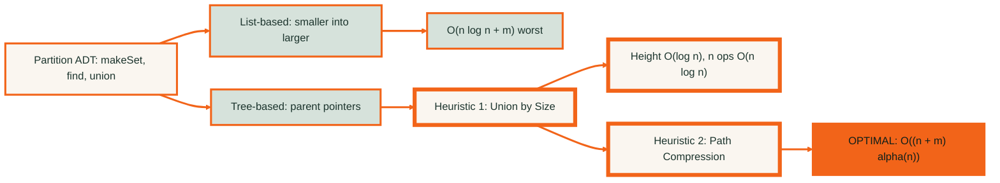
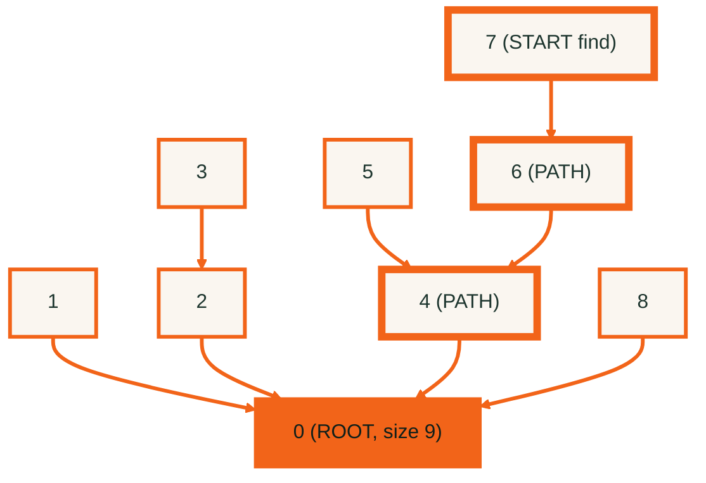
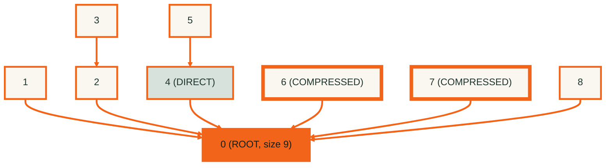

# 04 — Δομές Ένωσης-Εύρεσης
*Union-Find (Disjoint Sets)*

Το κεφάλαιο πραγματεύεται τη διαχείριση μιας συλλογής ξένων συνόλων (`disjoint sets`) υπό δυναμικές συγχωνεύσεις και ερωτήματα συμμετοχής. Η Αφηρημένη Τυπική Δομή (`ADT`) διαμέρισης (`partition ADT`) παρέχει τις λειτουργίες `makeSet`, `find` και `union`, επιτρέποντας την αποδοτική παρακολούθηση συνδεδεμένων συνιστωσών, τη δημιουργία λαβυρίνθων και την προσομοίωση διήθησης. Η ανάλυση των υλοποιήσεων με συνδεδεμένες λίστες και με δέντρα δεικτών γονέα στηρίζεται στην ασυμπτωτική και επιμερισμένη ανάλυση της [01_analysis_of_algorithms.md](01_analysis_of_algorithms.md). Ο συνδυασμός των ευρετικών μηχανισμών ένωσης κατά μέγεθος (`union by size`) και συμπίεσης διαδρομής (`path compression`) επιτυγχάνει σχεδόν γραμμικό συνολικό χρόνο $O((n+m)\alpha(n))$. Εφαρμογή στην Τελική: η δομή `Union-Find` αποτελεί τον πυρήνα του αλγορίθμου `Kruskal` για την ανίχνευση κύκλων και τη συγχώνευση συστάδων στα Δέντρα Επικάλυψης Ελαχίστου Κόστους (`MST`).

> **Εξεταστική κάλυψη:** Πρόοδος
> **Κεφάλαιο βιβλίου:** Κεφ. 7 | **Διαλέξεις:** `07_union_find.pdf`
> **Πηγή:** `Resources/Meta/mindmap.md` (Ενότητα 04)
> **Εκτός ύλης:** Ενότητα `7.3.1` (επιμερισμένη ανάλυση με συνάρτηση Ackermann και κυβερνοδολάρια)

## Πίνακας Περιεχομένων

- [1. Εννοιολογικό Πλαίσιο και Συνολική Εικόνα](#1-εννοιολογικό-πλαίσιο-και-συνολική-εικόνα)
- [2. Θεωρητική Θεμελίωση και Τυπικοί Ορισμοί](#2-θεωρητική-θεμελίωση-και-τυπικοί-ορισμοί)
- [3. Αλγόριθμοι, Ιχνηλάτηση και Κώδικας](#3-αλγόριθμοι-ιχνηλάτηση-και-κώδικας)
- [4. Συγκριτική Ανάλυση και Πολυπλοκότητα](#4-συγκριτική-ανάλυση-και-πολυπλοκότητα)
- [5. Πλήρως Λυμένες Ασκήσεις Εξεταστικού Επιπέδου](#5-πλήρως-λυμένες-ασκήσεις-εξεταστικού-επιπέδου)
- [6. Οδηγός Επιβίωσης στις Εξετάσεις και Παγίδες](#6-οδηγός-επιβίωσης-στις-εξετάσεις-και-παγίδες)
- [7. Συνοπτικός Πίνακας Εννοιών](#7-συνοπτικός-πίνακας-εννοιών)

---

## 1. Εννοιολογικό Πλαίσιο και Συνολική Εικόνα

### Το Πρόβλημα

Ένα κοινωνικό δίκτυο αποτελείται από ένα σύνολο $S$ με $n$ χρήστες και ένα σύνολο $E$ από $m$ ζεύγη φιλίας. Ζητείται ο διαχωρισμός των χρηστών σε **συνδεδεμένες συνιστώσες (`connected components`)**: υποσύνολα $T \subseteq S$ τέτοια ώστε κάθε δύο άτομα $x, y \in T$ να συνδέονται μέσω μιας αλυσίδας φιλίας («φίλος ενός φίλου») και κανένα άτομο στο $T$ να μην είναι φίλος με άτομο εκτός του $T$.

Καθώς προστίθενται δεσμοί φιλίας, δύο προηγουμένως ασύνδετες ομάδες συγχωνεύονται σε μία. Μια αφελής σάρωση όλων των στοιχείων σε κάθε συγχώνευση κοστίζει $O(n)$ ανά ένωση, οδηγώντας σε τετραγωνικό συνολικό χρόνο $O(n^2)$ για $n$ ενώσεις. Το ίδιο υπολογιστικό πρόβλημα εμφανίζεται στην τυχαία κατασκευή λαβυρίνθων (`MazeGenerator`), όπου πρέπει να ελέγχεται αν δύο κελιά ανήκουν ήδη στο ίδιο προσβάσιμο τμήμα πριν αφαιρεθεί ο ενδιάμεσος τοίχος, καθώς και στη **Θεωρία Διήθησης (`Percolation Theory`)**, όπου ένα πορώδες υλικό μοντελοποιείται ως τρισδιάστατο πλέγμα κελιών $n \times n \times n$ με εμπόδια που αφαιρούνται με πιθανότητα $p$ και διατηρούνται με πιθανότητα $1 - p$.

### Χάρτης Εννοιών του Κεφαλαίου



Πορτοκαλί γέμισμα: η βέλτιστη ασυμπτωτική πολυπλοκότητα του κεφαλαίου. Παχύ περίγραμμα: η διαδρομή βελτιστοποίησης μέσω των δύο ευρετικών μηχανισμών. Απαλό πράσινο: η υλοποίηση με λίστες και η αφελής δεντρική βάση. Κρεμ: η αφηρημένη διεπαφή της δομής.

Η εξέλιξη της σχεδίασης ακολουθεί τρία στάδια. Η υλοποίηση με λίστες δίνει άμεση `find` σε $O(1)$, αλλά απαιτεί ενημέρωση δεικτών κατά το `union`, που με τον κανόνα «μικρότερο στο μεγαλύτερο» δίνει $O(n \log n + m)$. Η μετάβαση σε δέντρα με δείκτες προς τον γονέα καθιστά το `union` πράξη $O(1)$ (σύνδεση ριζών), μεταφέροντας το κόστος στο `find`. Η ένωση κατά μέγεθος περιορίζει το ύψος των δέντρων σε $O(\log n)$, ενώ η προσθήκη συμπίεσης διαδρομής επιπεδώνει τα δέντρα κατά τις αναζητήσεις και οδηγεί στον σχεδόν γραμμικό χρόνο $O((n+m)\alpha(n))$.

### Πότε Χρησιμοποιείται Κάθε Υλοποίηση

Η **υλοποίηση με λίστες** προτιμάται μόνο όταν ο φόρτος εργασίας κυριαρχείται συντριπτικά από ερωτήματα `find` που απαιτούν αυστηρό $O(1)$ στη χειρότερη περίπτωση ανά κλήση, ενώ οι ενώσεις είναι λίγες. Η **δεντρική υλοποίηση μόνο με ένωση κατά μέγεθος** προτιμάται όταν απαιτείται απλότητα χωρίς τροποποίηση της δομής κατά το `find` (π.χ. όταν χρειάζεται αναίρεση ενώσεων) με εγγύηση $O(\log n)$ χειρότερης περίπτωσης ανά πράξη. Η **δεντρική υλοποίηση με ένωση κατά μέγεθος και συμπίεση διαδρομής** αποτελεί την καθολική επιλογή για ακολουθίες μικτών πράξεων `union` και `find`, προσφέροντας σχεδόν σταθερό επιμερισμένο χρόνο $O(\alpha(n))$ ανά λειτουργία.

---

## 2. Θεωρητική Θεμελίωση και Τυπικοί Ορισμοί

### 2.1 ΑΤΔ Διαμέρισης (`Partition ADT` / Δομή Ένωσης-Εύρεσης)

**Ορισμός.** Μια **δομή ένωσης-εύρεσης (`union-find structure`)** διατηρεί μια συλλογή από αμοιβαία ξένα σύνολα (`disjoint sets`) $S_1, S_2, \dots, S_k$ (δηλαδή $S_i \cap S_j = \emptyset$ για $i \ne j$), όπου κάθε σύνολο ταυτοποιείται από ένα μοναδικό όνομα (αντιπρόσωπο).

| Μέθοδος | Σημασιολογία | Επιστροφή |
|---|---|---|
| `makeSet(e)` | Δημιουργεί ένα μοναδιαίο σύνολο (`singleton set`) $\{e\}$ που περιέχει μόνο το στοιχείο $e$ | Το νέο σύνολο $\{e\}$ |
| `find(e)` | Εντοπίζει το σύνολο στο οποίο ανήκει το στοιχείο $e$ | Το όνομα (αντιπρόσωπο) του συνόλου του $e$ |
| `union(A, B)` | Συνενώνει τα ξένα σύνολα $A$ και $B$ στο $A \cup B$, καταστρέφοντας τα παλιά σύνολα | Το ενωμένο σύνολο, με όνομα είτε «$A$» είτε «$B$» |

> Σύμβαση του συγγράμματος: η λειτουργία `union(A, B)` δέχεται ως ορίσματα τα **ονόματα των συνόλων** (τις ρίζες των δέντρων), όχι αυθαίρετα στοιχεία. Όταν δίνονται δύο στοιχεία $x, y$, προηγείται πάντα κλήση `find(x)` και `find(y)`, και μόνο αν $\text{find}(x) \ne \text{find}(y)$ εκτελείται `union(find(x), find(y))`.

### 2.2 Ανάλυση Υλοποίησης Βάσει Λίστας

Στην υλοποίηση βάσει λίστας, κάθε σύνολο αποθηκεύεται ως συνδεδεμένη λίστα κόμβων. Κάθε κόμβος περιέχει το στοιχείο και έναν δείκτη προς το αντικείμενο-όνομα του συνόλου (το οποίο διατηρεί επίσης το μέγεθος της λίστας).

- **`find(e)`:** ακολουθεί τον μοναδικό δείκτη του κόμβου προς το όνομα του συνόλου σε χρόνο $O(1)$ στη χειρότερη περίπτωση.
- **`union(A, B)`:** μετακινεί όλα τα στοιχεία του **μικρότερου** συνόλου στο **μεγαλύτερο**, ενημερώνοντας τους δείκτες ονόματος των μετακινούμενων στοιχείων και προσαρτώντας τη μικρότερη λίστα στη μεγαλύτερη.

**Θεώρημα 2.1 (Πολυπλοκότητα Υλοποίησης Βάσει Λίστας).** *Με την υλοποίηση βάσει λίστας και τον κανόνα μετακίνησης του μικρότερου συνόλου στο μεγαλύτερο, μια ακολουθία από $n$ λειτουργίες `union` (ξεκινώντας από $n$ μοναδιαία σύνολα) και $m$ λειτουργίες `find` εκτελείται σε συνολικό χρόνο $O(n \log n + m)$ στη χειρότερη περίπτωση.*

**Απόδειξη.**
1. Κάθε λειτουργία `find` διαβάζει έναν μόνο δείκτη και κοστίζει $O(1)$, άρα οι $m$ λειτουργίες `find` κοστίζουν συνολικά $\Theta(m)$.
2. Θεωρούμε ένα αυθαίρετο στοιχείο $x$ που αρχικά ανήκει σε μοναδιαίο σύνολο μεγέθους $1$.
3. Κάθε φορά που το $x$ μετακινείται κατά τη διάρκεια μιας λειτουργίας `union(A, B)`, ανήκει στο μικρότερο σύνολο, έστω $A$ με $|A| \le |B|$.
4. Μετά τη συγχώνευση, το νέο σύνολο $A \cup B$ έχει μέγεθος $|A| + |B| \ge 2|A|$. Άρα το μέγεθος του συνόλου του $x$ **τουλάχιστον διπλασιάζεται** σε κάθε μετακίνηση.
5. Αν το $x$ μετακινηθεί $k$ φορές, το μέγεθος του συνόλου του είναι τουλάχιστον $2^k$. Επειδή το συνολικό πλήθος στοιχείων είναι $n$, ισχύει:
   $$2^k \le n \implies k \le \lfloor \log_2 n \rfloor$$
6. Επομένως, κάθε ένα από τα $n$ στοιχεία μετακινείται το πολύ $\lfloor \log_2 n \rfloor$ φορές, και κάθε μετακίνηση ενημερώνει έναν δείκτη σε χρόνο $O(1)$.
7. Αθροίζοντας σε όλα τα $n$ στοιχεία, ο συνολικός χρόνος όλων των ενημερώσεων στις ενώσεις είναι το πολύ $O(n \log n)$. Μαζί με τις $m$ αναζητήσεις `find`, το σύνολο είναι $O(n \log n + m)$. $\square$

### 2.3 Δεντρική Υλοποίηση και Ευρετικός Μηχανισμός 1: Ένωση κατά Μέγεθος

Στη δεντρική υλοποίηση, κάθε σύνολο αναπαρίσταται από ένα ριζωμένο δέντρο όπου κάθε κόμβος διατηρεί δείκτη προς τον γονέα του (`parent`). Η ρίζα $r$ του δέντρου έχει δείκτη που δείχνει στον εαυτό της ($\text{parent}[r] = r$) και λειτουργεί ως το όνομα του συνόλου.

- **`find(e)`:** ακολουθεί διαδοχικά τους δείκτες γονέα από τον κόμβο $e$ έως ότου φτάσει σε κόμβο με αυτο-αναφορά. Ο χρόνος είναι ανάλογος του βάθους του $e$.
- **`union(A, B)` (χωρίς ευρετικό):** κάνει τη ρίζα του ενός δέντρου να δείχνει στη ρίζα του άλλου σε $O(1)$. Χωρίς περιορισμό, μια ακολουθία $n-1$ ενώσεων μπορεί να δημιουργήσει αλυσίδα ύψους $n - 1$, καθιστώντας τη `find` $O(n)$ στη χειρότερη περίπτωση.
- **Ευρετικός μηχανισμός 1 — Ένωση κατά μέγεθος (`Union by Size`):** κάθε ρίζα $r$ αποθηκεύει το πλήθος κόμβων $\text{size}[r]$ του δέντρου της. Κατά τη `union(A, B)` (με $A, B$ ρίζες), η ρίζα του **μικρότερου** δέντρου γίνεται παιδί της ρίζας του **μεγαλύτερου** δέντρου και ενημερώνεται το μέγεθος της νέας ρίζας.

**Θεώρημα 2.2 (Ύψος Δέντρου με Ένωση κατά Μέγεθος).** *Σε μια δεντρική δομή `Union-Find` που εφαρμόζει μόνο ένωση κατά μέγεθος (ξεκινώντας από $n$ μοναδιαία σύνολα), κάθε δέντρο ύψους $h$ περιέχει τουλάχιστον $2^h$ κόμβους. Συνεπώς, το ύψος κάθε δέντρου ικανοποιεί $h \le \lfloor \log_2 n \rfloor = O(\log n)$, κάθε `find` εκτελείται σε $O(\log n)$ στη χειρότερη περίπτωση, και $n$ λειτουργίες ένωσης-εύρεσης εκτελούνται σε $O(n \log n)$ στη χειρότερη περίπτωση.*

**Απόδειξη (Επαγωγή στο ύψος $h$, ισοδύναμη με το επιχείρημα διπλασιασμού).**
- **Βάση ($h = 0$):** Ένα δέντρο ύψους $0$ αποτελείται από έναν μόνο κόμβο (τη ρίζα), και $1 \ge 2^0 = 1$.
- **Επαγωγική υπόθεση:** Υποθέτουμε ότι κάθε δέντρο ύψους $k < h$ έχει τουλάχιστον $2^k$ κόμβους.
- **Επαγωγικό βήμα:** Έστω δέντρο $T$ που αποκτά ύψος $h \ge 1$ για πρώτη φορά κατά τη διάρκεια μιας `union(A, B)`, όπου η ρίζα του $B$ συνδέεται κάτω από τη ρίζα του $A$. Επειδή η ένωση κατά μέγεθος επιβάλλει $|B| \le |A|$, υπάρχουν δύο περιπτώσεις:
  1. Το ύψος του $T$ προέρχεται από το ίδιο το $A$ (δηλαδή το $A$ είχε ήδη ύψος $h$): τότε το $A$ είχε ήδη τουλάχιστον $2^h$ κόμβους, άρα $|T| = |A| + |B| > 2^h$.
  2. Το ύψος αυξήθηκε επειδή το $B$ συνδέθηκε κάτω από τη ρίζα του $A$: τότε το $B$ είχε ύψος $h - 1$. Από την επαγωγική υπόθεση, $|B| \ge 2^{h-1}$. Επειδή $|A| \ge |B|$, προκύπτει:
     $$|T| = |A| + |B| \ge 2|B| \ge 2 \cdot 2^{h-1} = 2^h$$
- **Συμπέρασμα:** Εφόσον ένα δέντρο έχει το πολύ $n$ κόμβους, ισχύει $2^h \le n \implies h \le \lfloor \log_2 n \rfloor$. Ισοδύναμα, κάθε φορά που ακολουθούμε έναν δείκτη γονέα από κόμβο $v$ στον γονέα $w$, το μέγεθος του υποδέντρου του $w$ είναι τουλάχιστον διπλάσιο από το μέγεθος του υποδέντρου του $v$, άρα ακολουθούμε το πολύ $\lfloor \log_2 n \rfloor$ δείκτες ανά `find`. $\square$

### 2.4 Ευρετικός Μηχανισμός 2: Συμπίεση Διαδρομής και Αντίστροφη Συνάρτηση Ackermann

**Ευρετικός μηχανισμός 2 — Συμπίεση διαδρομής (`Path Compression`).** Κατά την εκτέλεση μιας λειτουργίας `find(e)`, αφού εντοπιστεί η ρίζα $r$ του δέντρου, όλοι οι κόμβοι κατά μήκος της διαδρομής από το $e$ έως το $r$ ενημερώνουν τον δείκτη γονέα τους ώστε να δείχνει απευθείας στη ρίζα $r$. Η συμπίεση δεν αυξάνει το ασυμπτωτικό κόστος της τρέχουσας `find` (απαιτεί ένα δεύτερο πέρασμα κατά μήκος της ίδιας διαδρομής), αλλά μειώνει δραστικά το βάθος όλων αυτών των κόμβων για μελλοντικές αναζητήσεις.

**Θεώρημα 2.3 (Συνδυασμένη Πολυπλοκότητα — Διατυπώνεται χωρίς απόδειξη).** *Με συνδυασμό ένωσης κατά μέγεθος και συμπίεσης διαδρομής, ο συνολικός χρόνος για $m$ λειτουργίες ένωσης-εύρεσης ξεκινώντας από $n$ μοναδιαία σύνολα είναι:*

$$O\big((n + m)\,\alpha(n)\big)$$

*στη χειρότερη περίπτωση (επιμερισμένος χρόνος $O(\alpha(n))$ ανά λειτουργία), όπου $\alpha(n) = \min\{x : A(x) \ge n\}$ είναι η αντίστροφη συνάρτηση Ackermann.*

Η συνάρτηση Ackermann $A(x)$ αυξάνεται εξαιρετικά ταχέως: $A(3) = 2048$, ενώ το $A(4)$ υπερβαίνει τον αριθμό των υποατομικών σωματιδίων στο σύμπαν. Αντίστροφα, η $\alpha(n)$ αυξάνεται εξαιρετικά αργά: παρότι θεωρητικά $\lim_{n \to \infty} \alpha(n) = \infty$, για κάθε πρακτικά εφικτό μέγεθος εισόδου $n$ ισχύει $\alpha(n) \le 4$.

> Εκτός ύλης: Ενότητα `7.3.1` (επιμερισμένη ανάλυση με συνάρτηση Ackermann, βαθμούς κόμβων και κυβερνοδολάρια).

---

## 3. Αλγόριθμοι, Ιχνηλάτηση και Κώδικας

### 3.1 Υλοποίηση Βάσει Λίστας (Μικρότερο στο Μεγαλύτερο)

**Σκοπός:** Διατήρηση ξένων συνόλων με $O(1)$ αναζήτηση και μετακίνηση του μικρότερου συνόλου στο μεγαλύτερο κατά την ένωση.

**Ψευδοκώδικας:**

```text
Algorithm ListMakeSet(e):
    Input: Element e
    Output: Singleton set containing e
    Create a new list L containing a single node for e
    Set L.name ← e and L.size ← 1
    Set e.setRef ← L
    return L

Algorithm ListFind(e):
    Input: Element e
    Output: Set containing e
    return e.setRef

Algorithm ListUnion(A, B):
    Input: Two distinct set references A and B
    Output: Set A ∪ B
    if A.size < B.size then
        small ← A; large ← B
    else
        small ← B; large ← A
    for each element x in small do
        x.setRef ← large
    Append list small to the end of list large
    large.size ← large.size + small.size
    return large
```

**Ιχνηλάτηση (καταμέτρηση μετακινήσεων σε 8 στοιχεία `0..7`):**

Κανόνας ισοβαθμίας: όταν $|A| = |B|$, μετακινείται το σύνολο με το μεγαλύτερο όνομα προς το σύνολο με το μικρότερο όνομα. Αρχικά υπάρχουν 8 μοναδιαία σύνολα `{0}, {1}, ..., {7}`.

| Βήμα | Λειτουργία | Μεγέθη πριν | Ποιο σύνολο μετακινείται | Μετακινούμενα στοιχεία | Μετακινήσεις βήματος | Αθροιστικές μετακινήσεις | Σύνολα μετά |
|---|---|---|---|---|---|---|---|
| 1 | `union(0, 1)` | $|0|=1, |1|=1$ | `{1}` $\to$ `{0}` | `1` | 1 | 1 | `{0,1}`, `{2}`, `{3}`, `{4}`, `{5}`, `{6}`, `{7}` |
| 2 | `union(2, 3)` | $|2|=1, |3|=1$ | `{3}` $\to$ `{2}` | `3` | 1 | 2 | `{0,1}`, `{2,3}`, `{4}`, `{5}`, `{6}`, `{7}` |
| 3 | `union(4, 5)` | $|4|=1, |5|=1$ | `{5}` $\to$ `{4}` | `5` | 1 | 3 | `{0,1}`, `{2,3}`, `{4,5}`, `{6}`, `{7}` |
| 4 | `union(6, 7)` | $|6|=1, |7|=1$ | `{7}` $\to$ `{6}` | `7` | 1 | 4 | `{0,1}`, `{2,3}`, `{4,5}`, `{6,7}` |
| 5 | `union(0, 2)` | $|0|=2, |2|=2$ | `{2,3}` $\to$ `{0,1}` | `2, 3` | 2 | 6 | `{0,1,2,3}`, `{4,5}`, `{6,7}` |
| 6 | `union(4, 6)` | $|4|=2, |6|=2$ | `{6,7}` $\to$ `{4,5}` | `6, 7` | 2 | 8 | `{0,1,2,3}`, `{4,5,6,7}` |
| 7 | `union(0, 4)` | $|0|=4, |4|=4$ | `{4,5,6,7}` $\to$ `{0,1,2,3}` | `4, 5, 6, 7` | 4 | 12 | `{0,1,2,3,4,5,6,7}` |

Κατανομή μετακινήσεων ανά στοιχείο:

| Στοιχείο | `0` | `1` | `2` | `3` | `4` | `5` | `6` | `7` | Σύνολο |
|---|---|---|---|---|---|---|---|---|---|
| Πλήθος μετακινήσεων | 0 | 1 | 1 | 2 | 1 | 2 | 2 | 3 | 12 |

Το μέγιστο πλήθος μετακινήσεων ενός στοιχείου είναι $3 = \log_2 8$, επιβεβαιώνοντας το άνω όριο $\lfloor \log_2 n \rfloor$.

**Κώδικας Python (ρητός αλγόριθμος):**

```python
class ListUnionFind:
    """List-based Union-Find using the smaller-into-larger heuristic."""

    def __init__(self, elements: list[int]) -> None:
        """Initializes one singleton list per element.

        Args:
            elements (list[int]): Distinct initial elements.
        """
        self.sets_map: dict[int, list[int]] = {elem: [elem] for elem in elements}
        self.set_name: dict[int, int] = {elem: elem for elem in elements}
        self.moves_per_element: dict[int, int] = {elem: 0 for elem in elements}
        self.total_moves: int = 0

    def find(self, element: int) -> int:
        """Returns the set name containing the given element in O(1) time.

        Args:
            element (int): The element to locate.

        Returns:
            int: The identifier of the set containing element.
        """
        return self.set_name[element]

    def union(self, elem_a: int, elem_b: int) -> int:
        """Merges the sets of elem_a and elem_b by moving the smaller list.

        Args:
            elem_a (int): An element in the first set.
            elem_b (int): An element in the second set.

        Returns:
            int: The identifier of the resulting merged set.
        """
        name_a = self.find(elem_a)
        name_b = self.find(elem_b)
        if name_a == name_b:
            return name_a

        list_a = self.sets_map[name_a]
        list_b = self.sets_map[name_b]
        # Tie-break: move larger set name into smaller set name when sizes match.
        if len(list_a) < len(list_b) or (len(list_a) == len(list_b) and name_a > name_b):
            src_name, dst_name = name_a, name_b
        else:
            src_name, dst_name = name_b, name_a

        moved_items = self.sets_map.pop(src_name)
        for item in moved_items:
            # Updating set_name preserves O(1) worst-case find.
            self.set_name[item] = dst_name
            self.moves_per_element[item] += 1
            self.total_moves += 1
        self.sets_map[dst_name].extend(moved_items)
        return dst_name


list_uf = ListUnionFind(list(range(8)))
for first_elem, second_elem in [(0, 1), (2, 3), (4, 5), (6, 7), (0, 2), (4, 6), (0, 4)]:
    list_uf.union(first_elem, second_elem)

assert list_uf.total_moves == 12
assert list_uf.moves_per_element == {0: 0, 1: 1, 2: 1, 3: 2, 4: 1, 5: 2, 6: 2, 7: 3}
```

**Pythonic ιδίωμα:** Δεν υπάρχει ενσωματωμένο ιδίωμα στην τυπική βιβλιοθήκη της Python για δομή διαμέρισης βάσει λίστας με δείκτες.

**Ανάλυση πολυπλοκότητας ανά γραμμή:**
- `find`: μία προσπέλαση λεξικού $\to O(1)$ στη χειρότερη περίπτωση.
- `union`: εντοπισμός ονομάτων $O(1)$, σύγκριση μεγεθών $O(1)$, βρόχος `for` εκτελείται $|S_{\text{small}}|$ φορές. Μεμονωμένη κλήση `union` κοστίζει $O(n)$ στη χειρότερη περίπτωση, αλλά αθροιστικά για $n$ ενώσεις και $m$ ευρέσεις το κόστος είναι $O(n \log n + m)$ στη χειρότερη περίπτωση (Θεώρημα 2.1). Χώρος: $O(n)$.

---

### 3.2 Δεντρική Υλοποίηση με Ένωση κατά Μέγεθος και Συμπίεση Διαδρομής

**Σκοπός:** Αναπαράσταση ξένων συνόλων ως δάσος δέντρων δεικτών γονέα με `union by size` και επαναληπτικό `find` με `path compression`.

**Ψευδοκώδικας:**

```text
Algorithm TreeMakeSet(e):
    Input: Element e
    Output: Root node for singleton set {e}
    parent[e] ← e
    size[e] ← 1
    return e

Algorithm TreeFind(e):
    Input: Element e
    Output: Root (set name) of the tree containing e
    r ← e
    while parent[r] ≠ r do
        r ← parent[r]
    curr ← e
    while parent[curr] ≠ r do
        nextNode ← parent[curr]
        parent[curr] ← r
        curr ← nextNode
    return r

Algorithm TreeUnion(A, B):
    Input: Roots A and B of two distinct trees
    Output: Root of the merged tree A ∪ B
    if A = B then
        return A
    if size[A] < size[B] then
        parent[A] ← B
        size[B] ← size[B] + size[A]
        return B
    else
        parent[B] ← A
        size[A] ← size[A] + size[B]
        return A
```

**Ιχνηλάτηση Α — 8 λειτουργίες `union` κατά μέγεθος σε 9 στοιχεία (`0..8`):**

Κανόνας ισοβαθμίας: όταν $\text{size}[r_a] = \text{size}[r_b]$, η ρίζα με τον μικρότερο δείκτη παραμένει ρίζα. Για να αναδειχθεί καθαρά το βάθος του δέντρου πριν τη συμπίεση διαδρομής, οι 8 ενώσεις εκτελούνται με ενεργή μόνο την ένωση κατά μέγεθος· αμέσως μετά εκτελείται `find(7)` με συμπίεση διαδρομής.

| Βήμα | Κλήση | Ρίζες $(r_a, r_b)$ | Μεγέθη πριν | Ενέργεια | Πίνακας `parent[0..8]` | Πίνακας `size[0..8]` |
|---|---|---|---|---|---|---|
| 0 | Αρχική | — | — | 9 μοναδιαία | `[0, 1, 2, 3, 4, 5, 6, 7, 8]` | `[1, 1, 1, 1, 1, 1, 1, 1, 1]` |
| 1 | `union(0, 1)` | `(0, 1)` | `(1, 1)` | `1 -> 0` | `[0, 0, 2, 3, 4, 5, 6, 7, 8]` | `[2, 1, 1, 1, 1, 1, 1, 1, 1]` |
| 2 | `union(2, 3)` | `(2, 3)` | `(1, 1)` | `3 -> 2` | `[0, 0, 2, 2, 4, 5, 6, 7, 8]` | `[2, 1, 2, 1, 1, 1, 1, 1, 1]` |
| 3 | `union(0, 2)` | `(0, 2)` | `(2, 2)` | `2 -> 0` | `[0, 0, 0, 2, 4, 5, 6, 7, 8]` | `[4, 1, 2, 1, 1, 1, 1, 1, 1]` |
| 4 | `union(4, 5)` | `(4, 5)` | `(1, 1)` | `5 -> 4` | `[0, 0, 0, 2, 4, 4, 6, 7, 8]` | `[4, 1, 2, 1, 2, 1, 1, 1, 1]` |
| 5 | `union(6, 7)` | `(6, 7)` | `(1, 1)` | `7 -> 6` | `[0, 0, 0, 2, 4, 4, 6, 6, 8]` | `[4, 1, 2, 1, 2, 1, 2, 1, 1]` |
| 6 | `union(4, 6)` | `(4, 6)` | `(2, 2)` | `6 -> 4` | `[0, 0, 0, 2, 4, 4, 4, 6, 8]` | `[4, 1, 2, 1, 4, 1, 2, 1, 1]` |
| 7 | `union(0, 4)` | `(0, 4)` | `(4, 4)` | `4 -> 0` | `[0, 0, 0, 2, 0, 4, 4, 6, 8]` | `[8, 1, 2, 1, 4, 1, 2, 1, 1]` |
| 8 | `union(8, 3)` | `(8, 0)` | `(1, 8)` | `8 -> 0` | `[0, 0, 0, 2, 0, 4, 4, 6, 0]` | `[9, 1, 2, 1, 4, 1, 2, 1, 1]` |

Παρατήρηση στο βήμα 8: παρότι το `8` δίνεται πρώτο όρισμα στην `union(8, 3)`, το `find(3)` επιστρέφει τη ρίζα `0` με μέγεθος $8 > 1$, άρα το μικρότερο δέντρο `8` συνδέεται κάτω από το `0`.

**Ιχνηλάτηση Β — `find(7)` με συμπίεση διαδρομής:**

| Στάδιο | Διαδρομή προς ρίζα | Δείκτες που αλλάζουν | Πίνακας `parent[0..8]` |
|---|---|---|---|
| Πριν το `find(7)` | `7 -> 6 -> 4 -> 0` (μήκος 3) | — | `[0, 0, 0, 2, 0, 4, 4, 6, 0]` |
| Μετά το `find(7)` | `7 -> 0` (μήκος 1) | `parent[7]: 6 -> 0`, `parent[6]: 4 -> 0` | `[0, 0, 0, 2, 0, 4, 0, 0, 0]` |

**Διάγραμμα 1 — Το δέντρο πριν το `find(7)` (μετά τα 8 `union`):**



Πορτοκαλί γέμισμα: η ρίζα του συνόλου (`0`). Παχύ περίγραμμα: οι κόμβοι της διαδρομής `7 -> 6 -> 4 -> 0` που διασχίζει η `find(7)`. Κρεμ: οι υπόλοιποι κόμβοι που δεν επηρεάζονται.

Τα βέλη δείχνουν από κάθε παιδί προς τον γονέα του (`parent`). Πριν τη συμπίεση, η αναζήτηση από τον κόμβο `7` απαιτεί 3 άλματα δεικτών (`7 -> 6`, `6 -> 4`, `4 -> 0`) για να φτάσει στη ρίζα `0`.

**Διάγραμμα 2 — Το δέντρο μετά το `find(7)` με συμπίεση διαδρομής:**



Πορτοκαλί γέμισμα: η ρίζα `0`. Παχύ περίγραμμα: οι κόμβοι `6` και `7` των οποίων οι δείκτες γονέα ανακατευθύνθηκαν απευθείας στο `0`. Απαλό πράσινο: ο κόμβος `4` που έδειχνε ήδη στο `0`. Κρεμ: οι αμετάβλητοι κόμβοι.

Μετά τη συμπίεση διαδρομής, οι κόμβοι `6` και `7` γίνονται άμεσα παιδιά της ρίζας `0`, οπότε κάθε μελλοντική κλήση `find(7)` ή `find(6)` ολοκληρώνεται σε 1 μόνο βήμα. Ο πίνακας `size` των μη-ριζών (`4`, `6`) δεν χρειάζεται ενημέρωση, διότι η `union` διαβάζει μόνο το `size` των ριζών.

**Κώδικας Python (ρητός αλγόριθμος με επαναληπτική `find`):**

```python
class UnionFind:
    """Tree-based Union-Find with union by size and iterative path compression."""

    def __init__(self, count: int) -> None:
        """Creates count singleton sets numbered 0 to count - 1.

        Args:
            count (int): Total number of initial singleton elements.
        """
        self.parent: list[int] = list(range(count))
        self.size: list[int] = [1] * count

    def makeSet(self, element: int) -> None:
        """Resets or initializes a single element as its own singleton set.

        Args:
            element (int): Index of the element to initialize.
        """
        self.parent[element] = element
        self.size[element] = 1

    def find(self, element: int, compress: bool = True) -> int:
        """Finds the root of element with optional iterative path compression.

        Args:
            element (int): Element whose set representative is requested.
            compress (bool): Whether to apply path compression along the path.

        Returns:
            int: The root index representing the set containing element.
        """
        root = element
        while self.parent[root] != root:
            root = self.parent[root]

        if compress:
            curr = element
            while self.parent[curr] != root:
                # Redirect each visited node directly to the root to flatten the tree.
                next_node = self.parent[curr]
                self.parent[curr] = root
                curr = next_node
        return root

    def union(self, elem_a: int, elem_b: int, compress: bool = True) -> int:
        """Unites the sets containing elem_a and elem_b using union by size.

        Args:
            elem_a (int): First element.
            elem_b (int): Second element.
            compress (bool): Whether find calls perform path compression.

        Returns:
            int: The root of the resulting merged set.
        """
        root_a = self.find(elem_a, compress=compress)
        root_b = self.find(elem_b, compress=compress)
        if root_a == root_b:
            return root_a

        # Attach smaller tree under larger; tie-break keeps smaller index as root.
        if self.size[root_a] < self.size[root_b] or (
            self.size[root_a] == self.size[root_b] and root_a > root_b
        ):
            root_a, root_b = root_b, root_a

        self.parent[root_b] = root_a
        self.size[root_a] += self.size[root_b]
        return root_a


uf = UnionFind(9)
for first_elem, second_elem in [(0, 1), (2, 3), (0, 2), (4, 5), (6, 7), (4, 6), (0, 4), (8, 3)]:
    uf.union(first_elem, second_elem, compress=False)

assert uf.parent == [0, 0, 0, 2, 0, 4, 4, 6, 0]
assert uf.size == [9, 1, 2, 1, 4, 1, 2, 1, 1]
assert uf.find(7, compress=True) == 0
assert uf.parent == [0, 0, 0, 2, 0, 4, 0, 0, 0]
```

**Pythonic ιδίωμα και διασταύρωση:** Η τυπική βιβλιοθήκη της Python δεν διαθέτει ενσωματωμένη κλάση `Union-Find` (ούτε το `set` υποστηρίζει αποδοτικές διαμερίσεις). Για εξωτερικό έλεγχο συνδεδεμένων συνιστωσών στο οικοσύστημα της Python χρησιμοποιείται η `networkx.connected_components(G)` (ή `scipy.cluster.hierarchy.DisjointSet`), η οποία όμως είναι εξωτερική βιβλιοθήκη. Στην εξέταση γράφεται πάντα η ρητή κλάση `UnionFind` με πίνακες `parent` και `size`.

**Ανάλυση πολυπλοκότητας ανά γραμμή:**
- `__init__`: δημιουργία δύο πινάκων μεγέθους $n \to O(n)$ χρόνος και χώρος.
- `find`: ο πρώτος βρόχος διασχίζει το βάθος $d(e) \le \lfloor \log_2 n \rfloor$, ο δεύτερος βρόχος διασχίζει την ίδια διαδρομή. Μεμονωμένη κλήση: $O(\log n)$ στη χειρότερη περίπτωση.
- `union`: δύο κλήσεις `find` + σταθερές αναθέσεις $O(1)$.
- Ακολουθία $m$ λειτουργιών `union`/`find` από $n$ μοναδιαία σύνολα: $O((n + m)\alpha(n))$ στη χειρότερη περίπτωση (επιμερισμένα $O(\alpha(n))$ ανά λειτουργία).

---

### 3.3 Εφαρμογή 1: Συνδεδεμένες Συνιστώσες (`UFConnectedComponents`)

**Σκοπός:** Υπολογισμός του αναγνωριστικού της συνδεδεμένης συνιστώσας κάθε στοιχείου ενός συνόλου $S$ δεδομένου ενός συνόλου $E$ από $m$ δεσμούς.

**Ψευδοκώδικας (όπως στη διάλεξη `07_union_find.pdf`):**

```text
Algorithm UFConnectedComponents(S, E):
    Input: A set S of n people and a set E of m pairs of people from S
           defining pairwise relationships
    Output: An identification, for each x in S, of the connected component
            containing x
    for each x in S do
        makeSet(x)
    for each (x, y) in E do
        if find(x) ≠ find(y) then
            union(find(x), find(y))
    for each x in S do
        Output "Person x belongs to connected component " find(x)
```

**Ιχνηλάτηση σε 6 άτομα $S = \{\text{A, B, C, D, E, F}\}$ με 5 δεσμούς $E = \{(\text{A,B}), (\text{B,C}), (\text{D,E}), (\text{A,C}), (\text{E,F})\}$:**

Κανόνας ισοβαθμίας: σε ίσα μεγέθη, ρίζα παραμένει το αλφαβητικά μικρότερο γράμμα.

| Βήμα | Ακμή $(x, y)$ | `find(x)` | `find(y)` | Ενέργεια | Πίνακας `parent` για `[A, B, C, D, E, F]` |
|---|---|---|---|---|---|
| 0 | Αρχικοποίηση | — | — | 6 `makeSet` | `[A, B, C, D, E, F]` |
| 1 | `(A, B)` | `A` | `B` | `union(A, B)` (`B -> A`) | `[A, A, C, D, E, F]` |
| 2 | `(B, C)` | `A` | `C` | `union(A, C)` (`C -> A`) | `[A, A, A, D, E, F]` |
| 3 | `(D, E)` | `D` | `E` | `union(D, E)` (`E -> D`) | `[A, A, A, D, D, F]` |
| 4 | `(A, C)` | `A` | `A` | Παράλειψη (ίδια συνιστώσα) | `[A, A, A, D, D, F]` |
| 5 | `(E, F)` | `D` | `F` | `union(D, F)` (`F -> D`) | `[A, A, A, D, D, D]` |

Τελική έξοδος: τα άτομα `A, B, C` ανήκουν στη συνιστώσα `A`, ενώ τα `D, E, F` στη συνιστώσα `D` (2 συνδεδεμένες συνιστώσες).

**Κώδικας Python (ρητός αλγόριθμος και διασταύρωση με συγχώνευση συνόλων Python):**

```python
def ufConnectedComponents(
    people: list[str],
    edges: list[tuple[str, str]],
) -> dict[str, list[str]]:
    """Computes connected components using tree-based Union-Find.

    Args:
        people (list[str]): List of person identifiers.
        edges (list[tuple[str, str]]): Undirected friendship pairs.

    Returns:
        dict[str, list[str]]: Mapping from component representative to sorted members.
    """
    index_of = {person: idx for idx, person in enumerate(people)}
    uf_struct = UnionFind(len(people))

    for first_person, second_person in edges:
        root_u = uf_struct.find(index_of[first_person])
        root_v = uf_struct.find(index_of[second_person])
        if root_u != root_v:
            uf_struct.union(root_u, root_v)

    components: dict[str, list[str]] = {}
    for person in people:
        rep = people[uf_struct.find(index_of[person])]
        components.setdefault(rep, []).append(person)
    return components


def naiveSetMergeComponents(
    people: list[str],
    edges: list[tuple[str, str]],
) -> list[list[str]]:
    """Cross-checks connected components by repeatedly merging Python sets.

    Args:
        people (list[str]): List of person identifiers.
        edges (list[tuple[str, str]]): Undirected friendship pairs.

    Returns:
        list[list[str]]: Sorted list of sorted connected components.
    """
    groups: list[set[str]] = [{person} for person in people]
    for first_person, second_person in edges:
        # Locate the two sets containing the endpoints and merge them if distinct.
        idx_u = next(i for i, grp in enumerate(groups) if first_person in grp)
        idx_v = next(i for i, grp in enumerate(groups) if second_person in grp)
        if idx_u != idx_v:
            groups[idx_u] |= groups[idx_v]
            groups.pop(idx_v)
    return sorted(sorted(grp) for grp in groups)


sample_people = ["A", "B", "C", "D", "E", "F"]
sample_edges = [("A", "B"), ("B", "C"), ("D", "E"), ("A", "C"), ("E", "F")]
uf_result = ufConnectedComponents(sample_people, sample_edges)
assert uf_result == {"A": ["A", "B", "C"], "D": ["D", "E", "F"]}
assert sorted(sorted(c) for c in uf_result.values()) == naiveSetMergeComponents(
    sample_people, sample_edges
)
```

| Μορφή | Χρόνος (χειρότερη) | Επιπλέον χώρος | Σημείωση |
|---|---|---|---|
| `ufConnectedComponents` | $O((n + m)\alpha(n))$ | $O(n)$ | Ο αλγόριθμος της εξέτασης (`O(t(n, n+m))`) |
| `naiveSetMergeComponents` | $O(m \cdot n)$ | $O(n)$ | Απλή διασταύρωση με ενσωματωμένα `set`, ακατάλληλη για μεγάλα $n, m$ |
| `networkx.connected_components` | $O(n + m)$ | $O(n + m)$ | Εξωτερική βιβλιοθήκη για έλεγχο στην πράξη (δεν αντικαθιστά τον αλγόριθμο) |

**Ανάλυση πολυπλοκότητας:**
Ο πρώτος βρόχος εκτελεί $n$ κλήσεις `makeSet`. Ο δεύτερος βρόχος εκτελεί $2m$ κλήσεις `find` και το πολύ $n - 1$ κλήσεις `union`. Ο τρίτος βρόχος εκτελεί $n$ κλήσεις `find`. Συνολικά γίνονται $O(n + m)$ πράξεις `union`/`find` ξεκινώντας από $n$ μοναδιαία σύνολα, άρα ο χρόνος εκτέλεσης είναι $O(t(n, n + m))$, όπου $t(j, k)$ ο χρόνος για $k$ πράξεις ξεκινώντας από $j$ μοναδιαία σύνολα. Με δέντρα, ένωση κατά μέγεθος και συμπίεση διαδρομής: $O((n + m)\alpha(n))$.

---

### 3.4 Εφαρμογή 2: Γεννήτρια Κατασκευής Λαβυρίνθων (`MazeGenerator`)

**Σκοπός:** Δημιουργία λαβυρίνθου σε πλέγμα $n$ κελιών με αφαίρεση ακριβώς $n - 1$ εσωτερικών τοίχων ώστε κάθε δύο κελιά να συνδέονται με μοναδική απλή διαδρομή (χωρίς κύκλους).

**Ψευδοκώδικας (όπως στη διάλεξη `07_union_find.pdf`):**

```text
Algorithm MazeGenerator(G, E):
    Input: A grid G consisting of n cells and a set E of m "walls", each of
           which divides two cells x and y, such that the walls in E initially
           separate and isolate all the cells in G
    Output: A subset R of E, such that removing the edges in R from E creates
            a maze defined on G by the remaining walls
    Initialize n singleton sets (one per cell) and R ← ∅
    while R has fewer than n - 1 edges do
        Choose an edge (x, y) in E uniformly at random from among those
            previously unchosen
        if find(x) ≠ find(y) then
            union(find(x), find(y))
            Add the edge (x, y) to R
    return R
```

**Ιχνηλάτηση σε πλέγμα $2 \times 3$ (6 κελιά `0, 1, 2` στην πάνω γραμμή, `3, 4, 5` στην κάτω, $m = 7$ εσωτερικοί τοίχοι):**

Σταθερή σειρά τυχαίας επιλογής τοίχων για αναπαραγωγιμότητα: `(0,1), (3,4), (0,3), (1,4), (1,2), (2,5), (4,5)`. Ζητούνται $n - 1 = 5$ τοίχοι στο $R$.

| Βήμα | Επιλεγμένος τοίχος `(x, y)` | `find(x)` | `find(y)` | Απόφαση | $|R|$ | Αιτιολόγηση |
|---|---|---|---|---|---|---|
| 1 | `(0, 1)` | `0` | `1` | Αφαίρεση (προσθήκη στο $R$) | 1 | Διαφορετικά σύνολα, `union(0, 1)` |
| 2 | `(3, 4)` | `3` | `4` | Αφαίρεση (προσθήκη στο $R$) | 2 | Διαφορετικά σύνολα, `union(3, 4)` |
| 3 | `(0, 3)` | `0` | `3` | Αφαίρεση (προσθήκη στο $R$) | 3 | Συνένωση `{0,1}` και `{3,4}` |
| 4 | `(1, 4)` | `0` | `0` | Διατήρηση τοίχου | 3 | Ίδιο σύνολο — αφαίρεση θα δημιουργούσε κύκλο `0-1-4-3-0` |
| 5 | `(1, 2)` | `0` | `2` | Αφαίρεση (προσθήκη στο $R$) | 4 | Προσάρτηση `{2}` στο `{0,1,3,4}` |
| 6 | `(2, 5)` | `0` | `5` | Αφαίρεση (προσθήκη στο $R$) | 5 | Προσάρτηση `{5}` — τερματισμός ($|R| = 5$) |

Ο τοίχος `(4, 5)` δεν χρειάζεται να ελεγχθεί και παραμένει στη θέση του, όπως και ο `(1, 4)`.

**Κώδικας Python:**

```python
def mazeGenerator(
    num_cells: int,
    wall_order: list[tuple[int, int]],
) -> list[tuple[int, int]]:
    """Selects n - 1 walls to remove from a grid to form an acyclic maze.

    Args:
        num_cells (int): Total number of cells in the grid.
        wall_order (list[tuple[int, int]]): Pre-shuffled list of internal walls.

    Returns:
        list[tuple[int, int]]: The subset R of n - 1 removed walls.
    """
    uf_struct = UnionFind(num_cells)
    removed_walls: list[tuple[int, int]] = []

    for cell_u, cell_v in wall_order:
        if len(removed_walls) == num_cells - 1:
            break
        root_u = uf_struct.find(cell_u)
        root_v = uf_struct.find(cell_v)
        if root_u != root_v:
            # Removing a wall between distinct components cannot create a cycle.
            uf_struct.union(root_u, root_v)
            removed_walls.append((cell_u, cell_v))
    return removed_walls


sample_walls = [(0, 1), (3, 4), (0, 3), (1, 4), (1, 2), (2, 5), (4, 5)]
assert mazeGenerator(6, sample_walls) == [(0, 1), (3, 4), (0, 3), (1, 2), (2, 5)]
```

**Pythonic ιδίωμα:** Δεν υπάρχει ενσωματωμένο ιδίωμα στην τυπική βιβλιοθήκη για παραγωγή λαβυρίνθων· στην πράξη το τυχαίο ανακάτεμα των τοίχων γίνεται με `random.shuffle(walls)` σε $O(m)$ πριν τον βρόχο.

**Ανάλυση πολυπλοκότητας:** Ο βρόχος εξετάζει το πολύ $m$ τοίχους (σε ένα $2\text{D}$ πλέγμα $m = O(n)$) και εκτελεί ακριβώς $n - 1$ ενώσεις και το πολύ $2m$ ευρέσεις. Με `Union-Find` (ένωση κατά μέγεθος και συμπίεση διαδρομής), ο συνολικός χρόνος είναι $O((n + m)\alpha(n))$.

---

## 4. Συγκριτική Ανάλυση και Πολυπλοκότητα

### Πίνακας Σύγκρισης Υλοποιήσεων `Union-Find`

Έστω $n$ αρχικά μοναδιαία σύνολα (`makeSet`) και ακολουθία $m$ λειτουργιών `union` και `find` (όπου οι ενώσεις είναι το πολύ $n - 1$ αποτελεσματικές συγχωνεύσεις).

| Υλοποίηση | `makeSet` | `find` (μεμονωμένη) | `union` (μεμονωμένη, με ρίζες) | Σύνολο $n$ ενώσεων και $m$ ευρέσεων | Χώρος |
|---|---|---|---|---|---|
| Λίστα (χωρίς κανόνα μεγέθους) | $O(1)$ χειρότερη | $O(1)$ χειρότερη | $O(n)$ χειρότερη | $O(n^2 + m)$ χειρότερη | $O(n)$ |
| Λίστα (μικρότερο στο μεγαλύτερο) | $O(1)$ χειρότερη | $O(1)$ χειρότερη | $O(n)$ χειρότερη, $O(\log n)$ επιμερισμένη | $O(n \log n + m)$ χειρότερη | $O(n)$ |
| Δέντρα (χωρίς ευρετικούς) | $O(1)$ χειρότερη | $O(n)$ χειρότερη | $O(1)$ χειρότερη | $O(n \cdot m)$ χειρότερη | $O(n)$ |
| Δέντρα + Ένωση κατά μέγεθος | $O(1)$ χειρότερη | $O(\log n)$ χειρότερη | $O(1)$ χειρότερη | $O((n + m)\log n)$ χειρότερη ($O(n \log n)$ για $n$ πράξεις) | $O(n)$ |
| Δέντρα + Ένωση κατά μέγεθος + Συμπίεση διαδρομής | $O(1)$ χειρότερη | $O(\log n)$ χειρότερη, $O(\alpha(n))$ επιμερισμένη | $O(1)$ χειρότερη (αν δοθούν ρίζες) | $O((n + m)\alpha(n))$ χειρότερη | $O(n)$ |

> Προσοχή στη διάκριση περιπτώσεων: στη δομή `Union-Find` **δεν** υπάρχει τυχαιοποίηση, άρα δεν μιλάμε για αναμενόμενο (`expected`) χρόνο. Τα όρια $O(n \log n + m)$ και $O((n + m)\alpha(n))$ ισχύουν στη **χειρότερη περίπτωση** για το σύνολο της ακολουθίας, ενώ η τιμή ανά λειτουργία ($O(\log n)$ για λίστα, $O(\alpha(n))$ για δέντρα με τους δύο ευρετικούς) είναι **επιμερισμένη (`amortized`)**.

### Κανόνας Επιλογής Δομής

| Σενάριο / Απαίτηση | Επιλογή | Αιτιολόγηση |
|---|---|---|
| Τεράστιο πλήθος `find` ($m \gg n \log n$) και απαίτηση αυστηρού $O(1)$ ανά `find` | Λίστα με μικρότερο στο μεγαλύτερο | $O(n \log n + m) = O(m)$, μηδενική μεταβλητότητα χρόνου `find` |
| Μικτή ακολουθία `union` και `find` ($m = \Theta(n)$ ή $m = O(n \log n)$) | Δέντρα + Ένωση κατά μέγεθος + Συμπίεση διαδρομής | $O((n + m)\alpha(n))$, πρακτικά γραμμικός χρόνος ($\alpha(n) \le 4$) |
| Απαίτηση σταθερού σχήματος δέντρων κατά το `find` (χωρίς μεταβολές) | Δέντρα + Ένωση κατά μέγεθος | Εγγυημένο ύψος $\le \lfloor \log_2 n \rfloor$ χωρίς παρενέργειες στη `find` |

---

## 5. Πλήρως Λυμένες Ασκήσεις Εξεταστικού Επιπέδου

### Άσκηση 1 (Ιχνηλάτηση με το χέρι)

**Εκφώνηση.** Δίνονται $8$ στοιχεία αριθμημένα $1, 2, \dots, 8$, αρχικά σε μοναδιαία σύνολα. Χρησιμοποιείται δεντρική υλοποίηση `Union-Find` με ένωση κατά μέγεθος και συμπίεση διαδρομής. Κανόνας ισοβαθμίας: σε ίσα μεγέθη, ρίζα παραμένει ο κόμβος με τον μικρότερο αριθμό. Εκτελέστε διαδοχικά τις παρακάτω λειτουργίες, καταγράφοντας σε κάθε βήμα τους πίνακες `parent[1..8]` και `size[1..8]`, και αναφέρετε ποιοι δείκτες μεταβλήθηκαν κατά τις κλήσεις `find`:
1. `union(1, 2)`
2. `union(3, 4)`
3. `union(5, 6)`
4. `union(1, 3)`
5. `union(7, 8)`
6. `union(5, 7)`
7. `union(1, 5)`
8. `find(8)`
9. `find(4)`
10. `union(4, 8)`

**Στρατηγική.** Εφαρμόζουμε σε κάθε `union(a, b)` πρώτα `find(a)` και `find(b)`, συγκρίνουμε τα μεγέθη των ριζών, συνδέουμε τη μικρότερη ρίζα κάτω από τη μεγαλύτερη (με τον κανόνα ισοβαθμίας) και αυξάνουμε το `size` μόνο της νέας ρίζας. Σε κάθε `find(x)` εντοπίζουμε τη ρίζα και ανακατευθύνουμε όλους τους κόμβους της διαδρομής απευθείας σε αυτήν.

**Λύση.**

1. **Αρχική κατάσταση:**
   `parent = [1, 2, 3, 4, 5, 6, 7, 8]`, `size = [1, 1, 1, 1, 1, 1, 1, 1]`.
2. **Βήμα 1 — `union(1, 2)`:** `find(1)=1`, `find(2)=2`, `size[1]=1 = size[2]=1`. Ισοβαθμία: `1` μένει ρίζα, `parent[2] = 1`, `size[1] = 2`.
   `parent = [1, 1, 3, 4, 5, 6, 7, 8]`, `size = [2, 1, 1, 1, 1, 1, 1, 1]`.
3. **Βήμα 2 — `union(3, 4)`:** `find(3)=3`, `find(4)=4`, ίσα μεγέθη $1$. `parent[4] = 3`, `size[3] = 2`.
   `parent = [1, 1, 3, 3, 5, 6, 7, 8]`, `size = [2, 1, 2, 1, 1, 1, 1, 1]`.
4. **Βήμα 3 — `union(5, 6)`:** `find(5)=5`, `find(6)=6`, ίσα μεγέθη $1$. `parent[6] = 5`, `size[5] = 2`.
   `parent = [1, 1, 3, 3, 5, 5, 7, 8]`, `size = [2, 1, 2, 1, 2, 1, 1, 1]`.
5. **Βήμα 4 — `union(1, 3)`:** `find(1)=1` (μέγεθος 2), `find(3)=3` (μέγεθος 2). Ισοβαθμία: `parent[3] = 1`, `size[1] = 4`.
   `parent = [1, 1, 1, 3, 5, 5, 7, 8]`, `size = [4, 1, 2, 1, 2, 1, 1, 1]`.
6. **Βήμα 5 — `union(7, 8)`:** `find(7)=7`, `find(8)=8`, ίσα μεγέθη $1$. `parent[8] = 7`, `size[7] = 2`.
   `parent = [1, 1, 1, 3, 5, 5, 7, 7]`, `size = [4, 1, 2, 1, 2, 1, 2, 1]`.
7. **Βήμα 6 — `union(5, 7)`:** `find(5)=5` (μέγεθος 2), `find(7)=7` (μέγεθος 2). Ισοβαθμία: `parent[7] = 5`, `size[5] = 4`.
   `parent = [1, 1, 1, 3, 5, 5, 5, 7]`, `size = [4, 1, 2, 1, 4, 1, 2, 1]`.
8. **Βήμα 7 — `union(1, 5)`:** `find(1)=1` (μέγεθος 4), `find(5)=5` (μέγεθος 4). Ισοβαθμία: `parent[5] = 1`, `size[1] = 8`.
   `parent = [1, 1, 1, 3, 1, 5, 5, 7]`, `size = [8, 1, 2, 1, 4, 1, 2, 1]`.
9. **Βήμα 8 — `find(8)`:** Διαδρομή `8 -> 7 -> 5 -> 1` (ρίζα `1`, μήκος 3). Με συμπίεση διαδρομής: `parent[8] = 1` (ήταν `7`), `parent[7] = 1` (ήταν `5`), ενώ το `parent[5]` ήταν ήδη `1`. Επιστρέφει `1`.
   `parent = [1, 1, 1, 3, 1, 5, 1, 1]`, `size = [8, 1, 2, 1, 4, 1, 2, 1]`.
10. **Βήμα 9 — `find(4)`:** Διαδρομή `4 -> 3 -> 1` (ρίζα `1`, μήκος 2). Με συμπίεση διαδρομής: `parent[4] = 1` (ήταν `3`), ενώ `parent[3]` ήταν ήδη `1`. Επιστρέφει `1`.
    `parent = [1, 1, 1, 1, 1, 5, 1, 1]`, `size = [8, 1, 2, 1, 4, 1, 2, 1]`.
11. **Βήμα 10 — `union(4, 8)`:** `find(4) = 1` (1 βήμα), `find(8) = 1` (1 βήμα). Επειδή οι ρίζες ταυτίζονται, δεν γίνεται καμία αλλαγή ούτε στο `parent` ούτε στο `size`.

**Έλεγχος.** Όλοι οι κόμβοι ανήκουν στο μοναδικό δέντρο με ρίζα `1` και `size[1] = 8`. Μόνο ο κόμβος `6` παραμένει σε βάθος 2 (`6 -> 5 -> 1`), διότι δεν συμμετείχε σε καμία `find` μετά το βήμα 7. Το αποτέλεσμα συμφωνεί με τη διασταύρωση σε Python.

---

### Άσκηση 2 (Εξαγωγή Πολυπλοκότητας με Αθροίσματα)

**Εκφώνηση.** Στην υλοποίηση `Union-Find` βάσει λίστας για $n$ στοιχεία (αρχικά σε $n$ μοναδιαία σύνολα), εξετάζουμε μια ακολουθία από $n - 1$ λειτουργίες `union` και $m$ λειτουργίες `find`:
- **(α)** Αποδείξτε ότι **χωρίς** τον κανόνα «μικρότερο στο μεγαλύτερο», ο συνολικός χρόνος στη χειρότερη περίπτωση είναι $\Theta(n^2 + m)$, κατασκευάζοντας ρητή ακολουθία ενώσεων.
- **(β)** Υπολογίστε το ακριβές άθροισμα μετακινήσεων για μια πλήρη ισορροπημένη ακολουθία ενώσεων όταν $n = 2^k$ με τον κανόνα «μικρότερο στο μεγαλύτερο», και επαληθεύστε το ασυμπτωτικό όριο $O(n \log n + m)$.

**Στρατηγική.** Στο (α) μετακινούμε πάντα το μεγαλύτερο σύνολο μέσα σε ένα μοναδιαίο, παράγοντας αριθμητική πρόοδο. Στο (β) συγχωνεύουμε σε $k = \log_2 n$ γύρους σύνολα ίσου μεγέθους $2^i$ και αθροίζουμε τις μετακινήσεις ανά γύρο.

**Λύση.**

**Μέρος (α) — Χωρίς κανόνα μεγέθους:**
1. Έστω στοιχεία $1, 2, \dots, n$. Στο βήμα $i$ (για $i = 1, 2, \dots, n - 1$) ενώνουμε το ήδη σχηματισμένο σύνολο $\{1, \dots, i\}$ μεγέθους $i$ με το μοναδιαίο σύνολο $\{i + 1\}$ μεγέθους $1$, επιλέγοντας (ατυχώς) να μετακινήσουμε το σύνολο $\{1, \dots, i\}$ μέσα στο $\{i + 1\}$.
2. Στο βήμα $i$ ενημερώνονται ακριβώς $i$ δείκτες ονόματος.
3. Το συνολικό πλήθος ενημερώσεων δεικτών για τις $n - 1$ ενώσεις είναι:
   $$\sum_{i=1}^{n-1} i = \frac{(n - 1)n}{2} = \frac{n^2 - n}{2} = \Theta(n^2)$$
4. Κάθε μία από τις $m$ λειτουργίες `find` κοστίζει $\Theta(1)$, άρα οι $m$ αναζητήσεις κοστίζουν $\Theta(m)$.
5. Συνολικός χρόνος στη χειρότερη περίπτωση: $\Theta(n^2 + m)$.

**Μέρος (β) — Με τον κανόνα «μικρότερο στο μεγαλύτερο» για $n = 2^k$:**
1. Στον γύρο $j = 0$: υπάρχουν $n$ μοναδιαία σύνολα, τα οποία ενώνονται σε $n/2$ ζεύγη μεγέθους $1$ με $1$. Κάθε ένωση μετακινεί $1$ στοιχείο, άρα συνολικά $(n/2) \cdot 1 = n/2$ μετακινήσεις.
2. Στον γύρο $j$ (για $j = 0, 1, \dots, k - 1$): υπάρχουν $n / 2^j$ σύνολα μεγέθους $2^j$, που ενώνονται σε $n / 2^{j+1}$ ζεύγη. Κάθε ένωση μετακινεί ένα σύνολο μεγέθους $2^j$.
3. Το πλήθος μετακινήσεων στον γύρο $j$ είναι:
   $$\frac{n}{2^{j+1}} \cdot 2^j = \frac{n}{2}$$
4. Υπάρχουν ακριβώς $k = \log_2 n$ γύροι, οπότε το συνολικό πλήθος μετακινήσεων είναι:
   $$\sum_{j=0}^{k-1} \frac{n}{2} = k \cdot \frac{n}{2} = \frac{n}{2} \log_2 n = \Theta(n \log n)$$
5. Προσθέτοντας τις $m$ λειτουργίες `find` κόστους $\Theta(m)$, ο συνολικός χρόνος είναι $\Theta(n \log n + m)$, σε πλήρη συμφωνία με το γενικό άνω όριο $O(n \log n + m)$ του Θεωρήματος 2.1.

**Έλεγχος.** Για $n = 8 = 2^3$, ο τύπος δίνει $(8/2)\log_2 8 = 4 \cdot 3 = 12$ μετακινήσεις, που ταυτίζεται ακριβώς με την Ιχνηλάτηση 3.1.

---

### Άσκηση 3 (Απόδειξη και Κατασκευή Οριακής Περίπτωσης)

**Εκφώνηση.** Θεωρήστε δεντρική υλοποίηση `Union-Find` **μόνο** με ένωση κατά μέγεθος (χωρίς συμπίεση διαδρομής).
- **(α)** Αποδείξτε ότι αν ένα δέντρο έχει ύψος $h$, τότε το πλήθος των κόμβων του είναι τουλάχιστον $2^h$, και εξαγάγετε το άνω όριο ύψους για $n$ στοιχεία.
- **(β)** Δείξτε ότι το φράγμα $h = \log_2 n$ είναι **σφιχτό** όταν $n = 2^k$, περιγράφοντας επαγωγικά την ακολουθία ενώσεων που παράγει δέντρο ακριβώς ύψους $h = 3$ με $n = 8$ κόμβους.

**Στρατηγική.** Για το (α) εφαρμόζουμε μαθηματική επαγωγή στον αριθμό των ενώσεων (ή στο ύψος $h$). Για το (β) ενώνουμε πάντα δέντρα ίσου μεγέθους και ίσου ύψους (διωνυμικά δέντρα), διότι μόνο τότε το ύψος αυξάνεται κατά $1$ με το ελάχιστο δυνατό κόστος σε κόμβους.

**Λύση.**

**Μέρος (α):**
1. Αποδεικνύουμε με επαγωγή στο πλήθος των εκτελεσμένων ενώσεων ότι κάθε δέντρο $T$ ύψους $h$ έχει $|T| \ge 2^h$.
2. **Βάση (0 ενώσεις):** Κάθε δέντρο είναι μοναδιαίο με $h = 0$ και $|T| = 1 \ge 2^0 = 1$.
3. **Επαγωγικό βήμα:** Έστω ότι η ιδιότητα ισχύει πριν από μια `union(A, B)` με $|A| \ge |B|$, ώστε η ρίζα του $B$ να συνδέεται ως παιδί της ρίζας του $A$. Το νέο δέντρο $T$ έχει $|T| = |A| + |B|$ και ύψος $h(T) = \max\{h(A), h(B) + 1\}$.
   - Αν $h(T) = h(A)$: τότε $|T| = |A| + |B| > |A| \ge 2^{h(A)} = 2^{h(T)}$.
   - Αν $h(T) = h(B) + 1$: από την επαγωγική υπόθεση $|B| \ge 2^{h(B)}$. Επειδή $|A| \ge |B|$, ισχύει:
     $$|T| = |A| + |B| \ge 2|B| \ge 2 \cdot 2^{h(B)} = 2^{h(B) + 1} = 2^{h(T)}$$
4. Εφόσον $|T| \le n$, προκύπτει $2^h \le n \implies h \le \lfloor \log_2 n \rfloor$.

**Μέρος (β) — Κατασκευή για $n = 8$, $h = 3$:**
1. Για να επιτευχθεί ύψος $h$ με ακριβώς $2^h$ κόμβους, απαιτείται ισότητα σε κάθε βήμα ($|A| = |B|$ και $h(A) = h(B)$).
2. Με στοιχεία `0..7`:
   - 4 ενώσεις δέντρων ύψους $0$ (μεγέθους $1$): `union(0, 1)`, `union(2, 3)`, `union(4, 5)`, `union(6, 7)` $\to$ 4 δέντρα ύψους $1$, μεγέθους $2$.
   - 2 ενώσεις δέντρων ύψους $1$ (μεγέθους $2$): `union(0, 2)`, `union(4, 6)` $\to$ 2 δέντρα ύψους $2$, μεγέθους $4$.
   - 1 ένωση δέντρων ύψους $2$ (μεγέθους $4$): `union(0, 4)` $\to$ 1 δέντρο μεγέθους $8$ με ρίζα `0` και φύλλο `7` στη διαδρομή `7 -> 6 -> 4 -> 0` μήκους $3$.

**Έλεγχος.** Το δέντρο έχει $n = 8$ κόμβους και μέγιστο βάθος $3 = \log_2 8$, αποδεικνύοντας ότι το φράγμα $\lfloor \log_2 n \rfloor$ είναι ακριβές και δεν μπορεί να βελτιωθεί χωρίς συμπίεση διαδρομής.

---

### Άσκηση 4 (Επιλογή Μεθόδου και Αιτιολόγηση)

**Εκφώνηση.** Για καθένα από τα παρακάτω τρία σενάρια, επιλέξτε την καταλληλότερη υλοποίηση `Union-Find` μεταξύ: (i) λίστας με μετακίνηση μικρότερου στο μεγαλύτερο, (ii) δέντρων μόνο με ένωση κατά μέγεθος, (iii) δέντρων με ένωση κατά μέγεθος και συμπίεση διαδρομής. Αιτιολογήστε με ακριβή ασυμπτωτική πολυπλοκότητα (ονομάζοντας την περίπτωση: χειρότερη ή επιμερισμένη).
- **Σενάριο Α:** Προσομοίωση διήθησης σε πλέγμα $n = 10^6$ κελιών με $m = 3 \cdot 10^6$ τυχαίες αφαιρέσεις εμποδίων και ελέγχους συνδεσιμότητας.
- **Σενάριο Β:** Δίκτυο $n = 10^3$ κόμβων με $n - 1$ αρχικές ενώσεις, ακολουθούμενες από $m = 10^8$ ερωτήματα `find` σε σύστημα πραγματικού χρόνου που απαιτεί αυστηρή εγγύηση $O(1)$ για κάθε μεμονωμένο `find`.
- **Σενάριο Γ:** Εφαρμογή με $n = 10^5$ στοιχεία όπου εκτελούνται $m = 10^5$ πράξεις `union`/`find`, αλλά η μνήμη των κόμβων κατά τη `find` είναι μόνο για ανάγνωση (δεν επιτρέπεται τροποποίηση δεικτών κατά το `find`).

**Στρατηγική.** Αντιστοιχίζουμε τις παραμέτρους $(n, m)$ και τους λειτουργικούς περιορισμούς κάθε σεναρίου στα χαρακτηριστικά του συγκριτικού πίνακα της Ενότητας 4.

**Λύση.**

1. **Σενάριο Α $\to$ (iii) Δέντρα με ένωση κατά μέγεθος και συμπίεση διαδρομής.**
   - Εδώ $m = 3n = \Theta(n)$, άρα οι πράξεις `union` και `find` είναι ισοδύναμης τάξης μεγέθους.
   - Η υλοποίηση (iii) δίνει συνολικό χρόνο $O((n + m)\alpha(n)) = O(n \alpha(n))$ στη χειρότερη περίπτωση (επιμερισμένα $O(\alpha(n)) \le 4$ ανά πράξη), έναντι $O(n \log n + m) = O(n \log n)$ για τη (i) και $O(n \log n)$ για τη (ii). Για $n = 10^6$, $\log_2 n \approx 20$, άρα η (iii) εξαλείφει τον λογαριθμικό παράγοντα.
2. **Σενάριο Β $\to$ (i) Λίστα με μετακίνηση μικρότερου στο μεγαλύτερο.**
   - Παρότι η (iii) έχει επιμερισμένο χρόνο $O(\alpha(n))$, μια μεμονωμένη κλήση `find` στη (iii) μπορεί να κοστίσει έως $O(\log n)$ στη χειρότερη περίπτωση, παραβιάζοντας την απαίτηση πραγματικού χρόνου.
   - Η (i) εγγυάται **αυστηρό $O(1)$ στη χειρότερη περίπτωση** για κάθε μεμονωμένο `find`. Επιπλέον, ο συνολικός χρόνος είναι $O(n \log n + m)$: επειδή $n \log_2 n \approx 10^4 \ll m = 10^8$, ο όρος $m$ κυριαρχεί και το συνολικό κόστος είναι $\Theta(m)$ στη χειρότερη περίπτωση.
3. **Σενάριο Γ $\to$ (ii) Δέντρα μόνο με ένωση κατά μέγεθος.**
   - Ο περιορισμός «μόνο για ανάγνωση κατά το `find`» αποκλείει τη συμπίεση διαδρομής (iii), η οποία τροποποιεί τον πίνακα `parent` κατά το `find`.
   - Μεταξύ (i) και (ii), αμφότερες δίνουν συνολικό χρόνο $O(n \log n)$ για $m = n$ στη χειρότερη περίπτωση· η (ii) προσφέρει επιπλέον $O(1)$ χειρότερη περίπτωση για κάθε `union` (με ρίζες) και $O(\log n)$ χειρότερη περίπτωση για κάθε `find` με ελάχιστη μνήμη (δύο ακέραιοι πίνακες `parent`, `size` χωρίς κόμβους συνδεδεμένης λίστας).

**Έλεγχος.** Και στις τρεις περιπτώσεις ελέγχθηκαν τόσο το συνολικό ασυμπτωτικό κόστος όσο και οι περιορισμοί χειρότερης περίπτωσης ανά μεμονωμένη κλήση.

---

## 6. Οδηγός Επιβίωσης στις Εξετάσεις και Παγίδες

### Παγίδες

| Λανθασμένη αντίληψη | Γιατί είναι λάθος | Ορθός κανόνας |
|---|---|---|
| Σύνδεση της ρίζας του μεγαλύτερου δέντρου κάτω από τη ρίζα του μικρότερου | Καταστρέφει την ιδιότητα διπλασιασμού· το ύψος εκφυλίζεται σε $O(n)$ (αλυσίδα) | Πάντα η ρίζα του **μικρότερου** δέντρου δείχνει στη ρίζα του **μεγαλύτερου** |
| «Η $\alpha(n)$ είναι μαθηματικά σταθερά, άρα η πολυπλοκότητα είναι $O(n + m)$» | Η $\alpha(n)$ αυξάνεται απεριόριστα καθώς $n \to \infty$, απλώς εξαιρετικά αργά | Γράφουμε πάντα $O((n + m)\alpha(n))$ και σημειώνουμε ότι πρακτικά $\alpha(n) \le 4$ |
| Κλήση `union(x, y)` με απευθείας σύνδεση `parent[y] = x` χωρίς `find` | Αν το $y$ δεν είναι ρίζα, αποκόπτει το $y$ από το προηγούμενο δέντρο του ή δημιουργεί κύκλους | Πάντα πρώτα `r_x = find(x)`, `r_y = find(y)` και σύνδεση μόνο των ριζών αν `r_x != r_y` |
| Ενημέρωση του `size` ακόμα και όταν `find(x) == find(y)` | Διπλασιάζει ψευδώς το μέγεθος του ίδιου συνόλου και αλλοιώνει τις μελλοντικές αποφάσεις `union` | Επιστρέφουμε αμέσως αν `root_a == root_b`, χωρίς καμία τροποποίηση |
| «Με συμπίεση διαδρομής κάθε μεμονωμένο `find` είναι $O(\alpha(n))$ στη χειρότερη περίπτωση» | Η πρώτη `find` σε ένα βαθύ φύλλο διασχίζει ολόκληρο το ύψος $O(\log n)$ | Το $O(\alpha(n))$ είναι **επιμερισμένος** χρόνος ανά πράξη· η μεμονωμένη `find` παραμένει $O(\log n)$ στη χειρότερη |

### Σημεία SOS

1. **Ορισμός ΑΤΔ Διαμέρισης:** `makeSet(e)`, `find(e)`, `union(A, B)` και η σύμβαση ότι το `union` λειτουργεί σε ονόματα συνόλων (ρίζες).
2. **Απόδειξη λίστας σε $O(n \log n + m)$:** κάθε μετακίνηση του στοιχείου $x$ τουλάχιστον διπλασιάζει το μέγεθος του συνόλου του, άρα κάθε στοιχείο μετακινείται το πολύ $\lfloor \log_2 n \rfloor$ φορές.
3. **Απόδειξη ύψους δέντρου με ένωση κατά μέγεθος:** κάθε δέντρο ύψους $h$ έχει τουλάχιστον $2^h$ κόμβους $\implies h \le \lfloor \log_2 n \rfloor$.
4. **Συμπίεση διαδρομής (`Path Compression`):** όλοι οι κόμβοι της διαδρομής που διανύθηκε στο `find` δείχνουν απευθείας στη ρίζα· συνδυασμένο όριο $O((n + m)\alpha(n))$ με $\alpha(n) \le 4$ (χωρίς την απόδειξη της `7.3.1`).
5. **Ιχνηλάτηση πινάκων `parent` και `size`:** να προσέχετε πάντα τον κανόνα ισοβαθμίας και να ενημερώνετε το `size` μόνο της νέας ρίζας.
6. **Αλγόριθμοι εφαρμογών:** `UFConnectedComponents(S, E)` σε $O(t(n, n + m))$ και `MazeGenerator(G, E)` (αφαίρεση $n - 1$ τοίχων χωρίς κύκλους).

### Μνημονικός Κανόνας

- «**Μικρό κάτω από μεγάλο, όλοι στη ρίζα**»: στη `union` το μικρότερο δέντρο κρεμιέται από το μεγαλύτερο· στη `find` όλοι οι κόμβοι της διαδρομής κρεμιούνται απευθείας από τη ρίζα.

### Γρήγορη Επανάληψη (Τύποι)

- Λίστα (μικρότερο στο μεγαλύτερο): $k_{\text{moves}}(x) \le \lfloor \log_2 n \rfloor$, σύνολο $O(n \log n + m)$ χειρότερη.
- Δέντρα + ένωση κατά μέγεθος: $|T| \ge 2^h \implies h \le \lfloor \log_2 n \rfloor$, $n$ πράξεις σε $O(n \log n)$ χειρότερη.
- Δέντρα + ένωση κατά μέγεθος + συμπίεση διαδρομής: $O((n + m)\alpha(n))$ χειρότερη, με $\alpha(n) = \min\{x : A(x) \ge n\} \le 4$ πρακτικά.
- `UFConnectedComponents`: $O(t(n, n + m))$.
- `MazeGenerator`: τερματίζει όταν $|R| = n - 1$.

---

## 7. Συνοπτικός Πίνακας Εννοιών

| Έννοια / Αλγόριθμος | Ορισμός ή τύπος | Πολυπλοκότητα ή κύρια ιδιότητα | Τι ζητά η εξέταση |
|---|---|---|---|
| ΑΤΔ Διαμέρισης (`Union-Find`) | `makeSet(e)`, `find(e)`, `union(A, B)` σε ξένα σύνολα | Καμία κοινή τομή μεταξύ συνόλων | Ορισμός λειτουργιών και χρήση τους σε αλγορίθμους |
| Υλοποίηση βάσει λίστας | Συνδεδεμένες λίστες με δείκτη ονόματος· μετακίνηση μικρότερου στο μεγαλύτερο | `find` $O(1)$ χειρότερη, σύνολο $O(n \log n + m)$ χειρότερη | Απόδειξη φράγματος $\le \log_2 n$ μετακινήσεων ανά στοιχείο |
| Δεντρική υλοποίηση (βασική) | Δείκτες προς γονέα, ρίζα με $\text{parent}[r] = r$ | `union` $O(1)$, `find` $O(n)$ χειρότερη χωρίς ευρετικούς | Αντιπαράδειγμα εκφυλισμένης αλυσίδας |
| Ένωση κατά μέγεθος (`Union by Size`) | Η ρίζα του μικρότερου δέντρου δείχνει στη ρίζα του μεγαλύτερου | $|T| \ge 2^h \implies h \le \lfloor \log_2 n \rfloor$, $O(n \log n)$ για $n$ πράξεις | Απόδειξη ύψους και ιχνηλάτηση `parent`/`size` |
| Συμπίεση διαδρομής (`Path Compression`) | Όλοι οι κόμβοι της διαδρομής του `find` δείχνουν απευθείας στη ρίζα | Με `Union by Size`: $O((n+m)\alpha(n))$ χειρότερη, $\alpha(n) \le 4$ | Ιχνηλάτηση δεικτών πριν και μετά το `find` |
| Αντίστροφη Ackermann $\alpha(n)$ | $\alpha(n) = \min\{x : A(x) \ge n\}$ | Αυξάνεται απεριόριστα, αλλά $\alpha(n) \le 4$ πρακτικά (η `7.3.1` εκτός ύλης) | Ακριβής διατύπωση ορίου (όχι $O(1)$ μαθηματικά) |
| `UFConnectedComponents(S, E)` | `makeSet` για $S$, `union` για κάθε ακμή με διαφορετικά `find`, έξοδος `find(x)` | $O(t(n, n + m))$ (με ευρετικούς: $O((n+m)\alpha(n))$) | Ψευδοκώδικας, ιχνηλάτηση και ανάλυση χρόνου |
| `MazeGenerator(G, E)` και Διήθηση | Αφαίρεση $n - 1$ τυχαίων τοίχων που ενώνουν ξένα σύνολα | Παράγει ακυκλικό συνδεδεμένο λαβύρινθο σε $O((n+m)\alpha(n))$ | Ιχνηλάτηση επιλογής/απόρριψης τοίχων και σύνδεση με διήθηση |
