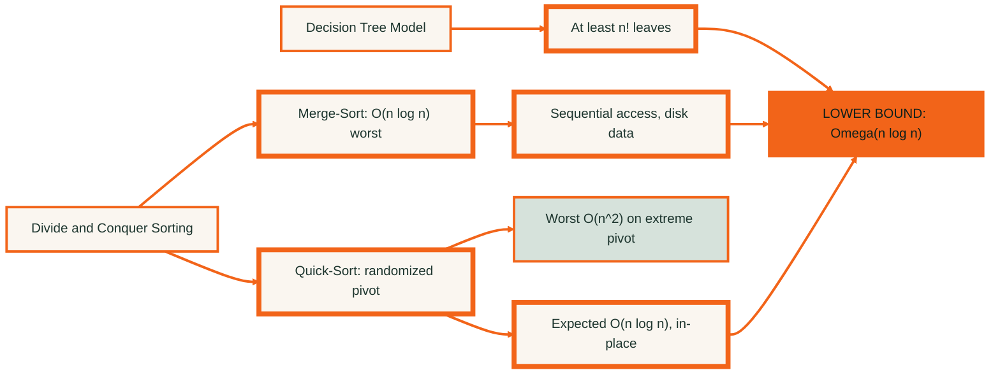
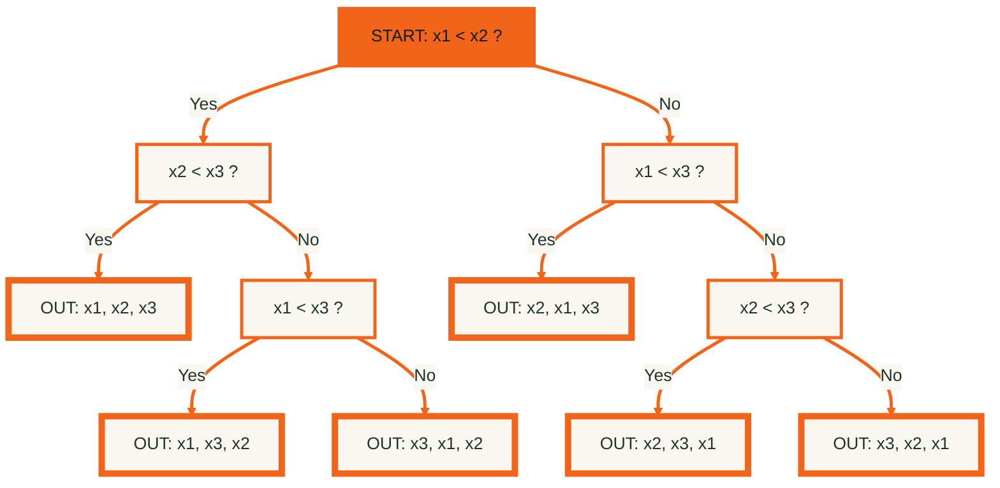
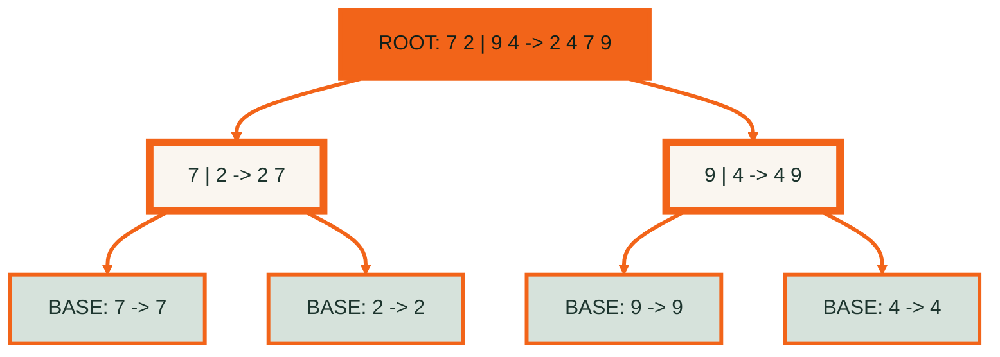

# 05 — Ταξινόμηση και Κάτω Όριο Συγκρίσεων
*Sorting and Comparison-Based Lower Bound*

Το κεφάλαιο μελετά τους δύο θεμελιώδεις αλγορίθμους ταξινόμησης που βασίζονται στο παράδειγμα «Διαίρει και Βασίλευε» (`Divide and Conquer`), την ταξινόμηση με συγχώνευση (`Merge-Sort`) και τη γρήγορη ταξινόμηση (`Quick-Sort`), καθώς και το θεωρητικό κάτω όριο $\Omega(n \log n)$ για κάθε αλγόριθμο ταξινόμησης βάσει συγκρίσεων. Η ανάλυση των χρόνων εκτέλεσης στηρίζεται στις τεχνικές ασυμπτωτικής ανάλυσης της [01_analysis_of_algorithms.md](01_analysis_of_algorithms.md), ενώ οι αλγόριθμοι συγκρίνονται άμεσα με τις μεθόδους `Selection-Sort`, `Insertion-Sort` και `Heap-Sort` της [02_priority_queues_heaps.md](02_priority_queues_heaps.md). Οι αναδρομικές σχέσεις του `Merge-Sort` και του `Quick-Sort` αποτελούν τα πρότυπα παραδείγματα για τη γενική ανάλυση αναδρομών της [07_divide_and_conquer.md](07_divide_and_conquer.md). Εφαρμογή στην Τελική: η ταξινόμηση ακμών σε χρόνο $O(m \log n)$ αποτελεί το πρώτο βήμα του αλγορίθμου `Kruskal` για Δέντρα Επικάλυψης Ελαχίστου Κόστους (`MST`).

> **Εξεταστική κάλυψη:** Πρόοδος
> **Κεφάλαιο βιβλίου:** Κεφ. 8 | **Διαλέξεις:** `08_merge_sort.pdf`, `09_quick_sort.pdf`, `10_sorting_lower_bound.pdf`
> **Πηγή:** `Resources/Meta/mindmap.md` (Ενότητα 05)
> **Εκτός ύλης:** Καμία (ολόκληρο το Κεφάλαιο 8 εντός ύλης)

## Πίνακας Περιεχομένων

- [1. Εννοιολογικό Πλαίσιο και Συνολική Εικόνα](#1-εννοιολογικό-πλαίσιο-και-συνολική-εικόνα)
- [2. Θεωρητική Θεμελίωση και Τυπικοί Ορισμοί](#2-θεωρητική-θεμελίωση-και-τυπικοί-ορισμοί)
- [3. Αλγόριθμοι, Ιχνηλάτηση και Κώδικας](#3-αλγόριθμοι-ιχνηλάτηση-και-κώδικας)
- [4. Συγκριτική Ανάλυση και Πολυπλοκότητα](#4-συγκριτική-ανάλυση-και-πολυπλοκότητα)
- [5. Πλήρως Λυμένες Ασκήσεις Εξεταστικού Επιπέδου](#5-πλήρως-λυμένες-ασκήσεις-εξεταστικού-επιπέδου)
- [6. Οδηγός Επιβίωσης στις Εξετάσεις και Παγίδες](#6-οδηγός-επιβίωσης-στις-εξετάσεις-και-παγίδες)
- [7. Συνοπτικός Πίνακας Εννοιών](#7-συνοπτικός-πίνακας-εννοιών)

---

## 1. Εννοιολογικό Πλαίσιο και Συνολική Εικόνα

### Το Πρόβλημα και η Πραγματική Εφαρμογή

Μια μηχανή αναζήτησης στο Διαδίκτυο πρέπει να επιστρέφει ακαριαία τη λίστα όλων των εγγράφων που περιέχουν μια δεδομένη λέξη-κλειδί $k$. Η δομή δεδομένων που υλοποιεί αυτή τη λειτουργία ονομάζεται **ανεστραμμένο αρχείο (`inverted file`)** ή **ανεστραμμένο ευρετήριο (`inverted index`)**: για κάθε λέξη-κλειδί (π.χ. `dog`) τηρείται η λίστα των ζευγών `(αριθμός εγγράφου, θέση λέξης)` όπου εμφανίζεται (π.χ. `1:60, 1:70, 2:22, 3:20, 4:11`).

Η κατασκευή ενός ανεστραμμένου ευρετηρίου ανάγεται άμεσα στο πρόβλημα της ταξινόμησης:

1. Εξάγονται όλα τα ζεύγη $(k, d)$ από τη συλλογή εγγράφων, όπου $k$ είναι μια λέξη-κλειδί και $d$ η αναφορά του εγγράφου και της θέσης.
2. Ταξινομείται το σύνολο όλων των ζευγών $(k, d)$ κατά λέξη-κλειδί $k$. Η ταξινόμηση συγκεντρώνει όλες τις εμφανίσεις της ίδιας λέξης $k$ σε διαδοχικές θέσεις.
3. Με μία γραμμική σάρωση της ταξινομημένης ακολουθίας κατασκευάζεται ο πίνακας αναζήτησης εγγράφων για κάθε λέξη-κλειδί.

Επειδή οι συλλογές εγγράφων στο Διαδίκτυο περιλαμβάνουν εκατομμύρια ή δισεκατομμύρια ζεύγη που δεν χωρούν στην κύρια μνήμη, ένας τετραγωνικός αλγόριθμος $O(n^2)$ είναι απαγορευτικός και απαιτούνται αλγόριθμοι $O(n \log n)$ με κατάλληλο μοτίβο πρόσβασης στα δεδομένα.

### Χάρτης Εννοιών του Κεφαλαίου



Πορτοκαλί γέμισμα: το θεμελιώδες κάτω όριο συγκρίσεων $\Omega(n \log n)$. Παχύ περίγραμμα: οι βέλτιστες ασυμπτωτικά προσεγγίσεις (`Merge-Sort`, αναμενόμενο `Quick-Sort`) και το βήμα των $n!$ φύλλων. Απαλό πράσινο: η εκφυλισμένη χειρότερη περίπτωση $O(n^2)$ του `Quick-Sort`. Κρεμ: τα δύο κεντρικά πλαίσια ανάλυσης του κεφαλαίου.

Το κεφάλαιο απαντά σε δύο συμπληρωματικά ερωτήματα: πώς επιτυγχάνουμε χρόνο $O(n \log n)$ χωρίς βοηθητική ουρά προτεραιότητας (`Merge-Sort` με εγγυημένη χειρότερη περίπτωση και σειριακή προσπέλαση· `Quick-Sort` με τυχαιοποίηση, επί-τόπου εκτέλεση και ταχύτερη πράξη) και γιατί κανένας αλγόριθμος που βασίζεται αποκλειστικά σε συγκρίσεις ζευγών δεν μπορεί να ξεπεράσει το φράγμα $\Omega(n \log n)$.

### Πότε Χρησιμοποιείται Κάθε Μέθοδος

Για **μικρά σύνολα δεδομένων ($n < 1\text{K}$)**, οι απλοί επί-τόπου αλγόριθμοι $O(n^2)$ (`Insertion-Sort`, `Selection-Sort`) είναι συχνά ταχύτεροι λόγω μικρών σταθερών παραγόντων. Για **μεγάλα σύνολα στη μνήμη RAM ($1\text{K} \le n \le 1\text{M}$)**, ο τυχαιοποιημένος επί-τόπου `Quick-Sort` είναι ο ταχύτερος στην πράξη (αναμενόμενο $O(n \log n)$), ενώ ο `Heap-Sort` προτιμάται όταν απαιτείται αυστηρή εγγύηση χειρότερης περίπτωσης $O(n \log n)$ με $O(1)$ επιπλέον χώρο. Για **τεράστια σύνολα δεδομένων ($n > 1\text{M}$)** που αποθηκεύονται σε δίσκο, ο `Merge-Sort` υπερέχει διότι προσπελαύνει τα δεδομένα **διαδοχικά (`sequential access`)**, αποφεύγοντας τις ακριβές τυχαίες αναζητήσεις δίσκου.

---

## 2. Θεωρητική Θεμελίωση και Τυπικοί Ορισμοί

### 2.1 Παράδειγμα «Διαίρει και Βασίλευε» στην Ταξινόμηση

Ένας αλγόριθμος ταξινόμησης κατά το παράδειγμα **Διαίρει και Βασίλευε (`Divide and Conquer`)** σε μια ακολουθία $S$ μεγέθους $n$ οργανώνεται σε τρία βήματα:

1. **Διαίρει (`Divide`):** Διαιρεί την είσοδο $S$ σε δύο (ή περισσότερες) ξένες υποακολουθίες.
2. **Επανάλαβε (`Recur`):** Επιλύει αναδρομικά το πρόβλημα της ταξινόμησης σε κάθε υποακολουθία. Η βασική περίπτωση της αναδρομής είναι υποακολουθίες μεγέθους $0$ ή $1$, οι οποίες είναι εξ ορισμού ταξινομημένες.
3. **Βασίλευε (`Conquer`):** Συνδυάζει τις ταξινομημένες υποακολουθίες σε μία ενιαία ταξινομημένη ακολουθία για το $S$.

Η δομική διαφορά μεταξύ `Merge-Sort` και `Quick-Sort` εντοπίζεται στο πού εκτελείται η κύρια εργασία:

- Ο **`Merge-Sort`** κάνει τετριμμένη διαίρεση (απλή τομή στη μέση) και εκτελεί όλη τη συγκριτική εργασία στο βήμα **Βασίλευε** (`merge`).
- Ο **`Quick-Sort`** εκτελεί όλη τη συγκριτική εργασία στο βήμα **Διαίρει** (`partition`), ενώ το βήμα **Βασίλευε** είναι απλή συνένωση $L, E, G$ (ή μηδενική εργασία στην επί-τόπου εκδοχή).

---

### 2.2 Ανάλυση Χρόνου Εκτέλεσης του `Merge-Sort`

**Θεώρημα 2.1 (Πολυπλοκότητα `Merge-Sort`).** *Ο αλγόριθμος `Merge-Sort` ταξινομεί μια ακολουθία $S$ μεγέθους $n$ σε χρόνο $O(n \log n)$ στη χειρότερη περίπτωση.*

**Απόδειξη (μέσω δέντρου `Merge-Sort`).**
Η εκτέλεση του `Merge-Sort` αναπαρίσταται από ένα δυαδικό δέντρο $T$, όπου κάθε κόμβος αντιστοιχεί σε μία αναδρομική κλήση: η ρίζα περιέχει την αρχική ακολουθία μεγέθους $n$ και τα φύλλα αντιστοιχούν σε υποακολουθίες μεγέθους $0$ ή $1$. Για απλότητα έστω $n = 2^k$ (για γενικό $n$, το φράγμα ισχύει με χρήση $\lceil \log_2 n \rceil$).

1. **Ύψος δέντρου:** Σε κάθε αναδρομική κλήση το μέγεθος της ακολουθίας υποδιπλασιάζεται ($n \to n/2 \to n/4 \to \dots \to 1$). Μετά από $i$ βήματα το μέγεθος κάθε υποακολουθίας είναι $n / 2^i$. Η αναδρομή τερματίζει όταν $n / 2^h = 1$, δηλαδή:
$$h = \log_2 n = O(\log n)$$

2. **Έργο ανά επίπεδο βάθους $i$:** Στο βάθος $i$ ($0 \le i \le h - 1$) υπάρχουν ακριβώς $2^i$ κόμβοι, καθένας από τους οποίους διαμερίζει και συγχωνεύει μια ακολουθία μεγέθους $n / 2^i$ (και παράγει $2^{i+1}$ αναδρομικές κλήσεις). Επειδή οι λειτουργίες `partition` και `merge` σε ακολουθία μεγέθους $m$ απαιτούν χρόνο $O(m)$, το συνολικό έργο στο βάθος $i$ είναι:
$$W_i = 2^i \cdot O\!\left(\frac{n}{2^i}\right) = O(n)$$

| Βάθος $i$ | Πλήθος ακολουθιών | Μέγεθος καθεμίας | Συνολικό έργο επιπέδου |
|---|---|---|---|
| $0$ | $1$ | $n$ | $O(n)$ |
| $1$ | $2$ | $n/2$ | $O(n)$ |
| $2$ | $4$ | $n/4$ | $O(n)$ |
| $i$ | $2^i$ | $n/2^i$ | $O(n)$ |
| $h = \log_2 n$ | $n$ | $1$ | $O(n)$ |

3. **Συνολικός χρόνος:** Αθροίζοντας το έργο όλων των $h + 1 = O(\log n)$ επιπέδων προκύπτει η αναδρομική εξίσωση $T(n) = 2T(n/2) + cn$ με συνολικό χρόνο εκτέλεσης στη χειρότερη περίπτωση:
$$T(n) = \sum_{i=0}^{\log_2 n} O(n) = O(n \log n)$$

---

### 2.3 Χειρότερη και Αναμενόμενη Πολυπλοκότητα του Τυχαιοποιημένου `Quick-Sort`

**Πρόταση 2.2 (Χειρότερη Περίπτωση `Quick-Sort`).** *Ο χρόνος εκτέλεσης του `Quick-Sort` στη χειρότερη περίπτωση είναι $O(n^2)$.*

**Απόδειξη.**
Η χειρότερη περίπτωση συμβαίνει όταν σε κάθε αναδρομική κλήση το σημείο περιστροφής (`pivot`) $x$ είναι το ελάχιστο ή το μέγιστο στοιχείο της τρέχουσας ακολουθίας (και όλα τα στοιχεία είναι διακριτά). Τότε μία από τις υποακολουθίες $L, G$ έχει μέγεθος $n - 1$ και η άλλη μέγεθος $0$. Το δέντρο αναδρομής εκφυλίζεται σε αλυσίδα ύψους $n - 1$, όπου στο βάθος $i$ ($0 \le i \le n - 1$) εκτελείται έργο ανάλογο του $n - i$. Ο συνολικός χρόνος είναι ανάλογος του αθροίσματος:
$$n + (n - 1) + (n - 2) + \dots + 2 + 1 = \frac{n(n + 1)}{2} = O(n^2)$$

**Θεώρημα 2.3 (Αναμενόμενος Χρόνος Εκτέλεσης Τυχαιοποιημένου `Quick-Sort`).** *Όταν το σημείο περιστροφής $x$ επιλέγεται ομοιόμορφα τυχαία σε κάθε αναδρομική κλήση, ο αναμενόμενος χρόνος εκτέλεσης του `Quick-Sort` για οποιαδήποτε είσοδο μεγέθους $n$ είναι $O(n \log n)$.*

**Απόδειξη (επιχείρημα καλών και κακών κλήσεων).**
Θεωρούμε μια αναδρομική κλήση του `Quick-Sort` σε υποακολουθία μεγέθους $s$. Ορίζουμε:

- **Καλή κλήση (`good call`):** Τα μεγέθη και των δύο υποακολουθιών $L$ και $G$ είναι μικρότερα από $\frac{3}{4}s$, δηλαδή $|L| < \frac{3s}{4}$ και $|G| < \frac{3s}{4}$.
- **Κακή κλήση (`bad call`):** Ισχύει $|L| \ge \frac{3s}{4}$ ή $|G| \ge \frac{3s}{4}$.

1. **Πιθανότητα καλής κλήσης:** Αν διατάξουμε νοητά τα $s$ στοιχεία σε αύξουσα σειρά, κάθε pivot που βρίσκεται στο μεσαίο μισό της διάταξης (από τη θέση $\lfloor s/4 \rfloor + 1$ έως τη θέση $\lceil 3s/4 \rceil$) αφήνει το πολύ $3s/4$ στοιχεία σε καθεμία από τις $L$ και $G$. Ενδεικτικά, για $s = 16$ στοιχεία $\{1, 2, \dots, 16\}$, τα $8$ μεσαία στοιχεία $\{5, 6, 7, 8, 9, 10, 11, 12\}$ είναι καλά pivots (π.χ. pivot $= 5$ δίνει $|L| = 4 < 12$ και $|G| = 11 < 12$), ενώ τα $\{1, 2, 3, 4\}$ και $\{13, 14, 15, 16\}$ είναι κακά pivots. Επομένως, τουλάχιστον το $1/2$ των πιθανών pivots δίνει καλή κλήση:
$$\Pr[\text{καλή κλήση}] \ge \frac{1}{2}$$

2. **Γεγονός από τη Θεωρία Πιθανοτήτων (ρίψεις νομίσματος):** Ο αναμενόμενος αριθμός ανεξάρτητων ρίψεων ενός δίκαιου νομίσματος για να εμφανιστούν $k$ κορώνες είναι $2k$.

3. **Αναμενόμενο μέγεθος σε βάθος $i$:** Εξετάζουμε έναν κόμβο $v$ στο δέντρο εκτέλεσης του `Quick-Sort` σε βάθος $i$ από τη ρίζα. Κατά μήκος του μονοπατιού των $i$ προγόνων του $v$, αναμένουμε $i/2$ από αυτούς να είναι καλές κλήσεις. Κάθε καλή κλήση πολλαπλασιάζει το μέγεθος της ακολουθίας επί παράγοντα μικρότερο του $3/4$, ενώ κάθε κακή κλήση δεν αυξάνει το μέγεθος (πολλαπλασιάζει το πολύ επί $1$). Άρα το αναμενόμενο μέγεθος εισόδου σε βάθος $i$ φράσσεται από:
$$s(v) \le \left(\frac{3}{4}\right)^{i/2} n$$

4. **Αναμενόμενο ύψος δέντρου:** Το αναμενόμενο μέγεθος φτάνει το $1$ (βασική περίπτωση) όταν:
$$\left(\frac{3}{4}\right)^{i/2} n = 1 \iff n = \left(\frac{4}{3}\right)^{i/2} \iff \frac{i}{2} = \log_{4/3} n \iff i = 2 \log_{4/3} n$$
Άρα το αναμενόμενο ύψος του δέντρου `Quick-Sort` είναι $2 \log_{4/3} n = O(\log n)$.

5. **Συνολικός αναμενόμενος χρόνος:** Οι υποακολουθίες όλων των κόμβων στο ίδιο βάθος $i$ είναι ανά δύο ξένες, επομένως το άθροισμα των μεγεθών τους είναι το πολύ $n$ και το συνολικό έργο στο επίπεδο $i$ είναι $O(n)$. Με $O(\log n)$ αναμενόμενα επίπεδα και $O(n)$ έργο ανά επίπεδο, ο συνολικός αναμενόμενος χρόνος εκτέλεσης είναι:
$$E[T(n)] = O(n \log n)$$

> **Διάκριση κρίσιμη για τις εξετάσεις:** Το «αναμενόμενο $O(n \log n)$» του τυχαιοποιημένου `Quick-Sort` αναφέρεται στη μέση τιμή ως προς τις **τυχαίες επιλογές pivot του ίδιου του αλγορίθμου**, και ισχύει για **κάθε** είσοδο (ακόμα και για ήδη ταξινομημένο πίνακα). Δεν προϋποθέτει ότι οι είσοδοι κατανέμονται τυχαία (μέση περίπτωση εισόδων).

---

### 2.4 Κάτω Όριο Ταξινόμησης βάσει Συγκρίσεων (`Comparison-Based Sorting Lower Bound`)

#### Μοντέλο Δέντρου Αποφάσεων (`Decision Tree Model`)

Ένας αλγόριθμος ταξινόμησης χαρακτηρίζεται **αλγόριθμος βάσει συγκρίσεων (`comparison-based sorting algorithm`)** όταν η μόνη πληροφορία που αντλεί για τη σχετική διάταξη των $n$ στοιχείων εισόδου $x_1, x_2, \dots, x_n$ προέρχεται από δυαδικές συγκρίσεις ζευγών της μορφής «είναι $x_i < x_j$;». Σε αυτή την κατηγορία ανήκουν οι `Bubble-Sort`, `Selection-Sort`, `Insertion-Sort`, `Heap-Sort`, `Merge-Sort` και `Quick-Sort`.

Για σταθερό $n$, κάθε καθοριστικός αλγόριθμος συγκρίσεων μοντελοποιείται από ένα δυαδικό **δέντρο αποφάσεων (`decision tree`)**:

- Κάθε **εσωτερικός κόμβος** αναπαριστά μία σύγκριση της μορφής $x_i < x_j$ με δύο εξερχόμενους κλάδους: `ναι` (αριστερά) και `όχι` (δεξιά).
- Κάθε **φύλλο** αναπαριστά μία τελική διάταξη εξόδου (μία μετάθεση των $x_1, x_2, \dots, x_n$).
- Κάθε πιθανή εκτέλεση του αλγορίθμου αντιστοιχεί σε ένα **μονοπάτι από τη ρίζα έως ένα φύλλο**. Ο αριθμός των συγκρίσεων στη χειρότερη περίπτωση ισούται με το **ύψος $h$** του δέντρου αποφάσεων.

#### Παράδειγμα Δέντρου Αποφάσεων για $n = 3$

Για $n = 3$ διακριτά στοιχεία $(x_1, x_2, x_3)$ υπάρχουν $3! = 6$ δυνατές μεταθέσεις εξόδου, οι οποίες αντιστοιχούν στα $6$ φύλλα του παρακάτω δέντρου αποφάσεων ύψους $h = 3$:



Πορτοκαλί γέμισμα: η αρχική σύγκριση στη ρίζα (`START`). Κρεμ: οι ενδιάμεσοι κόμβοι σύγκρισης. Παχύ περίγραμμα: τα $6 = 3!$ φύλλα εξόδου (`OUT`), καθένα με διαφορετική μετάθεση.

Ο μέγιστος αριθμός συγκρίσεων στο παραπάνω δέντρο είναι $h = 3$ (στα φύλλα βάθους $3$, όπως `(x1, x3, x2)`). Παρατηρούμε ότι $\lceil \log_2(3!) \rceil = \lceil \log_2 6 \rceil = \lceil 2.585 \rceil = 3$, επομένως το δέντρο αυτό είναι βέλτιστο για $n = 3$.

#### Θεώρημα Κάτω Ορίου

**Θεώρημα 2.4 (Κάτω Όριο Ταξινόμησης βάσει Συγκρίσεων).** *Κάθε αλγόριθμος ταξινόμησης που βασίζεται σε συγκρίσεις απαιτεί χρόνο $\Omega(n \log n)$ στη χειρότερη περίπτωση για να ταξινομήσει $n$ στοιχεία.*

**Απόδειξη (πλήρης αλυσίδα ανισοτήτων).**

1. **Ελάχιστος αριθμός φύλλων:** Έστω είσοδος $n$ διακριτών στοιχείων. Υπάρχουν $n! = 1 \cdot 2 \cdots n$ διαφορετικές μεταθέσεις της εισόδου. Κάθε μετάθεση πρέπει να οδηγεί σε **διαφορετικό** φύλλο εξόδου: αν δύο διαφορετικές μεταθέσεις (π.χ. $\dots, 4, \dots, 5, \dots$ και $\dots, 5, \dots, 4, \dots$) κατέληγαν στο ίδιο φύλλο, ο αλγόριθμος θα εφάρμοζε την ίδια αναδιάταξη και στις δύο, παράγοντας εσφαλμένη έξοδο για τουλάχιστον μία από αυτές. Επομένως, το πλήθος $L$ των φύλλων του δέντρου αποφάσεων ικανοποιεί:
$$L \ge n!$$

2. **Σχέση ύψους και φύλλων σε δυαδικό δέντρο:** Ένα δυαδικό δέντρο ύψους $h$ έχει το πολύ $2^h$ φύλλα, άρα:
$$2^h \ge L \ge n!$$

3. **Λήψη δυαδικού λογαρίθμου:** Επειδή η συνάρτηση $\log_2$ είναι γνησίως αύξουσα:
$$h \ge \log_2(n!)$$

4. **Κάτω φράγμα για το $n!$:** Γράφουμε το παραγοντικό ως γινόμενο και απορρίπτουμε το μικρότερο μισό των παραγόντων (όσους είναι μικρότεροι από $n/2$). Οι υπόλοιποι τουλάχιστον $n/2$ παράγοντες (οι μεγαλύτεροι: $\lceil n/2 \rceil, \dots, n$) είναι καθένας μεγαλύτερος ή ίσος του $n/2$:
$$n! = 1 \cdot 2 \cdots \left\lfloor \frac{n}{2} \right\rfloor \cdot \left(\left\lfloor \frac{n}{2} \right\rfloor + 1\right) \cdots n \ge \underbrace{\left(\frac{n}{2}\right) \cdot \left(\frac{n}{2}\right) \cdots \left(\frac{n}{2}\right)}_{n/2 \text{ παράγοντες}} = \left(\frac{n}{2}\right)^{n/2}$$

5. **Συμπέρασμα:** Αντικαθιστώντας στην ανισότητα για το ύψος $h$:
$$h \ge \log_2(n!) \ge \log_2\!\left(\left(\frac{n}{2}\right)^{n/2}\right) = \frac{n}{2} \log_2\!\left(\frac{n}{2}\right) = \frac{n}{2}(\log_2 n - 1)$$
Για $n \ge 4$ ισχύει $\log_2 n - 1 \ge \frac{1}{2}\log_2 n$, άρα:
$$h \ge \frac{1}{4} n \log_2 n \implies h = \Omega(n \log n)$$

Εφόσον ο αριθμός συγκρίσεων στη χειρότερη περίπτωση είναι τουλάχιστον $h$, κάθε αλγόριθμος ταξινόμησης βάσει συγκρίσεων απαιτεί χρόνο $\Omega(n \log n)$. Κατά συνέπεια, οι `Merge-Sort` και `Heap-Sort` (με χειρότερη περίπτωση $O(n \log n)$) είναι **ασυμπτωτικά βέλτιστοι** στην κλάση των αλγορίθμων συγκρίσεων.

---

## 3. Αλγόριθμοι, Ιχνηλάτηση και Κώδικας

### 3.1 Ταξινόμηση με Συγχώνευση (`Merge-Sort` και `merge`)

**Σκοπός:** Ταξινομεί αναδρομικά μια ακολουθία $S$ μεγέθους $n$ σε αύξουσα σειρά, διαιρώντας τη σε δύο ίσα μέρη και συγχωνεύοντας τα ταξινομημένα αποτελέσματα σε γραμμικό χρόνο $O(n)$.

#### Ψευδοκώδικας

```text
Algorithm mergeSort(S):
    Input: sequence S with n elements
    Output: sequence S sorted according to C
    if S.size() > 1 then
        (S1, S2) ← partition(S, n / 2)
        mergeSort(S1)
        mergeSort(S2)
        S ← merge(S1, S2)
```

```text
Algorithm merge(S1, S2, S):
    Input: Two arrays S1 and S2 of sizes n1 and n2, sorted in non-decreasing order,
           and an empty array S of size at least n1 + n2
    Output: S containing the elements from S1 and S2 in sorted order
    i ← 1
    j ← 1
    while i <= n1 and j <= n2 do
        if S1[i] <= S2[j] then
            S[i + j - 1] ← S1[i]
            i ← i + 1
        else
            S[i + j - 1] ← S2[j]
            j ← j + 1
    while i <= n1 do
        S[i + j - 1] ← S1[i]
        i ← i + 1
    while j <= n2 do
        S[i + j - 1] ← S2[j]
        j ← j + 1
```

#### Διάγραμμα Δέντρου Αναδρομής `Merge-Sort` (για $4$ στοιχεία)

Για την ακολουθία `[7, 2, 9, 4]`, το δέντρο αναδρομής δείχνει σε κάθε κόμβο την είσοδο (πριν τον διαμερισμό) και την έξοδο (μετά τη συγχώνευση):



Πορτοκαλί γέμισμα: η αρχική κλήση στη ρίζα (`ROOT`) με το τελικό ταξινομημένο αποτέλεσμα. Παχύ περίγραμμα: ενδιάμεσες κλήσεις διαίρεσης και συγχώνευσης. Απαλό πράσινο: τα φύλλα βασικής περίπτωσης (`BASE`) μεγέθους $1$.

Το δέντρο έχει ύψος $\log_2 4 = 2$, $2^i$ κόμβους στο βάθος $i$ και συνολικό έργο $4$ στοιχείων ανά επίπεδο.

#### Πίνακες Ιχνηλάτησης `Merge-Sort` σε $8$ στοιχεία

Είσοδος: `S = [7, 2, 9, 4, 3, 8, 6, 1]`. Κανόνας ισοβαθμίας: σε ίσα κλειδιά, προηγείται το στοιχείο της αριστερής υποακολουθίας (`<=`), γεγονός που διασφαλίζει τη **σταθερότητα (`stability`)** του αλγορίθμου.

**Φάση 1 — Πίνακας Διαιρέσεων (`Split`):**

| Επίπεδο βάθους | Υποακολουθίες στο επίπεδο | Μέγεθος καθεμίας |
|---|---|---|
| $0$ | `[7, 2, 9, 4, 3, 8, 6, 1]` | $8$ |
| $1$ | `[7, 2, 9, 4]`, `[3, 8, 6, 1]` | $4$ |
| $2$ | `[7, 2]`, `[9, 4]`, `[3, 8]`, `[6, 1]` | $2$ |
| $3$ (φύλλα) | `[7]`, `[2]`, `[9]`, `[4]`, `[3]`, `[8]`, `[6]`, `[1]` | $1$ |

**Φάση 2 — Πίνακας Συγχωνεύσεων (`Merge`):**

| Επίπεδο | Συγχωνεύσεις (`S1` + `S2`) | Αποτέλεσμα επιπέδου | Συγκρίσεις επιπέδου |
|---|---|---|---|
| $3 \to 2$ | `[7]+[2]`, `[9]+[4]`, `[3]+[8]`, `[6]+[1]` | `[2, 7]`, `[4, 9]`, `[3, 8]`, `[1, 6]` | $1 + 1 + 1 + 1 = 4$ |
| $2 \to 1$ | `[2, 7]+[4, 9]`, `[3, 8]+[1, 6]` | `[2, 4, 7, 9]`, `[1, 3, 6, 8]` | $3 + 3 = 6$ |
| $1 \to 0$ | `[2, 4, 7, 9]+[1, 3, 6, 8]` | `[1, 2, 3, 4, 6, 7, 8, 9]` | $7$ |

**Αναλυτική Ιχνηλάτηση της Τελικής Κλήσης `merge([2, 4, 7, 9], [1, 3, 6, 8])`:**

| Βήμα | `i` (`S1[i]`) | `j` (`S2[j]`) | Σύγκριση | Επιλεγμένο στοιχείο | Πίνακας `S` μέχρι στιγμής |
|---|---|---|---|---|---|
| $1$ | $0$ (`2`) | $0$ (`1`) | $2 \le 1$ (Όχι) | `1` (από `S2`) | `[1]` |
| $2$ | $0$ (`2`) | $1$ (`3`) | $2 \le 3$ (Ναι) | `2` (από `S1`) | `[1, 2]` |
| $3$ | $1$ (`4`) | $1$ (`3`) | $4 \le 3$ (Όχι) | `3` (από `S2`) | `[1, 2, 3]` |
| $4$ | $1$ (`4`) | $2$ (`6`) | $4 \le 6$ (Ναι) | `4` (από `S1`) | `[1, 2, 3, 4]` |
| $5$ | $2$ (`7`) | $2$ (`6`) | $7 \le 6$ (Όχι) | `6` (από `S2`) | `[1, 2, 3, 4, 6]` |
| $6$ | $2$ (`7`) | $3$ (`8`) | $7 \le 8$ (Ναι) | `7` (από `S1`) | `[1, 2, 3, 4, 6, 7]` |
| $7$ | $3$ (`9`) | $3$ (`8`) | $9 \le 8$ (Όχι) | `8` (από `S2`) | `[1, 2, 3, 4, 6, 7, 8]` |
| $8$ | $3$ (`9`) | $4$ (τέλος) | αντιγραφή υπολοίπου `S1` | `9` (από `S1`) | `[1, 2, 3, 4, 6, 7, 8, 9]` |

#### Υλοποίηση σε Python (Δυαδική Μορφή)

**Ρητός αλγόριθμος (`merge` και `mergeSort` — ό,τι ζητά η εξέταση):**

```python
def merge(left: list[int], right: list[int]) -> list[int]:
    """Merges two sorted lists into a single sorted list.

    Args:
        left (list[int]): First sorted list in non-decreasing order.
        right (list[int]): Second sorted list in non-decreasing order.

    Returns:
        list[int]: A new sorted list containing all elements from left and right.
    """
    result: list[int] = []
    left_index = 0
    right_index = 0

    while left_index < len(left) and right_index < len(right):
        # Using <= preserves relative order of equal keys (stability).
        if left[left_index] <= right[right_index]:
            result.append(left[left_index])
            left_index += 1
        else:
            result.append(right[right_index])
            right_index += 1

    # Copy any remaining tail elements without further comparisons.
    while left_index < len(left):
        result.append(left[left_index])
        left_index += 1
    while right_index < len(right):
        result.append(right[right_index])
        right_index += 1

    return result


def mergeSort(sequence: list[int]) -> list[int]:
    """Sorts a list in non-decreasing order using top-down Merge-Sort.

    Args:
        sequence (list[int]): Input list of integers to sort.

    Returns:
        list[int]: A new list containing the sorted elements.
    """
    if len(sequence) <= 1:
        return sequence[:]

    mid = len(sequence) // 2
    left_sorted = mergeSort(sequence[:mid])
    right_sorted = mergeSort(sequence[mid:])
    return merge(left_sorted, right_sorted)


assert merge([2, 4, 7, 9], [1, 3, 6, 8]) == [1, 2, 3, 4, 6, 7, 8, 9]
assert mergeSort([7, 2, 9, 4, 3, 8, 6, 1]) == [1, 2, 3, 4, 6, 7, 8, 9]
```

**Pythonic ιδίωμα (επαλήθευση μόνο):**

```python
data = [7, 2, 9, 4, 3, 8, 6, 1]
sorted_copy = sorted(data)   # επιστρέφει νέα ταξινομημένη λίστα, αμετάβλητη η data
data.sort()                  # ταξινομεί επί τόπου, επιστρέφει None
assert sorted_copy == [1, 2, 3, 4, 6, 7, 8, 9]
assert data == [1, 2, 3, 4, 6, 7, 8, 9]
```

| Μορφή | Χρόνος (χειρότερη) | Επιπλέον χώρος | Σταθερός | Σημείωση |
|---|---|---|---|---|
| `mergeSort(sequence)` | $O(n \log n)$ | $O(n)$ | Ναι | Ο ρητός αλγόριθμος που ζητά η εξέταση |
| `sorted(data)` | $O(n \log n)$ | $O(n)$ | Ναι | Υλοποιεί Timsort (επιστρέφει νέο αντίγραφο) |
| `data.sort()` | $O(n \log n)$ | $O(n)$ (βοηθητικός Timsort) | Ναι | Τροποποιεί τη λίστα επί τόπου |

Και οι δύο μορφές έχουν χειρότερη περίπτωση $O(n \log n)$ και είναι σταθερές· ωστόσο στην εξέταση γράφεται πάντοτε ο ρητός αλγόριθμος και η ιχνηλάτησή του, ενώ το `sorted()` χρησιμεύει μόνο ως έλεγχος ορθότητας.

#### Ανάλυση Πολυπλοκότητας Γραμμή προς Γραμμή (`Merge-Sort`)

- Στη `merge`: κάθε επανάληψη των τριών βρόχων `while` προωθεί είτε το `left_index` είτε το `right_index` κατά $1$, προσθέτοντας ένα στοιχείο στο `result`. Άρα εκτελούνται ακριβώς $n_1 + n_2$ προσθήκες, δηλαδή χρόνος $\Theta(n_1 + n_2)$ και επιπλέον χώρος $\Theta(n_1 + n_2)$.
- Στη `mergeSort`: για $n \le 1$ ο χρόνος είναι $O(1)$. Για $n > 1$ οι τομές `sequence[:mid]` και `sequence[mid:]` κοστίζουν $\Theta(n)$, οι δύο αναδρομικές κλήσεις $2T(n/2)$ και η `merge` κοστίζει $\Theta(n)$. Άρα $T(n) = 2T(n/2) + \Theta(n) = \Theta(n \log n)$ σε όλες τις περιπτώσεις (καλύτερη, μέση, χειρότερη), με επιπλέον χώρο $O(n)$.

---

### 3.2 Τυχαιοποιημένη Γρήγορη Ταξινόμηση (`Quick-Sort` — Τριμερής Διαμερισμός)

**Σκοπός:** Ταξινομεί μια ακολουθία $S$ επιλέγοντας τυχαίο σημείο περιστροφής (`pivot`) $x$, διαμερίζοντας το $S$ σε τρεις ακολουθίες $L$ ($< x$), $E$ ($= x$), $G$ ($> x$) σε χρόνο $O(n)$, ταξινομώντας αναδρομικά μόνο τις $L$ και $G$, και συνενώνοντας $L, E, G$.

#### Ψευδοκώδικας

```text
Algorithm partition(S, p):
    Input: sequence S, position p of pivot
    Output: subsequences L, E, G of the elements of S less than, equal to,
            or greater than the pivot, respectively
    L, E, G ← empty sequences
    x ← S.remove(p)
    E.addLast(x)
    while not S.isEmpty() do
        y ← S.remove(S.first())
        if y < x then
            L.addLast(y)
        else if y = x then
            E.addLast(y)
        else
            G.addLast(y)
    return L, E, G
```

```text
Algorithm quickSort(S):
    Input: sequence S with n elements
    Output: sequence S sorted in non-decreasing order
    if S.size() <= 1 then
        return S
    p ← random position in S
    (L, E, G) ← partition(S, p)
    L ← quickSort(L)
    G ← quickSort(G)
    return concatenate(L, E, G)
```

> Σημείωση για τον ψευδοκώδικα της διάλεξης `09_quick_sort.pdf`: στο βήμα αφαίρεσης του pivot ($x \leftarrow S.\text{remove}(p)$) το ίδιο το pivot $x$ πρέπει να εισάγεται στο $E$ (είτε πριν τον βρόχο `while` όπως παραπάνω, είτε στο τέλος του διαμερισμού), ώστε να μη χάνεται από την τελική συνένωση $L, E, G$.

#### Ιχνηλάτηση Τριμερούς `Quick-Sort` (σταθερός κανόνας επιλογής pivot)

Είσοδος: `S = [7, 2, 9, 4, 3, 7, 6, 1]` (το παράδειγμα της διάλεξης `09_quick_sort.pdf`). Για μονοσήμαντη ιχνηλάτηση, εφαρμόζουμε τις εξής επιλογές pivot ανά κλήση (σημειωμένες στη στήλη `Pivot`):

| Κλήση | Είσοδος | Επιλεγμένο Pivot $x$ | $L$ ($< x$) | $E$ ($= x$) | $G$ ($> x$) | Επιστροφή `L + E + G` |
|---|---|---|---|---|---|---|
| $1$ (ρίζα) | `[7, 2, 9, 4, 3, 7, 6, 1]` | `6` | `[2, 4, 3, 1]` | `[6]` | `[7, 9, 7]` | `[1, 2, 3, 4, 6, 7, 7, 9]` |
| $2$ (αριστερά της $1$) | `[2, 4, 3, 1]` | `2` | `[1]` | `[2]` | `[4, 3]` | `[1, 2, 3, 4]` |
| $3$ (αριστερά της $2$) | `[1]` | — (βασική) | — | — | — | `[1]` |
| $4$ (δεξιά της $2$) | `[4, 3]` | `3` | `[]` | `[3]` | `[4]` | `[3, 4]` |
| $5$ (δεξιά της $4$) | `[4]` | — (βασική) | — | — | — | `[4]` |
| $6$ (δεξιά της $1$) | `[7, 9, 7]` | `7` | `[]` | `[7, 7]` | `[9]` | `[7, 7, 9]` |
| $7$ (δεξιά της $6$) | `[9]` | — (βασική) | — | — | — | `[9]` |

Παρατηρήστε την κλήση $6$: επειδή τα δύο `7` τοποθετούνται μαζί στο $E = [7, 7]$, δεν χρειάζονται περαιτέρω αναδρομικές κλήσεις. Ο τριμερής διαμερισμός αντιμετωπίζει τα διπλότυπα κλειδιά σε γραμμικό χρόνο (σε πίνακα με όλα τα στοιχεία ίσα, ο τριμερής `Quick-Sort` τερματίζει σε $O(n)$).

---

### 3.3 Επί-Τόπου Γρήγορη Ταξινόμηση (`inPlaceQuickSort` και `inPlacePartition`)

**Σκοπός:** Υλοποιεί τον `Quick-Sort` χωρίς βοηθητικές λίστες $L, E, G$, αναδιατάσσοντας τα στοιχεία απευθείας στον πίνακα εισόδου με δύο συγκλίνοντες δείκτες $j, k$ και επιστρέφοντας τα όρια $(h, k)$ της ζώνης των ίσων με το pivot.

#### Ψευδοκώδικας

```text
Algorithm inPlaceQuickSort(S, l, r):
    Input: sequence S, ranks l and r
    Output: sequence S with the elements of rank between l and r
            rearranged in increasing order
    if l >= r then
        return
    i ← a random integer between l and r
    x ← S.elemAtRank(i)
    (h, k) ← inPlacePartition(S, l, r, x)
    inPlaceQuickSort(S, l, h - 1)
    inPlaceQuickSort(S, k + 1, r)
```

Η συνάρτηση `inPlacePartition(S, l, r, x)` εκτελείται σε δύο διαδοχικές σαρώσεις δύο δεικτών ($j$ από αριστερά προς τα δεξιά, $k$ από δεξιά προς τα αριστερά), όπως περιγράφεται στη διάλεξη `09_quick_sort.pdf`:

1. **Πρώτη σάρωση (`L` έναντι `E U G`):** Ο $j$ προχωρά δεξιά όσο $S[j] < x$· ο $k$ προχωρά αριστερά όσο $S[k] \ge x$· όσο $j < k$, ανταλλάσσονται τα $S[j]$ και $S[k]$. Όταν συναντηθούν, ο δείκτης $h = j$ ορίζει την αρχή της ζώνης $E \cup G$ (όλα τα στοιχεία σε θέσεις $< h$ είναι $< x$).
2. **Δεύτερη σάρωση (`E` έναντι `G`):** Στο υποδιάστημα $[h, r]$, ο $j$ προχωρά δεξιά όσο $S[j] = x$· ο $k$ προχωρά αριστερά όσο $S[k] > x$· όσο $j < k$, ανταλλάσσονται τα $S[j]$ και $S[k]$. Όταν συναντηθούν, τα στοιχεία σε θέσεις $[h, k]$ είναι ίσα με $x$ και τα στοιχεία σε θέσεις $> k$ είναι $> x$. Επιστρέφεται το ζεύγος $(h, k)$.

#### Ιχνηλάτηση `inPlacePartition` με Δύο Δείκτες

Είσοδος: `S = [7, 2, 9, 4, 3, 7, 6, 1]` με `l = 0`, `r = 7`, `pivot x = 6`.

| Σάρωση / Βήμα | Δείκτες (`j`, `k`) | Ενέργεια | Κατάσταση πίνακα `S` |
|---|---|---|---|
| Αρχή 1ης σάρωσης | `j = 0`, `k = 7` | Έλεγχος $S[0]=7 \ge 6$, $S[7]=1 < 6$ | `[7, 2, 9, 4, 3, 7, 6, 1]` |
| Σάρωση 1, Βήμα 1 | `j = 0`, `k = 7` | Ανταλλαγή `S[0]` (`7`) και `S[7]` (`1`), μετά `j=1, k=6` | `[1, 2, 9, 4, 3, 7, 6, 7]` |
| Σάρωση 1, Βήμα 2 | `j = 2`, `k = 4` | `j` προσπερνά `2` (σταματά στο `9`), `k` προσπερνά `6, 7` (σταματά στο `3`)· ανταλλαγή `S[2]` (`9`) και `S[4]` (`3`), μετά `j=3, k=3` | `[1, 2, 3, 4, 9, 7, 6, 7]` |
| Τέλος 1ης σάρωσης | `j = 4`, `k = 3` | `j` προσπερνά `4` (σταματά στο `9`), `k` σταματά στο `4` (`j > k`)· ορίζεται **`h = 4`** | `[1, 2, 3, 4 | 9, 7, 6, 7]` |
| Σάρωση 2, Βήμα 1 | `j = 4`, `k = 6` | Στο `[4..7]`: `j` σταματά στο `9` ($\ne 6$), `k` προσπερνά `7` και σταματά στο `6`· ανταλλαγή `S[4]` (`9`) και `S[6]` (`6`), μετά `j=5, k=5` | `[1, 2, 3, 4 | 6, 7, 9, 7]` |
| Τέλος 2ης σάρωσης | `j = 5`, `k = 4` | `k` προσπερνά `7` (`k=4`), `j > k`· επιστρέφεται **`(h = 4, k = 4)`** | `[1, 2, 3, 4 | 6 | 7, 9, 7]` |

Μετά την επιστροφή `(4, 4)`, τα στοιχεία στις θέσεις `[0..3]` είναι όλα $< 6$, το στοιχείο στη θέση `4` είναι $= 6$, και τα στοιχεία στις θέσεις `[5..7]` είναι όλα $> 6$. Οι επόμενες αναδρομικές κλήσεις είναι `inPlaceQuickSort(S, 0, 3)` και `inPlaceQuickSort(S, 5, 7)`.

#### Υλοποίηση σε Python (Δυαδική Μορφή)

**Ρητοί αλγόριθμοι (`quickSort` με τριμερή διαμερισμό και `inPlaceQuickSort`):**

```python
import random


def quickSort(sequence: list[int]) -> list[int]:
    """Sorts a list using randomized three-way Quick-Sort.

    Args:
        sequence (list[int]): Input list of integers to sort.

    Returns:
        list[int]: A new list containing the sorted elements.
    """
    if len(sequence) <= 1:
        return sequence[:]

    pivot = sequence[random.randrange(len(sequence))]
    # Three-way split handles duplicate keys without quadratic blow-up.
    less = [item for item in sequence if item < pivot]
    equal = [item for item in sequence if item == pivot]
    greater = [item for item in sequence if item > pivot]
    return quickSort(less) + equal + quickSort(greater)


def inPlacePartition(
    sequence: list[int], left: int, right: int, pivot: int
) -> tuple[int, int]:
    """Partitions sequence[left..right] in place into < pivot, == pivot, > pivot.

    Args:
        sequence (list[int]): The list being partitioned in place.
        left (int): Starting index of the subarray.
        right (int): Ending index (inclusive) of the subarray.
        pivot (int): Pivot value for partitioning.

    Returns:
        tuple[int, int]: Indices (h, k) where elements < pivot are in [left..h-1],
            elements == pivot are in [h..k], and elements > pivot are in [k+1..right].
    """
    # Pass 1: separate elements strictly smaller than pivot from the rest.
    j, k = left, right
    while j <= k:
        while j <= k and sequence[j] < pivot:
            j += 1
        while j <= k and sequence[k] >= pivot:
            k -= 1
        if j < k:
            sequence[j], sequence[k] = sequence[k], sequence[j]
            j += 1
            k -= 1
    h = j

    # Pass 2: separate elements equal to pivot from elements strictly greater.
    j, k = h, right
    while j <= k:
        while j <= k and sequence[j] == pivot:
            j += 1
        while j <= k and sequence[k] > pivot:
            k -= 1
        if j < k:
            sequence[j], sequence[k] = sequence[k], sequence[j]
            j += 1
            k -= 1
    return h, k


def inPlaceQuickSort(sequence: list[int], left: int, right: int) -> None:
    """Sorts sequence[left..right] in place using randomized three-way Quick-Sort.

    Args:
        sequence (list[int]): The list to sort in place.
        left (int): Starting index of the subarray.
        right (int): Ending index (inclusive) of the subarray.

    Returns:
        None: The list is modified in place.
    """
    if left >= right:
        return
    pivot = sequence[random.randint(left, right)]
    h, k = inPlacePartition(sequence, left, right, pivot)
    inPlaceQuickSort(sequence, left, h - 1)
    inPlaceQuickSort(sequence, k + 1, right)


sample = [7, 2, 9, 4, 3, 7, 6, 1]
assert quickSort(sample) == [1, 2, 3, 4, 6, 7, 7, 9]

partition_test = [7, 2, 9, 4, 3, 7, 6, 1]
assert inPlacePartition(partition_test, 0, len(partition_test) - 1, 6) == (4, 4)
assert partition_test == [1, 2, 3, 4, 6, 7, 9, 7]

in_place_test = [7, 2, 9, 4, 3, 7, 6, 1]
inPlaceQuickSort(in_place_test, 0, len(in_place_test) - 1)
assert in_place_test == [1, 2, 3, 4, 6, 7, 7, 9]
```

**Pythonic ιδίωμα (επαλήθευση μόνο):**

```python
items = [7, 2, 9, 4, 3, 7, 6, 1]
sorted_items = sorted(items)                    # νέα ταξινομημένη λίστα
items.sort(key=lambda value: value)             # επί-τόπου ταξινόμηση με συνάρτηση κλειδιού
assert sorted_items == [1, 2, 3, 4, 6, 7, 7, 9]
assert items == [1, 2, 3, 4, 6, 7, 7, 9]
```

> **Προειδοποίηση υλοποίησης (Python `sorted` / `list.sort` έναντι `Quick-Sort`):** Οι ενσωματωμένες `sorted()` και `list.sort()` της Python **δεν** χρησιμοποιούν `Quick-Sort`. Υλοποιούν τον αλγόριθμο **Timsort** (υβρίδιο `Merge-Sort` και `Insertion-Sort`), ο οποίος είναι **σταθερός (`stable`)**, έχει εγγυημένη **χειρότερη περίπτωση $O(n \log n)$** (και καλύτερη $O(n)$ σε ήδη ταξινομημένα δεδομένα), σε αντίθεση με τον `Quick-Sort` που είναι ασταθής (`unstable`) και έχει χειρότερη περίπτωση $O(n^2)$.

#### Ανάλυση Πολυπλοκότητας Γραμμή προς Γραμμή (`inPlaceQuickSort`)

- Στην `inPlacePartition`: κάθε μία από τις δύο σαρώσεις μετακινεί τους δείκτες $j$ και $k$ αυστηρά προς το κέντρο μέχρι να διασταυρωθούν, επομένως κάθε στοιχείο του υποδιαστήματος $[l, r]$ εξετάζεται το πολύ δύο φορές. Ο χρόνος είναι $\Theta(r - l + 1)$ και ο επιπλέον χώρος $O(1)$.
- Στην `inPlaceQuickSort`: το συνολικό έργο ανά επίπεδο αναδρομής είναι $O(n)$. Στη χειρότερη περίπτωση (ακραίο pivot) το βάθος αναδρομής είναι $O(n)$, δίνοντας χρόνο $O(n^2)$ και χώρο στοίβας αναδρομής $O(n)$. Με τυχαίο pivot το αναμενόμενο βάθος είναι $2 \log_{4/3} n = O(\log n)$, δίνοντας **αναμενόμενο χρόνο $O(n \log n)$** και αναμενόμενο χώρο στοίβας $O(\log n)$.

---

## 4. Συγκριτική Ανάλυση και Πολυπλοκότητα

### Πίνακας Σύγκρισης Αλγορίθμων Ταξινόμησης (Ύλη Προόδου)

Ο πίνακας συνοψίζει όλους τους αλγορίθμους ταξινόμησης της Προόδου (Κεφ. 5 και Κεφ. 8) με ρητή επισήμανση της περίπτωσης πολυπλοκότητας:

| Αλγόριθμος | Καλύτερη περίπτωση | Αναμενόμενη / Μέση | Χειρότερη περίπτωση | Επιπλέον χώρος | Επί-τόπου (`in-place`) | Σταθερός (`stable`) | Προτεινόμενο μέγεθος και χρήση |
|---|---|---|---|---|---|---|---|
| `Selection-Sort` | $O(n^2)$ | $O(n^2)$ | $O(n^2)$ | $O(1)$ | Ναι | Όχι (τυπική επί-τόπου) | Μικρά σύνολα ($< 1\text{K}$), ελάχιστες ανταλλαγές |
| `Insertion-Sort` | $O(n)$ | $O(n^2)$ | $O(n^2)$ | $O(1)$ | Ναι | Ναι | Μικρά σύνολα ($< 1\text{K}$) ή σχεδόν ταξινομημένα |
| `Heap-Sort` | $O(n \log n)$ | $O(n \log n)$ | $O(n \log n)$ | $O(1)$ | Ναι | Όχι | Μεγάλα σύνολα ($1\text{K}\text{–}1\text{M}$) με αυστηρή εγγύηση χειρότερης περίπτωσης |
| `Quick-Sort` (τυχαιοποιημένος) | $O(n \log n)$ | $O(n \log n)$ (αναμενόμενη) | $O(n^2)$ | $O(\log n)$ αναμενόμενη στοίβα ($O(n)$ χειρότερη) | Ναι (`inPlaceQuickSort`) | Όχι | Μεγάλα σύνολα ($1\text{K}\text{–}1\text{M}$) στη RAM· ταχύτερος στην πράξη |
| `Merge-Sort` | $O(n \log n)$ | $O(n \log n)$ | $O(n \log n)$ | $O(n)$ | Όχι | Ναι | Τεράστια σύνολα ($> 1\text{M}$), δεδομένα σε δίσκο (σειριακή προσπέλαση), απαίτηση σταθερότητας |

### Κανόνας Επιλογής Αλγορίθμου στην Εξέταση

1. **Μικρή είσοδος ($n < 1\text{K}$) ή σχεδόν ταξινομημένη ακολουθία:** `Insertion-Sort` (απλός, επί-τόπου, $O(n)$ σε ήδη ταξινομημένη είσοδο).
2. **Μεγάλη είσοδος στη RAM με προτεραιότητα την πρακτική ταχύτητα:** Τυχαιοποιημένος `inPlaceQuickSort` (μικροί σταθεροί παράγοντες, εξαιρετική τοπικότητα κρυφής μνήμης, αναμενόμενο $O(n \log n)$).
3. **Μεγάλη είσοδος στη RAM με αυστηρό όριο χειρότερης περίπτωσης ΚΑΙ $O(1)$ επιπλέον μνήμη:** `Heap-Sort` (εγγυημένο $O(n \log n)$ χειρότερης περίπτωσης, επί-τόπου).
4. **Τεράστια δεδομένα ($> 1\text{M}$) σε δευτερεύουσα μνήμη (δίσκος) ή απαίτηση σταθερότητας με εγγύηση $O(n \log n)$:** `Merge-Sort` (σειριακή προσπέλαση, χωρίς τυχαία άλματα μνήμης, σταθερός).

---

## 5. Πλήρως Λυμένες Ασκήσεις Εξεταστικού Επιπέδου

### Άσκηση 1 — Πλήρης Ιχνηλάτηση (`Merge-Sort` και `inPlaceQuickSort`)

**Εκφώνηση.** Δίνεται ο πίνακας $A = [6, 2, 8, 4, 1, 5]$.
(α) Εκτελέστε τον αλγόριθμο `Merge-Sort` δείχνοντας όλα τα επίπεδα διαίρεσης και συγχώνευσης, καθώς και τον συνολικό αριθμό συγκρίσεων κλειδιών.
(β) Εκτελέστε τον αλγόριθμο `inPlaceQuickSort` επιλέγοντας καθοριστικά ως pivot το τελευταίο στοιχείο `S[r]` κάθε υποπίνακα, δείχνοντας κάθε διαμερισμό `inPlacePartition` και τα επιστρεφόμενα όρια $(h, k)$.

**Στρατηγική.** Στο (α) διασπούμε διαδοχικά στη μέση ($\lfloor n/2 \rfloor$ αριστερά, $\lceil n/2 \rceil$ δεξιά) μέχρι μοναδιαία στοιχεία και συγχωνεύουμε από κάτω προς τα πάνω μετρώντας κάθε σύγκριση $S_1[i] \le S_2[j]$. Στο (β) εφαρμόζουμε τις δύο σαρώσεις δεικτών $j, k$ της `inPlacePartition` για κάθε αναδρομική κλήση με `l < r`.

**Λύση.**

**(α) Ιχνηλάτηση `Merge-Sort`:**

1. **Διαιρέσεις:**
   - Επίπεδο $0$: `[6, 2, 8, 4, 1, 5]`
   - Επίπεδο $1$: `[6, 2, 8]` και `[4, 1, 5]`
   - Επίπεδο $2$: `[6]`, `[2, 8]` και `[4]`, `[1, 5]`
   - Επίπεδο $3$: `[2]`, `[8]` και `[1]`, `[5]` (τα `[6]` και `[4]` είναι ήδη φύλλα στο επίπεδο $2$).

2. **Συγχωνεύσεις (από κάτω προς τα πάνω):**
   - `merge([2], [8])`: σύγκριση $2 \le 8$ (Ναι) $\to$ `[2, 8]` ($1$ σύγκριση).
   - `merge([1], [5])`: σύγκριση $1 \le 5$ (Ναι) $\to$ `[1, 5]` ($1$ σύγκριση).
   - `merge([6], [2, 8])`:
     - $6 \le 2$ (Όχι) $\to$ `[2]`
     - $6 \le 8$ (Ναι) $\to$ `[2, 6]`, υπόλοιπο `8` $\to$ `[2, 6, 8]` ($2$ συγκρίσεις).
   - `merge([4], [1, 5])`:
     - $4 \le 1$ (Όχι) $\to$ `[1]`
     - $4 \le 5$ (Ναι) $\to$ `[1, 4]`, υπόλοιπο `5` $\to$ `[1, 4, 5]` ($2$ συγκρίσεις).
   - `merge([2, 6, 8], [1, 4, 5])`:
     - $2 \le 1$ (Όχι) $\to$ `[1]`
     - $2 \le 4$ (Ναι) $\to$ `[1, 2]`
     - $6 \le 4$ (Όχι) $\to$ `[1, 2, 4]`
     - $6 \le 5$ (Όχι) $\to$ `[1, 2, 4, 5]`, υπόλοιπο `6, 8` $\to$ `[1, 2, 4, 5, 6, 8]` ($4$ συγκρίσεις).

3. **Συνολικές συγκρίσεις:** $1 + 1 + 2 + 2 + 4 = 10$ συγκρίσεις.

**(β) Ιχνηλάτηση `inPlaceQuickSort` (pivot $= S[r]$):**

1. **Κλήση `inPlaceQuickSort(A, 0, 5)`**, υποπίνακας `[6, 2, 8, 4, 1, 5]`, pivot $x = A[5] = 5$:
   - Σάρωση 1 (`< 5` έναντι `>= 5`):
     - `j=0` (`6 >= 5`), `k=4` (`1 < 5`, αφού `5 >= 5`): ανταλλαγή `A[0]` και `A[4]` $\to$ `[1, 2, 8, 4, 6, 5]`.
     - `j=2` (`8 >= 5`), `k=3` (`4 < 5`): ανταλλαγή `A[2]` και `A[3]` $\to$ `[1, 2, 4, 8, 6, 5]`.
     - Τερματισμός με `j=3, k=2` $\to$ $h = 3$.
   - Σάρωση 2 (`== 5` έναντι `> 5` στο `[3..5]`):
     - `j=3` (`8 != 5`), `k=5` (`5 == 5`): ανταλλαγή `A[3]` και `A[5]` $\to$ `[1, 2, 4, 5, 6, 8]`.
     - Τερματισμός με `j=4, k=3` $\to$ επιστροφή `(h = 3, k = 3)`.
   - Αναδρομικές κλήσεις: `inPlaceQuickSort(A, 0, 2)` και `inPlaceQuickSort(A, 4, 5)`.

2. **Κλήση `inPlaceQuickSort(A, 0, 2)`**, υποπίνακας `[1, 2, 4]`, pivot $x = A[2] = 4$:
   - Σάρωση 1: `j` προχωρά έως `2`, `k` έως `1` (καμία ανταλλαγή) $\to$ $h = 2$.
   - Σάρωση 2 στο `[2..2]`: `j=3, k=2` (καμία ανταλλαγή) $\to$ επιστροφή `(2, 2)`.
   - Αναδρομικές κλήσεις: `inPlaceQuickSort(A, 0, 1)` και `inPlaceQuickSort(A, 3, 2)` (βασική περίπτωση, τερματίζει).

3. **Κλήση `inPlaceQuickSort(A, 0, 1)`**, υποπίνακας `[1, 2]`, pivot $x = A[1] = 2$:
   - Σάρωση 1: `j=1, k=0` $\to$ $h = 1$. Σάρωση 2: `(1, 1)`.
   - Αναδρομικές κλήσεις `[0..0]` και `[2..1]`: βασικές περιπτώσεις, τερματίζουν.

4. **Κλήση `inPlaceQuickSort(A, 4, 5)`**, υποπίνακας `[6, 8]`, pivot $x = A[5] = 8$:
   - Σάρωση 1: `j=5, k=4` $\to$ $h = 5$. Σάρωση 2: `(5, 5)`.
   - Αναδρομικές κλήσεις `[4..4]` και `[6..5]`: βασικές περιπτώσεις, τερματίζουν.

**Έλεγχος.** Και οι δύο αλγόριθμοι παράγουν τον ταξινομημένο πίνακα `[1, 2, 4, 5, 6, 8]`. Για $n = 6$, ισχύει $\lceil \log_2(6!) \rceil = \lceil \log_2 720 \rceil = 10$, και ο `Merge-Sort` πραγματοποίησε ακριβώς $10$ συγκρίσεις.

---

### Άσκηση 2 — Ανάλυση Πολυπλοκότητας με Δέντρο Αναδρομής

**Εκφώνηση.**
(α) Θεωρήστε μια παραλλαγή του `Merge-Sort` που διαιρεί τον πίνακα σε **τρία** ίσα μέρη μεγέθους $n/3$, τα ταξινομεί αναδρομικά και τα συγχωνεύει σε γραμμικό χρόνο $cn$. Γράψτε την αναδρομική εξίσωση και λύστε τη μέσω δέντρου αναδρομής. Είναι ασυμπτωτικά ταχύτερη από τον κλασικό `Merge-Sort`;
(β) Έστω ότι σε μια υλοποίηση του `Quick-Sort` ο διαμερισμός χωρίζει πάντα την ακολουθία σε αναλογία $1/4$ και $3/4$, δίνοντας την αναδρομική εξίσωση $T(n) = T(n/4) + T(3n/4) + cn$. Δείξτε μέσω δέντρου αναδρομής ότι $T(n) = O(n \log n)$.

**Στρατηγική.** Σχεδιάζουμε νοητά το δέντρο αναδρομής, υπολογίζουμε το έργο ανά επίπεδο και το μέγιστο ύψος του δέντρου, και αθροίζουμε.

**Λύση.**

**(α) Τριμερής `Merge-Sort`:**

1. **Αναδρομική εξίσωση:** Για $n = 3^k$ και σταθερά $c > 0$:
$$T(n) = 3T\!\left(\frac{n}{3}\right) + cn, \quad T(1) = c$$

2. **Έργο ανά επίπεδο βάθους $i$:**
   - Στο βάθος $i = 0$: $1$ κόμβος μεγέθους $n$, έργο $cn$.
   - Στο βάθος $i = 1$: $3$ κόμβοι μεγέθους $n/3$, έργο $3 \cdot c(n/3) = cn$.
   - Στο γενικό βάθος $i$: $3^i$ κόμβοι μεγέθους $n/3^i$, συνολικό έργο:
$$W_i = 3^i \cdot c\left(\frac{n}{3^i}\right) = cn$$

3. **Ύψος δέντρου:** Η αναδρομή τερματίζει όταν $n / 3^h = 1 \iff h = \log_3 n$.

4. **Συνολικός χρόνος:** Υπάρχουν $h + 1 = \log_3 n + 1$ επίπεδα, καθένα με έργο $cn$:
$$T(n) = cn(\log_3 n + 1) = c \frac{\log_2 n}{\log_2 3} n + cn = \Theta(n \log n)$$

5. **Σύγκριση με κλασικό `Merge-Sort`:** Επειδή $\log_3 n = \frac{\log_2 n}{\log_2 3}$ διαφέρει από το $\log_2 n$ μόνο κατά σταθερό παράγοντα ($1 / \log_2 3 \approx 0.631$), η τριμερής παραλλαγή **δεν** είναι ασυμπτωτικά ταχύτερη· παραμένει $\Theta(n \log n)$ (άλλωστε το κάτω όριο συγκρίσεων απαγορεύει χρόνο $o(n \log n)$).

**(β) Ανισομερής `Quick-Sort` με αναλογία $1/4$ και $3/4$:**

1. **Έργο ανά επίπεδο:**
   - Βάθος $0$: $n$ (έργο $cn$).
   - Βάθος $1$: υποπροβλήματα $n/4$ και $3n/4$, άθροισμα $n/4 + 3n/4 = n$ (έργο $cn$).
   - Βάθος $2$: υποπροβλήματα $n/16$, $3n/16$, $3n/16$, $9n/16$, άθροισμα $\frac{1 + 3 + 3 + 9}{16}n = n$ (έργο $cn$).
   - Σε κάθε βάθος $i$ όπου δεν έχουν τερματίσει ακόμη υποπροβλήματα, το έργο είναι $cn$· σε μεγαλύτερα βάθη (αφού τερματίσουν οι συντομότεροι κλάδοι) το έργο είναι **το πολύ** $cn$.

2. **Ελάχιστο και μέγιστο βάθος φύλλου:**
   - Ο συντομότερος κλάδος ακολουθεί πάντα το $1/4$: τερματίζει στο βάθος $h_{\min} = \log_4 n$.
   - Ο μακρύτερος κλάδος ακολουθεί πάντα το $3/4$: τερματίζει όταν $(3/4)^{h_{\max}} n = 1$, άρα:
$$h_{\max} = \log_{4/3} n = \frac{\log_2 n}{\log_2(4/3)}$$

3. **Άνω φράγμα συνολικού χρόνου:** Με το πολύ $h_{\max} + 1$ επίπεδα και έργο $\le cn$ σε κάθε επίπεδο:
$$T(n) \le cn(\log_{4/3} n + 1) = O(n \log n)$$

**Έλεγχος.** Και για το (β) το κάτω φράγμα από τα πλήρη επίπεδα είναι $\ge cn \log_4 n = \Omega(n \log n)$, άρα $T(n) = \Theta(n \log n)$. Ακόμη και ένας σταθερά ανισομερής διαμερισμός (όπως $1/4$–$3/4$) διατηρεί την πολυπλοκότητα $\Theta(n \log n)$· τετραγωνικός χρόνος εμφανίζεται μόνο όταν η μία πλευρά έχει σταθερό μέγεθος (π.χ. $0$ ή $1$).

---

### Άσκηση 3 — Απόδειξη Κάτω Ορίου και Εφαρμογή σε $n = 5$

**Εκφώνηση.**
(α) Αποδείξτε ότι δεν υπάρχει καθοριστικός αλγόριθμος ταξινόμησης βάσει συγκρίσεων που να ταξινομεί $n = 5$ διακριτά στοιχεία χρησιμοποιώντας το πολύ $6$ συγκρίσεις στη χειρότερη περίπτωση.
(β) Γενικεύστε το επιχείρημα για αυθαίρετο $n$ και δείξτε αναλυτικά όλα τα βήματα της ανισότητας που οδηγεί στο $\Omega(n \log n)$.

**Στρατηγική.** Εφαρμόζουμε το μοντέλο του δέντρου αποφάσεων: συγκρίνουμε τον μέγιστο αριθμό φύλλων ενός δυαδικού δέντρου ύψους $h$ με τον αριθμό των μεταθέσεων $n!$.

**Λύση.**

**(α) Περίπτωση $n = 5$:**

1. Για $n = 5$ διακριτά στοιχεία, το πλήθος όλων των δυνατών μεταθέσεων της εισόδου είναι:
$$5! = 5 \cdot 4 \cdot 3 \cdot 2 \cdot 1 = 120$$

2. Κάθε ορθός αλγόριθμος ταξινόμησης βάσει συγκρίσεων αντιστοιχεί σε ένα δυαδικό δέντρο αποφάσεων με τουλάχιστον $L \ge 120$ φύλλα, διότι δύο διαφορετικές μεταθέσεις δεν μπορούν να καταλήξουν στο ίδιο φύλλο χωρίς να παραχθεί εσφαλμένη έξοδος για τουλάχιστον μία από τις δύο.

3. Ένα δυαδικό δέντρο ύψους $h$ έχει το πολύ $2^h$ φύλλα. Αν υπήρχε αλγόριθμος με το πολύ $h = 6$ συγκρίσεις στη χειρότερη περίπτωση, το δέντρο αποφάσεών του θα είχε το πολύ:
$$2^6 = 64 \text{ φύλλα}$$

4. Επειδή $64 < 120$, βάσει της αρχής των περιστεριών (`pigeonhole principle`), τουλάχιστον δύο διαφορετικές μεταθέσεις θα κατέληγαν στο ίδιο φύλλο — άτοπο. Άρα απαιτούνται τουλάχιστον:
$$h \ge \lceil \log_2(120) \rceil = \lceil 6.907 \rceil = 7 \text{ συγκρίσεις}$$

**(β) Γενίκευση για αυθαίρετο $n$:**

1. Για $n$ διακριτά στοιχεία απαιτούνται $L \ge n!$ φύλλα, άρα $2^h \ge n! \implies h \ge \log_2(n!)$.
2. Κρατώντας μόνο τους $\lceil n/2 \rceil$ μεγαλύτερους παράγοντες του $n!$ (καθένας $\ge n/2$):
$$n! = \prod_{k=1}^{n} k \ge \prod_{k=\lceil n/2 \rceil}^{n} k \ge \left(\frac{n}{2}\right)^{n/2}$$
3. Λαμβάνοντας δυαδικό λογάριθμο και στα δύο μέλη:
$$h \ge \log_2(n!) \ge \log_2\!\left(\left(\frac{n}{2}\right)^{n/2}\right) = \frac{n}{2}\log_2\!\left(\frac{n}{2}\right) = \frac{n}{2}(\log_2 n - 1)$$
4. Για κάθε $n \ge 4$ ισχύει $\log_2 n \ge 2 \implies \log_2 n - 1 \ge \frac{1}{2}\log_2 n$, επομένως:
$$h \ge \frac{1}{4} n \log_2 n \implies h = \Omega(n \log n)$$

**Έλεγχος.** Για $n = 5$: $2^6 = 64 < 120 \le 128 = 2^7$, άρα το αυστηρό ελάχιστο είναι $7$ συγκρίσεις. Η ασυμπτωτική ανισότητα επαληθεύεται με $c = 1/4$ και $n_0 = 4$.

---

### Άσκηση 4 — Επιλογή Μεθόδου Ταξινόμησης και Αιτιολόγηση

**Εκφώνηση.** Για καθένα από τα παρακάτω τέσσερα σενάρια, επιλέξτε τον καταλληλότερο αλγόριθμο ταξινόμησης από την ύλη της Προόδου (`Selection-Sort`, `Insertion-Sort`, `Heap-Sort`, `Quick-Sort`, `Merge-Sort`) και αιτιολογήστε την επιλογή σας με βάση χρόνο, χώρο, μοτίβο προσπέλασης και σταθερότητα:
- **Σενάριο Α:** Ταξινόμηση $400$ εγγραφών αισθητήρα σε ενσωματωμένο μικροελεγκτή με ελάχιστη RAM, οι οποίες φτάνουν σχεδόν ταξινομημένες κατά χρονική σήμανση.
- **Σενάριο Β:** Κατασκευή ανεστραμμένου ευρετηρίου (`inverted index`) για $50\text{M}$ ζεύγη `(λέξη, έγγραφο)` αποθηκευμένα σε σκληρό δίσκο, με απαίτηση διατήρησης της αρχικής σειράς των εγγράφων για την ίδια λέξη.
- **Σενάριο Γ:** Ταξινόμηση $500.000$ ακεραίων στην κύρια μνήμη RAM όπου ζητείται η μέγιστη δυνατή πρακτική ταχύτητα κατά μέσο όρο χωρίς αυστηρή απαίτηση χειρότερης περίπτωσης.
- **Σενάριο Δ:** Ταξινόμηση $300.000$ εγγραφών σε σύστημα πραγματικού χρόνου (π.χ. έλεγχος εναέριας κυκλοφορίας) όπου δεν επιτρέπεται καμία υποβάθμιση σε $O(n^2)$ και η διαθέσιμη επιπλέον μνήμη είναι αυστηρά $O(1)$.

**Στρατηγική.** Ελέγχουμε για κάθε σενάριο τους τέσσερις περιορισμούς: μέγεθος $n$, εγγύηση χειρότερης περίπτωσης έναντι αναμενόμενης, περιορισμός μνήμης/δίσκου και απαίτηση σταθερότητας.

**Λύση.**

1. **Σενάριο Α $\to$ `Insertion-Sort`:**
   - Το μέγεθος είναι μικρό ($n = 400 < 1\text{K}$), ο αλγόριθμος εκτελείται επί-τόπου ($O(1)$ επιπλέον χώρος) και έχει μικρούς σταθερούς παράγοντες.
   - Επειδή τα δεδομένα είναι σχεδόν ταξινομημένα, ο `Insertion-Sort` πλησιάζει την καλύτερη περίπτωσή του $O(n)$ (σε αντίθεση με τον `Selection-Sort` που εκτελεί πάντα $\Theta(n^2)$ συγκρίσεις).

2. **Σενάριο Β $\to$ `Merge-Sort`:**
   - Το μέγεθος είναι τεράστιο ($n = 50\text{M} > 1\text{M}$) και τα δεδομένα βρίσκονται σε δίσκο. Ο `Merge-Sort` προσπελαύνει τα δεδομένα **διαδοχικά (`sequential access`)**, ελαχιστοποιώντας τις μεταφορές μπλοκ από τον δίσκο, σε αντίθεση με τους `Heap-Sort` και `Quick-Sort` που κάνουν τυχαίες προσπελάσεις.
   - Είναι **σταθερός** (με σύγκριση `<=` στη `merge`), άρα διατηρεί την αρχική σειρά των εγγράφων για ίσες λέξεις-κλειδιά, με εγγυημένο χρόνο $O(n \log n)$ στη χειρότερη περίπτωση.

3. **Σενάριο Γ $\to$ Τυχαιοποιημένος `inPlaceQuickSort`:**
   - Το μέγεθος ($500\text{K}$) χωρά στη RAM, όπου η επί-τόπου εκτέλεση του `Quick-Sort` προσφέρει την ταχύτερη πρακτική επίδοση (μικροί σταθεροί παράγοντες και υψηλή τοπικότητα αναφορών) με αναμενόμενο χρόνο $O(n \log n)$.
   - Η τυχαιοποίηση του pivot προστατεύει από συστηματικά κακές εισόδους, ενώ η απουσία αυστηρού περιορισμού χειρότερης περίπτωσης επιτρέπει την επιλογή του έναντι του `Heap-Sort`.

4. **Σενάριο Δ $\to$ `Heap-Sort`:**
   - Η απαίτηση αυστηρού $O(n \log n)$ στη χειρότερη περίπτωση αποκλείει τον `Quick-Sort` (χειρότερη περίπτωση $O(n^2)$).
   - Η απαίτηση αυστηρά $O(1)$ επιπλέον μνήμης (επί-τόπου) αποκλείει τον `Merge-Sort` (απαιτεί $O(n)$ επιπλέον χώρο). Ο `Heap-Sort` ικανοποιεί και τις δύο απαιτήσεις ταυτόχρονα.

**Έλεγχος.** Κάθε επιλογή ταιριάζει με τον συγκριτικό πίνακα της Ενότητας 4 και τα κριτήρια μεγέθους/μνήμης των διαλέξεων `08_merge_sort.pdf` και `09_quick_sort.pdf`.

---

## 6. Οδηγός Επιβίωσης στις Εξετάσεις και Παγίδες

### Παγίδες

| Λανθασμένη πεποίθηση | Γιατί είναι λάθος | Ορθός κανόνας |
|---|---|---|
| «Το κάτω όριο $\Omega(n \log n)$ ισχύει για **όλους** τους αλγορίθμους ταξινόμησης.» | Η απόδειξη με δέντρο αποφάσεων υποθέτει ότι η μόνη πράξη είναι η σύγκριση ζευγών ($x_i < x_j$). Αλγόριθμοι που αξιοποιούν τη δομή των κλειδιών (π.χ. ψηφία) δεν υπακούουν στο μοντέλο. | Το κάτω όριο $\Omega(n \log n)$ ισχύει αποκλειστικά για **αλγορίθμους ταξινόμησης βάσει συγκρίσεων**. |
| «Ο `Quick-Sort` είναι πάντα $O(n \log n)$.» | Όταν το pivot είναι συστηματικά το ελάχιστο ή το μέγιστο στοιχείο, τα μεγέθη μειώνονται κατά $1$ σε κάθε βήμα ($n + (n-1) + \dots + 1$). | Ο `Quick-Sort` έχει **αναμενόμενο** χρόνο $O(n \log n)$ (με τυχαίο pivot) και **χειρότερη περίπτωση $O(n^2)$**. |
| «Αναμενόμενος χρόνος του τυχαιοποιημένου `Quick-Sort` σημαίνει μέσος χρόνος σε τυχαίες εισόδους.» | Η τυχαιότητα δεν βρίσκεται στα δεδομένα εισόδου αλλά στην επιλογή του pivot από τον αλγόριθμο. | Το αναμενόμενο $O(n \log n)$ ισχύει για **κάθε** είσοδο (ακόμα και ήδη ταξινομημένη), ως μέση τιμή επί των τυχαίων επιλογών pivot. |
| «Ο `Merge-Sort` εκτελείται επί-τόπου ($O(1)$ χώρος).» | Η τυπική `merge` απαιτεί βοηθητικό πίνακα για τη συγχώνευση των δύο υποακολουθιών. | Ο `Merge-Sort` απαιτεί **$O(n)$ επιπλέον χώρο**, σε αντίθεση με τον `Heap-Sort` ($O(1)$). |
| «Ο επί-τόπου `Quick-Sort` χρησιμοποιεί $O(1)$ συνολικό χώρο.» | Η αναδρομή αποθηκεύει πλαίσια κλήσης στη στοίβα εκτέλεσης. | Ο `inPlaceQuickSort` δεν αντιγράφει τον πίνακα, αλλά η στοίβα αναδρομής απαιτεί **$O(\log n)$ αναμενόμενο** ($O(n)$ χειρότερο) χώρο. |

### Σημεία SOS

1. **Ανάλυση `Merge-Sort`:** Ύψος $h = \log_2 n$, $2^i$ υποακολουθίες μεγέθους $n/2^i$ στο βάθος $i$, έργο $O(n)$ ανά επίπεδο, σύνολο $O(n \log n)$ στη χειρότερη περίπτωση.
2. **Επιχείρημα αναμενόμενου χρόνου `Quick-Sort`:** Ορισμός καλής κλήσης ($|L|, |G| < 3s/4$), πιθανότητα $1/2$, $i/2$ καλές κλήσεις σε βάθος $i$, μέγεθος $\le (3/4)^{i/2} n$, αναμενόμενο ύψος $2 \log_{4/3} n = O(\log n)$, έργο $O(n)$ ανά επίπεδο.
3. **Πλήρης απόδειξη κάτω ορίου συγκρίσεων:** Δέντρο αποφάσεων $\to$ τουλάχιστον $n!$ φύλλα $\to$ $h \ge \log_2(n!) \ge \log_2((n/2)^{n/2}) = (n/2)\log_2(n/2) = \Omega(n \log n)$.
4. **Δέντρο αποφάσεων για μικρά $n$:** Να μπορείτε να σχεδιάζετε το πλήρες δέντρο για $n = 3$ ($6$ φύλλα, ύψος $3$) και να υπολογίζετε το $\lceil \log_2(n!) \rceil$ για $n = 4, 5$.
5. **Επί-τόπου διαμερισμός (`inPlacePartition`):** Δύο συγκλίνοντες δείκτες $j, k$ και επιστροφή ορίων $(h, k)$ για τριμερή διαχωρισμό (`< x`, `= x`, `> x`).
6. **Πίνακας επιλογής ταξινόμησης:** Πότε `Insertion-Sort` ($< 1\text{K}$), πότε `Quick-Sort` (RAM, ταχύτερος στην πράξη), πότε `Heap-Sort` (RAM, εγγυημένο $O(n \log n)$ και $O(1)$ χώρος), πότε `Merge-Sort` ($> 1\text{M}$, δίσκος, σειριακή προσπέλαση, σταθερός).

### Γρήγορη Επανάληψη (Κανόνες Μνήμης και Τύποι)

- **Κανόνας μνήμης:** «Ο `Merge-Sort` κάνει τη δουλειά στον γυρισμό (`merge`)· ο `Quick-Sort` κάνει τη δουλειά στον πηγαιμό (`partition`).»
- **Κανόνας μνήμης:** «$n!$ φύλλα $\implies$ ύψος $\ge \log_2(n!) \ge (n/2)\log_2(n/2) = \Omega(n \log n)$.»

$$\text{Merge-Sort: } T(n) = 2T\!\left(\frac{n}{2}\right) + O(n) = O(n \log n) \text{ (χειρότερη)}$$

$$\text{Quick-Sort: } \text{χειρότερη } O(n^2), \quad \text{αναμενόμενο ύψος } 2\log_{4/3} n \implies \text{αναμενόμενος } O(n \log n)$$

$$\text{Κάτω όριο συγκρίσεων: } h \ge \log_2(n!) \ge \log_2\!\left(\left(\frac{n}{2}\right)^{n/2}\right) = \frac{n}{2}\log_2\!\left(\frac{n}{2}\right) = \Omega(n \log n)$$

---

## 7. Συνοπτικός Πίνακας Εννοιών

| Έννοια / Αλγόριθμος | Ορισμός ή τύπος | Πολυπλοκότητα ή κύρια ιδιότητα | Τι ζητά η εξέταση |
|---|---|---|---|
| Ανεστραμμένο ευρετήριο (`Inverted Index`) | Δομή αντιστοίχισης λέξης-κλειδιού σε λίστα εγγράφων και θέσεων | Κατασκευή με ταξινόμηση ζευγών $(k, d)$ σε $O(n \log n)$ | Εφαρμογή της ταξινόμησης σε μηχανές αναζήτησης |
| `Merge-Sort` | Διαίρεση στη μέση, αναδρομική ταξινόμηση, συγχώνευση `merge` | $O(n \log n)$ χειρότερη, $O(n)$ χώρος, σταθερός, σειριακή προσπέλαση | Ιχνηλάτηση, ανάλυση δέντρου ($2^i$ ακολουθίες μεγέθους $n/2^i$), επιλογή για δίσκο ($> 1\text{M}$) |
| `merge(S1, S2, S)` | Συγχώνευση δύο ταξινομημένων ακολουθιών με δύο δείκτες | $\Theta(n_1 + n_2)$ χρόνος, $\Theta(n_1 + n_2)$ χώρος | Ψευδοκώδικας, βήμα-βήμα ιχνηλάτηση και καταμέτρηση συγκρίσεων |
| Τυχαιοποιημένος `Quick-Sort` | Τυχαίο pivot $x$, τριμερής διαμερισμός $L$ ($<x$), $E$ ($=x$), $G$ ($>x$) | Αναμενόμενος $O(n \log n)$, χειρότερος $O(n^2)$ | Απόδειξη αναμενόμενου χρόνου (καλή κλήση $< 3s/4$, ύψος $2\log_{4/3} n$), παγίδα χειρότερης περίπτωσης |
| `inPlaceQuickSort` / `inPlacePartition` | Επί-τόπου διαμερισμός με δύο δείκτες $j, k$, επιστροφή $(h, k)$ | Αναμενόμενος $O(n \log n)$, επί-τόπου ($O(\log n)$ αναμενόμενη στοίβα) | Ιχνηλάτηση δεικτών $j, k$, ψευδοκώδικας και όρια αναδρομής $[l, h-1]$, $[k+1, r]$ |
| Δέντρο αποφάσεων (`Decision Tree`) | Δυαδικό δέντρο συγκρίσεων $x_i < x_j?$ με φύλλα τις μεταθέσεις εξόδου | Κάθε εκτέλεση είναι μονοπάτι ρίζας-φύλλου· ύψος $h$ = χειρότερες συγκρίσεις | Σχεδίαση δέντρου για $n = 3$, υπολογισμός $\lceil \log_2(n!) \rceil$ |
| Κάτω όριο συγκρίσεων | $h \ge \log_2(n!) \ge (n/2)\log_2(n/2)$ | $\Omega(n \log n)$ στη χειρότερη περίπτωση (μόνο για αλγορίθμους συγκρίσεων) | Πλήρης απόδειξη βήμα προς βήμα και διευκρίνιση πού εφαρμόζεται |
