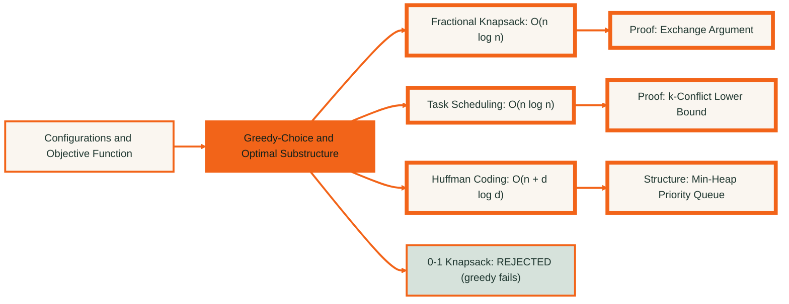
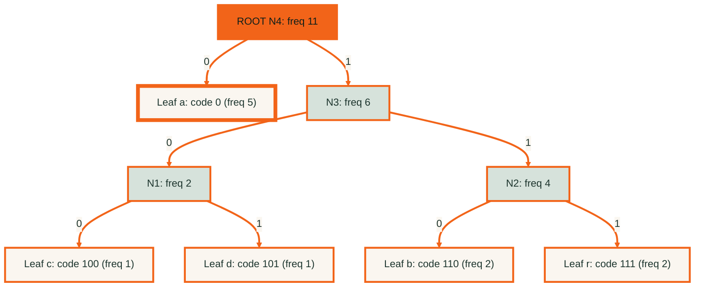

# 06 — Η Άπληστη Μέθοδος
*Greedy Method*

Το κεφάλαιο παρουσιάζει το αλγοριθμικό παράδειγμα της **άπληστης μεθόδου (`greedy method`)**, το οποίο επιλύει προβλήματα βελτιστοποίησης κατασκευάζοντας τη λύση σταδιακά μέσω τοπικά βέλτιστων επιλογών. Αναλύονται τρία κλασικά προβλήματα — το Κλασματικό Πρόβλημα Σακιδίου (`Fractional Knapsack`), ο Χρονοπρογραμματισμός Εργασιών (`Task Scheduling`) και η Κωδικοποίηση `Huffman` (`Huffman Coding`) — μαζί με τις αυστηρές αποδείξεις ορθότητας και τα όρια εφαρμογής της μεθόδου. Η υλοποίηση και η ανάλυση πολυπλοκότητας των αλγορίθμων στηρίζονται άμεσα στους δυαδικούς σωρούς της [02_priority_queues_heaps.md](02_priority_queues_heaps.md) και στους αλγορίθμους ταξινόμησης $O(n \log n)$ της [05_sorting_and_lower_bound.md](05_sorting_and_lower_bound.md). Εφαρμογή στην Τελική: η άπληστη στρατηγική αποτελεί τη βάση των αλγορίθμων `Dijkstra`, `Prim-Jarnik` και `Kruskal`, ενώ η αποτυχία της στο πρόβλημα σακιδίου `0-1` οδηγεί στον Δυναμικό Προγραμματισμό.

> **Εξεταστική κάλυψη:** Πρόοδος
> **Κεφάλαιο βιβλίου:** Κεφ. 10 | **Διαλέξεις:** `11_greedy_method.pdf`
> **Πηγή:** `Resources/Meta/mindmap.md` (Ενότητα 06)
> **Εκτός ύλης:** Τυπική ανάλυση Κωδικοποίησης Huffman (σελ. 294–297)

## Πίνακας Περιεχομένων

- [1. Εννοιολογικό Πλαίσιο και Συνολική Εικόνα](#1-εννοιολογικό-πλαίσιο-και-συνολική-εικόνα)
- [2. Θεωρητική Θεμελίωση και Τυπικοί Ορισμοί](#2-θεωρητική-θεμελίωση-και-τυπικοί-ορισμοί)
- [3. Αλγόριθμοι, Ιχνηλάτηση και Κώδικας](#3-αλγόριθμοι-ιχνηλάτηση-και-κώδικας)
- [4. Συγκριτική Ανάλυση και Πολυπλοκότητα](#4-συγκριτική-ανάλυση-και-πολυπλοκότητα)
- [5. Πλήρως Λυμένες Ασκήσεις Εξεταστικού Επιπέδου](#5-πλήρως-λυμένες-ασκήσεις-εξεταστικού-επιπέδου)
- [6. Οδηγός Επιβίωσης στις Εξετάσεις και Παγίδες](#6-οδηγός-επιβίωσης-στις-εξετάσεις-και-παγίδες)
- [7. Συνοπτικός Πίνακας Εννοιών](#7-συνοπτικός-πίνακας-εννοιών)

---

## 1. Εννοιολογικό Πλαίσιο και Συνολική Εικόνα

### Το Πρόβλημα

Ένας δικτυακός τόπος ηλεκτρονικών δημοπρασιών διαθέτει $100$ πανομοιότυπες ψηφιακές κάμερες ή $500$ μονάδες του ίδιου smartphone και δέχεται μεγάλο αριθμό προσφορών της μορφής «$\$y$ για $x$ μονάδες». Προκειμένου να μεγιστοποιήσει τις προμήθειες από τις πωλήσεις, το σύστημα πρέπει να επιλέξει ποιες προσφορές θα ικανοποιήσει ώστε να μεγιστοποιήσει το συνολικό χρηματικό ποσό χωρίς να υπερβεί το διαθέσιμο απόθεμα $W$.

Όταν μια προσφορά αγοράς $x$ μονάδων για $\$y$ μπορεί να ικανοποιηθεί **μερικά** (πουλώντας $k < x$ μονάδες έναντι $\$y \cdot (k / x)$), το πρόβλημα ανάγεται στο **Κλασματικό Πρόβλημα Σακιδίου (`Fractional Knapsack`)**, όπου η επιλογή των προσφορών με τη μεγαλύτερη τιμή ανά μονάδα $y / x$ δίνει εγγυημένα την καθολικά βέλτιστη λύση. Αντίστοιχα, η κατανομή εργασιών σταθερού χρονικού διαστήματος στον ελάχιστο δυνατό αριθμό μηχανών (`Task Scheduling`) και η βέλτιστη δυαδική συμπίεση κειμένου (`Huffman Coding`) επιδέχονται άμεσες τοπικές επιλογές χωρίς επανεξέταση προηγούμενων αποφάσεων. Αντιθέτως, όταν οι προσφορές είναι αδιαίρετες (έκδοση `0-1`, δηλαδή «όλες οι $x$ μονάδες ή καμία»), η ίδια άπληστη λογική αποτυγχάνει να εγγυηθεί τη βέλτιστη λύση.

### Χάρτης Εννοιών του Κεφαλαίου



Πορτοκαλί γέμισμα: οι δύο αναγκαίες και ικανές συνθήκες εφαρμογής της άπληστης μεθόδου. Παχύ περίγραμμα: τα τρία προβλήματα εντός ύλης με τις πολυπλοκότητες και τους μηχανισμούς ορθότητας ή υλοποίησης. Απαλό πράσινο: το πρόβλημα όπου η άπληστη επιλογή αποτυγχάνει. Κρεμ: το γενικό πλαίσιο διατύπωσης προβλημάτων βελτιστοποίησης.

Κάθε άπληστος αλγόριθμος ορίζεται από ένα κριτήριο ταξινόμησης ή επιλογής (πυκνότητα αξίας $b_i / w_i$, ώρα έναρξης $s_i$, ελάχιστη συχνότητα $f(c)$) και συνοδεύεται υποχρεωτικά από απόδειξη ότι η τοπική απόφαση δεν αποκλείει την καθολικά βέλτιστη λύση. Χωρίς τέτοια απόδειξη, μια διαισθητική άπληστη στρατηγική αποτελεί απλώς ευρετική (`heuristic`) που μπορεί να δώσει υποβέλτιστο αποτέλεσμα, όπως συμβαίνει στο πρόβλημα σακιδίου `0-1`.

### Πότε Χρησιμοποιείται η Άπληστη Μέθοδος

Η άπληστη μέθοδος επιλέγεται όταν ένα πρόβλημα βελτιστοποίησης διαθέτει τόσο **βέλτιστη υποδομή** όσο και την **ιδιότητα της άπληστης επιλογής**, επιτρέποντας τη δέσμευση σε μία απόφαση ανά βήμα χωρίς οπισθοδρόμηση (`backtracking`). Σε επίπεδο Προόδου, εφαρμόζεται σε διαιρετούς πόρους με γραμμικό όφελος (`Fractional Knapsack`), σε κατανομή εργασιών σταθερών διαστημάτων στον ελάχιστο αριθμό πόρων (`Task Scheduling`) και στην κατασκευή βέλτιστων προθεματικών κωδίκων (`Huffman Coding`). Όταν η τοπική επιλογή μπορεί να παγιδευτεί σε τοπικό ακρότατο (όπως στα αδιαίρετα αντικείμενα του `0-1 Knapsack`), η άπληστη μέθοδος απορρίπτεται.

---

## 2. Θεωρητική Θεμελίωση και Τυπικοί Ορισμοί

### 2.1 Δομικά Στοιχεία της Άπληστης Μεθόδου

Η άπληστη μέθοδος (`greedy method`) είναι ένα γενικό παράδειγμα σχεδίασης αλγορίθμων για προβλήματα βελτιστοποίησης και βασίζεται σε δύο θεμελιώδη στοιχεία:

- **Διαμορφώσεις (`configurations`):** κάθε διαμόρφωση ορίζεται από τις τιμές που λαμβάνουν οι παράμετροι οι οποίες περιγράφουν μια επιτρεπτή (ή μερική) λύση του προβλήματος.
- **Αντικειμενική συνάρτηση (`objective function`):** μια συνάρτηση που αντιστοιχίζει σε κάθε διαμόρφωση μια αριθμητική βαθμολογία, την οποία επιδιώκουμε να μεγιστοποιήσουμε ή να ελαχιστοποιήσουμε.

Ένας άπληστος αλγόριθμος ξεκινά από μια καλά καθορισμένη εναρκτήρια διαμόρφωση και σε κάθε βήμα επιλέγει επαναληπτικά τη διαθέσιμη διαμόρφωση που επιφέρει τη μεγαλύτερη άμεση βελτίωση στην αντικειμενική συνάρτηση. Για να εγγυάται η διαδικασία καθολικά βέλτιστη λύση, το πρόβλημα πρέπει να ικανοποιεί δύο ιδιότητες:

1. **Ιδιότητα της άπληστης επιλογής (`greedy-choice property`):** μια καθολικά βέλτιστη λύση μπορεί πάντα να βρεθεί μέσω μιας ακολουθίας τοπικών βελτιώσεων (τοπικά βέλτιστων επιλογών), ξεκινώντας από την αρχική διαμόρφωση, χωρίς να απαιτείται αναθεώρηση προηγούμενων επιλογών.
2. **Βέλτιστη υποδομή (`optimal substructure`):** αφού ληφθεί η άπληστη επιλογή, το υπολειπόμενο υποπρόβλημα έχει την ίδια μορφή και η καθολικά βέλτιστη λύση του αρχικού προβλήματος αποτελείται από την άπληστη επιλογή συν τη βέλτιστη λύση του υποπροβλήματος.

### 2.2 Τυπική Διατύπωση και Ορθότητα του Κλασματικού Σακιδίου

Δίνεται σύνολο $S$ από $n$ αντικείμενα, όπου κάθε αντικείμενο $i \in S$ έχει θετικό όφελος $b_i > 0$ και θετικό βάρος $w_i > 0$, καθώς και μέγιστη χωρητικότητα σακιδίου $W > 0$. Ζητούνται οι ποσότητες $x_i$ ($0 \le x_i \le w_i$) που επιλέγονται από κάθε αντικείμενο $i$, ώστε:

$$\text{Μεγιστοποίηση } \sum_{i \in S} b_i \left(\frac{x_i}{w_i}\right) = \sum_{i \in S} \left(\frac{b_i}{w_i}\right) x_i = \sum_{i \in S} v_i x_i$$

$$\text{υπό τους περιορισμούς } \sum_{i \in S} x_i \le W \quad \text{και} \quad 0 \le x_i \le w_i \text{ για κάθε } i \in S$$

όπου $v_i = b_i / w_i$ ονομάζεται **αξία (`value`)** ή **πυκνότητα αξίας (`value density`)** του αντικειμένου $i$ (όφελος ανά μονάδα βάρους).

**Θεώρημα 2.1 (Ορθότητα Άπληστου Αλγορίθμου για το Κλασματικό Σακίδιο — Επιχείρημα Ανταλλαγής).** *Η επιλογή αντικειμένων κατά φθίνουσα σειρά αξίας $v_i = b_i / w_i$ με ποσότητα $x_i = \min\{w_i, W - w\}$ σε κάθε βήμα παράγει καθολικά βέλτιστη λύση για το Κλασματικό Πρόβλημα Σακιδίου.*

**Απόδειξη (εις άτοπον / `exchange argument`):**

1. Υποθέτουμε, προς αντίφαση, ότι υπάρχει βέλτιστη λύση $X^* = (x_1, x_2, \dots, x_n)$ με αυστηρά μεγαλύτερο συνολικό όφελος από τη λύση που παράγει ο άπληστος αλγόριθμος.
2. Αν $\sum_{i \in S} w_i \le W$, ο άπληστος αλγόριθμος λαμβάνει όλα τα αντικείμενα εξ ολοκλήρου ($x_i = w_i$), επιτυγχάνοντας το μέγιστο δυνατό όφελος, άρα δεν υπάρχει καλύτερη λύση. Επομένως $\sum_{i \in S} w_i > W$ και κάθε βέλτιστη λύση γεμίζει πλήρως το σακίδιο ($\sum_{i \in S} x_i = W$).
3. Εφόσον η $X^*$ διαφέρει από την άπληστη λύση σε αντικείμενα με διαφορετικές αξίες $v_i$, πρέπει να υπάρχουν δύο αντικείμενα $i, j \in S$ τέτοια ώστε:
   $$x_i < w_i, \qquad x_j > 0, \qquad \text{και} \qquad v_i > v_j$$
   Δηλαδή, παρόλο που το αντικείμενο $i$ έχει αυστηρά υψηλότερη αξία ανά μονάδα βάρους από το $j$, υπάρχει ακόμη διαθέσιμη ποσότητα $w_i - x_i > 0$ του $i$, ενώ στη λύση $X^*$ περιέχεται θετική ποσότητα $x_j > 0$ του $j$.
4. Ορίζουμε την ποσότητα ανταλλαγής:
   $$y = \min\{w_i - x_i, \, x_j\} > 0$$
5. Κατασκευάζουμε νέα λύση $X'$ αντικαθιστώντας ποσότητα $y$ του αντικειμένου $j$ με ίση ποσότητα $y$ του αντικειμένου $i$: θέτουμε $x'_i = x_i + y$, $x'_j = x_j - y$ και $x'_k = x_k$ για κάθε $k \notin \{i, j\}$.
6. Η $X'$ είναι επιτρεπτή λύση, διότι:
   - $x'_i = x_i + y \le x_i + (w_i - x_i) = w_i$ και $x'_j = x_j - y \ge x_j - x_j = 0$.
   - Το συνολικό βάρος παραμένει αμετάβλητο: $\sum_{k \in S} x'_k = \sum_{k \in S} x_k + y - y = W$.
7. Η μεταβολή στο συνολικό όφελος είναι:
   $$\Delta B = v_i y - v_j y = (v_i - v_j) y > 0$$
   καθώς $v_i > v_j$ και $y > 0$.
8. Άρα η $X'$ έχει αυστηρά μεγαλύτερο όφελος από την $X^*$, γεγονός που αντιβαίνει στην υπόθεση ότι η $X^*$ είναι βέλτιστη. Επομένως, η άπληστη λύση είναι καθολικά βέλτιστη. $\blacksquare$

### 2.3 Αποτυχία της Άπληστης Μεθόδου στο Πρόβλημα Σακιδίου `0-1`

Στο πρόβλημα σακιδίου `0-1` (`0-1 Knapsack`), κάθε αντικείμενο είτε λαμβάνεται ολόκληρο είτε δεν λαμβάνεται καθόλου ($x_i \in \{0, w_i\}$). Η ανταλλαγή κλασματικής ποσότητας $y = \min\{w_i - x_i, x_j\}$ παύει να είναι επιτρεπτή και η ιδιότητα της άπληστης επιλογής καταρρέει.

**Αντιπαράδειγμα:** Έστω σακίδιο χωρητικότητας $W = 10$ και τρία αδιαίρετα αντικείμενα:

| Αντικείμενο | Βάρος $w_i$ | Όφελος $b_i$ | Αξία $v_i = b_i / w_i$ |
|---|---|---|---|
| `A` | $6$ | $36$ | $6{,}0$ |
| `B` | $5$ | $25$ | $5{,}0$ |
| `C` | $5$ | $25$ | $5{,}0$ |

- **Άπληστη επιλογή κατά $v_i$:** επιλέγει το `A` ($v_A = 6{,}0$, βάρος $6$, όφελος $36$). Η υπολειπόμενη χωρητικότητα είναι $10 - 6 = 4$, στην οποία δεν χωρά ούτε το `B` ($w_B = 5$) ούτε το `C` ($w_C = 5$). Συνολικό όφελος: **$36$**.
- **Βέλτιστη λύση `0-1`:** επιλέγει το σύνολο $\{\text{B}, \text{C}\}$ με συνολικό βάρος $5 + 5 = 10 \le 10$ και συνολικό όφελος $25 + 25 = \mathbf{50} > 36$.

Εφαρμογή στην Τελική: το πρόβλημα `0-1 Knapsack` επιλύεται βέλτιστα με Δυναμικό Προγραμματισμό σε ψεύδο-πολυωνυμικό χρόνο $O(nW)$.

### 2.4 Τυπική Διατύπωση και Ορθότητα του Χρονοπρογραμματισμού Εργασιών

Δίνεται σύνολο $T$ από $n$ εργασίες, όπου κάθε εργασία $i \in T$ ορίζεται από ένα χρονικό διάστημα $[s_i, f_i]$ με ώρα έναρξης $s_i$ και ώρα λήξης $f_i$ ($s_i < f_i$). Δύο εργασίες $i, j$ **δεν συγκρούονται (`non-conflicting`)** αν και μόνο αν $f_i \le s_j$ ή $f_j \le s_i$ (δηλαδή μια μηχανή που ολοκληρώνει εργασία στη χρονική στιγμή $t$ μπορεί να ξεκινήσει αμέσως νέα εργασία στη στιγμή $t$). Στόχος είναι η εκτέλεση **όλων** των εργασιών με τον **ελάχιστο αριθμό μηχανών** χωρίς συγκρούσεις στην ίδια μηχανή.

**Θεώρημα 2.2 (Ορθότητα του `taskSchedule`).** *Ο άπληστος αλγόριθμος `taskSchedule`, ο οποίος επεξεργάζεται τις εργασίες κατά αύξουσα ώρα έναρξης $s_i$ και αναθέτει κάθε εργασία σε μια διαθέσιμη μηχανή ή ανοίγει νέα αν δεν υπάρχει διαθέσιμη, χρησιμοποιεί τον ελάχιστο δυνατό αριθμό μηχανών.*

**Απόδειξη (εις άτοπον):**

1. Έστω ότι ο αλγόριθμος `taskSchedule` χρησιμοποιεί $k$ μηχανές και υποθέτουμε, προς αντίφαση, ότι υπάρχει επιτρεπτό πρόγραμμα χωρίς συγκρούσεις που χρησιμοποιεί $k - 1$ μηχανές.
2. Έστω $i$ η **πρώτη** εργασία που προγραμματίζεται στη μηχανή $k$ (με ώρα έναρξης $s_i$).
3. Επειδή ο αλγόριθμος άνοιξε τη μηχανή $k$ για την εργασία $i$, καμία από τις προηγούμενες $k - 1$ μηχανές δεν ήταν ελεύθερη τη χρονική στιγμή $s_i$.
4. Συνεπώς, σε καθεμία από τις μηχανές $1, 2, \dots, k - 1$ υπάρχει κάποια ήδη προγραμματισμένη εργασία $j_r$ ($1 \le r \le k - 1$) της οποίας η εκτέλεση δεν έχει ολοκληρωθεί στη στιγμή $s_i$, άρα $f_{j_r} > s_i$.
5. Επειδή οι εργασίες εξετάζονται κατά αύξουσα ώρα έναρξης, κάθε τέτοια εργασία $j_r$ ξεκίνησε το αργότερο στη στιγμή $s_i$, δηλαδή $s_{j_r} \le s_i < f_{j_r}$.
6. Άρα, τη χρονική στιγμή $s_i$ (και σε ένα μικρό διάστημα $[s_i, s_i + \varepsilon)$), εκτελούνται **ταυτόχρονα** $k$ εργασίες: οι $j_1, j_2, \dots, j_{k-1}$ και η $i$, οι οποίες συγκρούονται ανά ζεύγη.
7. Καμία δύο από αυτές τις $k$ εργασίες δεν μπορούν να ανατεθούν στην ίδια μηχανή, επομένως **κάθε** έγκυρο πρόγραμμα χρειάζεται τουλάχιστον $k$ μηχανές. Αντίφαση με την υπόθεση των $k - 1$ μηχανών. $\blacksquare$

### 2.5 Προθεματικές Κωδικοποιήσεις και Δέντρα Κωδικοποίησης (`Huffman`)

Δεδομένης μιας συμβολοσειράς $X$ μήκους $n = |X|$ πάνω σε ένα αλφάβητο $d$ διακριτών χαρακτήρων με συχνότητες $f(c)$ για κάθε χαρακτήρα $c$:

- **Κωδικοποίηση (`encoding`):** αντιστοίχιση κάθε χαρακτήρα $c$ του αλφαβήτου σε μια δυαδική συμβολοσειρά (κωδικό).
- **Προθεματική κωδικοποίηση (`prefix-free code`):** δυαδική κωδικοποίηση στην οποία κανένας κωδικός χαρακτήρα δεν αποτελεί πρόθεμα (`prefix`) του κωδικού οποιουδήποτε άλλου χαρακτήρα. Η ιδιότητα αυτή εξασφαλίζει μονοσήμαντη αποκωδικοποίηση χωρίς διαχωριστικά σύμβολα, με μία μόνο σάρωση των bits από αριστερά προς τα δεξιά.
- **Δέντρο κωδικοποίησης (`coding tree`):** δυαδικό δέντρο $T$ στο οποίο κάθε φύλλο αντιστοιχεί σε έναν διακριτό χαρακτήρα $c$, κάθε αριστερή ακμή φέρει ετικέτα `0` και κάθε δεξιά ακμή ετικέτα `1`. Ο κωδικός του $c$ είναι η ακολουθία των bits στο μονοπάτι από τη ρίζα προς το φύλλο του $c$, και το μήκος του κωδικού ισούται με το βάθος $d_T(c)$ του φύλλου.

Η αντικειμενική συνάρτηση που ελαχιστοποιεί η κωδικοποίηση `Huffman` είναι το συνολικό πλήθος bits της κωδικοποιημένης συμβολοσειράς $Y$:

$$B(T) = \sum_{c} f(c) \cdot d_T(c)$$

Οι χαρακτήρες με υψηλή συχνότητα $f(c)$ τοποθετούνται κοντά στη ρίζα (μικρό βάθος $d_T(c)$), ενώ οι σπάνιοι χαρακτήρες τοποθετούνται βαθύτερα (μεγαλύτερο $d_T(c)$).

> Εκτός ύλης: Τυπική ανάλυση Κωδικοποίησης Huffman (σελ. 294–297). Ο αλγόριθμος `Huffman(X)`, η κατασκευή του δέντρου κωδικοποίησης και η πολυπλοκότητά του $O(n + d \log d)$ βρίσκονται πλήρως εντός ύλης.

---

## 3. Αλγόριθμοι, Ιχνηλάτηση και Κώδικας

### 3.1 Κλασματικό Πρόβλημα Σακιδίου (`fractionalKnapsack`)

#### Σκοπός

Επιλέγει ποσότητες $x_i \in [0, w_i]$ από ένα σύνολο $S$ αντικειμένων ώστε να μεγιστοποιηθεί το συνολικό όφελος υπό περιορισμό συνολικού βάρους το πολύ $W$.

#### Ψευδοκώδικας

```text
Algorithm fractionalKnapsack(S, W):
    Input: set S of items with benefit b_i and weight w_i; max. weight W
    Output: amount x_i of each item i to maximize benefit with weight at most W
    for each item i in S do
        x_i ← 0
        v_i ← b_i / w_i                     {value density}
    w ← 0                                   {total weight}
    while w < W and S is not empty do
        remove item i from S with highest v_i
        x_i ← min{w_i, W - w}
        w ← w + min{w_i, W - w}
    return {x_i}
```

#### Ιχνηλάτηση

Δεδομένα (παράδειγμα διάλεξης): χωρητικότητα $W = 10\text{ ml}$ και $5$ αντικείμενα:

| Αντικείμενο $i$ | Βάρος $w_i$ (ml) | Όφελος $b_i$ (USD) | Αξία $v_i = b_i / w_i$ (USD/ml) |
|---|---|---|---|
| `1` | $4$ | $12$ | $3$ |
| `2` | $8$ | $32$ | $4$ |
| `3` | $2$ | $40$ | $20$ |
| `4` | $6$ | $30$ | $5$ |
| `5` | $1$ | $50$ | $50$ |

**Κανόνας ισοβαθμίας:** σε ίσες αξίες $v_i$, προηγείται το αντικείμενο με μικρότερο δείκτη $i$.

Μετά την ταξινόμηση κατά φθίνουσα αξία $v_i$, η σειρά εξέτασης είναι `5, 3, 4, 2, 1`:

| Βήμα | Αντικείμενο $i$ | $v_i$ | $w_i$ | Υπολειπόμενο $W - w$ | Επιλογή $x_i = \min\{w_i, W - w\}$ | Κέρδος $v_i x_i$ | Νέο βάρος $w$ | Αθροιστικό όφελος |
|---|---|---|---|---|---|---|---|---|
| Αρχή | — | — | — | $10$ | — | $0$ | $0$ | $0$ |
| 1 | `5` | $50$ | $1$ | $10$ | $1$ (ολόκληρο) | $50$ | $1$ | $50$ |
| 2 | `3` | $20$ | $2$ | $9$ | $2$ (ολόκληρο) | $40$ | $3$ | $90$ |
| 3 | `4` | $5$ | $6$ | $7$ | $6$ (ολόκληρο) | $30$ | $9$ | $120$ |
| 4 | `2` | $4$ | $8$ | $1$ | $1$ (κλασματικό $1/8$) | $4$ | $10$ | $124$ |
| Τέλος | `1` (δεν εξετάζεται) | $3$ | $4$ | $0$ | $0$ | $0$ | $10$ | $124$ |

Τελική λύση: $x_5 = 1\text{ ml}$, $x_3 = 2\text{ ml}$, $x_4 = 6\text{ ml}$, $x_2 = 1\text{ ml}$, $x_1 = 0\text{ ml}$, με μέγιστο συνολικό όφελος $\$124$.

#### Υλοποίηση σε Python (Διπλή Μορφή)

**Ρητός αλγόριθμος (υπολογισμός αξιών, ταξινόμηση και σάρωση με ρητό έλεγχο χωρητικότητας):**

```python
def fractionalKnapsack(
    items: list[tuple[int, float, float]],
    max_weight: float,
) -> tuple[float, dict[int, float]]:
    """Solves the Fractional Knapsack problem using the greedy value-density rule.

    Args:
        items (list[tuple[int, float, float]]): List of (item_id, weight, benefit) tuples.
        max_weight (float): Maximum capacity W of the knapsack.

    Returns:
        tuple[float, dict[int, float]]: Total maximum benefit and mapping item_id -> chosen amount.
    """
    chosen_amounts: dict[int, float] = {item_id: 0.0 for item_id, _, _ in items}
    valued_items: list[tuple[float, int, float, float]] = []
    for item_id, weight, benefit in items:
        value_density = benefit / weight
        # Negating value_density is avoided by explicit descending sort on key;
        # item_id provides deterministic tie-breaking.
        valued_items.append((value_density, item_id, weight, benefit))

    valued_items.sort(key=lambda entry: (-entry[0], entry[1]))

    current_weight = 0.0
    total_benefit = 0.0
    index = 0
    while current_weight < max_weight and index < len(valued_items):
        value_density, item_id, weight, _ = valued_items[index]
        # Take as much of the highest-density item as capacity allows.
        amount = min(weight, max_weight - current_weight)
        chosen_amounts[item_id] = amount
        current_weight += amount
        total_benefit += value_density * amount
        index += 1

    return total_benefit, chosen_amounts


lecture_items = [(1, 4.0, 12.0), (2, 8.0, 32.0), (3, 2.0, 40.0), (4, 6.0, 30.0), (5, 1.0, 50.0)]
benefit_explicit, amounts_explicit = fractionalKnapsack(lecture_items, 10.0)
assert benefit_explicit == 124.0
assert amounts_explicit == {1: 0.0, 2: 1.0, 3: 2.0, 4: 6.0, 5: 1.0}
```

**Pythonic ιδιωματισμός (απευθείας `sorted` με συνάρτηση κλειδιού):**

```python
def fractionalKnapsackPythonic(
    items: list[tuple[int, float, float]],
    max_weight: float,
) -> float:
    """Computes the optimal Fractional Knapsack benefit using sorted() with a key function.

    Args:
        items (list[tuple[int, float, float]]): List of (item_id, weight, benefit) tuples.
        max_weight (float): Maximum capacity W of the knapsack.

    Returns:
        float: Total maximum benefit achievable within max_weight.
    """
    remaining = max_weight
    total_benefit = 0.0
    for _, weight, benefit in sorted(items, key=lambda it: it[2] / it[1], reverse=True):
        if remaining <= 0.0:
            break
        take = min(weight, remaining)
        total_benefit += (benefit / weight) * take
        remaining -= take
    return total_benefit


lecture_items = [(1, 4.0, 12.0), (2, 8.0, 32.0), (3, 2.0, 40.0), (4, 6.0, 30.0), (5, 1.0, 50.0)]
assert fractionalKnapsackPythonic(lecture_items, 10.0) == 124.0
```

| Μορφή | Χρόνος (χειρότερη) | Επιπλέον χώρος | Τροποποιεί την είσοδο | Σημείωση |
|---|---|---|---|---|
| `fractionalKnapsack` | $O(n \log n)$ | $O(n)$ | Όχι | Επιστρέφει και τις ακριβείς ποσότητες $x_i$· αντιστοιχεί στον ψευδοκώδικα της εξέτασης |
| `fractionalKnapsackPythonic` | $O(n \log n)$ | $O(n)$ | Όχι | Η `sorted` κρύβει την ταξινόμηση Timsort $O(n \log n)$ και δημιουργεί νέα λίστα |

Και οι δύο μορφές έχουν χειρότερο χρόνο $\Theta(n \log n)$ και χώρο $O(n)$: η `sorted(..., reverse=True)` απλώς συντομεύει τον κώδικα χωρίς να μειώνει την ασυμπτωτική πολυπλοκότητα. Στη γραπτή εξέταση ζητείται ο ρητός αλγόριθμος και ο πίνακας ιχνηλάτησης· η Pythonic μορφή χρησιμεύει μόνο για επαλήθευση.

> **Προειδοποίηση Python (`sorted` / Timsort):** Η ενσωματωμένη `sorted` χρησιμοποιεί τον αλγόριθμο `Timsort` (ευσταθής ταξινόμηση με εγγυημένο χειρότερο χρόνο $O(n \log n)$), ο οποίος διαφέρει από τον τυχαιοποιημένο `Quick-Sort` της [05_sorting_and_lower_bound.md](05_sorting_and_lower_bound.md).

#### Ανάλυση Πολυπλοκότητας (Γραμμή προς Γραμμή)

1. Αρχικοποίηση $x_i \leftarrow 0$ και υπολογισμός $v_i \leftarrow b_i / w_i$ για $n$ αντικείμενα: $O(n)$ στη χειρότερη περίπτωση.
2. Ταξινόμηση των $n$ αντικειμένων κατά φθίνουσα τιμή $v_i$ (ή εισαγωγή σε μέγιστο σωρό και διαδοχικές εξαγωγές): $O(n \log n)$ στη χειρότερη περίπτωση.
3. Βρόχος `while`: εκτελείται το πολύ $n$ φορές, με $O(1)$ πράξεις ανά επανάληψη (μετά την ταξινόμηση): $O(n)$ στη χειρότερη περίπτωση.
4. Συνολικός χρόνος: $O(n) + O(n \log n) + O(n) = O(n \log n)$ στη χειρότερη περίπτωση. Χώρος: $O(n)$.

---

### 3.2 Χρονοπρογραμματισμός Εργασιών (`taskSchedule`)

#### Σκοπός

Αναθέτει όλες τις εργασίες $T = \{[s_i, f_i]\}$ στον ελάχιστο δυνατό αριθμό μηχανών χωρίς χρονικές επικαλύψεις στην ίδια μηχανή.

#### Ψευδοκώδικας

```text
Algorithm taskSchedule(T):
    Input: set T of tasks with start time s_i and finish time f_i
    Output: non-conflicting schedule with minimum number of machines
    m ← 0                                   {number of machines}
    while T is not empty do
        remove task i from T with smallest s_i
        if there is a machine j available for i then
            schedule i on machine j
        else
            m ← m + 1
            schedule i on machine m
    return schedule
```

Για να εκτελείται ο έλεγχος «υπάρχει διαθέσιμη μηχανή $j$ για την $i$» σε $O(\log n)$ (αντί $O(m)$ με γραμμική σάρωση), διατηρούμε έναν ελάχιστο σωρό (`min-heap`) με τις ώρες λήξης της τελευταίας εργασίας κάθε ανοιχτής μηχανής. Μια μηχανή είναι διαθέσιμη αν και μόνο αν η **ελάχιστη** ώρα λήξης στον σωρό ικανοποιεί $f_{\min} \le s_i$.

#### Ιχνηλάτηση

Δεδομένα (παράδειγμα διάλεξης): $7$ εργασίες ήδη ταξινομημένες κατά ώρα έναρξης $s_i$:
$T_1 = [1, 4]$, $T_2 = [1, 3]$, $T_3 = [2, 5]$, $T_4 = [3, 7]$, $T_5 = [4, 7]$, $T_6 = [6, 9]$, $T_7 = [7, 8]$.

**Κανόνας ισοβαθμίας:** σε ίσες ώρες έναρξης διατηρείται η αρχική σειρά εισόδου ($T_1$ πριν από $T_2$). Όταν περισσότερες από μία μηχανές είναι ελεύθερες, επιλέγεται η ρίζα του ελάχιστου σωρού (μικρότερη ώρα λήξης) και σε ισοβαθμία λήξης ο μικρότερος αριθμός μηχανής.

| Βήμα | Εργασία $[s_i, f_i]$ | Ρίζα σωρού $(f_{\min}, \text{μηχανή})$ | Έλεγχος $f_{\min} \le s_i$ | Ενέργεια | Κατάσταση σωρού μετά το βήμα `(λήξη, μηχανή)` | Πλήθος μηχανών $m$ |
|---|---|---|---|---|---|---|
| Αρχή | — | κενός | — | — | `[]` | $0$ |
| 1 | $T_1 = [1, 4]$ | — | Όχι (κενός) | Νέα μηχανή `M1` | `[(4, M1)]` | $1$ |
| 2 | $T_2 = [1, 3]$ | `(4, M1)` | $4 \le 1$ (Όχι) | Νέα μηχανή `M2` | `[(3, M2), (4, M1)]` | $2$ |
| 3 | $T_3 = [2, 5]$ | `(3, M2)` | $3 \le 2$ (Όχι) | Νέα μηχανή `M3` | `[(3, M2), (4, M1), (5, M3)]` | $3$ |
| 4 | $T_4 = [3, 7]$ | `(3, M2)` | $3 \le 3$ (Ναι) | Επαναχρησιμοποίηση `M2` | `[(4, M1), (5, M3), (7, M2)]` | $3$ |
| 5 | $T_5 = [4, 7]$ | `(4, M1)` | $4 \le 4$ (Ναι) | Επαναχρησιμοποίηση `M1` | `[(5, M3), (7, M1), (7, M2)]` | $3$ |
| 6 | $T_6 = [6, 9]$ | `(5, M3)` | $5 \le 6$ (Ναι) | Επαναχρησιμοποίηση `M3` | `[(7, M1), (7, M2), (9, M3)]` | $3$ |
| 7 | $T_7 = [7, 8]$ | `(7, M1)` | $7 \le 7$ (Ναι) | Επαναχρησιμοποίηση `M1` | `[(7, M2), (8, M1), (9, M3)]` | $3$ |

Τελική ανάθεση ($m = 3$ μηχανές):
- `M1`: $[1, 4], \, [4, 7], \, [7, 8]$
- `M2`: $[1, 3], \, [3, 7]$
- `M3`: $[2, 5], \, [6, 9]$

#### Υλοποίηση σε Python (Διπλή Μορφή)

Δεν υπάρχει ενσωματωμένη συνάρτηση της πρότυπης βιβλιοθήκης Python που να επιλύει απευθείας το πρόβλημα χρονοπρογραμματισμού εργασιών (`interval partitioning`). Η υλοποίηση συνδυάζει `sorted` με την ουρά προτεραιότητας `heapq`.

**Ρητός αλγόριθμος (με `heapq` για τις ώρες λήξης των μηχανών):**

```python
import heapq


def scheduleTasks(
    tasks: list[tuple[int, int]],
) -> tuple[int, dict[int, list[tuple[int, int]]]]:
    """Schedules all interval tasks using the minimum number of non-conflicting machines.

    Args:
        tasks (list[tuple[int, int]]): List of (start_time, finish_time) intervals.

    Returns:
        tuple[int, dict[int, list[tuple[int, int]]]]: Minimum number of machines and
            a mapping machine_id -> list of assigned (start, finish) intervals.
    """
    # Sort strictly by start time; Python's sort is stable, preserving input order on ties.
    sorted_tasks = sorted(tasks, key=lambda interval: interval[0])
    # Min-heap stores (latest_finish_time, machine_id) so the earliest-free machine is at index 0.
    machine_heap: list[tuple[int, int]] = []
    schedule: dict[int, list[tuple[int, int]]] = {}
    machine_count = 0

    for start_time, finish_time in sorted_tasks:
        if machine_heap and machine_heap[0][0] <= start_time:
            _, machine_id = heapq.heappop(machine_heap)
        else:
            machine_count += 1
            machine_id = machine_count
            schedule[machine_id] = []

        schedule[machine_id].append((start_time, finish_time))
        heapq.heappush(machine_heap, (finish_time, machine_id))

    return machine_count, schedule


lecture_tasks = [(1, 4), (1, 3), (2, 5), (3, 7), (4, 7), (6, 9), (7, 8)]
num_machines, task_plan = scheduleTasks(lecture_tasks)
assert num_machines == 3
assert task_plan == {
    1: [(1, 4), (4, 7), (7, 8)],
    2: [(1, 3), (3, 7)],
    3: [(2, 5), (6, 9)],
}
```

> **Προειδοποίηση Python (`heapq`):** Η βιβλιοθήκη `heapq` υλοποιεί **0-indexed ελάχιστο σωρό** (παιδιά της θέσης $i$ στις θέσεις $2i + 1$ και $2i + 2$, ρίζα στο `heap[0]`), ενώ το μάθημα και η [02_priority_queues_heaps.md](02_priority_queues_heaps.md) χρησιμοποιούν **1-indexed** πίνακα (παιδιά $2i$ και $2i + 1$). Επιπλέον, η `heapq` δεν διαθέτει λειτουργία `replaceKey` / `decrease-key`, οπότε η ενημέρωση της ώρας λήξης μιας μηχανής γίνεται με ζεύγος `heappop` + `heappush` σε $O(\log m)$ χρόνο (ισοδύναμα με `heapq.heapreplace`).

#### Ανάλυση Πολυπλοκότητας (Γραμμή προς Γραμμή)

1. Ταξινόμηση των $n$ εργασιών κατά αύξουσα ώρα έναρξης $s_i$: $O(n \log n)$ στη χειρότερη περίπτωση.
2. Ο βρόχος εκτελείται ακριβώς $n$ φορές. Το πλήθος μηχανών $m$ ικανοποιεί $m \le n$.
3. Σε κάθε επανάληψη, ο έλεγχος της ρίζας του σωρού (`min`) κοστίζει $O(1)$ και το πολύ μία `removeMin` συν μία `insert` κοστίζουν $O(\log m) = O(\log n)$ στη χειρότερη περίπτωση.
4. Συνολικός χρόνος: $O(n \log n) + n \cdot O(\log n) = O(n \log n)$ στη χειρότερη περίπτωση. Χώρος: $O(n)$.

*(Σημείωση: αν ο έλεγχος διαθέσιμης μηχανής γινόταν με απλή γραμμική σάρωση των $m$ μηχανών χωρίς σωρό, η χειρότερη περίπτωση θα επιδεινωνόταν σε $O(n^2)$ όταν όλες οι εργασίες επικαλύπτονται.)*

---

### 3.3 Κωδικοποίηση `Huffman` (`Huffman`)

#### Σκοπός

Κατασκευάζει ένα βέλτιστο δυαδικό δέντρο προθεματικής κωδικοποίησης για μια συμβολοσειρά $X$ μήκους $n$ με $d$ διακριτούς χαρακτήρες, ελαχιστοποιώντας το συνολικό μήκος της κωδικοποιημένης εξόδου.

#### Ψευδοκώδικας

```text
Algorithm Huffman(X):
    Input: String X of length n with d distinct characters
    Output: Coding tree for X
    Compute the frequency f(c) of each character c of X.
    Initialize a priority queue Q.
    for each distinct character c in X do
        Create a single-node binary tree T storing c.
        Insert T into Q with key f(c).
    while len(Q) > 1 do
        (f_1, T_1) ← Q.removeMin()
        (f_2, T_2) ← Q.removeMin()
        Create a new binary tree T with left subtree T_1 and right subtree T_2.
        Insert T into Q with key f_1 + f_2.
    (f, T) ← Q.removeMin()
    return tree T
```

#### Ιχνηλάτηση

Δεδομένα (παράδειγμα διάλεξης): $X = \text{"abracadabra"}$ με $n = 11$ και $d = 5$ διακριτούς χαρακτήρες.
Συχνότητες: $f(\text{a}) = 5$, $f(\text{b}) = 2$, $f(\text{c}) = 1$, $f(\text{d}) = 1$, $f(\text{r}) = 2$.

**Κανόνας ισοβαθμίας:** τα αρχικά φύλλα εισάγονται σε αλφαβητική σειρά (`a, b, c, d, r`) με αύξοντα κωδικό δημιουργίας `0..4` και κάθε νέο εσωτερικό δέντρο λαμβάνει επόμενο κωδικό δημιουργίας (`5, 6, ...`). Σε ίσες συχνότητες εξάγεται πρώτος ο κόμβος με μικρότερο κωδικό δημιουργίας. Το πρώτο εξαγόμενο δέντρο ($T_1$) γίνεται αριστερό παιδί (`0`) και το δεύτερο ($T_2$) δεξί παιδί (`1`).

**Πίνακας συγχωνεύσεων:**

| Βήμα | Δύο ελάχιστα $(f_1, T_1)$ και $(f_2, T_2)$ | Νέος κόμβος και βάρος $f_1 + f_2$ | Κατάσταση ουράς $Q$ μετά τη συγχώνευση (κατά συχνότητα) |
|---|---|---|---|
| Αρχή | — | — | `(1, c), (1, d), (2, b), (2, r), (5, a)` |
| 1 | `(1, c)` και `(1, d)` | `N1(2)` με παιδιά `(c, d)` | `(2, b), (2, r), (2, N1), (5, a)` |
| 2 | `(2, b)` και `(2, r)` | `N2(4)` με παιδιά `(b, r)` | `(2, N1), (4, N2), (5, a)` |
| 3 | `(2, N1)` και `(4, N2)` | `N3(6)` με παιδιά `(N1, N2)` | `(5, a), (6, N3)` |
| 4 | `(5, a)` και `(6, N3)` | `N4(11)` με παιδιά `(a, N3)` | `(11, N4)` — Τερματισμός (`len(Q) == 1`) |

**Δέντρο Κωδικοποίησης `Huffman` για το `X = "abracadabra"`:**



Πορτοκαλί γέμισμα: η ρίζα του τελικού δέντρου (συνολική συχνότητα $n = 11$). Παχύ περίγραμμα: ο συχνότερος χαρακτήρας `a` με τον συντομότερο κωδικό (`0`). Απαλό πράσινο: οι ενδιάμεσοι εσωτερικοί κόμβοι συγχώνευσης. Κρεμ: τα υπόλοιπα φύλλα-χαρακτήρες με τους κωδικούς τους.

**Τελικός πίνακας κωδικών και συνολικό μήκος:**

| Χαρακτήρας $c$ | Συχνότητα $f(c)$ | Κωδικός `Huffman` | Μήκος $d_T(c)$ | Συνεισφορά $f(c) \cdot d_T(c)$ (bits) |
|---|---|---|---|---|
| `a` | $5$ | `0` | $1$ | $5$ |
| `b` | $2$ | `110` | $3$ | $6$ |
| `c` | $1$ | `100` | $3$ | $3$ |
| `d` | $1$ | `101` | $3$ | $3$ |
| `r` | $2$ | `111` | $3$ | $6$ |
| **Σύνολο** | **$11$** | — | — | **$23$ bits** |

Με κωδικοποίηση σταθερού μήκους για $d = 5$ χαρακτήρες απαιτούνται $\lceil \log_2 5 \rceil = 3$ bits ανά χαρακτήρα, δηλαδή $11 \times 3 = 33$ bits. Η κωδικοποίηση `Huffman` μειώνει το μέγεθος στα **$23$ bits** (έναντι $29$ bits και $24$ bits των μη βέλτιστων δέντρων $T_1, T_2$ της διάλεξης). Η κωδικοποιημένη συμβολοσειρά για το `"abracadabra"` είναι `01101110100010101101110` (μήκος $23$ bits).

#### Υλοποίηση σε Python (Διπλή Μορφή)

**Ρητός αλγόριθμος (ρητή καταμέτρηση συχνοτήτων με λεξικό, κλάση κόμβου και `heapq` με ντετερμινιστικό μετρητή ισοβαθμίας):**

```python
from dataclasses import dataclass
import heapq
from collections import Counter


@dataclass
class HuffmanNode:
    """Represents a node in a Huffman coding tree.

    Attributes:
        freq (int): Frequency weight of the character or combined subtree.
        char (str | None): Character stored in a leaf, or None for an internal node.
        left (HuffmanNode | None): Left child corresponding to bit '0'.
        right (HuffmanNode | None): Right child corresponding to bit '1'.
    """

    freq: int
    char: str | None = None
    left: "HuffmanNode | None" = None
    right: "HuffmanNode | None" = None


def buildHuffmanTree(text: str) -> tuple[HuffmanNode, dict[str, str]]:
    """Builds a Huffman coding tree and prefix-free code table for a non-empty string.

    Args:
        text (str): Non-empty input string X of length n.

    Returns:
        tuple[HuffmanNode, dict[str, str]]: Root node of the Huffman tree and
            mapping character -> binary code string.

    Raises:
        ValueError: If text is empty.
    """
    if not text:
        raise ValueError("Input string must be non-empty.")

    # Explicit frequency counting in O(n) time.
    frequencies: dict[str, int] = {}
    for ch in text:
        frequencies[ch] = frequencies.get(ch, 0) + 1

    # Tuple format: (frequency, tie_breaker_id, node) ensures deterministic ordering
    # and prevents Python from comparing HuffmanNode objects directly.
    priority_queue: list[tuple[int, int, HuffmanNode]] = []
    tie_counter = 0
    for ch in sorted(frequencies):
        leaf = HuffmanNode(freq=frequencies[ch], char=ch)
        heapq.heappush(priority_queue, (leaf.freq, tie_counter, leaf))
        tie_counter += 1

    while len(priority_queue) > 1:
        freq_1, _, tree_1 = heapq.heappop(priority_queue)
        freq_2, _, tree_2 = heapq.heappop(priority_queue)
        merged = HuffmanNode(freq=freq_1 + freq_2, left=tree_1, right=tree_2)
        heapq.heappush(priority_queue, (merged.freq, tie_counter, merged))
        tie_counter += 1

    _, _, root = heapq.heappop(priority_queue)

    codes: dict[str, str] = {}

    def extractCodes(node: HuffmanNode, prefix: str) -> None:
        """Traverses the tree to assign binary codes to all leaves.

        Args:
            node (HuffmanNode): Current tree node.
            prefix (str): Accumulated binary prefix from root to node.
        """
        if node.char is not None:
            # Single-character alphabet edge case receives code '0'.
            codes[node.char] = prefix if prefix else "0"
            return
        if node.left is not None:
            extractCodes(node.left, prefix + "0")
        if node.right is not None:
            extractCodes(node.right, prefix + "1")

    extractCodes(root, "")
    return root, codes


huff_root, huff_codes = buildHuffmanTree("abracadabra")
assert huff_root.freq == 11
assert huff_codes == {"a": "0", "c": "100", "d": "101", "b": "110", "r": "111"}
encoded_str = "".join(huff_codes[ch] for ch in "abracadabra")
assert len(encoded_str) == 23
```

**Pythonic ιδιωματισμός (`collections.Counter` για τις συχνότητες και `heapq.heapify` σε $O(d)$):**

```python
from collections import Counter
import heapq


def huffmanCodeLengthsPythonic(text: str) -> dict[str, str]:
    """Builds Huffman codes using collections.Counter and bottom-up heapq.heapify.

    Args:
        text (str): Non-empty input string X.

    Returns:
        dict[str, str]: Mapping character -> binary prefix-free code.
    """
    freq_map = Counter(text)
    # Build initial heap bottom-up in O(d) time instead of d pushes in O(d log d).
    heap: list[tuple[int, int, str | tuple]] = [
        (freq, idx, ch) for idx, (ch, freq) in enumerate(sorted(freq_map.items()))
    ]
    heapq.heapify(heap)
    next_id = len(heap)

    while len(heap) > 1:
        f1, _, left = heapq.heappop(heap)
        f2, _, right = heapq.heappop(heap)
        heapq.heappush(heap, (f1 + f2, next_id, (left, right)))
        next_id += 1

    codes: dict[str, str] = {}
    stack: list[tuple[str | tuple, str]] = [(heap[0][2], "")]
    while stack:
        node, prefix = stack.pop()
        if isinstance(node, str):
            codes[node] = prefix or "0"
        else:
            stack.append((node[1], prefix + "1"))
            stack.append((node[0], prefix + "0"))
    return codes


assert huffmanCodeLengthsPythonic("abracadabra") == {
    "a": "0",
    "c": "100",
    "d": "101",
    "b": "110",
    "r": "111",
}
```

| Μορφή | Χρόνος (χειρότερη) | Επιπλέον χώρος | Τι κρύβει ο ιδιωματισμός |
|---|---|---|---|
| `buildHuffmanTree` | $O(n + d \log d)$ | $O(d)$ | Ρητός βρόχος συχνοτήτων και ρητές `heappush` (όπως στον ψευδοκώδικα) |
| `huffmanCodeLengthsPythonic` | $O(n + d \log d)$ | $O(d)$ | Το `Counter(text)` κρύβει σάρωση $O(n)$ με hash table· η `heapify` ρίχνει την αρχικοποίηση σε $O(d)$, αλλά ο βρόχος `while` παραμένει $O(d \log d)$ |

Η `Counter(text)` δεν αλλάζει την ασυμπτωτική πολυπλοκότητα ($O(n)$), ενώ η κατασκευή σωρού από κάτω προς τα πάνω (`heapify`) μειώνει μόνο τη φάση αρχικοποίησης από $O(d \log d)$ σε $O(d)$, αφήνοντας το συνολικό κόστος $O(n + d \log d)$ αμετάβλητο λόγω των $d - 1$ συγχωνεύσεων. Στην εξέταση παρουσιάζονται ρητά η δομή του σωρού και ο πίνακας συγχωνεύσεων.

#### Ανάλυση Πολυπλοκότητας (Γραμμή προς Γραμμή)

1. Υπολογισμός συχνοτήτων $f(c)$ με μία σάρωση της συμβολοσειράς $X$ μήκους $n$ (με πίνακα ή πίνακα κατακερματισμού): $O(n)$ (αναμενόμενο $O(n)$ με hash table, χειρότερο $O(n)$ με πίνακα σταθερού αλφαβήτου).
2. Εισαγωγή των $d$ μοναδιαίων δέντρων στον ελάχιστο σωρό $Q$: $d$ κλήσεις `insert`, κόστος $O(d \log d)$ (ή $O(d)$ με `bottom-up` κατασκευή σωρού).
3. Βρόχος `while len(Q) > 1`: σε κάθε επανάληψη το μέγεθος του $Q$ μειώνεται κατά $1$ (αφαιρούνται $2$ δέντρα, εισάγεται $1$). Επομένως εκτελείται ακριβώς $d - 1$ φορές.
4. Κάθε επανάληψη εκτελεί $2$ κλήσεις `removeMin` και $1$ κλήση `insert` σε σωρό μεγέθους το πολύ $d$: κόστος $O(\log d)$ ανά επανάληψη, άρα $(d - 1) \cdot O(\log d) = O(d \log d)$ στη χειρότερη περίπτωση.
5. Τελική εξαγωγή της ρίζας (`removeMin`): $O(1)$. Διάσχιση του δέντρου (το οποίο έχει $d$ φύλλα και $d - 1$ εσωτερικούς κόμβους, άρα $2d - 1$ κόμβους συνολικά) για εξαγωγή κωδικών: $O(d)$.
6. Συνολικός χρόνος: $O(n + d \log d)$ στη χειρότερη περίπτωση (υπό πίνακα συχνοτήτων). Επιπλέον χώρος: $O(d)$.

---

## 4. Συγκριτική Ανάλυση και Πολυπλοκότητα

### 4.1 Σύγκριση των Άπληστων Αλγορίθμων του Κεφαλαίου

| Αλγόριθμος | Κριτήριο άπληστης επιλογής | Κύρια βοηθητική δομή | Χρόνος (χειρότερη) | Επιπλέον χώρος | Μέθοδος απόδειξης ορθότητας |
|---|---|---|---|---|---|
| `fractionalKnapsack` | Φθίνουσα αξία $v_i = b_i / w_i$ | Ταξινόμηση $O(n \log n)$ ή μέγιστος σωρός | $O(n \log n)$ | $O(n)$ | Επιχείρημα ανταλλαγής (`exchange argument`) εις άτοπον |
| `taskSchedule` | Αύξουσα ώρα έναρξης $s_i$ | Ταξινόμηση $O(n \log n)$ + ελάχιστος σωρός ωρών λήξης | $O(n \log n)$ | $O(n)$ | Κάτω όριο $k$ ταυτόχρονων συγκρούσεων εις άτοπον |
| `Huffman` | Δύο ελάχιστες συχνότητες $f_1, f_2$ | Πίνακας συχνοτήτων + ελάχιστος σωρός δέντρων | $O(n + d \log d)$ | $O(d)$ | Εκτός ύλης (σελ. 294–297) |

### 4.2 Επίδραση της Υλοποίησης Ουράς Προτεραιότητας στον `Huffman`

Η επιλογή της δομής δεδομένων για την ουρά προτεραιότητας $Q$ καθορίζει άμεσα τον όρο που εξαρτάται από το $d$:

| Υλοποίηση $Q$ (βλ. [02_priority_queues_heaps.md](02_priority_queues_heaps.md)) | `insert` (χειρότερη) | `removeMin` (χειρότερη) | Συνολικός χρόνος `Huffman` (χειρότερη) |
|---|---|---|---|
| Δυαδικός σωρός (`Binary Heap`) | $O(\log d)$ | $O(\log d)$ | $O(n + d \log d)$ |
| Μη ταξινομημένη λίστα | $O(1)$ | $O(d)$ | $O(n + d^2)$ |
| Ταξινομημένη λίστα | $O(d)$ | $O(1)$ | $O(n + d^2)$ |

### 4.3 Κανόνας Επιλογής Στρατηγικής (Ύλη Προόδου)

| Τύπος προβλήματος | Ενδείξεις εκφώνησης | Κατάλληλη στρατηγική | Χρόνος (χειρότερη) |
|---|---|---|---|
| Μεγιστοποίηση οφέλους με διαιρετούς πόρους | «επιτρέπονται κλασματικές ποσότητες», «μερική ικανοποίηση προσφορών» | `Fractional Knapsack` (κατά $b_i / w_i$) | $O(n \log n)$ |
| Μεγιστοποίηση οφέλους με αδιαίρετους πόρους (`0-1`) | «ολόκληρο ή καθόλου», «αδιαίρετα αντικείμενα» | Η άπληστη **αποτυγχάνει** (δώστε αντιπαράδειγμα) | — |
| Ελαχιστοποίηση πόρων (μηχανών/αιθουσών) για όλα τα διαστήματα | «εκτέλεση όλων των εργασιών», «ελάχιστος αριθμός μηχανών» | `Task Scheduling` (ταξινόμηση κατά $s_i$ + min-heap) | $O(n \log n)$ |
| Βέλτιστη μη απωλεστική συμπίεση συμβόλων | «προθεματική κωδικοποίηση», «ελάχιστο πλήθος bits» | `Huffman Coding` (min-heap συχνοτήτων) | $O(n + d \log d)$ |

---

## 5. Πλήρως Λυμένες Ασκήσεις Εξεταστικού Επιπέδου

### Άσκηση 1 (Ιχνηλάτηση): Κωδικοποίηση `Huffman` και Αποκωδικοποίηση

#### Εκφώνηση

Δίνεται συμβολοσειρά $X$ μήκους $n = 41$ πάνω σε αλφάβητο $d = 6$ χαρακτήρων με συχνότητες:
$f(\text{A}) = 15$, $f(\text{B}) = 7$, $f(\text{C}) = 6$, $f(\text{D}) = 6$, $f(\text{E}) = 5$, $f(\text{F}) = 2$.

1. Να εκτελεστεί ο αλγόριθμος `Huffman` δείχνοντας σε πίνακα κάθε συγχώνευση και την κατάσταση της ουράς προτεραιότητας $Q$. Κανόνας ισοβαθμίας: αρχική αλφαβητική σειρά (`A..F`), νεότεροι εσωτερικοί κόμβοι έπονται των παλαιότερων σε ίσες συχνότητες, πρώτο εξαγόμενο αριστερά (`0`), δεύτερο δεξιά (`1`).
2. Να δοθεί ο πίνακας κωδικών και να υπολογιστεί το συνολικό πλήθος bits $B(T)$ καθώς και η εξοικονόμηση σε σχέση με κωδικοποίηση σταθερού μήκους.
3. Να αποκωδικοποιηθεί η δυαδική ακολουθία `01101001110`.

#### Στρατηγική

Εισάγουμε τους $6$ χαρακτήρες στον ελάχιστο σωρό $Q$ και εκτελούμε $d - 1 = 5$ συγχωνεύσεις των δύο ελάχιστων στοιχείων. Στη συνέχεια διαβάζουμε τα μονοπάτια ρίζας-φύλλου, υπολογίζουμε το $\sum f(c) d_T(c)$ και σαρώνουμε τη δυαδική ακολουθία από αριστερά προς τα δεξιά.

#### Λύση

1. **Εκτέλεση συγχωνεύσεων ($d - 1 = 5$ βήματα):**

   Αρχικοποίηση $Q$ (ταξινομημένη κατά συχνότητα και κωδικό δημιουργίας):
   `[(2, F), (5, E), (6, C), (6, D), (7, B), (15, A)]`.

   | Βήμα | Εξαγόμενα $(f_1, T_1), \, (f_2, T_2)$ | Νέος κόμβος | Ουρά προτεραιότητας $Q$ μετά την εισαγωγή |
   |---|---|---|---|
   | 1 | `(2, F)` και `(5, E)` | `N1(7) = (F, E)` | `[(6, C), (6, D), (7, B), (7, N1), (15, A)]` |
   | 2 | `(6, C)` και `(6, D)` | `N2(12) = (C, D)` | `[(7, B), (7, N1), (12, N2), (15, A)]` |
   | 3 | `(7, B)` και `(7, N1)` | `N3(14) = (B, N1)` | `[(12, N2), (14, N3), (15, A)]` |
   | 4 | `(12, N2)` και `(14, N3)` | `N4(26) = (N2, N3)` | `[(15, A), (26, N4)]` |
   | 5 | `(15, A)` και `(26, N4)` | `N5(41) = (A, N4)` | `[(41, N5)]` — Τέλος |

   Δομή τελικού δέντρου `N5`: αριστερά (`0`) το `A`· δεξιά (`1`) το `N4`, που έχει αριστερά (`0`) το `N2 = (C, D)` και δεξιά (`1`) το `N3 = (B, N1)` με `N1 = (F, E)`.

2. **Πίνακας κωδικών και συνολικό μήκος:**

   | Χαρακτήρας $c$ | $f(c)$ | Μονοπάτι από `N5` | Κωδικός | $d_T(c)$ | $f(c) \cdot d_T(c)$ |
   |---|---|---|---|---|---|
   | `A` | $15$ | `0` | `0` | $1$ | $15$ |
   | `B` | $7$ | `1` $\to$ `1` $\to$ `0` | `110` | $3$ | $21$ |
   | `C` | $6$ | `1` $\to$ `0` $\to$ `0` | `100` | $3$ | $18$ |
   | `D` | $6$ | `1` $\to$ `0` $\to$ `1` | `101` | $3$ | $18$ |
   | `E` | $5$ | `1` $\to$ `1` $\to$ `1` $\to$ `1` | `1111` | $4$ | $20$ |
   | `F` | $2$ | `1` $\to$ `1` $\to$ `1` $\to$ `0` | `1110` | $4$ | $8$ |
   | **Σύνολο** | **$41$** | — | — | — | **$100$ bits** |

   - Συνολικό μήκος `Huffman`: $B(T) = 15 + 21 + 18 + 18 + 20 + 8 = 100$ bits.
   - Κωδικοποίηση σταθερού μήκους για $d = 6$: $\lceil \log_2 6 \rceil = 3$ bits/χαρακτήρα $\Rightarrow 41 \times 3 = 123$ bits.
   - Εξοικονόμηση: $123 - 100 = 23$ bits, δηλαδή $23 / 123 \approx 18{,}7\%$.

3. **Αποκωδικοποίηση της `01101001110`:**
   - `0` $\to$ φύλλο `A` (υπόλοιπο `1101001110`).
   - `110` $\to$ φύλλο `B` (υπόλοιπο `1001110`).
   - `100` $\to$ φύλλο `C` (υπόλοιπο `1110`).
   - `1110` $\to$ φύλλο `F` (υπόλοιπο κενό).
   - Αποκωδικοποιημένη συμβολοσειρά: **`ABCF`**.

#### Έλεγχος

Το άθροισμα συχνοτήτων στη ρίζα είναι $15 + 7 + 6 + 6 + 5 + 2 = 41$. Κανένας κωδικός (`0`, `100`, `101`, `110`, `1110`, `1111`) δεν είναι πρόθεμα άλλου, και το άθροισμα των εσωτερικών κόμβων $7 + 12 + 14 + 26 + 41 = 100$ ισούται ακριβώς με το $B(T) = 100$ bits (γνωστή ταυτότητα: το $B(T)$ ισούται με το άθροισμα των βαρών όλων των εσωτερικών κόμβων).

---

### Άσκηση 2 (Ανάλυση Πολυπλοκότητας): `Huffman` με Διαφορετικές Ουρές Προτεραιότητας

#### Εκφώνηση

Έστω συμβολοσειρά $X$ μήκους $n$ με $d$ διακριτούς χαρακτήρες ($1 \le d \le n$).

1. Να υπολογιστεί ο ακριβής αριθμός κλήσεων των μεθόδων `insert` και `removeMin` της ουράς προτεραιότητας $Q$ κατά την εκτέλεση του `Huffman(X)`.
2. Να παραχθεί η χειρότερη χρονική πολυπλοκότητα του `Huffman(X)` όταν η $Q$ υλοποιείται με: (α) δυαδικό σωρό, (β) μη ταξινομημένη λίστα, (γ) ταξινομημένη λίστα.
3. Να εξεταστεί η πολυπλοκότητα στην περίπτωση σταθερού αλφαβήτου (π.χ. ASCII, $d \le 128$) έναντι γενικού αλφαβήτου ($d = \Theta(n)$).

#### Στρατηγική

Μετράμε τις ακριβείς κλήσεις ανά φάση του ψευδοκώδικα και πολλαπλασιάζουμε με το χειρότερο κόστος κάθε λειτουργίας της αντίστοιχης δομής από την [02_priority_queues_heaps.md](02_priority_queues_heaps.md).

#### Λύση

1. **Ακριβής καταμέτρηση λειτουργιών σε $Q$:**
   - **Φάση 1 (αρχικοποίηση):** εισάγεται $1$ μοναδιαίο δέντρο για καθέναν από τους $d$ διακριτούς χαρακτήρες $\Rightarrow d$ κλήσεις `insert`.
   - **Φάση 2 (βρόχος `while len(Q) > 1`):** το μέγεθος του $Q$ ξεκινά από $d$, μειώνεται κατά $1$ σε κάθε επανάληψη και σταματά στο $1$, άρα εκτελούνται ακριβώς $d - 1$ επαναλήψεις. Κάθε επανάληψη εκτελεί $2$ κλήσεις `removeMin` και $1$ κλήση `insert` $\Rightarrow 2(d - 1)$ κλήσεις `removeMin` και $d - 1$ κλήσεις `insert`.
   - **Φάση 3 (τελική εξαγωγή):** $1$ κλήση `removeMin`.
   - **Σύνολο λειτουργιών:**
     $$\text{Πλήθος } \texttt{insert} = d + (d - 1) = 2d - 1$$
     $$\text{Πλήθος } \texttt{removeMin} = 2(d - 1) + 1 = 2d - 1$$
   - Επιπλέον, η καταμέτρηση συχνοτήτων κοστίζει $\Theta(n)$ (με πίνακα απευθείας δεικτοδότησης) και το μέγιστο μέγεθος του $Q$ σε κάθε στιγμή είναι $d$.

2. **Χειρότερη πολυπλοκότητα ανά υλοποίηση:**
   - **(α) Δυαδικός σωρός:** κάθε `insert` και κάθε `removeMin` κοστίζει $O(\log d)$ στη χειρότερη περίπτωση.
     $$T_{\text{heap}}(n, d) = O(n) + (2d - 1) \cdot O(\log d) + (2d - 1) \cdot O(\log d) = O(n + d \log d)$$
   - **(β) Μη ταξινομημένη λίστα:** κάθε `insert` κοστίζει $O(1)$ και κάθε `removeMin` κοστίζει $O(k)$ όταν το $Q$ έχει $k$ στοιχεία. Στην $j$-οστή επανάληψη ($j = 0, \dots, d - 2$) το μέγεθος είναι $d - j$, οπότε:
     $$\sum_{k=2}^{d} \bigl(O(k) + O(k - 1)\bigr) = \Theta(d^2)$$
     $$T_{\text{unsorted}}(n, d) = O(n) + (2d - 1) \cdot O(1) + O(d^2) = O(n + d^2)$$
   - **(γ) Ταξινομημένη λίστα:** κάθε `removeMin` κοστίζει $O(1)$ και κάθε `insert` κοστίζει $O(k)$ στη χειρότερη περίπτωση (διατήρηση διάταξης). Οι $d$ αρχικές εισαγωγές κοστίζουν $\sum_{k=1}^{d} O(k) = O(d^2)$ και οι $d - 1$ εισαγωγές στον βρόχο κοστίζουν επίσης $O(d^2)$:
     $$T_{\text{sorted}}(n, d) = O(n) + O(d^2) + (2d - 1) \cdot O(1) = O(n + d^2)$$

3. **Σταθερό αλφάβητο έναντι γενικού αλφαβήτου:**
   - Όταν $d = O(1)$ (π.χ. $d \le 128$ για ASCII), ισχύει $d \log d = O(1)$ (ακόμη και $d^2 = O(1)$), οπότε ο συνολικός χρόνος γίνεται γραμμικός **$O(n)$** ως προς το μήκος της συμβολοσειράς.
   - Όταν $d = \Theta(n)$ (όλοι ή σχεδόν όλοι οι χαρακτήρες είναι διακριτοί), ο δυαδικός σωρός δίνει **$O(n \log n)$**, ενώ οι υλοποιήσεις με λίστα εκφυλίζονται σε **$O(n^2)$**.

#### Έλεγχος

Για $d = 1$, ο τύπος δίνει $2(1) - 1 = 1$ `insert` και $1$ `removeMin` ($0$ επαναλήψεις `while`), που συμφωνεί με τον ψευδοκώδικα. Για $d = 5$ (παράδειγμα `"abracadabra"`), δίνει $9$ `insert` ($5$ αρχικές + $4$ συγχωνεύσεις) και $9$ `removeMin` ($8$ στον βρόχο + $1$ τελική).

---

### Άσκηση 3 (Απόδειξη και Αντιπαράδειγμα): Κριτήριο Ταξινόμησης στο `Task Scheduling`

#### Εκφώνηση

Στο πρόβλημα ελαχιστοποίησης μηχανών (`Task Scheduling`), ένας φοιτητής προτείνει να τροποποιηθεί ο αλγόριθμος `taskSchedule` ώστε οι εργασίες να ταξινομούνται κατά **αύξουσα ώρα λήξης $f_i$** (αντί για ώρα έναρξης $s_i$), αναθέτοντας κάθε εργασία στην πρώτη διαθέσιμη μηχανή χωρίς σύγκρουση ή ανοίγοντας νέα.

1. Να αποδειχθεί με ένα ελάχιστο αντιπαράδειγμα $4$ εργασιών ότι η ταξινόμηση κατά αύξουσα ώρα λήξης $f_i$ **αποτυγχάνει** να ελαχιστοποιήσει τον αριθμό μηχανών.
2. Να συγκριθεί το αποτέλεσμα με την εκτέλεση του κανονικού `taskSchedule` (κατά αύξουσα $s_i$) στο ίδιο παράδειγμα.
3. Να εξηγηθεί ποιο ακριβώς βήμα της απόδειξης του Θεωρήματος 2.2 καταρρέει όταν η ταξινόμηση γίνεται κατά $f_i$.

#### Στρατηγική

Κατασκευάζουμε $4$ διαστήματα με μέγιστη ταυτόχρονη επικάλυψη $2$, όπου η πρώιμη τοποθέτηση μιας σύντομης όψιμης εργασίας στην πρώτη μηχανή «κλείνει» τον χώρο για μια προηγούμενη εργασία που ξεκινά νωρίτερα αλλά λήγει αργότερα.

#### Λύση

1. **Αντιπαράδειγμα $4$ εργασιών:**
   $$A = [1, 3], \qquad B = [2, 5], \qquad C = [5, 6], \qquad D = [4, 7]$$
   Ταξινόμηση κατά αύξουσα ώρα λήξης $f_i$: $A = [1, 3]$ ($f=3$), $B = [2, 5]$ ($f=5$), $C = [5, 6]$ ($f=6$), $D = [4, 7]$ ($f=7$).

   Εκτέλεση της προτεινόμενης παραλλαγής (κατά $f_i$):

   | Βήμα | Εργασία | Έλεγχος υπαρχουσών μηχανών | Ανάθεση |
   |---|---|---|---|
   | 1 | $A = [1, 3]$ | Καμία μηχανή | Νέα `M1`: $\{[1, 3]\}$ |
   | 2 | $B = [2, 5]$ | Συγκρούεται με $A$ στην `M1` ($2 < 3$) | Νέα `M2`: $\{[2, 5]\}$ |
   | 3 | $C = [5, 6]$ | Η `M1` είναι ελεύθερη ($3 \le 5$) | `M1`: $\{[1, 3], [5, 6]\}$ |
   | 4 | $D = [4, 7]$ | Συγκρούεται με $C = [5, 6]$ στην `M1` ΚΑΙ με $B = [2, 5]$ στην `M2` | Νέα `M3`: $\{[4, 7]\}$ |

   Η παραλλαγή κατά ώρα λήξης χρησιμοποιεί **$3$ μηχανές**.

2. **Εκτέλεση του κανονικού `taskSchedule` (κατά αύξουσα $s_i$):**
   Ταξινόμηση κατά $s_i$: $A = [1, 3]$, $B = [2, 5]$, $D = [4, 7]$, $C = [5, 6]$.

   | Βήμα | Εργασία | Ρίζα σωρού $(f_{\min}, \text{μηχανή})$ | Έλεγχος $f_{\min} \le s_i$ | Ανάθεση |
   |---|---|---|---|---|
   | 1 | $A = [1, 3]$ | κενός | Όχι | `M1`: $\{[1, 3]\}$ |
   | 2 | $B = [2, 5]$ | `(3, M1)` | $3 \le 2$ (Όχι) | `M2`: $\{[2, 5]\}$ |
   | 3 | $D = [4, 7]$ | `(3, M1)` | $3 \le 4$ (Ναι) | `M1`: $\{[1, 3], [4, 7]\}$ |
   | 4 | $C = [5, 6]$ | `(5, M2)` | $5 \le 5$ (Ναι) | `M2`: $\{[2, 5], [5, 6]\}$ |

   Ο κανονικός `taskSchedule` χρησιμοποιεί μόνο **$2$ μηχανές** (που είναι το βέλτιστο, καθώς οι $A, B$ επικαλύπτονται στο $[2, 3)$).

3. **Πού καταρρέει η απόδειξη του Θεωρήματος 2.2:**
   Στην απόδειξη του Θεωρήματος 2.2, το κρίσιμο βήμα είναι ότι όταν ανοίγει η μηχανή $k$ για την εργασία $i$, κάθε προηγούμενη εργασία $j_r$ στις μηχανές $1, \dots, k - 1$ ικανοποιεί **ταυτόχρονα** $s_{j_r} \le s_i$ και $f_{j_r} > s_i$, άρα όλες οι $k$ εργασίες συγκρούονται στο **ίδιο** χρονικό σημείο $s_i$. Με ταξινόμηση κατά $f_i$, η εργασία $C = [5, 6]$ τοποθετήθηκε πριν από την $D = [4, 7]$ παρότι $s_C = 5 > s_D = 4$. Έτσι η $D$ συγκρούστηκε με την $B = [2, 5]$ στο διάστημα $[4, 5)$ και με την $C = [5, 6]$ στο διάστημα $[5, 6)$, χωρίς οι $B$ και $C$ να συγκρούονται μεταξύ τους! Δεν υπάρχει κοινό χρονικό σημείο $3$ ταυτόχρονων συγκρούσεων, άρα το επιχείρημα κάτω ορίου δεν ισχύει.

#### Έλεγχος

Μέγιστη ταυτόχρονη επικάλυψη των $\{[1,3], [2,5], [5,6], [4,7]\}$: σε $[1,2)$ είναι $1$, σε $[2,3)$ είναι $2$ ($A,B$), σε $[3,4)$ είναι $1$ ($B$), σε $[4,5)$ είναι $2$ ($B,D$), σε $[5,6)$ είναι $2$ ($C,D$), σε $[6,7)$ είναι $1$ ($D$). Άρα το βέλτιστο είναι πράγματι $2$ μηχανές, ενώ η ταξινόμηση κατά $f_i$ χρησιμοποίησε $3$.

---

### Άσκηση 4 (Επιλογή Στρατηγικής και Αιτιολόγηση): Αναγνώριση Προβλημάτων Προόδου

#### Εκφώνηση

Για καθένα από τα παρακάτω τέσσερα σενάρια, να προσδιοριστεί αν η άπληστη μέθοδος εγγυάται καθολικά βέλτιστη λύση, να επιλεγεί ο κατάλληλος αλγόριθμος (ή να δοθεί αντιπαράδειγμα αποτυχίας) και να αναφερθεί η χειρότερη χρονική πολυπλοκότητα:

- **(α)** Πάροχος υπολογιστικού νέφους διαθέτει $W = 100\text{ Gbps}$ εύρος ζώνης και δέχεται $n$ αιτήματα πελατών της μορφής «$\$b_i$ για $w_i\text{ Gbps}$», με δυνατότητα μερικής κατανομής αναλογικά της τιμής.
- **(β)** Διακομιστής διαθέτει $W = 16\text{ GB}$ μνήμης RAM και $n$ διεργασίες που απαιτούν $w_i\text{ GB}$ η καθεμία (αδιαίρετα: η διεργασία είτε φορτώνεται ολόκληρη είτε απορρίπτεται) με προτεραιότητα-κέρδος $b_i$. Ζητείται μεγιστοποίηση συνολικού κέρδους.
- **(γ)** Πανεπιστήμιο έχει $n$ εξετάσεις με προκαθορισμένες ώρες έναρξης και λήξης $[s_i, f_i]$ και ζητά τον ελάχιστο αριθμό αμφιθεάτρων ώστε να διεξαχθούν όλες χωρίς σύγκρουση.
- **(δ)** Σύστημα τηλεμετρίας αποθηκεύει αρχείο καταγραφής μήκους $n = 10^7$ συμβόλων από αλφάβητο $d = 12$ κωδικών σφαλμάτων με πολύ άνισες συχνότητες και ζητά μη απωλεστική δυαδική συμπίεση ελάχιστου μήκους.

#### Στρατηγική

Ελέγχουμε σε κάθε σενάριο αν υπάρχει διαιρετότητα πόρων, αν ισχύει η ιδιότητα της άπληστης επιλογής και ποιο από τα μοντέλα του Κεφαλαίου 10 εφαρμόζεται.

#### Λύση

1. **Σενάριο (α) — Διαιρετό εύρος ζώνης:**
   - **Επιλογή:** Άπληστη μέθοδος — **Κλασματικό Πρόβλημα Σακιδίου (`fractionalKnapsack`)**.
   - **Αιτιολόγηση:** κάθε αίτημα αντιστοιχεί σε αντικείμενο με βάρος $w_i$ και όφελος $b_i$, ενώ η δυνατότητα μερικής κατανομής επιτρέπει κλασματικές ποσότητες $x_i \in [0, w_i]$. Βάσει του Θεωρήματος 2.1 (επιχείρημα ανταλλαγής), η ταξινόμηση κατά φθίνουσα πυκνότητα $v_i = b_i / w_i$ εγγυάται καθολικά βέλτιστη λύση.
   - **Πολυπλοκότητα:** $O(n \log n)$ στη χειρότερη περίπτωση.

2. **Σενάριο (β) — Αδιαίρετες διεργασίες σε μνήμη RAM:**
   - **Επιλογή:** Η άπληστη μέθοδος **αποτυγχάνει** (πρόβλημα `0-1 Knapsack`).
   - **Αιτιολόγηση με αντιπαράδειγμα:** για $W = 16\text{ GB}$ και διεργασίες $P_1 = (w=10, b=60, v=6)$, $P_2 = (w=8, b=40, v=5)$, $P_3 = (w=8, b=40, v=5)$, η άπληστη κατά $v_i$ επιλέγει μόνο την $P_1$ (κέρδος $60$, υπόλοιπο $6\text{ GB}$ ανεπαρκές), ενώ η βέλτιστη επιλέγει $\{P_2, P_3\}$ (βάρος $16\text{ GB}$, κέρδος $80 > 60$).
   - **Σημείωση:** Εφαρμογή στην Τελική: το πρόβλημα επιλύεται βέλτιστα με Δυναμικό Προγραμματισμό.

3. **Σενάριο (γ) — Ελάχιστος αριθμός αμφιθεάτρων:**
   - **Επιλογή:** Άπληστη μέθοδος — **Χρονοπρογραμματισμός Εργασιών (`taskSchedule`)** με ταξινόμηση κατά ώρα έναρξης $s_i$ και ελάχιστο σωρό ωρών λήξης αμφιθεάτρων.
   - **Αιτιολόγηση:** οι εξετάσεις είναι διαστήματα $[s_i, f_i]$ και τα αμφιθέατρα είναι οι «μηχανές». Βάσει του Θεωρήματος 2.2, ο αλγόριθμος εγγυάται τον ελάχιστο αριθμό αμφιθεάτρων.
   - **Πολυπλοκότητα:** $O(n \log n)$ στη χειρότερη περίπτωση.

4. **Σενάριο (δ) — Συμπίεση αρχείου τηλεμετρίας:**
   - **Επιλογή:** Άπληστη μέθοδος — **Κωδικοποίηση `Huffman` (`Huffman`)**.
   - **Αιτιολόγηση:** οι άνισες συχνότητες των $d = 12$ συμβόλων επιτρέπουν σημαντική συμπίεση με βέλτιστο προθεματικό κώδικα μεταβλητού μήκους.
   - **Πολυπλοκότητα:** $O(n + d \log d)$ στη χειρότερη περίπτωση· εφόσον $d = 12$ (σταθερό) και $n = 10^7$, ο χρόνος κυριαρχείται από τη σάρωση συχνοτήτων και είναι πρακτικά γραμμικός $O(n)$.

#### Έλεγχος

Και τα τέσσερα σενάρια αντιστοιχίστηκαν αποκλειστικά σε έννοιες της Προόδου, με ρητή διάκριση μεταξύ διαιρετής (`Fractional`) και αδιαίρετης (`0-1`) έκδοσης του σακιδίου και ακριβή αναφορά της χειρότερης περίπτωσης σε κάθε πολυπλοκότητα.

---

## 6. Οδηγός Επιβίωσης στις Εξετάσεις και Παγίδες

### Παγίδες

| Λανθασμένη αντίληψη | Γιατί είναι λάθος | Ορθός κανόνας |
|---|---|---|
| Η ταξινόμηση κατά $b_i / w_i$ λύνει και το `0-1 Knapsack` | Τα αδιαίρετα αντικείμενα δεν επιτρέπουν κλασματική ανταλλαγή $y$· μπορεί να αφήσουν ανεκμετάλλευτο χώρο υψηλής αξίας | Η άπληστη κατά $b_i / w_i$ είναι βέλτιστη **μόνο** στο Κλασματικό Σακίδιο· στο `0-1` έχει αντιπαράδειγμα |
| Στο `Task Scheduling` ταξινομούμε κατά ώρα λήξης $f_i$ | Η ταξινόμηση κατά $f_i$ αφορά επιλογή μέγιστου πλήθους εργασιών σε **μία** μηχανή, όχι ελαχιστοποίηση μηχανών (βλ. Άσκηση 3) | Για ελαχιστοποίηση μηχανών (`taskSchedule`) ταξινομούμε **πάντα κατά αύξουσα ώρα έναρξης $s_i$** |
| Οι κωδικοί `Huffman` είναι μοναδικοί | Ισοβαθμίες στις συχνότητες ή αντιστροφή `0`/`1` σε αριστερό/δεξί παιδί παράγουν διαφορετικούς κωδικούς | Μοναδικό (βέλτιστο) είναι το **συνολικό μήκος $B(T)$**, όχι ο ατομικός κωδικός κάθε χαρακτήρα |
| Η πολυπλοκότητα του `Huffman` είναι $O(d \log d)$ | Αγνοεί τη φάση καταμέτρησης συχνοτήτων στη συμβολοσειρά $X$ μήκους $n$ | Η σωστή πολυπλοκότητα είναι **$O(n + d \log d)$** στη χειρότερη περίπτωση |
| Η βέλτιστη υποδομή αρκεί για άπληστο αλγόριθμο | Το `0-1 Knapsack` έχει βέλτιστη υποδομή, αλλά αποτυγχάνει με άπληστη επιλογή | Απαιτούνται **ταυτόχρονα** βέλτιστη υποδομή **και** ιδιότητα άπληστης επιλογής |

### Σημεία SOS

1. **Απόδειξη Κλασματικού Σακιδίου (Επιχείρημα Ανταλλαγής):** να γνωρίζετε απέξω τα τρία στοιχεία της υπόθεσης εις άτοπον ($x_i < w_i$, $x_j > 0$, $v_i > v_j$) και τον ορισμό $y = \min\{w_i - x_i, x_j\}$.
2. **Αντιπαράδειγμα `0-1 Knapsack`:** έχετε έτοιμο ένα απλό παράδειγμα $3$ αντικειμένων (π.χ. $W = 10$, αντικείμενα $(6, 36)$, $(5, 25)$, $(5, 25)$).
3. **Ορθότητα `taskSchedule`:** αν χρησιμοποιηθούν $k$ μηχανές, η πρώτη εργασία $i$ στη μηχανή $k$ συγκρούεται ταυτόχρονα με $k - 1$ εργασίες τη στιγμή $s_i$, άρα κάθε έγκυρη λύση χρειάζεται τουλάχιστον $k$ μηχανές.
4. **Δομή δεδομένων στο `taskSchedule`:** για να επιτευχθεί $O(n \log n)$ (και όχι $O(n^2)$), οι μηχανές διατηρούνται σε ελάχιστο σωρό με κλειδί την ώρα λήξης της τελευταίας τους εργασίας.
5. **Ιχνηλάτηση `Huffman`:** δηλώνετε ρητά κανόνα ισοβαθμίας, σχεδιάζετε το δέντρο με `0` αριστερά / `1` δεξιά, και ελέγχετε ότι $B(T) = \sum f(c) d_T(c)$ ισούται με το άθροισμα βαρών όλων των εσωτερικών κόμβων.
6. **Εκτός ύλης:** δεν ζητείται η τυπική απόδειξη βελτιστότητας του `Huffman` (σελ. 294–297), αλλά ζητούνται ο αλγόριθμος, η ιχνηλάτηση και η ανάλυση $O(n + d \log d)$.

**Μνημονικός κανόνας:** *«Σακίδιο κλασματικό $\to$ φθίνουσα πυκνότητα $b_i / w_i$· Μηχανές ελάχιστες $\to$ αύξουσα έναρξη $s_i$· Huffman $\to$ ένωση των δύο μικρότερων».*

### Γρήγορη Επανάληψη

```text
Fractional Knapsack:
  v_i = b_i / w_i,  x_i = min{w_i, W - w},  Time: O(n log n) worst
  Exchange quantity: y = min{w_i - x_i, x_j}  for  x_i < w_i, x_j > 0, v_i > v_j

Task Scheduling (min machines):
  Sort by start time s_i; reuse machine iff min_finish <= s_i (min-heap)
  Time: O(n log n) worst;  Correctness: k simultaneous conflicts at s_i

Huffman Coding:
  Prefix-free binary tree; repeat (d - 1) times: merge two min-frequency trees
  Total bits: B(T) = sum f(c) * d_T(c) = sum of internal node weights
  Time: O(n + d log d) worst  (n = |X|, d = distinct characters)
```

---

## 7. Συνοπτικός Πίνακας Εννοιών

| Έννοια / Αλγόριθμος | Ορισμός ή τύπος | Πολυπλοκότητα ή κύρια ιδιότητα | Τι ζητά η εξέταση |
|---|---|---|---|
| Διαμόρφωση και Αντικειμενική Συνάρτηση | Τιμές παραμέτρων λύσης και βαθμολογία προς μεγιστοποίηση/ελαχιστοποίηση | Θεμέλιο κάθε προβλήματος βελτιστοποίησης | Σύντομος ορισμός και αναγνώριση σε πρόβλημα |
| Ιδιότητα Άπληστης Επιλογής | Καθολικά βέλτιστη λύση μέσω ακολουθίας τοπικών βελτιώσεων | Αναγκαία (μαζί με βέλτιστη υποδομή) για ορθότητα | Διάκριση πότε ισχύει και πότε αποτυγχάνει |
| Κλασματικό Σακίδιο (`fractionalKnapsack`) | $\max \sum v_i x_i$ υπό $\sum x_i \le W$, $v_i = b_i / w_i$, $x_i = \min\{w_i, W - w\}$ | $O(n \log n)$ χειρότερη, χώρος $O(n)$ | Ιχνηλάτηση, απόδειξη με $y = \min\{w_i - x_i, x_j\}$, αντιπαράδειγμα `0-1` |
| Χρονοπρογραμματισμός Εργασιών (`taskSchedule`) | Ταξινόμηση κατά $s_i$, επαναχρησιμοποίηση ελεύθερης μηχανής ($f_{\min} \le s_i$) | $O(n \log n)$ χειρότερη με min-heap, χώρος $O(n)$ | Ιχνηλάτηση $7$ εργασιών, απόδειξη $k$ συγκρούσεων, γιατί όχι κατά $f_i$ |
| Προθεματική Κωδικοποίηση (`prefix-free code`) | Κανένας κωδικός δεν είναι πρόθεμα άλλου· φύλλα δυαδικού δέντρου | Μονοσήμαντη αποκωδικοποίηση χωρίς διαχωριστικά | Έλεγχος ιδιότητας και αποκωδικοποίηση bitstring |
| Κωδικοποίηση `Huffman` (`Huffman`) | Επαναληπτική συγχώνευση $2$ δέντρων ελάχιστης συχνότητας ($f_1 + f_2$) | $O(n + d \log d)$ χειρότερη με σωρό, χώρος $O(d)$ | Πίνακας συγχωνεύσεων, δέντρο, πίνακας κωδικών, υπολογισμός $B(T)$ |
