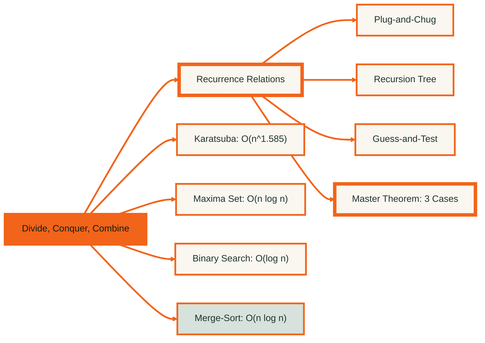
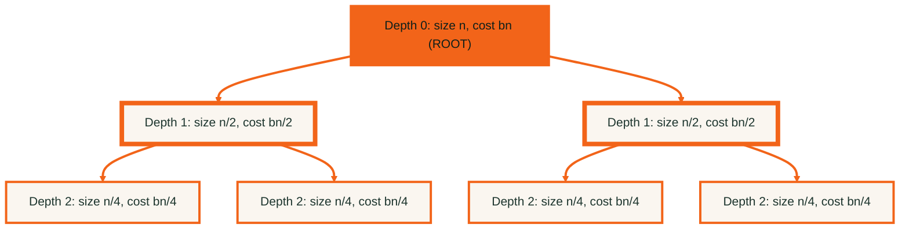

# 07 — Διαίρει και Βασίλευε
*Divide and Conquer*

Το κεφάλαιο αναπτύσσει το αλγοριθμικό παράδειγμα **Διαίρει και Βασίλευε (`Divide and Conquer`)**, το οποίο επιλύει ένα πρόβλημα διασπώντας το σε ανεξάρτητα υποπροβλήματα μικρότερου μεγέθους, επιλύοντάς τα αναδρομικά και συνθέτοντας τις επιμέρους λύσεις. Παρουσιάζονται οι τέσσερις συστηματικές μέθοδοι επίλυσης αναδρομικών εξισώσεων — επαναληπτική αντικατάσταση (`plug-and-chug`), δέντρο αναδρομής (`recursion tree`), εικασία και έλεγχος (`guess-and-test`) και Μάστερ Θεώρημα (`Master Theorem`) — καθώς και δύο εμβληματικές εφαρμογές: ο γρήγορος πολλαπλασιασμός ακεραίων (`Karatsuba`) και το πρόβλημα συνόλου μεγίστων (`Maxima Set`). Οι τεχνικές του κεφαλαίου ενοποιούν την ασυμπτωτική ανάλυση της [01_analysis_of_algorithms.md](01_analysis_of_algorithms.md), την κατασκευή σωρού της [02_priority_queues_heaps.md](02_priority_queues_heaps.md) και την ταξινόμηση με συγχώνευση της [05_sorting_and_lower_bound.md](05_sorting_and_lower_bound.md), αντιδιαστέλλοντάς τες από την άπληστη στρατηγική της [06_greedy_method.md](06_greedy_method.md). Εφαρμογή στην Τελική: όταν τα αναδρομικά υποπροβλήματα επικαλύπτονται αντί να είναι ανεξάρτητα, το παράδειγμα «Διαίρει και Βασίλευε» οδηγεί σε εκθετικό χρόνο και αντικαθίσταται από τον Δυναμικό Προγραμματισμό.

> **Εξεταστική κάλυψη:** Πρόοδος
> **Κεφάλαιο βιβλίου:** Κεφ. 11 | **Διαλέξεις:** `12_divide_and_conquer.pdf`
> **Πηγή:** `Resources/Meta/mindmap.md` (Ενότητα 07)
> **Εκτός ύλης:** Καμία (ολόκληρο το Κεφάλαιο 11 εντός ύλης)

## Πίνακας Περιεχομένων

- [1. Εννοιολογικό Πλαίσιο και Συνολική Εικόνα](#1-εννοιολογικό-πλαίσιο-και-συνολική-εικόνα)
- [2. Θεωρητική Θεμελίωση και Τυπικοί Ορισμοί](#2-θεωρητική-θεμελίωση-και-τυπικοί-ορισμοί)
- [3. Αλγόριθμοι, Ιχνηλάτηση και Κώδικας](#3-αλγόριθμοι-ιχνηλάτηση-και-κώδικας)
- [4. Συγκριτική Ανάλυση και Πολυπλοκότητα](#4-συγκριτική-ανάλυση-και-πολυπλοκότητα)
- [5. Πλήρως Λυμένες Ασκήσεις Εξεταστικού Επιπέδου](#5-πλήρως-λυμένες-ασκήσεις-εξεταστικού-επιπέδου)
- [6. Οδηγός Επιβίωσης στις Εξετάσεις και Παγίδες](#6-οδηγός-επιβίωσης-στις-εξετάσεις-και-παγίδες)
- [7. Συνοπτικός Πίνακας Εννοιών](#7-συνοπτικός-πίνακας-εννοιών)

---

## 1. Εννοιολογικό Πλαίσιο και Συνολική Εικόνα

### Το Πρόβλημα

Ένας ταξιδιώτης συγκρίνει ένα μεγάλο σύνολο $n$ ξενοδοχείων με βάση δύο ανταγωνιστικά κριτήρια: το μέγεθος της πισίνας ($x$) και τη βαθμολογία ποιότητας του εστιατορίου ($y$). Ένα ξενοδοχείο $(x, y)$ απορρίπτεται αμέσως αν υπάρχει άλλο ξενοδοχείο $(x', y')$ που είναι τουλάχιστον εξίσου καλό και στα δύο κριτήρια ($x \le x'$ και $y \le y'$). Ο ευθύς έλεγχος όλων των ζευγών απαιτεί $\Theta(n^2)$ συγκρίσεις, κόστος απαγορευτικό για μεγάλες βάσεις δεδομένων. Η διάσπαση του συνόλου σημείων σε δύο ίσα ημίσεα ως προς τη διάμεσο συντεταγμένη, η αναδρομική εύρεση των μη κυριαρχούμενων σημείων (`Maxima Set` ή `Pareto Layer`) σε κάθε μισό και η συγχώνευση σε γραμμικό χρόνο μειώνουν τη χειρότερη πολυπλοκότητα σε $O(n \log n)$.

Αντίστοιχο κέρδος προκύπτει στον πολλαπλασιασμό μεγάλων ακεραίων $n$ ψηφίων (όπως στα κρυπτογραφικά συστήματα δημοσίου κλειδιού): ο κλασικός σχολικός αλγόριθμος απαιτεί $\Theta(n^2)$ πράξεις, ενώ η αλγεβρική αναδιάταξη του `Karatsuba` μειώνει τις αναδρομικές κλήσεις από $4$ σε $3$ και ρίχνει τον χρόνο σε $O(n^{\log_2 3}) \approx O(n^{1.585})$. Για την ακριβή αποτίμηση κάθε τέτοιου αλγορίθμου απαιτούνται αυστηρά εργαλεία επίλυσης αναδρομικών εξισώσεων.

### Χάρτης Εννοιών του Κεφαλαίου



Πορτοκαλί γέμισμα: το κεντρικό παράδειγμα «Διαίρει και Βασίλευε». Παχύ περίγραμμα: ο πυρήνας ανάλυσης (αναδρομικές εξισώσεις και Μάστερ Θεώρημα). Κρεμ: οι μέθοδοι επίλυσης και οι κύριες εφαρμογές του κεφαλαίου. Απαλό πράσινο: σύνδεση με την ταξινόμηση με συγχώνευση της ενότητας 05.

Ο σχεδιασμός ενός αλγορίθμου «Διαίρει και Βασίλευε» αξιολογείται άμεσα μέσω της αναδρομικής εξίσωσης που παράγει. Το πλήθος των υποπροβλημάτων $a$, ο παράγοντας σμίκρυνσης $b$ και το κόστος διάσπασης/συγχώνευσης $f(n)$ καθορίζουν αν η αναδρομή βελτιώνει την αφελή λύση (όπως η μείωση $a = 4 \to 3$ στον `Karatsuba`).

### Πότε Χρησιμοποιείται το «Διαίρει και Βασίλευε»

Η τεχνική «Διαίρει και Βασίλευε» επιλέγεται όταν ένα πρόβλημα μπορεί να διασπαστεί σε **διακριτά και ανεξάρτητα** υποπροβλήματα του ίδιου τύπου, των οποίων οι λύσεις συντίθενται αποδοτικά (συνήθως σε $O(1)$ ή $O(n)$ χρόνο). Στην ύλη της Προόδου, χρησιμοποιείται για αποδοτική ταξινόμηση (`Merge-Sort`, `Quick-Sort`), αναζήτηση σε ταξινομημένο πίνακα (`Binary Search`), γρήγορο πολλαπλασιασμό μεγάλων ακεραίων (`Karatsuba`) και γεωμετρική πολυκριτηριακή βελτιστοποίηση (`Maxima Set`). Αντιθέτως, όταν η βέλτιστη λύση προκύπτει με μία σειρά μη αναστρέψιμων τοπικών επιλογών χωρίς ανάγκη σύνθεσης ανεξάρτητων κλάδων, προτιμάται η άπληστη μέθοδος ([06_greedy_method.md](06_greedy_method.md)).

---

## 2. Θεωρητική Θεμελίωση και Τυπικοί Ορισμοί

### 2.1 Το Γενικό Πρότυπο «Διαίρει και Βασίλευε»

Ένας αλγόριθμος «Διαίρει και Βασίλευε» επί δεδομένων εισόδου $S$ μεγέθους $n$ αποτελείται από τρία βήματα και μία βασική περίπτωση:

1. **Διαίρει (`Divide`):** διαχωρισμός των δεδομένων εισόδου $S$ σε $a \ge 1$ διακριτά υποσύνολα $S_1, S_2, \dots, S_a$, καθένα μικρότερου μεγέθους (τυπικά $n / b$ με $b > 1$).
2. **Βασίλευε (`Conquer`):** αναδρομική επίλυση καθενός από τα υποπροβλήματα $S_1, S_2, \dots, S_a$. Όταν το μέγεθος εισόδου πέσει κάτω από ένα σταθερό κατώφλι $d$ (**βασική περίπτωση**, `base case`, π.χ. $n < 2$), το υποπρόβλημα επιλύεται απευθείας σε σταθερό χρόνο $O(1)$.
3. **Συγχώνευσε (`Combine`):** σύνθεση των επιμέρους λύσεων των $S_1, S_2, \dots, S_a$ σε μία ενιαία λύση για το αρχικό σύνολο $S$.

Ο χρόνος εκτέλεσης $T(n)$ περιγράφεται από μία **αναδρομική εξίσωση (`recurrence relation`)** της μορφής:

$$T(n) = \begin{cases} c & \text{αν } n < d \\ a \, T(n/b) + f(n) & \text{αν } n \ge d \end{cases}$$

όπου $c > 0$ και $d \ge 1$ είναι σταθερές, $a \ge 1$ το πλήθος αναδρομικών κλήσεων, $b > 1$ ο παράγοντας διαίρεσης και $f(n)$ το συνολικό κόστος των βημάτων «Διαίρει» και «Συγχώνευσε». Στόχος της ανάλυσης είναι η εύρεση **κλειστής μορφής (`closed form`)**, όπου το $T(n)$ εμφανίζεται μόνο στο αριστερό μέλος.

---

### 2.2 Μέθοδος 1: Επαναληπτική Αντικατάσταση (`Plug-and-Chug`)

Η μέθοδος της επαναληπτικής αντικατάστασης εφαρμόζει διαδοχικά την αναδρομική εξίσωση στον εαυτό της, εντοπίζει το γενικό μοτίβο στη βαθμίδα $i$ και επιλύει ως προς $i$ τη συνθήκη τερματισμού στη βασική περίπτωση.

**Πλήρης ιχνηλάτηση για $T(n) = 2T(n/2) + n$ (με $T(1) = b$ και $n = 2^k$):**

Αναπτύσσουμε διαδοχικά αντικαθιστώντας το $T(n/2^i)$ από τον ορισμό $T(m) = 2T(m/2) + m$:

| Βήμα ($i$) | Αντικατάσταση | Απλοποιημένη έκφραση |
|---|---|---|
| $0$ | Αρχική εξίσωση | $T(n) = 2T(n/2) + n$ |
| $1$ | $T(n/2) = 2T(n/4) + n/2$ | $2\big(2T(n/2^2) + n/2\big) + n = 2^2 T(n/2^2) + 2n$ |
| $2$ | $T(n/2^2) = 2T(n/2^3) + n/2^2$ | $2^2\big(2T(n/2^3) + n/2^2\big) + 2n = 2^3 T(n/2^3) + 3n$ |
| $3$ | $T(n/2^3) = 2T(n/2^4) + n/2^3$ | $2^3\big(2T(n/2^4) + n/2^3\big) + 3n = 2^4 T(n/2^4) + 4n$ |
| $i$ | Γενικό μοτίβο | $T(n) = 2^i T(n/2^i) + i \cdot n$ |

Η βασική περίπτωση $T(1) = b$ επιτυγχάνεται όταν:

$$\frac{n}{2^i} = 1 \iff 2^i = n \iff i = \log_2 n$$

Αντικαθιστούμε $i = \log_2 n$ στο γενικό μοτίβο:

$$T(n) = 2^{\log_2 n} T(1) + (\log_2 n) \cdot n = b n + n \log_2 n = \Theta(n \log n)$$

*(Για τη γενικότερη μορφή της `Merge-Sort`, $T(n) = 2T(n/2) + bn$ με $T(n) = b$ για $n < 2$, η ίδια ανάπτυξη δίνει $T(n) = 2^i T(n/2^i) + ibn$, οπότε για $i = \log_2 n$ προκύπτει $T(n) = bn + bn \log_2 n = \Theta(n \log n)$.)*

---

### 2.3 Μέθοδος 2: Δέντρο Αναδρομής (`Recursion Tree`)

Το δέντρο αναδρομής απεικονίζει κάθε αναδρομική κλήση ως κόμβο με το μη αναδρομικό κόστος που εκτελείται σε αυτήν. Ο συνολικός χρόνος ισούται με το άθροισμα του κόστους όλων των εσωτερικών επιπέδων συν το κόστος των φύλλων (τελευταίο επίπεδο).

Για την εξίσωση $T(n) = 2T(n/2) + bn$ (με $T(1) = b$), τα πρώτα $3$ επίπεδα του δέντρου αναδρομής είναι:



Πορτοκαλί γέμισμα: ρίζα του δέντρου αναδρομής (επίπεδο 0). Παχύ περίγραμμα: επίπεδο 1 με 2 κλήσεις μεγέθους $n/2$. Κρεμ: επίπεδο 2 με 4 κλήσεις μεγέθους $n/4$.

Ο ακόλουθος πίνακας συνοψίζει το έργο ανά επίπεδο μέχρι τα φύλλα:

| Βάθος ($i$) | Πλήθος κλήσεων ($T$'s) | Μέγεθος ανά κλήση | Κόστος ανά κλήση | Συνολικό κόστος επιπέδου |
|---|---|---|---|---|
| $0$ | $1 = 2^0$ | $n$ | $bn$ | $bn$ |
| $1$ | $2 = 2^1$ | $n/2$ | $b(n/2)$ | $2 \cdot b(n/2) = bn$ |
| $2$ | $4 = 2^2$ | $n/4$ | $b(n/4)$ | $4 \cdot b(n/4) = bn$ |
| $i$ ($0 \le i < \log_2 n$) | $2^i$ | $n / 2^i$ | $b(n/2^i)$ | $2^i \cdot b(n/2^i) = bn$ |
| $\log_2 n$ (φύλλα) | $2^{\log_2 n} = n$ | $1$ | $b$ | $n \cdot b = bn$ |

Υπάρχουν $\log_2 n$ εσωτερικά επίπεδα με έργο $bn$ το καθένα, συν το επίπεδο των φύλλων με έργο $bn$:

$$T(n) = bn + \sum_{i=0}^{\log_2 n - 1} bn = bn + bn \log_2 n = \Theta(n \log n)$$

---

### 2.4 Μέθοδος 3: Εικασία και Έλεγχος (`Guess-and-Test`)

Στη μέθοδο εικασίας και ελέγχου διατυπώνουμε μία υπόθεση κλειστής μορφής για το $T(n)$ και την επαληθεύουμε με **μαθηματική επαγωγή (`mathematical induction`)**. Αν το επαγωγικό βήμα δεν κλείνει, η εικασία απορρίπτεται και προσαρμόζεται.

**Παράδειγμα (αποτυχία και διόρθωση εικασίας):** έστω η αναδρομική εξίσωση:

$$T(n) = \begin{cases} b & \text{αν } n < 2 \\ 2T(n/2) + bn \log_2 n & \text{αν } n \ge 2 \end{cases}$$

- **Εικασία 1 (αποτυγχάνει):** $T(n) \le c n \log_2 n$ για κάποια σταθερά $c > 0$.
  Εφαρμόζουμε την επαγωγική υπόθεση στο $T(n/2) \le c (n/2) \log_2(n/2)$:
  $$T(n) \le 2 \left( c \frac{n}{2} \log_2 \frac{n}{2} \right) + bn \log_2 n = c n (\log_2 n - \log_2 2) + bn \log_2 n = c n \log_2 n - cn + bn \log_2 n$$
  Επειδή $bn \log_2 n$ μεγαλώνει ασυμπτωτικά ταχύτερα από το $-cn$, δεν υπάρχει σταθερά $c > 0$ τέτοια ώστε $-cn + bn \log_2 n \le 0$ για κάθε $n \ge 2$. Η εικασία $O(n \log n)$ αποτυγχάνει.

- **Εικασία 2 (επιτυγχάνει):** $T(n) \le c n \log_2^2 n$ για κατάλληλη σταθερά $c > 0$ (για $n \ge 2$).
  Βασική περίπτωση ($n = 2$): $T(2) = 2T(1) + 2b \log_2 2 = 4b$, ενώ $c \cdot 2 \cdot \log_2^2 2 = 2c$, άρα αρκεί $c \ge 2b$.
  Επαγωγικό βήμα (με $T(n/2) \le c (n/2) \log_2^2(n/2)$):
  $$\begin{aligned}
  T(n) &\le 2 \left( c \frac{n}{2} \log_2^2 \frac{n}{2} \right) + bn \log_2 n \\
  &= c n (\log_2 n - 1)^2 + bn \log_2 n \\
  &= c n \log_2^2 n - 2cn \log_2 n + cn + bn \log_2 n \\
  &= c n \log_2^2 n - \big( (2c - b) n \log_2 n - cn \big)
  \end{aligned}$$
  Για $n \ge 2$ ισχύει $\log_2 n \ge 1$, οπότε $(2c - b) n \log_2 n - cn \ge (2c - b - c) n \log_2 n = (c - b) n \log_2 n \ge 0$ εφόσον επιλέξουμε $c \ge 2b$ (οπότε ισχύει και $c > b$). Άρα $T(n) \le c n \log_2^2 n$, δηλαδή $T(n) = O(n \log^2 n)$.

---

### 2.5 Μέθοδος 4: Το Μάστερ Θεώρημα (`Master Theorem`)

**Μάστερ Θεώρημα:** έστω αναδρομική εξίσωση της μορφής $T(n) = c$ για $n < d$ και $T(n) = a T(n/b) + f(n)$ για $n \ge d$, όπου $a \ge 1$, $b > 1$, $c > 0$, $d \ge 1$ είναι σταθερές και $f(n)$ ασυμπτωτικά θετική συνάρτηση. Συγκρίνουμε τη συνάρτηση $f(n)$ με τη συνάρτηση των φύλλων $n^{\log_b a}$:

1. **Περίπτωση 1 (κυριαρχούν τα φύλλα):** αν $f(n) = O\!\left(n^{\log_b a - \varepsilon}\right)$ για κάποια σταθερά $\varepsilon > 0$, τότε:
   $$T(n) = \Theta\!\left(n^{\log_b a}\right)$$
2. **Περίπτωση 2 (ισορροπία επιπέδων):** αν $f(n) = \Theta\!\left(n^{\log_b a} \log^k n\right)$ για κάποια σταθερά $k \ge 0$, τότε:
   $$T(n) = \Theta\!\left(n^{\log_b a} \log^{k+1} n\right)$$
3. **Περίπτωση 3 (κυριαρχεί η ρίζα):** αν $f(n) = \Omega\!\left(n^{\log_b a + \varepsilon}\right)$ για κάποια σταθερά $\varepsilon > 0$ **και** ικανοποιείται η **συνθήκη κανονικότητας (`regularity condition`)** $a f(n/b) \le \delta f(n)$ για κάποια σταθερά $\delta < 1$ και επαρκώς μεγάλο $n$, τότε:
   $$T(n) = \Theta(f(n))$$

**Αιτιολόγηση υψηλού επιπέδου (κλειστή μορφή αθροίσματος):**

Εφαρμόζοντας επαναληπτική αντικατάσταση στην $T(n) = a T(n/b) + f(n)$ (για $n$ δύναμη του $b$):

$$\begin{aligned}
T(n) &= a T(n/b) + f(n) \\
&= a\big(a T(n/b^2) + f(n/b)\big) + f(n) = a^2 T(n/b^2) + a f(n/b) + f(n) \\
&= a^3 T(n/b^3) + a^2 f(n/b^2) + a f(n/b) + f(n) \\
&= \dots \\
&= a^{\log_b n} T(1) + \sum_{i=0}^{(\log_b n) - 1} a^i f(n / b^i)
\end{aligned}$$

Επειδή από τις ιδιότητες λογαρίθμων ισχύει $a^{\log_b n} = n^{\log_b a}$, προκύπτει η θεμελιώδης ταυτότητα:

$$T(n) = n^{\log_b a} T(1) + \sum_{i=0}^{(\log_b n) - 1} a^i f(n / b^i)$$

Από τη σύγκριση του πρώτου όρου (φύλλα: $n^{\log_b a} T(1)$) με το άθροισμα των $\log_b n$ επιπέδων προκύπτουν οι τρεις περιπτώσεις:
- **Περίπτωση 1:** το άθροισμα αυξάνεται γεωμετρικά προς τα φύλλα, οπότε ο πρώτος όρος $n^{\log_b a}$ κυριαρχεί.
- **Περίπτωση 2:** κάθε όρος του αθροίσματος έχει την ίδια τάξη μεγέθους (ή πολλαπλασιάζεται με $\log^k n$), οπότε το άθροισμα $\log_b n$ όρων προσθέτει έναν επιπλέον παράγοντα $\log n$ ($\log^{k+1} n$).
- **Περίπτωση 3:** το άθροισμα φθίνει γεωμετρικά από τη ρίζα προς τα φύλλα (ακριβώς λόγω της συνθήκης $a f(n/b) \le \delta f(n)$ με $\delta < 1$, η οποία εγγυάται ότι το άθροισμα φράσσεται από $\frac{1}{1-\delta} f(n)$), οπότε κυριαρχεί ο όρος $i = 0$, δηλαδή $f(n)$.

#### Πίνακας Απόφασης Μάστερ Θεωρήματος (8 Αντιπροσωπευτικές Εξισώσεις)

| Αναδρομική εξίσωση | $a$ | $b$ | $f(n)$ | $\log_b a$ | Σύγκριση $f(n)$ με $n^{\log_b a}$ | Περίπτωση | Αποτέλεσμα |
|---|---|---|---|---|---|---|---|
| $T(n) = 4T(n/2) + n$ | $4$ | $2$ | $n$ | $2$ | $n = O(n^{2 - 1})$, $\varepsilon = 1$ | Περίπτωση 1 | $\Theta(n^2)$ |
| $T(n) = 2T(n/2) + n \log n$ | $2$ | $2$ | $n \log n$ | $1$ | $n \log n = \Theta(n^1 \log^1 n)$, $k = 1$ | Περίπτωση 2 | $\Theta(n \log^2 n)$ |
| $T(n) = T(n/2) + 1$ *(δυαδική αναζήτηση)* | $1$ | $2$ | $1$ | $0$ | $1 = \Theta(n^0 \log^0 n)$, $k = 0$ | Περίπτωση 2 | $\Theta(\log n)$ |
| $T(n) = T(n/3) + n \log n$ | $1$ | $3$ | $n \log n$ | $0$ | $n \log n = \Omega(n^{0 + 1})$· $1 \cdot \frac{n}{3}\log\frac{n}{3} \le \frac{1}{3} n \log n$ ($\delta = 1/3 < 1$) | Περίπτωση 3 | $\Theta(n \log n)$ |
| $T(n) = 2T(n/2) + \log n$ *(κατασκευή σωρού)* | $2$ | $2$ | $\log n$ | $1$ | $\log n = O(n^{1 - 0.5})$, $\varepsilon = 0.5$ | Περίπτωση 1 | $\Theta(n)$ |
| $T(n) = 3T(n/2) + n$ *(`Karatsuba`)* | $3$ | $2$ | $n$ | $\log_2 3 \approx 1.585$ | $n = O(n^{1.585 - 0.5})$, $\varepsilon = 0.5$ | Περίπτωση 1 | $\Theta(n^{\log_2 3}) \approx \Theta(n^{1.585})$ |
| $T(n) = 9T(n/3) + n^3$ | $9$ | $3$ | $n^3$ | $2$ | $n^3 = \Omega(n^{2 + 1})$· $9(n/3)^3 = \frac{1}{3}n^3 \le \frac{1}{3}n^3$ ($\delta = 1/3 < 1$) | Περίπτωση 3 | $\Theta(n^3)$ |
| $T(n) = 2T(n/2) + n / \log n$ | $2$ | $2$ | $n / \log n$ | $1$ | $n/\log n$ μικρότερο του $n$, αλλά όχι κατά $n^\varepsilon$ ($k = -1 \notin [0, \infty)$) | Δεν εφαρμόζεται | Χάσμα Περ. 1–2 (επίλυση με δέντρο αναδρομής: $\Theta(n \log \log n)$) |

---

### 2.6 Αλγεβρική Θεμελίωση Πολλαπλασιασμού `Karatsuba`

Δίνονται δύο $n$-bit ακέραιοι $I$ και $J$ (έστω $n$ δύναμη του $2$). Διαχωρίζουμε κάθε αριθμό σε $n/2$ bits υψηλής τάξης (`high-order`) και $n/2$ bits χαμηλής τάξης (`low-order`):

$$I = I_h \cdot 2^{n/2} + I_l, \qquad J = J_h \cdot 2^{n/2} + J_l$$

Ο άμεσος διαμερισμός δίνει $4$ πολλαπλασιασμούς μεγέθους $n/2$:

$$I \cdot J = I_h J_h \cdot 2^n + (I_h J_l + I_l J_h) \cdot 2^{n/2} + I_l J_l$$

Η αντίστοιχη αναδρομική εξίσωση είναι $T(n) = 4T(n/2) + n$, η οποία από την Περίπτωση 1 του Μάστερ Θεωρήματος ($\log_2 4 = 2$) δίνει $\Theta(n^2)$ — καμία βελτίωση έναντι του σχολικού αλγορίθμου.

**Θεώρημα (Αναδιάταξη `Karatsuba`):** ο μεσαίος συντελεστής $(I_h J_l + I_l J_h)$ υπολογίζεται με **έναν μόνο επιπλέον πολλαπλασιασμό** χρησιμοποιώντας τα ήδη υπολογισμένα γινόμενα $I_h J_h$ και $I_l J_l$:

$$I \cdot J = I_h J_h \cdot 2^n + \Big[ (I_h - I_l)(J_l - J_h) + I_h J_h + I_l J_l \Big] \cdot 2^{n/2} + I_l J_l$$

**Απόδειξη (αλγεβρικό ανάπτυγμα):**

$$(I_h - I_l)(J_l - J_h) + I_h J_h + I_l J_l = (I_h J_l - I_h J_h - I_l J_l + I_l J_h) + I_h J_h + I_l J_l = I_h J_l + I_l J_h$$

Οι δύο όροι $-I_h J_h$ και $-I_l J_l$ αλληλοαναιρούνται με τους $+I_h J_h$ και $+I_l J_l$. Οι μοναδικοί $3$ αναδρομικοί πολλαπλασιασμοί είναι οι $P_1 = I_h J_h$, $P_2 = I_l J_l$ και $P_3 = (I_h - I_l)(J_l - J_h)$, ενώ οι προσθέσεις, αφαιρέσεις και μετατοπίσεις bits ($\cdot 2^n$, $\cdot 2^{n/2}$) απαιτούν γραμμικό χρόνο $O(n)$. Επομένως:

$$T(n) = 3T(n/2) + n \implies T(n) = \Theta\!\left(n^{\log_2 3}\right) \approx \Theta(n^{1.585})$$

*(Η ίδια ακριβώς ταυτότητα ισχύει σε οποιαδήποτε βάση $B$, π.χ. δεκαδική βάση $B = 10$ με αντικατάσταση του $2^{n/2}$ από $10^{n/2}$.)*

---

### 2.7 Τυπικός Ορισμός και Ορθότητα του Συνόλου Μεγίστων (`Maxima Set`)

**Ορισμός (Μέγιστο / Μη Κυριαρχούμενο Σημείο):** δεδομένου ενός συνόλου $S$ από $n$ διακριτά σημεία $(x, y)$ στο επίπεδο, ένα σημείο $r = (x, y) \in S$ ονομάζεται **μέγιστο (`maximal`)** ή **μη κυριαρχούμενο (`non-dominated`)** στο $S$ αν δεν υπάρχει άλλο σημείο $r' = (x', y') \in S$ ($r' \ne r$) τέτοιο ώστε:

$$x \le x' \quad \text{και} \quad y \le y'$$

Το σύνολο όλων των μεγίστων σημείων του $S$ ονομάζεται **σύνολο μεγίστων (`Maxima Set`)** ή **επίπεδο `Pareto` (`Pareto layer`)**.

**Θεώρημα (Ιδιότητα Συγχώνευσης του `MaximaSet`):** έστω $L$ και $G$ διαμερισμός του $S$ ως προς τη διάμεσο $p$ στη **λεξικογραφική διάταξη $(x, y)$** (πρώτα κατά αύξον $x$, και σε ισοβαθμία κατά αύξον $y$), ώστε κάθε σημείο του $L$ να είναι λεξικογραφικά μικρότερο του $p$ και κάθε σημείο του $G$ μεγαλύτερο ή ίσο του $p$. Έστω $M_1 = \text{MaximaSet}(L)$ και $M_2 = \text{MaximaSet}(G)$, και έστω $q$ το **λεξικογραφικά ελάχιστο** (αριστερότερο) σημείο του $M_2$. Τότε:
1. Κάθε σημείο του $M_2$ είναι μέγιστο στο $S$.
2. Ένα σημείο $r \in M_1$ κυριαρχείται από κάποιο σημείο του $G$ **αν και μόνο αν** κυριαρχείται από το $q$ (δηλαδή $x(r) \le x(q)$ και $y(r) \le y(q)$).

**Απόδειξη:**
1. Για κάθε $u \in M_2$ και κάθε $v \in L$, ισχύει λεξικογραφικά $v < u$, άρα είτε $x(v) < x(u)$ είτε ($x(v) = x(u)$ και $y(v) < y(u)$). Σε καμία περίπτωση δεν μπορεί το $v$ να κυριαρχεί στο $u$. Εφόσον το $u$ δεν κυριαρχείται ούτε από σημείο του $G$ (ως μέλος του $M_2$), είναι μέγιστο στο $S$.
2. Επειδή το $M_2$ αποτελείται από μη κυριαρχούμενα σημεία ταξινομημένα κατά αύξον $x$, οι συντεταγμένες $y$ των σημείων του $M_2$ είναι **αυστηρά φθίνουσες**. Άρα το αριστερότερο σημείο $q \in M_2$ έχει τη **μεγαλύτερη συντεταγμένη $y$** ανάμεσα σε όλα τα σημεία του $G$ (αν υπήρχε $w \in G$ με $y(w) > y(q)$, τότε κάποιο μέγιστο του $G$ θα είχε μεγαλύτερο $y$ από το $q$, άτοπο). Επίσης για κάθε $r \in M_1 \subseteq L$ ισχύει $x(r) \le x(p) \le x(q)$. Επομένως $r$ κυριαρχείται από κάποιο σημείο του $G$ $\iff \exists w \in G: y(r) \le y(w) \iff y(r) \le y(q)$ (αφού $y(q) = \max_{w \in G} y(w)$ και ήδη $x(r) \le x(q)$).

---

## 3. Αλγόριθμοι, Ιχνηλάτηση και Κώδικας

### 3.1 Γρήγορος Πολλαπλασιασμός Ακεραίων (`Karatsuba`)

**Σκοπός:** υπολογισμός του γινομένου δύο $n$-bit (ή $n$-ψήφιων) ακεραίων $I, J$ σε χρόνο $\Theta(n^{\log_2 3})$ μέσω τριών αναδρομικών πολλαπλασιασμών.

#### Ψευδοκώδικας

```text
Algorithm karatsuba(I, J, n):
    Input: two n-bit non-negative integers I and J (n is a power of 2)
    Output: the product I * J
    if n <= 1 then
        return I * J
    m ← n / 2
    I_h ← I div 2^m;  I_l ← I mod 2^m
    J_h ← J div 2^m;  J_l ← J mod 2^m
    P1 ← karatsuba(I_h, J_h, m)
    P2 ← karatsuba(I_l, J_l, m)
    P3 ← karatsuba(I_h - I_l, J_l - J_h, m)
    mid ← P3 + P1 + P2
    return P1 * 2^(2m) + mid * 2^m + P2
```

#### Ιχνηλάτηση (4-ψήφιος επί 4-ψήφιο στη βάση $10$: $1234 \times 5678$)

Κανόνας διαμερισμού: για αριθμούς έως $n$ ψηφίων, $m = \lfloor n / 2 \rfloor$ και $B = 10^m$. Η βασική περίπτωση εκτελείται όταν και οι δύο παράγοντες είναι μονοψήφιοι ($< 10$). Σημείωση προσήμου: το $P_3 = (I_h - I_l)(J_l - J_h)$ υπολογίζεται αναδρομικά επί των απολύτων τιμών και διατηρεί το αλγεβρικό του πρόσημο.

| Βάθος | Κλήση ($I \times J$) | $m$ ($10^m$) | $I_h, I_l$ | $J_h, J_l$ | $P_1 = I_h J_h$ | $P_2 = I_l J_l$ | $I_h - I_l$, $J_l - J_h$ | $P_3 = (I_h-I_l)(J_l-J_h)$ | $\text{mid} = P_3 + P_1 + P_2$ | Αποτέλεσμα $P_1 \cdot 10^{2m} + \text{mid} \cdot 10^m + P_2$ |
|---|---|---|---|---|---|---|---|---|---|---|
| $1$ | $12 \times 56$ | $1$ ($10$) | $1, 2$ | $5, 6$ | $1 \cdot 5 = 5$ | $2 \cdot 6 = 12$ | $-1, +1$ | $-1$ | $-1 + 5 + 12 = 16$ | $500 + 160 + 12 = 672$ |
| $1$ | $34 \times 78$ | $1$ ($10$) | $3, 4$ | $7, 8$ | $3 \cdot 7 = 21$ | $4 \cdot 8 = 32$ | $-1, +1$ | $-1$ | $-1 + 21 + 32 = 52$ | $2100 + 520 + 32 = 2652$ |
| $1$ | $22 \times 22$ | $1$ ($10$) | $2, 2$ | $2, 2$ | $2 \cdot 2 = 4$ | $2 \cdot 2 = 4$ | $0, 0$ | $0$ | $0 + 4 + 4 = 8$ | $400 + 80 + 4 = 484$ |
| $0$ | $1234 \times 5678$ | $2$ ($100$) | $12, 34$ | $56, 78$ | $672$ | $2652$ | $-22, +22$ | $-484$ | $-484 + 672 + 2652 = 2840$ | $6720000 + 284000 + 2652 = 7006652$ |

Έλεγχος: $1234 \times 5678 = 7\,006\,652$. Το αποτέλεσμα της ιχνηλάτησης συμφωνεί ακριβώς.

#### Κώδικας Python (Διπλή Μορφή)

**Ρητός αλγόριθμος (εξεταστική μορφή):**

```python
def karatsuba(first_num: int, second_num: int, base: int = 10) -> int:
    """Multiplies two integers using the Karatsuba divide-and-conquer algorithm.

    Args:
        first_num (int): First integer operand.
        second_num (int): Second integer operand.
        base (int): Positional numeral base used for splitting (default 10).

    Returns:
        int: Exact product of first_num and second_num.
    """
    if first_num == 0 or second_num == 0:
        return 0
    # Handle negative factors up front so recursive splitting operates on magnitudes.
    sign = -1 if (first_num < 0) ^ (second_num < 0) else 1
    abs_first, abs_second = abs(first_num), abs(second_num)

    if abs_first < base and abs_second < base:
        return sign * (abs_first * abs_second)

    # Count digits in the chosen base to split near the midpoint.
    max_val = max(abs_first, abs_second)
    digits = 0
    temp_val = max_val
    while temp_val > 0:
        temp_val //= base
        digits += 1

    half_digits = digits // 2
    split_power = base ** half_digits

    i_high, i_low = divmod(abs_first, split_power)
    j_high, j_low = divmod(abs_second, split_power)

    # Textbook reduction from 4 sub-products to 3: Ih*Jh, Il*Jl, and (Ih-Il)*(Jl-Jh).
    prod_high = karatsuba(i_high, j_high, base)
    prod_low = karatsuba(i_low, j_low, base)
    prod_diff = karatsuba(i_high - i_low, j_low - j_high, base)

    middle_term = prod_diff + prod_high + prod_low
    result = prod_high * (split_power ** 2) + middle_term * split_power + prod_low
    return sign * result


assert karatsuba(1234, 5678) == 1234 * 5678 == 7006652
assert karatsuba(1234, 5678, base=2) == 1234 * 5678
```

**Pythonic ιδίωμα (επαλήθευση):**

```python
product_value = 1234 * 5678  # Built-in arbitrary-precision multiplication
assert product_value == 7006652
```

| Μορφή | Χρόνος (χειρότερη) | Επιπλέον χώρος | Σημείωση |
|---|---|---|---|
| `karatsuba(a, b)` | $\Theta(n^{\log_2 3}) \approx \Theta(n^{1.585})$ | $O(n)$ (στοίβα + ενδιάμεσα μέρη) | Ο ρητός αλγόριθμος και η ιχνηλάτηση που ζητά η εξέταση |
| `a * b` (CPython `int`) | $O(n^2)$ για μικρά $n$, $O(n^{1.585})$ για μεγάλα $n$ | $O(n)$ | Η CPython μεταβαίνει εσωτερικά σε Karatsuba όταν οι ακέραιοι ξεπερνούν κατώφλι μήκους |

Στην εξέταση γράφεται πάντοτε ο ρητός αλγόριθμος με την αναγωγή από $4$ σε $3$ πολλαπλασιασμούς και την ιχνηλάτησή του· ο ενσωματωμένος τελεστής `*` χρησιμεύει μόνο για επαλήθευση.

#### Ανάλυση Πολυπλοκότητας (`Karatsuba`)

- **Διαίρει:** διαχωρισμός $I, J$ σε $n/2$ bits με μετατοπίσεις/μάσκες σε $O(n)$.
- **Βασίλευε:** $3$ αναδρομικές κλήσεις σε μέγεθος $n/2$, κόστος $3T(n/2)$.
- **Συγχώνευσε:** σταθερός αριθμός προσθέσεων, αφαιρέσεων και μετατοπίσεων $n$-bit αριθμών σε $O(n)$.
- **Αναδρομική εξίσωση:** $T(n) = 3T(n/2) + c n$ για $n > 1$, $T(1) = O(1)$. Με Μάστερ Θεώρημα ($a = 3, b = 2, \log_2 3 \approx 1.585, f(n) = c n = O(n^{\log_2 3 - \varepsilon})$), Περίπτωση 1 $\Rightarrow T(n) = \Theta(n^{\log_2 3}) \approx \Theta(n^{1.585})$ στη χειρότερη περίπτωση.

---

### 3.2 Πρόβλημα Συνόλου Μεγίστων (`MaximaSet`)

**Σκοπός:** εύρεση όλων των μη κυριαρχούμενων σημείων (`Pareto layer`) ενός συνόλου $n$ σημείων στο επίπεδο σε χειρότερο χρόνο $O(n \log n)$.

#### Ψευδοκώδικας

```text
Algorithm MaximaSet(S):
    Input: A set, S, of n points in the plane
    Output: The set, M, of maxima points in S
    if n <= 1 then
        return S
    Let p be the median point in S, by lexicographic (x, y)-coordinates
    Let L be the set of points lexicographically less than p in S
    Let G be the set of points lexicographically greater than or equal to p in S
    M1 ← MaximaSet(L)
    M2 ← MaximaSet(G)
    Let q be the lexicographically smallest point in M2
    for each point, r, in M1 do
        if x(r) <= x(q) and y(r) <= y(q) then
            Remove r from M1
    return M1 ∪ M2
```

**Κρίσιμη λεπτομέρεια υλοποίησης (εύρεση διαμέσου $p$):**
Υπάρχουν δύο ισοδύναμες ασυμπτωτικά επιλογές ώστε κάθε επίπεδο της αναδρομής να διατηρεί κόστος $O(n)$:
1. **Προ-ταξινόμηση (πρακτικά προτιμητέα):** ταξινομούμε μία φορά το $S$ λεξικογραφικά κατά $(x, y)$ σε $O(n \log n)$ πριν την κλήση του `MaximaSet`. Κατόπιν, σε κάθε αναδρομική κλήση το διάμεσο σημείο $p$ είναι απλώς το μεσαίο στοιχείο του υποπίνακα σε $O(1)$, και τα $L, G$ παραμένουν ήδη ταξινομημένα.
2. **Γραμμική εύρεση διαμέσου:** επιλογή διαμέσου σε $O(n)$ σε κάθε κλήση χωρίς προ-ταξινόμηση (περισσότερο πολύπλοκη υλοποίηση, ίδια ασυμπτωτική πολυπλοκότητα $O(n \log n)$).

#### Ιχνηλάτηση (8 Σημεία με Ισοβαθμία στο $x$)

Είσοδος $8$ σημείων: $P_1(1, 9)$, $P_2(2, 4)$, $P_3(3, 6)$, $P_4(4, 8)$, $P_5(4, 3)$, $P_6(6, 5)$, $P_7(7, 6)$, $P_8(9, 2)$.
Κανόνας διάταξης (ισοβαθμία): λεξικογραφικά πρώτα κατά αύξον $x$, και σε ίσο $x$ κατά αύξον $y$. Άρα $P_5(4, 3)$ προηγείται του $P_4(4, 8)$.

**Προ-ταξινομημένη ακολουθία:** $[P_1(1,9),\; P_2(2,4),\; P_3(3,6),\; P_5(4,3),\; P_4(4,8),\; P_6(6,5),\; P_7(7,6),\; P_8(9,2)]$.
Κάθε κλήση διαιρεί τον πίνακα στο $\lfloor n/2 \rfloor$ (το $p$ είναι το στοιχείο θέσης $\lfloor n/2 \rfloor$ σε 0-indexed αρίθμηση, οπότε το $p$ ανήκει στο $G$).

| Βάθος | Υποσύνολα $L \mid G$ | $M_1$ | $M_2$ | Αριστερότερο $q \in M_2$ | Έλεγχος σημείων $r \in M_1$ ($x(r) \le x(q) \land y(r) \le y(q)$) | Αποτέλεσμα $M_1 \cup M_2$ |
|---|---|---|---|---|---|---|
| $2$ | $[P_1] \mid [P_2]$ | $[P_1(1,9)]$ | $[P_2(2,4)]$ | $P_2(2,4)$ | $P_1$: $9 \le 4$ ψευδές $\to$ διατηρείται | $[P_1, P_2]$ |
| $2$ | $[P_3] \mid [P_5]$ | $[P_3(3,6)]$ | $[P_5(4,3)]$ | $P_5(4,3)$ | $P_3$: $6 \le 3$ ψευδές $\to$ διατηρείται | $[P_3, P_5]$ |
| $1$ | $[P_1, P_2] \mid [P_3, P_5]$ | $[P_1(1,9), P_2(2,4)]$ | $[P_3(3,6), P_5(4,3)]$ | $P_3(3,6)$ | $P_1$: $9 \le 6$ ψευδές (μένει)· $P_2$: $2 \le 3 \land 4 \le 6$ αληθές (αφαιρείται) | $[P_1, P_3, P_5]$ |
| $2$ | $[P_4] \mid [P_6]$ | $[P_4(4,8)]$ | $[P_6(6,5)]$ | $P_6(6,5)$ | $P_4$: $8 \le 5$ ψευδές $\to$ διατηρείται | $[P_4, P_6]$ |
| $2$ | $[P_7] \mid [P_8]$ | $[P_7(7,6)]$ | $[P_8(9,2)]$ | $P_8(9,2)$ | $P_7$: $6 \le 2$ ψευδές $\to$ διατηρείται | $[P_7, P_8]$ |
| $1$ | $[P_4, P_6] \mid [P_7, P_8]$ | $[P_4(4,8), P_6(6,5)]$ | $[P_7(7,6), P_8(9,2)]$ | $P_7(7,6)$ | $P_4$: $8 \le 6$ ψευδές (μένει)· $P_6$: $6 \le 7 \land 5 \le 6$ αληθές (αφαιρείται) | $[P_4, P_7, P_8]$ |
| $0$ | $[P_1, P_2, P_3, P_5] \mid [P_4, P_6, P_7, P_8]$ | $[P_1(1,9), P_3(3,6), P_5(4,3)]$ | $[P_4(4,8), P_7(7,6), P_8(9,2)]$ | $P_4(4,8)$ | $P_1$: $9 \le 8$ ψευδές (μένει)· $P_3$: $3 \le 4 \land 6 \le 8$ (αφαιρείται)· $P_5$: $4 \le 4 \land 3 \le 8$ (αφαιρείται) | $[P_1(1,9), P_4(4,8), P_7(7,6), P_8(9,2)]$ |

Παρατήρηση ελέγχου: στο τελικό σύνολο $[P_1(1,9), P_4(4,8), P_7(7,6), P_8(9,2)]$, οι τετμημένες αυξάνονται αυστηρά ($1 < 4 < 7 < 9$) ενώ οι τεταγμένες φθίνουν αυστηρά ($9 > 8 > 6 > 2$), επιβεβαιώνοντας ότι κανένα σημείο δεν κυριαρχεί σε άλλο.

#### Κώδικας Python

```python
Point = tuple[str, int, int]


def findMaximaRecursive(sorted_points: list[Point]) -> list[Point]:
    """Computes the Pareto maxima set of lexicographically sorted 2D points.

    Args:
        sorted_points (list[Point]): Points (label, x, y) sorted by (x, y).

    Returns:
        list[Point]: Non-dominated points in ascending x (descending y) order.
    """
    if len(sorted_points) <= 1:
        return list(sorted_points)

    mid_index = len(sorted_points) // 2
    left_maxima = findMaximaRecursive(sorted_points[:mid_index])
    right_maxima = findMaximaRecursive(sorted_points[mid_index:])

    # The leftmost point in right_maxima has the maximum y among all right points.
    dominating_q = right_maxima[0]
    filtered_left = [
        pt for pt in left_maxima
        if not (pt[1] <= dominating_q[1] and pt[2] <= dominating_q[2])
    ]
    return filtered_left + right_maxima


def findMaxima(points: list[Point]) -> list[Point]:
    """Finds the maxima set (Pareto layer) of 2D points in O(n log n) time.

    Args:
        points (list[Point]): Unsorted list of (label, x, y) points.

    Returns:
        list[Point]: Maxima points ordered lexicographically by (x, y).
    """
    # Pre-sorting once in O(n log n) makes median selection O(1) at every call.
    lex_sorted = sorted(points, key=lambda pt: (pt[1], pt[2]))
    return findMaximaRecursive(lex_sorted)


sample_points: list[Point] = [
    ("P1", 1, 9), ("P2", 2, 4), ("P3", 3, 6), ("P4", 4, 8),
    ("P5", 4, 3), ("P6", 6, 5), ("P7", 7, 6), ("P8", 9, 2),
]
expected_maxima = [("P1", 1, 9), ("P4", 4, 8), ("P7", 7, 6), ("P8", 9, 2)]
assert findMaxima(sample_points) == expected_maxima

# Brute-force cross-check in O(n^2) to verify correctness on the trace input.
brute_maxima = sorted(
    [
        p for p in sample_points
        if not any(
            (p[1] <= q[1] and p[2] <= q[2] and (p[1] < q[1] or p[2] < q[2]))
            for q in sample_points if q[0] != p[0]
        )
    ],
    key=lambda pt: (pt[1], pt[2]),
)
assert findMaxima(sample_points) == brute_maxima
```

**Σημείωση ιδιώματος:** δεν υπάρχει ενσωματωμένη συνάρτηση της τυπικής βιβλιοθήκης Python που να υπολογίζει απευθείας το σύνολο μεγίστων (`Pareto layer`)· ο ρητός αλγόριθμος `findMaxima` είναι η κανονική υλοποίηση.

#### Ανάλυση Πολυπλοκότητας (`MaximaSet`)

- **Προ-επεξεργασία:** λεξικογραφική ταξινόμηση σε $O(n \log n)$ (χειρότερη περίπτωση).
- **Διαίρει:** εύρεση μεσαίου δείκτη σε $O(1)$ (με διαμοιρασμό δεικτών) ή αντιγραφή υποπινάκων σε $O(n)$.
- **Βασίλευε:** $2$ αναδρομικές κλήσεις μεγέθους $n/2$, κόστος $2T(n/2)$.
- **Συγχώνευσε:** εύρεση του πρώτου στοιχείου $q \in M_2$ σε $O(1)$ και γραμμική σάρωση του $M_1$ σε $O(n)$.
- **Αναδρομική εξίσωση:** $T(n) = 2T(n/2) + b n$ για $n \ge 2$, $T(n) = b$ για $n < 2$. Με Μάστερ Θεώρημα ($a = 2, b = 2, \log_2 2 = 1, k = 0$), Περίπτωση 2 $\Rightarrow T(n) = \Theta(n \log n)$ στη χειρότερη περίπτωση. Συνολικά $O(n \log n) + \Theta(n \log n) = \Theta(n \log n)$.

---

### 3.3 Δυαδική Αναζήτηση (`Binary Search`)

**Σκοπός:** εντοπισμός της θέσης ενός κλειδιού `target` σε ταξινομημένο πίνακα $n$ στοιχείων σε χειρότερο χρόνο $O(\log n)$, αποτελώντας το κλασικό παράδειγμα «Διαίρει και Βασίλευε» με ένα μόνο υποπρόβλημα ($a = 1, b = 2$).

#### Ψευδοκώδικας

```text
Algorithm binarySearch(A, low, high, target):
    Input: sorted array A[low..high] and key target
    Output: index i where A[i] = target, or -1 if absent
    if low > high then
        return -1
    mid ← floor((low + high) / 2)
    if A[mid] = target then
        return mid
    else if target < A[mid] then
        return binarySearch(A, low, mid - 1, target)
    else
        return binarySearch(A, mid + 1, high, target)
```

#### Ιχνηλάτηση (Πίνακας 8 Στοιχείων)

Είσοδος: $A = [4, 9, 15, 22, 31, 40, 52, 68]$, `target = 40`.

| Βήμα | `low` | `high` | `mid` | `A[mid]` | Σύγκριση με `40` | Ενέργεια |
|---|---|---|---|---|---|---|
| $1$ | $0$ | $7$ | $3$ | $22$ | $40 > 22$ | Μετάβαση στο δεξί μισό (`low = 4`) |
| $2$ | $4$ | $7$ | $5$ | $40$ | $40 = 40$ | Εύρεση και επιστροφή δείκτη `5` |

#### Κώδικας Python (Διπλή Μορφή)

**Ρητός αλγόριθμος (εξεταστική μορφή):**

```python
def binarySearch(sorted_arr: list[int], target: int) -> int:
    """Finds the index of target in a sorted list using binary search.

    Args:
        sorted_arr (list[int]): List of integers sorted in ascending order.
        target (int): Value to search for.

    Returns:
        int: Zero-based index of target if found, otherwise -1.
    """
    low_index, high_index = 0, len(sorted_arr) - 1
    while low_index <= high_index:
        mid_index = (low_index + high_index) // 2
        if sorted_arr[mid_index] == target:
            return mid_index
        if target < sorted_arr[mid_index]:
            # Discard the right half including mid_index because array is sorted.
            high_index = mid_index - 1
        else:
            low_index = mid_index + 1
    return -1


data_arr = [4, 9, 15, 22, 31, 40, 52, 68]
assert binarySearch(data_arr, 40) == 5
assert binarySearch(data_arr, 25) == -1
```

**Pythonic ιδίωμα (`bisect.bisect_left`):**

```python
import bisect

data_arr = [4, 9, 15, 22, 31, 40, 52, 68]
pos = bisect.bisect_left(data_arr, 40)
found_index = pos if pos < len(data_arr) and data_arr[pos] == 40 else -1
assert found_index == 5
```

| Μορφή | Χρόνος (χειρότερη) | Επιπλέον χώρος | Σημείωση |
|---|---|---|---|
| `binarySearch(arr, x)` (επαναληπτική) | $O(\log n)$ | $O(1)$ | Επιστρέφει `-1` αν το στοιχείο απουσιάζει |
| `binarySearch` (αναδρομική) | $O(\log n)$ | $O(\log n)$ | Χρησιμοποιεί στοίβα αναδρομής βάθους $\lfloor \log_2 n \rfloor + 1$ |
| `bisect.bisect_left(arr, x)` | $O(\log n)$ | $O(1)$ | Επιστρέφει **σημείο εισαγωγής** (όχι `-1`)· απαιτεί έλεγχο ορίων και ισότητας |

> **Προσοχή στη σύμβαση βιβλιοθήκης:** η `bisect.bisect_left` δεν επιστρέφει `-1` όταν το στοιχείο λείπει, αλλά τον δείκτη όπου θα έπρεπε να εισαχθεί (έως και `len(arr)`). Χωρίς τον έλεγχο `pos < len(arr) and arr[pos] == target`, προκαλεί σφάλμα `IndexError` ή ψευδώς θετικό αποτέλεσμα.

#### Ανάλυση Πολυπλοκότητας (`Binary Search`)

Σε κάθε βήμα γίνεται μία σύγκριση ($O(1)$) και ένα μόνο αναδρομικό υποπρόβλημα μεγέθους $\lfloor n/2 \rfloor$:
$$T(n) = T(n/2) + 1 \quad (n \ge 2), \qquad T(1) = 1$$
Με Μάστερ Θεώρημα: $a = 1, b = 2, \log_2 1 = 0$, $f(n) = 1 = \Theta(n^0 \log^0 n)$ ($k = 0$), Περίπτωση 2 $\Rightarrow T(n) = \Theta(\log n)$ στη χειρότερη περίπτωση.

---

### 3.4 Επαλήθευση Κρίσιμου Εκθέτη Μάστερ Θεωρήματος

Για γρήγορο αριθμητικό έλεγχο του κρίσιμου εκθέτη $c_{\text{crit}} = \log_b a$ στις αναδρομικές εξισώσεις του κεφαλαίου χρησιμοποιείται η `math.log(a, b)`:

```python
import math


def criticalExponent(subproblems: int, shrink_factor: float) -> float:
    """Computes the Master Theorem critical exponent log_b(a).

    Args:
        subproblems (int): Number of recursive subproblems a (a >= 1).
        shrink_factor (float): Input size divisor b (b > 1).

    Returns:
        float: The critical exponent log_b(a).
    """
    return math.log(subproblems, shrink_factor)


assert math.isclose(criticalExponent(4, 2), 2.0)           # 4T(n/2) + n
assert math.isclose(criticalExponent(2, 2), 1.0)           # Merge-Sort / Heap build
assert math.isclose(criticalExponent(1, 2), 0.0)           # Binary Search
assert math.isclose(criticalExponent(1, 3), 0.0)           # T(n/3) + n log n
assert math.isclose(criticalExponent(3, 2), 1.5849625, rel_tol=1e-5)  # Karatsuba
assert math.isclose(criticalExponent(9, 3), 2.0)           # 9T(n/3) + n^3
```

---

## 4. Συγκριτική Ανάλυση και Πολυπλοκότητα

### 4.1 Σύγκριση των Τεσσάρων Μεθόδων Επίλυσης Αναδρομικών Εξισώσεων

| Μέθοδος | Πότε εφαρμόζεται | Πλεονεκτήματα | Περιορισμοί |
|---|---|---|---|
| **Μάστερ Θεώρημα (`Master Theorem`)** | Αποκλειστικά στη μορφή $T(n) = aT(n/b) + f(n)$ με σταθερές $a \ge 1, b > 1$ | Ταχύτερη μέθοδος (3 γραμμές λύση) | Δεν καλύπτει ανισομερή υποπροβλήματα, αφαιρετικές εξισώσεις ($T(n-c)$), μη σταθερά $a, b$ ή το χάσμα Περ. 1–2 ($n/\log n$) |
| **Επαναληπτική Αντικατάσταση (`Plug-and-Chug`)** | Απλές διαιρετικές ή αφαιρετικές αναδρομικές εξισώσεις | Δεν απαιτεί εικασία· αποκαλύπτει ακριβείς σταθερές | Επιρρεπής σε αλγεβρικά λάθη σε πολύπλοκα αθροίσματα |
| **Δέντρο Αναδρομής (`Recursion Tree`)** | Οποιαδήποτε αναδρομική εξίσωση, ακόμη και ανισομερής ($T(n/3) + T(2n/3) + n$) | Ισχυρή γεωμετρική διαίσθηση για το ποιο επίπεδο κυριαρχεί | Στις εξετάσεις συχνά απαιτεί επιβεβαίωση του ορίου με επαγωγή |
| **Εικασία και Έλεγχος (`Guess-and-Test`)** | Κάθε αναδρομική εξίσωση όταν υπάρχει υποψήφια κλειστή μορφή | Παρέχει αυστηρή μαθηματική απόδειξη (επαγωγή) | Απαιτεί σωστή αρχική εικασία και ενίοτε ενίσχυση υπόθεσης (αφαίρεση όρου χαμηλότερης τάξης) |

### 4.2 Σύγκριση Αλγορίθμων «Διαίρει και Βασίλευε» (Ύλη Προόδου)

| Αλγόριθμος | Αναδρομική εξίσωση | Χρόνος (περίπτωση) | Επιπλέον χώρος | Κρίσιμη παρατήρηση |
|---|---|---|---|---|
| `Binary Search` | $T(n) = T(n/2) + 1$ | $\Theta(\log n)$ χειρότερη | $O(1)$ επαναληπτικά / $O(\log n)$ αναδρομικά | Απαιτεί προ-ταξινομημένο πίνακα· $a = 1$ |
| `Merge-Sort` ([05_sorting_and_lower_bound.md](05_sorting_and_lower_bound.md)) | $T(n) = 2T(n/2) + bn$ | $\Theta(n \log n)$ χειρότερη | $O(n)$ | Ευσταθής, σειριακή προσπέλαση |
| `Quick-Sort` (τυχαιοποιημένη, [05_sorting_and_lower_bound.md](05_sorting_and_lower_bound.md)) | Μέσο: ισορροπημένο· Χειρότερο: $T(n-1) + n$ | $O(n \log n)$ αναμενόμενος, $O(n^2)$ χειρότερη | $O(\log n)$ αναμενόμενη στοίβα (`in-place`) | Μη ισομερής διάσπαση· το Μάστερ Θεώρημα δεν εφαρμόζεται άμεσα |
| `Bottom-Up Heap` ([02_priority_queues_heaps.md](02_priority_queues_heaps.md)) | $T(n) = 2T(n/2) + \log n$ | $\Theta(n)$ χειρότερη | $O(1)$ επί-τόπου | Περίπτωση 1 Μάστερ: κυριαρχούν τα φύλλα |
| `Karatsuba` | $T(n) = 3T(n/2) + n$ | $\Theta(n^{\log_2 3}) \approx \Theta(n^{1.585})$ χειρότερη | $O(n)$ | Βελτιώνει το $\Theta(n^2)$ μειώνοντας $a$ από $4$ σε $3$ |
| `MaximaSet` | $T(n) = 2T(n/2) + bn$ | $\Theta(n \log n)$ χειρότερη | $O(n)$ | Απαιτεί λεξικογραφική προ-ταξινόμηση $(x, y)$ ή γραμμική διάμεσο |

### 4.3 Κανόνας Επιλογής Στρατηγικής (Επίπεδο Προόδου)

- Επιλέξτε **Διαίρει και Βασίλευε** όταν τα δεδομένα διαμερίζονται σε **ανεξάρτητα** τμήματα και υπάρχει αποδοτικός τρόπος συγχώνευσης (ταξινόμηση, αναζήτηση, `Karatsuba`, `MaximaSet`).
- Επιλέξτε **Άπληστη Μέθοδο** ([06_greedy_method.md](06_greedy_method.md)) όταν ζητείται βελτιστοποίηση με ιδιότητα άπληστης επιλογής αποδείξιμη μέσω επιχειρήματος ανταλλαγής (`Fractional Knapsack`, `Task Scheduling`, `Huffman`).
- Επιλέξτε **Εξειδικευμένη Δομή Δεδομένων** (σωρός, πίνακας κατακερματισμού, `Union-Find`) όταν το πρόβλημα απαιτεί δυναμικές ερωτήσεις και ενημερώσεις σε πραγματικό χρόνο και όχι στατική επεξεργασία εφάπαξ.

---

## 5. Πλήρως Λυμένες Ασκήσεις Εξεταστικού Επιπέδου

### Άσκηση 1 — Ιχνηλάτηση `MaximaSet` με Ισοβαθμία

**Εκφώνηση:**
Δίνονται $6$ ξενοδοχεία με συντεταγμένες `(μέγεθος πισίνας x, ποιότητα εστιατορίου y)`:
$H_1(2, 9)$, $H_2(3, 5)$, $H_3(5, 7)$, $H_4(5, 4)$, $H_5(8, 6)$, $H_6(10, 3)$.
Εκτελέστε πλήρη ιχνηλάτηση του αλγορίθμου `MaximaSet` με λεξικογραφική προ-ταξινόμηση $(x, y)$ και προσδιορίστε το σύνολο μεγίστων (κανόνας διαμερισμού: $L = S[0..\lfloor n/2 \rfloor - 1]$, $G = S[\lfloor n/2 \rfloor..n-1]$).

**Στρατηγική:**
Πρώτα ταξινομούμε λεξικογραφικά κατά $(x, y)$ επιλύοντας την ισοβαθμία στο $x = 5$, έπειτα αναπτύσσουμε τις αναδρομικές κλήσεις από κάτω προς τα πάνω και σε κάθε συγχώνευση ελέγχουμε τα σημεία του $M_1$ μόνο έναντι του αριστερότερου σημείου $q \in M_2$.

**Λύση:**
1. **Προ-ταξινόμηση κατά $(x, y)$:**
   Στην ισοβαθμία $x = 5$, ισχύει $4 < 7$, άρα $H_4(5, 4)$ προηγείται του $H_3(5, 7)$.
   $$S_{\text{sorted}} = [H_1(2, 9),\; H_2(3, 5),\; H_4(5, 4),\; H_3(5, 7),\; H_5(8, 6),\; H_6(10, 3)]$$

2. **Διαίρεση ρίζας ($n = 6, \lfloor 6/2 \rfloor = 3$):**
   $L = [H_1(2, 9), H_2(3, 5), H_4(5, 4)]$, $G = [H_3(5, 7), H_5(8, 6), H_6(10, 3)]$.

3. **Επίλυση αριστερού υποπροβλήματος $L$ ($n = 3, \lfloor 3/2 \rfloor = 1$):**
   - Διάσπαση σε $L_1 = [H_1(2,9)]$ και $G_1 = [H_2(3,5), H_4(5,4)]$.
   - Για το $G_1$ ($n = 2$): διάσπαση σε $[H_2(3,5)]$ και $[H_4(5,4)]$. Εδώ $q = H_4(5,4)$. Ελέγχουμε $H_2(3,5)$: $3 \le 5$ αλλά $5 \le 4$ είναι ψευδές, άρα το $H_2$ παραμένει. Επιστρέφεται $M(G_1) = [H_2(3,5), H_4(5,4)]$.
   - Συγχώνευση $L_1$ και $G_1$: $M_1 = [H_1(2,9)]$, $M_2 = [H_2(3,5), H_4(5,4)]$, $q = H_2(3,5)$. Ελέγχουμε $H_1(2,9)$: $9 \le 5$ ψευδές, άρα παραμένει. Επιστρέφεται:
     $$M_L = [H_1(2, 9),\; H_2(3, 5),\; H_4(5, 4)]$$

4. **Επίλυση δεξιού υποπροβλήματος $G$ ($n = 3, \lfloor 3/2 \rfloor = 1$):**
   - Διάσπαση σε $L_2 = [H_3(5,7)]$ και $G_2 = [H_5(8,6), H_6(10,3)]$.
   - Για το $G_2$ ($n = 2$): διάσπαση σε $[H_5(8,6)]$ και $[H_6(10,3)]$. Εδώ $q = H_6(10,3)$. Για $H_5(8,6)$: $6 \le 3$ ψευδές, παραμένει. Επιστρέφεται $M(G_2) = [H_5(8,6), H_6(10,3)]$.
   - Συγχώνευση $L_2$ και $G_2$: $M_1 = [H_3(5,7)]$, $M_2 = [H_5(8,6), H_6(10,3)]$, $q = H_5(8,6)$. Για $H_3(5,7)$: $7 \le 6$ ψευδές, παραμένει. Επιστρέφεται:
     $$M_G = [H_3(5, 7),\; H_5(8, 6),\; H_6(10, 3)]$$

5. **Τελική συγχώνευση στη ρίζα ($M_L$ και $M_G$):**
   - Το αριστερότερο σημείο του $M_G$ είναι το $q = H_3(5, 7)$.
   - Έλεγχος κάθε σημείου $r \in M_L$:
     - $H_1(2, 9)$: $2 \le 5$ αληθές, $9 \le 7$ ψευδές $\to$ **διατηρείται**.
     - $H_2(3, 5)$: $3 \le 5$ αληθές, $5 \le 7$ αληθές $\to$ **αφαιρείται** (κυριαρχείται από $H_3$).
     - $H_4(5, 4)$: $5 \le 5$ αληθές, $4 \le 7$ αληθές $\to$ **αφαιρείται** (κυριαρχείται από $H_3$).
   - Τελικό σύνολο μεγίστων: $\{H_1(2, 9),\; H_3(5, 7),\; H_5(8, 6),\; H_6(10, 3)\}$.

**Έλεγχος:**
Στα $4$ τελικά σημεία οι τιμές $x$ αυξάνονται αυστηρά ($2 < 5 < 8 < 10$) και οι τιμές $y$ φθίνουν αυστηρά ($9 > 7 > 6 > 3$). Τα δύο απορριφθέντα σημεία ($H_2(3,5)$ και $H_4(5,4)$) ικανοποιούν και τα δύο $x \le 5$ και $y \le 7$, άρα κυριαρχούνται από το $H_3(5,7)$.

---

### Άσκηση 2 — Επίλυση Αναδρομικών Εξισώσεων (Μάστερ Θεώρημα και Όριά του)

**Εκφώνηση:**
Βρείτε σφιχτό ασυμπτωτικό όριο ($\Theta$) για καθεμία από τις παρακάτω αναδρομικές εξισώσεις (με $T(n) = O(1)$ για σταθερά $n$):
- (α) $T(n) = 3T(n/3) + n\sqrt{n}$
- (β) $T(n) = 2T(n/4) + \sqrt{n}$
- (γ) $T(n) = T(n - 2) + n$ (με $n$ άρτιο και $T(0) = 1$)

**Στρατηγική:**
Ελέγχουμε πρώτα αν κάθε εξίσωση έχει τη μορφή $aT(n/b) + f(n)$ με σταθερά $a \ge 1, b > 1$. Για τις (α) και (β) εφαρμόζουμε το Μάστερ Θεώρημα (συμπεριλαμβανομένου ρητού ελέγχου κανονικότητας στην Περίπτωση 3). Για τη (γ), επειδή η αναδρομή είναι αφαιρετική, εφαρμόζουμε επαναληπτική αντικατάσταση.

**Λύση:**
1. **Υποερώτημα (α): $T(n) = 3T(n/3) + n^{3/2}$**
   - Παράμετροι: $a = 3$, $b = 3$, $f(n) = n\sqrt{n} = n^{3/2}$.
   - Κρίσιμος εκθέτης: $\log_b a = \log_3 3 = 1$, άρα $n^{\log_b a} = n^1 = n$.
   - Σύγκριση: $f(n) = n^{3/2} = \Omega(n^{1 + 1/2})$, άρα ικανοποιείται η προϋπόθεση της Περίπτωσης 3 με $\varepsilon = 1/2 > 0$.
   - Έλεγχος συνθήκης κανονικότητας $a f(n/b) \le \delta f(n)$:
     $$a f(n/b) = 3 \cdot \left(\frac{n}{3}\right)^{3/2} = \frac{3}{3\sqrt{3}} n^{3/2} = \frac{1}{\sqrt{3}} n^{3/2} \le \delta \, n^{3/2}$$
     Επιλέγοντας $\delta = \frac{1}{\sqrt{3}} \approx 0.577 < 1$, η συνθήκη κανονικότητας ισχύει για κάθε $n > 0$.
   - Συμπέρασμα (Περίπτωση 3): $T(n) = \Theta(n\sqrt{n})$.

2. **Υποερώτημα (β): $T(n) = 2T(n/4) + \sqrt{n}$**
   - Παράμετροι: $a = 2$, $b = 4$, $f(n) = \sqrt{n} = n^{1/2}$.
   - Κρίσιμος εκθέτης: $\log_b a = \log_4 2 = \frac{1}{2}$, άρα $n^{\log_b a} = n^{1/2} = \sqrt{n}$.
   - Σύγκριση: $f(n) = \sqrt{n} = \Theta(n^{1/2} \log^0 n)$, άρα Περίπτωση 2 με $k = 0$.
   - Συμπέρασμα (Περίπτωση 2): $T(n) = \Theta\!\left(n^{1/2} \log^{0+1} n\right) = \Theta(\sqrt{n} \log n)$.

3. **Υποερώτημα (γ): $T(n) = T(n - 2) + n$**
   - Το Μάστερ Θεώρημα **δεν εφαρμόζεται**, διότι το μέγεθος του υποπροβλήματος μειώνεται κατά σταθερά ($n - 2$) και όχι διαιρετικά ($n / b$).
   - Επαναληπτική αντικατάσταση:
     $$\begin{aligned}
     T(n) &= T(n - 2) + n \\
     &= \big(T(n - 4) + (n - 2)\big) + n \\
     &= T(n - 6) + (n - 4) + (n - 2) + n \\
     &= T(n - 2i) + \sum_{j=0}^{i-1} (n - 2j)
     \end{aligned}$$
   - Τερματισμός στη βασική περίπτωση $n - 2i = 0 \iff i = n/2$:
     $$T(n) = T(0) + \big(2 + 4 + \dots + n\big) = 1 + 2 \sum_{r=1}^{n/2} r = 1 + 2 \cdot \frac{(n/2)(n/2 + 1)}{2} = 1 + \frac{n^2}{4} + \frac{n}{2}$$
   - Συμπέρασμα: $T(n) = \Theta(n^2)$.

**Έλεγχος:**
- Για (γ) με $n = 6$: από την αναδρομή $T(6) = 6 + T(4) = 6 + 4 + T(2) = 6 + 4 + 2 + T(0) = 13$. Από τον κλειστό τύπο: $1 + 36/4 + 6/2 = 1 + 9 + 3 = 13$. Ταυτίζονται.
- Για (α) η σταθερά $\delta = 1/\sqrt{3} < 1$ επιβεβαιώνει ότι η ρίζα κυριαρχεί, ενώ για (β) η ισότητα εκθετών $1/2 = 1/2$ προσθέτει ακριβώς έναν παράγοντα $\log n$.

---

### Άσκηση 3 — Απόδειξη με Εικασία και Επαγωγή (`Guess-and-Test`)

**Εκφώνηση:**
Δίνεται η αναδρομική εξίσωση $T(n) = 4T(n/2) + n$ για $n \ge 2$ (με $n$ δύναμη του $2$) και $T(1) = 1$.
1. Δείξτε γιατί η απλή επαγωγική εικασία $T(n) \le c n^2$ αποτυγχάνει στο επαγωγικό βήμα.
2. Ενισχύστε την εικασία σε $T(n) \le c n^2 - d n$ (με σταθερές $c, d > 0$) και αποδείξτε με μαθηματική επαγωγή ότι $T(n) = O(n^2)$.

**Στρατηγική:**
Όταν το επαγωγικό βήμα παράγει έναν επιπλέον θετικό όρο χαμηλότερης τάξης ($+n$), η απλή υπόθεση $T(n) \le c n^2$ δεν μπορεί να τον απορροφήσει. Αφαιρώντας έναν γραμμικό όρο $-dn$ από την εικασία, ο πολλαπλασιασμός με $a = 4$ και η διαίρεση με $b = 2$ παράγουν $-2dn$, που υπεραντισταθμίζει το $+n$.

**Λύση:**
1. **Αποτυχία της απλής εικασίας $T(n) \le c n^2$:**
   Υποθέτοντας $T(n/2) \le c (n/2)^2$:
   $$T(n) = 4T(n/2) + n \le 4 \cdot c \frac{n^2}{4} + n = c n^2 + n$$
   Επειδή $n > 0$, δεν ισχύει $c n^2 + n \le c n^2$ για καμία επιλογή της σταθεράς $c$. Η επαγωγή δεν κλείνει.

2. **Ενισχυμένη εικασία $T(n) \le c n^2 - d n$ (για $c, d > 0$):**
   - **Βασική περίπτωση ($n = 1$):** ζητούμε $T(1) \le c \cdot 1^2 - d \cdot 1$, δηλαδή:
     $$1 \le c - d \iff c \ge d + 1$$
   - **Επαγωγική υπόθεση:** έστω ότι για $n/2$ ισχύει $T(n/2) \le c (n/2)^2 - d (n/2)$.
   - **Επαγωγικό βήμα:** αντικαθιστούμε στην αναδρομική εξίσωση:
     $$\begin{aligned}
     T(n) &= 4T(n/2) + n \\
     &\le 4 \left( c \frac{n^2}{4} - d \frac{n}{2} \right) + n \\
     &= c n^2 - 2dn + n \\
     &= c n^2 - dn - (d - 1)n
     \end{aligned}$$
   - Για να ισχύει $c n^2 - dn - (d - 1)n \le c n^2 - dn$, αρκεί:
     $$(d - 1)n \ge 0 \iff d \ge 1$$
   - Επιλέγουμε $d = 1$ και $c = d + 1 = 2$. Τότε ικανοποιούνται ταυτόχρονα η βασική περίπτωση ($1 \le 2 - 1 = 1$) και το επαγωγικό βήμα ($T(n) \le 2n^2 - n$).
   - Συμπέρασμα: $T(n) \le 2n^2 - n \le 2n^2$ για κάθε δύναμη του $2$, άρα $T(n) = O(n^2)$.

**Έλεγχος:**
Ακριβείς τιμές από την αναδρομή: $T(1) = 1$, $T(2) = 4(1) + 2 = 6$, $T(4) = 4(6) + 4 = 28$.
Τιμές του φράγματος $2n^2 - n$: για $n = 1 \to 1$, για $n = 2 \to 8 - 2 = 6$, για $n = 4 \to 32 - 4 = 28$. Το φράγμα $2n^2 - n$ δεν είναι απλώς άνω όριο, αλλά η ακριβής κλειστή μορφή της $T(n)$.

---

### Άσκηση 4 — Επιλογή Αλγοριθμικής Στρατηγικής και Αιτιολόγηση

**Εκφώνηση:**
Για καθένα από τα παρακάτω τρία προβλήματα, επιλέξτε την κατάλληλη αλγοριθμική τεχνική από την ύλη της Προόδου («Διαίρει και Βασίλευε», Άπληστη Μέθοδος ή Δομή Δεδομένων), ονομάστε τον συγκεκριμένο αλγόριθμο και αιτιολογήστε τη χρονική του πολυπλοκότητα:
- (α) Πολλαπλασιασμός δύο ακεραίων $n = 4096$ bits σε κρυπτογραφική βιβλιοθήκη.
- (β) Εύρεση όλων των «βέλτιστων» διαδρομών δικτύου από σύνολο $n$ υποψήφιων συνδέσεων `(εύρος ζώνης x, αξιοπιστία y)` όπου καμία άλλη σύνδεση δεν είναι ανώτερη και στα δύο κριτήρια.
- (γ) Κατανομή $n$ εργασιών με γνωστά διαστήματα $[s_i, f_i]$ στον ελάχιστο δυνατό αριθμό διακομιστών χωρίς επικαλύψεις.

**Στρατηγική:**
Αναγνωρίζουμε τη δομή κάθε προβλήματος: ανεξάρτητα υποπροβλήματα με αλγεβρική ή γεωμετρική σύνθεση οδηγούν σε «Διαίρει και Βασίλευε», ενώ ελαχιστοποίηση πόρων με τοπική δέσμευση κατά χρόνο έναρξης οδηγεί στην Άπληστη Μέθοδο.

**Λύση:**
1. **Πρόβλημα (α): Διαίρει και Βασίλευε — Αλγόριθμος `Karatsuba`.**
   - **Αιτιολόγηση:** ο αριθμός $n$ bits διασπάται σε δύο ανεξάρτητα ημίσεα $n/2$ bits. Η αλγεβρική αναδιάταξη μειώνει τους αναδρομικούς πολλαπλασιασμούς από $4$ σε $3$, δίνοντας $T(n) = 3T(n/2) + n$.
   - **Πολυπλοκότητα:** $\Theta(n^{\log_2 3}) \approx \Theta(n^{1.585})$ στη χειρότερη περίπτωση (αισθητά ταχύτερο από το $\Theta(n^2)$ του σχολικού πολλαπλασιασμού για $n = 4096$).

2. **Πρόβλημα (β): Διαίρει και Βασίλευε — Αλγόριθμος `MaximaSet`.**
   - **Αιτιολόγηση:** ζητείται το επίπεδο `Pareto` στο επίπεδο $(x, y)$. Η λεξικογραφική ταξινόμηση κατά $(x, y)$ και η αναδρομική διάσπαση στη διάμεσο επιτρέπουν γραμμικό φιλτράρισμα του αριστερού συνόλου $M_1$ μόνο ως προς το αριστερότερο σημείο $q \in M_2$.
   - **Πολυπλοκότητα:** $T(n) = 2T(n/2) + bn \Rightarrow \Theta(n \log n)$ στη χειρότερη περίπτωση (βελτίωση έναντι του $\Theta(n^2)$ της εξαντλητικής σύγκρισης ζευγών).

3. **Πρόβλημα (γ): Άπληστη Μέθοδος — Αλγόριθμος `Task Scheduling` ([06_greedy_method.md](06_greedy_method.md)).**
   - **Αιτιολόγηση:** το πρόβλημα διαθέτει ιδιότητα άπληστης επιλογής· ταξινομώντας κατά ώρα έναρξης $s_i$ και αναθέτοντας κάθε εργασία σε διαθέσιμο διακομιστή (με τη βοήθεια ελάχιστου σωρού χρόνων λήξης) ή σε νέο διακομιστή, αποδεικνύεται ότι αν απαιτηθούν $k$ διακομιστές, υπάρχουν $k$ αμοιβαία συγκρουόμενες εργασίες. Η διάσπαση «Διαίρει και Βασίλευε» δεν απαιτείται και θα περιέπλεκε τη συγχώνευση επικαλυπτόμενων διαστημάτων.
   - **Πολυπλοκότητα:** $O(n \log n)$ στη χειρότερη περίπτωση (ταξινόμηση + πράξεις σωρού).

**Έλεγχος:**
Κάθε πρόβλημα αντιστοιχίζεται σε τεχνική εντός ύλης Προόδου με ρητά αιτιολογημένη χειρότερη πολυπλοκότητα και σύγκριση έναντι της αφελούς λύσης.

---

## 6. Οδηγός Επιβίωσης στις Εξετάσεις και Παγίδες

### Παγίδες

| Λανθασμένη αντίληψη | Γιατί είναι λανθασμένη | Ορθός κανόνας |
|---|---|---|
| Εφαρμογή Περίπτωσης 2 του Μάστερ Θεωρήματος όταν $f(n) = n / \log n$ και $n^{\log_b a} = n$ | Στην Περίπτωση 2 απαιτείται $f(n) = \Theta(n^{\log_b a} \log^k n)$ με $k \ge 0$. Το $k = -1$ δεν ανήκει στην Περίπτωση 2, ούτε στην Περίπτωση 1 (η διαφορά δεν είναι πολυωνυμική $n^\varepsilon$). | Όταν η διαφορά μεταξύ $f(n)$ και $n^{\log_b a}$ είναι μόνο λογαριθμικός παρονομαστής, το Μάστερ Θεώρημα **δεν εφαρμόζεται**· λύστε με δέντρο αναδρομής. |
| Παράλειψη ελέγχου της συνθήκης κανονικότητας στην Περίπτωση 3 | Η ανισότητα $f(n) = \Omega(n^{\log_b a + \varepsilon})$ μόνη της δεν εγγυάται ότι το άθροισμα των επιπέδων φθίνει γεωμετρικά. | Γράψτε πάντα ρητά τον έλεγχο $a f(n/b) \le \delta f(n)$ και προσδιορίστε συγκεκριμένη τιμή $\delta < 1$. |
| Χρήση Μάστερ Θεωρήματος σε $T(n) = 2^n T(n/2) + n$ ή $T(n) = T(n/3) + T(2n/3) + n$ ή $T(n) = T(n-1) + n$ | Το Μάστερ Θεώρημα απαιτεί σταθερά $a \ge 1, b > 1$ και ίσα διαιρετικά υποπροβλήματα $n/b$. | Σε μη σταθερά $a, b$, ανισομερή ή αφαιρετικά υποπροβλήματα χρησιμοποιήστε επαναληπτική αντικατάσταση, δέντρο αναδρομής ή επαγωγή. |
| Διατύπωση ότι κάθε διάσπαση «Διαίρει και Βασίλευε» βελτιώνει τον πολλαπλασιασμό ακεραίων | Ο αφελής διαμερισμός με $4$ πολλαπλασιασμούς δίνει $T(n) = 4T(n/2) + n = \Theta(n^2)$, ίδιο με τον σχολικό αλγόριθμο. | Η βελτίωση σε $\Theta(n^{\log_2 3})$ οφείλεται αποκλειστικά στη μείωση $a = 4 \to 3$ του `Karatsuba`. |
| Αφαίρεση σημείων από το δεξί σύνολο $M_2$ στο `MaximaSet` | Κάθε σημείο του $M_2$ έχει μεγαλύτερο λεξικογραφικά $(x, y)$ από κάθε σημείο του $L$, άρα κανένα σημείο του $L$ δεν μπορεί να το κυριαρχήσει. | Διαγράφονται σημεία **μόνο από το $M_1$** που κυριαρχούνται από το αριστερότερο σημείο $q \in M_2$. |

### Σημεία SOS

1. **Εκφώνηση και εφαρμογή του Μάστερ Θεωρήματος** και στις τρεις περιπτώσεις, με ρητό υπολογισμό $\log_b a$, επιλογή $\varepsilon$ ή $k$, και έλεγχο κανονικότητας $a f(n/b) \le \delta f(n)$ ($\delta < 1$) στην Περίπτωση 3.
2. **Αναγνώριση πότε το Μάστερ Θεώρημα ΔΕΝ εφαρμόζεται** (αφαιρετική αναδρομή $T(n-c)$, ανισομερή υποπροβλήματα, μη σταθερά $a, b$, χάσμα $n/\log n$) και μετάβαση σε επαναληπτική αντικατάσταση ή δέντρο αναδρομής.
3. **Κλειστή μορφή αιτιολόγησης Μάστερ Θεωρήματος:** $T(n) = n^{\log_b a} T(1) + \sum_{i=0}^{\log_b n - 1} a^i f(n/b^i)$.
4. **Ενίσχυση επαγωγικής υπόθεσης στο `Guess-and-Test`:** όταν προκύπτει περίσσεια χαμηλότερου βαθμού, αφαιρέστε αντίστοιχο όρο ($c n^2 - d n$) από την εικασία.
5. **Αλγεβρική ταυτότητα `Karatsuba`:** $(I_h - I_l)(J_l - J_h) + I_h J_h + I_l J_l = I_h J_l + I_l J_h$ και αναδρομική εξίσωση $T(n) = 3T(n/2) + n \Rightarrow \Theta(n^{\log_2 3}) \approx \Theta(n^{1.585})$.
6. **Ιχνηλάτηση και ορθότητα του `MaximaSet`:** λεξικογραφική προ-ταξινόμηση $(x, y)$, διατήρηση όλου του $M_2$, φιλτράρισμα του $M_1$ μόνο έναντι του αριστερότερου σημείου $q \in M_2$, πολυπλοκότητα $T(n) = 2T(n/2) + bn = \Theta(n \log n)$.

### Μνημονικοί Κανόνες

- **Μάστερ Θεώρημα:** «Περίπτωση 1 κερδίζουν τα **φύλλα** ($n^{\log_b a}$), Περίπτωση 2 **ισοπαλία** (βάλε ένα $\log n$ παραπάνω), Περίπτωση 3 κερδίζει η **ρίζα** ($f(n)$ με έλεγχο $\delta < 1$)».
- **`MaximaSet`:** «Το δεξί $M_2$ είναι άθικτο· το αριστερότερο σημείο του $q$ έχει το μέγιστο $y$ και σαρώνει όλο το αριστερό $M_1$».

### Γρήγορη Επανάληψη (Τύποι)

$$T(n) = aT(n/b) + f(n) = n^{\log_b a} T(1) + \sum_{i=0}^{(\log_b n) - 1} a^i f(n / b^i)$$

$$\text{Περ. 1: } f(n) = O(n^{\log_b a - \varepsilon}) \Rightarrow \Theta(n^{\log_b a}) \qquad \text{Περ. 2: } f(n) = \Theta(n^{\log_b a} \log^k n) \Rightarrow \Theta(n^{\log_b a} \log^{k+1} n)$$

$$\text{Περ. 3: } f(n) = \Omega(n^{\log_b a + \varepsilon}) \land a f(n/b) \le \delta f(n)\; (\delta < 1) \Rightarrow \Theta(f(n))$$

$$\text{Karatsuba: } I \cdot J = I_h J_h 2^n + \big[(I_h - I_l)(J_l - J_h) + I_h J_h + I_l J_l\big] 2^{n/2} + I_l J_l, \quad T(n) = 3T(n/2) + n = \Theta(n^{\log_2 3})$$

$$\text{MaximaSet: } T(n) = 2T(n/2) + bn = \Theta(n \log n), \qquad \text{Binary Search: } T(n) = T(n/2) + 1 = \Theta(\log n)$$

---

## 7. Συνοπτικός Πίνακας Εννοιών

| Έννοια / Αλγόριθμος | Ορισμός ή τύπος | Πολυπλοκότητα ή κύρια ιδιότητα | Τι ζητά η εξέταση |
|---|---|---|---|
| **Διαίρει και Βασίλευε** | Διαίρει σε ανεξάρτητα υποπροβλήματα, Βασίλευε αναδρομικά, Συγχώνευσε | Περιγράφεται από αναδρομική εξίσωση $T(n)$ | Αναγνώριση σταδίων και διατύπωση $T(n)$ |
| **Επαναληπτική αντικατάσταση (`Plug-and-Chug`)** | Διαδοχική ανάπτυξη μέχρι τη βασική περίπτωση ($2^i = n$) | Βρίσκει ακριβή κλειστή μορφή χωρίς εικασία | Πλήρης ανάπτυξη βήμα-βήμα και εύρεση $i$ |
| **Δέντρο αναδρομής (`Recursion Tree`)** | Άθροιση κόστους ανά επίπεδο συν φύλλα | Δείχνει ποιο επίπεδο κυριαρχεί | Πίνακας επιπέδων (βάθος, κλήσεις, μέγεθος, έργο) |
| **Εικασία και έλεγχος (`Guess-and-Test`)** | Υπόθεση κλειστής μορφής + απόδειξη με επαγωγή | Αυστηρή απόδειξη άνω/κάτω ορίου | Επαγωγική απόδειξη και ενίσχυση υπόθεσης |
| **Μάστερ Θεώρημα (`Master Theorem`)** | $T(n) = aT(n/b) + f(n)$, σύγκριση $f(n)$ με $n^{\log_b a}$ | 3 περιπτώσεις (φύλλα, ισορροπία, ρίζα) | Εφαρμογή περιπτώσεων, έλεγχος $\delta < 1$, όρια εφαρμογής |
| **Πολλαπλασιασμός `Karatsuba`** | $3$ γινόμενα: $I_h J_h$, $I_l J_l$, $(I_h - I_l)(J_l - J_h)$ | $T(n) = 3T(n/2) + n \Rightarrow \Theta(n^{1.585})$ χειρότερη | Αλγεβρική απόδειξη, ιχνηλάτηση, σύγκριση με $O(n^2)$ |
| **Σύνολο Μεγίστων (`MaximaSet`)** | Μη κυριαρχούμενα σημεία στο $(x, y)$ (επίπεδο `Pareto`) | $T(n) = 2T(n/2) + bn \Rightarrow \Theta(n \log n)$ χειρότερη | Ιχνηλάτηση συγχώνευσης με $q \in M_2$ και προ-ταξινόμηση |
| **Δυαδική Αναζήτηση (`Binary Search`)** | Διαίρεση ταξινομημένου πίνακα στο μέσο ($a=1, b=2$) | $T(n) = T(n/2) + 1 \Rightarrow \Theta(\log n)$ χειρότερη | Αναδρομική εξίσωση (Περ. 2, $k=0$) και ιχνηλάτηση |
