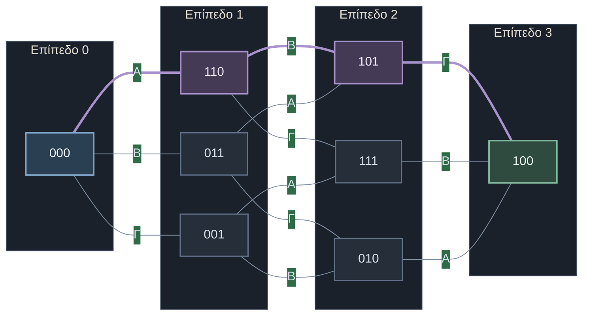
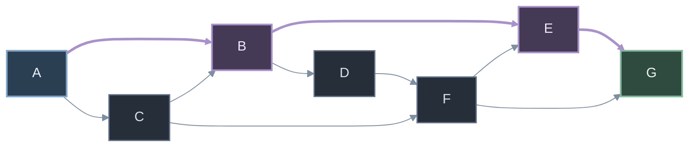
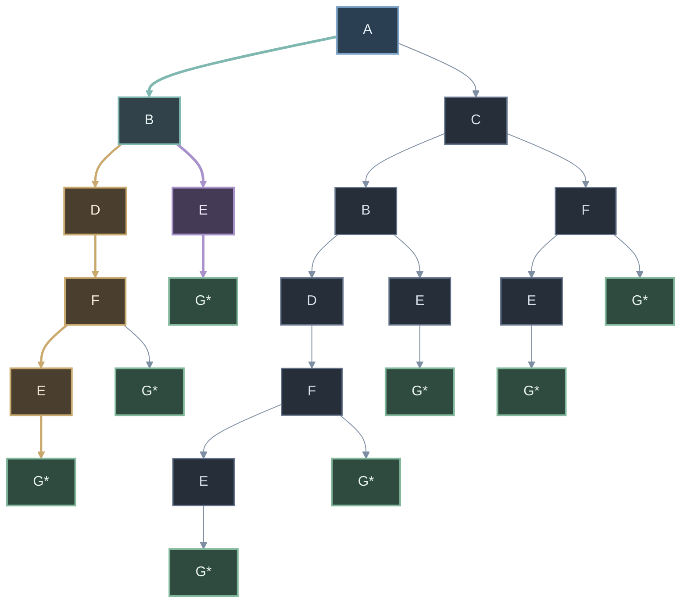
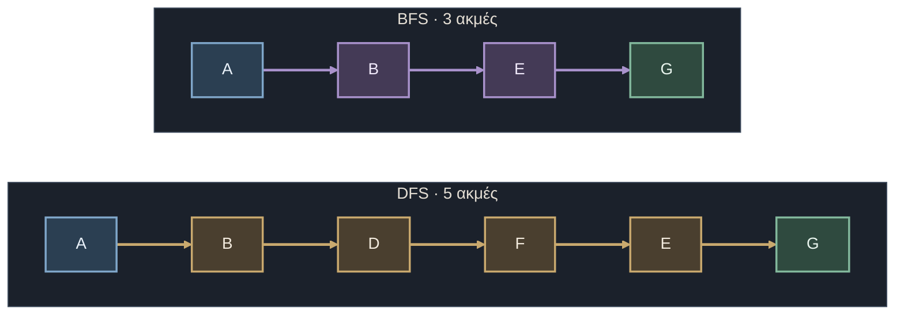
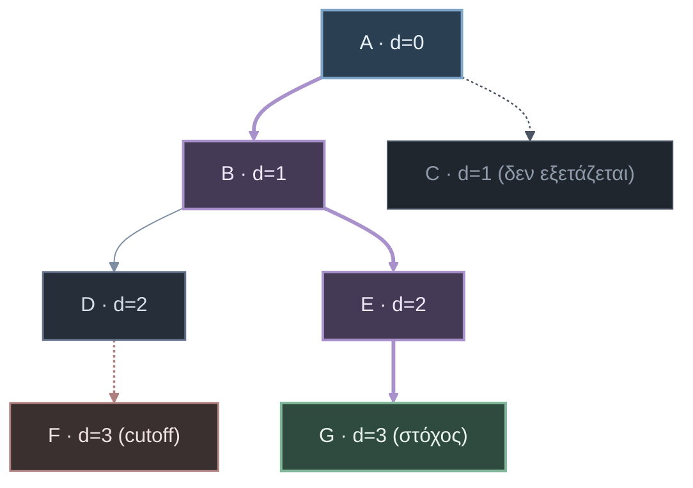

# Λύσεις 1ου Σετ Προαιρετικών Ασκήσεων

---

# Άσκηση 1.1 — Λαμπτήρες και διακόπτες

## (α) Ορισμός του προβλήματος $P = (I, G, T, S)$

**Αναπαράσταση κατάστασης:** $s = (x_1, x_2, x_3)$, με $x_i \in \{0, 1\}$ (0 = σβηστός, 1 = αναμμένος ο λαμπτήρας Λi).

**Χώρος καταστάσεων:** $S = \{0,1\}^3$, δηλαδή $2^3 = 8$ καταστάσεις: `000, 001, 010, 011, 100, 101, 110, 111`.

**Αρχική κατάσταση:** $I = (0, 0, 0)$.

**Κατάσταση-στόχος:** $G = \{(1, 0, 0)\}$, δηλαδή $\text{IsGoal}(s) \iff s = (1,0,0)$.

**Τελεστές μετάβασης $T$** (χωρίς προϋποθέσεις: κάθε διακόπτης πατιέται σε κάθε κατάσταση):

| Τελεστής | Επίδραση | Ορισμός |
|---|---|---|
| $A$ | αντιστρέφει Λ1, Λ2 | $A(x_1,x_2,x_3) = (1-x_1,\ 1-x_2,\ x_3)$ |
| $B$ | αντιστρέφει Λ2, Λ3 | $B(x_1,x_2,x_3) = (x_1,\ 1-x_2,\ 1-x_3)$ |
| $\Gamma$ | αντιστρέφει Λ3 | $\Gamma(x_1,x_2,x_3) = (x_1,\ x_2,\ 1-x_3)$ |

**Κόστος:** $c(s,a,s') = 1$ ανά πάτημα, άρα ζητείται το ελάχιστο πλήθος πατημάτων.

> Κάθε τελεστής είναι ενέλιξη ($A\circ A = B\circ B = \Gamma\circ\Gamma = \text{id}$). Άρα κάθε μετάβαση είναι αντιστρέψιμη και ο γράφος καταστάσεων είναι μη κατευθυνόμενος.

---

## (β) Γράφος προσβάσιμων καταστάσεων

### Βήμα 1: Όλες οι μεταβάσεις

| Κατάσταση | με A | με B | με Γ |
|---|---|---|---|
| 000 | 110 | 011 | 001 |
| 001 | 111 | 010 | 000 |
| 010 | 100 | 001 | 011 |
| 011 | 101 | 000 | 010 |
| 100 | 010 | 111 | 101 |
| 101 | 011 | 110 | 100 |
| 110 | 000 | 101 | 111 |
| 111 | 001 | 100 | 110 |

Παράδειγμα: $B(1,0,1) = (1,\ 1-0,\ 1-1) = (1,1,0)$.

### Βήμα 2: Προσβάσιμες καταστάσεις (BFS ανά επίπεδο)

| Επίπεδο | Καταστάσεις | Προέλευση |
|---|---|---|
| 0 | 000 | αρχική |
| 1 | 110, 011, 001 | A, B, Γ από την 000 |
| 2 | 101, 111, 010 | 101 = B(110) = A(011); 111 = Γ(110) = A(001); 010 = Γ(011) = B(001) |
| 3 | 100 | 100 = Γ(101) = B(111) = A(010) |

Προσβάσιμες είναι και οι **8** καταστάσεις. Αναμενόταν, γιατί τα διανύσματα $A=(1,1,0)$, $B=(0,1,1)$, $\Gamma=(0,0,1)$ είναι γραμμικά ανεξάρτητα στο $\mathbb{F}_2^3$.

### Βήμα 3: Ο γράφος

Κάθε κατάσταση εμφανίζεται μία φορά. Οι ακμές είναι αμφίδρομες (ενέλιξη), γι' αυτό σημειώνονται χωρίς βέλη. Σύνολο ακμών: $8\cdot 3/2 = 12$.

| # | Ακμή | Διακόπτης |
|---|---|---|
| 1 | 000 — 110 | A |
| 2 | 000 — 011 | B |
| 3 | 000 — 001 | Γ |
| 4 | 110 — 101 | B |
| 5 | 110 — 111 | Γ |
| 6 | 011 — 101 | A |
| 7 | 011 — 010 | Γ |
| 8 | 001 — 111 | A |
| 9 | 001 — 010 | B |
| 10 | 101 — 100 | Γ |
| 11 | 111 — 100 | B |
| 12 | 010 — 100 | A |

Ο γράφος είναι 3-κανονικός και όλες οι ακμές του συνδέουν διαδοχικά επίπεδα BFS· στο παρακάτω σχήμα οι κόμβοι ομαδοποιούνται ανά επίπεδο και με μοβ σημειώνεται η βέλτιστη διαδρομή.

*Μοβ: η βέλτιστη διαδρομή $000 \to 110 \to 101 \to 100$· μπλε: αρχική κατάσταση· πράσινο: στόχος.*

Οι ακμές 110—101 (B), 110—111 (Γ), 011—101 (A), 011—010 (Γ), 001—111 (A), 001—010 (B) συνδέουν τα επίπεδα 1 και 2· οι 101—100 (Γ), 111—100 (B), 010—100 (A) συνδέουν το επίπεδο 2 με τον στόχο.

### Συμπέρασμα γράφου

Οι τρεις γείτονες του στόχου 100 είναι οι 101 (Γ), 111 (B), 010 (A), όλοι σε επίπεδο 2. Άρα η απόσταση 000 → 100 είναι 3.

---

## (γ) Ελάχιστη ακολουθία ενεργειών

### Μέθοδος 1: BFS

Ο στόχος 100 εμφανίζεται πρώτη φορά στο επίπεδο 3, άρα το ελάχιστο κόστος είναι 3 πατήματα. Διαδρομή προς τα πίσω:

$100 \leftarrow_{\Gamma} 101 \leftarrow_{B} 110 \leftarrow_{A} 000$

### Μέθοδος 2: Αλγεβρική επαλήθευση

Κάθε πάτημα προσθέτει modulo 2 ένα διάνυσμα. Αν $a,b,c\in\{0,1\}$ είναι οι ισοτιμίες των πατημάτων των A, B, Γ:

$$a\cdot(1,1,0) + b\cdot(0,1,1) + c\cdot(0,0,1) = (1,0,0) \pmod 2$$

- Λ1: $a = 1$.
- Λ2: $a + b = 0 \Rightarrow b = 1$.
- Λ3: $b + c = 0 \Rightarrow c = 1$.

Κάθε διακόπτης πρέπει να πατηθεί περιττές φορές, άρα τουλάχιστον μία ο καθένας: ελάχιστο $1+1+1 = 3$ πατήματα. Η σειρά δεν παίζει ρόλο.

### Απάντηση

$$(0,0,0) \xrightarrow{A} (1,1,0) \xrightarrow{B} (1,0,1) \xrightarrow{\Gamma} (1,0,0)$$

**Ελάχιστος αριθμός πατημάτων = 3.** Ισοδύναμες βέλτιστες λύσεις είναι και οι 6 μεταθέσεις των A, B, Γ.

---
---

# Άσκηση 1.2 — Αναζήτηση σε κατευθυνόμενο γράφο

## Δεδομένα: ο γράφος

Αρχή: A. Στόχος: G. Ο γράφος είναι κατευθυνόμενος και άκυκλος, άρα το δέντρο αναζήτησης είναι πεπερασμένο.

*Μοβ: η βέλτιστη διαδρομή $A \to B \to E \to G$· μπλε: αρχική κατάσταση· πράσινο: στόχος.*

### Πίνακας διαδόχων

Ακμές από τον γράφο: A→B, A→C, C→B, C→F, B→D, B→E, D→F, F→E, F→G, E→G.

| Κόμβος | Διάδοχοι (αλφαβητικά) |
|---|---|
| A | B, C |
| B | D, E |
| C | B, F |
| D | F |
| E | G |
| F | E, G |
| G | — (στόχος) |

---

## (α) Δέντρο αναζήτησης

Οι κόμβοι επεκτείνονται με αλφαβητική σειρά διαδόχων. Επειδή δεν γίνεται έλεγχος επαναλαμβανόμενων καταστάσεων, ένας κόμβος του γράφου εμφανίζεται πολλές φορές (π.χ. B μέσω A και μέσω C). Οι κόμβοι G δεν επεκτείνονται.

*Το δέντρο αναζήτησης· οι κόμβοι φέρουν την κατάσταση στην οποία αντιστοιχούν (με G* και πράσινο χρώμα οι καταστάσεις-στόχοι). Με μοβ η διαδρομή BFS, με πορτοκαλί η διαδρομή DFS, με γαλάζιο η κοινή αρχική ακμή $A \to B$.*

**Κόμβοι ανά βάθος** (διαδρομές, με σειρά αριστερά προς δεξιά):

| Βάθος | Διαδρομές |
|---|---|
| 0 | A |
| 1 | AB, AC |
| 2 | ABD, ABE, ACB, ACF |
| 3 | ABDF, ABEG, ACBD, ACBE, ACFE, ACFG |
| 4 | ABDFE, ABDFG, ACBDF, ACBEG, ACFEG |
| 5 | ABDFEG, ACBDFE, ACBDFG |
| 6 | ACBDFEG |

Σύνολο κόμβων του δέντρου: $1+2+4+6+5+3+1=22$.

---

## (β) DFS και BFS στο δέντρο

**Σύμβαση:** η διαδρομή κάθε κόμβου γράφεται ως συνένωση γραμμάτων (π.χ. `ABD`). Ο έλεγχος στόχου γίνεται **κατά την επιλογή** κόμβου από το σύνορο.

### DFS (σύνορο = στοίβα LIFO, κορυφή αριστερά)

Οι διάδοχοι εισάγονται ώστε ο αλφαβητικά μικρότερος να βγαίνει πρώτος.

| Βήμα | Επιλεγμένος κόμβος | Στόχος; | Σύνορο μετά την επέκταση |
|---|---|---|---|
| 0 | — | — | [A] |
| 1 | A | όχι | [AB, AC] |
| 2 | AB | όχι | [ABD, ABE, AC] |
| 3 | ABD | όχι | [ABDF, ABE, AC] |
| 4 | ABDF | όχι | [ABDFE, ABDFG, ABE, AC] |
| 5 | ABDFE | όχι | [ABDFEG, ABDFG, ABE, AC] |
| 6 | ABDFEG | **ναι** | τέλος |

**Διαδρομή DFS:** $A \to B \to D \to F \to E \to G$, **μήκος 5 ακμές**. Δεν είναι βέλτιστη (υπάρχει διαδρομή 3 ακμών).

### BFS (σύνορο = ουρά FIFO, κεφαλή αριστερά)

| Βήμα | Επιλεγμένος κόμβος | Στόχος; | Σύνορο μετά την επέκταση |
|---|---|---|---|
| 0 | — | — | [A] |
| 1 | A | όχι | [AB, AC] |
| 2 | AB | όχι | [AC, ABD, ABE] |
| 3 | AC | όχι | [ABD, ABE, ACB, ACF] |
| 4 | ABD | όχι | [ABE, ACB, ACF, ABDF] |
| 5 | ABE | όχι | [ACB, ACF, ABDF, ABEG] |
| 6 | ACB | όχι | [ACF, ABDF, ABEG, ACBD, ACBE] |
| 7 | ACF | όχι | [ABDF, ABEG, ACBD, ACBE, ACFE, ACFG] |
| 8 | ABDF | όχι | [ABEG, ACBD, ACBE, ACFE, ACFG, ABDFE, ABDFG] |
| 9 | ABEG | **ναι** | τέλος |

Ο ABEG υπάρχει στο σύνορο από το βήμα 5, αλλά ελέγχεται μόνο όταν επιλεγεί (βήμα 9).

**Διαδρομή BFS:** $A \to B \to E \to G$, **μήκος 3 ακμές**.

### Σύγκριση

| Αλγόριθμος | Διαδρομή | Μήκος (ακμές) | Βήματα επιλογής | Βέλτιστη; |
|---|---|---|---|---|
| DFS | A-B-D-F-E-G | 5 | 6 | όχι |
| BFS | A-B-E-G | 3 | 9 | ναι |

*Οι δύο διαδρομές που επιστρέφουν οι αλγόριθμοι: η DFS διαδρομή μήκους 5 ακμών και η BFS διαδρομή μήκους 3 ακμών.*

---

## (γ) Επαναληπτική Εμβάθυνση (IDS)

DFS με όριο βάθους $d = 0, 1, 2, \dots$ μέχρι να βρεθεί ο στόχος. Κόμβοι σε βάθος $d$ δεν επεκτείνονται.

| Όριο $d$ | Σειρά εξέτασης κόμβων | Στόχος G; |
|---|---|---|
| 0 | A | όχι |
| 1 | A, B, C | όχι |
| 2 | A, B, D, E, C, B, F | όχι |
| 3 | A, B, D, F, E, G | **ναι** |

Ανά επανάληψη:

- **$d=0$:** εξετάζεται ο A, δεν είναι στόχος και δεν επεκτείνεται (cutoff).
- **$d=1$:** A → B → C. Οι B, C βρίσκονται στο όριο, δεν επεκτείνονται.
- **$d=2$:** A → B → D → E → C → B → F. Οι κόμβοι βάθους 2 (D, E, B, F) δεν επεκτείνονται, άρα το G (βάθος ≥ 3) δεν φτάνεται.
- **$d=3$:** A → B → D → F (βάθος 3, όριο, δεν επεκτείνεται) → E (βάθος 2) → G (βάθος 3): **βρέθηκε ο στόχος**.

*Η επανάληψη $d=3$ του IDS: ο F εξετάζεται στο όριο και δεν επεκτείνεται· η αναζήτηση οπισθοδρομεί στον E και βρίσκει τον G. Ο C δεν εξετάζεται, επειδή ο στόχος βρίσκεται στο υποδέντρο του B.*

**Βάθος πρώτου εντοπισμού του G:** $d = 3$.

**Τελική διαδρομή IDS:** $A \to B \to E \to G$ (3 ακμές), ίδια με τη BFS.

**Συνολικές εξετάσεις κόμβων:** $1 + 3 + 7 + 6 = 17$. Ο IDS έχει τη βελτιστότητα της BFS (ομοιόμορφο κόστος) με μνήμη $O(bd)$ της DFS.
