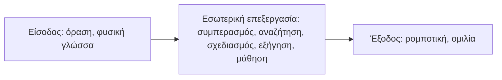
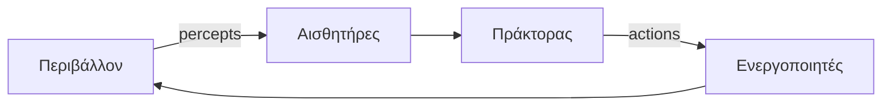
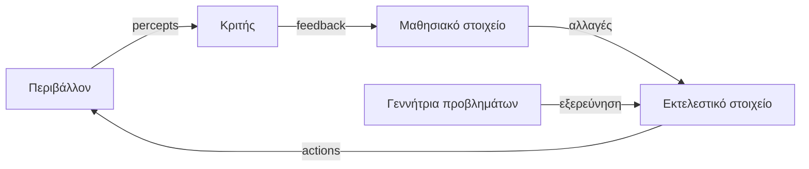

# 01 — Θεμέλια, Ιστορία και Ευφυείς Πράκτορες

Η ενότητα 01 εισάγει την Τεχνητή Νοημοσύνη (ΤΝ) ως επιστημονικό πεδίο, οριοθετεί τις τέσσερις βασικές προσεγγίσεις της και συνδέει την εξέλιξή της με τη φιλοσοφία, τα μαθηματικά, την οικονομία, την ψυχολογία, τη γλωσσολογία και την τεχνολογία των υπολογιστών. Το κεντρικό σημερινό παράδειγμα είναι ο **ορθολογικός πράκτορας**: ένα σύστημα που αντιλαμβάνεται το περιβάλλον του και επιλέγει ενέργειες με στόχο τη μεγιστοποίηση της αναμενόμενης απόδοσης. Οι έννοιες του περιβάλλοντος, της ορθολογικότητας, της αρχιτεκτονικής και των κατηγοριών πρακτόρων αποτελούν τη βάση για τις επόμενες ενότητες: αναζήτηση, CSP, παίγνια, λογική και μηχανική μάθηση.

> Πηγές: `Resources/Meta/minmap.md`, ενότητα 01· `Lectures/lecture_01_intro_to_ai.pdf`· `Lectures/lecture_02_principles_of_ai.pdf`· Russell & Norvig, *Artificial Intelligence: A Modern Approach*, κεφ. 1-2· Βλαχάβας κ.ά., *Τεχνητή Νοημοσύνη*.

---

## 1. Ορισμοί και Προσεγγίσεις

### 1.1 Τι είναι Τεχνητή Νοημοσύνη

Η ΤΝ είναι ο κλάδος της επιστήμης των υπολογιστών που μελετά την αναπαράσταση, την επεξεργασία και τη χρήση γνώσης για την παραγωγή νοήμονος συμπεριφοράς. Η μελέτη αυτή περιλαμβάνει συστήματα που αντιλαμβάνονται, συλλογίζονται, μαθαίνουν, σχεδιάζουν και δρουν σε ένα περιβάλλον. Το πεδίο δεν ταυτίζεται με μία μόνο τεχνική· περιλαμβάνει συμβολικές μεθόδους, νευρωνικά δίκτυα, ασαφή συστήματα, εξελικτικό υπολογισμό και έμπειρα συστήματα.

Η βασική διάκριση που οργανώνει την ενότητα είναι διπλή:

- **Τι μοντελοποιείται:** η ανθρώπινη συμπεριφορά ή η ορθολογική συμπεριφορά.
- **Τι εξετάζεται:** η σκέψη ή η δράση.

Από τον συνδυασμό των δύο διαστάσεων προκύπτουν οι τέσσερις προσεγγίσεις της ΤΝ.

### 1.2 Οι τέσσερις προσεγγίσεις

|  | Ανθρώπινο πρότυπο | Ορθολογικό πρότυπο |
| :--- | :--- | :--- |
| **Σκέψη** | **Thinking Humanly**: γνωστικά μοντέλα, γνωστική επιστήμη, πειραματική επαλήθευση | **Thinking Rationally**: νόμοι της σκέψης, τυπική λογική, αριστοτελικοί συλλογισμοί |
| **Δράση** | **Acting Humanly**: δοκιμασία Turing, μίμηση ανθρώπινης συμπεριφοράς | **Acting Rationally**: ορθολογικός πράκτορας, μεγιστοποίηση αναμενόμενης απόδοσης |

**Thinking Humanly — ανθρώπινη σκέψη.** Η προσέγγιση επιχειρεί να αναπαραγάγει τον τρόπο με τον οποίο σκέπτεται ο άνθρωπος. Χρησιμοποιεί υπολογιστικά μοντέλα και πειραματικές τεχνικές της ψυχολογίας, ώστε να διατυπώσει ακριβείς και πειραματικά επαληθεύσιμες θεωρίες για τη λειτουργία του νου. Το κριτήριο επιτυχίας είναι η αντιστοίχιση με ανθρώπινα γνωστικά δεδομένα, όχι απλώς η επίλυση ενός προβλήματος.

**Acting Humanly — ανθρώπινη δράση.** Η προσέγγιση εξετάζει αν το σύστημα συμπεριφέρεται σαν άνθρωπος. Το πρότυπο είναι η **δοκιμασία Turing**: ένας κριτής συνομιλεί με άνθρωπο και μηχανή χωρίς να γνωρίζει ποιος είναι ποιος· αν δεν μπορεί να τους ξεχωρίσει, η μηχανή θεωρείται ευφυής. Η προσέγγιση είναι λειτουργική και συμπεριφοριστική: ελέγχει τη συμπεριφορά, όχι την εσωτερική νόηση.

**Thinking Rationally — ορθολογική σκέψη.** Η προσέγγιση βασίζεται στους **νόμους της σκέψης** και στην τυπική λογική. Ο Αριστοτέλης διατύπωσε συλλογισμούς που παράγουν έγκυρα συμπεράσματα από αληθείς προκείμενες· ο Boole έθεσε τις βάσεις της προτασιακής λογικής και ο Frege της κατηγορηματικής λογικής. Το κριτήριο επιτυχίας είναι η λογική εγκυρότητα. Η προσέγγιση αντιμετωπίζει δύο πρακτικά εμπόδια: τη μετάφραση της άτυπης γνώσης σε τυπικά αξιώματα και την υπολογιστική δυσκολία της συναγωγής συμπερασμάτων.

**Acting Rationally — ορθολογική δράση.** Η προσέγγιση εστιάζει στην επιλογή ενέργειας που μεγιστοποιεί την **αναμενόμενη απόδοση** με βάση τις αντιλήψεις και τη γνώση του πράκτορα. Δεν απαιτείται ρητή σκέψη: μια αντανακλαστική ενέργεια μπορεί να είναι ορθολογική αν παράγει το καλύτερο αναμενόμενο αποτέλεσμα. Η προσέγγιση αυτή είναι το κυρίαρχο παράδειγμα της σύγχρονης ΤΝ, επειδή είναι γενική, μετρήσιμη και δεν εξαρτάται από την αναπαραγωγή της ανθρώπινης νοητικής αρχιτεκτονικής.

> **Exam Tip:** Η κρίσιμη διάκριση είναι **σκέψη έναντι δράσης**. Η ορθολογική σκέψη απαιτεί τυπική συλλογιστική· η ορθολογική δράση απαιτεί μόνο την επιλογή της βέλτιστης αναμενόμενης ενέργειας. Ένας θερμοστάτης μπορεί να δρα ορθολογικά χωρίς να «σκέπτεται».

### 1.3 Λεκτικοί ορισμοί

Οι παρακάτω ορισμοί είναι λεκτικοί: περιγράφουν το πεδίο με φυσική γλώσσα και δεν ορίζουν τυπικά κριτήριο μέλους.

| Πηγή | Ορισμός | Έμφαση |
| :--- | :--- | :--- |
| Rich & Knight | Η μελέτη του πώς οι υπολογιστές κάνουν πράγματα που σήμερα οι άνθρωποι κάνουν καλύτερα. | Σύγκριση με την ανθρώπινη ικανότητα |
| Winston | Η μελέτη των διαδικασιών που καθιστούν δυνατή την αντίληψη, τον συλλογισμό και τη δράση. | Γνωστικές διαδικασίες |
| Luger | Ο κλάδος της επιστήμης των υπολογιστών που ασχολείται με την αυτοματοποίηση της νοήμονος συμπεριφοράς. | Αυτοματοποίηση |
| Dean, Allen, Aloimonos | Η σχεδίαση και μελέτη προγραμμάτων που επιδεικνύουν νοήμονα συμπεριφορά. | Προγράμματα και συμπεριφορά |
| Ginsberg | Η δημιουργία νοημόνων κατασκευασμάτων. | Τεχνητά συστήματα |

Οι ορισμοί δεν είναι ισοδύναμοι: άλλοι τονίζουν την ανθρώπινη σύγκριση, άλλοι τις γνωστικές διαδικασίες και άλλοι την αυτοματοποίηση. Για τον λόγο αυτό, η ΤΝ οριοθετείται συνήθως μέσω μιας προσέγγισης και ενός κριτηρίου επιτυχίας, όχι μέσω ενός μοναδικού ορισμού.

### 1.4 Δοκιμασία Turing

Η δοκιμασία Turing προτάθηκε από τον Alan Turing το 1950 στο άρθρο *Computing Machinery and Intelligence*. Ο κριτής επικοινωνεί γραπτώς με έναν άνθρωπο και μία μηχανή, χωρίς να γνωρίζει ποιος είναι ποιος. Αν δεν μπορεί να τους διακρίνει, η μηχανή περνά τη δοκιμασία και θεωρείται ευφυής.

Για να περάσει η μηχανή τη βασική δοκιμασία, απαιτούνται τέσσερις τεχνολογικές περιοχές:

| Τεχνολογία | Ρόλος στη δοκιμασία |
| :--- | :--- |
| Επεξεργασία φυσικής γλώσσας (NLP) | Κατανόηση ερωτήσεων και παραγωγή φυσικών απαντήσεων |
| Αναπαράσταση γνώσης | Αποθήκευση γεγονότων και κοινής λογικής |
| Αυτοματοποιημένη συλλογιστική | Εξαγωγή συμπερασμάτων και απάντηση σε ερωτήσεις |
| Μηχανική μάθηση | Προσαρμογή σε νέα θέματα και βελτίωση από την αλληλεπίδραση |

Η **πλήρης δοκιμασία Turing** (Total Turing Test) προσθέτει δύο ακόμη απαιτήσεις:

- **Μηχανική όραση**, ώστε ο πράκτορας να αντιλαμβάνεται εικόνες και αντικείμενα.
- **Ρομποτική**, ώστε ο πράκτορας να δρα και να αλληλεπιδρά με τον φυσικό κόσμο.

| Δοκιμασία | Απαιτούμενες τεχνολογίες | Τι ελέγχει |
| :--- | :--- | :--- |
| Βασική δοκιμασία Turing | NLP, αναπαράσταση γνώσης, συλλογιστική, μηχανική μάθηση | Γλωσσική συμπεριφορά |
| Πλήρης δοκιμασία Turing | Βασικές τεχνολογίες και μηχανική όραση, ρομποτική | Γλωσσική και φυσική αλληλεπίδραση |

Η βασική κριτική είναι ότι η δοκιμασία ελέγχει **μίμηση συμπεριφοράς**, όχι εσωτερική νόηση ή συνείδηση. Ένα σύστημα μπορεί να παράγει πειστικές απαντήσεις μέσω παράφρασης, γενικών απαντήσεων και ανίχνευσης λέξεων-κλειδιών, όπως έδειξε το ιστορικό παράδειγμα του ELIZA, χωρίς να κατανοεί το περιεχόμενο.

### 1.5 Ορθολογική σκέψη και ορθολογική δράση

Η ορθολογική σκέψη και η ορθολογική δράση δεν ταυτίζονται:

| Κριτήριο | Thinking Rationally | Acting Rationally |
| :--- | :--- | :--- |
| Τι απαιτεί | Τυπική συλλογιστική και έγκυρη εξαγωγή συμπερασμάτων | Επιλογή ενέργειας με βάση την αναμενόμενη απόδοση |
| Κριτήριο επιτυχίας | Λογική εγκυρότητα | Μεγιστοποίηση αναμενόμενου αποτελέσματος |
| Παράδειγμα | Αποδεικτής θεωρημάτων | Θερμοστάτης, αυτόνομο όχημα, παίκτης σκακιού |
| Περιορισμός | Απαιτεί πλήρη και τυπική γνώση· συχνά υπολογιστικά δυσχερής | Απαιτεί μέτρο απόδοσης και μοντέλο του περιβάλλοντος |

Η ορθολογική δράση είναι γενικότερη από την ορθολογική σκέψη, διότι μπορεί να επιτευχθεί με αναζήτηση, μάθηση ή αντανακλαστικούς κανόνες. Η ορθολογική σκέψη είναι ένα μέσο· η ορθολογική δράση είναι το κριτήριο.

---

## 2. Θεμελιώδη Χαρακτηριστικά Νοημοσύνης

Η νοημοσύνη δεν είναι μία μόνο ικανότητα. Περιλαμβάνει τουλάχιστον:

- **Κρίση, σκέψη και συμπερασμό:** εξαγωγή συμπερασμάτων από δεδομένα και γνώση.
- **Απόκτηση και χρήση γνώσης:** συλλογή, αποθήκευση, οργάνωση και εφαρμογή γνώσης.
- **Αντίληψη και αλληλεπίδραση:** αναγνώριση αντικειμένων, κατανόηση καταστάσεων και δράση σε ένα περιβάλλον.
- **Επεξεργασία πληροφορίας:** αναπαράσταση και μετασχηματισμός πληροφορίας.
- **Προσαρμογή:** μάθηση από την εμπειρία και βελτίωση της συμπεριφοράς.

Το **κεντρικό δόγμα** της ΤΝ είναι ότι οι νοητικές λειτουργίες μπορούν, σε κάποιο επίπεδο, να θεωρηθούν ως μορφή υπολογισμού. Το ερώτημα της ΤΝ είναι ποια είναι η φύση αυτού του υπολογισμού και πώς μπορεί να υλοποιηθεί σε μηχανή.

| Στάδιο | Λειτουργίες | Παραδείγματα |
| :--- | :--- | :--- |
| Είσοδος | Αντίληψη του περιβάλλοντος | Αναγνώριση εικόνας, κατανόηση φυσικής γλώσσας |
| Εσωτερική επεξεργασία | Συμπερασμός, αναζήτηση, σχεδιασμός, εξήγηση, μάθηση | Επίλυση προβλήματος, απόδειξη θεωρήματος, προσαρμογή |
| Έξοδος | Δράση στον κόσμο | Ρομποτική κίνηση, παραγωγή ομιλίας |

Η διάκριση εισόδου, εσωτερικής επεξεργασίας και εξόδου είναι λειτουργική, όχι αρχιτεκτονική: ένα σύγχρονο σύστημα μπορεί να συνδυάζει όλα τα στάδια σε ένα ενιαίο δίκτυο. Η διάκριση παραμένει χρήσιμη για την ανάλυση των επιμέρους προβλημάτων.

---

## 3. Διεπιστημονικές Ρίζες

Η ΤΝ αναπτύχθηκε από τη συνάντηση διαφορετικών παραδόσεων. Κάθε πεδίο συνεισέφερε ερωτήματα, φορμαλισμούς ή τεχνολογικές δυνατότητες.

| Πεδίο | Κεντρικό ερώτημα | Συνεισφορά στην ΤΝ |
| :--- | :--- | :--- |
| Φιλοσοφία | Πώς προκύπτει η νόηση από την ύλη; Πώς παράγεται γνώση; | Δυϊσμός και υλισμός, εμπειρισμός, επαγωγή, αλγόριθμος του Αριστοτέλη |
| Μαθηματικά | Ποια είναι τα όρια και οι δυνατότητες του υπολογισμού; | Προτασιακή και κατηγορηματική λογική, θεωρία υπολογισμού, πιθανότητες |
| Οικονομικά | Πώς λαμβάνονται ορθολογικές αποφάσεις; | Θεωρία αποφάσεων, θεωρία παιγνίων, επιχειρησιακή έρευνα, MDP |
| Ψυχολογία και γνωστική επιστήμη | Πώς σκέπτονται και δρουν άνθρωποι και ζώα; | Πειραματική ψυχολογία, ενδοσκόπηση, συμπεριφορισμός, γνωστικά μοντέλα |
| Τεχνολογία υπολογιστών | Πώς κατασκευάζονται αποδοτικές μηχανές; | Υπολογιστική ισχύς και πλατφόρμες υλοποίησης |
| Θεωρία ελέγχου και κυβερνητική | Πώς λειτουργούν αυτόνομα τεχνουργήματα; | Στόχος, ανάδραση, μεγιστοποίηση αντικειμενικής συνάρτησης |
| Γλωσσολογία | Πώς σχετίζεται η γλώσσα με τη σκέψη; | Υπολογιστική γλωσσολογία, τυπική γραμματική |
| Νευροεπιστήμη | Πώς επεξεργάζεται ο εγκέφαλος την πληροφορία; | Νευρωνικά μοντέλα και αρχιτεκτονικές |

### 3.1 Φιλοσοφία

Η φιλοσοφία έθεσε τα θεμελιώδη ερωτήματα για τη νόηση, τη γνώση και τη δράση:

- **Δυϊσμός Καρτέσιου έναντι υλισμού:** ο νους ως ξεχωριστή ουσία έναντι της νόησης ως φυσικού φαινομένου του εγκεφάλου.
- **Εμπειρισμός και επαγωγή:** η γνώση προκύπτει από την εμπειρία και τη γενίκευση παρατηρήσεων.
- **Αλγόριθμος του Αριστοτέλη:** στα *Ηθικά Νικομάχεια* περιγράφεται μια διαδικασία λήψης αποφάσεων που μπορεί να διαβαστεί ως αλγόριθμος.
- **Πρώτες αριθμομηχανές:** από την Αναγέννηση και μετά, η μηχανική υπολογιστική γίνεται σταδιακά εφικτή.

### 3.2 Μαθηματικά

Τα μαθηματικά παρείχαν τις τυπικές γλώσσες και τα όρια του υπολογισμού:

- **Προτασιακή λογική:** ο Boole διατύπωσε τις βάσεις της τον 19ο αιώνα.
- **Κατηγορηματική λογική:** ο Frege έθεσε τις βάσεις του predicate calculus.
- **Θεωρία υπολογισμού:** η θέση Turing-Church ορίζει την έννοια της υπολογισιμότητας.
- **Όρια:** το θεώρημα μη-πληρότητας του Gödel δείχνει ότι δεν είναι όλες οι αλήθειες αποδείξιμες σε ένα τυπικό σύστημα· η NP-completeness δείχνει ότι ορισμένα προβλήματα είναι υπολογιστικά δυσχερή.
- **Πιθανότητες:** παρέχουν το πλαίσιο για συλλογισμό υπό αβεβαιότητα.

### 3.3 Οικονομικά

Τα οικονομικά συνεισέφεραν τη θεωρία λήψης αποφάσεων:

- **Θεωρία αποφάσεων:** συνδυασμός πιθανοτήτων και χρησιμοτήτων για επιλογή δράσης.
- **Θεωρία παιγνίων:** ανάλυση στρατηγικής αλληλεπίδρασης όταν άλλοι πράκτορες επηρεάζουν το αποτέλεσμα.
- **Επιχειρησιακή έρευνα:** βελτιστοποίηση πόρων και χρονοπρογραμματισμός.
- **Διαδικασίες αποφάσεων Markov (MDP):** μοντελοποίηση διαδοχικών αποφάσεων υπό αβεβαιότητα.

### 3.4 Ψυχολογία και γνωστική επιστήμη

Η ψυχολογία συνεισέφερε μεθόδους και μοντέλα:

- **Πειραματική ψυχολογία:** συστηματική παρατήρηση της ανθρώπινης συμπεριφοράς.
- **Ενδοσκόπηση:** αναφορά των υποκειμένων για τις εσωτερικές τους διεργασίες.
- **Συμπεριφορισμός:** έμφαση στην παρατηρήσιμη συμπεριφορά, μελετήθηκε και σε ζώα.
- **Γνωστική ψυχολογία:** μελέτη εσωτερικών αναπαραστάσεων και επεξεργασίας πληροφορίας.
- **Γνωστική επιστήμη:** συνδυασμός υπολογιστικών μοντέλων και πειραματικών δεδομένων για τη νόηση.

### 3.5 Τεχνολογία υπολογιστών

Η ανάπτυξη αποδοτικών υπολογιστών στο δεύτερο μισό του 20ού αιώνα κατέστησε δυνατή την πρακτική υλοποίηση αλγορίθμων που ήταν θεωρητικά γνωστοί αλλά υπολογιστικά ασύμφοροι. Η τεχνολογία παρέχει την πλατφόρμα εκτέλεσης, όχι το εννοιολογικό πλαίσιο της νοημοσύνης.

### 3.6 Θεωρία ελέγχου και κυβερνητική

Η θεωρία ελέγχου μελετά συστήματα που μεγιστοποιούν μια αντικειμενική συνάρτηση στον χρόνο. Η διαφορά από την ΤΝ είναι μεθοδολογική:

| Κριτήριο | Θεωρία ελέγχου | Τεχνητή Νοημοσύνη |
| :--- | :--- | :--- |
| Μαθηματικά | Μαθηματικός λογισμός, γραμμική άλγεβρα | Διακριτά μαθηματικά, λογική, αναζήτηση |
| Στόχος | Ρύθμιση και σταθεροποίηση συνεχών συστημάτων | Συμβολική και υπολογιστική νοημοσύνη |
| Παράδειγμα | Αυτόματος πιλότος, ρυθμιστής θερμοκρασίας | Σχεδιασμός, απόδειξη, μάθηση |

### 3.7 Γλωσσολογία

Η υπολογιστική γλωσσολογία μελετά τη γλώσσα ως υπολογιστικό σύστημα. Το *Syntactic Structures* του Chomsky (1950, όπως αναφέρεται στις διαφάνειες· βιβλιογραφικά το έργο εκδόθηκε το 1957) επηρέασε τη μορφή των τυπικών γραμματικών και τη σχέση γλώσσας και σκέψης.

### 3.8 Νευροεπιστήμη

Η νευροεπιστήμη παρέχει το βιολογικό πρότυπο για τα τεχνητά νευρωνικά δίκτυα. Η σύγκριση εγκεφάλου και υπολογιστή εξετάζεται στην ενότητα 8.3.

---

## 4. Ιστορικές Περίοδοι

### 4.1 Χρονολόγιο

| Περίοδος | Έτη | Βασικά ορόσημα | Κρίσιμη αλλαγή |
| :--- | :--- | :--- | :--- |
| Κυοφορία | 1943-1955 | McCulloch-Pitts (1943), Hebb (1949), Turing (1950), SNARC (1951) | Τεχνητοί νευρώνες, μοντέλα μάθησης, δοκιμασία Turing |
| Γέννηση | 1956 | Συνέδριο Dartmouth, Logic Theorist, καθιέρωση του όρου AI | Η ΤΝ ορίζεται ως ερευνητικό πεδίο |
| Πρώιμος ενθουσιασμός | 1952-1969 | LISP, Advice Taker, Geometry Theorem Prover, GPS, Shakey, μικρόκοσμοι | Γενικοί λύτες προβλημάτων και συμβολική αναπαράσταση |
| Χειμώνας / δόση ρεαλισμού | 1966-1973 | Πρόβλεψη Simon (1957), δυσεπίλυτα προβλήματα, Minsky (1969), έκθεση Lighthill (1973) | Υπερεκτίμηση και διακοπή χρηματοδότησης |
| Έμπειρα συστήματα | 1969-1979 | DENDRAL, MYCIN, Prolog (1972), Lunar, SHRDLU | Στροφή στην εξειδικευμένη γνώση |
| Βιομηχανική επέκταση | 1980-σήμερα | R1, Πρόγραμμα 5ης γενιάς (1981), δεύτερος χειμώνας, Backpropagation | Εμπορική εκμετάλλευση και αναβίωση συνδεσμισμού |
| Εποχή ευφυών πρακτόρων | 1995-σήμερα | Διαδίκτυο, πιθανοτική μοντελοποίηση, βαθιά μάθηση, Deep Blue, Watson, AlphaGo, Libratus | Επιστροφή στο συνολικό πρόβλημα του πράκτορα |

### 4.2 Ανάλυση περιόδων

#### 4.2.1 Κυοφορία (1943-1955)

- **1943 — McCulloch και Pitts:** μοντέλο τεχνητών νευρώνων με δυνατότητα μάθησης και υπολογισμού συναρτήσεων.
- **1949 — Hebb:** μέθοδος εκπαίδευσης νευρωνικών δικτύων.
- **1950 — Turing:** *Computing Machinery and Intelligence*· δοκιμασία Turing, μηχανική μάθηση, γενετικοί αλγόριθμοι και ενισχυτική μάθηση, όπως αναφέρονται στις διαφάνειες.
- **1951 — Minsky και Edmonds:** SNARC, το πρώτο νευρωνικό δίκτυο με 40 νευρώνες και 3.000 λυχνίες.

Η περίοδος χαρακτηρίζεται από τη μετάβαση από τη θεωρία των νευρώνων σε πρώιμες υλοποιήσεις. Τα συστήματα ήταν πειραματικά και περιορισμένα, αλλά έθεσαν τις βασικές ιδέες της μάθησης και της αναπαράστασης.

#### 4.2.2 Γέννηση (1956)

- **Συνέδριο Dartmouth:** διοργανώθηκε από τους McCarthy, Minsky, Shannon και Rochester· είχε 10 συμμετέχοντες και διήρκεσε δύο μήνες.
- **Θεματικές:** θεωρία αυτομάτων, νευρωνικά δίκτυα και μελέτη της ευφυΐας.
- **Logic Theorist:** οι Newell και Simon παρουσίασαν πρόγραμμα που αποδείκνυε απλά μαθηματικά θεωρήματα.
- **Όνομα:** καθιερώθηκε ο όρος *Artificial Intelligence* που πρότεινε ο McCarthy.

Το συνέδριο Dartmouth θεωρείται η γενέθλια πράξη της ΤΝ ως αυτόνομου ερευνητικού πεδίου.

#### 4.2.3 Πρώιμος ενθουσιασμός (1952-1969)

- **1958 — McCarthy:** γλώσσα LISP και υποθετικό σύστημα Advice Taker, που χρησιμοποιούσε γνώση για καθημερινά προβλήματα.
- **1959 — Gelernter:** Geometry Theorem Prover.
- **1961 — Newell και Simon:** General Problem Solver (GPS).
- **1969 — Stanford:** ρομπότ Shakey.
- **Μικρόκοσμοι:** παιχνίδια, γρίφοι, γεωμετρικές αναλογίες (ANALOGY), ELIZA, SHRDLU.

Η περίοδος πίστευε ότι γενικοί μηχανισμοί αναζήτησης και συμβολικής αναπαράστασης θα έλυναν οποιοδήποτε πρόβλημα. Τα προβλήματα ήταν όμως μικρά και ελεγχόμενα· η κλιμάκωση σε πραγματικά περιβάλλοντα αποδείχθηκε δυσκολότερη.

#### 4.2.4 Χειμώνας / δόση ρεαλισμού (1966-1973)

- **Υπερεκτίμηση:** το 1957 ο Herbert Simon είχε προβλέψει ότι σε 10 χρόνια ο παγκόσμιος πρωταθλητής σκακιού θα ήταν υπολογιστής.
- **Δυσεπίλυτα προβλήματα:** η θεωρητική επιλυσιμότητα δεν συνεπάγεται πρακτικό μηχανισμό εύρεσης λύσης.
- **1969 — Minsky:** υποστήριξε ότι τα νευρωνικά δίκτυα είναι ανεπαρκή για μη-απλά προβλήματα.
- **1973 — Έκθεση Lighthill:** οδήγησε στη διακοπή της βρετανικής χρηματοδότησης για ΤΝ στα περισσότερα πανεπιστήμια.

Η περίοδος έδειξε ότι η γενική ευφυΐα δεν προκύπτει αυτόματα από γενικούς αλγορίθμους αναζήτησης. Η έλλειψη γνώσης και η υπολογιστική πολυπλοκότητα ήταν οι κύριοι περιορισμοί.

#### 4.2.5 Έμπειρα συστήματα (1969-1979)

- **Ασθενείς μέθοδοι:** γνώση γενικής χρήσης, ανεξάρτητη από το πεδίο.
- **Ισχυρές μέθοδοι:** εξειδικευμένη γνώση πεδίου· για ένα δύσκολο πρόβλημα, η γνώση είναι συχνά πιο αποτελεσματική από τη γενική αναζήτηση.
- **DENDRAL (Stanford, 1969):** εύρεση μοριακής δομής οργανικών ενώσεων από δεδομένα φασματογράφου μάζας.
- **MYCIN (Stanford):** διάγνωση μολύνσεων του αίματος.
- **Prolog (1972, Colmerauer):** γλώσσα λογικού προγραμματισμού.
- **Lunar και SHRDLU:** φυσική γλώσσα και μικρόκοσμος κύβων.

Η στροφή προς τα έμπειρα συστήματα αναγνώρισε ότι η γνώση είναι κεντρικός πόρος της νοημοσύνης. Τα συστήματα ήταν στενά, αλλά σε εξειδικευμένους τομείς ξεπερνούσαν τους γενικούς λύτες.

#### 4.2.6 Βιομηχανική επέκταση (1980-σήμερα)

- **R1 (DEC):** έμπειρο σύστημα διαμόρφωσης παραγγελιών· μέχρι το 1988 είχαν πωληθεί περισσότερα από 40 πακέτα.
- **Πρόγραμμα 5ης γενιάς (Ιαπωνία, 1981):** δεκαετές πρόγραμμα για υπολογιστές με γλώσσα μηχανής την Prolog και συστήματα φυσικής γλώσσας.
- **Δεύτερος χειμώνας (τέλη 1980s):** απογοήτευση από τις υποσχέσεις των έμπειρων συστημάτων και της 5ης γενιάς.
- **Αναβίωση συνδεσμισμού:** το 1986 η Backpropagation έδωσε πρακτική μέθοδο εκπαίδευσης πολυεπίπεδων νευρωνικών δικτύων.

Η περίοδος συνδυάζει εμπορική ωρίμανση και επιστημονική επαναξιολόγηση. Η ΤΝ άρχισε να ενσωματώνεται σε βιομηχανικές εφαρμογές, αλλά οι υπερβολικές προσδοκίες οδήγησαν σε νέα κρίση.

#### 4.2.7 Εποχή ευφυών πρακτόρων (1995-σήμερα)

- **Διαδίκτυο:** χώρος δοκιμής και εφαρμογών για αναζήτηση, ηλεκτρονικό εμπόριο και επεξεργασία φυσικής γλώσσας.
- **Πιθανοτική μοντελοποίηση:** συλλογισμός υπό αβεβαιότητα, δίκτυα Bayes, MDP.
- **Βαθιά μάθηση:** νευρωνικά δίκτυα με πολλά επίπεδα και μεγάλα δεδομένα.
- **Ορόσημα:** Deep Blue (1997), Watson (2011), Atari (2015), AlphaGo (2016), Libratus (2017), Project Debater (2019).

Η εποχή των πρακτόρων επιστρέφει στο συνολικό πρόβλημα: την κατασκευή συστημάτων που αντιλαμβάνονται, αποφασίζουν και δρουν σε ανοιχτά περιβάλλοντα. Η πρόοδος στηρίζεται σε συνδυασμό δεδομένων, υπολογιστικής ισχύος και αλγορίθμων.

### 4.3 Περιοδολόγηση κατά συγγραφείς

Ορισμένοι συγγραφείς διακρίνουν πέντε περιόδους:

| Περίοδος | Χαρακτηριστικό |
| :--- | :--- |
| Προϊστορική | Η ΤΝ προαναγγέλλεται σε διηγήματα επιστημονικής φαντασίας |
| Κλασική (έως μέσα 1960s) | Συστήματα που παίζουν παιχνίδια και λύνουν γρίφους |
| Ρομαντική (έως μέσα 1970s) | Κατανόηση ιστοριών και διαλόγων σε φυσική γλώσσα |
| Μοντέρνα (έως τέλη 1980s) | Συστήματα βασισμένα στη γνώση και εμπορική εκμετάλλευση |
| Μετα-μοντέρνα (σήμερα) | Διαδίκτυο, διάχυτη υπολογιστική, πράκτορες |

### 4.4 Διδάγματα από την ιστορία

- **Οι υπερβολικές υποσχέσεις οδηγούν σε χειμώνες:** η απόσταση μεταξύ επίδειξης και πραγματικής κλιμάκωσης υπονομεύει τη χρηματοδότηση.
- **Η γνώση είναι κρίσιμη:** οι γενικοί αλγόριθμοι δεν αρκούν χωρίς αναπαράσταση γνώσης και μοντέλο του πεδίου.
- **Ο συμβολισμός και ο συνδεσμισμός εναλλάσσονται:** κάθε προσέγγιση κυριαρχεί όταν οι συνθήκες (δεδομένα, υπολογιστική ισχύς, θεωρία) την ευνοούν.
- **Η θεωρητική επιλυσιμότητα δεν αρκεί:** ένα πρόβλημα μπορεί να είναι επιλύσιμο αλλά πρακτικά άλυτο.
- **Τα ορόσημα είναι ενδεικτικά, όχι οριστικά:** το Deep Blue, το AlphaGo και το Libratus έδειξαν πρόοδο σε συγκεκριμένους τομείς, όχι γενική νοημοσύνη.

---

## 5. Πεδία Εφαρμογών

### 5.1 Χάρτης εφαρμογών

| Πεδίο | Αντιπροσωπευτικό σύστημα | Συνεισφορά |
| :--- | :--- | :--- |
| Επεξεργασία φυσικής γλώσσας | Verbmobil | Μετάφραση εξαρτημένη από συμφραζόμενα, σε πραγματικό χρόνο |
| Μηχανική όραση | ALVINN | Αυτόνομη οδήγηση με νευρωνικό δίκτυο |
| Ρομποτική | HipNav, AIBO, QRIO, HOAP, ROBONAUT, RoboCup, Sophia, Boston Dynamics | Χειρουργική, ψυχαγωγία, διάστημα, ποδόσφαιρο, ανθρωποειδή |
| Έμπειρα συστήματα | DENDRAL, MYCIN | Επιστημονική και ιατρική διάγνωση |
| Σχεδιασμός και χρονοπρογραμματισμός | Remote Agent, D.A.R.T. | Διαστημικές και στρατιωτικές επιχειρήσεις |
| Παιχνίδια | Deep Blue | Σκάκι υψηλού επιπέδου |
| Αναζήτηση | — | Μεγάλοι χώροι, ευρετικές μέθοδοι |
| Αυτόνομος έλεγχος | ALVINN | Οδήγηση και προσαρμογή |
| Κατανόηση λόγου | Verbmobil | Μετάφραση ομιλίας |

### 5.2 Αναλυτικά παραδείγματα

**Verbmobil.** Σύστημα αυτόματης μετάφρασης, εξαρτημένης από τα συμφραζόμενα, σε πραγματικό χρόνο για Γερμανικά, Αγγλικά και Ιαπωνικά. Αποτελεί παράδειγμα συνδυασμού αναγνώρισης ομιλίας, κατανόησης γλώσσας και παραγωγής μετάφρασης.

**ALVINN.** Σύστημα μηχανικής όρασης που μαθαίνει να οδηγεί παρακολουθώντας ανθρώπινο οδηγό. Διαθέτει νευρωνικό δίκτυο ενός κρυμμένου επιπέδου· δέχεται εικόνες από κάμερες και παράγει την κατεύθυνση κίνησης. Ταξίδεψε 2.850 χιλιόμετρα στις ΗΠΑ διατηρώντας αυτονομία στο 98% της διαδρομής.

**Ρομποτική.** Το HipNav (1996, Carnegie Mellon) αναπτύχθηκε για τη μείωση του κινδύνου λανθασμένης τοποθέτησης σε επεμβάσεις πλήρους αντικατάστασης γοφού. Η Sony ανέπτυξε τα AIBO και QRIO· το QRIO αναγνωρίζει 10.000 ιαπωνικές λέξεις, αγγλικά και ελληνικά. Το Fujitsu HOAP είναι ανθρωποειδές ρομπότ με κινητικότητα κεφαλιού, μέσης και χεριών.

Ο ROBONAUT της NASA και της DARPA σχεδιάστηκε για τη συντήρηση του διαστημικού τηλεσκοπίου Hubble. Το RoboCup θέτει ως στόχο για το 2050 μια ομάδα αυτόνομων ανθρωποειδών ρομπότ να νικήσει την παγκόσμια πρωταθλήτρια στο ποδόσφαιρο. Η Sophia της Hanson Robotics (2015) διαθέτει 50 εκφράσεις προσώπου και έχει δημόσιες εμφανίσεις. Τα ρομπότ της Boston Dynamics δείχνουν προηγμένη κινητικότητα σε ζωόμορφες και ανθρωπόμορφες μορφές.

**Remote Agent.** Το πείραμα της NASA (1998-2001) υλοποίησε το πρώτο αυτόνομο πρόγραμμα σχεδιασμού ενεργειών για τον έλεγχο διαστημοπλοίου. Παρήγαγε πλάνα για στόχους που καθορίζονταν από τη Γη, παρακολουθούσε την εκτέλεση και προέβαινε σε διορθωτικές ενέργειες όταν διαπίστωνε αποκλίσεις.

**D.A.R.T.** Το Dynamic Analysis and Replanning Tool χρησιμοποιήθηκε από τις ΗΠΑ στον πόλεμο του Περσικού Κόλπου (1991) για αυτοματοποιημένο σχεδιασμό και χρονοπρογραμματισμό μεταφορών. Διαχειρίστηκε 50.000 οχήματα, φορτία και ανθρώπους και παρήγαγε πλάνα σε ώρες αντί για εβδομάδες. Η DARPA δήλωσε ότι η εφαρμογή απέφερε περισσότερα από τις επενδύσεις των ΗΠΑ στην ΤΝ τα προηγούμενα 30 χρόνια.

**Deep Blue.** Το σύστημα της IBM νίκησε τον παγκόσμιο πρωταθλητή Garry Kasparov με σκορ 3.5-2.5 σε αγώνα επίδειξης το 1997. Αποτέλεσε ορόσημο για την αναζήτηση σε παίγνια και την υπολογιστική ισχύ.

### 5.3 ΤΝ στη λογοτεχνία και στον κινηματογράφο

Η ιδέα της τεχνητής νοημοσύνης εμφανίζεται ήδη στην ελληνική μυθολογία: ο Ήφαιστος κατασκεύαζε ανθρωποειδή-υπηρέτες και ο Πυγμαλίων την ίδια του τη γυναίκα. Στη σύγχρονη εποχή, ο κινηματογράφος αντιμετωπίζει τα τεχνητά ευφυή όντα με φόβο (*Terminator*, *I Robot*, *Matrix*), ελπίδα (*Robocop*, *Bicentennial Man*), συμπάθεια (*Blade Runner*, *A.I.*) ή ηθικό προβληματισμό (*2001: A Space Odyssey*, *2010*). Η πραγματικότητα απέχει από την επιστημονική φαντασία: η κατασκευή συστημάτων σαν τον HAL ή ανδροειδών σαν τον David παραμένει μακρινός στόχος.

---

## 6. Προσεγγίσεις ΤΝ

### 6.1 Συμβολική και μη-συμβολική προσέγγιση

| Προσέγγιση | Βάση | Δυνατά σημεία | Περιορισμοί | Παραδείγματα |
| :--- | :--- | :--- | :--- | :--- |
| Κλασική / συμβολική | Αλγόριθμοι και συστήματα βασισμένα στη γνώση | Ερμηνευσιμότητα, ρητή γνώση, λογικές εγγυήσεις | Ευθραυστότητα, κόστος απόκτησης γνώσης, δυσκολία κλιμάκωσης | Έμπειρα συστήματα, Prolog, σχεδιασμός |
| Συνδετική / μη-συμβολική | Νευρομορφικά και νευρωνικά δίκτυα | Μάθηση από δεδομένα, γενίκευση, αναγνώριση προτύπων | Αδιαφάνεια, ανάγκη δεδομένων, έλλειψη εγγυήσεων | Perceptron, πολυεπίπεδα δίκτυα, βαθιά μάθηση |
| Υπολογιστική νοημοσύνη | Ασαφή συστήματα, νευρωνικά δίκτυα, εξελικτικός υπολογισμός, νευρο-ασαφή | Προσεγγιστικός συλλογισμός, προσαρμογή, βελτιστοποίηση | Ρύθμιση παραμέτρων, υπολογιστικό κόστος, ερμηνευσιμότητα | Ασαφής έλεγχος, γενετικοί αλγόριθμοι |
| Έμπειρα συστήματα | Εξειδικευμένη γνώση και κοινή λογική | Απόδοση σε στενό πεδίο, εξήγηση αποφάσεων | Ευθραυστότητα έξω από το πεδίο, συντήρηση | MYCIN, DENDRAL, R1 |
| Φιλοσοφική οπτική | Τεχνητά νοήμονα όντα και όρια πραγματικότητας | Κριτική ανάλυση, ηθική | Δεν παρέχει άμεσα υλοποιήσιμους αλγορίθμους | Συζητήσεις για συνείδηση και ευθύνη |

### 6.2 Κλασική / συμβολική προσέγγιση

Η συμβολική προσέγγιση βασίζεται στην κατανόηση των νοητικών διεργασιών και στην προσομοίωση της ανθρώπινης νοημοσύνης με αλγορίθμους και συστήματα που χρησιμοποιούν ρητή γνώση. Η γνώση αναπαρίσταται με σύμβολα, κανόνες ή λογικές προτάσεις και η συμπεριφορά προκύπτει από συλλογισμό πάνω σε αυτές τις αναπαραστάσεις. Η προσέγγιση κυριάρχησε στις πρώτες δεκαετίες της ΤΝ και παραμένει θεμελιώδης σε προβλήματα που απαιτούν εξηγήσιμη συλλογιστική.

### 6.3 Συνδετική / μη-συμβολική προσέγγιση

Η συνδετική προσέγγιση μιμείται τη βιολογική λειτουργία του εγκεφάλου με νευρωνικά δίκτυα. Η γνώση κατανέμεται στα συναπτικά βάρη και η μάθηση γίνεται μέσω προσαρμογής τους. Η προσέγγιση είναι ισχυρή σε αναγνώριση προτύπων, όραση, ομιλία και γενίκευση, αλλά συνήθως δεν παρέχει συμβολική εξήγηση της απόφασης.

### 6.4 Υπολογιστική νοημοσύνη

Η υπολογιστική νοημοσύνη περιλαμβάνει ασαφή συστήματα, νευρωνικά δίκτυα, εξελικτικό υπολογισμό και νευρο-ασαφή συστήματα. Ο κοινός στόχος είναι η αναπαραγωγή της ανθρώπινης ευφυΐας με υπολογιστικές τεχνικές που αξιοποιούν προσεγγιστικό συλλογισμό, προσαρμογή και βελτιστοποίηση. Τα συστήματα αυτά είναι κατάλληλα για αβέβαια, σύνθετα ή δυναμικά περιβάλλοντα.

### 6.5 Έμπειρα συστήματα

Τα έμπειρα συστήματα ενσωματώνουν εξειδικευμένη γνώση ειδικών σε έναν στενό τομέα. Η ανάπτυξή τους περιλαμβάνει συνεντεύξεις με ειδικούς, μεταφορά γνώσης, αναπαράσταση και έλεγχο. Η βασική τους αδυναμία είναι η έλλειψη κοινής λογικής: ένα σύστημα μπορεί να αποδίδει εξαιρετικά στο πεδίο του και να αποτυγχάνει έξω από αυτό.

### 6.6 Φιλοσοφική οπτική

Η φιλοσοφική οπτική εξετάζει αν τα τεχνητά συστήματα μπορούν να θεωρηθούν νοήμονα όντα, ποια είναι τα όρια μεταξύ πραγματικότητας και επιστημονικής φαντασίας και ποιες είναι οι ηθικές συνέπειες της ανάπτυξης τέτοιων συστημάτων. Η συζήτηση αυτή δεν παρέχει άμεσο αλγόριθμο, αλλά επηρεάζει τους στόχους και τους περιορισμούς της σχεδίασης.

---

## 7. Ασαφής Λογική

### 7.1 Ασάφεια

Η **ασάφεια** (fuzziness) σχετίζεται με την ποσοτικοποίηση πληροφορίας που προέρχεται από μη ακριβή δεδομένα. Παράδειγμα: η πρόταση «ο Νίκος είναι ψηλός» δεν προσδιορίζει με ακρίβεια το ύψος, αλλά επιτρέπει τη λήψη αποφάσεων σχετικών με το ύψος του Νίκου.

Η ασάφεια δεν είναι πρόβλημα των εννοιών αυτών καθαυτών, αλλά της αντίληψης που έχει κάθε άτομο για λεκτικούς προσδιορισμούς ποσοτικών μεγεθών. Αν ως «ψηλός» οριστεί όποιος ξεπερνά τα 1.95 μέτρα, είναι απολύτως σωστό να θεωρηθεί ότι κάποιος με ύψος 1.94 μέτρα δεν είναι ψηλός; Η ασάφεια είναι εγγενές χαρακτηριστικό της φυσικής γλώσσας.

### 7.2 Ασαφή σύνολα και βαθμός συμμετοχής

Η **θεωρία ασαφών συνόλων** διατυπώθηκε από τον Lotfi Zadeh τη δεκαετία του 1960. Σε ένα ασαφές σύνολο $A$, κάθε στοιχείο $x$ έχει βαθμό συμμετοχής:

$$
\mu_A(x) \in [0, 1]
$$

Η κλασική λογική είναι ειδική περίπτωση με $\mu_A(x) \in \{0, 1\}$. Η ασαφής λογική επεκτείνει την κλασική λογική ώστε να χειρίζεται τιμές αληθείας μεταξύ του «απολύτως αληθούς» και του «απολύτως ψευδούς».

Ένα διδακτικό παράδειγμα συνάρτησης συμμετοχής για την έννοια «ψηλός» είναι:

$$
\mu_{\text{Tall}}(x) =
\begin{cases}
0, & x \le 1.70 \\
\dfrac{x - 1.70}{1.95 - 1.70}, & 1.70 < x < 1.95 \\
1, & x \ge 1.95
\end{cases}
$$

Για $x = 1.80$ μέτρα:

$$
\mu_{\text{Tall}}(1.80) = \frac{1.80 - 1.70}{1.95 - 1.70} = \frac{0.10}{0.25} = 0.4
$$

Το άτομο ανήκει στο ασαφές σύνολο «ψηλός» με βαθμό 0.4. Η τιμή δεν είναι πιθανότητα· εκφράζει τον βαθμό συμβατότητας με την ασαφή έννοια.

### 7.3 Ασαφής συλλογισμός

Η ασαφής λογική είναι θεωρία αβεβαιότητας που βασίζεται σε προσεγγιστικό συλλογισμό. Χρησιμοποιεί ποσοτικό συλλογισμό με φυσική γλώσσα και ασαφείς λεκτικές προτάσεις, όπως «αν η θερμοκρασία είναι υψηλή, τότε η ψύξη είναι ισχυρή». Ο συλλογισμός παράγει προσεγγιστικά συμπεράσματα, όχι ακριβείς λογικές συνέπειες.

### 7.4 Σχέση με κλασική λογική και πιθανότητες

| Κριτήριο | Κλασική λογική | Ασαφής λογική | Πιθανότητα |
| :--- | :--- | :--- | :--- |
| Τιμές αληθείας | $\{0, 1\}$ | $[0, 1]$ | $[0, 1]$ ως βαθμός πεποίθησης |
| Τι μοντελοποιεί | Βεβαιότητα | Ασάφεια και βαθμός συμμετοχής | Τυχαιότητα και άγνοια |
| Σχέση | Βασικό σύστημα | Υπερσύνολο της κλασικής λογικής | Παράλληλη θεωρία αβεβαιότητας |
| Παράδειγμα | «Είναι ψηλός»: αληθές ή ψευδές | «Είναι ψηλός»: 0.4 | «Πιθανότητα να είναι ψηλός»: 0.4 |

Η ασαφής λογική και η θεωρία πιθανοτήτων είναι παράλληλες θεωρίες αβεβαιότητας· η μία δεν αντικαθιστά την άλλη. Η πιθανότητα μοντελοποιεί την τυχαιότητα ή την έλλειψη γνώσης· η ασάφεια μοντελοποιεί την απροσδιοριστία των εννοιών.

### 7.5 Εφαρμογές

Η ασαφής λογική χρησιμοποιείται σε οικονομία, ιατρική, αλγορίθμους ελέγχου και λήψη αποφάσεων. Είναι κατάλληλη όταν οι κανόνες διατυπώνονται σε φυσική γλώσσα και όταν οι μετρήσεις είναι ανακριβείς ή οι έννοιες δεν έχουν σαφή όρια.

---

## 8. Νευρωνικά Δίκτυα

### 8.1 Ορισμός και δομή

Τα **τεχνητά νευρωνικά δίκτυα** (ΤΝΔ) είναι δίκτυα από πυκνά παράλληλα επίπεδα απλών μη-γραμμικών κόμβων που συνδέονται μεταξύ τους με κλάδους. Τα **συναπτικά βάρη** των κλάδων καθορίζουν τη συμπεριφορά του δικτύου. Η γνώση δεν είναι αποθηκευμένη σε ρητούς κανόνες· κατανέμεται στα βάρη.

Ένα τυπικό μοντέλο νευρώνα είναι:

$$
y = \phi\left(\sum_{i=1}^{n} w_i x_i + b\right)
$$

όπου $x_i$ είναι οι είσοδοι, $w_i$ τα βάρη, $b$ η πόλωση και $\phi$ η συνάρτηση ενεργοποίησης. Η μάθηση συνίσταται στην προσαρμογή των $w_i$ και $b$ ώστε η έξοδος να προσεγγίζει την επιθυμητή συμπεριφορά.

### 8.2 Χαρακτηριστικά

Τα ΤΝΔ έχουν τα εξής χαρακτηριστικά:

- Μαθαίνουν από εμπειρία αντί από προτυποποίηση ή προγραμματισμό.
- Γενικεύουν και συσχετίζουν παρόμοια είσοδο με παρόμοια έξοδο.
- Μπορούν να σχηματίσουν μια αυθαίρετη μη-γραμμική συνάρτηση μεταξύ εισόδου και εξόδου.
- Έχουν κατανεμημένη αρχιτεκτονική που είναι έμφυτα παράλληλη.
- Έχουν ευστάθεια και ικανότητα απορρόφησης νέας γνώσης χωρίς να αλλοιώνεται η υπάρχουσα.
- Έχουν ικανότητα εκμάθησης εντός γραμμής παρά τις διαταραχές στη διαδικασία.

### 8.3 Σύγκριση με τον ανθρώπινο εγκέφαλο

| Μέγεθος | Υπολογιστής | Ανθρώπινος εγκέφαλος |
| :--- | :--- | :--- |
| Υπολογιστικές μονάδες | 1 CPU, $10^8$ πύλες | $10^{11}$ νευρώνες |
| Αποθηκευτικές μονάδες | $10^{10}$ bit RAM, $10^{11}$ bit δίσκου | $10^{11}$ νευρώνες, $10^{14}$ συνάψεις |
| Χρόνος κύκλου | $10^{-9}$ s | $10^{-3}$ s |
| Εύρος ζώνης | $10^{10}$ bit/s | $10^{14}$ bit/s |
| Ενημερώσεις μνήμης ανά δευτερόλεπτο | $10^9$ | $10^{14}$ |

Ο εγκέφαλος υπερτερεί σε μαζικό παραλληλισμό και πυκνότητα συνδέσεων· ο υπολογιστής υπερτερεί σε ταχύτητα μεμονωμένων πράξεων και ακρίβεια. Τα τεχνητά νευρωνικά δίκτυα αξιοποιούν την παράλληλη, κατανεμημένη επεξεργασία ως αναλογία, όχι ως βιολογική προσομοίωση.

### 8.4 Ιστορική πορεία

Τα ΤΝΔ προτάθηκαν τη δεκαετία του 1950, πριν από την ασαφή λογική, αλλά οι τότε συνθήκες δεν επέτρεπαν την πρακτική τους χρήση.

- **1943:** McCulloch και Pitts προτείνουν μοντέλο τεχνητών νευρώνων.
- **Δεκαετία 1950-1960:** Perceptron και βελτιώσεις της μεθόδου μάθησης του Hebb από τον Rosenblatt.
- **1969:** Ο Minsky υποστηρίζει ότι τα νευρωνικά δίκτυα είναι ανεπαρκή για μη-απλά προβλήματα· ακολουθεί περίοδος περιορισμένου ενδιαφέροντος.
- **1986:** Αναβίωση του συνδεσμισμού με τη Backpropagation και τα πολυεπίπεδα δίκτυα.
- **Σήμερα:** Βαθιά μάθηση, μεγάλα δεδομένα και εξειδικευμένο υλικό.

---

## 9. Αρχιτεκτονική Πράκτορα

### 9.1 Δομική σύνθεση

Ένας πράκτορας ορίζεται ως:

$$
\text{Πράκτορας} = \text{Αρχιτεκτονική} + \text{Πρόγραμμα}
$$

Η **αρχιτεκτονική** είναι η υπολογιστική συσκευή με τους αισθητήρες και τους ενεργοποιητές. Το **πρόγραμμα** είναι η υλοποίηση της συνάρτησης του πράκτορα και εκτελείται πάνω στην αρχιτεκτονική.

### 9.2 Αισθητήρες, ενεργοποιητές και αντιλήψεις

- **Αισθητήρες (sensors):** προσλαμβάνουν πληροφορία από το περιβάλλον.
- **Αντιλήψεις (percepts):** οι επιμέρους προσλήψεις των αισθητήρων.
- **Ακολουθία αντιλήψεων (percept sequence):** το πλήρες ιστορικό των αντιλήψεων.
- **Ενεργοποιητές (actuators):** εκτελούν ενέργειες στο περιβάλλον.
- **Ενέργειες (actions):** οι επιλογές του πράκτορα.

### 9.3 Συνάρτηση και πρόγραμμα πράκτορα

Η **συνάρτηση πράκτορα** (agent function) απεικονίζει κάθε ακολουθία αντιλήψεων σε μια ενέργεια:

$$
f: P^* \to A
$$

όπου $P^*$ είναι το σύνολο όλων των πεπερασμένων ακολουθιών αντιλήψεων και $A$ το σύνολο των ενεργειών. Η συνάρτηση είναι μαθηματική αφαίρεση: ορίζει τι πρέπει να κάνει ο πράκτορας για κάθε πιθανή ιστορία αντιλήψεων.

Το **πρόγραμμα πράκτορα** (agent program) είναι η συγκεκριμένη υλοποίηση της συνάρτησης. Εκτελείται στην αρχιτεκτονική, λαμβάνει την τρέχουσα αντίληψη και τυχόν εσωτερική κατάσταση, και επιστρέφει μια ενέργεια.

| Έννοια | Ορισμός | Ρόλος |
| :--- | :--- | :--- |
| Συνάρτηση πράκτορα | Μαθηματική απεικόνιση $f: P^* \to A$ | Καθορίζει αφηρημένα τη συμπεριφορά |
| Πρόγραμμα πράκτορα | Πεπερασμένη υλοποίηση | Εκτελείται στην αρχιτεκτονική |
| Αρχιτεκτονική | Υπολογιστική συσκευή με αισθητήρες και ενεργοποιητές | Παρέχει τις φυσικές δυνατότητες |
| Πράκτορας | Αρχιτεκτονική και πρόγραμμα | Πλήρες σύστημα |

Η ίδια συνάρτηση μπορεί να υλοποιηθεί από πολλά προγράμματα· το ίδιο πρόγραμμα μπορεί να εκτελεστεί σε διαφορετικές αρχιτεκτονικές με διαφορετική απόδοση.

---

## 10. Ορθολογικότητα

### 10.1 Ορισμός

Ένας **ορθολογικός πράκτορας** επιλέγει, για κάθε πιθανή ακολουθία αντιλήψεων, την ενέργεια που μεγιστοποιεί την **αναμενόμενη απόδοση**, με βάση τις αποδείξεις από την ακολουθία αντιλήψεων και την ενσωματωμένη γνώση του.

Τυπικά:

$$
a^* = \arg\max_{a \in A} \mathbb{E}\left[U \mid P, a, K\right]
$$

όπου $P$ είναι η ακολουθία αντιλήψεων, $K$ η ενσωματωμένη γνώση, $A$ το σύνολο των ενεργειών και $U$ η συνάρτηση χρησιμότητας που ποσοτικοποιεί το μέτρο απόδοσης.

Η ορθολογικότητα είναι σχετική με:

- Το **μέτρο απόδοσης**: διαφορετικά κριτήρια οδηγούν σε διαφορετικές βέλτιστες ενέργειες.
- Την **πρότερη γνώση**: ο πράκτορας αποφασίζει με ό,τι γνωρίζει.
- Τις **διαθέσιμες ενέργειες**: μια ενέργεια που δεν υπάρχει δεν μπορεί να επιλεγεί.
- Την **ακολουθία αντιλήψεων**: η απόφαση εξαρτάται από την προσλαμβανόμενη πληροφορία.

### 10.2 Ορθολογικότητα έναντι παντογνωσίας

Η ορθολογικότητα δεν ταυτίζεται με την **παντογνωσία** (omniscience). Ο πράκτορας μεγιστοποιεί την *αναμενόμενη* απόδοση με βάση τις διαθέσιμες πληροφορίες· δεν γνωρίζει εκ των προτέρων κάθε μελλοντικό γεγονός. Μια απόφαση μπορεί να είναι ορθολογική εκ των προτέρων και να αποτύχει εκ των υστέρων λόγω απρόβλεπτων συνθηκών.

Η ορθολογικότητα απαιτεί επίσης **συλλογή πληροφορίας** όταν το κόστος της είναι μικρότερο από το αναμενόμενο όφελος. Ένας πράκτορας που δρα χωρίς να εξετάσει διαθέσιμες πληροφορίες μπορεί να μην είναι ορθολογικός, ακόμη και αν η ενέργειά του αποδειχθεί σωστή.

### 10.3 Μάθηση και αυτονομία

Η **αυτονομία** (autonomy) είναι η ικανότητα του πράκτορα να λειτουργεί με βάση τη δική του εμπειρία και όχι αποκλειστικά με βάση την πρότερη γνώση του σχεδιαστή. Ένας πράκτορας που βασίζεται μόνο σε ενσωματωμένους κανόνες δεν είναι αυτόνομος· ένας πράκτορας που μαθαίνει από τις αντιλήψεις και προσαρμόζει τη συμπεριφορά του αποκτά μεγαλύτερη αυτονομία.

Η μάθηση είναι ο μηχανισμός που επιτρέπει τη βελτίωση της ορθολογικότητας με την πάροδο του χρόνου. Η αυτονομία είναι το αποτέλεσμα: ο πράκτορας δεν εξαρτάται πλήρως από τις αρχικές επιλογές του σχεδιαστή.

---

## 11. Προδιαγραφή PEAS

### 11.1 Τι είναι η PEAS

Η **PEAS** είναι ένα πλαίσιο προδιαγραφής πράκτορα με τέσσερα στοιχεία:

| Στοιχείο | Σημασία | Τι περιγράφει |
| :--- | :--- | :--- |
| **P** — Performance measure | Μέτρο απόδοσης | Κριτήρια επιτυχίας και βελτιστοποίησης |
| **E** — Environment | Περιβάλλον | Χώρος δράσης και συνθήκες |
| **A** — Actuators | Ενεργοποιητές | Διαθέσιμες ενέργειες στο περιβάλλον |
| **S** — Sensors | Αισθητήρες | Διαθέσιμη πληροφορία εισόδου |

Η PEAS δεν είναι αλγόριθμος· είναι εργαλείο σχεδίασης. Ορίζει τι πρέπει να μετράται, πού δρα ο πράκτορας, πώς δρα και τι αντιλαμβάνεται.

### 11.2 Παράδειγμα: αυτοματοποιημένος οδηγός

| Στοιχείο | Περιγραφή | Παραδείγματα |
| :--- | :--- | :--- |
| **P** | Ασφάλεια, ταχύτητα, άνεση, νομιμότητα, οικονομία | Αποφυγή σύγκρουσης, ελάχιστος χρόνος διαδρομής, ομαλή επιτάχυνση |
| **E** | Οδικό δίκτυο, όχημα, πεζοί, άλλα οχήματα, καιρός, σήματα | Δρόμοι, κυκλοφορία, διαβάσεις, βροχή, φωτεινοί σηματοδότες |
| **A** | Τιμόνι, επιταχυντής, φρένο, φλας, κόρνα | Έλεγχος πορείας, επιτάχυνση, επιβράδυνση, σηματοδότηση |
| **S** | Κάμερες, ραντάρ, GPS, ταχύμετρο, οδόμετρο, αισθητήρες βροχής | Εικόνες δρόμου, απόσταση εμποδίου, θέση, ταχύτητα, διανυθείσα απόσταση, καιρός |

### 11.3 Οδηγός σχεδίασης

1. **Ξεκινήστε από το μέτρο απόδοσης.** Προσδιορίστε τι σημαίνει επιτυχία και ποιες είναι οι αντισταθμίσεις.
2. **Περιγράψτε το περιβάλλον.** Καταγράψτε αντικείμενα, δυνάμεις, άλλους πράκτορες και συνθήκες.
3. **Καταγράψτε τους ενεργοποιητές.** Απαριθμήστε τις ενέργειες που μπορεί να εκτελέσει ο πράκτορας.
4. **Καταγράψτε τους αισθητήρες.** Απαριθμήστε την πληροφορία που μπορεί να προσλάβει.
5. **Ελέγξτε τη συνέπεια.** Κάθε ενέργεια πρέπει να είναι εφικτή με τους διαθέσιμους ενεργοποιητές· κάθε απόφαση πρέπει να βασίζεται σε διαθέσιμες αντιλήψεις.

Συχνά λάθη: σύγχυση ενεργοποιητών με αισθητήρες, περιγραφή του περιβάλλοντος με όρους υλοποίησης αντί με όρους προβλήματος, και παράλειψη αντισταθμίσεων στο μέτρο απόδοσης.

---

## 12. Τυπολογία Περιβαλλόντων

### 12.1 Επτά διαστάσεις

| Διάσταση | Ερώτημα | Πλήρως / Ένα άκρο | Μερικώς / Άλλο άκρο |
| :--- | :--- | :--- | :--- |
| Παρατηρησιμότητα | Πόσο πλήρη είναι τα δεδομένα των αισθητήρων; | **Πλήρως παρατηρήσιμο** (fully observable) | **Μερικώς παρατηρήσιμο** (partially observable) |
| Πράκτορες | Πόσοι πράκτορες δρουν; | **Ενός πράκτορα** (single-agent) | **Πολλών πρακτόρων** (multi-agent) |
| Ντετερμινισμός | Καθορίζει πλήρως η κατάσταση την επόμενη κατάσταση; | **Ντετερμινιστικό** (deterministic) | **Στοχαστικό** (stochastic) |
| Επεισόδια | Εξαρτάται κάθε απόφαση από τις προηγούμενες; | **Επεισοδιακό** (episodic) | **Διαδοχικό** (sequential) |
| Μεταβολή | Αλλάζει το περιβάλλον κατά τη διάρκεια της απόφασης; | **Στατικό** (static) | **Δυναμικό** (dynamic) ή **ημιδυναμικό** (semidynamic) |
| Διακριτότητα | Οι καταστάσεις και οι ενέργειες είναι πεπερασμένες; | **Διακριτό** (discrete) | **Συνεχές** (continuous) |
| Γνώση | Γνωρίζει ο πράκτορας τους κανόνες και τις συνέπειες; | **Γνωστό** (known) | **Άγνωστο** (unknown) |

### 12.2 Επεξήγηση διαστάσεων

- **Πλήρως παρατηρήσιμο:** οι αισθητήρες παρέχουν πρόσβαση στην πλήρη κατάσταση σε κάθε χρονική στιγμή. **Μερικώς παρατηρήσιμο:** υπάρχει θόρυβος, απόκρυψη ή έλλειψη αισθητήρων.
- **Ενός πράκτορα:** η απόδοση εξαρτάται μόνο από τις δικές του ενέργειες. **Πολλών πρακτόρων:** άλλοι πράκτορες επηρεάζουν το αποτέλεσμα· η αλληλεπίδραση μπορεί να είναι ανταγωνιστική ή συνεργατική.
- **Ντετερμινιστικό:** η επόμενη κατάσταση καθορίζεται πλήρως από την τρέχουσα κατάσταση και την ενέργεια. **Στοχαστικό:** υπάρχει πιθανοτική μεταβολή.
- **Επεισοδιακό:** κάθε επεισόδιο είναι ανεξάρτητο· η ποιότητα μιας απόφασης δεν επηρεάζει τις επόμενες. **Διαδοχικό:** οι τρέχουσες ενέργειες επηρεάζουν μελλοντικές καταστάσεις και αποφάσεις.
- **Στατικό:** το περιβάλλον δεν αλλάζει όσο ο πράκτορας σκέπτεται. **Δυναμικό:** αλλάζει συνεχώς. **Ημιδυναμικό:** το περιβάλλον δεν αλλάζει, αλλά το μέτρο απόδοσης μεταβάλλεται με τον χρόνο, όπως σε σκάκι με ρολόι.
- **Διακριτό:** πεπερασμένες ή αριθμήσιμες καταστάσεις, αντιλήψεις και ενέργειες. **Συνεχές:** συνεχείς μεταβλητές, όπως θέση, ταχύτητα και χρόνος.
- **Γνωστό:** ο πράκτορας γνωρίζει τους κανόνες και τις συνέπειες των ενεργειών. **Άγνωστο:** πρέπει να εξερευνήσει για να μάθει τη δυναμική του περιβάλλοντος.

### 12.3 Παραδείγματα ταξινόμησης

| Περιβάλλον | Παρατηρησιμότητα | Πράκτορες | Ντετερμινισμός | Επεισόδια | Μεταβολή | Διακριτότητα | Γνώση |
| :--- | :--- | :--- | :--- | :--- | :--- | :--- | :--- |
| Σκάκι | Πλήρες | Πολλοί, ανταγωνιστικό | Ντετερμινιστικό | Διαδοχικό | Στατικό | Διακριτό | Γνωστό |
| Πόκερ | Μερικό | Πολλοί, ανταγωνιστικό | Στοχαστικό | Διαδοχικό | Στατικό | Διακριτό | Γνωστό (κανόνες) |
| Ηλεκτρική σκούπα | Μερικό | Ένας | Στοχαστικό | Διαδοχικό | Δυναμικό | Συνεχές | Άγνωστο |
| Ταξινόμηση εικόνας | Πλήρες | Ένας | Ντετερμινιστικό | Επεισοδιακό | Στατικό | Συνεχές (είσοδος) | Γνωστό |
| Mars rover | Μερικό | Ένας | Στοχαστικό | Διαδοχικό | Δυναμικό | Συνεχές | Άγνωστο |

### 12.4 Συχνές παγίδες

- **Παρατηρησιμότητα δεν σημαίνει γνώση.** Ένα περιβάλλον μπορεί να είναι πλήρως παρατηρήσιμο αλλά οι κανόνες του να είναι άγνωστοι.
- **Ντετερμινισμός δεν σημαίνει παρατηρησιμότητα.** Ένα ντετερμινιστικό περιβάλλον μπορεί να είναι μερικώς παρατηρήσιμο.
- **Στατικό δεν σημαίνει διακριτό.** Ένα στατικό περιβάλλον μπορεί να έχει συνεχείς μεταβλητές.
- **Στοχαστικό δεν σημαίνει άγνωστο.** Οι πιθανότητες μπορεί να είναι γνωστές.
- **Η ταξινόμηση εξαρτάται από τις υποθέσεις.** Ένα πρόβλημα μπορεί να αλλάξει κατηγορία αν αλλάξει το μοντέλο ή οι αισθητήρες.

---

## 13. Κατηγορίες Πρακτόρων

### 13.1 Επισκόπηση

| Τύπος πράκτορα | Τι διατηρεί | Πώς αποφασίζει | Παράδειγμα |
| :--- | :--- | :--- | :--- |
| Απλός αντανακλαστικός | Τρέχουσα αντίληψη | Κανόνες συνθήκης-ενέργειας | Θερμοστάτης, απλή ηλεκτρική σκούπα |
| Αντανακλαστικός με μοντέλο | Εσωτερική κατάσταση και μοντέλο κόσμου | Ενημέρωση κατάστασης και κανόνες | Σύστημα πέδησης με παρακολούθηση |
| Βασισμένος σε στόχους | Κατάσταση και στόχο | Αναζήτηση και σχεδιασμός | Πλοήγηση GPS |
| Βασισμένος σε χρησιμότητα | Κατάσταση και συνάρτηση χρησιμότητας | Μεγιστοποίηση αναμενόμενης χρησιμότητας | Αυτόνομο ταξί |
| Πράκτορας που μαθαίνει | Εμπειρία και μοντέλο βελτίωσης | Μάθηση από ανατροφοδότηση | Προσαρμοστικός παίκτης, φίλτρο spam |

### 13.2 Απλοί αντανακλαστικοί πράκτορες

Οι **απλοί αντανακλαστικοί πράκτορες** (simple reflex agents) επιλέγουν ενέργεια με κανόνες της μορφής:

Κανόνας: `IF condition THEN action`.

Η απόφαση βασίζεται μόνο στην τρέχουσα αντίληψη. Ο πράκτορας δεν διατηρεί ιστορικό και δεν εξετάζει μελλοντικές συνέπειες. Είναι αποτελεσματικός σε πλήρως παρατηρήσιμα περιβάλλοντα, όπου η τρέχουσα αντίληψη αρκεί. Σε μερικώς παρατηρήσιμα περιβάλλοντα μπορεί να αποτύχει ή να εγκλωβιστεί σε επαναλαμβανόμενους βρόχους.

### 13.3 Αντανακλαστικοί πράκτορες με μοντέλο

Οι **αντανακλαστικοί πράκτορες με μοντέλο** (model-based reflex agents) διατηρούν **εσωτερική κατάσταση** που περιγράφει την εξέλιξη του κόσμου. Χρησιμοποιούν:

- **Μοντέλο μετάβασης:** πώς εξελίσσεται το περιβάλλον ανεξάρτητα από τον πράκτορα.
- **Μοντέλο αισθητήρα:** πώς οι αντιλήψεις αντανακλούν την κατάσταση.

Η εσωτερική κατάσταση επιτρέπει τη λειτουργία υπό μερική παρατηρησιμότητα. Ο πράκτορας ενημερώνει την κατάσταση και στη συνέχεια εφαρμόζει κανόνες συνθήκης-ενέργειας.

### 13.4 Πράκτορες βασισμένοι σε στόχους

Οι **πράκτορες βασισμένοι σε στόχους** (goal-based agents) συνδυάζουν την τρέχουσα κατάσταση με έναν επιθυμητό στόχο. Χρησιμοποιούν αναζήτηση ή σχεδιασμό για να βρουν ακολουθία ενεργειών που οδηγεί στον στόχο. Είναι πιο ευέλικτοι από τους αντανακλαστικούς, επειδή μπορούν να επιλέξουν διαφορετική πορεία ανάλογα με την κατάσταση, αλλά απαιτούν περισσότερη γνώση και υπολογισμό.

### 13.5 Πράκτορες βασισμένοι σε χρησιμότητα

Οι **πράκτορες βασισμένοι σε χρησιμότητα** (utility-based agents) χρησιμοποιούν συνάρτηση χρησιμότητας για να συγκρίνουν διαφορετικά αποτελέσματα. Επιλύουν συμβιβασμούς, όπως ταχύτητα έναντι ασφάλειας ή κόστος έναντι ποιότητας. Η απόφαση δεν είναι απλώς «επίτευξη στόχου», αλλά «βέλτιστο αναμενόμενο αποτέλεσμα».

### 13.6 Πράκτορες που μαθαίνουν

Οι **πράκτορες που μαθαίνουν** (learning agents) βελτιώνουν τη συμπεριφορά τους με την εμπειρία. Περιλαμβάνουν τέσσερα στοιχεία:

- **Εκτελεστικό στοιχείο (performance element):** επιλέγει ενέργειες.
- **Μαθησιακό στοιχείο (learning element):** τροποποιεί το εκτελεστικό στοιχείο.
- **Κριτής (critic):** αξιολογεί την απόδοση με βάση ένα σταθερό πρότυπο.
- **Γεννήτρια προβλημάτων (problem generator):** προτείνει διερευνητικές ενέργειες.

Ο κριτής είναι απαραίτητος επειδή το εκτελεστικό στοιχείο δεν γνωρίζει από μόνο του αν μια ενέργεια ήταν καλή. Η γεννήτρια προβλημάτων επιτρέπει εξερεύνηση, η οποία μπορεί να θυσιάσει βραχυπρόθεσμη απόδοση για μακροπρόθεσμη μάθηση.

### 13.7 Σύγκριση

| Τύπος | Ισχύς | Περιορισμός |
| :--- | :--- | :--- |
| Απλός αντανακλαστικός | Απλός, γρήγορος, χαμηλό κόστος | Αποτυγχάνει υπό μερική παρατηρησιμότητα |
| Με μοντέλο | Χειρίζεται μερική παρατηρησιμότητα | Απαιτεί ακριβές μοντέλο |
| Με στόχους | Ευέλικτος, σχεδιάζει | Υπολογιστικά ακριβότερος |
| Με χρησιμότητα | Συγκρίνει εναλλακτικές | Απαιτεί συνάρτηση χρησιμότητας |
| Που μαθαίνει | Βελτιώνεται με την εμπειρία | Πολυπλοκότητα και ανάγκη ανατροφοδότησης |

---

## Σύνδεση με τις Επόμενες Ενότητες

- **Ενότητα 02:** διατύπωση προβλημάτων και χώρος καταστάσεων· η έννοια του πράκτορα μετατρέπεται σε πρόβλημα αναζήτησης.
- **Ενότητα 03:** τυφλή αναζήτηση· BFS, DFS, UCS, DLS, IDDFS, BiS, Branch and Bound.
- **Ενότητα 04:** ευρετική αναζήτηση· Best-First, A*, IDA*, RBFS, SMA*, τοπική αναζήτηση.
- **Ενότητα 05:** ανταγωνιστική αναζήτηση· Minimax, Alpha-Beta, στοχαστικά παίγνια.
- **Ενότητα 06:** CSP· μεταβλητές, περιορισμοί, backtracking, AC-3.
- **Ενότητες 07-12:** αναπαράσταση γνώσης, λογική, συλλογισμός, αβεβαιότητα και μηχανική μάθηση.

Η ενότητα 01 παρέχει το λεξιλόγιο και το εννοιολογικό πλαίσιο για όλες τις επόμενες τεχνικές: κάθε αλγόριθμος αναζήτησης, συλλογισμού ή μάθησης είναι ένας τρόπος υλοποίησης μιας συνάρτησης πράκτορα σε ένα συγκεκριμένο περιβάλλον.

---

## Solved Exercises

### Exercise 1: Κατάταξη Προσεγγίσεων ΤΝ

**Problem:** Να καταταχθεί κάθε πρόταση στην αντίστοιχη προσέγγιση της ΤΝ και να αιτιολογηθεί η επιλογή.

1. «Το σύστημα παράγει συμπεράσματα με αξιωματικό σύστημα προτασιακής λογικής.»
2. «Το σύστημα συνομιλεί και ο κριτής δεν μπορεί να το ξεχωρίσει από άνθρωπο.»
3. «Το σύστημα επιλέγει τη δράση με τη μεγαλύτερη αναμενόμενη απόδοση.»
4. «Το σύστημα προσομοιώνει γνωστικές λειτουργίες και επαληθεύεται πειραματικά με ψυχολογικά δεδομένα.»

**Solution:**

Βήμα 1: Προσδιορίζεται τι εξετάζει κάθε πρόταση: σκέψη ή δράση.

| Πρόταση | Τι εξετάζει | Τι πρότυπο χρησιμοποιεί | Προσέγγιση |
| :--- | :--- | :--- | :--- |
| 1 | Σκέψη | Ορθολογικό | **Thinking Rationally** |
| 2 | Δράση | Ανθρώπινο | **Acting Humanly** |
| 3 | Δράση | Ορθολογικό | **Acting Rationally** |
| 4 | Σκέψη | Ανθρώπινο | **Thinking Humanly** |

Βήμα 2: Αιτιολόγηση.

- Η πρόταση 1 χρησιμοποιεί τυπική λογική και αξιώματα· το κριτήριο είναι η λογική εγκυρότητα, άρα ορθολογική σκέψη.
- Η πρόταση 2 χρησιμοποιεί τη δοκιμασία Turing· το κριτήριο είναι η μη διακριτότητα από άνθρωπο, άρα ανθρώπινη δράση.
- Η πρόταση 3 χρησιμοποιεί μέτρο απόδοσης και αναμενόμενο αποτέλεσμα· το κριτήριο είναι η ορθολογική επιλογή, άρα ορθολογική δράση.
- Η πρόταση 4 χρησιμοποιεί γνωστικά μοντέλα και πειραματική επαλήθευση· το κριτήριο είναι η αντιστοίχιση με ανθρώπινη νόηση, άρα ανθρώπινη σκέψη.

Βήμα 3: Η βασική διάκριση είναι ότι η ορθολογική σκέψη απαιτεί τυπική συλλογιστική, ενώ η ορθολογική δράση απαιτεί μόνο βέλτιστη αναμενόμενη επιλογή. Η ανθρώπινη σκέψη εξετάζει εσωτερικές διεργασίες· η ανθρώπινη δράση εξετάζει εξωτερική συμπεριφορά.

### Exercise 2: Απαιτήσεις της Δοκιμασίας Turing

**Problem:** Ομάδα σχεδιάζει σύστημα για τη βασική δοκιμασία Turing. Να προσδιοριστούν οι τέσσερις απαιτούμενες τεχνολογικές περιοχές, να εξηγηθεί η συμβολή καθεμιάς και να περιγραφεί τι προσθέτει η πλήρης δοκιμασία Turing.

**Solution:**

Βήμα 1: Η βασική δοκιμασία είναι γλωσσική: ο κριτής θέτει ερωτήσεις γραπτώς και πρέπει να μην μπορεί να διακρίνει άνθρωπο από μηχανή.

Βήμα 2: Οι τέσσερις περιοχές και η συμβολή τους:

| Περιοχή | Συμβολή | Παράδειγμα απαίτησης |
| :--- | :--- | :--- |
| Επεξεργασία φυσικής γλώσσας | Κατανόηση και παραγωγή φυσικής γλώσσας | Απάντηση σε ερώτηση με σύνταξη και σημασιολογία |
| Αναπαράσταση γνώσης | Αποθήκευση γεγονότων και κοινής λογικής | Γνώση ότι το νερό βράζει στους $100^{\circ}$C σε κανονική πίεση |
| Αυτοματοποιημένη συλλογιστική | Εξαγωγή συμπερασμάτων από τη γνώση | Συμπέρασμα ότι ένα υγρό θερμαίνεται αν βράζει |
| Μηχανική μάθηση | Προσαρμογή σε νέες ερωτήσεις και βελτίωση | Εκμάθηση νέου θέματος από τη συνομιλία |

Βήμα 3: Η πλήρης δοκιμασία Turing προσθέτει **μηχανική όραση** και **ρομποτική**. Η μηχανική όραση επιτρέπει την αντίληψη εικόνων και αντικειμένων· η ρομποτική επιτρέπει τη φυσική δράση και αλληλεπίδραση. Χωρίς αυτές, η δοκιμασία περιορίζεται σε γλωσσική συμπεριφορά.

Βήμα 4: Η δοκιμασία ελέγχει συμπεριφορά, όχι εσωτερική κατανόηση. Ένα σύστημα μπορεί να παράγει πειστικές απαντήσεις με παράφραση και ανίχνευση λέξεων-κλειδιών, όπως το ELIZA, χωρίς να κατανοεί το περιεχόμενο. Η κριτική αυτή είναι κεντρική για τη διάκριση μεταξύ μίμησης και νόησης.

### Exercise 3: PEAS και Ταξινόμηση Περιβάλλοντος

**Problem:** Να προδιαγραφεί με PEAS ένας αυτόνομος ρομποτικός καθαριστής δαπέδου και να ταξινομηθεί το περιβάλλον του στις επτά διαστάσεις. Να αιτιολογηθεί κάθε επιλογή.

**Solution:**

Βήμα 1: Προσδιορισμός του μέτρου απόδοσης **P**.

- Καθαριότητα δαπέδου και κάλυψη χώρου.
- Χρόνος καθαρισμού και κατανάλωση ενέργειας.
- Θόρυβος και άνεση χρήστη.
- Ασφάλεια: αποφυγή ζημιών σε έπιπλα, καλώδια και κατοικίδια.

Βήμα 2: Προσδιορισμός του περιβάλλοντος **E**.

- Δωμάτια, διάδρομοι, χαλιά και σκληρά δάπεδα.
- Έπιπλα, κατώφλια, σκάλες και εμπόδια.
- Κατοικίδια, άνθρωποι και βάση φόρτισης.
- Σκόνη, τρίχες και τοπικοί ρύποι.

Βήμα 3: Προσδιορισμός των ενεργοποιητών **A**.

- Τροχοί και κινητήρες κίνησης.
- Βούρτσες και σύστημα αναρρόφησης.
- Οθόνη, φωτεινές ενδείξεις και ηχείο.
- Επιστροφή στη βάση φόρτισης.

Βήμα 4: Προσδιορισμός των αισθητήρων **S**.

- Αισθητήρες bump και υπερήχων για εμπόδια.
- Αισθητήρες πτώσης για σκάλες.
- Αισθητήρας σκόνης και βρωμιάς.
- Κάμερα ή lidar για χαρτογράφηση.
- Αισθητήρας μπαταρίας και οδόμετρο.

Βήμα 5: Ταξινόμηση του περιβάλλοντος.

| Διάσταση | Ταξινόμηση | Αιτιολόγηση |
| :--- | :--- | :--- |
| Παρατηρησιμότητα | Μερικώς παρατηρήσιμο | Δεν φαίνεται κάτω από έπιπλα και πίσω από εμπόδια· οι αισθητήρες έχουν περιορισμένη εμβέλεια |
| Πράκτορες | Ενός πράκτορα | Ο καθαριστής δρα μόνος· άνθρωποι και κατοικίδια θεωρούνται εξωτερικές διαταραχές |
| Ντετερμινισμός | Στοχαστικό | Ολισθήσεις, ανομοιόμορφα δάπεδα, μετακίνηση αντικειμένων και θόρυβος αισθητήρων |
| Επεισόδια | Διαδοχικό | Η κάλυψη, η μπαταρία και η θέση επηρεάζουν τις επόμενες αποφάσεις |
| Μεταβολή | Δυναμικό | Άνθρωποι και κατοικίδια μπορούν να αλλάξουν το περιβάλλον κατά την εκτέλεση |
| Διακριτότητα | Συνεχές | Θέση, προσανατολισμός, ταχύτητα και αποστάσεις είναι συνεχείς μεταβλητές |
| Γνώση | Άγνωστο | Η αρχική κάτοψη και η κατανομή ρύπων είναι άγνωστες· απαιτείται εξερεύνηση |

Βήμα 6: Η ταξινόμηση εξαρτάται από τις υποθέσεις. Αν ο καθαριστής διαθέτει πλήρη κάτοψη, σταθερό περιβάλλον και ακριβείς αισθητήρες, ορισμένες διαστάσεις αλλάζουν· η απάντηση πρέπει πάντα να δηλώνει τις υποθέσεις.

### Exercise 4: Ορθολογικότητα και Παντογνωσία

**Problem:** Ένας πράκτορας έχει τρεις διαθέσιμες ενέργειες:

- `Suck`: βέβαιη απόδοση 8.
- `Move`: με πιθανότητα 0.6 απόδοση 15 και με πιθανότητα 0.4 απόδοση 0.
- `Inspect`: κόστος 1, αποκαλύπτει την κατάσταση και στη συνέχεια ο πράκτορας επιλέγει `Suck` (απόδοση 8) ή `Move` (απόδοση 15). Η κατάσταση είναι καλή με πιθανότητα 0.6 και κακή με πιθανότητα 0.4.

Να υπολογιστεί η αναμενόμενη απόδοση κάθε ενέργειας και να επιλεγεί η ορθολογική ενέργεια. Στη συνέχεια, να εξηγηθεί αν ένας πράκτορας που δεν έχει τη δυνατότητα `Inspect` και επιλέγει `Move`, το οποίο τελικά δίνει 0, ενήργησε παράλογα.

**Solution:**

Βήμα 1: Ορισμός των αναμενόμενων τιμών.

$$
\mathbb{E}[\text{Suck}] = 8
$$

$$
\mathbb{E}[\text{Move}] = 0.6 \cdot 15 + 0.4 \cdot 0 = 9
$$

Βήμα 2: Υπολογισμός της `Inspect`. Αν η κατάσταση είναι καλή, ο πράκτορας επιλέγει `Move` και παίρνει 15· αν είναι κακή, επιλέγει `Suck` και παίρνει 8. Αφαιρείται το κόστος 1:

$$
\mathbb{E}[\text{Inspect}] = 0.6 \cdot 15 + 0.4 \cdot 8 - 1 = 9 + 3.2 - 1 = 11.2
$$

Βήμα 3: Σύγκριση.

| Ενέργεια | Αναμενόμενη απόδοση |
| :--- | :--- |
| `Suck` | 8 |
| `Move` | 9 |
| `Inspect` | 11.2 |

Η ορθολογική ενέργεια είναι η `Inspect`, διότι μεγιστοποιεί την αναμενόμενη απόδοση.

Βήμα 4: Ανάλυση ευαισθησίας ως προς το κόστος $c$ της `Inspect`:

$$
\mathbb{E}[\text{Inspect}] = 0.6 \cdot 15 + 0.4 \cdot 8 - c = 12.2 - c
$$

Η `Inspect` είναι βέλτιστη όταν:

$$
12.2 - c > 9 \quad \Longrightarrow \quad c < 3.2
$$

Για $c = 3.2$ οι `Inspect` και `Move` είναι ισοδύναμες· για $c > 3.2$ η `Move` γίνεται βέλτιστη.

Βήμα 5: Αν ο πράκτορας δεν έχει τη δυνατότητα `Inspect` και επιλέξει `Move`, η αναμενόμενη απόδοση είναι 9, μεγαλύτερη από το 8 της `Suck`, άρα η επιλογή είναι ορθολογική εκ των προτέρων. Αν τελικά το `Move` δώσει 0, αυτό δεν την καθιστά παράλογη: η ορθολογικότητα μεγιστοποιεί την *αναμενόμενη* απόδοση με βάση τις διαθέσιμες πληροφορίες· δεν εγγυάται το πραγματικό αποτέλεσμα. Η διάκριση αυτή είναι η διαφορά μεταξύ ορθολογικότητας και παντογνωσίας.

### Exercise 5: Ιστορική Κατάταξη Οροσήμων

**Problem:** Να αντιστοιχιστεί κάθε ορόσημο στην ιστορική περίοδο και να εξηγηθεί η σημασία του.

1. Συνέδριο Dartmouth
2. MYCIN
3. Έκθεση Lighthill
4. SNARC
5. AlphaGo
6. Prolog
7. Shakey
8. Deep Blue

**Solution:**

Βήμα 1: Εντοπίζεται η περίοδος κάθε οροσήμου από το χρονολόγιο της ενότητας 4.1.

Βήμα 2: Γίνεται η αντιστοίχιση και ελέγχεται αν το ορόσημο εξηγεί το χαρακτηριστικό της περιόδου.

| Ορόσημο | Περίοδος | Σημασία |
| :--- | :--- | :--- |
| Συνέδριο Dartmouth | Γέννηση (1956) | Καθιέρωση του όρου AI, Logic Theorist, 10 συμμετέχοντες |
| MYCIN | Έμπειρα συστήματα (1969-1979) | Διάγνωση μολύνσεων αίματος με εξειδικευμένη γνώση |
| Έκθεση Lighthill | Χειμώνας / ρεαλισμός (1966-1973) | Διακοπή βρετανικής χρηματοδότησης λόγω υπερεκτίμησης |
| SNARC | Κυοφορία (1943-1955) | Πρώτο νευρωνικό δίκτυο, 40 νευρώνες, 3.000 λυχνίες |
| AlphaGo | Εποχή ευφυών πρακτόρων (1995-σήμερα) | Ορόσημο βαθιάς μάθησης στο Go (2016) |
| Prolog | Έμπειρα συστήματα (1969-1979) | Γλώσσα λογικού προγραμματισμού (1972) |
| Shakey | Πρώιμος ενθουσιασμός (1952-1969) | Ρομπότ του Stanford (1969) |
| Deep Blue | Εποχή ευφυών πρακτόρων (1995-σήμερα) | Νίκη στο σκάκι εναντίον του Kasparov (1997) |

Η ιστορική κατάταξη δείχνει ότι κάθε περίοδος συνδέεται με μια τεχνολογική ή εννοιολογική στροφή: νευρώνες, συμβολική αναζήτηση, εξειδικευμένη γνώση, εμπορική ωρίμανση ή μάθηση μεγάλης κλίμακας.

---

## Exam Tip: Διακρίσεις που Εμφανίζονται Συχνά

| Παγίδα | Σωστή διάκριση |
| :--- | :--- |
| Βασική δοκιμασία Turing έναντι πλήρους | Η βασική ελέγχει γλωσσική συμπεριφορά· η πλήρης προσθέτει όραση και ρομποτική |
| Thinking Humanly έναντι Thinking Rationally | Γνωστικό μοντέλο και πειραματική επαλήθευση έναντι τυπικής λογικής |
| Acting Humanly έναντι Acting Rationally | Μη διακριτότητα από άνθρωπο έναντι μεγιστοποίησης αναμενόμενης απόδοσης |
| Πλήρως παρατηρήσιμο έναντι γνωστού | Παρατηρησιμότητα σημαίνει πρόσβαση στην κατάσταση· γνώση σημαίνει γνώση κανόνων |
| Ντετερμινιστικό έναντι πλήρως παρατηρήσιμου | Το πρώτο αφορά την εξέλιξη της κατάστασης· το δεύτερο την πρόσβαση σε αυτήν |
| Στατικό έναντι διακριτού | Το πρώτο αφορά μεταβολή κατά τη διάρκεια της απόφασης· το δεύτερο το πλήθος των τιμών |
| Fuzzy logic έναντι πιθανότητας | Ασάφεια και βαθμός συμμετοχής έναντι τυχαιότητας και βαθμού πεποίθησης |
| Συνάρτηση πράκτορα έναντι προγράμματος | Μαθηματική απεικόνιση έναντι πεπερασμένης υλοποίησης |
| Ορθολογικότητα έναντι παντογνωσίας | Αναμενόμενη απόδοση με βάση τις πληροφορίες έναντι τέλειας γνώσης του μέλλοντος |
| Έμπειρα συστήματα έναντι κλασικής ΤΝ | Εξειδικευμένη γνώση πεδίου έναντι γενικών μεθόδων και αναζήτησης |

**Στρατηγική απάντησης:**

1. Σε ερωτήσεις PEAS, γράψτε πρώτα το μέτρο απόδοσης, μετά το περιβάλλον, τους ενεργοποιητές και τους αισθητήρες.
2. Σε ερωτήσεις ταξινόμησης περιβάλλοντος, αιτιολογήστε κάθε διάσταση με βάση τις υποθέσεις σας.
3. Σε ερωτήσεις ιστορίας, συνδέστε κάθε ορόσημο με την περίοδο και την αιτία της αλλαγής.
4. Σε ερωτήσεις πρακτόρων, προσδιορίστε τι διατηρεί ο πράκτορας και τι βελτιστοποιεί.
5. Σε ερωτήσεις ορθολογικότητας, υπολογίστε πρώτα τις αναμενόμενες τιμές και μετά συγκρίνετε· μην ξεκινάτε από το τελικό αποτέλεσμα.

